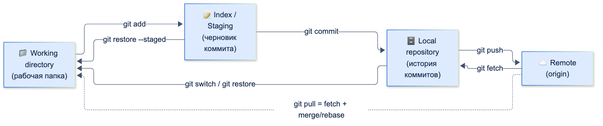
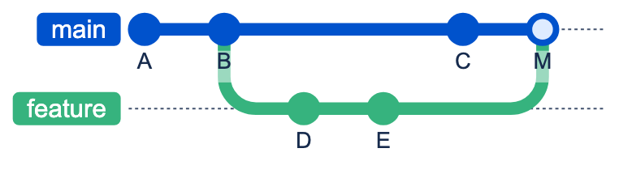
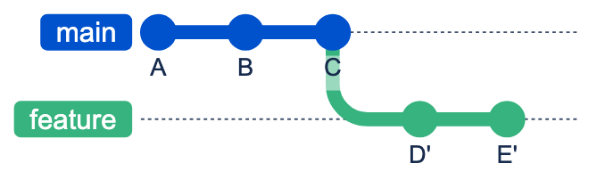

# GIT

| Грейд | Время на изучение | Статус |
|-------|-------------------|--------|
| ⭐ | ~15 мин лекция + практика | ✅ Готово |

---

## 📚 Ресурсы

| Ресурс | Формат | Язык | Уровень | Зачем читать |
|--------|--------|------|---------|--------------|
| [Pro Git (книга)](https://git-scm.com/book/ru/v2) | Книга | 🇷🇺 | ⭐ → ⭐⭐⭐ | Главный справочник. Обязательный минимум — главы 1–3 (основы и ветвление) |
| [Pro Git: Git изнутри](https://git-scm.com/book/ru/v2/Git-%D0%B8%D0%B7%D0%BD%D1%83%D1%82%D1%80%D0%B8-%D0%A1%D0%B0%D0%BD%D1%82%D0%B5%D1%85%D0%BD%D0%B8%D0%BA%D0%B0-%D0%B8-%D0%A4%D0%B0%D1%80%D1%84%D0%BE%D1%80) | Глава книги | 🇷🇺 | ⭐⭐⭐ | Как устроены объекты, ссылки и хранилище. После неё Git перестаёт быть магией |
| [Learn Git Branching](https://learngitbranching.js.org/?locale=ru_RU) | Интерактивный тренажёр | 🇷🇺 | ⭐ → ⭐⭐ | Наглядно отрабатывает ветки, rebase и cherry-pick в браузере. Лучший способ «набить руку» |
| [Визуальная справка по Git](https://marklodato.github.io/visual-git-guide/index-ru.html) | Шпаргалка со схемами | 🇷🇺 | ⭐ → ⭐⭐ | Схемы того, что каждая команда делает с HEAD, индексом и рабочей папкой |
| [Atlassian: merge и rebase](https://www.atlassian.com/ru/git/tutorials/merging-vs-rebasing) | Статья | 🇷🇺 | ⭐⭐ | Когда применять merge, а когда rebase, и «золотое правило» rebase |
| [Удачная модель ветвления для Git](https://habr.com/ru/articles/106912/) | Статья (Habr) | 🇷🇺 | ⭐⭐ | Первоисточник Git Flow на русском |
| [Conventional Commits](https://www.conventionalcommits.org/ru/v1.0.0/) | Спецификация | 🇷🇺 | ⭐ | Стандарт сообщений коммитов. Читается за 5 минут |
| [Чёрт побери, Git!?!](https://dangitgit.com/ru) | Шпаргалка | 🇷🇺 | ⭐ → ⭐⭐ | Рецепты на случай «всё сломалось»: закоммитил не туда, потерял изменения и т. п. |
| [What not to commit](https://dart.dev/tools/pub/private-files) | Документация | 🇬🇧 | ⭐ | Официальные правила Dart: какие файлы не коммитить |

---

## 🎓 Лекция

### 1. Как Git хранит данные

Git хранит **снимки** (snapshots) всего проекта, а не разницу между версиями файлов. Каждый коммит — это полный снимок
состояния. Неизменившиеся файлы не дублируются: на них просто ставится ссылка.

В репозитории (папка `.git`) хранятся четыре типа объектов:

| Объект | Что хранит |
|--------|-----------|
| **blob** | Содержимое одного файла (без имени) |
| **tree** | Содержимое каталога: имена файлов и ссылки на blob и вложенные tree |
| **commit** | Ссылку на корневой tree, ссылки на родительские коммиты, автора, дату и сообщение |
| **tag** (аннотированный) | Ссылку на коммит, автора тега и сообщение |

Каждый объект адресуется **хешем SHA-1** своего содержимого, например `a1b2c3d…`. Отсюда два важных следствия:

- **Коммит нельзя изменить.** `commit --amend` или `rebase` создают *новые* коммиты с новыми хешами.
  Старые никуда не деваются и ещё какое-то время доступны через `reflog`.
- **История — это граф.** Каждый коммит указывает на родителя (у merge-коммита родителей два).

**Ветка** — это просто файл с хешем одного коммита (`.git/refs/heads/main`). Создать ветку — значит записать 41 байт,
поэтому ветки в Git дешёвые.

**HEAD** — указатель на то, «где ты сейчас». Обычно он указывает на ветку, а ветка — на коммит. Если HEAD указывает
прямо на коммит, это состояние **detached HEAD**. Новые коммиты в нём не принадлежат ни одной ветке, и их легко потерять.

```bash
git cat-file -p HEAD          # посмотреть содержимое текущего коммита
git cat-file -p HEAD^{tree}   # посмотреть корневой tree
cat .git/HEAD                 # ref: refs/heads/main
```

### 2. Три области: рабочая папка, индекс, репозиторий



| Область | Что это | Как попасть |
|---------|---------|-------------|
| **Working directory** | Файлы, которые ты редактируешь | — |
| **Index (staging area)** | Черновик следующего коммита | `git add` |
| **Repository (HEAD)** | Зафиксированная история | `git commit` |

```bash
git status                    # что изменено и что уже в индексе
git diff                      # рабочая папка ↔ индекс
git diff --staged             # индекс ↔ последний коммит
git add -p                    # добавить в индекс по кусочкам (очень полезно!)
git restore <file>            # отменить изменения в рабочей папке
git restore --staged <file>   # убрать файл из индекса, изменения сохранятся
```

> 💡 **Совет:** индекс нужен, чтобы собирать **атомарные коммиты**. Если поправил баг и заодно отрефакторил соседний код,
> раздели это на два коммита с помощью `git add -p`.

### 3. Ветки и слияние: merge и rebase

Есть два способа перенести изменения из одной ветки в другую.

**Merge:**



**Rebase** (D и E пересозданы поверх C как D' и E'):



**Merge** объединяет истории.
- **Fast-forward:** если целевая ветка не ушла вперёд, Git просто передвигает указатель. Новый коммит не создаётся.
- **Трёхстороннее слияние:** если обе ветки ушли вперёд, Git находит общего предка (merge base) и создаёт
  **merge-коммит** с двумя родителями.
- История сохраняется в точности, но может стать «ветвистой».

**Rebase** переписывает историю.
- Берёт твои коммиты и **заново применяет** их поверх другой ветки. Получаются новые коммиты с новыми хешами.
- История остаётся линейной и чистой.

```bash
git switch feature
git rebase main               # переносим коммиты feature поверх свежего main
git switch main
git merge feature             # теперь это fast-forward
git merge --no-ff feature     # принудительно создать merge-коммит
```

> ⚠️ **Золотое правило rebase:** не делай rebase коммитов, которые уже запушены и которыми **пользуются другие**.
> Ты перепишешь историю, а у коллег останется старая. Свою личную feature-ветку ребейзить можно.

**Cherry-pick** копирует один конкретный коммит в текущую ветку. Пригодится, например, чтобы перенести хотфикс в релизную ветку:

```bash
git cherry-pick a1b2c3d
```

### 4. Интерактивный rebase: наводим порядок перед ревью

`git rebase -i` позволяет переписать историю своей ветки: склеить, переименовать, переставить или удалить коммиты.

```bash
git rebase -i main            # или HEAD~5 — последние 5 коммитов
```

| Команда | Действие |
|---------|----------|
| `pick` | Оставить коммит как есть |
| `reword` | Изменить сообщение |
| `squash` | Склеить с предыдущим и объединить сообщения |
| `fixup` | Склеить с предыдущим, выбросив сообщение |
| `drop` | Удалить коммит |

Удобный приём — коммиты-исправления с автоматической склейкой:

```bash
git commit --fixup a1b2c3d    # «исправление к коммиту a1b2c3d»
git rebase -i --autosquash main
```

### 5. Работа с удалённым репозиторием

```bash
git fetch                     # скачать изменения, ничего не трогая локально
git pull                      # fetch + merge
git pull --rebase             # fetch + rebase: история без лишних merge-коммитов
git push -u origin feature    # первый push с привязкой к удалённой ветке
git push --force-with-lease   # безопасный force push после rebase своей ветки
```

- `origin/main` — локальная копия состояния удалённой ветки на момент последнего `fetch`.
- `--force-with-lease` перезаписывает удалённую ветку, только если на ней нет чужих коммитов, которых ты не видел.
  **Никогда** не используй голый `--force`.

### 6. Как отменить изменения

| Ситуация | Команда | Переписывает историю? |
|----------|---------|-----------------------|
| Отменить правки в файле | `git restore <file>` | Нет |
| Исправить последний коммит (ещё не запушен) | `git commit --amend` | Да |
| Отменить коммиты, изменения оставить в индексе | `git reset --soft HEAD~1` | Да |
| Отменить коммиты, изменения оставить в рабочей папке | `git reset HEAD~1` (`--mixed`) | Да |
| Отменить коммиты вместе с изменениями | `git reset --hard HEAD~1` | Да ⚠️ |
| Отменить **запушенный** коммит | `git revert <sha>` (создаёт обратный коммит) | Нет |
| Временно отложить изменения | `git stash` / `git stash pop` | Нет |

**Reflog — страховочная сетка.** Git записывает каждое перемещение HEAD. Если «потерял» коммиты после неудачного
`reset --hard` или rebase, найди их в reflog:

```bash
git reflog                    # HEAD@{3}: commit: Add payment screen
git reset --hard HEAD@{3}     # вернуться в это состояние
```

> ℹ️ **Важно:** reflog локальный и по умолчанию хранит записи около 90 дней. Незакоммиченные изменения
> после `reset --hard` он **не спасёт**.

### 7. Конфликты

Конфликт возникает, когда обе ветки изменили одни и те же строки. Git останавливается и размечает файл:

```text
<<<<<<< HEAD
final timeout = Duration(seconds: 30);
=======
final timeout = Duration(seconds: 60);
>>>>>>> feature/payments
```

Как разрешить: выбери итоговый вариант и удали маркеры, затем `git add <file>`, затем `git merge --continue`
(или `git rebase --continue`). Если хочешь передумать — `git merge --abort` или `git rebase --abort`.

> 💡 **Совет:** включи `git config --global rerere.enabled true`. Тогда Git запомнит, как ты разрешил конфликт,
> и в следующий раз применит это решение сам. Особенно полезно при частых rebase.

### 8. Стратегии ветвления

| Стратегия | Суть | Когда подходит |
|-----------|------|----------------|
| **Git Flow** | Ветки `main`, `develop`, `feature/*`, `release/*`, `hotfix/*` | Релизы по расписанию, несколько поддерживаемых версий. Типично для мобильных приложений со сторами |
| **GitHub Flow** | `main` + короткие feature-ветки через Pull Request | Непрерывная поставка, одна актуальная версия |
| **Trunk-based** | Все вливают в `main` маленькими порциями (часто — несколько раз в день); незавершённое прячут за feature-флагами | Зрелый CI/CD и хорошее покрытие тестами |

### 9. Хорошие коммиты

- **Атомарность:** один коммит — одно логическое изменение. Такой коммит легко ревьюить, откатить через `revert` и перенести через `cherry-pick`.
- **Сообщение отвечает на вопрос «что и зачем»,** а не «как». Как — видно из диффа.
- **Conventional Commits:** `тип(область): описание`. Типы: `feat`, `fix`, `refactor`, `test`, `docs`, `chore`, `perf`, `ci`.

```text
feat(payments): add SBP payment method
fix(auth): handle expired refresh token
refactor(core): extract network layer into separate package
```

### 10. Git во Flutter-проекте

**Не коммитим:**

```gitignore
.dart_tool/
build/
.flutter-plugins
.flutter-plugins-dependencies
*.iml
.idea/
.DS_Store
# нативные артефакты
ios/Pods/
ios/.symlinks/
android/.gradle/
android/local.properties
# секреты — никогда!
*.jks
*.keystore
key.properties
```

**Особые случаи:**

- **`pubspec.lock`**
  - В **приложении** коммитим всегда: так у всех и в CI будут одинаковые версии транзитивных зависимостей.
  - В **пакете-библиотеке** официальная рекомендация — не коммитить.
- **`Podfile.lock`** коммитим по той же причине.
- **Сгенерированный код** (`*.g.dart`, `*.freezed.dart`) — договорённость команды. Коммит ускоряет CI и ревью сборки,
  но раздувает диффы. Главное — единое правило на весь проект.
- **Git-зависимости в `pubspec.yaml`** всегда фиксируй на теге или коммите, а не на ветке. Иначе сборка не воспроизводится:

```yaml
dependencies:
  my_ui_kit:
    git:
      url: https://git.example.com/mobile/ui-kit.git
      ref: v2.3.1        # тег или SHA, а не main
```

### ⚠️ Частые ошибки

- **Rebase или force push общей ветки.** У коллег ломается история. Ребейзь только свои ветки и пушь через `--force-with-lease`.
- **Огромные коммиты «fix» / «wip» / «changes».** Их невозможно ревьюить и откатывать. Перед PR наводи порядок через `rebase -i`.
- **Долгоживущие feature-ветки.** Чем дольше ветка живёт, тем страшнее конфликты. Подтягивай `main` регулярно.
- **Секреты в репозитории.** Удалить ключ из последнего коммита недостаточно: он остаётся в истории. Если секрет попал в репозиторий,
  считай его скомпрометированным и **перевыпусти**.
- **`git add .` не глядя.** В коммит попадают локальные конфиги и мусор. Смотри `git status` и `git diff --staged` перед коммитом.

---

## 🏦 Git в нашей команде

> ✍️ Раздел заполняется вручную: принятая стратегия ветвления, именование веток, правила Pull Request и ревью, CI-проверки.

---

## ✅ Самопроверка

**⭐ Junior**
1. Чем индекс отличается от рабочей папки и от репозитория?
2. Чем `git fetch` отличается от `git pull`?
3. Как отменить коммит, который уже запушен в общую ветку?
4. Нужно ли коммитить `pubspec.lock` в приложении? Почему?

**⭐⭐ Middle**
1. Чем merge отличается от rebase? Что такое fast-forward?
2. Сформулируй «золотое правило rebase».
3. Чем `reset --soft`, `--mixed` и `--hard` отличаются друг от друга?
4. Чем `--force-with-lease` безопаснее `--force`?

**⭐⭐⭐ Senior**
1. Из каких объектов состоит репозиторий Git? Что такое ветка и HEAD на уровне файлов?
2. Ты сделал `reset --hard` и потерял три коммита. Как их вернуть и в каком случае это невозможно?
3. Какую стратегию ветвления ты выберешь для мобильного приложения с релизами в сторах раз в две недели и зачем?
4. В репозиторий закоммитили ключ подписи приложения. Что делать?

<details>
<summary>Ответы</summary>

**Junior**
1. Рабочая папка — текущие файлы на диске. Индекс — черновик следующего коммита, туда попадают изменения после `git add`. Репозиторий — зафиксированная история коммитов.
2. `fetch` только скачивает изменения в `origin/*` и ничего не меняет в твоих ветках. `pull` = `fetch` + `merge` (или `rebase`) в текущую ветку.
3. Через `git revert <sha>`: создаётся новый коммит с обратными изменениями, история не переписывается.
4. Да. Тогда у всех разработчиков и в CI будут одинаковые версии всех зависимостей, включая транзитивные, и сборки будут воспроизводимы.

**Middle**
1. Merge объединяет истории и создаёт merge-коммит с двумя родителями. Rebase переносит коммиты поверх другой ветки и создаёт новые коммиты, история становится линейной. Fast-forward — merge без нового коммита, когда целевая ветка не ушла вперёд и указатель просто передвигается.
2. Не ребейзь коммиты, которые уже опубликованы и которыми пользуются другие.
3. Все три передвигают ветку на указанный коммит. `--soft` оставляет изменения в индексе, `--mixed` — в рабочей папке (вне индекса), `--hard` удаляет их полностью.
4. `--force-with-lease` откажется перезаписывать ветку, если на удалённом сервере появились коммиты, которых нет в твоём `origin/<branch>`. Так ты не затрёшь чужую работу.

**Senior**
1. Объекты blob, tree, commit и tag, все адресуются по SHA. Ветка — файл в `.git/refs/heads/` с хешем коммита. HEAD — файл `.git/HEAD`, обычно с символической ссылкой на ветку.
2. Найти нужное состояние в `git reflog` и сделать `git reset --hard HEAD@{N}`. Это невозможно, если изменения не были закоммичены, если reflog очищен или устарел (`gc`), или если это другой клон репозитория.
3. Типично Git Flow или его упрощённая версия: `main` + `develop` + `release/*` + `hotfix/*`. Релизная ветка позволяет стабилизировать версию на время ревью в сторе, пока разработка идёт дальше, а hotfix — срочно чинить версию в проде. При зрелом CI возможен trunk-based с релизными ветками и feature-флагами.
4. Считать ключ скомпрометированным: перевыпустить его, если возможно (для Android — Play App Signing upload key reset), отозвать доступы, удалить файл из истории (`git filter-repo`) и добавить его в `.gitignore`. Удалить файл из истории недостаточно: копии уже могли разойтись.

</details>
