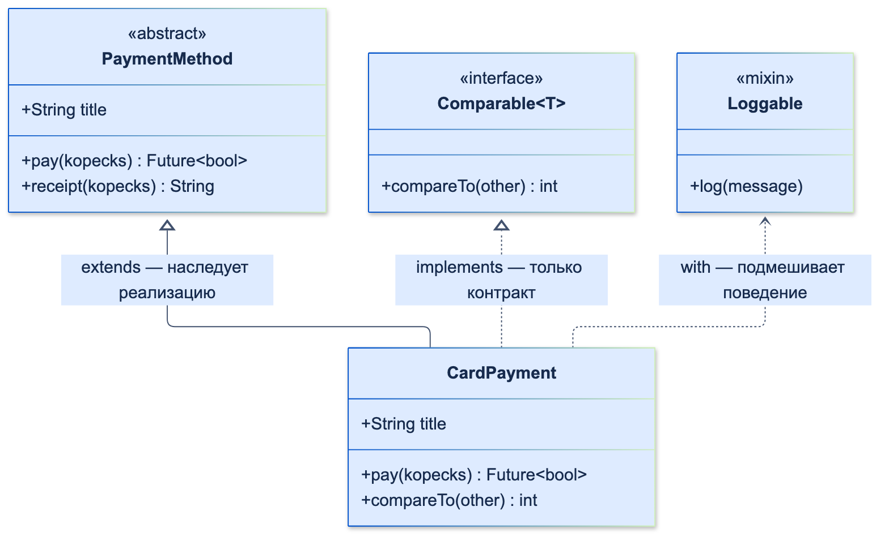
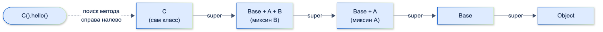

# ООП

| Грейд | Время на изучение | Статус |
|-------|-------------------|--------|
| ⭐ | ~20 мин лекция + практика | ✅ Готово |

---

## 📚 Ресурсы

| Ресурс | Формат | Язык | Уровень | Зачем читать |
|--------|--------|------|---------|--------------|
| [Metanit: Dart, глава «ООП»](https://metanit.com/dart/tutorial/4.1.php) | Учебник | 🇷🇺 | ⭐ | Классы, конструкторы, инкапсуляция, наследование, интерфейсы и миксины. Пошагово, с примерами. Листать по ссылкам «Вперёд» внизу страницы |
| [Использование примесей (mixins) в Dart](https://habr.com/ru/articles/484206/) | Статья (Habr) | 🇷🇺 | ⭐⭐ | Не «как», а **зачем** нужны миксины и когда они лучше наследования и интерфейсов |
| [Модификаторы классов в Dart 3.0](https://habr.com/ru/articles/765736/) | Статья (Habr) | 🇷🇺 | ⭐⭐ | `base`, `interface`, `final`, `sealed`, `mixin class` на примерах |
| [Dart 3 на практике](https://habr.com/ru/companies/surfstudio/articles/733532/) | Статья (Habr, Surf) | 🇷🇺 | ⭐⭐ | Sealed-классы, паттерны и records глазами Flutter-команды |
| [Dart: Classes](https://dart.dev/language/classes) | Документация | 🇬🇧 | ⭐ → ⭐⭐ | Официальный справочник: конструкторы, методы, наследование, интерфейсы |
| [Dart: Mixins](https://dart.dev/language/mixins) | Документация | 🇬🇧 | ⭐⭐ | Точные правила: `on`, `mixin class`, ограничения |
| [Dart: Class modifiers](https://dart.dev/language/class-modifiers) | Документация | 🇬🇧 | ⭐⭐ | Полная таблица модификаторов и их сочетаний |
| [Class modifiers for API maintainers](https://dart.dev/language/class-modifiers-for-apis) | Документация | 🇬🇧 | ⭐⭐⭐ | Как модификаторы помогают проектировать API пакетов и не ломать пользователей |

---

## 🎓 Лекция

ООП держится на четырёх принципах: **инкапсуляция**, **наследование**, **полиморфизм** и **абстракция**.
Dart — чисто объектный язык: *всё* является объектом, даже `int`, `null` и функции. Поэтому ООП в нём — фундамент,
а не опция. Все примеры ниже — из «банковского» домена.

### 1. Классы и объекты

**Класс** — это описание: какие у объекта данные (поля) и поведение (методы). **Объект** — конкретный экземпляр класса.

#### Конструкторы

В Dart несколько видов конструкторов, и на собеседованиях о них спрашивают постоянно.

```dart
class Account {
  // Генеративный конструктор: this.поле сразу присваивает значение
  Account(this.id, this.owner, {this.balance = 0});

  // Именованный конструктор, перенаправляет на основной
  Account.anonymous(String id) : this(id, 'Неизвестный клиент');

  final String id;
  final String owner;
  int balance; // в копейках: деньги никогда не храним в double
}
```

**Список инициализации** (после `:`) выполняется **до** тела конструктора. В нём удобно проверять аргументы и вычислять `final`-поля:

```dart
class Money {
  const Money(this.kopecks, this.currency) : assert(kopecks >= 0);

  final int kopecks;
  final String currency;
}
```

**`const`-конструктор** создаёт объект на этапе компиляции. Одинаковые `const`-объекты — это **один и тот же экземпляр** в памяти.
Во Flutter это важно: `const`-виджеты не пересоздаются при перестроении.

```dart
void main() {
  print(identical(const Money(100, 'RUB'), const Money(100, 'RUB'))); // true
}
```

**`factory`-конструктор** не обязан создавать новый объект. Он может вернуть объект из кеша или экземпляр подкласса.
Типичные применения: `fromJson`, кеширование, выбор реализации.

```dart
class Currency {
  factory Currency(String code) =>
      _cache.putIfAbsent(code, () => Currency._(code));

  Currency._(this.code); // приватный конструктор

  final String code;
  static final _cache = <String, Currency>{};
}
```

#### Равенство объектов

По умолчанию `==` сравнивает **ссылки** (тот же ли это объект). Чтобы объекты сравнивались по значению,
переопредели `==` **и обязательно** `hashCode`. Иначе сломаются `Set` и `Map`.

```dart
class Iban {
  const Iban(this.value);

  final String value;

  @override
  bool operator ==(Object other) =>
      identical(this, other) || other is Iban && other.value == value;

  @override
  int get hashCode => value.hashCode;
}
```

> 💡 **Совет:** в проектах этот код обычно не пишут руками, а генерируют (`freezed`) или берут готовым (`equatable`).
> Но понимать, что происходит под капотом, обязательно.

### 2. Инкапсуляция

**Инкапсуляция** — объект сам управляет своим состоянием и не даёт внешнему коду привести его в некорректный вид.
Наружу открыт только **публичный контракт**, внутренности скрыты.

В Dart нет `private`/`protected`/`public`. Есть только **приватность на уровне библиотеки**: имя, которое начинается
с `_`, не видно за пределами библиотеки. Обычно библиотека — это один файл, но `part` / `part of` объединяют
несколько файлов в одну библиотеку, и они видят приватные имена друг друга (так устроен сгенерированный код freezed).

```dart
class BankAccount {
  BankAccount(this.id);

  final String id;
  int _balance = 0;
  final _history = <int>[];

  int get balance => _balance;                      // читать можно, менять напрямую нельзя
  List<int> get history => List.unmodifiable(_history); // наружу — копия только для чтения

  void deposit(int kopecks) {
    if (kopecks <= 0) {
      throw ArgumentError.value(kopecks, 'kopecks', 'Сумма должна быть положительной');
    }
    _balance += kopecks;
    _history.add(kopecks);
  }
}
```

> ⚠️ **Внимание:** `_` — это приватность **библиотеки, а не класса**. Два класса в одной библиотеке (обычно — в одном файле)
> видят приватные поля друг друга. Если нужна изоляция, разнеси классы по разным файлам — и не связывай их через `part`.

Чего нет в языке, иногда добирают аннотациями из `package:meta`. Это только подсказки анализатору, а не ограничения языка:
- `@protected` — поле или метод предназначены для использования только в подклассах;
- `@visibleForTesting` — публичен только ради тестов.

### 3. Наследование

**Наследование** (`extends`) — подкласс получает поля и методы родителя и может их **переопределить** (`@override`).
В Dart наследование **одиночное**: у класса ровно один родитель. Если родитель не указан, им будет `Object`.

```dart
class BankCard {
  BankCard({required this.number});

  final String number;

  String get maskedNumber => '**** ${number.substring(number.length - 4)}';

  String describe() => 'Карта $maskedNumber';
}

class CreditCard extends BankCard {
  // super-параметры: передаём number прямо в конструктор родителя
  CreditCard({required super.number, required this.limit});

  final int limit;

  @override
  String describe() => '${super.describe()}, кредитный лимит $limit ₽';
}
```

Что важно помнить:
- **Конструкторы не наследуются.** Подкласс объявляет свои и вызывает конструктор родителя (`super(...)` или `super.param`).
- `super.method()` вызывает реализацию родителя.
- `@override` формально необязателен, но всегда его ставь: анализатор поймает опечатку в имени метода.

**Композиция вместо наследования.** Наследование — самая сильная связь между классами. Изменение родителя может
неожиданно сломать всех потомков: это проблема **хрупкого базового класса**. Правило выбора:
- отношение **«является»** (*is-a*): кредитная карта **является** картой → наследование допустимо;
- отношение **«имеет»** или **«использует»** (*has-a*): экран **использует** репозиторий → композиция. Объект передаётся
  через конструктор и хранится в поле.

> ℹ️ **Важно:** во Flutter композиция — основной способ строить UI. Виджеты почти никогда не наследуют друг от друга,
> а **вкладывают** друг друга. Своё поведение добавляют через `StatelessWidget`/`StatefulWidget` и композицию.

### 4. Абстракция

**Абстракция** — выделить существенное и спрятать детали. Код работает с тем, **что** объект умеет, а не с тем, **как** он это делает.

**Абстрактный класс** нельзя создать напрямую. Он может содержать абстрактные методы (без тела) и обычные методы с реализацией:

```dart
abstract class PaymentMethod {
  String get title;

  Future<bool> pay(int kopecks); // абстрактный метод: реализуют наследники

  String receipt(int kopecks) => '$title: списано $kopecks коп.'; // общая реализация
}
```

**Неявные интерфейсы.** В Dart нет отдельного ключевого слова `interface` для объявления интерфейса (как в Java).
**Каждый класс** автоматически задаёт интерфейс из всех своих публичных полей и методов. Через `implements` можно реализовать
интерфейс любого класса, но тогда **все** поля и методы нужно реализовать самому: реализация не наследуется.

```dart
abstract interface class AccountRepository {
  Future<List<Account>> fetchAccounts();
}

class RemoteAccountRepository implements AccountRepository {
  @override
  Future<List<Account>> fetchAccounts() async => [Account('40817…', 'Иванов И.И.')];
}

class FakeAccountRepository implements AccountRepository {
  @override
  Future<List<Account>> fetchAccounts() async => [];
}
```

Так устроены слои в архитектуре приложения: экран зависит от абстракции `AccountRepository`, а в проде и в тестах
подставляются разные реализации.

#### `extends`, `implements`, `with`: что выбрать



| | `extends` | `implements` | `with` |
|---|-----------|--------------|--------|
| Что получаем | Реализацию + интерфейс | Только интерфейс (контракт) | Реализацию из миксина |
| Сколько можно | Один класс | Сколько угодно | Сколько угодно |
| Обязаны реализовать | Только абстрактные методы | **Все** поля и методы | Только абстрактные методы миксина |
| Смысл | «является» | «умеет / соответствует контракту» | «обладает поведением» |

### 5. Полиморфизм

**Полиморфизм** — один и тот же код работает с объектами разных типов через общий интерфейс. Конкретная реализация
метода выбирается **во время выполнения** по реальному типу объекта.

```dart
class CardPayment extends PaymentMethod {
  @override
  String get title => 'Банковская карта';

  @override
  Future<bool> pay(int kopecks) async => true; // запрос в процессинг
}

class SbpPayment extends PaymentMethod {
  @override
  String get title => 'СБП';

  @override
  Future<bool> pay(int kopecks) async => true; // запрос в НСПК
}

Future<void> checkout(PaymentMethod method, int kopecks) async {
  // checkout не знает и не должен знать, какой именно это способ оплаты
  if (await method.pay(kopecks)) print(method.receipt(kopecks));
}
```

Добавить новый способ оплаты = написать новый класс. Функция `checkout` при этом **не меняется**.
Это и есть главная ценность полиморфизма.

Особенности Dart:
- **Нет перегрузки методов.** Два метода с одним именем и разными параметрами объявить нельзя. Вместо этого
  используют именованные и необязательные параметры или разные имена (`Account.anonymous`).
- **Есть перегрузка операторов:** `==`, `+`, `[]`, `<` и другие.
- **Параметрический полиморфизм** — это generics (`List<T>`). Подробно — в теме «Расширенные возможности типизации».

#### Полиморфизм через sealed-классы и `switch`

С Dart 3 есть второй подход. Вместо того чтобы класть поведение в виртуальный метод, описывают **закрытый** набор подтипов
через `sealed` и обрабатывают их через `switch`. Компилятор проверяет, что разобраны **все** варианты.

```dart
sealed class PaymentResult {}

final class PaymentSuccess extends PaymentResult {
  PaymentSuccess(this.transactionId);
  final String transactionId;
}

final class PaymentFailure extends PaymentResult {
  PaymentFailure(this.reason);
  final String reason;
}

String message(PaymentResult result) => switch (result) {
      PaymentSuccess(:final transactionId) => 'Оплачено, операция №$transactionId',
      PaymentFailure(:final reason) => 'Ошибка оплаты: $reason',
    }; // забыли вариант — ошибка компиляции
```

| Подход | Легко добавить | Тяжело добавить | Где во Flutter |
|--------|----------------|-----------------|----------------|
| Виртуальные методы (`abstract` + `extends`) | Новый **тип** | Новую **операцию**: правим все классы | Способы оплаты, стратегии, репозитории |
| `sealed` + `switch` | Новую **операцию**: ещё один `switch` | Новый **тип**: правим все `switch` | Состояния BLoC, результаты запросов, события |

### 6. Миксины

**Миксин** — набор полей и методов, который можно «подмешать» в класс через `with`. Это способ **переиспользовать поведение**
в классах из разных иерархий, без множественного наследования.

```dart
mixin Loggable {
  void log(String message) => print('[$runtimeType] $message');
}

class TransferService with Loggable {
  void transfer(int kopecks) => log('Перевод на $kopecks коп.');
}
```

Правила:
- Миксин объявляют через `mixin`. У него **не может быть конструкторов**, но могут быть поля, методы и абстрактные методы.
- **`on`** ограничивает, к каким классам миксин можно применять. Внутри миксина тогда доступны поля и методы этого типа и `super`.
- **`mixin class`** (Dart 3) — объявление, которое можно использовать и как класс, и как миксин. Обычный `class`
  с Dart 3 подмешать **нельзя**.

Самый частый пример во Flutter — миксины `on State<T>`. Например, свой миксин, который сам отменяет подписки:

```dart
mixin AutoCancelSubscriptions<T extends StatefulWidget> on State<T> {
  final _subscriptions = <StreamSubscription<Object?>>[];

  void autoCancel(StreamSubscription<Object?> subscription) =>
      _subscriptions.add(subscription);

  @override
  void dispose() {
    for (final subscription in _subscriptions) {
      subscription.cancel();
    }
    super.dispose(); // обязательно: передаём вызов дальше по цепочке
  }
}

class _BalanceScreenState extends State<BalanceScreen> with AutoCancelSubscriptions {
  // ...
}
```

Встроенные миксины Flutter, которые встречаются постоянно: `SingleTickerProviderStateMixin`, `TickerProviderStateMixin`
(для анимаций), `AutomaticKeepAliveClientMixin`, `WidgetsBindingObserver`.

#### Линеаризация: порядок миксинов важен

`class C extends Base with A, B` — это не «C с тремя родителями». Dart строит **цепочку** классов:
`Base` → `Base+A` → `Base+A+B` → `C`. Метод ищется **справа налево**: сначала в `C`, потом в `B`, потом в `A`,
потом в `Base`. Вызов `super` в миксине ведёт к предыдущему звену цепочки.

```dart
class Base {
  String hello() => 'Base';
}

mixin A on Base {
  @override
  String hello() => 'A → ${super.hello()}';
}

mixin B on Base {
  @override
  String hello() => 'B → ${super.hello()}';
}

class C extends Base with A, B {}

void main() => print(C().hello()); // B → A → Base
```



Отсюда правило: если два миксина переопределяют один метод, **побеждает последний** в списке `with`.
А если кто-то в цепочке забыл вызвать `super`, все звенья перед ним молча не выполнятся. Классический баг с `dispose()`.

### 7. Модификаторы классов (Dart 3)

Модификаторы ограничивают, что можно делать с классом **за пределами его библиотеки** (обычно это один файл). Внутри библиотеки можно всё.

| Объявление | Создать объект | `extends` | `implements` | `with` |
|------------|:--------------:|:---------:|:------------:|:------:|
| `class` | ✅ | ✅ | ✅ | ❌ |
| `abstract class` | ❌ | ✅ | ✅ | ❌ |
| `base class` | ✅ | ✅ | ❌ | ❌ |
| `interface class` | ✅ | ❌ | ✅ | ❌ |
| `final class` | ✅ | ❌ | ❌ | ❌ |
| `sealed class` | ❌ | ❌ | ❌ | ❌ |
| `abstract interface class` | ❌ | ❌ | ✅ | ❌ |
| `mixin class` | ✅ | ✅ | ✅ | ✅ |
| `mixin` | ❌ | ❌ | ✅ | ✅ |

- `sealed` — закрытый набор подтипов (все в одном файле) и проверка полноты `switch`.
- `abstract interface class` — «чистый» интерфейс, как в Java и Kotlin. Хороший выбор для контрактов репозиториев и сервисов.
- `final` и `base` защищают от того, что кто-то снаружи унаследует или подменит класс. Это полезно при разработке пакетов и SDK.

### ⚠️ Частые ошибки

- **Считать `_` приватностью класса.** Это приватность библиотеки (обычно — файла).
- **Переопределить `==` без `hashCode`.** Объекты «равны», но в `Set` и `Map` ведут себя как разные.
- **Отдавать наружу изменяемую внутреннюю коллекцию** (`List<int> get history => _history`). Любой внешний код может её поменять в обход проверок.
- **Глубокие иерархии ради переиспользования кода.** Через 3–4 уровня никто не понимает, откуда пришло поведение. Предпочитай композицию.
- **Путать `implements` и `extends`.** Ждать, что с `implements` унаследуется реализация.
- **Забыть `super.dispose()` / `super.initState()` в миксине или `State`.** Ломается вся цепочка: утечки и необработанные ресурсы.
- **Хранить деньги в `double`.** Ошибки округления (`0.1 + 0.2 != 0.3`). Используй целые копейки или `Decimal`.

---

## ✅ Самопроверка

**⭐ Junior**
1. Назови четыре принципа ООП и объясни каждый одним предложением.
2. Чем `extends` отличается от `implements`?
3. Что значит `_` в начале имени поля?
4. Зачем нужен `factory`-конструктор? Приведи пример.

**⭐⭐ Middle**
1. Почему при переопределении `==` нужно переопределять и `hashCode`?
2. Что такое миксин, чем он отличается от абстрактного класса и зачем нужен `on`?
3. Есть ли в Dart перегрузка методов? Как без неё обходятся?
4. Что значит «композиция вместо наследования»? Приведи пример из Flutter.

**⭐⭐⭐ Senior**
1. `class C extends Base with A, B`. Какая реализация `hello()` вызовется и в каком порядке отработают `super`-вызовы?
2. Сравни полиморфизм через виртуальные методы и через `sealed` + `switch`. Когда что выбрать?
3. Когда использовать `final class`, `base class` и `interface class` при разработке пакета?
4. Почему `const`-конструкторы важны для производительности Flutter?

<details>
<summary>Ответы</summary>

**Junior**
1. Инкапсуляция — скрываем состояние и даём менять его только через контролируемые методы. Наследование — подкласс получает поведение родителя и может его расширить. Полиморфизм — один код работает с разными типами через общий интерфейс. Абстракция — работаем с тем, что объект умеет, не вдаваясь в детали реализации.
2. `extends` наследует реализацию, родитель может быть только один. `implements` берёт только контракт: все поля и методы нужно реализовать самому, интерфейсов может быть сколько угодно.
3. Поле или метод приватны для библиотеки, в которой объявлен (обычно библиотека — это один файл).
4. Он может вернуть существующий объект (кеш, синглтон) или экземпляр подкласса, а также разобрать данные перед созданием объекта. Пример — `fromJson`.

**Middle**
1. `Set`/`Map` сначала ищут объект по `hashCode`, а потом сравнивают через `==`. У равных объектов хеши обязаны совпадать, иначе равный объект не найдётся.
2. Миксин — переиспользуемый набор полей и методов, который подмешивается через `with` в классы из разных иерархий. У него нет конструкторов, и его можно подмешать несколько раз в разные классы. Абстрактный класс — родитель, и он может быть только один. `on` ограничивает, к каким типам применим миксин, и даёт доступ к их полям, методам и `super`.
3. Нет. Используют именованные и необязательные параметры, именованные конструкторы и разные имена методов.
4. Вместо того чтобы наследовать класс ради его поведения, хранить объект этого класса в поле и делегировать ему работу. Во Flutter UI строится вложением виджетов, а не наследованием: `Padding(child: Text(...))`.

**Senior**
1. Вызовется реализация из `B`. Цепочка: `C` → `B` → `A` → `Base`, результат `B → A → Base`. Побеждает последний миксин в `with`.
2. Виртуальные методы удобны, когда часто добавляются новые типы с одинаковым набором операций: стратегии, способы оплаты. `sealed` + `switch` удобен, когда набор типов закрыт, а операции над ними добавляются часто: состояния, события, результаты. Компилятор проверяет полноту разбора.
3. `final` — когда класс нельзя ни наследовать, ни реализовывать снаружи: можно свободно менять его без ломающих изменений. `base` — когда наследовать можно, а подменять реализацию через `implements` нельзя: гарантируются инварианты и приватные поля и методы. `interface` — когда пользователь должен реализовать контракт, но не наследовать реализацию.
4. `const`-объект создаётся один раз на этапе компиляции, одинаковые экземпляры каноничны. Flutter видит тот же экземпляр виджета и пропускает перестроение его поддерева. Меньше аллокаций и работы при `build`.

</details>
