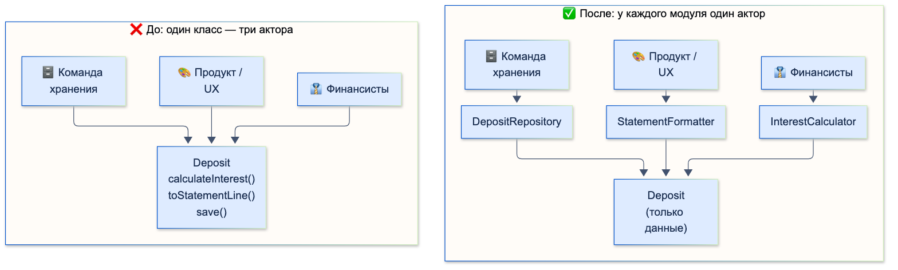
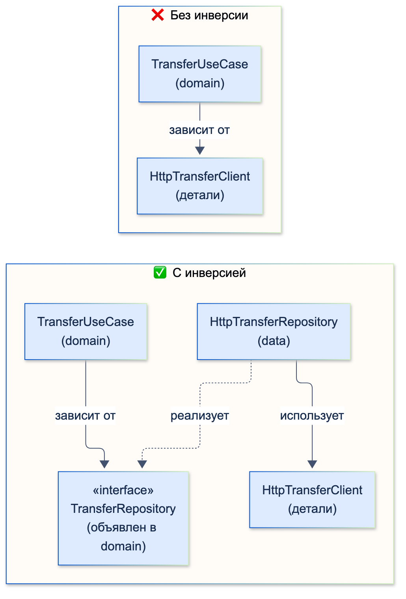

# SOLID / DRY / KISS / YAGNI

| Грейд | Время на изучение | Статус |
|-------|-------------------|--------|
| ⭐⭐ | ~25 мин лекция + практика | ✅ Готово |

---

## 📚 Ресурсы

| Ресурс | Формат | Язык | Уровень | Зачем читать |
|--------|--------|------|---------|--------------|
| Роберт Мартин, «Чистая архитектура» (Питер, 2018), главы 7–11 | Книга | 🇷🇺 | ⭐⭐ → ⭐⭐⭐ | Первоисточник. SOLID в формулировках автора, с историей и мотивацией каждого принципа |
| [Принципы SOLID, о которых должен знать каждый разработчик](https://habr.com/ru/companies/ruvds/articles/426413/) | Статья (Habr) | 🇷🇺 | ⭐ | Быстрое знакомство: все пять принципов на простых примерах |
| [Многоликий принцип единственности ответственности](https://habr.com/ru/articles/565158/) | Статья (Habr) | 🇷🇺 | ⭐⭐⭐ | Разбор того, как менялись формулировки SRP у Мартина и почему их понимают по-разному |
| [Неправильная абстракция](https://ru.hexlet.io/blog/posts/wrong-abstraction) | Статья (перевод Сэнди Метц) | 🇷🇺 | ⭐⭐ | Главный текст о том, как фанатичный DRY порождает абстракции хуже дублирования |
| [DRY и цена неправильных абстракций](https://habr.com/ru/articles/311014/) | Статья (Habr) | 🇷🇺 | ⭐⭐ | Та же мысль на других примерах: когда дублирование лучше общего кода |
| [The Single Responsibility Principle](https://blog.cleancoder.com/uncle-bob/2014/05/08/SingleReponsibilityPrinciple.html) | Статья (блог Мартина) | 🇬🇧 | ⭐⭐ | Мартин сам объясняет, что SRP — про людей и причины изменений, а не про «класс делает одно дело» |
| [Yagni](https://martinfowler.com/bliki/Yagni.html) | Статья (Мартин Фаулер) | 🇬🇧 | ⭐⭐ | Лучшее объяснение YAGNI: цена преждевременной функциональности и где YAGNI **не** работает |

---

## 🎓 Лекция

Все принципы ниже — **эвристики, а не законы**. Они помогают писать код, который дёшево менять. Но каждый из них,
доведённый до абсурда, даёт обратный эффект. Поэтому у каждого принципа ниже есть блок
«🚫 Чрезмерное применение».

---

### SOLID

Роберт Мартин (Uncle Bob) собрал эти принципы в конце 1990-х — начале 2000-х. Аббревиатуру SOLID придумал Майкл Физерс.
В книге «Чистая архитектура» Мартин формулирует цель так: принципы SOLID нужны, чтобы создавать программные структуры,
которые **терпимы к изменениям**, **просты для понимания** и **годятся для повторного использования**.

> ℹ️ **Важно:** у Мартина SOLID — принципы уровня **модулей** (классов и групп функций с данными), а не отдельных функций.
> Принципы уровня компонентов и архитектуры — отдельная история. Их разберём в разделе «Архитектура».

---

### S — Single Responsibility Principle (принцип единственной ответственности)

**Формулировка Мартина («Чистая архитектура»):**
*Модуль должен отвечать перед одним и только одним актором.*

**Актор** — группа людей (пользователей или заинтересованных лиц), которые хотят от системы изменений одного рода.
Ранняя формулировка того же принципа: *у модуля должна быть только одна причина для изменения*. Причина изменения —
это и есть актор.

> ⚠️ **Внимание:** самое частое заблуждение — «SRP значит, что класс должен делать что-то одно». Мартин прямо пишет,
> что это **другой** принцип: он относится к функциям («функция должна делать одно дело»). SRP — про то,
> **чьи** требования меняют модуль.

**Пример нарушения.** Класс вклада обслуживает трёх разных акторов:

```dart
class Deposit {
  Deposit(this.kopecks, this.rate);

  final int kopecks;
  final double rate; // годовая ставка: 0.16 = 16 %

  // Актор 1 — финансисты и риск-менеджмент: правила начисления процентов
  int calculateInterest(int days) => (kopecks * rate * days / 365).round();

  // Актор 2 — продуктовая команда: как вклад выглядит в выписке
  String toStatementLine() => 'Вклад: ${kopecks ~/ 100} ₽ под ${(rate * 100).round()} %';

  // Актор 3 — команда хранения данных: схема и способ сохранения
  Future<void> save(Map<String, Object> storage) async =>
      storage['deposit'] = {'kopecks': kopecks, 'rate': rate};
}
```

Чем это плохо, по Мартину:
- **Случайное дублирование.** Финансисты просят поменять округление в `calculateInterest`. Разработчик правит общий
  приватный метод, на который, как оказалось, опирается и форматирование выписки. Выписка ломается у людей,
  которые ничего не просили менять.
- **Слияния (merge).** Две команды по разным причинам правят один файл, и получаются конфликты.

**Как исправить:** разделить код по акторам. Данные остаются отдельно, каждое поведение — в своём классе.

```dart
class Deposit {
  const Deposit(this.kopecks, this.rate);

  final int kopecks;
  final double rate;
}

class InterestCalculator {
  int calculate(Deposit deposit, int days) =>
      (deposit.kopecks * deposit.rate * days / 365).round();
}

class StatementFormatter {
  String format(Deposit deposit) =>
      'Вклад: ${deposit.kopecks ~/ 100} ₽ под ${(deposit.rate * 100).round()} %';
}

class DepositRepository {
  DepositRepository(this._storage);

  final Map<String, Object> _storage;

  Future<void> save(Deposit deposit) async =>
      _storage['deposit'] = {'kopecks': deposit.kopecks, 'rate': deposit.rate};
}
```



Во Flutter-проекте SRP чаще всего нарушают так: виджет экрана сам ходит в сеть, парсит JSON, хранит состояние и рисует UI.
У дизайнера, бэкенда и бизнес-аналитика — три разные причины его менять.

#### 🚫 Чрезмерное применение SRP

- **«Один метод — один класс».** `AmountValidator`, `AmountParser`, `AmountTrimmer`, `AmountNormalizer`…
  Логика, которую всегда меняют вместе и по одной причине, размазана по десятку файлов. Это называют
  **«равиоли-кодом»**: много маленьких кусочков, а целого не видно.
- **Взрыв числа классов и зависимостей.** В конструктор экрана передают 8 сервисов, каждый из которых делает одну строчку работы.
- **Разделение не по акторам, а «по ощущениям».** Если две части кода всегда меняются вместе, им место в одном модуле.

---

### O — Open-Closed Principle (принцип открытости/закрытости)

**Формулировка (Бертран Мейер, 1988; у Мартина — как один из SOLID):**
*Программные сущности должны быть открыты для расширения и закрыты для изменения.*

Поведение системы должно расширяться **добавлением нового кода**, а не правкой старого, уже работающего.
Мартин в «Чистой архитектуре» добавляет главное: цель OCP — **защитить высокоуровневые правила от изменений в деталях**.
Это достигается правильным направлением зависимостей.

**Пример нарушения.** Каждый новый способ оплаты — правка этой функции и всех похожих `switch` по проекту:

```dart
int commission(String method, int kopecks) {
  switch (method) {
    case 'card':
      return (kopecks * 0.01).round();
    case 'sbp':
      return 0;
    default:
      throw ArgumentError.value(method, 'method', 'Неизвестный способ оплаты');
  }
}
```

**Как исправить:** вынести изменяемую часть за абстракцию. Новый способ оплаты — это новый класс, а старый код не трогаем.

```dart
abstract interface class CommissionPolicy {
  int commissionFor(int kopecks);
}

class CardCommission implements CommissionPolicy {
  @override
  int commissionFor(int kopecks) => (kopecks * 0.01).round();
}

class SbpCommission implements CommissionPolicy {
  @override
  int commissionFor(int kopecks) => 0;
}

class Checkout {
  Checkout(this._policy);

  final CommissionPolicy _policy;

  int total(int kopecks) => kopecks + _policy.commissionFor(kopecks);
}
```

> 💡 **Совет:** OCP не означает «никогда не используй `switch`». Если набор вариантов **закрыт** и принадлежит тебе
> (состояния экрана, результаты операции), `sealed`-класс + `switch` — нормальное решение: компилятор сам покажет все места,
> которые нужно поправить. OCP важен там, где варианты **добавляются регулярно** или добавляются **другими командами**.

#### 🚫 Чрезмерное применение OCP

- **Точки расширения «на будущее».** Плагинная архитектура, реестр стратегий и фабрика ради двух вариантов, которые
  не менялись год. Это прямое нарушение YAGNI.
- **Интерфейс на каждый класс.** Абстракция имеет смысл там, где реально бывает несколько реализаций или
  где нужно защитить стабильный код от нестабильного.
- **Ожидание, что код можно закрыть от всех изменений.** Мартин отдельно подчёркивает: защититься от всего невозможно.
  Выбирай, от **каких** изменений защищаться, исходя из реальной истории изменений.

---

### L — Liskov Substitution Principle (принцип подстановки Барбары Лисков)

**Формулировка (Барбара Лисков, 1988):**
*Если для каждого объекта o1 типа S существует такой объект o2 типа T, что для всех программ P, определённых в терминах T,
поведение P не изменяется при подстановке o1 вместо o2, то S является подтипом T.*

Проще: **объект подтипа должен работать везде, где ожидается базовый тип, и не ломать ожидания клиента.**
Наследование — это не «похожие данные», а **совместимое поведение**.

Правила контракта для подтипа:
- **Предусловия нельзя усиливать.** Нельзя требовать от вызывающего больше, чем требует базовый тип.
- **Постусловия нельзя ослаблять.** Нельзя гарантировать меньше, чем гарантирует базовый тип.
- **Инварианты базового типа сохраняются.**
- **Нельзя бросать новые исключения,** которых клиент базового типа не ожидает.

**Пример нарушения.** Срочный вклад — «тоже счёт», но снимать с него нельзя:

```dart
abstract class Account {
  int get balance;
  void withdraw(int kopecks);
}

class CurrentAccount extends Account {
  CurrentAccount(this._balance);

  int _balance;

  @override
  int get balance => _balance;

  @override
  void withdraw(int kopecks) => _balance -= kopecks;
}

class TermDeposit extends Account {
  TermDeposit(this.balance);

  @override
  final int balance;

  @override
  void withdraw(int kopecks) =>
      throw UnsupportedError('Снятие со срочного вклада запрещено'); // ❌ сюрприз для клиента
}

void payFrom(Account account, int kopecks) => account.withdraw(kopecks); // упадёт на TermDeposit
```

Типичный симптом нарушения LSP — проверки типа в клиентском коде: `if (account is TermDeposit) ...`.

**Как исправить:** не обещать в базовом типе то, что выполняют не все подтипы. Разделить возможности:

```dart
abstract interface class BalanceHolder {
  int get balance;
}

abstract interface class Withdrawable implements BalanceHolder {
  void withdraw(int kopecks);
}

class CurrentAccount implements Withdrawable {
  CurrentAccount(this._balance);

  int _balance;

  @override
  int get balance => _balance;

  @override
  void withdraw(int kopecks) => _balance -= kopecks;
}

class TermDeposit implements BalanceHolder {
  TermDeposit(this.balance);

  @override
  final int balance;
}

void payFrom(Withdrawable account, int kopecks) => account.withdraw(kopecks); // TermDeposit сюда не передать
```

> ℹ️ **Важно:** даже в стандартной библиотеке Dart есть осознанный компромисс с LSP. `List.unmodifiable(...)` реализует `List`,
> но `add()` у него бросает `UnsupportedError`. Поэтому не возвращай «неизменяемый `List`» туда, где клиент ожидает
> изменяемый. Лучше отдавать `Iterable` или явно документировать контракт.

Мартин в «Чистой архитектуре» расширяет LSP до уровня архитектуры. Всё, что выдаётся за одну и ту же «реализацию интерфейса»
(например, несколько бэкендов с одинаковым REST-контрактом), должно быть взаимозаменяемо. Иначе в коде появляются
`if (provider == 'X')`.

#### 🚫 Чрезмерное применение LSP

- **Полный отказ от наследования «из страха нарушить LSP».** Наследование, которое честно соблюдает контракт, — нормальный инструмент.
- **Дробление возможностей до абсурда.** `Readable`, `Withdrawable`, `Depositable`, `Closable`, `Freezable`, `Renamable`…
  Комбинаций становится больше, чем реальных типов счетов.
- **Формальные проверки там, где нет полиморфизма.** Если подтип нигде не подставляется вместо базового типа,
  обсуждать LSP бессмысленно.

---

### I — Interface Segregation Principle (принцип разделения интерфейсов)

**Формулировка Мартина:**
*Клиенты не должны зависеть от методов, которые они не используют.*

Если модуль зависит от «толстого» интерфейса, любое изменение в ненужных ему методах всё равно задевает его.
В Dart это проявляется так: приходится реализовывать лишние методы в тестовых фейках, пересобирать лишнее и разбираться
в чужом API.

**Пример нарушения:**

```dart
abstract interface class BankApi {
  Future<int> balance(String accountId);
  Future<void> transfer(String from, String to, int kopecks);
  Future<List<String>> statement(String accountId);
  Future<void> blockCard(String cardId);
  Future<void> changePin(String cardId, String newPin);
}

// Экрану баланса нужен один метод, а фейк для теста обязан реализовать все пять
```

**Как исправить:** разделить интерфейс по потребностям клиентов. Одна реализация может поддерживать их все.

```dart
abstract interface class AccountsApi {
  Future<int> balance(String accountId);
  Future<List<String>> statement(String accountId);
}

abstract interface class TransfersApi {
  Future<void> transfer(String from, String to, int kopecks);
}

abstract interface class CardsApi {
  Future<void> blockCard(String cardId);
  Future<void> changePin(String cardId, String newPin);
}

class HttpBankApi implements AccountsApi, TransfersApi, CardsApi {
  @override
  Future<int> balance(String accountId) async => 0; // запрос к бэкенду

  @override
  Future<List<String>> statement(String accountId) async => [];

  @override
  Future<void> transfer(String from, String to, int kopecks) async {}

  @override
  Future<void> blockCard(String cardId) async {}

  @override
  Future<void> changePin(String cardId, String newPin) async {}
}

class BalanceViewModel {
  BalanceViewModel(this._api); // зависит только от того, что использует

  final AccountsApi _api;

  Future<int> load(String accountId) => _api.balance(accountId);
}
```

#### 🚫 Чрезмерное применение ISP

- **Интерфейс на каждый метод.** `BalanceGetter`, `StatementGetter`, `PinChanger`… Клиент, которому нужно три связанные операции,
  получает три зависимости вместо одной.
- **Разделение без клиентов.** Интерфейсы режут «на всякий случай», хотя все клиенты используют их целиком.
  Правильный ориентир — **реальные потребители**, а не количество методов.

---

### D — Dependency Inversion Principle (принцип инверсии зависимостей)

**Формулировка Мартина:**
1. *Модули верхних уровней не должны зависеть от модулей нижних уровней. И те и другие должны зависеть от абстракций.*
2. *Абстракции не должны зависеть от деталей. Детали должны зависеть от абстракций.*

**Верхний уровень** — бизнес-правила: перевод, лимиты, начисления. **Нижний уровень** — детали: HTTP-клиент, база данных,
SDK, Flutter-плагины. Бизнес-правила не должны знать, через что именно идёт запрос.

**Пример нарушения:**

```dart
class HttpTransferClient {
  Future<void> post(String path, Map<String, Object> body) async {} // детали: HTTP
}

class TransferUseCase {
  final _client = HttpTransferClient(); // ❌ бизнес-логика жёстко привязана к HTTP

  Future<void> call(String from, String to, int kopecks) =>
      _client.post('/transfers', {'from': from, 'to': to, 'amount': kopecks});
}
```

**Как исправить:** бизнес-слой **сам объявляет** нужную ему абстракцию, а слой данных её реализует.
Зависимость в исходном коде теперь направлена **против** потока управления: отсюда слово «инверсия».

```dart
// domain — объявляет, что ему нужно
abstract interface class TransferRepository {
  Future<void> transfer(String from, String to, int kopecks);
}

class TransferUseCase {
  TransferUseCase(this._repository);

  final TransferRepository _repository;

  Future<void> call(String from, String to, int kopecks) {
    if (kopecks <= 0) throw ArgumentError.value(kopecks, 'kopecks');
    return _repository.transfer(from, to, kopecks);
  }
}

// data — реализует абстракцию из domain
class HttpTransferRepository implements TransferRepository {
  HttpTransferRepository(this._client);

  final HttpTransferClient _client;

  @override
  Future<void> transfer(String from, String to, int kopecks) =>
      _client.post('/transfers', {'from': from, 'to': to, 'amount': kopecks});
}

// Точка сборки (composition root) — единственное место, где известны все детали
final transfer = TransferUseCase(HttpTransferRepository(HttpTransferClient()));
```



> ℹ️ **Важно:** **DIP ≠ DI.** Dependency Inversion — принцип о направлении зависимостей. Dependency Injection — техника,
> как передать зависимость снаружи (через конструктор, `get_it`, `provider` и т. д.). DI помогает соблюдать DIP, но
> можно внедрять зависимости и при этом нарушать DIP, например внедряя конкретный `HttpTransferClient`.

Мартин уточняет: зависеть от **стабильных** конкретных вещей нормально. Никто не прячет `String`, `List` или `DateTime`
за интерфейсы. Абстракции нужны против **изменчивых** деталей: сети, хранилища, SDK, сторонних сервисов.

#### 🚫 Чрезмерное применение DIP

- **`IFoo` + `FooImpl` для каждого класса,** даже когда реализация одна и никогда не будет второй (форматтеры, мапперы,
  простые утилиты). Навигация по коду превращается в прыжки «интерфейс → единственная реализация».
- **Абстрагирование стабильного.** Обёртки над `DateTime.now()` или `Uuid` без реальной причины. Если причина есть
  (детерминированные тесты), обёртка оправдана.
- **Абстракция над самим Flutter.** Попытки спрятать виджеты за «платформонезависимыми» интерфейсами почти всегда
  дают сложность без пользы.

---

### DRY — Don't Repeat Yourself (не повторяйся)

**Формулировка (Эндрю Хант и Дэвид Томас, «Программист-прагматик», 1999):**
*Каждая единица знания должна иметь единственное, непротиворечивое и авторитетное представление в системе.*

> ⚠️ **Внимание:** DRY — про **дублирование знания**, а не про одинаковые строки кода. Два одинаковых куска кода
> могут выражать **разные** знания и меняться независимо. Тогда объединять их нельзя.

**Пример нарушения: одно знание в двух местах.**

```dart
// transfer_screen.dart
String? validateAmount(int kopecks) =>
    kopecks > 60000000 ? 'Превышен лимит перевода' : null;

// transfer_bloc.dart
bool isLimitExceeded(int kopecks) => kopecks > 60000000;

// Лимит поменяли на 1 000 000 ₽, поправили в одном месте — UI и логика разошлись
```

**Как исправить:** у правила должен быть один источник.

```dart
abstract final class TransferLimits {
  static const maxKopecks = 60_000_000; // 600 000 ₽

  static bool isExceeded(int kopecks) => kopecks > maxKopecks;
}
```

**Пример ложного дублирования.** Код совпадает, но знания разные:

```dart
// Лимит перевода другому человеку — требование службы финмониторинга
bool isValidTransfer(int kopecks) => kopecks > 0 && kopecks <= 60_000_000;

// Лимит пополнения своего счёта — продуктовое решение
bool isValidTopUp(int kopecks) => kopecks > 0 && kopecks <= 60_000_000;
```

Сегодня числа совпадают, но правила принадлежат разным акторам (привет, SRP!). Если их объединить, при изменении одного
правила незаметно поменяется второе.

#### 🚫 Чрезмерное применение DRY

- **Неправильная абстракция.** Общий код объединили слишком рано. Потом каждый новый случай добавляет в него
  параметр-флаг, и получается монстр:

```dart
Widget buildAmountField({
  bool isTransfer = false,
  bool isTopUp = false,
  bool isCredit = false,
  bool showCommission = false,
  bool hideLimitForPremium = false,
  // …и ещё 6 флагов
}) => const SizedBox();
```

  Сэнди Метц: *«Дублирование обходится гораздо дешевле, чем неправильная абстракция»*. Если абстракция обросла флагами,
  верни код обратно в места использования (inline) и выдели общее заново.
- **Правило трёх.** Объединяй код, когда он повторился **третий** раз и ты уверен, что это одно знание. На втором повторе ещё
  непонятно, что именно у случаев общего.
- **Общий модуль `common`/`utils`, от которого зависят все фичи.** Переиспользование между независимыми модулями
  связывает их. Изменение «общей» функции ради одной фичи ломает другие.
- **DRY в тестах.** Тест должен читаться сам по себе. Небольшое дублирование в тестах лучше, чем хитрые общие хелперы,
  из-за которых непонятно, что проверяется.

---

### KISS — Keep It Simple, Stupid (делай проще)

**Происхождение:** принцип приписывают авиаинженеру Келли Джонсону (Lockheed). Самолёт должен был ремонтировать
обычный механик в полевых условиях обычными инструментами.

**Суть для кода:** выбирай **самое простое решение, которое решает задачу**. Код гораздо чаще читают, чем пишут:
понятный код лучше «умного».

**Пример нарушения:** реестр, фабрика и стратегия ради форматирования суммы в рублях.

```dart
abstract interface class AmountFormatter {
  String format(int kopecks);
}

class RubFormatter implements AmountFormatter {
  @override
  String format(int kopecks) =>
      '${kopecks ~/ 100},${(kopecks % 100).toString().padLeft(2, '0')} ₽';
}

abstract final class AmountFormatterFactory {
  static final _registry = <String, AmountFormatter Function()>{
    'RUB': RubFormatter.new,
  };

  static AmountFormatter create(String currency) => _registry[currency]!();
}

final text = AmountFormatterFactory.create('RUB').format(150050);
```

**Как проще:**

```dart
String formatRub(int kopecks) =>
    '${kopecks ~/ 100},${(kopecks % 100).toString().padLeft(2, '0')} ₽';

final text = formatRub(150050); // 1500,50 ₽
```

Появится вторая валюта — тогда и усложним. А в реальном проекте лучше взять `NumberFormat.currency` из пакета `intl`:
это тоже KISS, ведь не нужно изобретать своё.

#### 🚫 Чрезмерное применение KISS

- **«Простота» как оправдание.** Экран на 800 строк в одном виджете, «зато всё в одном месте и без лишних слоёв».
  Это не простота, а **отсутствие структуры**: просто писать, но сложно читать и менять.
- **Простое ≠ лёгкое.** Лёгкое — то, что быстро написать прямо сейчас (скопировать, захардкодить). Простое — то, в чём мало
  переплетённых частей. Часто простое решение требует больше усилий на старте.
- **Упрощение за счёт корректности.** Игнорировать обработку ошибок, граничные случаи и состояния загрузки «чтобы было проще».
  В банковском приложении это прямой путь к инцидентам.

---

### YAGNI — You Aren't Gonna Need It (вам это не понадобится)

**Происхождение:** экстремальное программирование (XP), Рон Джеффрис:
*Всегда реализуйте функциональность, когда она действительно нужна, а не когда вы только предвидите, что она понадобится.*

Мартин Фаулер называет цены преждевременной функциональности:
- **цена разработки** — время на ненужное;
- **цена задержки** — нужное сделали позже;
- **цена владения** — лишний код усложняет всё остальное;
- **цена исправления** — угаданное «будущее» почти всегда оказывается другим, и код приходится переделывать.

**Пример нарушения:**

```dart
class TransferService {
  Future<void> transfer(
    String from,
    String to,
    int kopecks, {
    String currency = 'RUB',   // приложение работает только с рублями
    DateTime? scheduledAt,     // отложенных переводов нет в планах
    int retries = 3,           // никто не просил
    bool viaCrypto = false,    // «вдруг разрешат»
    Map<String, Object>? extra, // «на всякий случай»
  }) async {}
}
```

Каждый параметр нужно поддерживать, тестировать и учитывать при изменениях, хотя его никто не использует.

**Как правильно:** реализуй то, что нужно сейчас, но **держи код в состоянии, когда добавить новое дёшево**:
чистая структура, тесты, понятные границы.

```dart
class TransferService {
  Future<void> transfer(String from, String to, int kopecks) async {}
}
```

#### 🚫 Чрезмерное применение YAGNI

- **Игнорировать известные требования.** Если локализация, доступность или поддержка второй валюты уже стоят в роадмапе
  на ближайший квартал, это не «предвидение», а план. Закладывать их — не нарушение YAGNI.
- **YAGNI как отмазка от качества.** Фаулер подчёркивает: YAGNI относится к **функциональности**, а не к тестам,
  рефакторингу и читаемости. «Тесты нам не понадобятся» — не YAGNI, а техдолг.
- **Решения, которые дорого менять потом.** Безопасность, версионирование API, границы модулей, формат хранения
  данных на устройстве пользователя лучше продумать заранее: миграция будет дорогой.

---

### Принципы конфликтуют: как выбирать

| Конфликт | Пример | Как решать |
|----------|--------|------------|
| **DRY ↔ SRP** | Одинаковый код в двух модулях разных акторов | Сначала SRP: разное знание дублировать можно |
| **OCP ↔ YAGNI** | Делать ли точку расширения заранее | Делать, когда изменение **уже произошло** хотя бы раз или точно запланировано |
| **SOLID ↔ KISS** | Пять классов и три интерфейса для простой фичи | Абстракция должна окупаться: несколько реализаций, тестируемость, защита от изменчивых деталей |
| **DIP ↔ KISS** | Интерфейс над единственной стабильной реализацией | Абстрагируй изменчивое (сеть, хранилище, SDK), стабильное используй напрямую |

### Шпаргалка: признаки чрезмерного применения

| Принцип | Признак |
|---------|----------------------------|
| SRP | Логику, которая меняется вместе, приходится собирать по 10 файлам |
| OCP | Фабрики, реестры и плагины для 1–2 вариантов, которые не меняются |
| LSP | Десятки интерфейсов-возможностей и комбинаций вместо пары понятных типов |
| ISP | Интерфейс на каждый метод, у клиента 5 зависимостей вместо одной |
| DIP | `IFoo` + `FooImpl` на всё подряд, абстракции над стабильным кодом |
| DRY | Общая функция с флагами `isX`, `isY`, `isZ`. Модуль `utils`, от которого зависят все |
| KISS | «Простой» god-виджет на 800 строк, игнорирование ошибок ради простоты |
| YAGNI | Отказ от тестов и от продумывания дорогих решений «потому что YAGNI» |

---

## ✅ Самопроверка

**⭐ Junior**
1. Расшифруй SOLID и сформулируй каждый принцип одним предложением.
2. Что значат DRY, KISS и YAGNI?
3. Приведи пример нарушения SRP во Flutter-экране.

**⭐⭐ Middle**
1. Как Мартин формулирует SRP в «Чистой архитектуре»? Что такое актор? Почему «класс делает одно дело» — неверная трактовка?
2. Какие правила контракта нужно соблюдать, чтобы не нарушить LSP? Назови типичный симптом нарушения в коде.
3. Чем DIP отличается от DI?
4. Когда два одинаковых куска кода **не** нужно объединять?

**⭐⭐⭐ Senior**
1. Когда `sealed` + `switch` предпочтительнее полиморфизма, несмотря на OCP?
2. Что такое «неправильная абстракция» по Сэнди Метц и как из неё выбираться?
3. Кому должен принадлежать интерфейс репозитория — слою domain или data? Почему?
4. Приведи случаи, когда ссылка на YAGNI — ошибка.

<details>
<summary>Ответы</summary>

**Junior**
1. SRP — у модуля одна причина для изменения (один актор). OCP — расширяем добавлением кода, а не правкой существующего. LSP — подтип можно подставить вместо базового типа без поломок. ISP — клиент не зависит от методов, которые не использует. DIP — бизнес-логика и детали зависят от абстракций, а не бизнес-логика от деталей.
2. DRY — у каждого знания одно представление в системе. KISS — выбирай самое простое работающее решение. YAGNI — не реализуй функциональность, пока она не нужна.
3. Виджет экрана сам делает HTTP-запрос, парсит JSON, хранит состояние и рисует UI. Его меняют и бэкенд (формат ответа), и дизайнер (вёрстка), и аналитик (бизнес-правила).

**Middle**
1. «Модуль должен отвечать перед одним и только одним актором». Актор — группа заинтересованных лиц с одинаковыми требованиями к изменениям. «Делать одно дело» — принцип для функций. SRP же про то, чьи требования меняют модуль.
2. Нельзя усиливать предусловия, ослаблять постусловия, нарушать инварианты и бросать неожиданные исключения. Симптом — проверки `is` на конкретный подтип в клиентском коде или `UnsupportedError` в переопределённых методах.
3. DIP — принцип: зависимости направлены к абстракциям, абстракцию объявляет верхний уровень. DI — техника передачи зависимостей снаружи. Можно внедрять конкретный класс и нарушать DIP.
4. Когда код выражает разное знание: правила разных акторов, которые совпадают случайно и будут меняться независимо.

**Senior**
1. Когда набор вариантов закрыт и контролируется нами, а операции над ними добавляются чаще, чем новые варианты. Например, состояния BLoC. Компилятор проверяет полноту `switch`, а логика по каждому случаю видна в одном месте.
2. Преждевременно выделенная общая абстракция, которую под новые случаи расширяют флагами и условиями. Выход: встроить код обратно в места вызова (inline), удалить ненужные ветки в каждом месте и выделить общее заново, если оно действительно есть.
3. Domain. Интерфейс описывает потребности бизнес-логики, а data подстраивается под него. Так зависимость в коде направлена от деталей к правилам, и domain не меняется при смене API или базы.
4. Отказ от тестов и рефакторинга. Игнорирование требований, которые уже в плане. Отказ продумывать дорогие в изменении решения: безопасность, формат локального хранения, версионирование API, границы модулей.

</details>
