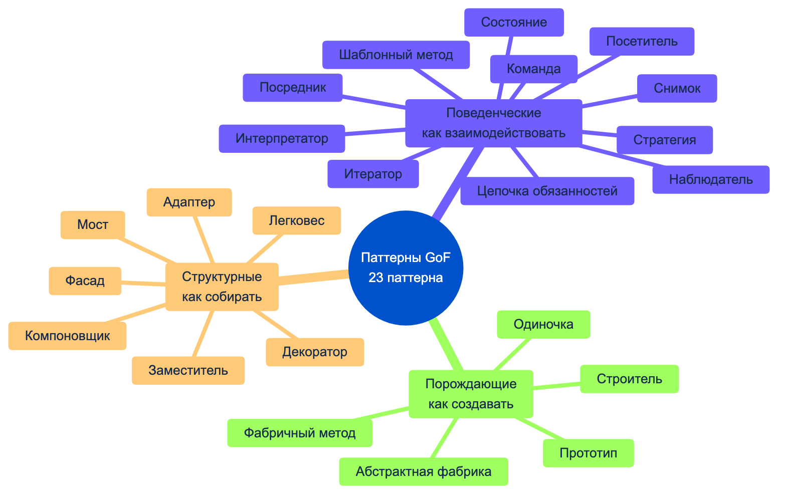
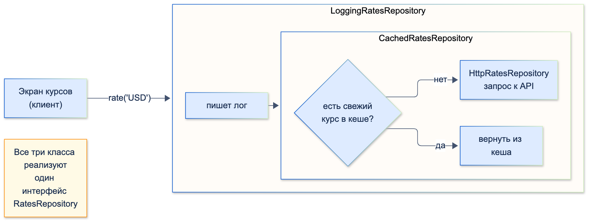

# Паттерны проектирования

| Грейд | Время на изучение | Статус |
|-------|-------------------|--------|
| ⭐⭐ | ~35 мин лекция + практика | ✅ Готово |

---

## 📚 Ресурсы

| Ресурс | Формат | Язык | Уровень | Зачем читать |
|--------|--------|------|---------|--------------|
| [Refactoring.Guru: паттерны проектирования](https://refactoring.guru/ru/design-patterns) | Справочник | 🇷🇺 | ⭐ → ⭐⭐ | Лучший бесплатный справочник. Начни с вводных страниц «Что такое паттерн» и «Зачем знать паттерны», затем — [каталог](https://refactoring.guru/ru/design-patterns/catalog). У каждого паттерна: проблема, решение, схема, плюсы и минусы, отношения с другими паттернами. Интерпретатора в каталоге нет |
| [Refactoring.Guru: критика паттернов](https://refactoring.guru/ru/design-patterns/criticism) | Статья | 🇷🇺 | ⭐⭐ | Коротко о том, когда паттерны вредят |
| [Паттерны проектирования в Dart](https://habr.com/ru/companies/otus/articles/678714/) | Статья (Habr, OTUS) | 🇷🇺 | ⭐⭐ | Порождающие паттерны с учётом возможностей Dart: factory-конструкторы, именованные параметры, миксины |
| [Flutter Design Patterns](https://flutterdesignpatterns.com/) | Сайт-сборник | 🇬🇧 | ⭐⭐ | Все паттерны GoF на Dart и Flutter, с работающими примерами |
| Гамма, Хелм, Джонсон, Влиссидес, «Паттерны объектно-ориентированного проектирования» (Питер) | Книга | 🇷🇺 | ⭐⭐⭐ | Первоисточник («Банда четырёх», GoF). Читать как справочник, а не подряд |
| Фримен, Робсон, «Head First. Паттерны проектирования» (Питер) | Книга | 🇷🇺 | ⭐ | Самое простое введение. Примеры на Java, легко переносятся на Dart |
| Джошуа Кериевски, «Рефакторинг с использованием шаблонов» | Книга | 🇷🇺 | ⭐⭐⭐ | Как **приходить** к паттернам через рефакторинг, а не внедрять их заранее |

---

## 🎓 Лекция

**Паттерн проектирования** — типовое решение часто встречающейся задачи проектирования. Это не готовый код, а общая
идея решения, которую каждый раз нужно подстроить под свою программу.

**Паттерн ≠ алгоритм.** Алгоритм — это **рецепт**: чёткая последовательность шагов. Паттерн — это **чертёж**: видно,
каким должно быть решение, но шаги реализации и код у каждого получатся свои.

Зачем знать паттерны:
1. **Проверенные решения.** Не нужно заново изобретать, как, например, добавить кеширование к репозиторию, не меняя его.
2. **Меньше ошибок проектирования.** В паттерне уже учтены типовые проблемы, на которые наступали до тебя.
3. **Общий словарь.** Фраза «оберни репозиторий декоратором» на ревью заменяет абзац объяснений.

#### Немного истории

Паттерны не **придумывают**, а **открывают**: замечают решение, которое повторяется в разных проектах, и описывают его.
Саму идею предложил архитектор Кристофер Александер в книге «Язык шаблонов» (1977), но о зданиях и городах.
В программирование её перенесли **Эрих Гамма, Ричард Хелм, Ральф Джонсон и Джон Влиссидес**. Их книга «Паттерны
объектно-ориентированного проектирования» (1994) описала **23 паттерна** в трёх группах. Авторов прозвали
«Бандой четырёх» (*Gang of Four*), отсюда сокращение **GoF**.

#### Уровни паттернов

| Уровень | Что это | Примеры |
|---------|---------|---------|
| **Идиомы** | Низкоуровневые приёмы конкретного языка | В Dart: каскады `..`, `copyWith`, `late final`, factory-конструкторы |
| **Паттерны проектирования (GoF)** | Решения на уровне нескольких классов, не зависят от языка | Декоратор, Стратегия, Наблюдатель |
| **Архитектурные паттерны** | Устройство всего приложения или его крупных частей | Слоистая архитектура, MVVM, BLoC, Clean Architecture |

На этой странице — средний уровень, паттерны GoF. Архитектурные паттерны разбираются в разделе «Архитектура».

#### Как читать описание паттерна

Описание любого паттерна в справочниках (и на Refactoring.Guru) строится по одной схеме. Её полезно держать в голове:
- **проблема**, которую решает паттерн;
- **решение** и его структура: какие классы участвуют и как связаны;
- **применимость**: в каких ситуациях паттерн уместен;
- **преимущества и недостатки** — недостатки есть всегда;
- **отношения с другими паттернами**: с чем его путают и с чем он сочетается.

Если не можешь сформулировать **проблему**, которую решает паттерн в твоём коде, скорее всего, он там не нужен.



> ℹ️ **Важно:** книге 30 лет, и часть паттернов в современных языках встроена прямо в язык. В Dart это factory-конструкторы
> (Фабричный метод, Одиночка), `Iterable` и `sync*` (Итератор), `Stream` (Наблюдатель), функции как значения
> (Стратегия, Команда), `sealed` + `switch` (Посетитель), каскады `..` (Строитель). Знать паттерн всё равно нужно:
> так понятно, **что** ты используешь и **зачем**.

### Все 23 паттерна: где их встретить во Flutter и Dart

| Паттерн | Суть одной фразой | Где встречается во Flutter / Dart |
|---------|-------------------|-----------------------------------|
| **Порождающие** — *как создавать объекты* | | |
| Одиночка (Singleton) | Один экземпляр на всё приложение и глобальная точка доступа к нему | `WidgetsBinding.instance`, `SharedPreferences.getInstance()` |
| Фабричный метод (Factory Method) | Подклассы решают, какой объект создать | `StatefulWidget.createState()`, factory-конструкторы, `fromJson` |
| Абстрактная фабрика (Abstract Factory) | Создаёт семейство связанных объектов, не привязываясь к их классам | Набор виджетов Material или Cupertino, белые метки (white label) |
| Строитель (Builder) | Пошаговая сборка сложного объекта | `StringBuffer`, `Uri`, `ThemeData`, построители запросов |
| Прототип (Prototype) | Создать объект копированием существующего | `copyWith` в `ThemeData`, `TextStyle`, моделях `freezed` |
| **Структурные** — *как собирать объекты в структуры* | | |
| Адаптер (Adapter) | Приводит чужой интерфейс к нужному | Обёртки над SDK, мапперы DTO → доменная модель |
| Мост (Bridge) | Разделяет абстракцию и реализацию, чтобы менять их независимо | `Canvas` (API) и графические движки Skia / Impeller (реализация) |
| Компоновщик (Composite) | Дерево, где лист и группа обрабатываются одинаково | Само дерево виджетов: `Column` содержит виджеты, которые содержат виджеты |
| Декоратор (Decorator) | Добавляет поведение обёрткой, не меняя исходный класс | `Padding`, `DecoratedBox`, кеширующие и логирующие обёртки репозиториев |
| Фасад (Facade) | Простой интерфейс к сложной подсистеме | Сервис оплаты поверх антифрода, лимитов, шлюза и чеков |
| Легковес (Flyweight) | Разделяет общие неизменяемые данные между множеством объектов | `const`-виджеты, кеш шрифтов и глифов в движке |
| Заместитель (Proxy) | Объект-посредник, управляющий доступом к другому | Ленивая загрузка, проверка прав, кеш, удалённые вызовы |
| **Поведенческие** — *как объекты взаимодействуют* | | |
| Цепочка обязанностей (Chain of Responsibility) | Запрос проходит по цепочке обработчиков, каждый решает, обработать ли его и передать ли дальше | Интерцепторы `dio`, middleware, всплытие `Notification` по дереву |
| Команда (Command) | Действие как объект: можно отложить, поставить в очередь, отменить | `Intent` + `Action` + `Shortcuts`, очередь офлайн-операций |
| Итератор (Iterator) | Последовательный обход без раскрытия внутреннего устройства | `Iterable`, `Iterator`, генераторы `sync*` |
| Посредник (Mediator) | Объекты общаются через посредника, а не напрямую | BLoC или координатор, который связывает независимые виджеты экрана |
| Снимок (Memento) | Сохранить и восстановить состояние, не раскрывая его | `RestorationMixin`, черновики форм |
| Наблюдатель (Observer) | Подписчики узнают об изменениях объекта | `Stream`, `ChangeNotifier`, `ValueNotifier`, `Listenable` |
| Состояние (State) | Поведение объекта зависит от его состояния, состояния — отдельные классы | Состояния BLoC, конечные автоматы процессов |
| Стратегия (Strategy) | Семейство взаимозаменяемых алгоритмов | Функции и колбэки, `Comparator`, политики комиссий и кешбэка |
| Шаблонный метод (Template Method) | Базовый класс задаёт скелет алгоритма, подклассы — шаги | Жизненный цикл `State`: `initState` → `build` → `dispose` |
| Посетитель (Visitor) | Новые операции над иерархией без изменения её классов | В Dart 3 заменяется `sealed` + `switch`; `Element.visitChildren` |
| Интерпретатор (Interpreter) | Грамматика и вычисление выражений простого языка | `RegExp`, форматы сообщений `intl` (ICU) |

Ниже — подробный разбор с кодом паттернов, которые чаще всего встречаются в Flutter-проектах.

---

### Порождающие паттерны

#### Одиночка (Singleton)

Гарантирует, что у класса есть только один экземпляр, и даёт к нему глобальный доступ.

```dart
class AppConfig {
  AppConfig._(); // приватный конструктор: снаружи создать нельзя

  static final instance = AppConfig._(); // static final в Dart инициализируется лениво

  String baseUrl = 'https://api.bank.example';
}

// Вариант через factory-конструктор: снаружи выглядит как обычное создание объекта
class Analytics {
  factory Analytics() => _instance;

  Analytics._();

  static final _instance = Analytics._();
}

void main() {
  print(identical(Analytics(), Analytics())); // true
}
```

> ⚠️ **Внимание:** Одиночка — самый спорный паттерн. Это **глобальное состояние**: зависимость не видна в конструкторе,
> её сложно подменить в тестах, а состояние «протекает» между тестами. В приложении лучше создавать один экземпляр
> и передавать его через DI (`get_it`, `provider`, конструкторы). Объект один, но глобального доступа к нему нет.

#### Фабричный метод (Factory Method)

Создание объекта выносится в отдельный метод, и **какой** именно объект будет создан, решает подкласс или логика метода.
Классический пример GoF во Flutter — `StatefulWidget.createState()`: фреймворк вызывает метод, а каждый виджет сам решает,
какой `State` создать.

В Dart для этого есть **factory-конструктор**: он может вернуть экземпляр подкласса.

```dart
sealed class BankEvent {
  const BankEvent();

  factory BankEvent.fromJson(Map<String, Object?> json) => switch (json['type']) {
        'transfer' => TransferEvent(json['kopecks'] as int),
        'login' => LoginEvent(json['device'] as String),
        final type => throw FormatException('Неизвестный тип события: $type'),
      };
}

final class TransferEvent extends BankEvent {
  const TransferEvent(this.kopecks);
  final int kopecks;
}

final class LoginEvent extends BankEvent {
  const LoginEvent(this.device);
  final String device;
}

void main() {
  final event = BankEvent.fromJson({'type': 'login', 'device': 'iPhone 16'});
  print(event.runtimeType); // LoginEvent
}
```

Код, который вызывает `BankEvent.fromJson`, не знает о конкретных подклассах и не меняется при добавлении нового типа события.

#### Абстрактная фабрика (Abstract Factory)

Создаёт **семейство** связанных объектов, которые должны сочетаться между собой. Клиент не знает их конкретных классов.

```dart
abstract interface class ControlsFactory {
  Widget button(String text, VoidCallback onPressed);
  Widget loader();
}

class MaterialControls implements ControlsFactory {
  @override
  Widget button(String text, VoidCallback onPressed) =>
      FilledButton(onPressed: onPressed, child: Text(text));

  @override
  Widget loader() => const CircularProgressIndicator();
}

class CupertinoControls implements ControlsFactory {
  @override
  Widget button(String text, VoidCallback onPressed) =>
      CupertinoButton.filled(onPressed: onPressed, child: Text(text));

  @override
  Widget loader() => const CupertinoActivityIndicator();
}

// Экран работает с фабрикой и не знает, какая платформа и какие виджеты под ней
Widget payButton(ControlsFactory controls, VoidCallback onPay) =>
    controls.button('Оплатить', onPay);
```

Где это реально нужно: приложение под несколько брендов (white label), разные платформы, разные дизайн-системы.
Если семейство одно, абстрактная фабрика не нужна.

#### Строитель (Builder)

Собирает сложный объект пошагово и проверяет его целостность перед созданием.

> 💡 **Совет:** в Dart Строитель нужен **реже**, чем в Java. Проблему «телескопических конструкторов» (10 перегрузок
> с разными наборами параметров) решают именованные параметры со значениями по умолчанию. Строитель оправдан,
> когда объект собирается **по шагам** в разных местах кода или нужна валидация комбинации полей.

```dart
enum StatementFormat { pdf, csv }

class StatementRequest {
  const StatementRequest._(this.accountId, this.from, this.to, this.format);

  final String accountId;
  final DateTime from;
  final DateTime to;
  final StatementFormat format;
}

class StatementRequestBuilder {
  String? _accountId;
  DateTime? _from;
  DateTime? _to;
  var _format = StatementFormat.pdf;

  void account(String id) => _accountId = id;

  void period(DateTime from, DateTime to) {
    _from = from;
    _to = to;
  }

  void format(StatementFormat format) => _format = format;

  StatementRequest build() {
    final (id, from, to) = (_accountId, _from, _to);
    if (id == null || from == null || to == null) {
      throw StateError('Не заданы счёт или период выписки');
    }
    if (to.isBefore(from)) throw StateError('Конец периода раньше начала');
    return StatementRequest._(id, from, to, _format);
  }
}

void main() {
  final request = (StatementRequestBuilder()
        ..account('40817810000000000001')
        ..period(DateTime(2026, 1, 1), DateTime(2026, 3, 31))
        ..format(StatementFormat.csv))
      .build(); // каскады `..` делают Строитель в Dart естественным
  print(request.format); // StatementFormat.csv
}
```

> ⚠️ **Внимание:** `builder:` во Flutter (`ListView.builder`, `LayoutBuilder`, `StreamBuilder`) — это **не** паттерн Строитель.
> Это колбэки, которые лениво создают виджеты. Совпадение только в названии.

#### Прототип (Prototype)

Новый объект создаётся **копированием** существующего с изменением части полей. Во Flutter это `copyWith`.

```dart
class TransferDraft {
  const TransferDraft({required this.recipient, required this.kopecks, this.comment = ''});

  final String recipient;
  final int kopecks;
  final String comment;

  TransferDraft copyWith({String? recipient, int? kopecks, String? comment}) => TransferDraft(
        recipient: recipient ?? this.recipient,
        kopecks: kopecks ?? this.kopecks,
        comment: comment ?? this.comment,
      );
}

void main() {
  const last = TransferDraft(recipient: '+7 900 000-00-00', kopecks: 100000, comment: 'За обед');
  final repeat = last.copyWith(kopecks: 50000); // кнопка «Повторить перевод»
  print('${repeat.recipient} ${repeat.kopecks} ${repeat.comment}');
}
```

> ⚠️ **Внимание:** у рукописного `copyWith` с `??` есть ловушка: **nullable-поле нельзя сбросить в `null`**,
> потому что `null` означает «не менять». `freezed` генерирует `copyWith`, который это умеет.

---

### Структурные паттерны

#### Адаптер (Adapter)

Приводит чужой, неудобный интерфейс к тому, который ожидает наш код. Обычно это обёртка над сторонним SDK
или нативным API: остальной код не знает о его особенностях.

```dart
// Сторонний SDK с неудобным API: магические коды результата
class LegacyBiometricSdk {
  int authenticate(String reason) => 0; // 0 — успех, 1 — отмена, 2 — биометрия не настроена
}

// Наш интерфейс
enum BiometricResult { success, cancelled, notAvailable }

abstract interface class BiometricAuth {
  Future<BiometricResult> authenticate();
}

// Адаптер
class LegacyBiometricAdapter implements BiometricAuth {
  LegacyBiometricAdapter(this._sdk);

  final LegacyBiometricSdk _sdk;

  @override
  Future<BiometricResult> authenticate() async =>
      switch (_sdk.authenticate('Вход в приложение банка')) {
        0 => BiometricResult.success,
        1 => BiometricResult.cancelled,
        _ => BiometricResult.notAvailable,
      };
}
```

Решили сменить SDK — пишем новый адаптер, а экраны и бизнес-логика не меняются. Мапперы `AccountDto → Account`
из слоя данных — тоже адаптеры.

#### Декоратор (Decorator)

Оборачивает объект в объект **с тем же интерфейсом** и добавляет поведение до или после вызова. Обёртки можно
комбинировать в любом порядке.

```dart
abstract interface class RatesRepository {
  Future<double> rate(String currency);
}

class HttpRatesRepository implements RatesRepository {
  @override
  Future<double> rate(String currency) async => 92.5; // запрос к API курсов
}

class CachedRatesRepository implements RatesRepository {
  CachedRatesRepository(this._inner, {this.ttl = const Duration(minutes: 1)});

  final RatesRepository _inner;
  final Duration ttl;
  final _cache = <String, (double, DateTime)>{};

  @override
  Future<double> rate(String currency) async {
    final cached = _cache[currency];
    if (cached != null && DateTime.now().difference(cached.$2) < ttl) return cached.$1;
    final value = await _inner.rate(currency);
    _cache[currency] = (value, DateTime.now());
    return value;
  }
}

class LoggingRatesRepository implements RatesRepository {
  LoggingRatesRepository(this._inner);

  final RatesRepository _inner;

  @override
  Future<double> rate(String currency) async {
    print('→ rate($currency)');
    return _inner.rate(currency);
  }
}

// Собираем «матрёшку»: логирование → кеш → сеть
final RatesRepository rates = LoggingRatesRepository(CachedRatesRepository(HttpRatesRepository()));
```



Во Flutter идея Декоратора повсюду: `Padding`, `Opacity`, `DecoratedBox`, `ClipRRect` оборачивают дочерний виджет
и добавляют ему одно свойство.

> ℹ️ **Важно:** Декоратор и Заместитель (Proxy) устроены одинаково: обёртка с тем же интерфейсом. Разница в **намерении**.
> Декоратор **добавляет поведение**, Заместитель **управляет доступом**: ленивое создание, проверка прав, удалённый вызов.
> Кеширующую обёртку называют и так и так, и это нормально.

#### Фасад (Facade)

Даёт простой интерфейс к сложной подсистеме из многих классов. Клиенту не нужно знать порядок вызовов и детали.

```dart
class PaymentFacade {
  PaymentFacade(this._antiFraud, this._limits, this._gateway, this._receipts);

  final AntiFraudService _antiFraud;
  final LimitsService _limits;
  final PaymentGateway _gateway;
  final ReceiptService _receipts;

  /// Экрану оплаты нужен один вызов вместо четырёх подсистем
  Future<String> pay(String accountId, int kopecks) async {
    await _antiFraud.check(accountId, kopecks);
    _limits.ensureWithinLimit(accountId, kopecks);
    final transactionId = await _gateway.charge(accountId, kopecks);
    await _receipts.send(transactionId);
    return transactionId;
  }
}
```

Фасад не запрещает работать с подсистемами напрямую, он лишь даёт удобный путь для типового сценария.

#### Компоновщик (Composite)

Объекты собираются в дерево. Отдельный элемент (лист) и группа элементов имеют общий интерфейс, и клиент работает
с ними одинаково. Самый наглядный пример — **дерево виджетов Flutter**: `Column` — виджет, который содержит виджеты.

```dart
sealed class ExpenseNode {
  int get total;
}

final class Expense extends ExpenseNode {
  Expense(this.title, this.kopecks);

  final String title;
  final int kopecks;

  @override
  int get total => kopecks;
}

final class ExpenseGroup extends ExpenseNode {
  ExpenseGroup(this.title, this.children);

  final String title;
  final List<ExpenseNode> children;

  @override
  int get total => children.fold(0, (sum, node) => sum + node.total);
}

void main() {
  final food = ExpenseGroup('Еда', [Expense('Кафе', 120000), Expense('Продукты', 450000)]);
  final all = ExpenseGroup('Все расходы', [food, Expense('Такси', 80000)]);
  print(all.total); // 650000 — клиенту не важно, лист это или группа
}
```

---

### Поведенческие паттерны

#### Наблюдатель (Observer)

Объект (издатель) хранит список подписчиков и уведомляет их об изменениях. Подписчики не опрашивают издателя сами.
Это основа реактивного Flutter: `Stream`, `ChangeNotifier`, `ValueNotifier`, а значит и `BLoC`, `provider`, `riverpod`.

```dart
class BalanceNotifier extends ChangeNotifier {
  int _kopecks = 0;

  int get kopecks => _kopecks;

  void update(int value) {
    if (value == _kopecks) return;
    _kopecks = value;
    notifyListeners(); // уведомляем всех подписчиков
  }
}

void main() {
  final balance = BalanceNotifier();
  void printBalance() => print('Баланс: ${balance.kopecks}');

  balance.addListener(printBalance);   // подписка
  balance.update(150000);              // Баланс: 150000
  balance.removeListener(printBalance); // отписка: без неё — утечка памяти
  balance.dispose();
}
```

> ⚠️ **Внимание:** главная проблема Наблюдателя — **забытые отписки**. Каждый `addListener` и `listen` должен иметь пару
> `removeListener` и `cancel` в `dispose`. Иначе будут утечки памяти и вызовы `setState` на уничтоженном виджете.

#### Стратегия (Strategy)

Семейство взаимозаменяемых алгоритмов за общим интерфейсом. Алгоритм выбирается и подменяется снаружи.
Пример с классами (комиссии за оплату) разобран в теме SOLID, в принципе OCP. В Dart часто достаточно **функции**:

```dart
typedef CashbackStrategy = int Function(int kopecks);

int noCashback(int kopecks) => 0;

CashbackStrategy percentCashback(double percent) =>
    (kopecks) => (kopecks * percent / 100).round();

class Purchase {
  Purchase(this._cashback);

  final CashbackStrategy _cashback;

  int cashbackFor(int kopecks) => _cashback(kopecks);
}

void main() {
  print(Purchase(percentCashback(5)).cashbackFor(200000)); // 10000
  print(Purchase(noCashback).cashbackFor(200000)); // 0
}
```

Класс-стратегия лучше функции, когда у алгоритма несколько методов, собственное состояние или зависимости.

#### Команда (Command)

Действие превращается в объект. Его можно передать, сохранить, поставить в очередь, повторить или отменить.

```dart
abstract interface class BankCommand {
  String get description;
  Future<void> execute();
}

class TransferCommand implements BankCommand {
  TransferCommand(this.to, this.kopecks);

  final String to;
  final int kopecks;

  @override
  String get description => 'Перевод $kopecks коп. на $to';

  @override
  Future<void> execute() async {} // вызов API перевода
}

/// Очередь операций, созданных без сети: отправим, когда связь появится
class OfflineQueue {
  final _pending = <BankCommand>[];

  void add(BankCommand command) => _pending.add(command);

  Future<void> flush() async {
    while (_pending.isNotEmpty) {
      final command = _pending.removeAt(0);
      await command.execute();
      print('Выполнено: ${command.description}');
    }
  }
}
```

Во Flutter паттерн Команда лежит в основе системы `Shortcuts` + `Actions` + `Intent`: `Intent` описывает намерение,
`Action` его выполняет. Простейшая команда — обычный `VoidCallback`.

#### Состояние (State)

Объект меняет поведение в зависимости от внутреннего состояния. Каждое состояние — отдельный класс, и он сам решает,
какие действия допустимы и в какое состояние перейти. Это избавляет от `if (status == ...)` по всему коду.

```dart
sealed class CardState {
  const CardState();

  bool get canPay;
  CardState block() => this;
  CardState unblock() => this;
}

final class ActiveCard extends CardState {
  const ActiveCard();

  @override
  bool get canPay => true;

  @override
  CardState block() => const BlockedCard();
}

final class BlockedCard extends CardState {
  const BlockedCard();

  @override
  bool get canPay => false;

  @override
  CardState unblock() => const ActiveCard();
}

final class ExpiredCard extends CardState {
  const ExpiredCard();

  @override
  bool get canPay => false; // разблокировать нельзя: block/unblock ничего не меняют
}

class BankCard {
  CardState _state = const ActiveCard();

  bool get canPay => _state.canPay;
  void block() => _state = _state.block();
  void unblock() => _state = _state.unblock();
}
```

Состояния экрана в BLoC (`Loading`, `Loaded`, `Error`) — родственная идея. Но там состояния — это обычно **данные**
для отрисовки, а не носители поведения.

#### Цепочка обязанностей (Chain of Responsibility)

Запрос проходит по цепочке обработчиков. Каждый может обработать его, изменить, передать дальше или остановить.
Во Flutter-проектах это прежде всего **интерцепторы `dio`**: авторизация, логирование, обновление токена, повтор запроса.

```dart
abstract class RequestHandler {
  RequestHandler? _next;

  RequestHandler then(RequestHandler next) {
    _next = next;
    return next;
  }

  void handle(Map<String, String> request) => _next?.handle(request);
}

class DeviceCheckHandler extends RequestHandler {
  DeviceCheckHandler({required this.isRooted});

  final bool isRooted;

  @override
  void handle(Map<String, String> request) {
    if (isRooted) throw StateError('Операции на устройстве с root-доступом запрещены'); // цепочка прерывается
    super.handle(request);
  }
}

class AuthHandler extends RequestHandler {
  @override
  void handle(Map<String, String> request) {
    request['Authorization'] = 'Bearer <token>';
    super.handle(request);
  }
}

class SendHandler extends RequestHandler {
  @override
  void handle(Map<String, String> request) => print('Отправлен запрос: $request');
}

void main() {
  final chain = DeviceCheckHandler(isRooted: false);
  chain.then(AuthHandler()).then(SendHandler());
  chain.handle({}); // Отправлен запрос: {Authorization: Bearer <token>}
}
```

#### Шаблонный метод (Template Method)

Базовый класс задаёт **неизменный скелет** алгоритма и вызывает шаги, которые переопределяют подклассы.
Его использует каждый Flutter-разработчик: фреймворк сам вызывает `initState` → `didChangeDependencies` → `build` → `dispose`,
а мы переопределяем шаги.

```dart
abstract class StatementExporter {
  // Шаблонный метод: порядок шагов зафиксирован в базовом классе
  String export(List<int> operations) {
    final buffer = StringBuffer(header());
    for (final kopecks in operations) {
      buffer.write(row(kopecks));
    }
    buffer.write(footer(operations));
    return buffer.toString();
  }

  String header();
  String row(int kopecks);
  String footer(List<int> operations) => ''; // необязательный шаг: «крючок» (hook)
}

class CsvExporter extends StatementExporter {
  @override
  String header() => 'amount\n';

  @override
  String row(int kopecks) => '$kopecks\n';

  @override
  String footer(List<int> operations) => 'total,${operations.fold(0, (a, b) => a + b)}\n';
}
```

Шаблонный метод построен на наследовании, Стратегия — на композиции. Если шагов много и они независимы,
чаще удобнее Стратегия.

---

### Похожие паттерны: как не перепутать

Многие паттерны устроены почти одинаково: обёртка, композиция, делегирование. Различаются они **намерением**.
На собеседованиях об этом спрашивают постоянно.

**Обёртки над объектом**

| Паттерн | Интерфейс обёртки | Намерение |
|---------|-------------------|-----------|
| Адаптер | **Другой**, нужный клиенту | Подружить несовместимые интерфейсы. Применяется **постфактум**, к уже существующему коду |
| Декоратор | **Тот же** (или расширенный) | Добавить поведение. Обёртки вкладываются друг в друга |
| Заместитель | **Тот же** | Управлять доступом: ленивое создание, права, кеш, удалённый вызов |
| Фасад | **Новый, упрощённый** | Спрятать целую **подсистему** из многих классов, а не один объект |
| Мост | Свой у каждой стороны | Разделить абстракцию и реализацию, чтобы развивать их независимо. Проектируется **заранее** |

**Поведение через композицию**

| Пара | Чем отличаются |
|------|----------------|
| Стратегия ↔ Состояние | Стратегии не знают друг о друге, их выбирает клиент. Состояния сами переключают объект в следующее состояние |
| Стратегия ↔ Команда | Стратегия — **разные способы** сделать одно и то же. Команда — **разные действия**, превращённые в объекты |
| Стратегия ↔ Шаблонный метод | Стратегия подменяет алгоритм **целиком** через композицию, можно даже во время работы. Шаблонный метод меняет **шаги** через наследование |
| Стратегия ↔ Декоратор | Стратегия меняет поведение объекта **изнутри**, Декоратор — **снаружи** |

**Порождающие**

| Паттерн | Когда выбирать |
|---------|----------------|
| Фабричный метод | Создаём **один** объект, а конкретный класс выбирают подкласс или логика метода |
| Абстрактная фабрика | Создаём **семейство** объектов, которые должны сочетаться между собой |
| Строитель | Собираем **сложный** объект по шагам, с проверкой перед созданием |
| Прототип | Нужен **почти такой же** объект, как существующий |

---

### 🚫 Чрезмерное применение паттернов

- **«Золотой молоток».** Выучив паттерны, разработчик видит их везде: `AccountManagerFactoryProviderImpl`, фабрика,
  которая создаёт фабрику. Паттерн — ответ на проблему. Нет проблемы — паттерн не нужен.
- **Одиночки вместо зависимостей.** `Api.instance`, `Storage.instance`, `Auth.instance` из любого места кода —
  это скрытые глобальные зависимости, которые невозможно подменить в тестах.
- **Строитель там, где хватает именованных параметров.** В Dart конструктор с именованными параметрами почти всегда проще.
- **Абстрактная фабрика для одного семейства.** Если Cupertino-версии нет и не планируется, фабрика — лишний слой.
- **Матрёшка из декораторов.** Шесть обёрток вокруг репозитория, и в отладчике уже не понять, где реальный вызов.
  Если обёрток больше двух-трёх, подумай о другом решении.
- **«Событийная лапша» из Наблюдателей.** Всё подписано на всё, поток данных не отследить, порядок обработки
  неочевиден. Лучше явный однонаправленный поток данных.
- **Иерархия классов-стратегий там, где хватит функции.** В Dart функция — полноценное значение.
- **Паттерны «на будущее».** Кериевски советует **приходить** к паттерну через рефакторинг, когда в коде появилась
  проблема, которую он решает, а не закладывать его заранее. Это прямое следствие YAGNI.

---

## ✅ Самопроверка

**⭐ Junior**
1. На какие три группы делятся паттерны GoF? Чем они отличаются?
2. Какие паттерны используются во Flutter «из коробки»? Назови три и где они встречаются.
3. Что такое `copyWith` с точки зрения паттернов?
4. Чем паттерн отличается от алгоритма?

**⭐⭐ Middle**
1. Чем плох Одиночка и как получить «один экземпляр» без его недостатков?
2. Чем Декоратор отличается от Заместителя (Proxy)? А от Адаптера?
3. Почему в Dart Строитель нужен реже, чем в Java? Когда он всё-таки оправдан?
4. Является ли `ListView.builder` паттерном Строитель?
5. Чем Стратегия отличается от Состояния, если структура классов у них почти одинаковая?

**⭐⭐⭐ Senior**
1. Какие паттерны GoF в Dart 3 заменены возможностями языка? Приведи примеры.
2. Как реализовать повторную отправку операций, созданных без сети? Какой паттерн и какие подводные камни?
3. Сравни Шаблонный метод и Стратегию: когда что выбрать?
4. Какой паттерн реализуют интерцепторы `dio`? Как ведёт себя цепочка, если один из обработчиков не передал запрос дальше?

<details>
<summary>Ответы</summary>

**Junior**
1. Порождающие отвечают за создание объектов, структурные — за то, как объекты собираются в более крупные структуры, поведенческие — за распределение обязанностей и взаимодействие объектов.
2. Например: Компоновщик — дерево виджетов; Наблюдатель — `Stream` и `ChangeNotifier`; Шаблонный метод — жизненный цикл `State`; Фабричный метод — `createState()`; Декоратор — `Padding` и другие виджеты-обёртки.
3. Прототип: новый объект создаётся копированием существующего с изменением части полей.
4. Алгоритм — точная последовательность шагов (рецепт). Паттерн — общая идея решения (чертёж), которую реализуют по-своему в каждой программе.

**Middle**
1. Это глобальное состояние: скрытые зависимости, трудно подменить в тестах, состояние сохраняется между тестами. Решение — создать объект один раз в точке сборки и передавать через DI. Экземпляр один, но доступ явный.
2. Декоратор и Заместитель реализуют **тот же** интерфейс, что и оборачиваемый объект. Декоратор добавляет поведение, Заместитель управляет доступом. Адаптер меняет интерфейс на **другой**, нужный клиенту.
3. Именованные параметры со значениями по умолчанию решают проблему конструкторов с десятком параметров. Строитель оправдан, когда объект собирается по шагам в разных местах или нужна валидация комбинации полей перед созданием.
4. Нет. Это колбэк, который лениво создаёт виджеты элементов списка по индексу. С паттерном совпадает только название.
5. Намерением. Стратегии независимы, и какую использовать, решает клиент. Состояния знают друг о друге и сами переводят объект в следующее состояние в ответ на действия.

**Senior**
1. Итератор — `Iterable` и `sync*`. Наблюдатель — `Stream`. Стратегия и Команда — функции как значения. Посетитель — `sealed` + исчерпывающий `switch`. Фабричный метод и Одиночка — factory-конструкторы. Строитель частично заменён именованными параметрами и каскадами `..`.
2. Паттерн Команда: каждая операция — объект, их хранят в персистентной очереди и выполняют при появлении сети. Подводные камни: идемпотентность (ключ идемпотентности, чтобы не списать деньги дважды), порядок выполнения, устаревание операций, хранение очереди между перезапусками, повторы при ошибках.
3. Шаблонный метод — наследование: скелет фиксирован в базовом классе, шаги переопределяются. Подходит, когда порядок шагов стабилен и шагов немного. Стратегия — композиция: алгоритм подставляется снаружи и меняется даже во время работы. Её проще тестировать, поэтому обычно её предпочитают.
4. Цепочку обязанностей. Если обработчик не передал запрос дальше, следующие не выполнятся. В `dio` это означает, что запрос не уйдёт, пока интерцептор не вызовет `handler.next()`, `handler.resolve()` или `handler.reject()`. Забытый вызов «подвешивает» запрос.

</details>
