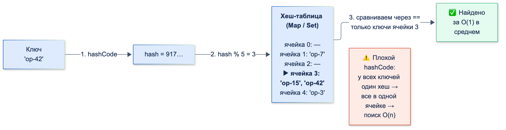

# Оценка сложности вычислений

| Грейд | Время на изучение | Статус |
|-------|-------------------|--------|
| ⭐ | ~25 мин лекция + практика | ✅ Готово |

---

## 📚 Ресурсы

| Ресурс | Формат | Язык | Уровень | Зачем читать |
|--------|--------|------|---------|--------------|
| Адитья Бхаргава, «Грокаем алгоритмы» (Питер), главы 1–2 и 5 | Книга | 🇷🇺 | ⭐ | Самое понятное введение в Big O, бинарный поиск, массивы против списков и хеш-таблицы. С картинками |
| [Сложность алгоритмов. Разбор Big O](https://habr.com/ru/articles/782608/) | Статья (Habr) | 🇷🇺 | ⭐ | Все основные классы сложности с примерами (на JavaScript) и графиком роста |
| [Big O](https://habr.com/ru/articles/444594/) | Статья (Habr, пересказ The Imposter's Handbook) | 🇷🇺 | ⭐ | Интуитивное объяснение O(1), O(n), O(n²), O(log n) на простых задачах |
| [Big-O Cheat Sheet](https://www.bigocheatsheet.com/) | Шпаргалка | 🇬🇧 | ⭐⭐ | Сложность операций основных структур данных и сортировок на одной странице |
| [Dart: Iterable collections](https://dart.dev/libraries/collections/iterables) | Документация | 🇬🇧 | ⭐ | Как устроены `Iterable`, ленивые `map` и `where` |
| [Effective Dart: коллекции](https://dart.dev/effective-dart/usage#dont-use-length-to-see-if-a-collection-is-empty) | Документация | 🇬🇧 | ⭐⭐ | Официальные правила: `isEmpty` вместо `length`, `whereType`, `cast` и их цена |

---

## 🎓 Лекция

### 1. Зачем мобильному разработчику оценивать сложность

На экране 60 Гц у Flutter есть **~16 мс** на кадр, на 120 Гц — **~8 мс**. За это время нужно выполнить `build`,
раскладку и отрисовку. Если в `build` фильтрация списка за O(n²), то на 50 операциях всё летает, а у клиента
с 5000 операций в истории интерфейс начинает «дёргаться».

Оценка сложности отвечает на вопрос: **как растёт время и память, когда растут данные?**
Это не про точные миллисекунды, а про **поведение при росте n**.

### 2. Нотация Big O

**O(f(n))** — верхняя граница роста затрат при увеличении размера входных данных n. Читается «О большое от f(n)».

Правила подсчёта:
- **Константы отбрасываем.** O(2n) = O(n), O(500) = O(1). Нас интересует форма роста, а не коэффициент.
- **Младшие слагаемые отбрасываем.** O(n² + n) = O(n²): при большом n слагаемое n ничтожно.
- **Последовательные шаги складываем, вложенные — умножаем.** Два цикла подряд — O(n + n) = O(n), цикл в цикле — O(n · n) = O(n²).
- **Разные входы — разные переменные.** Цикл по счетам, а внутри цикл по картам — это O(a · b), а не O(n²).

```dart
// O(n): один проход
int total(List<int> operations) {
  var sum = 0;
  for (final kopecks in operations) {
    sum += kopecks;
  }
  return sum;
}

// O(n²): для каждой операции проходим по всем остальным
bool hasDuplicatesSlow(List<String> ids) {
  for (var i = 0; i < ids.length; i++) {
    for (var j = i + 1; j < ids.length; j++) {
      if (ids[i] == ids[j]) return true;
    }
  }
  return false;
}
```

### 3. Основные классы сложности

| Сложность | Название | Пример | Операций при n = 1 000 | При n = 1 000 000 |
|-----------|----------|--------|------------------------|-------------------|
| **O(1)** | Константная | `list[i]`, `map[key]`, `set.contains` | 1 | 1 |
| **O(log n)** | Логарифмическая | Бинарный поиск в отсортированном списке | ~10 | ~20 |
| **O(n)** | Линейная | Проход по списку, `list.contains` | 1 000 | 1 000 000 |
| **O(n log n)** | Линейно-логарифмическая | Сортировка | ~10 000 | ~20 000 000 |
| **O(n²)** | Квадратичная | Вложенный цикл по тем же данным | 1 000 000 | 10¹² — практически никогда |
| **O(2ⁿ)** | Экспоненциальная | Перебор всех подмножеств | 10³⁰¹ | — |

> 💡 **Совет:** запомни ориентир. До O(n log n) включительно — нормально почти для любых данных в мобильном приложении.
> O(n²) допустимо только для заведомо маленьких n (десятки элементов). O(2ⁿ) — только для n около 20–25.

**Откуда берётся log n.** Если на каждом шаге задача **уменьшается вдвое**, шагов будет log₂n. Миллион элементов
делится пополам всего ~20 раз. Пример — бинарный поиск по отсортированной по дате истории операций:

```dart
/// Индекс первой операции не раньше [date] в списке, отсортированном по возрастанию. O(log n).
int firstNotBefore(List<DateTime> sortedDates, DateTime date) {
  var low = 0;
  var high = sortedDates.length;
  while (low < high) {
    final mid = (low + high) ~/ 2;
    if (sortedDates[mid].isBefore(date)) {
      low = mid + 1;
    } else {
      high = mid;
    }
  }
  return low;
}
```

В реальном проекте бери готовые `lowerBound` и `binarySearch` из `package:collection`.

### 4. Лучший, средний, худший случай и амортизированная сложность

- **Худший случай** — гарантия: «никогда не хуже». Big O обычно говорят именно о нём.
- **Средний случай** — то, что бывает на практике. Поиск в хеш-таблице в **среднем** O(1), а в худшем,
  когда все ключи попали в одну ячейку, — O(n).
- **Амортизированная сложность** — средняя стоимость операции на длинной серии. `List.add` иногда копирует весь
  массив в новый, вдвое больший (O(n)), но так редко, что **в пересчёте на одну операцию** это O(1).

Для полноты: в теории есть ещё **Ω** (омега, нижняя граница) и **Θ** (тета, точная оценка). На практике
и на собеседованиях почти всегда говорят «O большое» и имеют в виду точную оценку худшего случая.

### 5. Сложность по памяти

Оценивают так же, но считают **дополнительную** память, которая нужна алгоритму сверх входных данных.

```dart
// O(1) по памяти: только переменная sum
int sum(List<int> values) => values.fold(0, (acc, v) => acc + v);

// O(n) по памяти: создаём новый список такого же размера
List<int> doubled(List<int> values) => values.map((v) => v * 2).toList();
```

На что обращать внимание:
- **Копии коллекций.** Каждый `toList()`, `toSet()`, `[...list]` или `List.of()` — это O(n) памяти и времени.
  Цепочка `.map().toList().where().toList()` создаёт промежуточные списки.
- **Рекурсия.** Каждый вызов занимает место в стеке: рекурсия глубины n — это O(n) памяти. Dart не оптимизирует
  хвостовую рекурсию, поэтому на глубоких данных возможен `Stack Overflow`. Для них используй цикл.
- **Обмен памяти на время.** Индекс `Map<String, Operation>` занимает O(n) памяти, зато поиск по id становится O(1)
  вместо O(n). Обычно это выгодный обмен.

### 6. Сложность операций коллекций Dart

#### Как хеш-коллекции дают O(1)



`Set` и `Map` вычисляют `hashCode` ключа и по нему сразу попадают в нужную ячейку (bucket). Сравнение через `==`
идёт только с несколькими ключами в этой ячейке. Поэтому **качество `hashCode` напрямую влияет на скорость**.
Если у всех ключей одинаковый хеш, `Map` превращается в список с поиском за O(n). Как правильно переопределять
`==` и `hashCode`, разобрано в теме «ООП».

#### `List` (по умолчанию — растущий массив)

| Операция | Сложность | Комментарий |
|----------|-----------|-------------|
| `list[i]`, `list[i] = x`, `length`, `last` | O(1) | Доступ по индексу |
| `add`, `removeLast` | O(1) амортизированно | Работа с концом списка |
| `insert(0, x)`, `removeAt(0)`, `insert(i, x)`, `removeAt(i)` | **O(n)** | Сдвиг всех элементов после позиции |
| `contains`, `indexOf`, `remove(value)`, `firstWhere` | **O(n)** | Перебор |
| `sort` | O(n log n) | ⚠️ Стабильность **не гарантируется** документацией. Для стабильной сортировки — `mergeSort` из `package:collection` |
| `sublist`, `toList`, `List.of` | O(k) / O(n) | Создаётся копия |

#### `Set` и `Map` (по умолчанию `LinkedHashSet` и `LinkedHashMap`)

| Операция | Сложность | Комментарий |
|----------|-----------|-------------|
| `add`, `remove`, `contains` / `map[key]`, `map[key] = v`, `containsKey`, `remove` | O(1) в среднем | При хорошем `hashCode` |
| `map.containsValue(v)`, `map.values.contains(v)` | **O(n)** | Значения не индексируются |
| Обход | O(n) | В порядке **добавления** |

- `HashMap` и `HashSet` — то же самое, но **без гарантии порядка** обхода.
- `SplayTreeMap` и `SplayTreeSet` хранят ключи **отсортированными**, операции — O(log n) амортизированно.
  Пригодится, когда нужен упорядоченный по ключу справочник.

#### Очередь и строки

| Структура | Операция | Сложность |
|-----------|----------|-----------|
| `ListQueue` (`Queue` из `dart:collection`) | `addFirst`, `addLast`, `removeFirst`, `removeLast` | O(1), добавление — амортизированно |
| `String` | Конкатенация `a + b` | O(len(a) + len(b)): строки неизменяемы, создаётся новая |
| `StringBuffer` | `write` | O(1) амортизированно |

#### Ленивые `Iterable`

`map`, `where`, `skip`, `take`, `expand` возвращают **ленивый** `Iterable`. Он ничего не вычисляет сразу и пересчитывает
всю цепочку **при каждом обходе**.

```dart
void main() {
  var calls = 0;
  final amounts = [0, 100, 200, 300, 400];
  final large = amounts.where((kopecks) {
    calls++;
    return kopecks > 100;
  });

  print(large.length); // 3 — первый проход по списку
  print(large.length); // 3 — второй проход: length у ленивого Iterable считается перебором, O(n)
  for (final _ in large) {} // третий проход
  print(calls); // 15 — функция в where вызвана по 5 раз на каждый обход
}
```

- Если результат нужен несколько раз, **один раз** материализуй его через `.toList()`.
- Для проверки на пустоту используй `isEmpty` и `isNotEmpty`, а не `length == 0`: для ленивых `Iterable`
  `length` перебирает все элементы.
- `elementAt(i)` у не-`List` коллекций — тоже O(n).

### 7. Насколько это заметно: замеры

Замер на ноутбуке разработчика. Точные цифры зависят от устройства, важен **порядок разницы**.

| Задача | Медленно | Быстро |
|--------|----------|--------|
| Найти дубли среди 20 000 id операций | `List.contains` в цикле, O(n²): **251 мс** | `Set.add`, O(n): **5 мс** |
| Добавить 100 000 элементов в начало | `List.insert(0, x)`, O(n²) в сумме: **8 436 мс** | `ListQueue.addFirst`, O(n): **3 мс** |
| Собрать строку из 20 000 частей | `String +=`, O(n²): **808 мс** | `StringBuffer`, O(n): **3 мс** |

На слабом Android-устройстве разница будет ещё больше.

### 8. Типичные задачи: от медленного к быстрому

**Дубли операций:** O(n²) → O(n).

```dart
// O(n²): contains у List — перебор
List<String> duplicatesSlow(List<String> ids) {
  final seen = <String>[];
  final duplicates = <String>[];
  for (final id in ids) {
    if (seen.contains(id)) {
      duplicates.add(id);
    } else {
      seen.add(id);
    }
  }
  return duplicates;
}

// O(n): Set.add возвращает false, если элемент уже был
List<String> duplicatesFast(List<String> ids) {
  final seen = <String>{};
  return [for (final id in ids) if (!seen.add(id)) id];
}
```

**Поиск по id много раз:** O(n) на каждый поиск → O(1) после построения индекса.

```dart
class Operation {
  const Operation(this.id, this.kopecks);
  final String id;
  final int kopecks;
}

class OperationsIndex {
  // Строим один раз: O(n) времени и памяти
  OperationsIndex(List<Operation> operations)
      : _byId = {for (final operation in operations) operation.id: operation};

  final Map<String, Operation> _byId;

  Operation? byId(String id) => _byId[id]; // O(1) вместо firstWhere за O(n)
}
```

**Группировка по дате:** один проход O(n) вместо фильтрации списка для каждой даты O(n · d).

```dart
Map<DateTime, List<int>> groupByDay(List<(DateTime, int)> operations) {
  final result = <DateTime, List<int>>{};
  for (final (date, kopecks) in operations) {
    final day = DateTime(date.year, date.month, date.day);
    (result[day] ??= []).add(kopecks);
  }
  return result;
}
```

### 9. Сложность во Flutter

- **`build` вызывается часто** — при каждом `setState`, анимации или изменении зависимостей. Не сортируй и не фильтруй
  в `build` большие списки. Посчитай результат один раз при изменении данных (в BLoC, ViewModel или `didUpdateWidget`).
- **`ListView(children: [...])` создаёт все виджеты сразу** — O(n) на каждую перестройку. `ListView.builder` создаёт только
  видимые элементы. Для длинных списков — только `builder`.
- **Не ищи элементы в `itemBuilder` через `indexOf` и `firstWhere`.** Это O(n) на каждый элемент, итого O(n²) на прокрутку.
- **Поиск по мере ввода.** Фильтрация на каждое нажатие клавиши — это O(n) × число нажатий. Добавь debounce (задержку),
  а для больших справочников — заранее подготовленный индекс.
- **Тяжёлые вычисления** (разбор большого JSON, сортировка десятков тысяч записей) выноси из UI-изолята. Подробно —
  в теме «Изоляты».

### 10. Сложность поиска в дереве виджетов

`BuildContext` — это `Element`, узел дерева элементов. Каждый способ найти что-то «выше» или «ниже» по дереву
имеет свою сложность. Обозначим **d** глубину дерева: в реальном приложении это сотни уровней,
потому что каждый `Padding`, `Builder` или `Provider` — отдельный уровень.

| Способ | Сложность | Как работает | Где встречается |
|--------|-----------|--------------|-----------------|
| `dependOnInheritedWidgetOfExactType<T>()` | **O(1)** | Каждый элемент хранит хеш-таблицу «тип → ближайший `InheritedElement`», унаследованную от родителя. Поиск — одно обращение к ней | `Theme.of`, `MediaQuery.sizeOf`, `AppLocalizations.of`, `context.watch` из `provider` |
| `getInheritedWidgetOfExactType<T>()` | **O(1)** | То же, но без подписки на изменения | Разовое чтение в обработчиках |
| `findAncestorWidgetOfExactType<T>()`, `findAncestorStateOfType<T>()`, `findAncestorRenderObjectOfType<T>()` | **O(d)** | Цикл по родителям, пока не встретится нужный тип | `Navigator.of`, `Scaffold.of` |
| `findRootAncestorStateOfType<T>()` | **O(d)**, всегда до корня | Проходит **всё** дерево вверх и возвращает самый верхний | `Navigator.of(context, rootNavigator: true)` |
| `GlobalKey.currentState`, `currentContext` | **O(1)** | Реестр `Map<GlobalKey, Element>` в `BuildOwner` | `formKey.currentState!.validate()` |
| `visitChildElements` | O(1) для `Stateless`/`Stateful`, O(k) по числу детей | Обход непосредственных детей | Редко, в низкоуровневом коде |
| Рекурсивный обход потомков | **O(n)** размера поддерева | Посещает каждый элемент | `find.byType`, `find.text` в `flutter_test` |

> ℹ️ **Важно:** оценки взяты из документации `BuildContext` и исходников Flutter. Например, про `findAncestorWidgetOfExactType`
> там прямо сказано: относительно дорогой, O(N) по глубине дерева, вызывать, только если расстояние до предка
> заведомо небольшое и ограниченное.

**Почему `InheritedWidget` — O(1).** При встраивании в дерево элемент копирует от родителя ссылку на таблицу
`Type → InheritedElement`. Каждый `InheritedElement` добавляет в неё себя. Таблица неизменяемая (persistent),
поэтому копирование почти бесплатное, а поиск по типу — обращение к хеш-таблице, как в `Map`. Именно поэтому данные
во Flutter принято **спускать вниз** через `InheritedWidget` (и построенные на нём `provider`, `riverpod`, `BlocProvider`),
а не искать вверх по дереву.

```dart
class DoneButton extends StatelessWidget {
  const DoneButton({super.key});

  @override
  Widget build(BuildContext context) {
    final theme = Theme.of(context); // O(1)
    final width = MediaQuery.sizeOf(context).width; // O(1), перестроение — только при смене размера

    return SizedBox(
      width: width / 2,
      child: TextButton(
        // O(d), но вызывается один раз по нажатию, а не в каждом build — это нормально
        onPressed: () => Navigator.of(context).pop(),
        child: Text('Готово', style: theme.textTheme.titleMedium),
      ),
    );
  }
}
```

**Стоимость подписки.** `dependOn…` не только ищет за O(1), но и **подписывает** виджет. Когда `InheritedWidget` меняется,
перестраиваются **все** k подписчиков, это O(k). Отсюда практическое правило:
- `MediaQuery.of(context)` подписывает на **любое** изменение `MediaQueryData`. Когда выезжает клавиатура,
  `viewInsets` меняются каждый кадр анимации, и виджет перестраивается каждый кадр.
- `MediaQuery.sizeOf(context)`, `paddingOf`, `viewInsetsOf` подписывают только на **нужный аспект** (механизм `InheritedModel`).
  Используй их вместо `MediaQuery.of(context).size`.

Практические выводы:
- `Theme.of`, `MediaQuery.sizeOf`, `context.watch` в `build` — нормально, это O(1).
- `findAncestor…` в `build` — избегай. Если предок нужен постоянно, найди его один раз в `didChangeDependencies`
  или передай данные через `InheritedWidget`.
- `Navigator.of` и `Scaffold.of` в обработчиках нажатий — нормально: O(d) один раз по событию.
- `find.byType` в тестах обходит всё дерево, но в тестах это не проблема.

### 🚫 Преждевременная оптимизация

> ℹ️ **Важно:** «Преждевременная оптимизация — корень всех зол» (Дональд Кнут). Оценка сложности нужна, чтобы
> **не написать** O(n²) там, где легко сделать O(n), а не чтобы микрооптимизировать каждую строчку.

- **Не оптимизируй без замера.** Сначала профилирование (DevTools), потом оптимизация того, что реально тормозит.
- **Маленькие n.** Для списка из 10 валют `List.contains` ничем не хуже `Set`, а код проще.
- **Константы тоже важны.** O(1) с тяжёлым `hashCode` может быть медленнее O(n) по маленькому массиву.
  Big O описывает рост, а не скорость на конкретных данных.
- **Читаемость дороже микросекунд.** Хитрый «быстрый» код, который никто не понимает, — плохой обмен.

---

## ✅ Самопроверка

**⭐ Junior**
1. Что показывает нотация Big O? Почему O(2n) = O(n)?
2. Какая сложность у `list.contains`, `set.contains` и `map[key]`?
3. Почему `insert(0, x)` у `List` медленный и что использовать вместо него?
4. Какая сложность у двух вложенных циклов по одному списку?

**⭐⭐ Middle**
1. Что такое амортизированная сложность? Приведи пример из Dart.
2. Почему поиск в `Map` в среднем O(1), но в худшем случае O(n)? При чём тут `hashCode`?
3. Почему `iterable.where(...).length`, вызванный дважды, обходит коллекцию дважды? Как этого избежать?
4. Почему не стоит собирать строку через `+=` в цикле?

**⭐⭐⭐ Senior**
1. История операций из 10 000 элементов отсортирована по дате. Как быстро найти операции за период? Какая сложность?
2. Какие проблемы сложности бывают в `build` и `itemBuilder`? Как их обнаружить и исправить?
3. Стабильна ли сортировка `List.sort` в Dart? Когда это важно и что делать?
4. Когда сознательно оставить O(n²)?
5. Какая сложность у `Theme.of(context)` и у `Navigator.of(context)`? Почему они разные? Почему `MediaQuery.sizeOf` лучше, чем `MediaQuery.of(context).size`?

<details>
<summary>Ответы</summary>

**Junior**
1. Как растут затраты (время или память) при росте размера входных данных. Константы не меняют форму роста: при увеличении n вдвое и n, и 2n растут вдвое.
2. `list.contains` — O(n), `set.contains` — O(1) в среднем, `map[key]` — O(1) в среднем.
3. Все элементы после позиции вставки сдвигаются, это O(n) на каждую вставку. Для частых вставок в начало — `ListQueue` (`addFirst` за O(1)).
4. O(n²).

**Middle**
1. Средняя стоимость операции на длинной серии. `List.add` иногда копирует массив в новый, большего размера (O(n)), но так редко, что в среднем на одну операцию выходит O(1).
2. Ключ по `hashCode` попадает сразу в нужную ячейку. Если хеши распределены плохо (например, у всех одинаковые), все ключи окажутся в одной ячейке, и поиск станет перебором через `==`.
3. `where` возвращает ленивый `Iterable`, который пересчитывает цепочку при каждом обходе, а `length` у него считается перебором. Нужно один раз вызвать `.toList()` и работать со списком.
4. Строки неизменяемы: каждый `+=` создаёт новую строку и копирует в неё всё накопленное. В сумме O(n²). `StringBuffer` добавляет за амортизированное O(1).

**Senior**
1. Бинарным поиском найти индекс начала и конца периода (`lowerBound`), затем взять `sublist`. O(log n) на поиск границ плюс O(k) на копирование k найденных операций. Вместо O(n) фильтрации по всему списку.
2. Сортировка и фильтрация в `build`, `indexOf`/`firstWhere` в `itemBuilder`, `ListView(children:)` для длинных списков. Обнаружить — DevTools (Performance, CPU Profiler), профильный режим сборки, долгие кадры. Исправить — считать данные один раз при их изменении, строить индексы `Map`, использовать `ListView.builder`, выносить тяжёлое в изолят.
3. Документация стабильность **не гарантирует**: равные по ключу элементы могут поменяться местами. Важно при сортировке по одному полю с сохранением прежнего порядка (например, операции с одинаковой датой). Используй `mergeSort` из `package:collection` или добавь в компаратор второй ключ.
4. Когда n гарантированно маленький (десятки элементов), а O(n²)-решение заметно проще и понятнее.
5. `Theme.of` — O(1): это `dependOnInheritedWidgetOfExactType`, поиск по хеш-таблице `Type → InheritedElement`, которую каждый элемент наследует от родителя. `Navigator.of` — O(d): `findAncestorStateOfType` идёт вверх по родителям. `MediaQuery.of` подписывает на любое изменение `MediaQueryData` (например, `viewInsets` при анимации клавиатуры), а `sizeOf` через `InheritedModel` — только на изменение размера, поэтому лишних перестроений нет.

</details>
