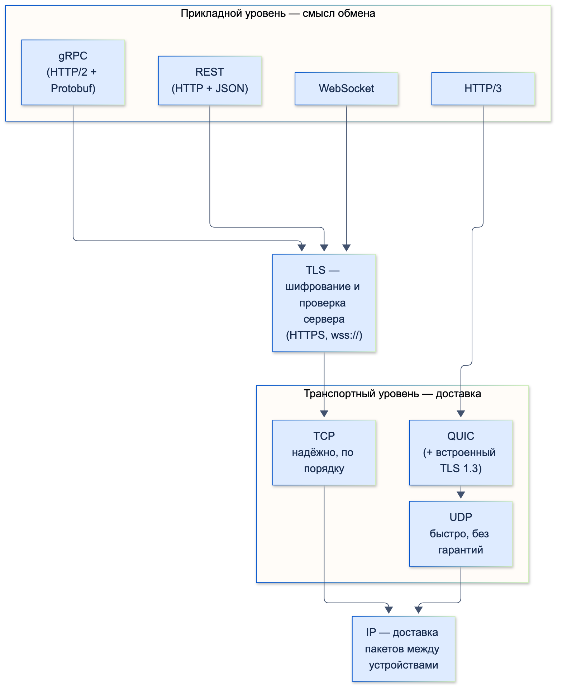
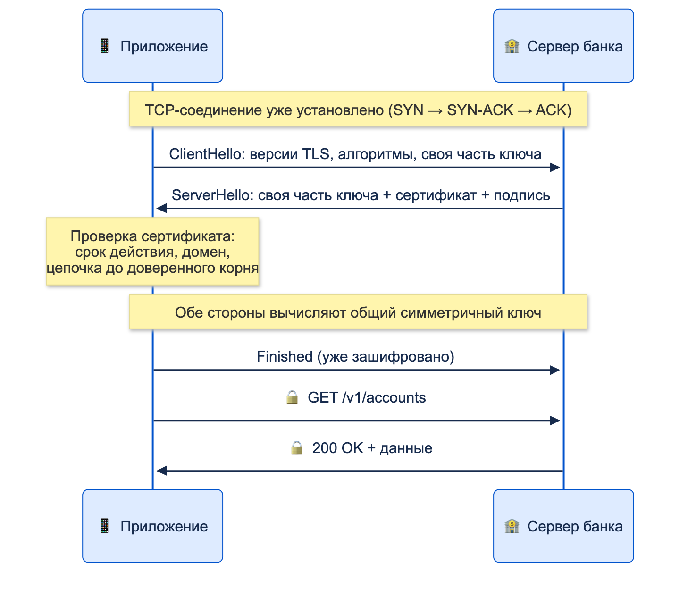

# Сетевые протоколы

| Грейд | Время на изучение | Статус |
|-------|-------------------|--------|
| ⭐ | ~25 мин лекция + практика | ✅ Готово |

---

## 📚 Ресурсы

| Ресурс | Формат | Язык | Уровень | Зачем читать |
|--------|--------|------|---------|--------------|
| [MDN: обзор протокола HTTP](https://developer.mozilla.org/ru/docs/Web/HTTP/Guides/Overview) | Документация | 🇷🇺 | ⭐ | Как устроены запрос и ответ, заголовки, соединения. Лучшая отправная точка |
| [MDN: коды состояния HTTP](https://developer.mozilla.org/ru/docs/Web/HTTP/Reference/Status) | Справочник | 🇷🇺 | ⭐ | Все коды ответов с пояснениями. Держать под рукой |
| [MDN: методы HTTP](https://developer.mozilla.org/ru/docs/Web/HTTP/Reference/Methods) | Справочник | 🇷🇺 | ⭐ | GET, POST, PUT, PATCH, DELETE и их свойства |
| [TCP и UDP, или Два столпа Интернета](https://habr.com/ru/articles/711578/) | Статья (Habr) | 🇷🇺 | ⭐ | Рукопожатие, гарантии доставки, отличия TCP и UDP. С примерами и разбором пакетов в Wireshark |
| [Разбираем TLS по байтам. Кто такой этот HTTPS?](https://habr.com/ru/companies/timeweb/articles/752270/) | Статья (Habr, Timeweb) | 🇷🇺 | ⭐⭐⭐ | Подробный разбор TLS 1.3: шифрование, обмен ключами, сертификаты. Для тех, кто хочет глубже |
| [Мифология REST](https://habr.com/ru/articles/560590/) | Статья (Habr) | 🇷🇺 | ⭐⭐ | Что на самом деле означает REST по Филдингу и какие правила реально полезны для HTTP API |
| [MDN: WebSockets](https://developer.mozilla.org/ru/docs/Web/API/WebSockets_API) | Документация | 🇷🇺 | ⭐ | Что такое WebSocket и как он работает |
| [gRPC: Core concepts](https://grpc.io/docs/what-is-grpc/core-concepts/) | Документация | 🇬🇧 | ⭐⭐ | Официальное описание: сервисы, 4 типа вызовов, дедлайны, отмена |
| [gRPC: Dart quick start](https://grpc.io/docs/languages/dart/quickstart/) | Документация | 🇬🇧 | ⭐⭐ | Как сгенерировать клиент из `.proto` и вызвать сервис из Dart |
| [Flutter: Networking](https://docs.flutter.dev/data-and-backend/networking) | Документация | 🇬🇧 | ⭐ | Сеть во Flutter: разрешения на платформах, HTTP-запросы, WebSocket |

---

## 🎓 Лекция

Цель темы — понимать, **что происходит между `await client.get(...)` и ответом сервера**, на уровне,
достаточном для отладки и общения с бэкендом. Глубокое устройство сетей нам не нужно.

### 1. Уровни: кто за что отвечает

Сетевое взаимодействие устроено слоями. Каждый слой решает свою задачу и пользуется нижним.

| Уровень | Задача | Протоколы |
|---------|--------|-----------|
| **Прикладной** | Смысл обмена: «дай список счетов», «пришёл новый курс» | HTTP, WebSocket, gRPC |
| **Защита** | Шифрование и проверка, что сервер — тот, за кого себя выдаёт | TLS |
| **Транспортный** | Доставка данных между программами на двух устройствах | TCP, UDP (и QUIC поверх UDP) |
| **Сетевой** | Доставка пакетов между устройствами по IP-адресам | IP |



Перед всем этим работает **DNS**: превращает `api.bank.example` в IP-адрес.

### 2. TCP и UDP

**TCP** — «заказное письмо с уведомлением».
- **Устанавливает соединение** тройным рукопожатием: клиент → `SYN`, сервер → `SYN-ACK`, клиент → `ACK`.
- **Гарантирует доставку и порядок.** Потерянные пакеты отправляются заново, данные собираются в исходной последовательности.
- **Цена — задержки.** Рукопожатие занимает время, а потерянный пакет задерживает все следующие за ним.
  Это называется **блокировкой начала очереди** (head-of-line blocking).

**UDP** — «открытка».
- Без соединения, без подтверждений и без гарантии порядка: отправил и забыл.
- Быстро и с минимальной задержкой. Подходит, где лучше потерять пакет, чем ждать его: голосовые и видеозвонки,
  онлайн-игры, DNS.

| | TCP | UDP |
|---|-----|-----|
| Соединение | Да, рукопожатие | Нет |
| Доставка и порядок | Гарантированы | Не гарантированы |
| Задержка | Выше | Минимальная |
| Где используется | HTTP/1.1, HTTP/2, WebSocket, gRPC | Звонки, видео, DNS, **HTTP/3 (QUIC)** |

### 3. HTTP

**HTTP** — текстовый (в версии 1.1) протокол «запрос — ответ». Клиент отправляет запрос, сервер возвращает ответ.
HTTP **не хранит состояние** между запросами: каждый запрос должен нести всё, что нужно серверу, например токен авторизации.

```text
POST /v1/transfers HTTP/1.1
Host: api.bank.example
Authorization: Bearer eyJhbGciOi...
Content-Type: application/json
Idempotency-Key: 5f1c2a7e-3b9d-4c1e-9a0f-7d2e8b6c4a11

{"from": "40817810000000000001", "to": "+79000000000", "amount": 150000}
```

```text
HTTP/1.1 201 Created
Content-Type: application/json

{"id": "tr-8812", "status": "processing"}
```

#### Методы

| Метод | Назначение | Только чтение (safe) | Можно повторить (идемпотентный) |
|-------|------------|:--------------------:|:-------------------------------:|
| `GET` | Получить ресурс | ✅ | ✅ |
| `POST` | Создать ресурс или выполнить действие | ❌ | ❌ |
| `PUT` | Заменить ресурс целиком | ❌ | ✅ |
| `PATCH` | Изменить часть ресурса | ❌ | ❌ (не гарантируется) |
| `DELETE` | Удалить ресурс | ❌ | ✅ |

- **Только чтение (safe)** — запрос ничего не меняет на сервере. Таких методов четыре: `GET`, `HEAD`, `OPTIONS`, `TRACE` (последний в мобильной разработке не встречается).
- **Можно повторить (идемпотентный)** — после двух одинаковых запросов на сервере то же состояние, что и после одного.
  Запрос при этом **может менять** данные: `PUT` и `DELETE` меняют, но повтор ничего не испортит.
  Например, `PUT /polls/123/vote {"optionIds": ["opt_2"]}` дважды — это всё тот же один голос за `opt_2`,
  а `POST /polls` дважды создаст **два** голосования.
- Всё, что «только чтение», автоматически «можно повторить». Обратное неверно.
- Идемпотентность важна для **повторов при ошибках сети**: идемпотентный запрос можно спокойно отправить ещё раз.

> ⚠️ **Внимание:** перевод денег — это `POST`, он не идемпотентен. Если ответ не пришёл из-за таймаута, клиент не знает,
> прошёл ли перевод. Повтор без защиты может **списать деньги дважды**. Защита — заголовок `Idempotency-Key`
> с уникальным ключом операции: сервер видит повтор и возвращает результат первого запроса, а не создаёт новый перевод.

#### Коды ответа

| Класс | Смысл | Важные коды |
|-------|-------|-------------|
| **2xx** | Успех | `200 OK`, `201 Created`, `204 No Content` |
| **3xx** | Перенаправление / кеш | `301`/`302` — ресурс переехал, `304 Not Modified` — бери из кеша |
| **4xx** | Ошибка клиента | `400` — неверный запрос, `401` — не авторизован (нужен вход или обновление токена), `403` — нет прав, `404` — не найдено, `409` — конфликт, `422` — ошибка валидации, `429` — слишком много запросов |
| **5xx** | Ошибка сервера | `500` — внутренняя ошибка, `502`/`504` — проблема шлюза или таймаут за ним, `503` — сервис недоступен |

**Правило для клиента:** 4xx повторять бессмысленно (кроме `401` после обновления токена и `429` после паузы),
5xx и сетевые ошибки можно повторить с увеличивающейся паузой, если запрос идемпотентный.

#### Полезные заголовки

| Заголовок | Зачем |
|-----------|-------|
| `Authorization` | Токен доступа (`Bearer …`) |
| `Content-Type` / `Accept` | Формат тела запроса и ожидаемый формат ответа (`application/json`) |
| `Cache-Control`, `ETag` + `If-None-Match` | Кеширование: сервер ответит `304`, если данные не изменились |
| `Idempotency-Key` | Защита от двойного выполнения при повторе |
| `Accept-Language` | Язык ответа (тексты ошибок) |

#### Версии HTTP

| Версия | Транспорт | Главное | Что важно для мобильных |
|--------|-----------|---------|-------------------------|
| **HTTP/1.1** | TCP | Текстовый протокол, одно соединение обслуживает один запрос за раз | Много параллельных запросов → много соединений |
| **HTTP/2** | TCP | Бинарный, **мультиплексирование**: много запросов параллельно в одном соединении, сжатие заголовков | Меньше соединений и рукопожатий. Но потеря пакета в TCP тормозит все потоки |
| **HTTP/3** | **QUIC поверх UDP** | Нет блокировки начала очереди TCP, TLS 1.3 встроен, быстрее устанавливается | **Миграция соединения** при переключении Wi-Fi ↔ мобильная сеть без разрыва |

#### HTTP-запрос во Flutter

```dart
import 'dart:convert';

import 'package:http/http.dart' as http;

class Account {
  const Account(this.id, this.kopecks);

  factory Account.fromJson(Map<String, dynamic> json) =>
      Account(json['id'] as String, json['balance'] as int);

  final String id;
  final int kopecks;
}

class AccountsApi {
  AccountsApi(this._client, this._token);

  final http.Client _client;
  final String _token;

  Future<List<Account>> fetchAccounts() async {
    final response = await _client
        .get(
          Uri.https('api.bank.example', '/v1/accounts'),
          headers: {'Authorization': 'Bearer $_token', 'Accept': 'application/json'},
        )
        .timeout(const Duration(seconds: 15)); // без таймаута запрос может «висеть» очень долго

    if (response.statusCode != 200) {
      throw http.ClientException('Ошибка ${response.statusCode}', response.request?.url);
    }
    final body = jsonDecode(response.body) as List<dynamic>;
    return [for (final item in body) Account.fromJson(item as Map<String, dynamic>)];
  }
}
```

В реальных проектах чаще используют `dio`: интерцепторы (авторизация, обновление токена, логирование), отмена запросов,
удобная работа с ошибками. Интерцепторы — это паттерн «Цепочка обязанностей» из темы «Паттерны проектирования».

### 4. HTTPS и TLS

**HTTPS = HTTP поверх TLS.** Сам HTTP не меняется, но всё, что идёт по сети, зашифровано.

TLS даёт три гарантии:
1. **Конфиденциальность** — данные зашифрованы, посредник (например, публичный Wi-Fi) их не прочитает.
2. **Целостность** — данные нельзя незаметно изменить по дороге.
3. **Аутентификация** — клиент убеждается, что говорит с настоящим сервером банка, а не с подменой.

**Как устанавливается соединение (TLS 1.3, упрощённо):**



1. Клиент отправляет `ClientHello`: поддерживаемые версии и алгоритмы, свою часть ключа для обмена.
2. Сервер отвечает `ServerHello` со своей частью ключа и **сертификатом**. Сертификат подписан удостоверяющим центром (CA).
3. Клиент **проверяет сертификат**: срок действия, совпадение домена и цепочку подписей до **корневого сертификата**,
   которому доверяет операционная система.
4. Обе стороны вычисляют общий **симметричный ключ**, и дальше весь трафик шифруется им.

**Асимметричная** криптография (пара открытый/закрытый ключ) используется только для проверки сертификата и согласования
ключа: она медленная. **Симметричная** (один общий ключ) шифрует сами данные: она быстрая.

#### Что важно мобильному разработчику

- **Платформы требуют HTTPS.** Android по умолчанию запрещает незашифрованный HTTP (cleartext) приложениям с `targetSdk` 28 (Android 9) и выше — запрет зависит от `targetSdk`, а не от версии ОС на телефоне, iOS через
  App Transport Security требует HTTPS. Разрешать HTTP можно только для отладки и только для конкретных доменов.
- **Сертификаты Минцифры.** Часть российских сервисов использует сертификаты Национального удостоверяющего центра
  (Russian Trusted Root CA). Их нет в стандартных хранилищах iOS и Android. Чтобы соединение устанавливалось,
  приложение должно доверять этому корневому сертификату явно:

```dart
import 'dart:io';

import 'package:flutter/services.dart';
import 'package:http/http.dart' as http;
import 'package:http/io_client.dart';

Future<http.Client> createClient() async {
  final certificate = await rootBundle.load('assets/certificates/russian_trusted_root_ca.pem');
  final context = SecurityContext(withTrustedRoots: true) // системные корни + наш
    ..setTrustedCertificatesBytes(certificate.buffer.asUint8List());
  return IOClient(HttpClient(context: context));
}
```

- **Никогда не отключай проверку сертификата** (`badCertificateCallback = (_, _, _) => true`) — даже «временно».
  Это открывает дорогу атаке «человек посередине». Такой код не должен попасть в релиз.
- **Certificate pinning** (привязка к конкретному сертификату или ключу сервера) — дополнительная защита в банковских
  приложениях. Подробно разберём в разделе о безопасности.

### 5. REST

**REST** — архитектурный стиль, который Рой Филдинг описал в диссертации в 2000 году. Это не протокол, а набор ограничений:
клиент-сервер, отсутствие состояния на сервере между запросами, кешируемость, единообразный интерфейс,
многоуровневая система (между клиентом и сервером могут быть прокси и шлюзы) и необязательный «код по запросу».

На практике «REST API» обычно означает **HTTP API, построенный вокруг ресурсов**:
- **URL — это ресурс** (существительное), а не действие.
- **HTTP-метод — это действие** над ресурсом.
- **Код ответа — это результат.** Тело — обычно JSON.

| Действие | ✅ Ресурсный стиль | ❌ Так не надо |
|----------|-------------------|---------------|
| Список счетов | `GET /v1/accounts` | `GET /getAccounts` |
| Один счёт | `GET /v1/accounts/{id}` | `POST /account/get` с id в теле |
| Создать перевод | `POST /v1/transfers` | `GET /makeTransfer?to=...&amount=...` |
| Заблокировать карту | `POST /v1/cards/{id}/block` | `GET /cards/{id}/block` (GET не должен ничего менять) |
| Выписка за период | `GET /v1/accounts/{id}/statement?from=2026-01-01&to=2026-03-31` | |

Почему это не просто вкусовщина: прокси, кеши и шлюзы понимают семантику HTTP. `GET` можно кешировать
и безопасно повторять, `POST` — нельзя. Если менять данные через `GET`, их может «повторить» кто угодно по дороге.

Версионирование и проектирование контрактов — в теме «Проектирование API».

### 6. WebSocket

**WebSocket** — постоянное **двустороннее** соединение поверх TCP. После установки сервер может отправлять данные
клиенту **сам**, без запроса.

- Начинается как обычный HTTP-запрос с заголовком `Upgrade: websocket`. Сервер отвечает `101 Switching Protocols`,
  и дальше по тому же TCP-соединению идут сообщения в обе стороны.
- `wss://` — WebSocket поверх TLS, как HTTPS для HTTP. В продакшене — только `wss://`.
- **Когда нужен:** чат с поддержкой, курсы валют и котировки в реальном времени, статусы операций «на лету».

```dart
import 'dart:async';

import 'package:web_socket_channel/web_socket_channel.dart';

class RatesSocket {
  WebSocketChannel? _channel;
  StreamSubscription<dynamic>? _subscription;
  var _attempt = 0;

  void connect(void Function(String message) onMessage) {
    final channel = WebSocketChannel.connect(Uri.parse('wss://ws.bank.example/rates'));
    _channel = channel;
    _subscription = channel.stream.listen(
      (message) {
        _attempt = 0; // соединение живое — сбрасываем счётчик попыток
        onMessage(message as String);
      },
      onError: (_) => _reconnect(onMessage),
      onDone: () => _reconnect(onMessage), // сервер или сеть закрыли соединение
    );
    channel.sink.add('{"subscribe": ["USD", "EUR"]}');
  }

  void _reconnect(void Function(String message) onMessage) {
    _subscription?.cancel();
    final delay = Duration(seconds: 1 << _attempt.clamp(0, 5)); // 1, 2, 4 … 32 секунды
    _attempt++;
    Timer(delay, () => connect(onMessage));
  }

  Future<void> close() async {
    await _subscription?.cancel();
    await _channel?.sink.close();
  }
}
```

Особенности на мобильных:
- **Соединение рвётся** при переходе в фон, смене сети и в метро. Переподключение с растущей паузой (exponential backoff)
  обязательно. После переподключения нужно заново подписаться и **догрузить пропущенное** через обычный HTTP-запрос.
- **В фоне WebSocket не живёт.** Если пользователя нужно уведомить, когда приложение закрыто, — это push-уведомления
  (FCM / APNs), а не WebSocket.
- **Проверка «живости»:** ping/pong или heartbeat-сообщения, иначе «мёртвое» соединение может долго выглядеть живым.

### 7. gRPC

**gRPC** — фреймворк удалённого вызова процедур от Google. Клиент вызывает метод сервера так, будто это локальная функция.

- **Контракт — `.proto`-файл** (Protocol Buffers). Из него генерируется код клиента и сервера для любого языка, включая Dart.
- **Формат данных — Protobuf**: бинарный, компактнее и быстрее JSON, строго типизированный.
- **Транспорт — HTTP/2**: мультиплексирование, потоки (streaming).

```protobuf
syntax = "proto3";

service RatesService {
  rpc GetRate (RateRequest) returns (Rate);              // обычный вызов
  rpc WatchRates (RateRequest) returns (stream Rate);    // сервер присылает поток обновлений
}

message RateRequest {
  string currency = 1;
}

message Rate {
  string currency = 1;
  int64 rate_micros = 2; // курс × 1 000 000: дробные деньги не храним во float
}
```

```dart
// RatesServiceClient, RateRequest и Rate сгенерированы из .proto командой protoc с плагином для Dart
final channel = ClientChannel(
  'grpc.bank.example',
  port: 443,
  options: const ChannelOptions(credentials: ChannelCredentials.secure()),
);
final client = RatesServiceClient(channel);

final rate = await client.getRate(
  RateRequest(currency: 'USD'),
  options: CallOptions(timeout: const Duration(seconds: 5)), // дедлайн вызова
);

await for (final update in client.watchRates(RateRequest(currency: 'EUR'))) {
  print('${update.currency}: ${update.rateMicros}');
}
```

Четыре типа вызовов:

| Тип | Как работает | Пример |
|-----|--------------|--------|
| Унарный (unary) | Один запрос — один ответ | Получить курс |
| Серверный поток | Один запрос — поток ответов | Подписка на курсы |
| Клиентский поток | Поток запросов — один ответ | Загрузка файла частями |
| Двунаправленный поток | Потоки в обе стороны | Чат, голосовой ассистент |

**Плюсы:** строгий контракт и кодогенерация (нет расхождений в названиях полей), компактный трафик, потоки, дедлайны.
**Минусы:** бинарный трафик сложнее отлаживать; браузеры не поддерживают gRPC напрямую, для Flutter Web нужен gRPC-Web
и прокси; нужна инфраструктура с поддержкой HTTP/2.

### 8. Что выбрать

| | REST (HTTP + JSON) | WebSocket | gRPC |
|---|--------------------|-----------|------|
| Модель | Запрос — ответ | Постоянное двустороннее соединение | Вызов метода + потоки |
| Формат | JSON (текст) | Любой (обычно JSON) | Protobuf (бинарный) |
| Кто инициирует | Клиент | Обе стороны | Клиент (сервер — в потоках) |
| Контракт | OpenAPI (необязательно) | Свой | `.proto` (обязательно) |
| Отладка | Просто: читаемый текст | Средне | Сложнее: бинарный трафик |
| Типичное применение | Основное API приложения | Чат, котировки, статусы в реальном времени | Внутренние сервисы, высоконагруженное или потоковое API |

### ⚠️ Частые ошибки

- **Нет таймаутов.** Запрос без таймаута в плохой сети «висит» минутами, а пользователь смотрит на бесконечный индикатор загрузки.
- **Повтор неидемпотентных запросов без `Idempotency-Key`.** Двойное списание.
- **Изменение данных через `GET`.** Кеши и прокси могут повторить или закешировать такой запрос.
- **Отключённая проверка сертификата** «для отладки», которая попала в релиз.
- **WebSocket без переподключения и догрузки пропущенного.** После смены сети экран молча перестаёт обновляться.
- **Обработка всех ошибок одинаково.** `401` требует обновить токен, `429` — подождать, `5xx` — повторить, `4xx` — показать ошибку.
  Одинаковое «Что-то пошло не так» для всего — плохой UX и сложная поддержка.

---

## ✅ Самопроверка

**⭐ Junior**
1. Чем TCP отличается от UDP? Приведи пример, где нужен каждый.
2. Что значат коды 200, 201, 401, 403, 404, 500?
3. Чем HTTPS отличается от HTTP? Какие три гарантии даёт TLS?
4. Какие HTTP-методы ты знаешь и для чего каждый?

**⭐⭐ Middle**
1. Что такое идемпотентность? Какие методы идемпотентны? Почему это важно для повторов запросов?
2. Таймаут при переводе денег: что могло произойти на сервере и как безопасно повторить запрос?
3. Чем WebSocket отличается от HTTP? Что нужно учесть при работе с ним на мобильных?
4. Как клиент проверяет сертификат сервера?

**⭐⭐⭐ Senior**
1. Чем HTTP/2 и HTTP/3 отличаются от HTTP/1.1? Почему HTTP/3 особенно полезен на мобильных?
2. Когда стоит выбрать gRPC вместо REST, а когда нет? Какие четыре типа вызовов в gRPC?
3. Приложение не может подключиться к API на части устройств с ошибкой сертификата. Какие возможные причины и решения?
4. Почему нельзя менять данные через `GET`, даже если «так удобнее»?

<details>
<summary>Ответы</summary>

**Junior**
1. TCP устанавливает соединение и гарантирует доставку и порядок — для API, загрузки данных. UDP без соединения и гарантий, но с минимальной задержкой — для звонков, видео, игр, DNS.
2. 200 — успех; 201 — ресурс создан; 401 — не авторизован (нет токена или он истёк); 403 — авторизован, но нет прав; 404 — не найдено; 500 — внутренняя ошибка сервера.
3. HTTPS — это HTTP поверх TLS. Гарантии: конфиденциальность (шифрование), целостность (данные не изменены по дороге), аутентификация сервера (сертификат).
4. GET — получить, POST — создать или выполнить действие, PUT — заменить целиком, PATCH — изменить часть, DELETE — удалить.

**Middle**
1. Повтор запроса даёт тот же результат, что и один запрос. Идемпотентны GET, PUT, DELETE (а также HEAD и OPTIONS). Идемпотентные запросы можно безопасно повторять при сетевых ошибках, неидемпотентные — нет.
2. Перевод мог не дойти до сервера, мог выполниться без доставленного ответа или ещё выполняться. Повторять только с тем же `Idempotency-Key`: сервер вернёт результат первой операции. Альтернатива — запросить статус операции по клиентскому идентификатору.
3. HTTP — запрос-ответ по инициативе клиента. WebSocket — постоянное двустороннее соединение, сервер может слать данные сам. На мобильных: соединение рвётся (фон, смена сети), нужны переподключение с растущей паузой, повторная подписка, догрузка пропущенного, heartbeat. В фоне — push-уведомления вместо WebSocket.
4. Проверяет срок действия, совпадение домена и цепочку подписей от сертификата сервера через промежуточные до корневого, которому доверяет система (или приложение).

**Senior**
1. HTTP/2 — бинарный, мультиплексирование многих запросов в одном TCP-соединении, сжатие заголовков. Но потеря TCP-пакета тормозит все потоки. HTTP/3 работает на QUIC поверх UDP: нет блокировки на уровне TCP, быстрее установка соединения со встроенным TLS 1.3, соединение переживает смену сети (Wi-Fi ↔ LTE) без переподключения.
2. gRPC — когда важны строгий контракт и кодогенерация, компактный трафик, потоки, много сервисов на разных языках. Не стоит, если нужен браузерный клиент без прокси, простая отладка, публичное API для внешних разработчиков или инфраструктура не поддерживает HTTP/2. Типы: унарный, серверный поток, клиентский поток, двунаправленный поток.
3. Сервер использует сертификат российского УЦ (Минцифры), которого нет в системном хранилище — добавить корневой сертификат в доверенные приложения. Неполная цепочка на сервере (нет промежуточного сертификата) — исправить на сервере. Неверное время на устройстве. Устаревшая ОС без нужных корней или версий TLS. Корпоративный прокси или антивирус, подменяющий сертификаты. Сработавший certificate pinning после смены сертификата на сервере.
4. `GET` по стандарту безопасный: прокси, кеши, браузеры и библиотеки вправе его кешировать, повторять и предзагружать. Изменение данных через `GET` приведёт к повторным и непредсказуемым изменениям, плюс такие запросы попадают в логи вместе с параметрами в URL.

</details>
