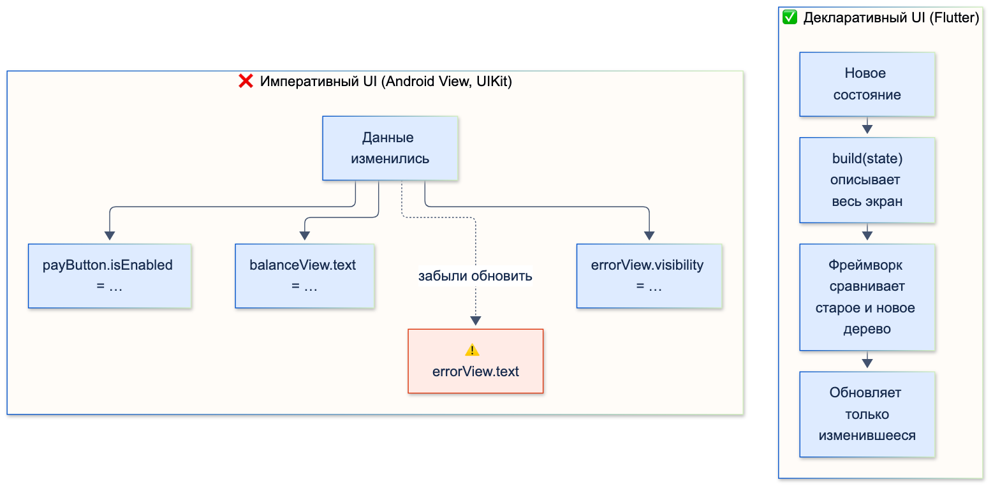
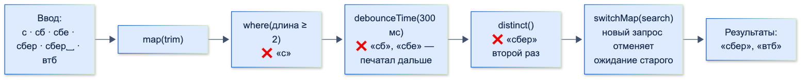

# Парадигмы программирования

| Грейд | Время на изучение | Статус |
|-------|-------------------|--------|
| ⭐⭐⭐ | ~25 мин лекция + практика | ✅ Готово |

---

## 📚 Ресурсы

| Ресурс | Формат | Язык | Уровень | Зачем читать |
|--------|--------|------|---------|--------------|
| [Дока: парадигмы программирования](https://doka.guide/tools/programming-paradigms/) | Статья | 🇷🇺 | ⭐ | Процедурная, ООП, функциональная и логическая парадигмы, императивный и декларативный стили — на простых примерах (JavaScript) |
| Роберт Мартин, «Чистая архитектура» (Питер), главы 3–6 | Книга | 🇷🇺 | ⭐⭐⭐ | Неочевидный взгляд: каждая парадигма не даёт новые возможности, а **отнимает** опасные |
| [Принципы функционального программирования в JavaScript](https://habr.com/ru/companies/ruvds/articles/434112/) | Статья (Habr) | 🇷🇺 | ⭐ | Чистые функции, иммутабельность, ссылочная прозрачность, функции высшего порядка |
| [Реактивное программирование на реальных примерах](https://tproger.ru/translations/reactive-programming) | Статья (перевод Андре Штальца) | 🇷🇺 | ⭐⭐ | Классическое введение: «всё — поток», операторы `map`, `filter`, `merge`, `flatMap` на живом примере |
| [Flutter: Start thinking declaratively](https://docs.flutter.dev/data-and-backend/state-mgmt/declarative) | Документация | 🇬🇧 | ⭐ | Короткая страница о главной идее Flutter: UI = f(state) |
| [Dart: Asynchronous programming: Streams](https://dart.dev/libraries/async/using-streams) | Документация | 🇬🇧 | ⭐⭐ | `Stream` в Dart: подписка, преобразования, обработка ошибок |
| [rxdart](https://pub.dev/packages/rxdart) | Пакет | 🇬🇧 | ⭐⭐ | Реактивные операторы поверх `Stream`: `debounceTime`, `switchMap`, `combineLatest` и `BehaviorSubject` |

---

## 🎓 Лекция

### 1. Что такое парадигма

**Парадигма** — способ думать о программе и структурировать код: из чего программа состоит и как её части взаимодействуют.
Парадигма — это не язык. Dart, Kotlin и Swift — **мультипарадигменные** языки: в одном файле можно писать в разных стилях.

Роберт Мартин в «Чистой архитектуре» формулирует неожиданную мысль: **каждая парадигма не добавляет возможности, а отнимает**.
- **Структурное программирование** отнимает `goto` (неограниченную передачу управления). Взамен — `if`, циклы и функции.
- **ООП** отнимает «сырые» указатели на функции. Взамен — безопасный полиморфизм.
- **Функциональное программирование** отнимает присваивание (изменение переменных). Взамен — неизменяемые данные.

Каждое ограничение защищает от целого класса ошибок. Поэтому парадигмы — это прежде всего **дисциплина**.

Две большие ветви:

| | Императивный стиль | Декларативный стиль |
|---|--------------------|---------------------|
| Описываем | **Как** получить результат: последовательность шагов | **Что** хотим получить |
| Состояние | Меняем явно, шаг за шагом | Описываем результат как функцию от данных |
| Примеры | Процедурное программирование, ООП | Функциональное программирование, SQL, HTML, **UI во Flutter** |

### 2. Императивный и декларативный стиль

**На данных.** Сумма поступлений больше 1000 ₽:

```dart
// Императивно: КАК — завести переменную, пройти циклом, проверить, накопить
int incomeImperative(List<int> operations) {
  var total = 0;
  for (final kopecks in operations) {
    if (kopecks > 100000) {
      total += kopecks;
    }
  }
  return total;
}

// Декларативно: ЧТО — «сумма операций больше 1000 ₽»
int incomeDeclarative(List<int> operations) =>
    operations.where((kopecks) => kopecks > 100000).fold(0, (sum, kopecks) => sum + kopecks);
```

**На интерфейсе — главное отличие Flutter.** В классическом Android (View) или iOS (UIKit) интерфейс **императивный**:
при каждом изменении данных разработчик сам находит нужные элементы и меняет их.

```kotlin
// Android View: вручную синхронизируем каждый элемент с данными
balanceView.text = formatRub(balance)
payButton.isEnabled = balance > 0
errorView.visibility = if (error != null) View.VISIBLE else View.GONE
errorView.text = error
```

Забыл обновить один элемент в одной из веток — интерфейс показывает противоречивое состояние.

Во Flutter интерфейс **декларативный**: мы описываем, **как UI выглядит при данном состоянии**, а фреймворк сам вычисляет,
что изменилось, и обновляет экран. Формула Flutter: **UI = f(state)**.

```dart
class BalanceState {
  const BalanceState({required this.kopecks, this.error});

  final int kopecks;
  final String? error;
}

class BalanceView extends StatelessWidget {
  const BalanceView({super.key, required this.state, required this.onPay});

  final BalanceState state;
  final VoidCallback onPay;

  @override
  Widget build(BuildContext context) => Column(
        children: [
          Text('${state.kopecks ~/ 100} ₽'),
          FilledButton(
            onPressed: state.kopecks > 0 ? onPay : null, // null — кнопка неактивна
            child: const Text('Оплатить'),
          ),
          if (state.error case final error?) Text(error, style: const TextStyle(color: Colors.red)),
        ],
      );
}
```



> ℹ️ **Важно:** декларативность «наверху» стоит на императивном фундаменте. Внутри Flutter сравнивает деревья виджетов
> и **императивно** обновляет элементы и `RenderObject`. Декларативный стиль переносит эту рутину с разработчика на фреймворк.

### 3. ООП

Программа — набор **объектов**, которые хранят состояние и обмениваются сообщениями (вызывают методы друг друга).
Основа — инкапсуляция, наследование, полиморфизм и абстракция. Подробно — в теме «ООП».

Где ООП сильнее всего во Flutter-проекте:
- **структура приложения:** сервисы, репозитории, use case, виджеты как классы;
- **границы и контракты:** абстрактные интерфейсы и полиморфизм позволяют подменять реализации (тесты, разные бэкенды);
- **инкапсуляция изменяемого состояния**, когда оно действительно нужно: `State`, контроллеры, кеши.

Слабое место — **разделяемое изменяемое состояние**. Объект, который меняют из разных мест, сложно понимать и тестировать.
Отсюда интерес к функциональным идеям даже в объектных языках.

### 4. Функциональное программирование (ФП)

Программа — композиция **функций**, которые преобразуют данные, а не меняют их.

#### Чистые функции

**Чистая функция:** результат зависит **только от аргументов**, и нет **побочных эффектов** (не меняет внешнее
состояние, не ходит в сеть, не пишет в базу и не читает текущее время).

```dart
class Loan {
  const Loan({required this.kopecks, required this.dueDate});

  final int kopecks;
  final DateTime dueDate;
}

// ❌ Нечистая: результат зависит от момента вызова. Тест «просрочки» придётся ждать или подменять системное время
int overdueFeeImpure(Loan loan) =>
    DateTime.now().isAfter(loan.dueDate) ? loan.kopecks ~/ 100 : 0;

// ✅ Чистая: всё нужное — в аргументах. Тест — одна строка с любой датой
int overdueFee(Loan loan, DateTime now) => now.isAfter(loan.dueDate) ? loan.kopecks ~/ 100 : 0;
```

Плюсы чистых функций: их легко тестировать, их можно кешировать, они безопасны для параллельного выполнения
(например, в изоляте), и их легко понять — не надо держать в голове внешнее состояние.

> 💡 **Совет:** полностью без побочных эффектов программа бесполезна: нужно показать UI, сходить в сеть, сохранить данные.
> Практичный подход — **«функциональное ядро, императивная оболочка»**. Бизнес-правила и расчёты — чистые функции,
> а эффекты (сеть, база, время, UI) — тонкий слой по краям.

#### Неизменяемость (immutability)

Данные не меняют, а создают **новую версию**. Тогда никто не изменит объект «из-за спины», а сравнить «было» и «стало»
можно простым `==`. На этом построены состояния в BLoC и Riverpod.

```dart
class TransferForm {
  const TransferForm({this.recipient = '', this.kopecks = 0});

  final String recipient;
  final int kopecks;

  TransferForm copyWith({String? recipient, int? kopecks}) =>
      TransferForm(recipient: recipient ?? this.recipient, kopecks: kopecks ?? this.kopecks);
}

void main() {
  const before = TransferForm(recipient: 'Иван');
  final after = before.copyWith(kopecks: 50000); // before не изменился
  print('${before.kopecks} → ${after.kopecks}'); // 0 → 50000
}
```

В Dart неизменяемость обеспечивают `final`-поля, `const`-конструкторы, `List.unmodifiable` и генерация моделей через `freezed`.

#### Функции как значения и функции высшего порядка

В Dart функции — полноценные значения: их можно хранить в переменных, передавать и возвращать.
**Функции высшего порядка** принимают или возвращают функции: `map`, `where`, `fold`, `sort`.

```dart
String formatRub(int kopecks) => '${kopecks ~/ 100} ₽';

// Функция, которая возвращает функцию (замыкание запоминает limit)
bool Function(int) above(int limit) => (kopecks) => kopecks > limit;

void main() {
  final operations = [50000, 250000, 120000];
  final large = operations.where(above(100000)).map(formatRub); // tear-off: передаём саму функцию
  print(large.toList()); // [2500 ₽, 1200 ₽]
}
```

#### Алгебраические типы данных и сопоставление с образцом

В ФП ошибки и варианты результата выражают **типами**, а не исключениями. В Dart 3 для этого есть `sealed`-классы
и `switch`-выражения с проверкой полноты.

```dart
sealed class Result<T> {
  const Result();
}

final class Ok<T> extends Result<T> {
  const Ok(this.value);
  final T value;
}

final class Err<T> extends Result<T> {
  const Err(this.message);
  final String message;
}

Result<int> parseAmount(String input) {
  final rubles = int.tryParse(input.replaceAll(' ', ''));
  if (rubles == null || rubles <= 0) return const Err('Введите сумму больше нуля');
  return Ok(rubles * 100);
}

String describe(Result<int> result) => switch (result) {
      Ok(:final value) => 'Сумма: $value коп.',
      Err(:final message) => 'Ошибка: $message',
    };
```

Компилятор не даст забыть случай ошибки, а сигнатура функции честно говорит, что она может не сработать.

#### Что есть в Dart для ФП, а чего нет

| Есть | Нет «из коробки» |
|------|-------------------|
| Функции как значения, замыкания, tear-off | Неизменяемые коллекции с эффективным копированием (есть в пакетах, например `fast_immutable_collections`) |
| `map`, `where`, `fold`, `expand` | Оптимизация хвостовой рекурсии |
| `sealed`-классы, records, сопоставление с образцом | Каррирование и композиция функций как синтаксис |
| `final`, `const`, `copyWith` (вручную или через `freezed`) | Типы `Either`, `Option`, `Task` (есть в пакете `fpdart`) |

### 5. Реактивное программирование

**Реактивное программирование** — программирование с **асинхронными потоками данных**: код описывает, **как реагировать**
на значения, которые приходят со временем (нажатия, ввод, ответы сервера, обновления курсов). Это развитие паттерна
«Наблюдатель» плюс набор операторов для преобразования потоков.

Где в Dart место потоков:

| | Одно значение | Много значений |
|---|---------------|----------------|
| **Синхронно** (pull: забираем сами) | `T` | `Iterable<T>` |
| **Асинхронно** (push: значения приходят сами) | `Future<T>` | **`Stream<T>`** |

#### `Stream` в Dart

```dart
import 'dart:async';

Future<void> main() async {
  final balance = StreamController<int>.broadcast(); // broadcast — несколько подписчиков

  final subscription = balance.stream
      .distinct() // пропускаем повторы одного и того же значения
      .map((kopecks) => '${kopecks ~/ 100} ₽')
      .listen(print);

  balance
    ..add(150000)
    ..add(150000) // повтор — не попадёт к подписчику
    ..add(90000);

  await Future<void>.delayed(Duration.zero); // даём событиям дойти
  await subscription.cancel(); // отписка обязательна, иначе утечка
  await balance.close();
}
```

- **Single-subscription** поток (по умолчанию) допускает одного слушателя и буферизует события до подписки.
  Подходит для «одноразовых» последовательностей: чтение файла, ответ по частям.
- **Broadcast** поток допускает много слушателей, но события, отправленные до подписки, теряются.
  Подходит для событий и состояния.

#### Операторы: поиск банка по мере ввода

Типичная реактивная задача — поиск по мере ввода. Нужно не дёргать сервер на каждую букву, отбросить слишком короткие запросы,
не повторять одинаковые и **отменить устаревший запрос**, если пользователь продолжил печатать. На `rxdart` это одна цепочка:

```dart
import 'dart:async';

import 'package:rxdart/rxdart.dart';

Stream<List<String>> bankSearch(
  Stream<String> queries,
  Future<List<String>> Function(String query) search,
) =>
    queries
        .map((query) => query.trim())
        .where((query) => query.length >= 2) // короткие запросы не отправляем
        .debounceTime(const Duration(milliseconds: 300)) // ждём паузу в наборе
        .distinct() // тот же запрос второй раз не отправляем
        .switchMap((query) => Stream.fromFuture(search(query))); // новый запрос отменяет ожидание старого
```



Императивная версия того же — таймер, флаги, счётчик последнего запроса и проверки «не устарел ли ответ» —
получается в несколько раз длиннее и чаще содержит ошибки.

#### Реактивность во Flutter

- `Stream` + `StreamBuilder`, `Future` + `FutureBuilder`.
- `ChangeNotifier`, `ValueNotifier` + `ListenableBuilder` / `ValueListenableBuilder`.
- **BLoC** построен на `Stream`: события на входе, поток состояний на выходе.
- **Riverpod**, **MobX**, **Signals** — свои реактивные модели, идея та же: UI подписан на данные и перестраивается сам.

> ⚠️ **Внимание:** частая ошибка — создавать поток **в `build`**: `StreamBuilder(stream: repository.watchBalance(), ...)`.
> Каждый `build` создаёт новый поток и переподписывается, состояние сбрасывается, запросы дублируются.
> Поток нужно создать один раз (в `initState`, в BLoC или в провайдере) и передавать готовым.

### 6. Как парадигмы сочетаются во Flutter-приложении

Хороший Flutter-код не выбирает одну парадигму, а использует каждую там, где она сильнее:

| Задача | Парадигма | Как выглядит |
|--------|-----------|--------------|
| Описание интерфейса | **Декларативная** | `build` возвращает дерево виджетов по состоянию |
| Структура и границы модулей | **ООП** | Классы, интерфейсы репозиториев, DI, полиморфизм |
| Бизнес-правила и расчёты | **Функциональная** | Чистые функции, неизменяемые модели, `sealed` + `switch` |
| Переход «состояние + событие → новое состояние» | **Функциональная** | Обработчик в BLoC/Cubit как чистая функция |
| Потоки данных во времени | **Реактивная** | `Stream`, BLoC, Riverpod, `ValueNotifier` |
| Низкоуровневые оптимизации, работа с платформой | **Императивная** | Циклы, изменяемые буферы, `CustomPainter`, платформенные каналы |

### 🚫 Чрезмерное применение

- **ООП:** класс и интерфейс на каждую функцию; `AmountFormatterService` с одним методом там, где хватает функции верхнего уровня.
- **ФП:** `Either`, `Option` и `TaskEither` из `fpdart` на каждом слое, длинные цепочки без промежуточных имён,
  «бесточечный» стиль, который понятен только автору. Команда должна читать код без курса теории категорий.
- **Иммутабельность любой ценой:** копирование больших коллекций на каждое изменение в горячем цикле. Внутри одной функции
  локальная изменяемая переменная — нормально, если она не «утекает» наружу.
- **Реактивность:** поток там, где хватает `Future` (одно значение); цепочки из 15 операторов `rxdart`, которые невозможно
  отладить; подписки, создающие подписки. Простое однократное действие пусть остаётся простым `await`.
- **Декларативность ради декларативности:** `fold` с хитрым аккумулятором вместо понятного цикла. Если декларативная запись
  читается хуже императивной — выбирай императивную.

---

## ✅ Самопроверка

**⭐ Junior**
1. Чем императивный стиль отличается от декларативного? Приведи пример каждого на Dart.
2. Почему UI во Flutter называют декларативным? Что значит UI = f(state)?
3. Что такое чистая функция?

**⭐⭐ Middle**
1. Чем `Future` отличается от `Stream`? Чем single-subscription поток отличается от broadcast?
2. Зачем нужны неизменяемые модели состояния? Как сделать модель неизменяемой в Dart?
3. Почему нельзя создавать поток прямо в параметре `stream:` у `StreamBuilder` внутри `build`?
4. Как сделать функцию расчёта, зависящую от текущей даты, чистой и тестируемой?

**⭐⭐⭐ Senior**
1. Что, по Мартину, «отнимает» каждая из парадигм: структурная, ООП, функциональная? Зачем это нужно?
2. Что такое «функциональное ядро, императивная оболочка»? Как применить это к Flutter-приложению?
3. Объясни цепочку `debounceTime → distinct → switchMap` для поиска. Что сломается, если заменить `switchMap` на `asyncExpand` или `flatMap`?
4. Когда функциональный стиль (`Either`, цепочки операторов) вредит проекту?

<details>
<summary>Ответы</summary>

**Junior**
1. Императивный описывает шаги (как): цикл с накоплением суммы. Декларативный описывает результат (что): `where(...).fold(...)`.
2. Разработчик не меняет элементы интерфейса вручную, а описывает в `build`, как интерфейс выглядит при данном состоянии. Фреймворк сам вычисляет разницу и обновляет экран. UI — функция от состояния.
3. Функция, результат которой зависит только от аргументов, и у которой нет побочных эффектов: она не меняет внешнее состояние, не обращается к сети, базе, времени.

**Middle**
1. `Future` — одно асинхронное значение (или ошибка). `Stream` — последовательность асинхронных значений во времени. Single-subscription — один слушатель, события буферизуются до подписки. Broadcast — много слушателей, события до подписки теряются.
2. Чтобы состояние нельзя было изменить «из-за спины», чтобы сравнение «было/стало» работало через `==` и чтобы проще было рассуждать и тестировать. В Dart: `final`-поля, `const`-конструктор, `copyWith`, неизменяемые коллекции, `freezed`.
3. `build` вызывается многократно: каждый раз создастся новый поток, `StreamBuilder` переподпишется, состояние сбросится, а запросы или подписки на сервере будут дублироваться. Поток создают один раз вне `build`.
4. Передать текущее время аргументом (`DateTime now`) или внедрить абстракцию часов (`Clock`). В тестах передать фиксированную дату.

**Senior**
1. Структурная отнимает `goto` — неограниченную прямую передачу управления. ООП отнимает указатели на функции, заменяя их безопасным полиморфизмом. ФП отнимает присваивание — изменение состояния. Каждое ограничение убирает целый класс ошибок и делает код предсказуемее.
2. Бизнес-логика и расчёты — чистые функции над неизменяемыми данными, их легко тестировать. Эффекты (сеть, база, время, навигация, UI) — тонкий внешний слой, который вызывает ядро. Во Flutter: модели и правила в domain — чистые; репозитории, BLoC-эффекты и виджеты — оболочка; переходы состояний в BLoC — чистые функции.
3. `debounceTime` ждёт паузу в наборе, `distinct` отбрасывает повтор того же запроса, `switchMap` при новом запросе отписывается от предыдущего. С `asyncExpand` запросы выполнятся строго по очереди, и UI будет «догонять» старые ответы. С `flatMap` ответы будут приходить параллельно и в любом порядке, и устаревший ответ может перезаписать актуальный.
4. Когда команда не владеет подходом и код становится нечитаемым; когда обёртки `Either` и `TaskEither` проходят через все слои без пользы; когда длинные безымянные цепочки сложно отлаживать; когда иммутабельные копии больших данных в горячих местах бьют по производительности.

</details>
