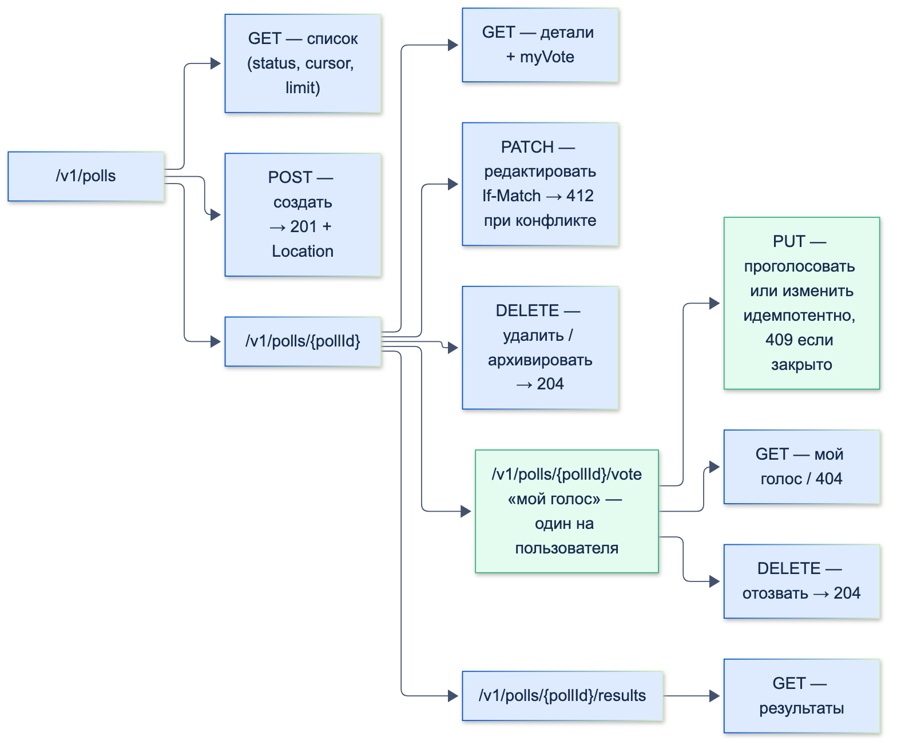

# Проектирование API (контракты, версионирование)

| Грейд | Время на изучение | Статус |
|-------|-------------------|--------|
| ⭐⭐⭐ | ~25 мин лекция + практика | ✅ Готово |

---

## 📚 Ресурсы

| Ресурс | Формат | Язык | Уровень | Зачем читать |
|--------|--------|------|---------|--------------|
| [Сергей Константинов, «API»: глава 37. Номенклатура URL ресурсов. CRUD-операции](https://twirl.github.io/The-API-Book/API.ru.html#http-api-urls-crud) | Книга (бесплатно онлайн) | 🇷🇺 | ⭐⭐ → ⭐⭐⭐ | Лучшая книга об API на русском. Эта глава — почему CRUD лишь стартовая гипотеза, как делать идемпотентное создание, зачем архивировать вместо удаления |
| [Там же: глава 6. Обратная совместимость](https://twirl.github.io/The-API-Book/API.ru.html#intro-back-compat) и [глава 7. О версионировании](https://twirl.github.io/The-API-Book/API.ru.html#intro-versioning) | Книга | 🇷🇺 | ⭐⭐ | Что такое обратная совместимость, сколько поддерживать старые версии, semver |
| [Там же: глава 38. Работа с ошибками в HTTP API](https://twirl.github.io/The-API-Book/API.ru.html#http-api-errors) | Книга | 🇷🇺 | ⭐⭐ | Как проектировать ошибки, чтобы клиент мог на них реагировать |
| [REST API: гайд по проектированию от принципов до боевых кейсов](https://habr.com/ru/companies/otus/articles/1008370/) | Статья (Habr) | 🇷🇺 | ⭐ → ⭐⭐ | Методы, коды ответов, пагинация, ошибки, идемпотентность — с кейсами из финтеха |
| [MDN: методы HTTP](https://developer.mozilla.org/ru/docs/Web/HTTP/Reference/Methods) | Справочник | 🇷🇺 | ⭐ | Точная семантика каждого метода |
| [Google AIP-180: Backwards compatibility](https://google.aip.dev/180) | Гайдлайн | 🇬🇧 | ⭐⭐⭐ | Чёткий список: какие изменения совместимы, какие ломают клиентов |
| [Tolerant Reader](https://martinfowler.com/bliki/TolerantReader.html) | Статья (Мартин Фаулер) | 🇬🇧 | ⭐⭐ | Как писать клиент, который не ломается от изменений сервера |
| [RFC 9457: Problem Details for HTTP APIs](https://www.rfc-editor.org/rfc/rfc9457) | Стандарт (RFC — официальный документ со стандартом интернета) | 🇬🇧 | ⭐⭐⭐ | Стандартный формат ошибок HTTP API |

---

## 🎓 Лекция

### 1. Что такое контракт API

**Контракт API** — договорённость между клиентом и сервером: какие есть эндпоинты, какие данные в запросе и ответе,
какие ошибки возможны и что они означают. Пока контракт соблюдается, клиент и сервер можно менять независимо.

Почему это особенно важно в мобильной разработке: **приложение нельзя «обновить у всех сразу»**. Веб-фронтенд выкатывается
вместе с бэкендом, а мобильное приложение версии полугодовой давности ещё живёт на телефонах пользователей.
Любое изменение контракта должно учитывать старые версии клиента.

#### Что такое RFC

Дальше на странице встречаются ссылки вида «RFC 9457». **RFC** (*Request for Comments*, «запрос комментариев») —
официальные документы со стандартами интернета: протоколами, форматами данных, заголовками. Их публикует
**IETF** — организация, которая разрабатывает интернет-стандарты. Читать их можно бесплатно на rfc-editor.org.

- **У каждого RFC свой номер, и опубликованный документ не меняется.** Чтобы обновить стандарт, выпускают новый RFC,
  а старый помечают устаревшим. Например, формат ошибок HTTP API сначала описывал RFC 7807, а в 2023 году его заменил RFC 9457.
- **Название историческое.** В 1969 году так оформляли черновики для обсуждения, а потом под тем же именем стали выходить
  и утверждённые стандарты.
- **Не каждый RFC обязателен.** Есть стандарты, рекомендации, экспериментальные и даже шуточные документы.
  Из первоапрельского RFC 2324 о кофеварке пришёл код ответа `418 I'm a teapot`.

| RFC | Что описывает |
|-----|---------------|
| RFC 9110 | Семантика HTTP: методы, коды ответа, заголовки |
| RFC 7396 | JSON Merge Patch — формат частичного обновления для `PATCH` |
| RFC 9457 | Problem Details — единый формат ошибок HTTP API |
| RFC 8594, RFC 9745 | Заголовки `Sunset` и `Deprecation` для вывода API из эксплуатации |

> 💡 **Совет:** ссылка на RFC — сильный аргумент в споре о контракте: «по стандарту `PUT` идемпотентен, см. RFC 9110».

### 2. Инструменты: методы HTTP и чем они отличаются

| Метод | Назначение | Тело запроса | Только чтение (safe) | Можно повторить (идемпотентный) | Типичный ответ |
|-------|------------|:------------:|:--------------------:|:-------------------------------:|----------------|
| `GET` | Получить ресурс или список | Нет | ✅ | ✅ | `200` |
| `POST` | Создать ресурс в коллекции или выполнить действие | Да | ❌ | ❌ | `201` + `Location`, или `200` |
| `PUT` | Создать или **полностью заменить** ресурс по известному URL | Да | ❌ | ✅ | `200` или `201` |
| `PATCH` | **Частично** изменить ресурс | Да | ❌ | ❌ (не гарантируется) | `200` |
| `DELETE` | Удалить ресурс | Обычно нет | ❌ | ✅ | `204` |

- **Только чтение (safe)** — запрос ничего не меняет на сервере. Таких методов четыре: `GET`, `HEAD`, `OPTIONS`, `TRACE` (последний в мобильной разработке не встречается).
- **Можно повторить (идемпотентный)** — после двух одинаковых запросов на сервере то же состояние, что и после одного.
  Запрос при этом **может менять** данные: `PUT` и `DELETE` меняют, но повтор ничего не испортит.
  Например, `PUT /polls/123/vote {"optionIds": ["opt_2"]}` дважды — это всё тот же один голос за `opt_2`,
  а `POST /polls` дважды создаст **два** голосования.
- Всё, что «только чтение», автоматически «можно повторить». Обратное неверно.

**PUT, PATCH и POST — главный вопрос на собеседовании:**
- **`POST /polls`** — «создай новое голосование, id придумай сам». Два одинаковых запроса создадут **два** голосования.
- **`PUT /polls/{id}/vote`** — «пусть по этому адресу будет вот это». Клиент знает URL, и повтор ничего не меняет:
  результат тот же. Отправляется **полное** представление ресурса.
- **`PATCH /polls/{id}`** — «измени вот эти поля». Отправляются только изменённые поля. Удобно для редактирования формы.
  Популярный формат — JSON Merge Patch (RFC 7396): переданное поле заменяется, `null` удаляет значение, отсутствующие поля не трогаются.

### 3. Задача с собеседования: API «голосовалки»

> ✍️ **Условие.** Спроектируй (устно) API для приложения-голосовалки. Пользователь может посмотреть голосования,
> проголосовать, изменить свой голос, отозвать его. Автор голосования может его создать, отредактировать и удалить.
> Какие методы будут в API-клиенте? Какие эндпоинты и примерные контракты?

Разбираем по шагам — так же, как стоит рассуждать вслух на собеседовании.

#### Шаг 1. Выделяем ресурсы

| Ресурс | Что это | Кто меняет |
|--------|---------|------------|
| **Poll** — голосование | Вопрос, варианты ответа, срок, статус | Автор |
| **Option** — вариант ответа | Текст варианта внутри голосования | Автор |
| **Vote** — голос | Выбор пользователя в конкретном голосовании | Каждый пользователь — только свой |
| **Results** — результаты | Сколько голосов у каждого варианта | Никто: вычисляются сервером |

Ключевое наблюдение: **у пользователя в голосовании не больше одного голоса**. Значит, голос — это не элемент
коллекции, которую можно бесконечно пополнять, а **один ресурс «мой голос»** внутри голосования. Пользователя
определяем по токену авторизации, а не по `userId` в URL: иначе клиент сможет подставить чужой id.

#### Шаг 2. Эндпоинты



| Действие | Метод и URL | Успешный ответ |
|----------|-------------|----------------|
| Список голосований | `GET /v1/polls?status=active&cursor=…&limit=20` | `200` + страница |
| Детали голосования | `GET /v1/polls/{pollId}` | `200` |
| Создать голосование | `POST /v1/polls` | `201` + `Location: /v1/polls/{pollId}` |
| Отредактировать | `PATCH /v1/polls/{pollId}` | `200` |
| Удалить (или архивировать) | `DELETE /v1/polls/{pollId}` | `204` |
| Проголосовать или изменить голос | `PUT /v1/polls/{pollId}/vote` | `200` |
| Посмотреть свой голос | `GET /v1/polls/{pollId}/vote` | `200` или `404`, если не голосовал |
| Отозвать голос | `DELETE /v1/polls/{pollId}/vote` | `204` |
| Результаты | `GET /v1/polls/{pollId}/results` | `200` |

**Почему голос — это `PUT`, а не `POST`.** Вариант с коллекцией голосов (`POST /polls/{pollId}/votes`,
затем `PATCH`/`DELETE /votes/{voteId}`) тоже рабочий. Но `PUT` на единственный ресурс «мой голос»:
- **идемпотентен** — если ответ потерялся по таймауту, клиент спокойно повторяет запрос, и второй голос не появится;
- **объединяет** «проголосовать» и «изменить голос» в одну операцию;
- **не требует хранить `voteId`** на клиенте.

#### Шаг 3. Контракты

Голосование в ответе сервера:

```json
{
  "id": "poll_8f3k2",
  "title": "Какой дизайн главного экрана оставить?",
  "status": "active",
  "multipleChoice": false,
  "closesAt": "2026-11-01T21:00:00Z",
  "author": { "id": "usr_17", "name": "Анна" },
  "options": [
    { "id": "opt_1", "text": "Вариант А" },
    { "id": "opt_2", "text": "Вариант Б" }
  ],
  "myVote": { "optionIds": ["opt_2"], "votedAt": "2026-10-06T09:15:00Z" },
  "revision": "7"
}
```

Создание голосования — `POST /v1/polls`:

```json
{
  "title": "Какой дизайн главного экрана оставить?",
  "options": ["Вариант А", "Вариант Б"],
  "multipleChoice": false,
  "closesAt": "2026-11-01T21:00:00Z"
}
```

Голос — `PUT /v1/polls/{pollId}/vote`:

```json
{ "optionIds": ["opt_2"] }
```

Список — страница с курсором:

```json
{
  "items": [ { "id": "poll_8f3k2", "title": "…", "status": "active", "totalVotes": 42 } ],
  "nextCursor": "eyJpZCI6InBvbGxfOGYzazIifQ"
}
```

Ошибка — единый формат по RFC 9457 (Problem Details):

```json
{
  "type": "https://api.example.com/errors/poll-closed",
  "title": "Голосование завершено",
  "status": 409,
  "detail": "Голосование закрылось 1 ноября в 21:00, изменить голос нельзя",
  "code": "POLL_CLOSED"
}
```

Решения в контракте, которые стоит проговорить:
- **id — строки,** даже если в базе это числа: формат id можно будет поменять, не ломая клиентов.
- **Даты — ISO 8601 в UTC** (`2026-11-01T21:00:00Z`). Часовой пояс клиент применяет сам при отображении.
- **Перечисления — строки** (`"active"`, `"closed"`), а не числа: так читаемо и расширяемо.
- **`myVote` прямо в голосовании** — экрану не нужен второй запрос.
- **`revision`** — версия ресурса для защиты от одновременного редактирования (см. ниже).
- **Машиночитаемый `code` в ошибке** — клиент реагирует на код, а не на текст (текст может поменяться или быть локализован).

#### Шаг 4. Ошибки и коды ответа

| Ситуация | Код |
|----------|-----|
| Нет токена или он истёк | `401 Unauthorized` |
| Редактирует или удаляет не автор | `403 Forbidden` |
| Голосование не найдено | `404 Not Found` |
| Голос за вариант, которого нет в голосовании; пустой заголовок; два варианта в голосовании с одним выбором | `422 Unprocessable Content` (или `400`) |
| Голос в закрытом голосовании | `409 Conflict` |
| Автор правит голосование, которое уже изменили с другого устройства | `412 Precondition Failed` (при `If-Match`) |
| Слишком частые запросы | `429 Too Many Requests` |

**Одновременное редактирование.** Автор открыл редактирование на телефоне и на планшете. Чтобы второе сохранение
не затёрло первое незаметно, клиент отправляет версию, которую видел: `If-Match: "7"` (из `revision` или заголовка `ETag`).
Если на сервере уже версия `8`, он ответит `412`, и клиент предложит обновить данные.

#### Шаг 5. API-клиент на Dart

Именно этот список методов обычно и ждут на собеседовании:

```dart
enum PollStatus { draft, active, closed, unknown }

abstract interface class PollsApi {
  Future<PollsPage> getPolls({PollStatus? status, String? cursor, int limit = 20});
  Future<Poll> getPoll(String pollId);
  Future<Poll> createPoll(CreatePollRequest request);
  Future<Poll> updatePoll(String pollId, UpdatePollRequest request, {required String revision});
  Future<void> deletePoll(String pollId);

  Future<Vote> vote(String pollId, List<String> optionIds); // PUT: проголосовать или изменить голос
  Future<Vote?> getMyVote(String pollId); // null, если ещё не голосовал
  Future<void> revokeVote(String pollId); // DELETE

  Future<PollResults> getResults(String pollId);
}
```

Как выглядят модели и пара методов реализации:

```dart
import 'dart:convert';

import 'package:http/http.dart' as http;

enum PollStatus {
  draft,
  active,
  closed,
  unknown; // для значений, которых клиент ещё не знает

  static PollStatus fromJson(String value) =>
      values.firstWhere((status) => status.name == value, orElse: () => unknown);
}

class Vote {
  const Vote({required this.optionIds, required this.votedAt});

  factory Vote.fromJson(Map<String, dynamic> json) => Vote(
        optionIds: (json['optionIds'] as List<dynamic>).cast<String>(),
        votedAt: DateTime.parse(json['votedAt'] as String),
      );

  final List<String> optionIds;
  final DateTime votedAt;
}

class ApiException implements Exception {
  const ApiException(this.status, this.code, this.message);

  final int status;
  final String code; // машиночитаемый код: POLL_CLOSED, OPTION_NOT_FOUND, …
  final String message;

  @override
  String toString() => 'ApiException($status, $code): $message';
}

class HttpPollsApi {
  HttpPollsApi(this._client, this._baseUrl);

  final http.Client _client;
  final Uri _baseUrl;

  Future<Vote> vote(String pollId, List<String> optionIds) async {
    final response = await _client.put(
      _baseUrl.resolve('/v1/polls/$pollId/vote'),
      headers: {'Content-Type': 'application/json'},
      body: jsonEncode({'optionIds': optionIds}),
    );
    return Vote.fromJson(_decode(response) as Map<String, dynamic>);
  }

  Future<Vote?> getMyVote(String pollId) async {
    final response = await _client.get(_baseUrl.resolve('/v1/polls/$pollId/vote'));
    if (response.statusCode == 404) return null; // не голосовал — это не ошибка
    return Vote.fromJson(_decode(response) as Map<String, dynamic>);
  }

  Future<void> revokeVote(String pollId) async {
    final response = await _client.delete(_baseUrl.resolve('/v1/polls/$pollId/vote'));
    _decode(response);
  }

  Object? _decode(http.Response response) {
    // Не response.body: для application/problem+json без charset http декодирует latin1 и ломает кириллицу
    final text = utf8.decode(response.bodyBytes);
    final body = text.isEmpty ? null : jsonDecode(text);
    if (response.statusCode >= 200 && response.statusCode < 300) return body;
    final problem = body is Map<String, dynamic> ? body : const <String, dynamic>{};
    throw ApiException(
      response.statusCode,
      problem['code'] as String? ?? 'UNKNOWN',
      problem['detail'] as String? ?? problem['title'] as String? ?? 'Ошибка ${response.statusCode}',
    );
  }
}
```

Авторизацию, повторы и логирование в реальном проекте добавляют интерцепторами `dio`, а не в каждом методе.

#### Как выглядит ответ на разных уровнях

| Уровень | Что обычно говорит кандидат |
|---------|-----------------------------|
| ⭐ Junior | Называет CRUD-методы, правильно сопоставляет GET/POST/PUT/DELETE с действиями, знает основные коды ответа |
| ⭐⭐ Middle | Выделяет ресурсы и вложенность, объясняет PUT против PATCH, проектирует JSON-контракты и единый формат ошибок, предлагает пагинацию для списка |
| ⭐⭐⭐ Senior | Замечает, что голос — единственный ресурс «мой голос», и выбирает идемпотентный `PUT`. Берёт пользователя из токена, а не из URL. Предусматривает одновременное редактирование (`If-Match`/`412`), закрытое голосование (`409`), курсорную пагинацию. Думает о версионировании и о том, как старые версии приложения переживут изменения: неизвестный статус, новые поля. Предлагает архивировать, а не удалять голосование, у которого уже есть голоса |

### 4. Правила хорошего контракта

| Тема | Правило |
|------|---------|
| URL | Ресурсы во множественном числе (`/polls`), вложенность — только при однозначном подчинении и не глубже 2 уровней |
| Действия, которые не ложатся на CRUD | Отдельный ресурс-действие: `POST /v1/polls/{id}/close`. Не надо натягивать каждое действие на `PATCH status` |
| Идентификаторы | Строки, непрозрачные для клиента |
| Даты | ISO 8601 в UTC |
| Деньги | В минимальных единицах (`150000` копеек) или строкой (`"1500.00"`) плюс код валюты. Никогда не `double` |
| Имена полей | Один стиль во всём API (`camelCase` или `snake_case`) |
| Списки | **Всегда** с пагинацией, даже если сейчас элементов мало |
| Ошибки | Единый формат, машиночитаемый `code`, понятный `detail` |
| Повторы | Идемпотентные операции (`PUT`, `DELETE`) или `Idempotency-Key` для `POST` |
| Одновременное редактирование | `ETag` / `revision` + `If-Match`, ответ `412` при конфликте |

**Пагинация: offset или курсор?**

| | Offset (`?offset=40&limit=20`) | Курсор (`?cursor=…&limit=20`) |
|---|--------------------------------|-------------------------------|
| Переход на произвольную страницу | ✅ | ❌ |
| Стабильность при добавлении элементов | ❌ Элементы «съезжают»: дубли и пропуски при прокрутке | ✅ |
| Производительность на больших данных | Падает с ростом offset | Стабильная |
| Где использовать | Таблицы с номерами страниц | **Бесконечные ленты в мобильных приложениях** |

### 5. Версионирование

#### Совместимые и ломающие изменения

| ✅ Совместимые (можно в рамках версии) | ❌ Ломающие (нужна новая мажорная версия) |
|---------------------------------------|-------------------------------------------|
| Новый эндпоинт | Удаление или переименование эндпоинта или поля |
| Новое **необязательное** поле в ответе | Изменение типа поля (`int` → `string`) |
| Новый **необязательный** параметр запроса | Новый **обязательный** параметр или поле запроса |
| Новое значение enum **в запросе** | Изменение значения по умолчанию или смысла поля |
| | Новое значение enum **в ответе** — ⚠️ для клиентов, которые его не ожидают |

> ⚠️ **Внимание:** новое значение enum в ответе формально считается совместимым изменением, но на мобильных оно
> регулярно ломает старые версии приложения. Если в приложении `PollStatus.values.byName(json['status'])`,
> то новый статус `"archived"` уронит разбор ответа у всех, кто не обновился. Поэтому клиент должен быть **терпимым** (см. ниже).

#### Где указывать версию

| Способ | Пример | Комментарий |
|--------|--------|-------------|
| В пути URL | `/v1/polls` | Самый распространённый. Видно в логах и мониторинге, легко маршрутизировать |
| В заголовке | `Accept: application/vnd.bank.v2+json` или `X-Api-Version: 2` | URL «чище», но версию не видно глазами, сложнее отлаживать |
| В query-параметре | `/polls?version=2` | Встречается редко |

Константинов в книге «API» приводит сильный аргумент за версию в пути: другие способы имеют смысл, только если при смене
мажорной версии URL ресурсов остаются прежними. Но если структуру ресурсов можно сохранить, то и ломать совместимость
незачем.

Практическая схема для мобильного API:
1. **Мажорная версия в URL** (`/v1/`), внутри версии — только совместимые изменения.
2. **Новая мажорная версия — редкое событие.** Старую поддерживают, пока ей пользуется заметная доля установленных приложений.
3. **Сервер сообщает о выводе из эксплуатации** заголовками `Deprecation` (RFC 9745) и `Sunset` (RFC 8594).
   Клиент пишет их в аналитику, и команда видит, сколько пользователей на старом API.
4. **Минимальная поддерживаемая версия приложения** и экран «Обновите приложение» — крайняя мера для тех, кто остался
   на неподдерживаемой версии.

#### Терпимый клиент (Tolerant Reader)

Мартин Фаулер: **читай из ответа только то, что нужно, и не падай на неожиданном.**
- Игнорируй неизвестные поля (в Dart `fromJson` так и работает, если не проверять ключи специально).
- Для enum всегда есть вариант `unknown`, как `PollStatus.fromJson` выше, и UI умеет его показать нейтрально.
- Новые поля в модели делай nullable или с разумным значением по умолчанию: старый сервер их не пришлёт.
- Не завязывайся на порядок полей и на текст ошибок — только на `code`.

### 6. Contract-first и OpenAPI

Удобный процесс в команде — **сначала контракт, потом код**:
1. Бэкенд и мобильные разработчики вместе описывают API в **OpenAPI** (`openapi.yaml`): эндпоинты, модели, ошибки.
2. Контракт проходит ревью как код.
3. Из него **генерируются** клиент на Dart (`openapi-generator`, `retrofit` + `json_serializable`) и заглушки сервера.
4. Мобильная команда начинает работу на моках по контракту, не дожидаясь готового бэкенда.
5. Контрактные тесты проверяют, что сервер и клиент соответствуют описанию.

### ⚠️ Частые ошибки

- **Глаголы в URL и всё через `POST`:** `POST /getPolls`, `POST /deleteVote`. Теряется семантика HTTP: кеширование, идемпотентность, понятные логи.
- **`userId` в URL для своих данных:** `/users/123/votes`. Пользователя нужно брать из токена, иначе легко получить доступ к чужим данным.
- **Список без пагинации** «потому что голосований мало». Через год их тысячи, а контракт уже не поменять.
- **`200 OK` с `{"error": "…"}` внутри.** Ломает интерцепторы, повторы, мониторинг. Ошибка — это код 4xx или 5xx.
- **Строгий разбор enum на клиенте** (`values.byName`) без запасного варианта. Новый статус на сервере роняет старые версии приложения.
- **Переименование поля «в рамках рефакторинга»** без новой версии API.
- **Кириллица в ошибках превращается в «ÐзмениÑÑ…».** `package:http` декодирует `response.body` как UTF-8 только для `application/json`. Для `application/problem+json` и других типов без `charset` он берёт latin1. Надёжнее читать `utf8.decode(response.bodyBytes)`.
- **Неидемпотентное голосование через `POST` без защиты:** повтор по таймауту создаёт второй голос или ошибку «уже голосовал» вместо успеха.

---

## ✅ Самопроверка

**⭐ Junior**
1. Какие методы HTTP ты знаешь? Какие из них идемпотентны?
2. Чем `PUT` отличается от `PATCH`?
3. Какие коды ответа вернёт сервер при успешном создании, удалении, ошибке валидации, отсутствии прав?

**⭐⭐ Middle**
1. Спроектируй эндпоинты голосовалки: список, детали, создание, редактирование, удаление, голос, отзыв голоса.
2. Как организовать пагинацию для бесконечной ленты голосований? Почему не offset?
3. Как выглядит хороший формат ошибки и почему в нём нужен машиночитаемый код?

**⭐⭐⭐ Senior**
1. Почему для голоса лучше `PUT /polls/{id}/vote`, а не `POST /polls/{id}/votes`?
2. Два устройства автора одновременно редактируют голосование. Как не потерять изменения?
3. Какие изменения API ломают старые версии мобильного приложения? Как их избежать?
4. Где указывать версию API и как выводить старую версию из эксплуатации?

<details>
<summary>Ответы</summary>

**Junior**
1. GET, POST, PUT, PATCH, DELETE (а также HEAD, OPTIONS). Идемпотентны GET, PUT, DELETE, HEAD, OPTIONS. POST — нет, PATCH — не гарантированно.
2. `PUT` заменяет ресурс целиком (передаётся полное представление) и идемпотентен. `PATCH` меняет только переданные поля и в общем случае не идемпотентен.
3. Создание — `201 Created` (с `Location`), удаление — `204 No Content`, ошибка валидации — `422` (или `400`), нет прав — `403` (а если не авторизован вообще — `401`).

**Middle**
1. `GET /v1/polls`, `GET /v1/polls/{id}`, `POST /v1/polls`, `PATCH /v1/polls/{id}`, `DELETE /v1/polls/{id}`, `PUT /v1/polls/{id}/vote`, `DELETE /v1/polls/{id}/vote`, плюс `GET /v1/polls/{id}/results`.
2. Курсорная пагинация: сервер возвращает `nextCursor`, клиент передаёт его в следующем запросе. Offset при добавлении новых голосований сдвигает элементы: появляются дубли и пропуски, а на больших данных такие запросы ещё и медленные.
3. Единый формат (например, RFC 9457): `status`, `title`, `detail`, `type` и машиночитаемый `code`. Клиент принимает решения по `code` (показать экран «голосование закрыто», предложить обновить данные), а не по тексту, который может меняться и переводиться.

**Senior**
1. У пользователя в голосовании максимум один голос, то есть это единственный ресурс с известным URL. `PUT` идемпотентен: повтор после таймаута безопасен. Одна операция покрывает и «проголосовать», и «изменить голос». Клиенту не нужно хранить `voteId`.
2. Оптимистическая блокировка: ресурс содержит версию (`revision` или `ETag`). Клиент отправляет `PATCH` с `If-Match: "<версия>"`. Если версия на сервере уже другая — `412 Precondition Failed`, и клиент показывает актуальные данные и предлагает повторить изменение.
3. Удаление и переименование полей и эндпоинтов, смена типа, новые обязательные поля запроса, смена смысла или значения по умолчанию. Практически — ещё и новые значения enum в ответе. Защита: только совместимые изменения внутри версии, терпимый клиент (`unknown` для enum, nullable-поля, игнорирование неизвестного), мажорная версия для ломающих изменений.
4. Обычно мажорная версия в пути (`/v1/`). Вывод из эксплуатации: заголовки `Deprecation` и `Sunset`, аналитика по версиям клиентов, поддержка старой версии, пока ей пользуется заметная доля, и минимальная поддерживаемая версия приложения с экраном обновления как крайняя мера.

</details>
