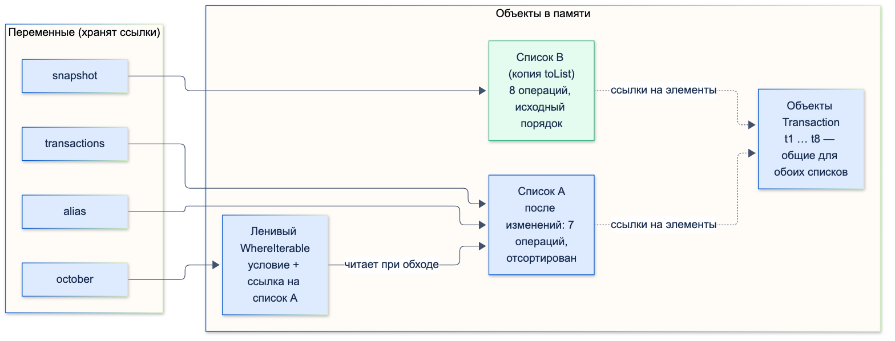
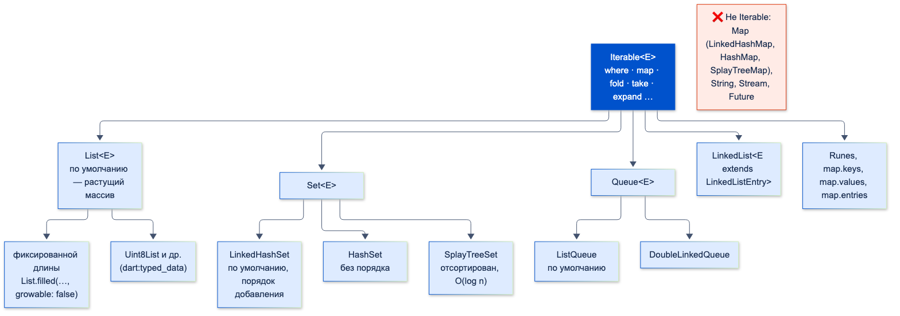

# Основы синтаксиса и коллекции

| Грейд | Время на изучение | Статус |
|-------|-------------------|--------|
| ⭐ | ~30 мин лекция + практика | ✅ Готово |

---

## 📚 Ресурсы

| Ресурс | Формат | Язык | Уровень | Зачем читать |
|--------|--------|------|---------|--------------|
| [Metanit: Late и отложенная инициализация](https://metanit.com/dart/tutorial/4.15.php) | Учебник | 🇷🇺 | ⭐ | `late`, `late final`, ленивая инициализация и ошибка обращения до присваивания — на коротких примерах |
| [Встроенные коллекции Dart](https://habr.com/ru/companies/friflex/articles/819503/) | Статья (Habr, глава из книги «Основы Dart») | 🇷🇺 | ⭐⭐ | Все реализации `Map`, `Set`, `Queue`, `LinkedList` из `dart:collection` и их сложность |
| [Dart: Variables](https://dart.dev/language/variables) | Документация | 🇬🇧 | ⭐ | Официально о `var`, `final`, `const`, `late` |
| [Dart: Iterable collections](https://dart.dev/libraries/collections/iterables) | Документация | 🇬🇧 | ⭐ | Методы `Iterable` и их ленивость |
| [dart:collection](https://api.dart.dev/dart-collection/dart-collection-library.html) | Справочник API | 🇬🇧 | ⭐⭐ | Все коллекции стандартной библиотеки с описанием сложности операций |
| [package:collection](https://pub.dev/packages/collection) | Пакет | 🇬🇧 | ⭐⭐ | `groupBy`, `sortedBy`, `firstWhereOrNull`, `sum`, сравнение коллекций — то, чего нет в стандартной библиотеке |
| [Understanding null safety](https://dart.dev/null-safety/understanding-null-safety) | Документация | 🇬🇧 | ⭐⭐⭐ | Глубоко: продвижение типов, `late`, почему поля не продвигаются |

---

## 🎓 Лекция

### 1. Шпаргалка по базе: только неочевидное

Базовый синтаксис Dart похож на Java, Kotlin и JavaScript. Ниже — по строчке на каждую конструкцию и то, на чём
спотыкаются даже опытные разработчики.

| Конструкция | Коротко | Неочевидный момент |
|-------------|---------|--------------------|
| `var x = 1;` | Тип выводится из значения: `int` | `var x;` **без** значения — это `dynamic`: туда можно положить и число, и строку |
| `int`, `double`, `num` | Целые, дробные, их общий тип | `7 ~/ 2 == 3` — целочисленное деление. `/` всегда возвращает `double` |
| `dynamic` и `Object?` | Оба «что угодно» | `dynamic` отключает проверки компилятора (ошибка всплывёт во время работы), `Object?` — нет. Предпочитай `Object?` |
| `String` | `'Баланс: ${balance ~/ 100} ₽'` | `r'\d+'` — raw-строка без экранирования, удобно для `RegExp` |
| `?` `!` `??` `??=` `?.` | Null safety | `!` — это обещание компилятору. Если ошибся, будет исключение во время работы |
| Продвижение типа | После `if (x != null)` переменная `x` считается не-null | Работает для локальных переменных и **приватных `final`-полей** (Dart 3.2+). Для публичных полей, геттеров и изменяемых полей — нет: скопируй в локальную переменную |
| Параметры функций | `{}` именованные, `[]` необязательные позиционные | Именованные по умолчанию **необязательные**, для обязательных нужен `required`. Значения по умолчанию должны быть `const` |
| Коллекционные `if`, `for`, `...` | `[if (isVip) vipCard, for (final a in accounts) a.title, ...extra]` | `...?list` — распаковка, если `list` может быть `null` |
| Каскад `..` | `StringBuffer()..write('a')..write('b')` | Возвращает исходный объект, а не результат метода. Отсюда приём `list..sort()` |
| Records | `(String, int) pair = ('RUB', 100);` | Сравниваются по значению: `('a', 1) == ('a', 1)` — `true` |
| Patterns и `switch` | `final (name, kopecks) = pair;` | `switch`-выражение по `sealed`-классу проверяется на полноту на этапе компиляции |
| Исключения | `try { … } on FormatException catch (e, stack) { … }` | `Exception` — ожидаемые ситуации, их ловят. `Error` (`StateError`, `RangeError`) — ошибка программиста, её исправляют, а не ловят |

### 2. `var`, `final`, `const`, `late`: в чём разница

| Объявление | Когда вычисляется значение | Можно присвоить заново | Объект можно изменить | Где можно использовать |
|------------|---------------------------|:----------------------:|:---------------------:|------------------------|
| `var` / тип | В момент объявления | ✅ | ✅ | Везде |
| `final` | Во время работы, один раз | ❌ | ✅ | Везде |
| `const` | **Во время компиляции** | ❌ | ❌ (глубоко) | Локальные переменные, верхний уровень, `static const` |
| `late` | Позже, до первого чтения | ✅ | ✅ | Поля, верхний уровень, локальные переменные |
| `late final` | Позже, **один раз** | ❌ | ✅ | Поля, верхний уровень, локальные переменные |
| `late final x = вычисление();` | **При первом обращении** (лениво) | ❌ | ✅ | Поля и верхний уровень |

#### `final` — нельзя переназначить ссылку, но можно менять объект

```dart
void main() {
  final accounts = ['40817…0001'];
  accounts.add('40817…0002'); // ✅ объект меняется
  // accounts = []; ❌ ошибка компиляции: ссылку переназначить нельзя
  print(accounts); // [40817…0001, 40817…0002]
}
```

#### `const` — константа времени компиляции, неизменяемая целиком

```dart
void main() {
  const currencies = ['RUB', 'USD'];
  try {
    currencies.add('EUR');
  } on UnsupportedError catch (e) {
    print(e); // Unsupported operation: Cannot add to an unmodifiable list
  }

  // Одинаковые const-объекты — один и тот же экземпляр в памяти
  print(identical(const ['RUB'], const ['RUB'])); // true
  print(identical(['RUB'], ['RUB'])); // false
}
```

Что важно знать про `const`:
- **Ошибка всплывает во время работы, а не при компиляции.** Тип `const` списка — обычный `List`, и `add` компилируется.
- **Неизменяемость глубокая.** В `const [[1], [2]]` вложенные списки тоже `const`: `const` распространяется на всё выражение.
- **Канонизация.** Одинаковые `const`-значения существуют в одном экземпляре. Во Flutter это даёт главное преимущество:
  `const`-виджет не пересоздаётся, и фреймворк пропускает перестроение его поддерева.
- **Поле экземпляра не может быть `const`**, только `static const`. Для поля экземпляра — `final`.
- **`const`-конструктор** возможен, только если все поля `final`, а инициализаторы — тоже константы.

#### `late` — «присвою позже, проверь во время работы»

`late` снимает с компилятора проверку «переменная точно инициализирована» и переносит её на время работы.

```dart
class TransferScreenController {
  late int limitKopecks; // присвоим в init()
  late final String sessionId; // присвоим один раз позже

  void init(int limit) {
    limitKopecks = limit;
    sessionId = 'sess-42';
  }
}

void main() {
  final controller = TransferScreenController();
  try {
    print(controller.limitKopecks);
  } on Error catch (e) {
    print(e); // LateInitializationError: Field 'limitKopecks' has not been initialized.
  }

  controller.init(60000000);
  try {
    controller.sessionId = 'sess-43';
  } on Error catch (e) {
    print(e); // LateInitializationError: Field 'sessionId' has already been initialized.
  }
}
```

> ⚠️ **Внимание:** `LateInitializationError` — это `Error`, а не `Exception`, то есть ошибка программиста.
> `late` без инициализатора — обещание «я точно присвою до чтения». Если в этом есть сомнения, честнее
> сделать поле nullable (`int?`) и обрабатывать `null`.

#### Ленивая инициализация: `late final` с инициализатором

```dart
int computeLimit(String who) {
  print('  вычисляю: $who');
  return 1;
}

final topLevelLimit = computeLimit('top-level final'); // верхний уровень — всегда лениво

class LimitsService {
  static final dailyLimit = computeLimit('static final'); // static — тоже всегда лениво
  final int eager = computeLimit('обычное final поле'); // при создании объекта
  late final int heavy = computeLimit('late final поле'); // при первом чтении
}

void main() {
  print('1. Старт');
  final service = LimitsService();
  print('2. Объект создан');
  print('3. ${service.heavy} ${service.heavy}'); // вычислится один раз
  print('4. ${LimitsService.dailyLimit}');
  print('5. $topLevelLimit');
}
```

```text
1. Старт
  вычисляю: обычное final поле
2. Объект создан
  вычисляю: late final поле
3. 1 1
  вычисляю: static final
4. 1
  вычисляю: top-level final
5. 1
```

- **Переменные верхнего уровня и `static`-поля в Dart всегда ленивые**, даже без `late`. Они вычисляются при первом обращении,
  а не при старте программы.
- **`late final` с инициализатором** — способ сделать ленивым поле экземпляра: тяжёлое вычисление выполнится, только если поле
  кому-то понадобилось, и один раз. Внутри инициализатора можно обращаться к `this`, в отличие от обычного поля.

#### Что выбрать

1. По умолчанию — **`final`**.
2. Значение известно при компиляции (лимиты, ключи, `EdgeInsets`, виджеты) — **`const`**.
3. Переменную действительно нужно переназначать — **`var`** или явный тип.
4. Значение появится позже, и ты **гарантированно** присвоишь его до чтения (например, в `initState`) — **`late`**.
5. Дорогое вычисление, которое может не понадобиться, — **`late final x = …`**.

### 3. Задача: цепочка методов перебора

> ✍️ **Условие.** Есть список операций по счёту. Нужно получить **топ-3 категории расходов за октябрь 2026** по сумме
> **успешных** операций, с номером, суммой в рублях и долей от всех расходов месяца.

```dart
enum Status { success, declined }

class Transaction {
  const Transaction(this.id, this.date, this.kopecks, this.category, this.status);

  final String id;
  final DateTime date;
  final int kopecks; // минус — расход, плюс — поступление
  final String category;
  final Status status;
}

final transactions = [
  Transaction('t1', DateTime(2026, 10, 1), -120000, 'Кафе', Status.success),
  Transaction('t2', DateTime(2026, 10, 2), 15000000, 'Зарплата', Status.success),
  Transaction('t3', DateTime(2026, 10, 3), -450000, 'Продукты', Status.success),
  Transaction('t4', DateTime(2026, 10, 5), -80000, 'Такси', Status.declined),
  Transaction('t5', DateTime(2026, 9, 28), -300000, 'Продукты', Status.success),
  Transaction('t6', DateTime(2026, 10, 7), -95000, 'Такси', Status.success),
  Transaction('t7', DateTime(2026, 10, 9), -210000, 'Кафе', Status.success),
  Transaction('t8', DateTime(2026, 10, 12), -1500000, 'Авиабилеты', Status.success),
];

List<String> topExpenseCategories(List<Transaction> transactions, {required int year, required int month}) {
  final totals = transactions
      .where((t) => t.status == Status.success) // 1. только успешные
      .where((t) => t.kopecks < 0) // 2. только расходы
      .where((t) => t.date.year == year && t.date.month == month) // 3. только за нужный месяц
      .fold(<String, int>{}, (sums, t) => sums // 4. суммы по категориям
        ..update(t.category, (sum) => sum - t.kopecks, ifAbsent: () => -t.kopecks));

  final total = totals.values.fold(0, (a, b) => a + b); // 5. сумма всех расходов месяца

  return (totals.entries.toList() // 6. Map → список пар: сам Map не Iterable
        ..sort((a, b) => b.value.compareTo(a.value))) // 7. по убыванию суммы
      .take(3) // 8. первые три
      .indexed // 9. добавляем номер: (0, пара), (1, пара)…
      .map((e) {
        final (index, MapEntry(key: category, value: kopecks)) = e; // 10. разбор записи паттерном
        final percent = (kopecks * 100 / total).round();
        return '${index + 1}. $category — ${kopecks ~/ 100} ₽ ($percent %)';
      })
      .toList(); // 11. только здесь ленивая часть цепочки (шаги 8–10) реально выполняется
}

void main() => topExpenseCategories(transactions, year: 2026, month: 10).forEach(print);
```

```text
1. Авиабилеты — 15000 ₽ (63 %)
2. Продукты — 4500 ₽ (19 %)
3. Кафе — 3300 ₽ (14 %)
```

#### Что происходит на каждом шаге

| Шаг | Метод | Результат |
|-----|-------|-----------|
| 1 | `where` (успешные) | `t1, t2, t3, t5, t6, t7, t8` — отброшена отклонённая `t4` |
| 2 | `where` (расходы) | `t1, t3, t5, t6, t7, t8` — отброшена зарплата `t2` |
| 3 | `where` (октябрь) | `t1, t3, t6, t7, t8` — отброшена сентябрьская `t5` |
| 4 | `fold` в `Map` | `{Кафе: 330000, Продукты: 450000, Такси: 95000, Авиабилеты: 1500000}` |
| 5 | `fold` по `values` | `2375000` |
| 6–7 | `entries.toList()..sort()` | `Авиабилеты, Продукты, Кафе, Такси` |
| 8 | `take(3)` | Без `Такси` |
| 9–10 | `indexed` + `map` | Строки с номером, суммой и долей |
| 11 | `toList()` | Готовый список |

Разбор неочевидных мест:
- **Шаги 1–3 ничего не делают сами по себе.** `where` возвращает ленивый `Iterable`. Реальный перебор начинается в `fold` —
  это **терминальная** операция, которая выдаёт результат, а не новый `Iterable`.
- **`fold` с `Map` и каскадом.** `sums..update(...)` вызывает `update` и возвращает сам `sums`. Без `..` функция вернула бы
  результат `update` (число), и аккумулятор сломался бы.
- **`Map` не наследует `Iterable`.** У него нет `where` и `map` в привычном смысле. Для цепочек используют `entries`, `keys` или `values`.
- **`sort()` возвращает `void` и меняет список на месте.** В цепочку его встраивают каскадом в скобках: `(list..sort()).take(3)`.
  Отсюда и шаг 6: `toList()` создаёт копию, чтобы не сортировать чужие данные.
- **`indexed`** (Dart 3) превращает элементы в записи `(индекс, элемент)`, а паттерн `(index, MapEntry(key: …, value: …))`
  сразу их разбирает.

#### Ленивость цепочки: в каком порядке всё выполняется

```dart
void main() {
  final amounts = [-120000, 15000000, -450000, -80000, -300000, -95000];

  final firstTwoLarge = amounts
      .where((kopecks) {
        print('where: $kopecks');
        return kopecks <= -100000; // расход от 1000 ₽
      })
      .map((kopecks) {
        print('  map: $kopecks');
        return '${-kopecks ~/ 100} ₽';
      })
      .take(2);

  print('Цепочка построена, но ещё ничего не выполнено');
  print('Результат: ${firstTwoLarge.toList()}');
}
```

```text
Цепочка построена, но ещё ничего не выполнено
where: -120000
  map: -120000
where: 15000000
where: -450000
  map: -450000
Результат: [1200 ₽, 4500 ₽]
```

Что видно из вывода:
1. Пока не вызван `toList()`, **ни одна функция не выполнилась**.
2. Элементы идут через цепочку **по одному**: сначала первый проходит `where` и `map`, потом второй, и так далее.
   Это не «сначала весь `where`, потом весь `map`».
3. `take(2)` **останавливает перебор**: последние три элемента даже не проверялись.

> ⚠️ **Внимание:** классическая ошибка — использовать `map` ради побочного эффекта: `ids.map((id) => api.delete(id));`.
> Без терминальной операции этот код **ничего не делает**: функция внутри `map` ни разу не вызовется. Для побочных
> эффектов используют `for` или `forEach`.

#### Продолжение задачи: переприсваивание и ссылки на объекты

> ✍️ **Условие.** Построим ленивую выборку октябрьских операций, затем «переприсвоим» список в другую переменную, изменим
> его через неё и снова обратимся к выборке через первую переменную. Что она покажет?

```dart
// Модель Transaction и список transactions — из задачи выше

void clearAll(List<Transaction> list) => list.clear(); // меняет объект вызывающего

void replaceAll(List<Transaction> list) {
  list = []; // меняет только локальную переменную list
}

void main() {
  // 1. Ленивая выборка поверх transactions: пока ничего не вычислено
  final october = transactions.where((t) => t.date.year == 2026 && t.date.month == 10);

  // 2. «Переприсваивание»: alias — НЕ копия, а вторая ссылка на тот же список
  final alias = transactions;
  // 3. Настоящая копия списка (но элементы в ней — те же объекты Transaction)
  final snapshot = transactions.toList();

  // 4. Меняем список через alias
  alias.removeWhere((t) => t.status == Status.declined); // удалили t4
  alias.sort((a, b) => a.kopecks.compareTo(b.kopecks)); // отсортировали на месте

  // 5. Заканчиваем опять на первой переменной
  print('Октябрь: ${october.map((t) => t.id).toList()}');
  print('transactions: ${transactions.length}, alias: ${alias.length}, snapshot: ${snapshot.length}');
  print('alias и transactions — один объект: ${identical(alias, transactions)}');
  print('snapshot и transactions — один объект: ${identical(snapshot, transactions)}');
  print('Элемент t1 в snapshot и в transactions — один объект: '
      '${identical(snapshot.firstWhere((t) => t.id == 't1'), transactions.firstWhere((t) => t.id == 't1'))}');
  print('Порядок в snapshot: ${snapshot.map((t) => t.id).toList()}');

  replaceAll(snapshot);
  print('После replaceAll: ${snapshot.length}');
  clearAll(snapshot);
  print('После clearAll: ${snapshot.length}');

  try {
    for (final t in october) {
      if (t.kopecks > 0) transactions.remove(t); // меняем список во время обхода
    }
  } on ConcurrentModificationError catch (e) {
    print(e);
  }
}
```

```text
Октябрь: [t8, t3, t7, t1, t6, t2]
transactions: 7, alias: 7, snapshot: 8
alias и transactions — один объект: true
snapshot и transactions — один объект: false
Элемент t1 в snapshot и в transactions — один объект: true
Порядок в snapshot: [t1, t2, t3, t4, t5, t6, t7, t8]
После replaceAll: 8
После clearAll: 0
Concurrent modification during iteration: Instance(length:6) of '_GrowableList'.
```



**Как это работает.**

1. **Переменная хранит не объект, а ссылку на него.** Список живёт в памяти (куче) один, а переменных, которые на него
   указывают, может быть сколько угодно. `final alias = transactions;` **копирует ссылку**, а не список. После этого
   `alias` и `transactions` — два имени одного и того же объекта: `identical` возвращает `true`.
2. **`final` защищает переменную, а не объект.** `alias` нельзя переназначить на другой список, но менять сам список
   через неё можно: `removeWhere` и `sort` изменили объект, который видят **все** ссылки на него. Поэтому
   `transactions.length` тоже стал 7.
3. **`toList()` создаёт новый список, но копия поверхностная.** `snapshot` — другой объект: удаление и сортировка его
   не затронули, в нём по-прежнему 8 операций в исходном порядке. Но **элементы** — те же объекты `Transaction`:
   копируются ссылки на них, а не сами операции. Пока элементы неизменяемые (`final`-поля), это безопасно.
   Если бы элементы были изменяемыми, изменение операции через `transactions` было бы видно и в `snapshot`.
   Чтобы получить полностью независимую копию, копируют и элементы (`copyWith`, `fromJson(toJson())`).
4. **Ленивая выборка хранит ссылку на исходный список, а не результат.** `october` построена **до** изменений, но читает
   список в момент обхода. Поэтому она увидела, что `t4` удалена, и вернула операции **в новом порядке**:
   `[t8, t3, t7, t1, t6, t2]` — по возрастанию суммы, как отсортировали через `alias`.
5. **В функцию передаётся копия ссылки.** `clearAll` получила ссылку на тот же список и очистила **его**: изменение видно
   снаружи. `replaceAll` присвоила своему параметру новый пустой список, но это переназначило только её локальную
   переменную. Переменная `snapshot` у вызывающего по-прежнему указывает на старый список.
6. **Менять список во время его обхода нельзя.** Обход `october` идёт по `transactions`, а внутри цикла мы удаляем из
   `transactions`. Dart замечает это и бросает `ConcurrentModificationError`. Правильно: удалять через `removeWhere`
   или обходить копию: `for (final t in october.toList())`.

> ℹ️ **Важно для Flutter:** из-за ссылок классическая ошибка в управлении состоянием — изменить список «на месте» и
> отдать тот же объект как новое состояние: `state.items.add(item); emit(state);`. Для фреймворка это тот же объект,
> поэтому экран может не перестроиться. Новое состояние — это новый список: `emit(state.copyWith(items: [...state.items, item]))`.

#### Ещё полезные методы

| Метод | Пример | Результат |
|-------|--------|-----------|
| `expand` | `[['card-1', 'card-2'], [], ['card-3']].expand((c) => c)` | `[card-1, card-2, card-3]` |
| `whereType<T>()` | `[1, 'a', null, 2.5, 3].whereType<int>()` | `[1, 3]` |
| `followedBy` | `[1, 2].followedBy([3])` | `[1, 2, 3]` |
| `skipWhile` / `takeWhile` | `[5, 8, 12, 3].skipWhile((x) => x < 10)` | `[12, 3]` (а `takeWhile` → `[5, 8]`) |
| `any` / `every` | `[].every((x) => x > 100)` | `true` — для пустой коллекции `every` всегда `true` |
| `firstWhere` + `orElse` | `[1, 2, 3].firstWhere((x) => x > 5, orElse: () => -1)` | `-1` |
| `firstOrNull` (Dart 3) | `[1, 2, 3].where((x) => x > 5).firstOrNull` | `null` |
| `fold` и `reduce` | `<int>[].fold<int>(0, (a, b) => a + b)` | `0`, а `reduce` на пустом списке бросит `Bad state: No element` |

> 💡 **Совет:** `fold(0, (a, b) => a + b)` без контекста может не скомпилироваться: Dart выведет тип аккумулятора как
> `Object?`. Указывай тип явно — `fold<int>(0, …)` — или присваивай результат типизированной переменной.

### 4. Коллекции Dart и их иерархия



**Наследуют `Iterable`** и получают все методы перебора (`where`, `map`, `fold`…):
- `List` — растущий массив (по умолчанию), список фиксированной длины, `Uint8List` и другие из `dart:typed_data`;
- `Set` — `LinkedHashSet` (по умолчанию), `HashSet`, `SplayTreeSet`;
- `Queue` — `ListQueue` (по умолчанию), `DoubleLinkedQueue`;
- `LinkedList` — двусвязный список, элементы которого наследуют `LinkedListEntry`;
- а также `Runes`, `map.keys`, `map.values`, `map.entries`.

**Не наследуют `Iterable`:** `Map` (и все его реализации), `String`, а также асинхронные `Stream` и `Future`.

Что создаётся «по умолчанию»: `[]` — растущий `List`; `{1, 2}` и `<int>{}` — `LinkedHashSet`;
`{'RUB': 1}`, `{}` и `<String, int>{}` — `LinkedHashMap`; `Queue()` — `ListQueue`.

> ⚠️ **Внимание:** пустые фигурные скобки `{}` без типа — это **`Map`**, а не `Set`. Пустое множество — `<int>{}`.

#### Сложность добавления и удаления

| Коллекция | Добавление | Удаление | Поиск и доступ | Порядок |
|-----------|------------|----------|----------------|---------|
| `List` (растущий) | `add` — O(1) амортизированно; `insert(i)` — **O(n)** | `removeLast` — O(1); `removeAt(i)`, `remove(x)` — **O(n)** | `[i]` — O(1); `contains` — O(n) | По индексам |
| `List` фиксированной длины, `Uint8List` | ❌ `Cannot add to a fixed-length list` | ❌ | `[i]` — O(1), запись по индексу разрешена | По индексам |
| `const` и `List.unmodifiable` | ❌ `Cannot add to an unmodifiable list` | ❌ | `[i]` — O(1) | По индексам |
| `LinkedHashSet` (`Set` по умолчанию) | O(1) в среднем | O(1) в среднем | `contains` — O(1) в среднем | Порядок добавления |
| `HashSet` | O(1) в среднем | O(1) в среднем | O(1) в среднем | Не гарантирован |
| `SplayTreeSet` | O(log n) амортизированно | O(log n) | O(log n) | Отсортирован |
| `ListQueue` (`Queue` по умолчанию) | `addFirst`, `addLast` — O(1) амортизированно | `removeFirst`, `removeLast` — O(1); `remove(x)` — O(n) | — | Очередь |
| `DoubleLinkedQueue` | `addFirst`, `addLast` — O(1) | на концах — O(1) | — | Очередь |
| `LinkedList` | `add`, `insertAfter`, `insertBefore` — O(1) | `entry.unlink()` — O(1) | `contains` — по ссылке, O(n) | Порядок связей |
| `LinkedHashMap` (`Map` по умолчанию) | `map[k] = v` — O(1) в среднем | `remove` — O(1) в среднем | `map[k]` — O(1); `containsValue` — O(n) | Порядок добавления |
| `HashMap` | O(1) в среднем | O(1) в среднем | O(1) в среднем | Не гарантирован |
| `SplayTreeMap` | O(log n) амортизированно | O(log n) | O(log n) | Отсортирован по ключу |

Почему так и что из этого следует:
- **Хеш-коллекции дают O(1) только при хорошем `hashCode`.** Подробно — в темах «ООП» и «Оценка сложности вычислений».
- **`List` — это массив:** вставка или удаление в начале или середине сдвигает все следующие элементы. Частые операции
  с началом — повод взять `Queue`.
- **`LinkedList` хорош, когда у тебя на руках сам элемент:** удаление `entry.unlink()` — O(1) без поиска. Элемент может
  состоять только в одном таком списке одновременно, а `contains` и `remove` сравнивают по ссылке, а не по `==`.

### 5. Что ещё важно знать о коллекциях

#### Сравнение коллекций

`==` у коллекций сравнивает **ссылки**, а не содержимое. Для сравнения по содержимому — `package:collection`
(во Flutter есть ещё `listEquals`, `setEquals`, `mapEquals` из `foundation`).

```dart
import 'package:collection/collection.dart';

void main() {
  print([1, 2] == [1, 2]); // false: разные объекты
  print(const ListEquality<int>().equals([1, 2], [1, 2])); // true
  print(const DeepCollectionEquality().equals({'RUB': [1]}, {'RUB': [1]})); // true: с вложенными коллекциями
}
```

Это важно для моделей состояния: если в классе с переопределённым `==` есть поле-список, сравнивать его через `==` нельзя.
Иначе одинаковые состояния будут считаться разными, и экран будет перестраиваться лишний раз. `equatable` и `freezed`
сравнивают коллекции по содержимому сами.

#### Копия или неизменяемое представление

```dart
import 'package:collection/collection.dart';

void main() {
  final source = [100, 200];
  final copy = List<int>.unmodifiable(source); // копия: O(n), дальше живёт своей жизнью
  final view = UnmodifiableListView(source); // обёртка: O(1), видит изменения исходного списка
  source.add(300);
  print('$copy $view'); // [100, 200] [100, 200, 300]
}
```

- **Копия** (`List.unmodifiable`, `toList()`) защищает от любых изменений, но стоит O(n) памяти и времени.
- **Представление** (`UnmodifiableListView`, `UnmodifiableMapView`) ничего не копирует. Снаружи изменить нельзя,
  но владелец исходного списка может. Хороший выбор для геттера, который отдаёт внутреннюю коллекцию наружу.

#### `package:collection`: что стоит знать

```dart
import 'package:collection/collection.dart';

void main() {
  final operations = [('Кафе', 1200), ('Такси', 950), ('Кафе', 2100)];
  print(groupBy(operations, (op) => op.$1)); // {Кафе: [(Кафе, 1200), (Кафе, 2100)], Такси: [(Такси, 950)]}
  print(operations.map((op) => op.$2).sum); // 4250
  print(operations.sortedBy<num>((op) => op.$2)); // новый список: [(Такси, 950), (Кафе, 1200), (Кафе, 2100)]
  print(operations.firstWhereOrNull((op) => op.$2 > 5000)); // null
}
```

`sortedBy` возвращает **новый** список, поэтому его можно ставить в цепочку без каскада, в отличие от `sort()`.

#### Какую коллекцию выбрать

| Задача | Коллекция |
|--------|-----------|
| Упорядоченный список, доступ по индексу | `List` |
| Уникальные значения, быстрая проверка «есть ли» | `Set` (`LinkedHashSet`, если важен порядок) |
| Поиск по ключу, индекс по id | `Map` |
| Отсортированный справочник, «ближайший ключ» (`firstKeyAfter`, `lastKeyBefore`) | `SplayTreeMap` / `SplayTreeSet` |
| Очередь или стек: добавить и забрать с концов | `Queue` (`ListQueue`) |
| Частое удаление из середины по ссылке на элемент | `LinkedList` |
| Байты: файлы, криптография, изображения | `Uint8List` (`dart:typed_data`) — компактно, без упаковки каждого числа в объект |
| Отдать внутреннюю коллекцию наружу без копирования | `UnmodifiableListView` / `UnmodifiableMapView` |

### ⚠️ Частые ошибки

- **`late` «на всякий случай»** вместо nullable-типа. Ошибка инициализации переезжает с этапа компиляции во время работы.
- **`const`-список, который потом пытаются изменить**, например значение по умолчанию `const []` в параметре. Ошибка — только во время работы.
- **`map` ради побочного эффекта без `toList()` или `forEach`.** Код молча не выполняется.
- **`list.sort()` в середине цепочки без каскада:** `sort` возвращает `void`.
- **`reduce` на возможно пустой коллекции.** Используй `fold` с начальным значением.
- **`{}` вместо `<T>{}` для пустого множества** — получается `Map`.
- **«Копия» через присваивание** (`final copy = list;`). Это вторая ссылка на тот же объект: изменения через неё видны везде.
- **Изменение списка во время обхода** — `ConcurrentModificationError`. Удаляй через `removeWhere` или обходи копию.
- **Сравнение списков через `==`** в моделях состояния. Сравниваются ссылки, а не содержимое.
- **`!` вместо проверки** для публичного nullable-поля, потому что «продвижение не сработало». Скопируй значение в локальную переменную.

---

## ✅ Самопроверка

**⭐ Junior**
1. Чем `final` отличается от `const`? Можно ли добавить элемент в `final`-список? А в `const`?
2. Что выведет `print(identical(const [1], const [1]));`? Почему?
3. Чем `var x;` без значения отличается от `var x = 1;`?

**⭐⭐ Middle**
1. Когда вычисляются `static final`-поле, переменная верхнего уровня и `late final`-поле с инициализатором?
2. Почему `if (account.comment != null) account.comment.length` не компилируется, если `comment` — публичное `final`-поле? Как исправить?
3. Что выведет код `[1, 2, 3].map((x) { print(x); return x; });` и почему?
4. Какие коллекции наследуют `Iterable`, а какие нет?
5. Чем `List.unmodifiable(list)` отличается от `UnmodifiableListView(list)`?

**⭐⭐⭐ Senior**
1. В каком порядке выполнятся функции в цепочке `where → map → take(2)` и сколько раз вызовется `where` для списка из 6 элементов, если подходят 1-й и 3-й?
2. Какую коллекцию выбрать для очереди операций, создаваемых без сети, если операции добавляются в конец, выполняются с начала, а иногда отменяются из середины по ссылке на объект?
3. Почему `const`-виджеты ускоряют Flutter, и почему поле экземпляра не может быть `const`?
4. `final october = list.where(...)`, затем `final alias = list; alias.removeAt(0);`. Что вернёт `october.toList()` и почему? Что изменится, если вместо `alias = list` написать `alias = list.toList()`?

<details>
<summary>Ответы</summary>

**Junior**
1. `final` — значение вычисляется во время работы, присваивается один раз, но объект можно менять: в `final`-список добавить можно. `const` — значение вычисляется при компиляции и неизменяемо целиком: `add` в `const`-список бросит `UnsupportedError` во время работы.
2. `true`. Одинаковые `const`-значения канонизируются: это один и тот же объект в памяти.
3. `var x;` без значения имеет тип `dynamic`: можно присвоить что угодно, компилятор не проверяет. `var x = 1;` имеет тип `int`.

**Middle**
1. Все три — при первом обращении. `static final` и верхний уровень ленивые всегда, `late final` с инициализатором — ленивое поле экземпляра. Обычное `final`-поле вычисляется при создании объекта.
2. Продвижение типа работает для локальных переменных и приватных `final`-полей. Публичное поле может быть переопределено геттером в подклассе или в другой библиотеке, поэтому компилятор не может гарантировать, что второе чтение вернёт то же значение. Исправление: `final comment = account.comment; if (comment != null) comment.length`, либо `account.comment?.length`.
3. Ничего. `map` ленивый, а терминальной операции нет, поэтому функция не вызовется ни разу.
4. Наследуют: `List`, `Set` и его реализации, `Queue` и его реализации, `LinkedList`, `Runes`, а также `keys`, `values`, `entries` у `Map`. Не наследуют: `Map`, `String`, `Stream`, `Future`.
5. `List.unmodifiable` создаёт неизменяемую копию за O(n), изменения исходного списка её не затрагивают. `UnmodifiableListView` — обёртка за O(1) без копирования: снаружи менять нельзя, но изменения исходного списка через неё видны.

**Senior**
1. Элементы проходят цепочку по одному: `where(1)` → `map(1)` → `where(2)` → `where(3)` → `map(3)`. После второго результата `take(2)` останавливает перебор, поэтому `where` вызовется 3 раза, `map` — 2.
2. `LinkedList` (или `DoubleLinkedQueue`): добавление в конец и удаление с начала — O(1), а удаление из середины по ссылке — тоже O(1), без поиска: у `LinkedList` это `entry.unlink()`, у `DoubleLinkedQueue` — `entry.remove()` для элемента, полученного через `firstEntry()` / `nextEntry()`. Обычный `queue.remove(x)` ищет перебором — O(n). У `List` и `ListQueue` удаление из середины — O(n).
3. `const`-виджет создаётся один раз при компиляции и канонизируется. Flutter видит тот же экземпляр и пропускает перестроение его поддерева. Поле экземпляра не может быть `const`, потому что у каждого объекта своё значение поля, а `const` — одно значение на всю программу. Для этого есть `static const`.
4. Без удалённого элемента: `alias` — вторая ссылка на тот же список, а ленивый `where` читает исходный список в момент обхода и видит все изменения, сделанные через любую ссылку. Если `alias = list.toList()`, то удаление затронет только копию, и `october.toList()` вернёт элементы исходного списка без изменений.

</details>
