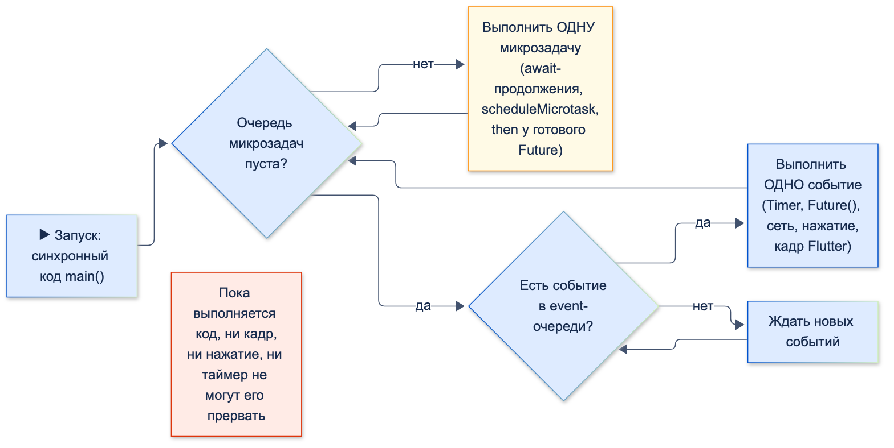

# Event Loop

| Грейд | Время на изучение | Статус |
|-------|-------------------|--------|
| ⭐⭐ | ~35 мин лекция + практика | ✅ Готово |

---

## 📚 Ресурсы

| Ресурс | Формат | Язык | Уровень | Зачем читать |
|--------|--------|------|---------|--------------|
| [Хендбук Яндекса по Flutter: асинхронность в Dart](https://contest.yandex.ru/tracks/flutter/crash-course/dart-asynchronous-programming) | Учебник | 🇷🇺 | ⭐ | Event Loop, микрозадачи, `Future`, `async`/`await`, изоляты — коротко и по делу |
| [Flutter. Асинхронность и параллельность](https://habr.com/ru/articles/497278/) | Статья (Habr, перевод Дидье Буленса) | 🇷🇺 | ⭐⭐ | Классический разбор Event Loop, `Future` и изолятов с примерами «что выполнится когда» |
| [Dart: Asynchronous programming](https://dart.dev/libraries/async/async-await) | Документация | 🇬🇧 | ⭐ | Официально про `Future`, `async`, `await` |
| [Dart: Concurrency](https://dart.dev/language/concurrency) | Документация | 🇬🇧 | ⭐⭐ | Модель конкурентности Dart: Event Loop, изоляты, что такое «однопоточность» на самом деле |
| [addPostFrameCallback](https://api.flutter.dev/flutter/scheduler/SchedulerBinding/addPostFrameCallback.html) | Справочник API | 🇬🇧 | ⭐⭐ | Как выполнить код после отрисовки кадра |

---

## 🎓 Лекция

### 1. Как устроен Event Loop

Код Dart в одном изоляте выполняется **в одном потоке**. `async` и `Future` не создают потоков: они лишь
**откладывают** часть работы на потом. Решает, что выполнять дальше, **Event Loop** (цикл событий) с двумя очередями:

| Очередь | Что в неё попадает | Приоритет |
|---------|--------------------|-----------|
| **Microtask** (микрозадачи) | Короткие внутренние продолжения: `scheduleMicrotask`, `Future.microtask`, продолжение после `await`, `then` у уже завершённого `Future` | **Высокий:** очередь выполняется **целиком** перед каждым событием |
| **Event** (события) | Всё, что приходит «извне» или по таймеру: `Timer`, `Future()`, `Future.delayed`, ответы сети и файлов, нажатия, кадры Flutter | Обычный: **по одному** событию за раз |

Алгоритм:

1. Выполнить текущий синхронный код до конца. Прервать его ничто не может.
2. Выполнить **все** микрозадачи, включая те, что появились в процессе.
3. Взять **одно** событие из event-очереди и выполнить его синхронно.
4. Вернуться к шагу 2.



### 2. Куда что попадает: шпаргалка

Каждое правило ниже проверено запуском на Dart 3.10.

| Когда выполнится | Что |
|------------------|-----|
| **Сразу, синхронно** | Обычный код; тело `async`-функции **до первого `await`**; тело `Future.sync`; **аргументы** любых вызовов, например `calculate()` в `Future.value(calculate())` |
| **В той же задаче, сразу после завершения `Future`** | `then`-колбэки `Future`, который завершился в этой задаче: `Future(() => …).then(…)` выполнит `then` сразу после тела, раньше других микрозадач |
| **Microtask** | `scheduleMicrotask`, `Future.microtask`; продолжение после **любого** `await`, даже `await null`; `then` у уже завершённого `Future`; завершение `Future.value(…)` и `async`-функции без `await` |
| **Event** | `Timer`, `Timer.run`, `Future()`, `Future.delayed` — **даже с `Duration.zero`**; ответы сети и файлов; жесты; кадры Flutter |

> ⚠️ **Внимание:** в статьях часто пишут «`then` всегда попадает в очередь микрозадач». Это неточно. Если `Future`
> завершается прямо сейчас (в текущей задаче), его `then` выполняется **сразу** за ним. Через очередь микрозадач
> `then` идёт, когда его вешают на **уже завершённый** `Future`.

### 3. Разминка: что выведет код?

```dart
import 'dart:async';

void main() {
  Future(() {
    print('A1 тело Future()');
    scheduleMicrotask(() => print('A3 микрозадача из тела'));
  }).then((_) => print('A2 then у Future()'));
  Timer.run(() => print('A4 следующий таймер'));

  Future.microtask(() => print('B1 тело Future.microtask')).then((_) => print('B2 then'));
  () async {
    print('C1 до await 5');
    await 5; // анализатор предупредит (await_only_futures): так не пишут, здесь это демонстрация
    print('C2 после await 5');
  }();
  Future.value(1).then((_) => print('D then у Future.value'));
  print('main конец');
}
```

<details>
<summary>Показать вывод и разбор</summary>

```text
C1 до await 5
main конец
B1 тело Future.microtask
B2 then
C2 после await 5
D then у Future.value
A1 тело Future()
A2 then у Future()
A3 микрозадача из тела
A4 следующий таймер
```

- `C1` и `main конец` — синхронный код. Безымянная `async`-функция выполняется синхронно до `await`.
- Микрозадачи идут в порядке постановки: `B1` (и сразу его `then` — `B2`), продолжение после `await 5` (`C2`), `then` у завершённого `Future.value` (`D`).
- События: тело `Future()` (`A1`) и сразу его `then` (`A2`). Только потом микрозадача из тела (`A3`), и лишь затем следующее событие (`A4`).

</details>

### 4. Главная задача: банковский экран с обманками

> ✍️ **Условие.** Прочитай код и **запиши на бумаге** порядок, в котором выведутся буквы. Затем открой ответ.
> В коде спрятаны ловушки: названия функций, которые обещают одно, а делают другое, и вызовы, которые выглядят
> одинаково, но попадают в разные очереди.

```dart
import 'dart:async';

void log(String message) => print(message);

/// Ловушка 1: «async» в сигнатуре не делает начало функции асинхронным
Future<int> loadBalance() async {
  log('A: loadBalance — начало');
  await null; // ловушка 2: «ничего не ждём», но функция всё равно прерывается
  log('B: loadBalance — после await null');
  return 150000;
}

/// Ловушка 3: в названии «Instant», а на деле — event-очередь
Future<String> loadUserInstant() => Future.delayed(Duration.zero, () {
      log('C: пользователь загружен');
      return 'Анна';
    });

/// Ловушка 4: выглядит как «отложенное вычисление», но аргумент считается сразу
int calculateLimit() {
  log('D: calculateLimit');
  return 60000000;
}

/// Ловушка 5: «пауза», которая не ставит ничего в event-очередь
Future<void> smallPause() async {}

Future<void> showScreen() async {
  log('E: showScreen — начало');
  final user = loadUserInstant(); // без await: запрос «улетел», идём дальше
  await smallPause();
  log('F: showScreen — после smallPause');
  log('G: привет, ${await user}');
}

void main() {
  log('H: main — старт');

  Timer(Duration.zero, () => log('I: Timer(zero)'));
  final balance = loadBalance();
  final limit = Future.value(calculateLimit());
  scheduleMicrotask(() => log('J: scheduleMicrotask'));

  balance.then((value) {
    log('K: balance.then — $value');
    Future(() => log('L: Future() внутри then'));
    scheduleMicrotask(() => log('M: микрозадача внутри then'));
  });
  limit.then((value) => log('N: limit.then — $value'));

  showScreen();
  Future.sync(() => log('O: Future.sync'));
  Future(() => log('P: Future()')).then((_) => log('Q: then у Future()'));

  log('R: main — конец');
}
```

<details>
<summary>Показать вывод</summary>

```text
H: main — старт
A: loadBalance — начало
D: calculateLimit
E: showScreen — начало
O: Future.sync
R: main — конец
B: loadBalance — после await null
K: balance.then — 150000
N: limit.then — 60000000
J: scheduleMicrotask
F: showScreen — после smallPause
M: микрозадача внутри then
I: Timer(zero)
C: пользователь загружен
G: привет, Анна
P: Future()
Q: then у Future()
L: Future() внутри then
```

</details>

#### Разбор: как этот код работает на самом деле

**Фаза 1. Синхронный код `main`** — выполняется целиком, ничто его не прерывает.

| Строка | Вывод | Что попало в очереди |
|--------|-------|----------------------|
| `log('H…')` | **H** | — |
| `Timer(Duration.zero, …)` | — | event: **[I]** |
| `loadBalance()` | **A** — функция выполняется синхронно до `await null` | microtask: **[продолжение loadBalance]** |
| `Future.value(calculateLimit())` | **D** — аргумент вычисляется прямо сейчас | microtask: [продолжение loadBalance, **завершение limit**] |
| `scheduleMicrotask(J)` | — | microtask: [продолжение loadBalance, завершение limit, **J**] |
| `balance.then(…)`, `limit.then(…)` | — | Только подписки: оба `Future` ещё не завершены, в очереди ничего не добавляется |
| `showScreen()` | **E**, затем `loadUserInstant()` и `smallPause()` | event: [I, **C**]; microtask: […, J, **завершение smallPause**] |
| `Future.sync(…)` | **O** — тело `Future.sync` выполняется сразу | — |
| `Future(P).then(Q)` | — | event: [I, C, **P**] |
| `log('R…')` | **R** | — |

**Фаза 2. Все микрозадачи** — по порядку постановки:

1. Продолжение `loadBalance` → **B**. Функция возвращает 150000, её `Future` завершается **прямо сейчас**, поэтому
   `then` выполняется сразу → **K**. Внутри `then`: `Future()` уходит в **конец** event-очереди (event: [I, C, P, **L**]),
   а микрозадача `M` — в конец очереди микрозадач.
2. Завершение `limit` → **N**. Вот почему `N` раньше `J`, хотя `limit.then` написан **после** `scheduleMicrotask(J)`:
   `Future.value` поставил свою микрозадачу ещё **при создании**, до `J`.
3. **J**.
4. Завершение `smallPause` → `showScreen` продолжается → **F**. Дальше `await user`: пользователь ещё не загружен,
   функция снова прерывается.
5. **M** — микрозадача из `then` выполняется раньше **любого** события, даже раньше таймера, который поставили в самом начале.

**Фаза 3. События** — по одному, после каждого снова проверяются микрозадачи:

1. **I** — таймер, поставленный первым.
2. **C** — `Future.delayed(Duration.zero)` из «мгновенной» `loadUserInstant`. Пользователь загружен, `await user`
   в `showScreen` дождался → **G**.
3. **P** и сразу его `then` → **Q**.
4. **L** — `Future()`, который поставили внутри `then` в фазе 2. Он оказался **последним**, хотя `K` выполнился одним из первых.

#### Какие ложные представления разрушает эта задача

| Ловушка | Ложное представление | Как на самом деле |
|---------|----------------------|-------------------|
| `async` в сигнатуре (`A`, `E`) | «Функция `async` — значит выполнится потом» | Тело выполняется **синхронно** до первого `await` |
| `await null` (`B`) | «Ждать нечего — значит без задержки» | Любой `await` прерывает функцию, продолжение уходит в микрозадачи |
| `loadUserInstant` (`C`) | «Instant / `Duration.zero` — значит сразу» | `Future.delayed` с нулём — это **таймер в event-очереди**: выполнится после всех микрозадач и после событий, поставленных в очередь раньше него |
| `Future.value(calculateLimit())` (`D`) | «`Future` — значит вычислится потом» | Аргумент вычисляется **сейчас**. Отложено только завершение `Future` |
| `smallPause()` (`F`) | «Пауза пропустит вперёд таймеры» | Пустая `async`-функция ставит только микрозадачу, поэтому `F` выполнится **раньше** `Timer(zero)` |
| Порядок `J` и `N` | «Что написано выше, то и выполнится раньше» | Важен момент **постановки в очередь**, а не место в коде |
| `Future.sync` (`O`) | «Любой `Future` — асинхронный» | Тело `Future.sync` выполняется сразу |
| `L` внутри `then` | «Раз `then` выполнился рано, и всё внутри него — рано» | `Future()` встаёт в **конец** event-очереди на момент вызова |

### 5. `Future.delayed` — это минимальная задержка, а не точное время

```dart
import 'dart:async';

void main() {
  final stopwatch = Stopwatch()..start();
  Future.delayed(
    const Duration(milliseconds: 100),
    () => print('Future.delayed(100 мс) сработал через ${stopwatch.elapsedMilliseconds} мс'),
  );

  final end = DateTime.now().add(const Duration(milliseconds: 300));
  while (DateTime.now().isBefore(end)) {} // «тяжёлая» синхронная работа: 300 мс
  print('Синхронная работа закончилась на ${stopwatch.elapsedMilliseconds} мс');
}
```

```text
Синхронная работа закончилась на 300 мс
Future.delayed(100 мс) сработал через 300 мс
```

Цифры у вас могут отличаться на пару миллисекунд. Таймер «созрел» через 100 мс, но событие не может выполниться, пока поток занят. Задержка в `Future.delayed` и `Timer`
означает «**не раньше чем**».

**Голодание event-очереди.** Микрозадачи выполняются все до одной перед следующим событием. Если они постоянно
порождают новые, событиям не достаётся времени. В эксперименте 2 млн микрозадач, порождающих друг друга,
задержали `Timer.run` на 41 мс — это уже 2–3 пропущенных кадра. Отсюда правило: **`scheduleMicrotask` — только для
коротких действий**, а «отложить на потом» нужно через event-очередь.

### 6. Связь с Flutter

Flutter-приложение работает в **главном изоляте** с тем же Event Loop. Нажатия, ответы сети, таймеры и **отрисовка
кадров** — всё это задачи этого цикла. Кадр 60 Гц — это примерно каждые 16 мс, и чтобы кадр нарисовался вовремя,
поток должен быть **свободен**.

#### Ловушка: спиннер, который появляется с опозданием

```dart
import 'package:flutter/material.dart';

class PayButton extends StatefulWidget {
  const PayButton({super.key, required this.pay, required this.buildReceipt});

  final Future<void> Function() pay;
  final String Function() buildReceipt; // тяжёлое синхронное вычисление

  @override
  State<PayButton> createState() => _PayButtonState();
}

class _PayButtonState extends State<PayButton> {
  var _loading = false;

  Future<void> _onPressed() async {
    setState(() => _loading = true); // ❗ только помечает виджет «грязным», кадр ещё не нарисован
    widget.buildReceipt(); // ❗ 500 мс синхронной работы: кадр со спиннером не может отрисоваться
    await widget.pay();
    if (!mounted) return; // ❗ за время await экран могли закрыть
    setState(() => _loading = false);
  }

  @override
  Widget build(BuildContext context) => FilledButton(
        onPressed: _loading ? null : _onPressed,
        child: _loading ? const CircularProgressIndicator() : const Text('Оплатить'),
      );
}
```

Что происходит:
1. `setState` не рисует кадр, а лишь **просит** перестроить виджет в следующем кадре.
2. `buildReceipt()` выполняется синхронно, сразу после `setState`. Пока он работает, поток занят, и кадр со спиннером
   ждёт своей очереди. Пользователь полсекунды видит «зависшую» кнопку, и только когда обработчик дойдёт
   до `await widget.pay()` и освободит поток, нарисуется кадр со спиннером.
3. Даже `await` на микрозадаче не поможет: кадр — это **отдельная задача**, до неё дело дойдёт, только когда опустеет
   очередь микрозадач.

Как правильно:
- Тяжёлое вычисление — **в другой изолят**: `await Isolate.run(heavyWork)` или `compute`. Поток UI свободен, кадры рисуются.
  Подробно — в теме «Изоляты».
- После **каждого** `await` в `State` проверяй `mounted` (а в `StatelessWidget` — `context.mounted`) перед `setState`
  и использованием `context`. Это же подсказывает правило анализатора `use_build_context_synchronously`.

#### Выполнить код после отрисовки кадра

Иногда нужно сделать что-то, когда кадр **уже** нарисован: показать диалог при открытии экрана, прокрутить список
к элементу, измерить размер виджета. Для этого есть `addPostFrameCallback`:

```dart
import 'package:flutter/material.dart';

class StatementScreen extends StatefulWidget {
  const StatementScreen({super.key});

  @override
  State<StatementScreen> createState() => _StatementScreenState();
}

class _StatementScreenState extends State<StatementScreen> {
  final _scrollController = ScrollController();

  @override
  void initState() {
    super.initState();
    // В initState ещё нет ни размеров, ни прокрутки: ждём первый кадр
    WidgetsBinding.instance.addPostFrameCallback((_) {
      if (!mounted) return;
      _scrollController.jumpTo(_scrollController.position.maxScrollExtent); // к последним операциям
    });
  }

  @override
  void dispose() {
    _scrollController.dispose();
    super.dispose();
  }

  @override
  Widget build(BuildContext context) => ListView.builder(
        controller: _scrollController,
        itemCount: 100,
        itemBuilder: (context, index) => ListTile(title: Text('Операция №$index')),
      );
}
```

| Нужно | Инструмент |
|-------|------------|
| Сделать после текущего синхронного кода, до следующего события | `scheduleMicrotask` / `Future.microtask` (только коротко!) |
| Отложить «на потом», дать поработать другим событиям | `Future(…)`, `Timer` |
| Сделать после отрисовки кадра | `WidgetsBinding.instance.addPostFrameCallback` |
| Тяжёлое вычисление, не блокируя UI | `Isolate.run` / `compute` |

### 7. Completer: свой Future, который завершаешь сам

`Future` обычно создаёт кто-то другой: `async`-функция, `http`, `Future.delayed`. **`Completer`** позволяет создать
`Future` вручную и **самому решить, когда и чем он завершится**:

| Метод / свойство | Что делает |
|------------------|------------|
| `completer.future` | `Future`, который отдаём наружу |
| `complete(value)` | Завершить успешно |
| `completeError(error, [stackTrace])` | Завершить ошибкой |
| `isCompleted` | Уже завершён? Повторный `complete` бросит `Bad state: Future already completed` |
| `Completer.sync()` | Вариант, который вызывает `then`-колбэки **сразу** в момент `complete`, а не микрозадачей |

**Главное применение — превратить API на колбэках в `Future`.** Так оборачивают сторонние и нативные SDK,
где результат приходит в `onSuccess`/`onError`:

```dart
import 'dart:async';

/// Сторонний SDK биометрии с API на колбэках
class BiometricSdk {
  void authenticate({
    required String reason,
    required void Function(String token) onSuccess,
    required void Function(String code) onError,
  }) {
    Timer(const Duration(milliseconds: 100), () => onSuccess('bio-token-42')); // имитация ответа SDK
  }
}

class BiometricException implements Exception {
  const BiometricException(this.code);

  final String code;

  @override
  String toString() => 'BiometricException($code)';
}

/// Наша обёртка: снаружи — обычный Future
class BiometricAuth {
  BiometricAuth(this._sdk);

  final BiometricSdk _sdk;

  Future<String> authenticate() {
    final completer = Completer<String>();
    _sdk.authenticate(
      reason: 'Вход в приложение банка',
      onSuccess: (token) {
        if (!completer.isCompleted) completer.complete(token); // защита от повторного вызова колбэка
      },
      onError: (code) {
        if (!completer.isCompleted) completer.completeError(BiometricException(code));
      },
    );
    return completer.future.timeout(const Duration(seconds: 30)); // SDK может вообще не вызвать колбэк
  }
}

Future<void> main() async {
  final token = await BiometricAuth(BiometricSdk()).authenticate();
  print('Токен: $token');
}
```

```text
Токен: bio-token-42
```

Три правила для такой обёртки:
1. **Каждый путь должен завершать `Completer`.** Если SDK не вызвал ни один колбэк, `await` будет ждать вечно,
   а экран — висеть с индикатором загрузки. Поэтому `timeout`.
2. **Защищайся от повторного вызова колбэков** через `isCompleted`: некоторые SDK вызывают `onError` после `onSuccess`
   или дважды, а повторный `complete` бросает `StateError`.
3. **Ошибки — через `completeError`,** а не через `throw` внутри колбэка: исключение из колбэка не попадёт в наш `Future`.

#### Продвинутый пример: запрос-ответ поверх WebSocket

WebSocket — это поток сообщений без понятия «ответ на мой запрос». `Completer` и идентификатор запроса превращают его
в удобное API вида `await rpc.request(...)`. Ответы могут приходить **в любом порядке**:

```dart
import 'dart:async';

class SocketRpc {
  SocketRpc(this._send);

  final void Function(Map<String, Object?> message) _send;
  final _pending = <String, Completer<Map<String, Object?>>>{};
  var _nextId = 0;

  Future<Map<String, Object?>> request(String method, Map<String, Object?> params) {
    final id = '${_nextId++}';
    final completer = Completer<Map<String, Object?>>();
    _pending[id] = completer;
    _send({'id': id, 'method': method, 'params': params});
    return completer.future.timeout(
      const Duration(seconds: 10),
      onTimeout: () {
        _pending.remove(id); // не копим «осиротевшие» запросы
        throw TimeoutException('Нет ответа на $method');
      },
    );
  }

  /// Вызывается на каждое входящее сообщение сокета
  void onMessage(Map<String, Object?> message) {
    final completer = _pending.remove(message['id']);
    if (completer == null) return; // ответ на запрос, который уже отменён по таймауту
    if (message['error'] case final String error) {
      completer.completeError(Exception(error));
    } else {
      completer.complete(message['result']! as Map<String, Object?>);
    }
  }
}

Future<void> main() async {
  late final SocketRpc rpc;
  // Имитация сервера: отвечает с разной задержкой, поэтому ответы приходят не по порядку
  rpc = SocketRpc((message) {
    final id = message['id']! as String;
    final delay = message['method'] == 'balance' ? 200 : 50;
    Timer(Duration(milliseconds: delay), () {
      rpc.onMessage(message['method'] == 'block'
          ? {'id': id, 'error': 'Карта уже заблокирована'}
          : {'id': id, 'result': {'method': message['method'], 'ok': true}});
    });
  });

  final balance = rpc.request('balance', {'account': '40817…0001'});
  final rates = rpc.request('rates', {'currency': 'USD'});
  print('Сначала пришли курсы: ${await rates}');
  print('Потом баланс: ${await balance}');
  try {
    await rpc.request('block', {'card': '…4242'});
  } on Exception catch (e) {
    print('Ошибка: $e');
  }
}
```

```text
Сначала пришли курсы: {method: rates, ok: true}
Потом баланс: {method: balance, ok: true}
Ошибка: Exception: Карта уже заблокирована
```

#### Completer и Event Loop

```dart
import 'dart:async';

Future<void> main() async {
  final regular = Completer<String>();
  regular.future.then((value) => print('then обычного Completer: $value'));
  regular.complete('A');
  print('после complete() обычного Completer');

  final sync = Completer<String>.sync();
  sync.future.then((value) => print('then Completer.sync: $value'));
  sync.complete('B');
  print('после complete() Completer.sync');
}
```

```text
после complete() обычного Completer
then Completer.sync: B
после complete() Completer.sync
then обычного Completer: A
```

Обычный `Completer` вызывает `then` **микрозадачей**, а `Completer.sync` — **сразу**, внутри `complete()`.
`Completer.sync` нужен редко: только когда `complete` вызывается последним действием в уже асинхронном колбэке
и лишняя микрозадача действительно мешает. В остальных случаях он делает порядок выполнения неочевидным.

> ⚠️ **Внимание:** не оборачивай в `Completer` то, что уже является `Future`:
> `final c = Completer<int>(); api().then(c.complete); return c.future;` — это лишний код, который к тому же
> теряет ошибки (`catchError` забыт). Достаточно `return api();`. `Completer` нужен, только когда источник результата —
> колбэки или события, а не `Future`.

### ⚠️ Частые ошибки

- **«`async` значит в фоне».** Нет: тот же поток, просто код разрезан на части. Тяжёлый синхронный код внутри `async`-функции всё равно блокирует UI.
- **`Future.delayed(Duration.zero)` как «сделать сразу после».** Это событие в конце очереди: перед ним выполнятся все микрозадачи и все ранее поставленные события.
- **Расчёт на точность таймеров.** Задержка — минимальная, а не гарантированная.
- **Длинные цепочки микрозадач.** Они не дают отрисовать кадр.
- **Вызов `async`-функции без `await` в расчёте на её завершение.** Синхронная часть выполнится сразу, остальное — когда-нибудь потом, а ошибка из такого `Future` может остаться необработанной.
- **`setState` и `context` после `await` без проверки `mounted`.**
- **`Completer`, который может не завершиться** (SDK не вызвал колбэк) — вечное ожидание. Нужен `timeout`.
- **Повторный `complete`** — `Bad state: Future already completed`. Проверяй `isCompleted`.

---

## ✅ Самопроверка

**⭐ Junior**
1. Сколько потоков использует Dart-код в одном изоляте? Делает ли `async` код параллельным?
2. Какие две очереди есть у Event Loop? Какая из них приоритетнее?
3. Что выведется раньше: `Future(() => print('a'))` или `scheduleMicrotask(() => print('b'))`, если `Future` создан первым?

**⭐⭐ Middle**
1. Выполнится ли что-нибудь из `async`-функции синхронно в момент вызова? Что именно?
2. Почему `await null` всё равно прерывает функцию? Куда уходит продолжение?
3. `Future.delayed(const Duration(milliseconds: 100), f)`, а сразу после него — синхронный цикл на 1 секунду. Когда вызовется `f`?
4. Почему спиннер появляется с опозданием, если после `setState` идёт тяжёлый синхронный код? Как исправить?

**⭐⭐⭐ Senior**
1. Почему в главной задаче `N` выводится раньше `J`, хотя `limit.then` стоит в коде после `scheduleMicrotask`?
2. Когда `then` выполняется в той же задаче, что и завершение `Future`, а когда — отдельной микрозадачей?
3. Что такое голодание event-очереди и как оно проявляется во Flutter?
4. Чем отличаются `scheduleMicrotask`, `Future(…)` и `addPostFrameCallback`? Приведи задачу для каждого.
5. Как с помощью `Completer` превратить SDK с колбэками `onSuccess`/`onError` в `Future`? Какие три ошибки в такой обёртке встречаются чаще всего?
6. Как поверх WebSocket сделать API вида `await rpc.request(...)`, если ответы приходят в произвольном порядке?

<details>
<summary>Ответы</summary>

**Junior**
1. Один. `async` не создаёт потоков, а откладывает части кода в очереди Event Loop. Параллельность в Dart — только через изоляты.
2. Microtask и event. Микрозадачи приоритетнее: перед каждым событием выполняются **все** микрозадачи.
3. Сначала `b`: микрозадачи выполняются раньше любых событий, а `Future()` ставит событие.

**Middle**
1. Да, всё тело до первого `await` (или целиком, если `await` нет) выполняется синхронно в момент вызова.
2. `await` всегда приостанавливает функцию, даже если ждёт не-`Future` или уже готовое значение. Продолжение ставится в очередь микрозадач.
3. Не раньше, чем закончится цикл: примерно через 1 секунду. Таймер «созреет» через 100 мс, но событие не выполнится, пока поток занят.
4. `setState` только помечает виджет для перестроения, кадр рисуется отдельной задачей. Пока поток занят синхронной работой, кадр не нарисуется — спиннер появится, только когда код дойдёт до настоящего ожидания (`await` сетевого запроса). Исправление — вынести тяжёлую работу в изолят (`Isolate.run`, `compute`).

**Senior**
1. `Future.value(...)` при создании ставит в очередь микрозадачу на своё завершение. Это происходит раньше, чем `scheduleMicrotask(J)`. Когда эта микрозадача выполняется, `Future` завершается, и подписанный на него `then` (`N`) вызывается сразу. Порядок определяется моментом постановки в очередь, а не местом подписки.
2. Если `Future` завершается в текущей задаче (тело `Future()`, возврат из `async`-функции), его `then` вызываются сразу же, в той же задаче. Если `then` вешают на уже завершённый `Future`, колбэк ставится отдельной микрозадачей.
3. Микрозадачи выполняются все до одной перед следующим событием. Если они непрерывно порождают новые, события — включая отрисовку кадров, нажатия, ответы сети — ждут. Во Flutter это пропущенные кадры и «замёрзший» интерфейс.
4. `scheduleMicrotask` — выполнить сразу после текущего кода, до любых событий (например, обновить внутреннее состояние перед тем, как кто-то его прочитает). `Future(...)` — отложить в конец event-очереди, пропустив вперёд другие события (например, разбить длинную работу на части). `addPostFrameCallback` — выполнить после отрисовки кадра (показать диалог при открытии экрана, прокрутить к элементу, измерить размер).
5. Создать `Completer`, в `onSuccess` вызвать `complete`, в `onError` — `completeError`, вернуть `completer.future`. Частые ошибки: `Completer` не завершается, если SDK не вызвал колбэк (нужен `timeout`); повторный вызов колбэка даёт `Bad state: Future already completed` (нужна проверка `isCompleted`); `throw` внутри колбэка вместо `completeError` — ошибка не попадает в `Future`.
6. Каждому запросу присвоить `id` и положить `Completer` в `Map<id, Completer>`. Отправить сообщение с `id`. Входящие сообщения разбирать по `id`: достать `Completer` из словаря и завершить его результатом или ошибкой. Добавить `timeout` и удалять `Completer` из словаря по таймауту, а ответы на неизвестные `id` игнорировать.

</details>
