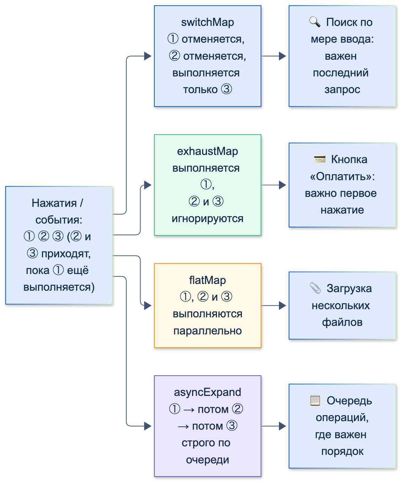

# Streams

| Грейд | Время на изучение | Статус |
|-------|-------------------|--------|
| ⭐⭐ | ~45 мин лекция + практика | ✅ Готово |

---

## 📚 Ресурсы

| Ресурс | Формат | Язык | Уровень | Зачем читать |
|--------|--------|------|---------|--------------|
| [Subject объекты в RxDart и чем они полезны Flutter-разработчику](https://habr.com/ru/companies/surfstudio/articles/773164/) | Статья (Habr, Surf) | 🇷🇺 | ⭐⭐ | `PublishSubject`, `BehaviorSubject`, `ReplaySubject` на практическом примере корзины. Неточность: `BehaviorSubject` можно создать и без начального значения |
| [Dart: Asynchronous programming: Streams](https://dart.dev/libraries/async/using-streams) | Документация | 🇬🇧 | ⭐ | Подписка, `await for`, преобразования, ошибки |
| [Dart: Creating streams](https://dart.dev/libraries/async/creating-streams) | Документация | 🇬🇧 | ⭐⭐ | `async*`, `StreamController`, `onListen`/`onPause`/`onCancel` — как правильно создавать свои потоки |
| [StreamBuilder](https://api.flutter.dev/flutter/widgets/StreamBuilder-class.html) | Справочник API | 🇬🇧 | ⭐ | Состояния снапшота и `initialData` |
| [rxdart](https://pub.dev/packages/rxdart) | Пакет | 🇬🇧 | ⭐⭐ | Официальное описание: потоки-фабрики, операторы-расширения, Subjects |
| [RxMarbles](https://rxmarbles.com/) | Интерактивные диаграммы | 🇬🇧 | ⭐⭐ | Можно «подвигать» события и увидеть, как работают `debounce`, `combineLatest`, `switchMap` и др. Названия операторов — из RxJS, но смысл тот же |

---

## 🎓 Лекция

### 1. Stream в двух словах

`Future` — одно значение в будущем, `Stream` — **последовательность** событий во времени. Событий три вида:
**данные**, **ошибка** и **завершение** (done). Поток не опрашивают: значения приходят к подписчику сами (push).

Все способы создать поток — в следующем разделе.

### 2. Все способы создать последовательность

| Способ | Что получается | Когда использовать |
|--------|----------------|--------------------|
| `sync*` + `yield` / `yield*` | `Iterable` — **синхронная** ленивая последовательность (это не `Stream`!) | Генерировать значения по требованию: даты платежей, страницы расчёта |
| `async*` + `yield` / `yield*` | `Stream` | Поток, который «генерирует себя сам», с `await` внутри: пагинация, чтение по частям |
| `StreamController` / `.broadcast()` | `Stream` | Значения приходят «снаружи»: колбэки, сокет, действия пользователя (раздел 3) |
| `Stream.multi` | `Stream`, у каждого подписчика свой контроллер | Каждому подписчику — своя последовательность, например «текущее значение + обновления» |
| `Stream.value`, `Stream.error`, `Stream.empty` | Поток из одного значения, одной ошибки или пустой | Заглушки и тесты |
| `Stream.fromIterable`, `Iterable` из `sync*` | Поток из готовой коллекции | Мост «синхронное → асинхронное» |
| `Stream.fromFuture`, `future.asStream()` | Поток из одного `Future` | Совместить `Future` с API, которое ждёт поток |
| `Stream.fromFutures` | События в порядке **завершения** `Future`, а не в порядке списка | Показывать результаты по мере готовности |
| `Stream.periodic` | Событие каждые N мс | Таймер, опрос сервера |
| `stream.transform(StreamTransformer…)` | Новый поток из старого | Своя переиспользуемая обработка: разбор, валидация |
| `stream.asBroadcastStream()` | Broadcast-версия single-потока | Нужно несколько подписчиков на один источник |
| Платформа и SDK | `EventChannel.receiveBroadcastStream()`, `File.openRead()`, `WebSocketChannel.stream` | Нативные события, файлы, сеть |
| `rxdart` | `Rx.merge`, `Rx.timer`, `Rx.retry`, Subjects… | Раздел 8 |

#### `sync*`: ленивый `Iterable`

```dart
/// График платежей по кредиту: бесконечный, но ленивый
Iterable<DateTime> paymentDates(DateTime first) sync* {
  var month = first.month;
  var year = first.year;
  while (true) {
    print('  sync*: вычисляю дату $month.$year');
    yield DateTime(year, month, first.day);
    month++;
    if (month > 12) {
      month = 1;
      year++;
    }
  }
}

void main() {
  final dates = paymentDates(DateTime(2026, 11, 15));
  print('Генератор создан, ничего не вычислено');
  print(dates.take(3).map((d) => '${d.day}.${d.month}.${d.year}').toList());
}
```

```text
Генератор создан, ничего не вычислено
  sync*: вычисляю дату 11.2026
  sync*: вычисляю дату 12.2026
  sync*: вычисляю дату 1.2027
[15.11.2026, 15.12.2026, 15.1.2027]
```

- Тело генератора не выполняется при вызове функции, а только по мере того, как значения **забирают** (pull).
  Поэтому бесконечный цикл здесь — это нормально: `take(3)` забрал три значения, и генератор больше не продолжился.
- Внутри `sync*` **нельзя** использовать `await`: значение отдаётся синхронно, по запросу.
- `yield*` отдаёт все значения другого `Iterable` (в `async*` — другого `Stream`).

#### `async*`: поток с `await` внутри

Пример — загрузка истории операций по страницам. Снаружи выглядит как один поток операций:

```dart
var requests = 0;

Future<List<String>> fetchPage(int page) async {
  requests++;
  print('  запрос страницы $page');
  await Future<void>.delayed(const Duration(milliseconds: 10));
  return page < 3 ? ['оп-${page}a', 'оп-${page}b'] : [];
}

Stream<String> allOperations() async* {
  try {
    var page = 0;
    while (true) {
      final items = await fetchPage(page++);
      if (items.isEmpty) return; // конец данных — поток закрывается
      yield* Stream.fromIterable(items);
    }
  } finally {
    print('  async*: finally — генератор остановлен');
  }
}

Future<void> main() async {
  print(await allOperations().take(3).toList());
  print('Запросов к серверу: $requests');
}
```

```text
  запрос страницы 0
  запрос страницы 1
  async*: finally — генератор остановлен
[оп-0a, оп-0b, оп-1a]
Запросов к серверу: 2
```

Неочевидное в `async*`:
- **Генератор запускается только при подписке** (`listen`), а не при вызове функции. `async*`-поток — single-subscription.
- **Отмена подписки останавливает генератор.** `take(3)` получил три операции и отменил подписку: генератор остановился
  на ближайшем `yield`, выполнил `finally`, и **третью страницу запрашивать не стал**. Освобождай ресурсы в `finally`.
- **Пауза подписки приостанавливает генератор** на `yield`: он не убежит вперёд и не накопит лишних данных.
- `return` внутри `async*` закрывает поток, исключение — отправляет ошибку и тоже закрывает поток.

#### `Stream.multi`: свой контроллер для каждого подписчика

```dart
Future<void> main() async {
  var subscriptions = 0;
  final balanceUpdates = Stream<int>.multi((controller) {
    final n = ++subscriptions; // эта функция вызывается на КАЖДУЮ подписку
    controller
      ..add(n * 10)
      ..add(n * 10 + 1)
      ..close();
  });

  print(await balanceUpdates.toList());
  print(await balanceUpdates.toList()); // повторная подписка разрешена и получает свои данные
}
```

```text
[10, 11]
[20, 21]
```

В отличие от `StreamController`, на `Stream.multi` можно подписаться много раз, и каждый подписчик получит свою
последовательность с начала. Типичный пример — «сначала текущее значение из кеша, потом живые обновления»
для каждого нового экрана.

#### Конструкторы `Stream` одной строкой

```dart
Future<void> main() async {
  print(await Stream.value('один').toList());
  print(await Stream<int>.empty().toList());
  print(await Stream.fromFutures([
    Future.delayed(const Duration(milliseconds: 20), () => 'медленный'),
    Future.value('быстрый'),
  ]).toList()); // порядок завершения, а не порядок в списке
  print(await Stream.periodic(const Duration(milliseconds: 10), (i) => i * i).take(4).toList());
  print(await Future.value(42).asStream().toList());
}
```

```text
[один]
[]
[быстрый, медленный]
[0, 1, 4, 9]
[42]
```

#### `StreamTransformer`: своя переиспользуемая обработка

```dart
import 'dart:async';

/// Разбор строк выписки в суммы: битые строки превращаются в ошибки, поток продолжается
final operationParser = StreamTransformer<String, int>.fromHandlers(
  handleData: (line, sink) {
    final kopecks = int.tryParse(line);
    if (kopecks == null) {
      sink.addError(FormatException('битая строка: $line'));
    } else {
      sink.add(kopecks);
    }
  },
);

Future<void> main() async {
  await Stream.fromIterable(['150000', 'abc', '-4500'])
      .transform(operationParser)
      .handleError((Object e) => print('ошибка: $e'))
      .forEach(print);
}
```

```text
150000
ошибка: FormatException: битая строка: abc
-4500
```

> ⚠️ **Внимание:** не пиши `stream.listen(onData, onError: handler).asFuture()`. Метод `asFuture` **перезаписывает**
> обработчики `onError` и `onDone`, а при первой ошибке отменяет подписку. Ошибка, которую ты собирался обработать
> в `handler`, станет ошибкой возвращённого `Future`, а если его не ждать — необработанной. Проверено: в таком коде
> программа падает на первой битой строке. Для «обработать ошибки и дождаться конца» используй `handleError` + `forEach`
> или `await for` с `try`.

### 3. StreamController

`StreamController` — «кран» для потока: в `sink` (`add`, `addError`) кладём события, из `stream` их читают подписчики.

```dart
import 'dart:async';

Future<void> main() async {
  late final StreamController<int> rates;
  rates = StreamController<int>(
    onListen: () {
      print('onListen: подключаемся к серверу котировок'); // ресурс берём только когда появился слушатель
      rates.add(9250);
    },
    onCancel: () => print('onCancel: отключаемся'), // и освобождаем, когда слушатель ушёл
  );

  final subscription = rates.stream.listen((kopecks) => print('Курс: $kopecks'));
  await Future<void>.delayed(Duration.zero);
  await subscription.cancel();
  await rates.close(); // закрываем контроллер, иначе — утечка и «висящий» поток
}
```

```text
onListen: подключаемся к серверу котировок
Курс: 9250
onCancel: отключаемся
```

Неочевидное:
- **События доставляются асинхронно** (микрозадачей), а не в момент `add`. Код после `add` выполнится раньше, чем подписчик получит значение.
  Есть `StreamController(sync: true)`, но с ним легко получить сложные для отладки эффекты: использовать только осознанно.
- **`onListen`/`onCancel`** позволяют открывать соединение, только когда кто-то слушает. Это правильный способ обернуть
  WebSocket, датчики или платформенный `EventChannel`.
- **Контроллер нужно закрывать** (`close()` в `dispose`). Подписку — отменять (`cancel()`).

### 4. Single-subscription и broadcast

| | Single-subscription (по умолчанию) | Broadcast |
|---|-----------------------------------|-----------|
| Подписчиков | Один. Вторая подписка — ошибка | Сколько угодно |
| События до подписки | **Буферизуются** и придут подписчику | **Теряются** |
| Пауза подписчика | Ставит источник на паузу | Не влияет на источник |
| Создание | `StreamController()`, `async*`, `File.openRead()` | `StreamController.broadcast()`, `stream.asBroadcastStream()` |
| Когда | Последовательность, которую нельзя пропустить: файл, ответ по частям | События и состояние для многих: курсы, статус сети |

```dart
import 'dart:async';

Future<void> main() async {
  final single = StreamController<int>();
  single
    ..add(1)
    ..add(2); // подписчика ещё нет — события ждут в буфере
  single.stream.listen((v) => print('single получил $v'));
  try {
    single.stream.listen((_) {});
  } on StateError catch (e) {
    print('Вторая подписка: $e');
  }

  final broadcast = StreamController<int>.broadcast();
  broadcast.add(1); // подписчиков нет — событие потеряно
  broadcast.stream.listen((v) => print('broadcast A получил $v'));
  broadcast.stream.listen((v) => print('broadcast B получил $v'));
  broadcast.add(2);

  await Future<void>.delayed(Duration.zero);
  await single.close();
  await broadcast.close();
}
```

```text
Вторая подписка: Bad state: Stream has already been listened to.
single получил 1
broadcast A получил 2
broadcast B получил 2
single получил 2
```

Обрати внимание на порядок: `single получил 2` пришёл **после** событий broadcast. Доставка асинхронная,
и события разных потоков перемешиваются в порядке очереди микрозадач.

### 5. Операторы стандартной библиотеки

| Оператор | Что делает | Неочевидное |
|----------|------------|-------------|
| `map`, `where`, `expand` | Как у `Iterable` | — |
| `distinct` | Пропускает повтор **подряд** идущего значения | Сравнивает через `==`: для моделей нужен корректный `==` |
| `asyncMap` | Асинхронное преобразование | Выполняется **строго по очереди**: следующее событие ждёт окончания предыдущего |
| `asyncExpand` | Каждое событие → поток, потоки идут один за другим | Аналог `concatMap` из Rx |
| `take`, `skip`, `takeWhile`, `skipWhile` | Ограничение потока | `take(n)` после n событий **отменяет** подписку на источник |
| `timeout` | Ошибка или замена, если событий долго нет | Таймер перезапускается на каждое событие |
| `handleError` | Перехват ошибок в цепочке | Без `test` ловит все ошибки |
| `transform` | Применить `StreamTransformer` | Так работают `utf8.decoder`, `LineSplitter` |
| `first`, `toList`, `forEach`, `drain`, `fold` | **Терминальные**: возвращают `Future` | `first` после получения значения отменяет подписку |

```dart
Future<void> main() async {
  final stopwatch = Stopwatch()..start();
  final results = await Stream.fromIterable([1, 2, 3])
      .asyncMap((id) => Future.delayed(const Duration(milliseconds: 100), () => 'счёт $id'))
      .toList();
  print('$results за ~${stopwatch.elapsedMilliseconds ~/ 100 * 100} мс'); // по очереди, а не параллельно
}
```

```text
[счёт 1, счёт 2, счёт 3] за ~300 мс
```

Нужно параллельно — используй `Future.wait` для фиксированного набора или `flatMap` из `rxdart` (раздел 8).

### 6. Обработка ошибок

Главное отличие Dart от классического Rx: **ошибка не закрывает поток**. После неё могут прийти новые данные.

```dart
import 'dart:async';

Future<void> main() async {
  final balance = StreamController<int>();
  balance.stream.listen(
    (kopecks) => print('данные: $kopecks'),
    onError: (Object e) => print('ошибка: $e'),
    onDone: () => print('поток закрыт'),
  );
  balance
    ..add(150000)
    ..addError(StateError('сервер не ответил'))
    ..add(93000); // поток жив, данные продолжают идти
  await balance.close();

  final strict = StreamController<int>();
  strict.stream.listen(
    (kopecks) => print('strict данные: $kopecks'),
    onError: (Object e) => print('strict ошибка: $e'),
    cancelOnError: true, // первая ошибка отменяет подписку
  );
  strict
    ..add(1)
    ..addError('сбой')
    ..add(2); // уже никто не получит
  await Future<void>.delayed(Duration.zero);

  Stream<int> operations() async* {
    yield 1;
    throw const FormatException('битый ответ');
  }

  try {
    await for (final op in operations()) {
      print('await for: $op');
    }
  } on FormatException catch (e) {
    print('await for поймал: $e'); // await for прерывается на первой ошибке
  }
}
```

```text
данные: 150000
ошибка: Bad state: сервер не ответил
данные: 93000
поток закрыт
strict данные: 1
strict ошибка: сбой
await for: 1
await for поймал: FormatException: битый ответ
```

Правила:
- **Всегда передавай `onError` в `listen`.** Ошибка без обработчика становится необработанной: в консольной Dart-программе
  она **завершает процесс** (проверено: `Unhandled exception`, код выхода 255), а во Flutter уходит в глобальный обработчик
  (`PlatformDispatcher.onError`, Crashlytics) — экран при этом не узнает о сбое.
- **`await for` бросает исключение и выходит из цикла** на первой ошибке. Подходит, когда ошибка означает «дальше нельзя».
- **`cancelOnError: true`** — когда после ошибки данные не имеют смысла.
- **Превращай ошибки в состояние**, если UI должен продолжать работать: например, `Result`/`sealed`-состояние «ошибка»
  или операторы `onErrorReturnWith`/`onErrorResume` из `rxdart`.

### 7. StreamBuilder

`StreamBuilder` подписывается на поток и перестраивает виджет на каждое событие. Что приходит в `builder`:

| `snapshot.connectionState` | Когда |
|----------------------------|-------|
| `none` | `stream: null` |
| `waiting` | Подписались, данных ещё нет |
| `active` | Пришли данные или ошибка |
| `done` | Поток закрыт |

Плюс `snapshot.hasData`/`data` и `snapshot.hasError`/`error`.

```dart
import 'package:flutter/material.dart';

class BalanceView extends StatelessWidget {
  const BalanceView({super.key, required this.balance, required this.initialKopecks});

  final Stream<int> balance; // создан ЗАРАНЕЕ (в BLoC, провайдере, initState), а не в build
  final int? initialKopecks;

  @override
  Widget build(BuildContext context) => StreamBuilder<int>(
        stream: balance,
        initialData: initialKopecks, // без этого первый кадр всегда будет waiting
        builder: (context, snapshot) {
          if (snapshot.hasError) return const Text('Не удалось обновить баланс');
          if (!snapshot.hasData) return const CircularProgressIndicator();
          return Text('${snapshot.data! ~/ 100} ₽');
        },
      );
}
```

Три неочевидных факта, проверенных widget-тестом:

1. **Первый кадр — всегда `waiting`, даже если значение уже есть.** У `BehaviorSubject.seeded(150000)` значение лежит
   внутри, но `StreamBuilder` получает его асинхронно. Первый кадр: `waiting` (мигнёт индикатор), второй: «Баланс 150000».
   Решение — `initialData: subject.value`: тогда первый кадр сразу с данными.
2. **После ошибки данные пропадают.** Пришла ошибка — в снапшоте `hasData=false, data=null, hasError=true`. Экран
   баланса вместо «старый баланс + сообщение об ошибке» показывает только ошибку. Если последнее значение нужно
   сохранить, храни его в состоянии (BLoC, `sealed`-класс с полями «данные» и «ошибка»), а не полагайся на снапшот.
3. **После новой порции данных ошибка исчезает:** `hasData=true, hasError=false`.

> ⚠️ **Внимание:** не создавай поток в `build`: `StreamBuilder(stream: repository.watchBalance(), …)` переподписывается
> при каждой перестройке (подробно — в теме «Парадигмы программирования»).

### 8. rxdart

`rxdart` **не заменяет** потоки Dart, а расширяет их. Любой результат — обычный `Stream`, совместимый с `StreamBuilder`,
`await for` и всем остальным. Пакет добавляет три вещи:

1. **Subjects** — «улучшенные» `StreamController`.
2. **Потоки-фабрики `Rx.*`** — объединение нескольких потоков, повторы, таймеры.
3. **Операторы-расширения** — более 40 методов прямо на `Stream`: `debounceTime`, `switchMap`, `scan`…

#### Subjects

Все Subjects — **broadcast**: подписчиков может быть много.

| Subject | Что получит новый подписчик | Типичное применение |
|---------|-----------------------------|---------------------|
| `PublishSubject` | Только события **после** подписки | Одноразовые события: «показать снекбар», «навигация» |
| `BehaviorSubject` | **Последнее** значение сразу + все следующие. Есть синхронный доступ `value`, `valueOrNull`, `hasValue` | **Состояние**: баланс, профиль, выбранный счёт |
| `ReplaySubject` | Последние `maxSize` значений (или все) + следующие | История: последние уведомления, лог операций |

```dart
import 'package:rxdart/rxdart.dart';

Future<void> main() async {
  final publish = PublishSubject<int>();
  final behavior = BehaviorSubject<int>.seeded(0);
  final replay = ReplaySubject<int>(maxSize: 2);

  for (final subject in <Subject<int>>[publish, behavior, replay]) {
    subject
      ..add(1)
      ..add(2)
      ..add(3); // все события — ДО подписки
  }

  publish.listen((v) => print('Publish: $v'));
  behavior.listen((v) => print('Behavior: $v'));
  replay.listen((v) => print('Replay(maxSize: 2): $v'));
  await Future<void>.delayed(Duration.zero);

  print('behavior.value = ${behavior.value}'); // синхронное чтение текущего состояния

  for (final subject in <Subject<int>>[publish, behavior, replay]) {
    await subject.close();
  }
}
```

```text
Behavior: 3
Replay(maxSize: 2): 2
Replay(maxSize: 2): 3
behavior.value = 3
```

`PublishSubject` не выдал ничего: всё отправили до подписки. `BehaviorSubject` выдал только последнее значение,
начальное `0` уже перезаписано. `ReplaySubject` — два последних.

> 💡 **Совет:** `BehaviorSubject` можно создать и **без** начального значения (`BehaviorSubject<int>()`). Тогда `hasValue == false`,
> а `value` бросит ошибку — используй `valueOrNull`.

#### Потоки-фабрики `Rx.*`

| Фабрика | Что делает | Пример применения |
|---------|------------|-------------------|
| `Rx.combineLatest2…9`, `combineLatestList` | Выдаёт комбинацию **последних** значений всех потоков при каждом событии любого из них (после того как каждый выдал хотя бы одно) | Валидность формы из нескольких полей |
| `Rx.merge` | Сливает события нескольких потоков в один по мере прихода | Push-уведомления + периодический опрос |
| `Rx.concat`, `concatEager` | Потоки по очереди: следующий — после завершения предыдущего | Сначала кеш, потом сеть |
| `Rx.zip2…9`, `zipList` | Пары событий «по номеру»: первое с первым, второе со вторым | Сопоставить запросы и ответы |
| `Rx.forkJoin2…9`, `forkJoinList` | Ждёт завершения всех потоков и выдаёт их **последние** значения | Аналог `Future.wait` для потоков |
| `Rx.race` | Берёт первый поток, который что-то выдал, остальные отменяет | Самый быстрый из нескольких серверов |
| `Rx.retry`, `retryWhen` | Пересоздаёт поток при ошибке (n раз или по своей логике с паузами) | Повтор загрузки при сбое сети |
| `Rx.timer` | Одно значение через заданное время | Отложенное действие |
| `Rx.defer`, `fromCallable` | Создаёт поток или вызывает функцию только при подписке | Ленивый запрос |
| `Rx.range`, `repeat`, `never`, `using`, `switchLatest`, `sequenceEqual` | Последовательность чисел, повтор, «вечный» поток, поток с ресурсом, переключение на последний поток, сравнение потоков | Реже, но полезно знать |

#### Операторы-расширения

| Группа | Операторы |
|--------|-----------|
| Преобразование «событие → поток» | `switchMap` (новое событие **отменяет** предыдущий внутренний поток), `exhaustMap` (пока внутренний поток не завершён, новые события **игнорируются**), `flatMap` (все параллельно, `maxConcurrent` ограничивает), `asyncExpand` из Dart — строго по очереди |
| Накопление | `scan` (как `fold`, но выдаёт каждый промежуточный результат), `pairwise` (пары «предыдущее, текущее»), `groupBy`, `bufferCount`, `bufferTime`, `windowCount`, `max`, `min` |
| Время | `debounceTime` (ждать паузу в событиях), `throttleTime` (не чаще раза в период), `sampleTime`, `delay`, `interval`, `timestamp`, `timeInterval` |
| Фильтрация | `distinctUnique` (уникальные за всё время, а не подряд), `whereNotNull`, `mapNotNull`, `takeUntil` / `skipUntil` (до / после события другого потока), `takeLast`, `skipLast`, `takeWhileInclusive`, `ignoreElements` |
| Комбинирование | `withLatestFrom` (прицепить последнее значение другого потока), `startWith`, `endWith`, `mergeWith`, `concatWith`, `zipWith`, `defaultIfEmpty`, `switchIfEmpty` |
| Ошибки | `onErrorReturn`, `onErrorReturnWith` (заменить ошибку значением), `onErrorResume`, `onErrorResumeNext` (переключиться на запасной поток) |
| Побочные эффекты и отладка | `doOnData`, `doOnError`, `doOnListen`, `doOnCancel`, `doOnDone` |



#### Примеры на банковских задачах

**Активна ли кнопка «Перевести»** — `combineLatest` по двум полям формы:

```dart
import 'package:rxdart/rxdart.dart';

Future<void> main() async {
  final amount = BehaviorSubject<int>.seeded(0);
  final recipient = BehaviorSubject<String>.seeded('');

  final canSubmit = Rx.combineLatest2(
    amount,
    recipient,
    (int kopecks, String phone) => kopecks > 0 && phone.length == 11,
  ).distinct(); // не дёргаем UI, если результат не изменился

  final subscription = canSubmit.listen((enabled) => print('Кнопка активна: $enabled'));

  Future<void> tick() => Future<void>.delayed(Duration.zero);
  await tick();
  recipient.add('79000000000');
  await tick();
  amount.add(150000);
  await tick();
  amount.add(0);
  await tick();

  await subscription.cancel();
  await amount.close();
  await recipient.close();
}
```

```text
Кнопка активна: false
Кнопка активна: true
Кнопка активна: false
```

**Защита от двойного нажатия «Оплатить»** — `exhaustMap`: пока оплата идёт, новые нажатия игнорируются.

```dart
import 'package:rxdart/rxdart.dart';

Future<void> main() async {
  final taps = PublishSubject<void>();
  var charges = 0;

  final subscription = taps
      .exhaustMap((_) => Rx.fromCallable(() async {
            charges++;
            await Future<void>.delayed(const Duration(milliseconds: 200)); // запрос к процессингу
            return 'чек №$charges';
          }))
      .listen((receipt) => print('Оплата: $receipt'));

  Future<void> wait(int ms) => Future<void>.delayed(Duration(milliseconds: ms));
  taps.add(null); // первое нажатие — оплата началась
  await wait(50);
  taps.add(null); // нажатие во время оплаты — игнорируется
  await wait(50);
  taps.add(null); // и это тоже
  await wait(300);
  taps.add(null); // оплата закончилась — новое нажатие проходит
  await wait(300);

  print('Нажатий: 4, списаний: $charges');
  await subscription.cancel();
  await taps.close();
}
```

```text
Оплата: чек №1
Оплата: чек №2
Нажатий: 4, списаний: 2
```

С `switchMap` первая оплата была бы **отменена** вторым нажатием, а с `flatMap` прошли бы все четыре.
Для поиска нужен `switchMap` (важен последний запрос), для оплаты — `exhaustMap` (важен первый).

**Баланс и его изменение** — `scan` + `startWith` + `pairwise`:

```dart
import 'package:rxdart/rxdart.dart';

Future<void> main() async {
  final operations = Stream.fromIterable([150000, -45000, -12000]);

  await operations
      .scan<int>((balance, operation, _) => balance + operation, 0) // промежуточные балансы
      .startWith(0)
      .pairwise() // [предыдущий, текущий]
      .forEach((pair) {
    final delta = pair[1] - pair[0];
    print('Баланс: ${pair[0]} → ${pair[1]} (${delta > 0 ? '+' : ''}$delta)');
  });
}
```

```text
Баланс: 0 → 150000 (+150000)
Баланс: 150000 → 105000 (-45000)
Баланс: 105000 → 93000 (-12000)
```

**Повтор загрузки и запасное значение** — `Rx.retry` и `onErrorReturnWith`:

```dart
import 'package:rxdart/rxdart.dart';

Future<void> main() async {
  var attempts = 0;
  final rate = await Rx.retry(
    () => Rx.fromCallable(() async {
      attempts++;
      print('Попытка $attempts');
      if (attempts < 3) throw Exception('сеть недоступна');
      return 92.5;
    }),
    5, // не больше 5 повторов
  ).first;
  print('Курс: $rate');

  await Stream<double>.error(Exception('нет сети'))
      .onErrorReturnWith((error, stackTrace) => -1) // вместо ошибки — заглушка
      .forEach((value) => print('Курс или заглушка: $value'));
}
```

```text
Попытка 1
Попытка 2
Попытка 3
Курс: 92.5
Курс или заглушка: -1.0
```

`Rx.retry` повторяет сразу, без паузы. Для паузы между попытками (exponential backoff) используют `Rx.retryWhen`.

**Подписка до закрытия экрана** — `takeUntil`:

```dart
import 'package:rxdart/rxdart.dart';

Future<void> main() async {
  final dispose = PublishSubject<void>(); // событие «экран закрыт»

  Stream.periodic(const Duration(milliseconds: 100), (i) => i)
      .takeUntil(dispose)
      .listen((i) => print('Обновление курса $i'), onDone: () => print('Подписка завершена'));

  await Future<void>.delayed(const Duration(milliseconds: 350));
  dispose.add(null); // в dispose() виджета
  await Future<void>.delayed(const Duration(milliseconds: 200));
  await dispose.close();
}
```

```text
Обновление курса 0
Обновление курса 1
Обновление курса 2
Подписка завершена
```

**`throttleTime` против `debounceTime`** — 5 нажатий с интервалом 30 мс, окно 100 мс:

```dart
import 'package:rxdart/rxdart.dart';

Future<void> main() async {
  final clicks = PublishSubject<int>();
  final throttled = <int>[];
  final debounced = <int>[];

  final a = clicks.throttleTime(const Duration(milliseconds: 100)).listen(throttled.add);
  final b = clicks.debounceTime(const Duration(milliseconds: 100)).listen(debounced.add);

  for (var i = 1; i <= 5; i++) {
    clicks.add(i);
    await Future<void>.delayed(const Duration(milliseconds: 30));
  }
  await Future<void>.delayed(const Duration(milliseconds: 200));

  print('throttleTime: $throttled, debounceTime: $debounced');
  await a.cancel();
  await b.cancel();
  await clicks.close();
}
```

```text
throttleTime: [1, 5], debounceTime: [5]
```

- **`throttleTime`** пропускает первое событие и «закрывает дверь» на период. Подходит для кнопок и прокрутки.
- **`debounceTime`** ждёт, пока события **прекратятся** на период, и выдаёт последнее. Подходит для поиска по мере ввода.

Поиск банка с `debounceTime → distinct → switchMap` разобран в теме «Парадигмы программирования».

### ⚠️ Частые ошибки

- **Не закрыт `StreamController`/Subject и не отменена подписка** — утечки памяти и вызовы `setState` на уничтоженном виджете.
- **Вторая подписка на single-subscription поток** — `Bad state: Stream has already been listened to`. Нужен broadcast или Subject.
- **Ожидание, что broadcast отдаст события, отправленные до подписки.** Для этого — `BehaviorSubject` или `ReplaySubject`.
- **`listen` без `onError`** — необработанная ошибка.
- **`listen(…, onError: …).asFuture()`** — `asFuture` перезаписывает `onError`, ошибка становится необработанной.
- **`await` внутри `sync*`** — невозможно. Если нужен `await`, это `async*` и `Stream`.
- **Ресурсы в `async*` без `finally`** — при отмене подписки генератор остановится, и без `finally` соединение или файл останутся открытыми.
- **Расчёт, что `StreamBuilder` сохранит данные после ошибки.** Не сохранит: `data` станет `null`.
- **Мигание индикатора на первом кадре** при `BehaviorSubject` — забыли `initialData`.
- **`asyncMap` там, где нужен параллелизм** — запросы идут по одному.
- **`switchMap` для оплаты** — второе нажатие отменит первую операцию на клиенте, но запрос мог уже уйти на сервер.

### 🚫 Чрезмерное применение rxdart

- **Subject как глобальная «шина событий»,** на которую подписано всё приложение: поток данных невозможно отследить.
- **`BehaviorSubject` вместо простого поля,** когда на значение никто не подписывается.
- **Длинные цепочки из 10–15 операторов** без промежуточных имён — отлаживать такое мучительно. Разбивай на именованные потоки.
- **Поток там, где нужен `Future`:** одно значение — это `Future`, а не `Stream` с одним событием.
- **`rxdart` ради одного оператора,** который делается стандартными средствами (`distinct`, `asyncMap`, `take`).

---

## ✅ Самопроверка

**⭐ Junior**
1. Чем `Stream` отличается от `Future`? Какие три вида событий бывают в потоке?
2. Чем single-subscription поток отличается от broadcast?
3. Почему `StreamController` нужно закрывать, а подписку — отменять?

**⭐⭐ Middle**
1. Закрывается ли поток после ошибки? Как ведут себя `listen` с `onError`, `cancelOnError: true` и `await for`?
2. Почему `StreamBuilder` с `BehaviorSubject.seeded(...)` на первом кадре показывает индикатор загрузки? Как исправить?
3. Чем отличаются `PublishSubject`, `BehaviorSubject` и `ReplaySubject`?
4. Что будет с `snapshot.data` в `StreamBuilder`, когда в поток придёт ошибка?

**⭐⭐⭐ Senior**
1. Чем отличаются `switchMap`, `exhaustMap`, `flatMap` и `asyncExpand`? Какой выбрать для поиска, для кнопки оплаты, для загрузки нескольких файлов?
2. Чем `throttleTime` отличается от `debounceTime`? Приведи задачу для каждого.
3. Как обернуть платформенный поток (например, датчик или WebSocket) в `StreamController`, чтобы ресурс открывался, только когда есть слушатели?
4. Как сделать повтор загрузки с растущей паузой между попытками?
5. Чем `sync*` отличается от `async*`? Что произойдёт с `async*`-генератором, если у его потока вызвать `take(3)`?

<details>
<summary>Ответы</summary>

**Junior**
1. `Future` — одно значение (или ошибка) в будущем. `Stream` — последовательность событий во времени: данные, ошибка, завершение.
2. Single-subscription — один подписчик, события до подписки буферизуются. Broadcast — много подписчиков, события до подписки теряются.
3. Незакрытый контроллер и неотменённая подписка держат ссылки на объекты (утечка памяти) и продолжают вызывать колбэки — в том числе `setState` на уже уничтоженном виджете.

**Middle**
1. Нет, в Dart ошибка — обычное событие, поток продолжается. `listen` с `onError` получает ошибку и следующие данные. `cancelOnError: true` отменяет подписку на первой ошибке. `await for` бросает исключение и выходит из цикла.
2. `StreamBuilder` получает значение из потока асинхронно, поэтому первый кадр строится в состоянии `waiting`. Исправление — `initialData: subject.value`.
3. `PublishSubject` отдаёт только события после подписки, `BehaviorSubject` — последнее значение сразу при подписке и даёт синхронный `value`, `ReplaySubject` — последние `maxSize` (или все) значения.
4. Станет `null`: снапшот будет `hasData=false, hasError=true`. Последнее значение нужно хранить в своём состоянии, если его надо показывать вместе с ошибкой.

**Senior**
1. `switchMap` отменяет предыдущий внутренний поток при новом событии — для поиска. `exhaustMap` игнорирует новые события, пока текущий внутренний поток не завершён — для кнопки оплаты. `flatMap` обрабатывает всё параллельно (с `maxConcurrent` — ограниченно) — для параллельной загрузки файлов. `asyncExpand` — строго по очереди, когда важен порядок.
2. `throttleTime` пропускает первое событие и игнорирует остальные в течение периода — защита кнопок, обработка прокрутки. `debounceTime` ждёт паузы в событиях и выдаёт последнее — поиск по мере ввода, автосохранение черновика.
3. Создать `StreamController` (или `.broadcast`) с `onListen`, где открывается ресурс и события пробрасываются в `add`/`addError`, и `onCancel`, где ресурс закрывается. Отдавать наружу только `controller.stream`.
4. `Rx.retryWhen` с функцией, которая по номеру попытки возвращает `Rx.timer(null, пауза)` с растущей задержкой (и ошибку, если попытки кончились). Или написать цикл с `Future.delayed` поверх `Future`, если поток не нужен.
5. `sync*` возвращает ленивый `Iterable`: значения вычисляются синхронно по запросу, `await` внутри нельзя. `async*` возвращает single-subscription `Stream`: генератор запускается при подписке, может использовать `await`. После трёх значений `take(3)` отменит подписку, генератор остановится на ближайшем `yield` и выполнит `finally`, дальнейшая работа (например, запрос следующей страницы) не выполнится.

</details>
