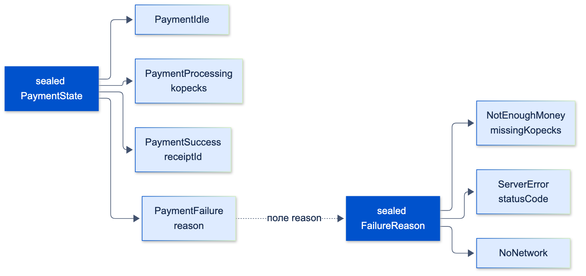

# Расширенные возможности типизации (generics, extension types, sealed classes)

| Грейд | Время на изучение | Статус |
|-------|-------------------|--------|
| ⭐⭐ | ~30 мин лекция + практика | ✅ Готово |

---

## 📚 Ресурсы

| Ресурс | Формат | Язык | Уровень | Зачем читать |
|--------|--------|------|---------|--------------|
| [Модификаторы классов в Dart 3.0](https://habr.com/ru/articles/765736/) | Статья (Habr) | 🇷🇺 | ⭐⭐ | `sealed`, `final`, `base`, `interface` на примерах |
| [Dart 3 на практике](https://habr.com/ru/companies/surfstudio/articles/733532/) | Статья (Habr, Surf) | 🇷🇺 | ⭐⭐ | Sealed-классы, patterns и records глазами Flutter-команды |
| [Dart: Generics](https://dart.dev/language/generics) | Документация | 🇬🇧 | ⭐ | Ограничения типов, обобщённые методы, сохранение типов во время выполнения |
| [Dart: Extension types](https://dart.dev/language/extension-types) | Документация | 🇬🇧 | ⭐⭐ | Официальное описание и главное предупреждение: extension type — не защитная граница |
| [Dart: Patterns](https://dart.dev/language/patterns) и [Branches](https://dart.dev/language/branches) | Документация | 🇬🇧 | ⭐⭐ | Все виды паттернов, `when`-условия, проверка полноты `switch` |
| [Dart: The Dart type system](https://dart.dev/language/type-system) | Документация | 🇬🇧 | ⭐⭐⭐ | Почему ковариантность коллекций — осознанная «дыра» в типобезопасности и что такое `covariant` |

---

## 🎓 Лекция

### 1. Generics

**Обобщённые типы** позволяют написать класс или функцию один раз для разных типов и сохранить проверку типов.

```dart
/// Страница списка с курсорной пагинацией — одна для счетов, карт, операций
class Page<T> {
  const Page(this.items, this.nextCursor);

  final List<T> items;
  final String? nextCursor;

  /// Обобщённый метод: у него свой параметр типа R
  Page<R> map<R>(R Function(T item) convert) => Page(items.map(convert).toList(), nextCursor);
}

/// Два параметра типа: сущность и тип её идентификатора
abstract interface class Repository<T, Id> {
  Future<T?> byId(Id id);
  Future<Page<T>> list({String? cursor});
}

/// Ограничение: T должен уметь сравниваться
T maxOf<T extends Comparable<T>>(Iterable<T> items) {
  var best = items.first;
  for (final item in items) {
    if (item.compareTo(best) > 0) best = item;
  }
  return best;
}

void main() {
  const page = Page([150000, 4500], 'cursor-2');
  final formatted = page.map((kopecks) => '${kopecks ~/ 100} ₽'); // Page<String> выведен сам
  print('${formatted.items} ${formatted.nextCursor}');
  print(maxOf([DateTime(2026, 1, 5), DateTime(2026, 3, 1)]));
}
```

```text
[1500 ₽, 45 ₽] cursor-2
2026-03-01 00:00:00.000
```

#### Неочевидное 1: в Dart типы-параметры сохраняются во время выполнения

В Java тип `List<String>` во время выполнения «стирается» до `List`. В Dart — **нет** (reified generics):
программа знает настоящий тип коллекции и может проверять `is T`.

```dart
bool isOf<T>(Object? value) => value is T; // в Java такое невозможно

void main() {
  final ints = <int>[1, 2];
  print(ints.runtimeType); // List<int>
  print(ints is List<num>); // true
  print((ints as Object) is List<String>); // false
  print(isOf<String>('40817')); // true
  print(isOf<int>('40817')); // false
}
```

```text
List<int>
true
false
true
false
```

#### Неочевидное 2: коллекции ковариантны, и это «дыра» в типобезопасности

`List<int>` считается подтипом `List<Object>`, поэтому присваивание компилируется. Но список по-прежнему
`List<int>` и **проверяет тип при каждой записи** — ошибка появится только во время работы:

```dart
void main() {
  final ints = <int>[1, 2];
  final List<Object> objects = ints; // компилируется!
  try {
    objects.add('строка');
  } on TypeError catch (e) {
    print(e);
  }
}
```

```text
type 'String' is not a subtype of type 'int' of 'value'
```

Это осознанное решение авторов языка: так удобнее читать коллекции. Цена — проверки при записи и такие ошибки.
Правило: **не записывай в коллекцию, полученную как более общий тип.**

#### Неочевидное 3: `int` не является `Comparable<int>`

`int` реализует `Comparable<num>`, а не `Comparable<int>`. Вместе с ковариантностью это даёт ловушку,
которая компилируется и падает во время работы:

```dart
T maxOfReduce<T extends Comparable<T>>(List<T> items) =>
    items.reduce((a, b) => a.compareTo(b) >= 0 ? a : b);

void main() {
  print(maxOfReduce(['б', 'в', 'а'])); // String реализует Comparable<String> — всё хорошо
  try {
    print(maxOfReduce([3, 9, 4]));
  } on TypeError catch (e) {
    print('TypeError: $e');
  }
}
```

```text
в
TypeError: type '(num, num) => num' is not a subtype of type '(int, int) => int' of 'combine'
```

Что произошло: чтобы удовлетворить ограничению, Dart вывел `T = num`. Список при этом остался `List<int>`, и его метод
`reduce` ожидает функцию `(int, int) => int`, а получил `(num, num) => num`. Версия `maxOf` из начала раздела
работает, потому что не передаёт функцию внутрь списка, а только читает элементы. Явно написать `maxOfReduce<int>(…)`
не получится: анализатор ответит, что `int` не удовлетворяет ограничению `Comparable<int>`.

#### Неочевидное 4: где теряется тип

| Код | Тип | Почему |
|-----|-----|--------|
| `final list = [];` | `List<dynamic>` | Не из чего вывести тип. Пиши `<Account>[]` |
| `fold(0, (a, b) => a + b)` там, где ожидается `Object?` (например, внутри `print(…)`) | аккумулятор `Object?` — не компилируется. В `final x = …fold(0, …)` тип выведется как `int` | Пиши `fold<int>(…)` |
| `Map<String, dynamic>` из `jsonDecode` | значения `dynamic` | Приводи явно при разборе: `json['balance'] as int` |
| Параметр без типа в замыкании, которому нечего вывести | `dynamic` | Включи строгие правила анализатора: `strict-inference`, `strict-raw-types` |

> 💡 **Совет:** в `analysis_options.yaml` в секции `analyzer: language:` включи `strict-casts: true`, `strict-inference: true`
> и `strict-raw-types: true`.
> Тогда тихих `dynamic` станет гораздо меньше, а большинство ловушек из этого раздела анализатор покажет заранее.

### 2. Extension types

**Extension type** (Dart 3.3+) — обёртка над существующим типом, которая существует **только при компиляции**.
Во время выполнения остаётся исходное значение: никаких лишних объектов и аллокаций.

#### Типизированные идентификаторы

Самая полезная задача — не дать перепутать строки разного смысла:

```dart
extension type AccountId(String value) {}

extension type CardId(String value) {}

void blockCard(CardId id) {
  // запрос на блокировку карты
}

void main() {
  final account = AccountId('40817810000000000001');
  final card = CardId('4276000000004242');
  blockCard(card);
  // blockCard(account); ❌ ошибка компиляции:
  // The argument type 'AccountId' can't be assigned to the parameter type 'CardId'.
  print(account.value);
}
```

С generics это даёт строгие репозитории: `Repository<Account, AccountId>` не примет `CardId` по ошибке.

#### Деньги с операторами

```dart
extension type const Kopecks(int value) implements int {
  Kopecks operator +(Kopecks other) => Kopecks(value + other.value);

  String get rubles => '${value ~/ 100},${(value % 100).toString().padLeft(2, '0')} ₽';
}

void main() {
  const price = Kopecks(150050);
  const fee = Kopecks(1000);
  print((price + fee).rubles); // наш оператор и наш геттер
  print(price * 2); // implements int: доступны все методы int
}
```

```text
1510,50 ₽
300100
```

`implements int` открывает все методы `int`. Без `implements` наружу видно только то, что объявлено в самом extension type.
Это удобно, чтобы **спрятать** лишнее: например, у `AccountId` нет `substring` и `toUpperCase`.

#### Неочевидное: extension type стирается во время выполнения

```dart
extension type AccountId(String value) {}

void main() {
  final Object? boxed = AccountId('40817');
  print(boxed is AccountId); // true
  print(boxed is String); // тоже true
  print(boxed.runtimeType); // String
  print(('любая строка' as Object) is AccountId); // true!
}
```

```text
true
true
String
true
```

Во время выполнения `AccountId` — это просто `String`. Отсюда важные следствия:
- **Это не граница безопасности и не валидация.** Проверку в конструкторе можно обойти обычным приведением `as AccountId`.
  Если инвариант должен соблюдаться всегда (например, «номер счёта из 20 цифр»), нужен обычный класс.
- **`is AccountId` не отличит счёт от любой строки.** Нельзя полагаться на проверки типа во время выполнения.
- **Без `implements Object` нельзя присвоить в `Object`**, только в `Object?`: это ещё один сюрприз при первом знакомстве.
- **`==` и `hashCode` — как у исходного значения.** Два `AccountId` с одинаковой строкой равны.

| | Extension type | Обычный класс-обёртка | Extension-методы (`extension on`) |
|---|----------------|-----------------------|-----------------------------------|
| Стоимость во время выполнения | Нулевая | Объект на каждое значение | Нулевая |
| Новый тип для компилятора | ✅ | ✅ | ❌ — тот же тип, только методы добавлены |
| Гарантия инвариантов | ❌ Обходится через `as` | ✅ | ❌ |
| Проверка `is` во время выполнения | Видит исходный тип | Работает честно | — |
| Когда выбрать | Типизированные id, единицы измерения, обёртки для JS-interop | Значения с жёсткими правилами (деньги с валютой, IBAN) | Удобные методы для чужих типов: `DateTime.isWeekend` |

### 3. Sealed-классы: глубже

Основы `sealed` (закрытый набор подтипов, `switch` с проверкой полноты, сравнение с полиморфизмом) разобраны
в теме «ООП». Здесь — то, что используется в реальных состояниях экранов.

#### Состояние оплаты: вложенные sealed-иерархии и паттерны

```dart
sealed class PaymentState {
  const PaymentState();
}

final class PaymentIdle extends PaymentState {
  const PaymentIdle();
}

final class PaymentProcessing extends PaymentState {
  const PaymentProcessing(this.kopecks);
  final int kopecks;
}

final class PaymentSuccess extends PaymentState {
  const PaymentSuccess(this.receiptId);
  final String receiptId;
}

final class PaymentFailure extends PaymentState {
  const PaymentFailure(this.reason);
  final FailureReason reason;
}

sealed class FailureReason {
  const FailureReason();
}

final class NotEnoughMoney extends FailureReason {
  const NotEnoughMoney(this.missingKopecks);
  final int missingKopecks;
}

final class ServerError extends FailureReason {
  const ServerError(this.statusCode);
  final int statusCode;
}

final class NoNetwork extends FailureReason {
  const NoNetwork();
}

String describe(PaymentState state) => switch (state) {
      PaymentIdle() => 'Введите сумму',
      PaymentProcessing(:final kopecks) when kopecks >= 100000000 => 'Крупный платёж: нужна дополнительная проверка',
      PaymentProcessing(:final kopecks) => 'Оплачиваем ${kopecks ~/ 100} ₽…',
      PaymentSuccess(:final receiptId) => 'Готово, чек $receiptId',
      PaymentFailure(reason: NotEnoughMoney(:final missingKopecks)) => 'Не хватает ${missingKopecks ~/ 100} ₽',
      PaymentFailure(reason: ServerError(statusCode: >= 500)) => 'Сервис временно недоступен',
      PaymentFailure(reason: ServerError(:final statusCode)) => 'Ошибка $statusCode',
      PaymentFailure(reason: NoNetwork()) => 'Нет интернета',
    };

void main() {
  const states = [
    PaymentIdle(),
    PaymentProcessing(250000),
    PaymentProcessing(150000000),
    PaymentSuccess('R-8812'),
    PaymentFailure(NotEnoughMoney(42000)),
    PaymentFailure(ServerError(503)),
    PaymentFailure(ServerError(409)),
    PaymentFailure(NoNetwork()),
  ];
  for (final state in states) {
    print(describe(state));
  }
}
```

```text
Введите сумму
Оплачиваем 2500 ₽…
Крупный платёж: нужна дополнительная проверка
Готово, чек R-8812
Не хватает 420 ₽
Сервис временно недоступен
Ошибка 409
Нет интернета
```



Что здесь используется:
- **Деструктуризация** `PaymentProcessing(:final kopecks)` — проверка типа и извлечение поля в одном выражении.
- **Условие `when`** — дополнительная проверка. Вариант с `when` **не засчитывается** в полноту: обязательно нужен
  такой же вариант без условия ниже.
- **Вложенные паттерны** `PaymentFailure(reason: NotEnoughMoney(…))` — проверка типа поля прямо в `case`.
- **Сравнение в паттерне** `ServerError(statusCode: >= 500)`.
- **Полнота проверяется и для вложенной иерархии.** Убери вариант `NoNetwork()` — и код не скомпилируется.

#### Что даёт компилятор

```dart
sealed class CardStatus {}

final class Active extends CardStatus {}

final class Blocked extends CardStatus {}

final class Expired extends CardStatus {}

String label(CardStatus status) => switch (status) {
      Active() => 'Активна',
      Blocked() => 'Заблокирована',
      // Expired() забыли
    };
```

```text
error: The type 'CardStatus' isn't exhaustively matched by the switch cases since it doesn't match the pattern 'Expired()'.
```

Это и есть главная ценность `sealed`: **добавил новое состояние — компилятор показал все места, где его нужно обработать.**

> ⚠️ **Внимание:** вариант по умолчанию `_ => …` в `switch` по sealed-типу **отключает** эту защиту: новый подтип молча
> попадёт в `_`. Используй `_` только там, где «все остальные» действительно обрабатываются одинаково.

#### Неочевидное о `sealed`

- **Все прямые подтипы — в той же библиотеке** (файле или его `part`-файлах). Поэтому состояние и все его варианты
  обычно лежат в одном файле.
- **Sealed-класс неявно абстрактный:** создать его экземпляр нельзя.
- **Подтипы закрыты только на первом уровне.** Если подтип объявлен обычным `class`, его можно унаследовать в другом файле,
  и полнота от этого не сломается, но иерархия расползётся. Объявляй подтипы как `final class`.
- **Полнота проверяется не только для `sealed`:** ещё для `enum`, `bool`, `null` у nullable-типов и records.

#### `sealed`, `enum` или `abstract`?

| | `enum` | `sealed class` | `abstract class` |
|---|--------|----------------|------------------|
| Набор вариантов | Закрытый | Закрытый | Открытый |
| Данные у варианта | Одинаковые поля у всех (константы) | **Свои поля у каждого варианта** | Свои поля |
| Проверка полноты `switch` | ✅ | ✅ | ❌ |
| Сколько экземпляров | По одному на вариант | Сколько угодно | Сколько угодно |
| Пример | Статус карты, валюта | Состояние экрана, результат операции, событие BLoC | Интерфейс репозитория, стратегия |

### ⚠️ Частые ошибки

- **Запись в коллекцию, полученную как более общий тип** (`List<Object>` поверх `List<int>`) — ошибка во время работы.
- **`final list = [];` без типа** — `List<dynamic>` и потеря проверок.
- **Extension type как валидация** («раз тип `AccountId`, значит строка проверена») — проверка обходится через `as`.
- **Проверка `is SomeExtensionType`** — во время работы она проверяет исходный тип.
- **`_ =>` в `switch` по sealed-типу** — новые варианты молча уходят в «остальное».
- **Подтипы sealed-класса без `final`** — иерархию можно расширить из других файлов.

---

## ✅ Самопроверка

**⭐ Junior**
1. Зачем нужны generics? Напиши обобщённый класс `Page<T>`.
2. Что такое ограничение `T extends Comparable<T>`?
3. Чем `sealed class` полезен в `switch`?

**⭐⭐ Middle**
1. Что выведет `print(<int>[1] is List<num>)` и почему? Сохраняются ли типы-параметры во время выполнения в Dart?
2. Почему `List<Object> objects = <int>[]; objects.add('a');` компилируется, но падает?
3. Что такое extension type и чем он отличается от extension-методов?
4. Как условие `when` в `case` влияет на проверку полноты `switch`?

**⭐⭐⭐ Senior**
1. Почему `maxOfReduce([3, 9, 4])` с ограничением `T extends Comparable<T>` падает во время выполнения? Как переписать?
2. Можно ли использовать extension type `AccountId` как гарантию того, что номер счёта прошёл проверку? Почему?
3. Когда выбрать `enum`, `sealed class` или обычный класс-обёртку вместо extension type?
4. Почему подтипы sealed-класса лучше объявлять `final class`?

<details>
<summary>Ответы</summary>

**Junior**
1. Чтобы один класс или функция работали с разными типами и при этом компилятор проверял типы. `class Page<T> { final List<T> items; final String? nextCursor; … }`.
2. `T` может быть только таким типом, который умеет сравниваться с самим собой, поэтому внутри можно вызывать `compareTo`.
3. Компилятор проверяет, что в `switch` обработаны все подтипы. При добавлении нового подтипа все такие `switch` перестанут компилироваться и покажут, что нужно доработать.

**Middle**
1. `true`. В Dart типы-параметры сохраняются во время выполнения (reified generics), а коллекции ковариантны: `List<int>` — подтип `List<num>`.
2. Коллекции ковариантны, поэтому присваивание разрешено. Но объект по-прежнему `List<int>` и проверяет тип при записи: `add('a')` бросает `TypeError`.
3. Extension type — новый тип, который существует только при компиляции, во время выполнения это исходное значение. Extension-методы не создают нового типа, а добавляют методы существующему.
4. Вариант с `when` не засчитывается в полноту: нужен ещё вариант того же типа без условия (или более общий), иначе `switch` не скомпилируется.

**Senior**
1. `int` реализует `Comparable<num>`, поэтому выводится `T = num`, а список остаётся `List<int>`. Его `reduce` ожидает `(int, int) => int`, а получает `(num, num) => num` — `TypeError` при выполнении. Решение: не передавать функцию с типом `T` в методы списка, а обойти элементы циклом, или ослабить ограничение.
2. Нет. Extension type стирается во время выполнения, любую строку можно привести через `as AccountId`, а `is AccountId` вернёт `true` для любой строки. Для гарантии инварианта нужен обычный класс с проверкой в конструкторе.
3. `enum` — закрытый набор вариантов без своих данных. `sealed class` — закрытый набор, у вариантов свои данные (состояния, результаты). Класс-обёртка — когда нужен инвариант и честная проверка типа во время выполнения (деньги с валютой, IBAN).
4. Иначе подтип можно унаследовать в другом файле, и иерархия станет шире, чем видно в одном месте. `final class` закрывает её полностью.

</details>
