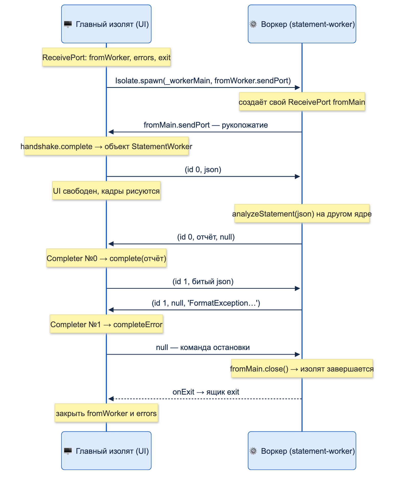

# Изоляты

| Грейд | Время на изучение | Статус |
|-------|-------------------|--------|
| ⭐⭐⭐ | ~45 мин лекция + практика | ✅ Готово |

---

## 📚 Ресурсы

| Ресурс | Формат | Язык | Уровень | Зачем читать |
|--------|--------|------|---------|--------------|
| [Flutter. Асинхронность и параллельность](https://habr.com/ru/articles/497278/) | Статья (Habr, перевод Дидье Буленса) | 🇷🇺 | ⭐⭐ | Event Loop и изоляты в одной картине, когда нужен `Future`, а когда изолят |
| [Хендбук Яндекса по Flutter: асинхронность в Dart](https://contest.yandex.ru/tracks/flutter/crash-course/dart-asynchronous-programming) | Учебник | 🇷🇺 | ⭐ | Коротко про `Isolate.run` и `compute` |
| [Flutter: Concurrency and isolates](https://docs.flutter.dev/perf/isolates) | Документация | 🇬🇧 | ⭐⭐ | Когда выносить работу в изолят, ограничения во Flutter: веб, UI, плагины |
| [Dart: Isolates](https://dart.dev/language/isolates) | Документация | 🇬🇧 | ⭐⭐⭐ | Официальный пример «надёжных портов»: рукопожатие, id запросов, `Completer` — та же схема, что в задаче ниже |
| [SendPort.send](https://api.dart.dev/dart-isolate/SendPort/send.html) | Справочник API | 🇬🇧 | ⭐⭐⭐ | Точный список того, что можно и нельзя передавать между изолятами |
| [BackgroundIsolateBinaryMessenger](https://api.flutter.dev/flutter/services/BackgroundIsolateBinaryMessenger-class.html) | Справочник API | 🇬🇧 | ⭐⭐⭐ | Как вызывать плагины и платформенные каналы из фонового изолята |

---

## 🎓 Лекция

### 1. Что такое изолят

**Изолят** — независимый исполнитель Dart-кода:

| У каждого изолята своё | Что из этого следует |
|------------------------|----------------------|
| **Память (куча)** | Переменные и объекты одного изолята не видны другому. Нет общей памяти — нет гонок данных и блокировок (`mutex`, `synchronized`) |
| **Event Loop** с очередями микрозадач и событий | Внутри изолята всё работает так же, как в теме «Event Loop» |
| **Поток выполнения** | Разные изоляты действительно выполняются **параллельно** на разных ядрах процессора |

Изоляты общаются **только сообщениями** через порты: `SendPort` (куда отправить) и `ReceivePort` (откуда читать).
Это модель акторов: никто не меняет чужое состояние, все просят друг друга сообщениями.

```dart
import 'dart:isolate';

int counter = 0; // глобальная переменная

void worker(SendPort port) {
  counter++; // у этого изолята СВОЯ копия counter, изначально 0
  port.send('в изоляте counter = $counter');
}

Future<void> main() async {
  counter = 100;
  final port = ReceivePort();
  await Isolate.spawn(worker, port.sendPort);
  print(await port.first);
  print('в main counter = $counter');
}
```

```text
в изоляте counter = 1
в main counter = 100
```

Во Flutter весь UI живёт в **главном изоляте**. Если в нём долго считать (разбор большого JSON, шифрование, обработка
изображения), кадры не рисуются — интерфейс «замерзает» (подробно — в теме «Event Loop»). Изолят переносит такую работу
на другое ядро, и главный изолят остаётся свободным.

> ℹ️ **Важно:** изолят нужен для **вычислений** (CPU), а не для ожидания. Сетевой запрос, чтение файла, работа с базой
> уже асинхронные и не блокируют UI: их выносить в изолят незачем. Выносят то, что **считает**: разбор и сериализацию
> больших данных, криптографию, сжатие, обработку изображений, сложную фильтрацию больших списков.

### 2. Что можно передавать между изолятами

Частое убеждение: «между изолятами можно передавать только примитивы и сериализуемые данные». Оно **верно только
для одного случая** — `Isolate.spawnUri`. Для `Isolate.spawn`, `Isolate.run` и `compute` правила намного шире.
Всё ниже — по документации `SendPort.send` из Dart SDK и проверено запуском на Dart 3.10.

#### Главное: зависит от того, есть ли у изолятов общий код

| | `Isolate.spawn`, `Isolate.run`, `compute` | `Isolate.spawnUri` |
|---|------------------------------------------|--------------------|
| Код программы | **Общий**: изоляты из одной программы (одна группа изолятов) | **Разный**: новый изолят запускает другой Dart-файл |
| Что можно передать | **Любой объект**, кроме короткого списка исключений (ниже) | **Только**: `null`, `bool`, `int`, `double`, `String`, `List`/`Map`/`Set` из этого же, `TransferableTypedData`, `Capability`, `SendPort`, `Type` этих типов |
| Объекты своих классов | ✅ | ❌ |
| Функции и замыкания | ✅, если всё захваченное тоже можно передать | ❌ |

**Почему объект с методами можно передать.** Методы — это **код класса**, а не данные объекта. Изоляты из одной программы
выполняют один и тот же код, поэтому копируются только **поля** объекта, а на той стороне создаётся объект того же класса
со всеми его методами. Поэтому в `spawnUri`, где код разный, своих классов передать нельзя: получателю не из чего
восстановить класс.

#### Чего нельзя передать никогда

Из документации `SendPort.send` и разметки самого SDK:

| Нельзя | Почему |
|--------|--------|
| `ReceivePort`, `RawReceivePort` | Порт принадлежит конкретному изоляту. Передавать нужно его `sendPort` |
| `Socket` и другие объекты с нативными ресурсами, `DynamicLibrary`, `Finalizable`, `Finalizer`, `NativeFinalizer`, `UserTag` | Привязаны к ресурсам ОС и памяти конкретного изолята |
| **`Future`, `Completer`, `Stream`, `Timer`, `Zone`** | Помечены в SDK как `@pragma('vm:isolate-unsendable')`: это «живые» асинхронные объекты Event Loop конкретного изолята |
| Объект, функция или замыкание, которые **где угодно в глубине** ссылаются на что-то из списка выше | Передаётся весь граф объектов, и проверяется каждый его элемент |

#### Проверено запуском

Каждый объект отправлялся через `SendPort.send` (изоляты с общим кодом):

| Объект | Результат |
|--------|-----------|
| `int`, `double`, `String`, `bool`, `null`, `List`, `Map`, `Set`, records | ✅ |
| `Uint8List`, `DateTime`, `Duration`, `BigInt`, `enum`, `Type` | ✅ |
| Объект своего класса с методами | ✅ |
| Объект с полем-колбэком, замыкание которого захватило `int` | ✅ |
| Функция верхнего уровня | ✅ |
| `SendPort`, `Capability`, `TransferableTypedData` | ✅ |
| `ReceivePort` | ❌ `_ReceivePortImpl` |
| Замыкание, которое захватило `ReceivePort` | ❌ `_ReceivePortImpl` |
| `Future`, `Completer`, `Stream`, `Timer` | ❌ `_Future`, `_AsyncCompleter`, `_ControllerStream`, `_Timer` |
| Объект, в поле которого лежит `Future` | ❌ `_Future` |
| Замыкание, которое захватило `Future` | ❌ `_Future` |
| `StreamController`, BLoC-подобный объект со `StreamController` внутри | ✅ — но это **бесполезная копия**, см. ниже |

> ⚠️ **Внимание:** «можно передать» не значит «имеет смысл». Копия `StreamController`, BLoC, кеша или репозитория в другом
> изоляте — это **отдельный объект без связи с оригиналом**: подписчики оригинала ничего не получат, изменения копии
> никто не увидит. Передавать стоит **данные** (DTO, records, коллекции, примитивы), а не «живые» объекты с состоянием и подписками.
> В этом смысле интуиция «передаём только данные» — правильное **практическое правило**, хотя технически ограничение мягче.

#### Как передаётся: копия, а не ссылка

```dart
import 'dart:isolate';

class Account {
  Account(this.id, this.kopecks);

  final String id;
  int kopecks;

  String describe() => '$id: ${kopecks ~/ 100} ₽'; // метод — это код класса, а не данные объекта
}

class FeePolicy {
  FeePolicy(this.calculate);

  final int Function(int kopecks) calculate; // поле-колбэк
}

/// Меняем объект в другом изоляте и вызываем его метод
Future<String> resetInIsolate(Account account) => Isolate.run(() {
      account.kopecks = 0; // меняется КОПИЯ
      return account.describe(); // метод доступен: у изолятов общий код программы
    });

/// Вызываем колбэк объекта в другом изоляте
Future<int> feeInIsolate(FeePolicy policy, int kopecks) => Isolate.run(() => policy.calculate(kopecks));

Future<void> main() async {
  final account = Account('40817', 150000);
  print('В изоляте: ${await resetInIsolate(account)}');
  print('В main: ${account.describe()}'); // оригинал не изменился

  final percent = 30; // 0,3 %
  final policy = FeePolicy((kopecks) => kopecks * percent ~/ 10000);
  print('Колбэк выполнен в другом изоляте: ${await feeInIsolate(policy, 150000)}');
}
```

```text
В изоляте: 40817: 0 ₽
В main: 40817: 1500 ₽
Колбэк выполнен в другом изоляте: 450
```

- **Изменяемые объекты копируются целиком**, со всем графом. Изоляты не делят память, поэтому изменение в изоляте
  (`kopecks = 0`) не затрагивает оригинал. Стоимость копирования растёт с размером графа.
- **Неизменяемые объекты** (строки, `const`-данные) передаются без копирования: менять их всё равно нельзя.
- **Колбэк выполняется там, куда его отправили**: в другом изоляте, с **копиями** захваченных переменных. Если колбэк
  что-то меняет, он меняет копию, и вызывающая сторона этого не увидит.
- **`Isolate.exit(port, result)`** передаёт результат **без копирования**: изолят завершается и отдаёт память получателю.
  Так `Isolate.run` возвращает результат.
- **Для больших байтовых массивов** (файлы, изображения) есть `TransferableTypedData`: байты передаются без копирования.

#### Ловушка: замыкание тащит за собой `this`

```dart
import 'dart:isolate';

class Screen {
  final ReceivePort port = ReceivePort(); // объект, который нельзя передать
  String json = '[1, 2, 3]';

  // ❌ Замыкание обращается к полю json — значит, захватывает весь this вместе с port
  Future<int> brokenParse() => Isolate.run(() => json.length);

  // ✅ Копируем нужное в локальную переменную — захватывается только строка
  Future<int> correctParse() {
    final data = json;
    return Isolate.run(() => data.length);
  }
}

Future<void> main() async {
  final screen = Screen();
  print(await screen.correctParse());
  try {
    await screen.brokenParse();
  } on ArgumentError catch (e) {
    print(e.toString().split(' - ').first); // первая часть длинного сообщения
  }
  screen.port.close();
}
```

```text
9
Invalid argument(s): Illegal argument in isolate message: object is unsendable
```

В полном тексте ошибки Dart показывает и путь до виновника: `<- port in Instance of 'Screen'`. Во Flutter в роли `Screen`
обычно оказывается `State` виджета, а в роли `port` — `BuildContext`, контроллеры, потоки. Правило: **внутри замыкания
для изолята используй только локальные переменные и параметры**.

#### Ловушка: замыкание захватывает соседей по функции

Это неочевидная особенность Dart VM, о которой прямо предупреждает документация `SendPort.send`: замыкания внутри одной
функции **делят общий контекст переменных**. Поэтому замыкание для изолята может потащить за собой переменную, которую
оно само не использует, если её захватило **другое** замыкание в той же функции.

```dart
import 'dart:isolate';

Future<int> loadLimit() async => 60000000;

Future<void> broken() async {
  final limit = loadLimit(); // Future в локальной переменной
  final kopecks = int.parse("150000"); // обычная переменная, не const
  Future<void> showLimit() async => print('лимит: ${await limit}'); // это замыкание захватило limit
  await showLimit();
  // Это замыкание limit не использует, но делит с showLimit общий контекст переменных функции
  final fee = await Isolate.run(() => kopecks ~/ 100);
  print('комиссия: $fee');
}

Future<void> fixed() async {
  final limit = loadLimit();
  Future<void> showLimit() async => print('лимит: ${await limit}');
  await showLimit();
  print('комиссия: ${await calculateFee(150000)}'); // работа для изолята — в отдельной функции
}

/// Здесь у замыкания в контексте только параметр kopecks
Future<int> calculateFee(int kopecks) => Isolate.run(() => kopecks ~/ 100);

Future<void> main() async {
  try {
    await broken();
  } on ArgumentError catch (e) {
    print('broken: ${e.toString().split(' - ').first}');
  }
  await fixed();
}
```

```text
лимит: 60000000
broken: Invalid argument(s): Illegal argument in isolate message: object is unsendable
лимит: 60000000
комиссия: 1500
```

В `broken` замыкание `() => kopecks ~/ 100` использует только число, но падает: в общем с `showLimit` контексте лежит `Future`.
В `fixed` то же вычисление вынесено в отдельную функцию `calculateFee`, и в её контексте нет ничего лишнего.

Правила, которые закрывают обе ловушки:
- **Работу для изолята выноси в отдельную функцию** (верхнего уровня или `static`) и передавай данные **параметрами**.
- **Внутри такой функции не держи `Future`, `Stream`, контроллеры и `BuildContext`** в переменных, которые видят замыкания.
- Если всё же упало — читай ошибку целиком: после `<-` Dart перечисляет путь до объекта, который нельзя передать.

### 3. Все способы запустить изолят

| Способ | Что делает | Когда использовать |
|--------|------------|--------------------|
| `Isolate.run(fn)` (Dart 2.19+) | Запускает изолят, выполняет `fn`, возвращает результат через `Isolate.exit` и завершает изолят | **Основной способ** для разовых тяжёлых вычислений |
| `compute(fn, message)` (Flutter) | На мобильных и десктопе — то же, что `Isolate.run(() => fn(message))`. **На вебе выполняется в главном потоке** | Код, который должен собираться и под веб |
| `Isolate.spawn(entry, message)` | Запускает долгоживущий изолят с функцией-точкой входа. Связь — только через порты, всё нужно сделать самому | **Воркер**, который принимает много задач: шифрование, обработка потока данных, база в фоне |
| `Isolate.spawnUri(uri, args, message)` | Запускает изолят из **отдельного Dart-файла** по URI | Серверные и консольные программы, плагины-скрипты. В мобильных Flutter-приложениях практически не используется |
| Пакеты (`worker_manager`, `squadron`) | Пулы изолятов, отмена задач, удобное API | Много параллельных задач, когда не хочется писать воркер самому |

> ⚠️ **Внимание:** на **вебе изолятов нет**. `Isolate.run` и `Isolate.spawn` там не работают, а `compute` выполняет
> функцию в главном потоке. Если приложение собирается и под веб, используй `compute`.

#### `Isolate.run` и `compute`

```dart
import 'dart:convert';
import 'dart:isolate';

import 'package:flutter/foundation.dart';

/// Функция для изолята: принимает данные, возвращает результат, ничего не трогает снаружи
List<Map<String, dynamic>> parseOperations(String json) =>
    (jsonDecode(json) as List<dynamic>).cast<Map<String, dynamic>>();

Future<List<Map<String, dynamic>>> loadWithRun(String json) =>
    Isolate.run(() => parseOperations(json)); // замыкание: можно передать сколько угодно аргументов

Future<List<Map<String, dynamic>>> loadWithCompute(String json) =>
    compute(parseOperations, json); // функция + ОДИН аргумент; на вебе — в главном потоке
```

#### Плагины в фоновом изоляте

По умолчанию платформенные каналы (а значит, и большинство плагинов) работают только в главном изоляте.
С Flutter 3.7 фоновому изоляту можно дать доступ к ним:

```dart
import 'dart:isolate';

import 'package:flutter/services.dart';

Future<String?> readFromSecureStorageInBackground() async {
  final token = RootIsolateToken.instance!; // берём В ГЛАВНОМ изоляте
  return Isolate.run(() async {
    BackgroundIsolateBinaryMessenger.ensureInitialized(token); // регистрируем фоновый изолят
    const channel = MethodChannel('bank/secure_storage');
    return channel.invokeMethod<String>('read', {'key': 'pin_hash'});
  });
}
```

Ограничение: фоновый изолят может **отправлять** запросы платформе и получать ответы, но не может получать
сообщения, которые платформа присылает сама (подписки, слушатели).

### 4. Главная задача: долгоживущий воркер на `Isolate.spawn`

> ✍️ **Условие.** Приложение банка загружает выписку (сотни тысяч операций в JSON) и строит по ней отчёт: доходы, расходы,
> категория с наибольшими тратами. Отчёты пересчитываются часто: при смене периода, фильтров, при подгрузке новых операций.
> Нужно, чтобы:
> - главный изолят (UI) не «замерзал» во время расчёта;
> - изолят не создавался заново на каждый расчёт, а работал постоянно и принимал задачи;
> - можно было отправить несколько задач подряд и получить **свой** ответ на каждую;
> - ошибка в одной задаче не роняла воркер, а приходила в нужный `Future`;
> - воркер корректно останавливался.

`Isolate.run` здесь не подходит: он создаёт изолят на каждую задачу и сразу его завершает. Нужен `Isolate.spawn`
и ручная работа с портами — самый «низкоуровневый» и самый гибкий способ.



#### Код целиком

Пояснения к каждому шагу — прямо в комментариях в коде.

```dart
import 'dart:async';
import 'dart:convert';
import 'dart:isolate';

/// Итог анализа выписки — обычный класс: его можно передавать между изолятами
class StatementReport {
  const StatementReport({
    required this.count,
    required this.income,
    required this.expenses,
    required this.topCategory,
  });

  final int count;
  final int income;
  final int expenses;
  final String topCategory;

  @override
  String toString() => 'операций: $count, доходы: ${income ~/ 100} ₽, '
      'расходы: ${expenses ~/ 100} ₽, больше всего трат: $topCategory';
}

/// Тяжёлая чистая функция: разбор JSON и агрегация
StatementReport analyzeStatement(String json) {
  final operations = (jsonDecode(json) as List<dynamic>).cast<Map<String, dynamic>>();
  var income = 0;
  var expenses = 0;
  final byCategory = <String, int>{};
  for (final operation in operations) {
    final kopecks = operation['amount'] as int;
    if (kopecks >= 0) {
      income += kopecks;
    } else {
      expenses -= kopecks;
      byCategory.update(operation['category'] as String, (sum) => sum - kopecks, ifAbsent: () => -kopecks);
    }
  }
  final top = byCategory.entries.reduce((a, b) => a.value >= b.value ? a : b).key;
  return StatementReport(count: operations.length, income: income, expenses: expenses, topCategory: top);
}

class StatementWorker {
  StatementWorker._(this._isolate, this._toWorker, this._fromWorker, this._errors, this._exit);

  final Isolate _isolate;
  final SendPort _toWorker; // адрес воркера: сюда отправляем задачи
  final ReceivePort _fromWorker; // наш ящик: сюда приходят ответы
  final ReceivePort _errors;
  final ReceivePort _exit;
  // Ожидающие задачи: номер → Completer, который завершим, когда придёт ответ с этим номером
  final _pending = <int, Completer<StatementReport>>{};
  var _nextId = 0;
  var _closed = false;

  static Future<StatementWorker> spawn() async {
    // «Почтовый ящик» главного изолята для ответов воркера. ReceivePort — это Stream,
    // а его sendPort — «адрес», по которому в ящик можно отправить письмо из любого изолята.
    final fromWorker = ReceivePort();
    // Отдельный ящик для НЕОБРАБОТАННЫХ ошибок воркера (упало что-то вне try).
    final errors = ReceivePort();
    // Ящик для уведомления «изолят завершился» — чтобы в dispose дождаться реальной остановки.
    final exit = ReceivePort();

    // Создаём новый изолят. await ждёт, пока изолят создан и запущен, а не пока он что-то сделает.
    final isolate = await Isolate.spawn(
      // Точка входа: функция верхнего уровня (или static) с одним аргументом — сообщением ниже.
      _workerMain,
      // Первое сообщение воркеру — адрес нашего ящика. Без него воркер не узнает, куда отвечать.
      // Это первая половина «рукопожатия».
      fromWorker.sendPort,
      // Необработанные ошибки воркера придут в ящик errors списком [ошибка, стек] строками.
      onError: errors.sendPort,
      // При завершении изолята в ящик exit придёт null.
      onExit: exit.sendPort,
      // Имя изолята в DevTools и логах — сильно помогает при отладке.
      debugName: 'statement-worker',
    );

    // Адрес ВОРКЕРА мы ещё не знаем: он пришлёт его первым сообщением.
    // Completer превращает это будущее сообщение в Future.
    final handshake = Completer<SendPort>();
    late final StatementWorker worker;
    // Подписываемся на ящик один раз и навсегда: ReceivePort — single-subscription поток,
    // второй listen не получится. Поэтому одно место разбирает и рукопожатие, и ответы.
    fromWorker.listen((message) {
      if (message is SendPort) {
        // Первое сообщение — SendPort воркера: рукопожатие завершено,
        // теперь у каждой стороны есть адрес другой.
        handshake.complete(message);
      } else {
        // Все остальные сообщения — ответы на задачи. Ответы начнут приходить
        // только после создания worker ниже, поэтому late final здесь безопасен.
        worker._handleResponse(message);
      }
    });

    // Ждём адрес воркера и создаём объект, который хранит изолят, адрес воркера и свои ящики.
    worker = StatementWorker._(isolate, await handshake.future, fromWorker, errors, exit);
    errors.listen(worker._handleCrash);
    return worker;
  }

  Future<StatementReport> analyze(String json) {
    if (_closed) throw StateError('Воркер уже закрыт');
    // Каждой задаче — уникальный номер: ответы приходят в ОДИН ящик,
    // и только по номеру можно понять, какой задаче принадлежит ответ.
    final id = _nextId++;
    final completer = Completer<StatementReport>();
    _pending[id] = completer;
    // Отправляем запись (номер, данные). Строка неизменяема, поэтому передаётся без копирования,
    // даже если это мегабайты JSON.
    _toWorker.send((id, json));
    // Для вызывающего кода воркер выглядит как обычная асинхронная функция.
    return completer.future;
  }

  void _handleResponse(Object? message) {
    // Ответ — запись из трёх полей. StatementReport пришёл КОПИЕЙ: создан в памяти воркера
    // и скопирован при отправке.
    final (int id, StatementReport? report, String? error) =
        message! as (int, StatementReport?, String?);
    // Достаём Completer своей задачи и сразу удаляем, чтобы не копить завершённые задачи.
    final completer = _pending.remove(id)!;
    if (error != null) {
      completer.completeError(StateError(error)); // ошибка воркера — в Future именно этой задачи
    } else {
      completer.complete(report);
    }
  }

  void _handleCrash(Object? message) {
    // onError присылает [текст ошибки, текст стека]. Раз воркер упал, ответов не будет:
    // завершаем ВСЕ ожидающие задачи ошибкой, иначе их await будут ждать вечно.
    final error = (message! as List<Object?>).first;
    for (final completer in _pending.values) {
      completer.completeError(StateError('Воркер упал: $error'));
    }
    _pending.clear();
  }

  Future<void> dispose() async {
    _closed = true;
    // Договорённость: null — команда «заверши работу». Воркер сам закроет свой ящик.
    _toWorker.send(null);
    // Ждём уведомления о реальном завершении. Не дождались за секунду (воркер завис в расчёте) —
    // убиваем изолят принудительно.
    await _exit.first.timeout(
      const Duration(seconds: 1),
      onTimeout: () => _isolate.kill(priority: Isolate.immediate),
    );
    // Закрываем свои ящики: открытый ReceivePort не даёт программе завершиться,
    // даже если вся работа сделана.
    _fromWorker.close();
    _errors.close();
  }
}

/// Точка входа воркера: выполняется в НОВОМ изоляте — со своей памятью и своим Event Loop
void _workerMain(SendPort toMain) {
  // Ящик воркера: сюда главный изолят будет присылать задачи.
  final fromMain = ReceivePort();
  // Вторая половина рукопожатия: отправляем главному изоляту свой адрес.
  toMain.send(fromMain.sendPort);

  // Воркер не завершается после выхода из _workerMain: пока его ящик открыт,
  // Event Loop изолята ждёт сообщений.
  fromMain.listen((message) {
    if (message == null) {
      // Команда остановки: закрываем единственный открытый порт — Event Loop пустеет,
      // изолят завершается, и в ящик exit главного изолята приходит уведомление.
      fromMain.close();
      return;
    }
    final (int id, String json) = message as (int, String);
    try {
      // Считаем ЗДЕСЬ, на другом ядре, и отвечаем с тем же номером.
      // Пока идёт расчёт, этот изолят занят, а главный — свободен.
      toMain.send((id, analyzeStatement(json), null));
    } catch (e) {
      // Ошибку отправляем строкой: объекты исключений со стеком не всегда можно передать,
      // а строку — всегда. Воркер продолжает работать.
      toMain.send((id, null, '$e'));
    }
  });
}

Future<void> main() async {
  final categories = ['Кафе', 'Такси', 'Продукты'];
  final json = jsonEncode([
    for (var i = 0; i < 300000; i++)
      {'amount': i.isEven ? -(i % 5000) : i % 7000, 'category': categories[i % 3]},
  ]);

  // Для сравнения: в главном изоляте таймер «замирает»
  var ticks = 0;
  var timer = Timer.periodic(const Duration(milliseconds: 5), (_) => ticks++);
  analyzeStatement(json);
  await Future<void>.delayed(Duration.zero);
  print('В главном изоляте: тиков таймера за время анализа — $ticks');
  timer.cancel();

  // В воркере: главный изолят свободен
  final worker = await StatementWorker.spawn();
  ticks = 0;
  timer = Timer.periodic(const Duration(milliseconds: 5), (_) => ticks++);
  final report = await worker.analyze(json);
  timer.cancel();
  print('В воркере: $report');
  print('Главный изолят был свободен: ${ticks > 0}');

  try {
    await worker.analyze('[{"amount": ');
  } on StateError catch (e) {
    print('Ошибка из воркера: ${e.message}');
  }

  await worker.dispose();
  print('Воркер остановлен, программа завершается');
}
```

```text
В главном изоляте: тиков таймера за время анализа — 1
В воркере: операций: 300000, доходы: 5235000 ₽, расходы: 3748500 ₽, больше всего трат: Продукты
Главный изолят был свободен: true
Ошибка из воркера: FormatException: Unexpected end of input (at character 13)
[{"amount": 
            ^

Воркер остановлен, программа завершается
```

Что показывает вывод:
- **В главном изоляте** таймер с периодом 5 мс за всё время анализа (сотни миллисекунд) сработал **один раз** — уже после
  окончания. Во Flutter это сотни миллисекунд без единого кадра.
- **С воркером** главный изолят был свободен: таймер тикал, пока воркер считал.
- **Ошибка** битого JSON пришла в `Future` своего запроса, воркер продолжил работать.
- **Программа завершилась сама**: все порты закрыты, изолят остановлен.

#### Почему именно так

- **Рукопожатие из двух `SendPort`** нужно потому, что порт — однонаправленный: `ReceivePort` только принимает, `SendPort`
  только отправляет. Для диалога каждой стороне нужен адрес другой.
- **Номера задач и `Completer`** превращают поток сообщений в обычные `Future`. Без них при двух одновременных задачах
  непонятно, чей ответ пришёл первым.
- **Ошибки — частью ответа**, а не падением воркера. Иначе одна битая выписка останавливала бы весь воркер.
- **Явная остановка** с ожиданием `onExit` и `kill` на крайний случай — иначе утечка изолята или зависание программы.

Готовые пакеты (`worker_manager`, `squadron`) делают то же самое под капотом. Понимать эту схему нужно, чтобы
читать их код и отлаживать проблемы.

### ⚠️ Частые ошибки

- **Изолят для сетевых запросов и работы с базой.** Ожидание не блокирует UI — изолят только добавит копирование данных.
- **Замыкание, которое захватывает `this`** (`State`, контроллер) — `object is unsendable` или копирование огромного объекта.
- **Замыкание для изолята внутри функции, где другое замыкание держит `Future` или `Stream`** — падает из-за общего контекста. Выноси работу в отдельную функцию.
- **Передача BLoC, репозитория или контроллера в изолят** — технически возможна, но это бесполезная копия без связи с оригиналом.
- **Незакрытый `ReceivePort`** — изолят и программа не завершаются.
- **`Isolate.run` в цикле на каждую мелкую задачу** — расходы на запуск и копирование перевешивают выгоду. Для потока задач — воркер.
- **Попытка трогать UI, `BuildContext` или `rootBundle` из фонового изолята.** UI живёт только в главном изоляте.
- **`Isolate.run` в коде, который собирается под веб.** Там изолятов нет — используй `compute`.
- **Воркер без обработки ошибок и без `onError`** — первая же ошибка оставляет все `await` висеть навсегда.

---

## ✅ Самопроверка

**⭐ Junior**
1. Что такое изолят и чем он отличается от потока (thread) в Java или Kotlin?
2. Почему тяжёлые вычисления в главном изоляте «замораживают» интерфейс Flutter?
3. Нужно ли выносить в изолят обычный HTTP-запрос? Почему?

**⭐⭐ Middle**
1. Чем `Isolate.run` отличается от `compute`? Что происходит на вебе?
2. Что можно и что нельзя передавать между изолятами? Копируются ли данные?
3. Почему `Isolate.run(() => json.length)` внутри метода `State` может упасть с `object is unsendable`? Как исправить?
4. Как вызвать плагин из фонового изолята?

**⭐⭐⭐ Senior**
1. Опиши протокол общения с долгоживущим воркером на `Isolate.spawn`: рукопожатие, задачи, ответы, ошибки, остановка.
2. Зачем каждой задаче номер и `Completer`? Что будет без них?
3. Почему после всей работы программа может не завершиться? Как воркер правильно останавливается?
4. Чем `SendPort.send` отличается от `Isolate.exit` с точки зрения памяти?

<details>
<summary>Ответы</summary>

**Junior**
1. Изолят — исполнитель со своей памятью, своим Event Loop и своим потоком. В отличие от потоков Java и Kotlin, изоляты не разделяют память: общаются только сообщениями, поэтому не нужны блокировки и нет гонок данных.
2. В главном изоляте живёт UI: отрисовка кадров — это задачи его Event Loop. Пока выполняется долгое синхронное вычисление, кадры не рисуются.
3. Нет. Запрос — асинхронное ожидание, он не занимает поток UI. Изолят нужен для вычислений, а не для ожидания.

**Middle**
1. На мобильных и десктопе `compute(fn, x)` — то же, что `Isolate.run(() => fn(x))`, только с одним аргументом. На вебе изолятов нет: `Isolate.run` не работает, а `compute` выполняет функцию в главном потоке.
2. Зависит от способа запуска. У изолятов с общим кодом (`Isolate.spawn`, `Isolate.run`, `compute`) — любые объекты, включая объекты своих классов с методами и замыкания, кроме `ReceivePort`, объектов с нативными ресурсами, `Future`, `Completer`, `Stream`, `Timer`, `Zone` и всего, что на них ссылается. У `Isolate.spawnUri` — только примитивы, строки, коллекции из них, `TransferableTypedData`, `Capability` и `SendPort`. `send` копирует изменяемые данные (неизменяемые — без копии), `Isolate.exit` передаёт без копирования. На практике передают данные, а не «живые» объекты: копия BLoC или контроллера не связана с оригиналом.
3. Замыкание обращается к полю, то есть захватывает весь `this`, а в `State` есть `BuildContext`, контроллеры, порты — их нельзя передать. Нужно скопировать данные в локальную переменную и использовать в замыкании только её.
4. В главном изоляте получить `RootIsolateToken.instance`, передать его в фоновый изолят и там вызвать `BackgroundIsolateBinaryMessenger.ensureInitialized(token)`. После этого платформенные каналы работают, но только в режиме «запрос — ответ».

**Senior**
1. Главный изолят создаёт `ReceivePort` и запускает воркер, передавая свой `SendPort`. Воркер создаёт свой `ReceivePort` и отправляет обратно свой `SendPort` — рукопожатие. Задачи уходят как `(id, данные)`, ответы приходят как `(id, результат, ошибка)` и завершают `Completer` по `id`. Необработанные ошибки — через порт `onError`, все ожидающие задачи завершаются ошибкой. Остановка: команда (например, `null`), воркер закрывает свой порт, главный изолят ждёт `onExit` (с `kill` по таймауту) и закрывает свои порты.
2. Все ответы приходят в один `ReceivePort`. Без номеров при нескольких одновременных задачах непонятно, какому вызову принадлежит ответ: результаты перепутаются. `Completer` превращает ответ из потока сообщений в `Future` конкретного вызова.
3. Открытый `ReceivePort` удерживает изолят живым: его Event Loop ждёт сообщений. Программа завершится, только когда закрыты все порты. Воркер останавливается по команде, закрывая свой порт; главный изолят дожидается `onExit` и закрывает свои порты.
4. `send` копирует граф объектов (кроме неизменяемых), отправитель продолжает работать со своими данными. `Isolate.exit` завершает изолят и передаёт результат получателю без копирования — быстро даже для больших данных, поэтому так работает `Isolate.run`.

</details>
