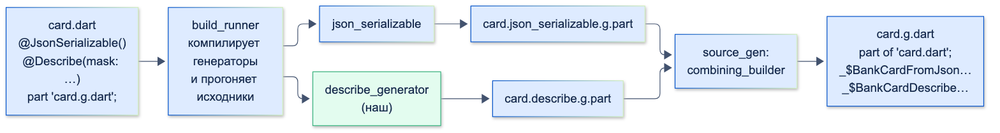

# Кодогенерация (build_runner, свой генератор, mason)

| Грейд | Время на изучение | Статус |
|-------|-------------------|--------|
| ⭐⭐⭐ | ~20 мин лекция + практика | ✅ Готово |

---

## 📚 Ресурсы

| Ресурс | Формат | Язык | Уровень | Зачем читать |
|--------|--------|------|---------|--------------|
| [build_runner](https://pub.dev/packages/build_runner) | Пакет и документация | 🇬🇧 | ⭐ | Команды, `build.yaml`, отличия версий |
| [source_gen](https://pub.dev/packages/source_gen) | Пакет | 🇬🇧 | ⭐⭐⭐ | Основа почти всех генераторов: `GeneratorForAnnotation`, `SharedPartBuilder` |
| [json_serializable](https://pub.dev/packages/json_serializable) | Пакет | 🇬🇧 | ⭐ | Самый частый генератор в проектах. Хороший образец, как устроен генератор изнутри |
| [Mason: документация](https://docs.brickhub.dev/) и [синтаксис brick](https://docs.brickhub.dev/brick-syntax) | Документация | 🇬🇧 | ⭐⭐ | Создание шаблонов, переменные, лямбды, условные файлы, хуки |
| [BrickHub](https://brickhub.dev/) | Каталог шаблонов | 🇬🇧 | ⭐ | Готовые brick: экраны, фичи с BLoC, пакеты |
| [An update on Dart macros & data serialization](https://medium.com/dartlang/an-update-on-dart-macros-data-serialization-06d3037d4f12) | Статья команды Dart | 🇬🇧 | ⭐⭐ | Почему макросов не будет и что команда Dart делает вместо них |

---

## 🎓 Лекция

### 1. Зачем кодогенерация

В Dart нет рефлексии во время выполнения во Flutter-приложениях (`dart:mirrors` недоступен): код не может «посмотреть» на
поля класса и сам себя сериализовать. Поэтому шаблонный код (`fromJson`/`toJson`, `copyWith`, `==`/`hashCode`, моки,
регистрация зависимостей) **генерируют на этапе разработки**.

| Инструмент | Что генерирует | Когда работает |
|------------|----------------|----------------|
| `build_runner` + генераторы | Код **по существующему коду**: аннотации на классах → файлы `.g.dart`, `.freezed.dart` | Постоянно, при каждом изменении исходников |
| `mason` | **Новые файлы по шаблону**: экран, фича, пакет | Один раз, когда создаёшь что-то новое |

> ℹ️ **Важно:** в 2024 году команда Dart разрабатывала **макросы**, которые должны были заменить `build_runner`.
> В январе 2025 года работу над ними **остановили**: они ломали быструю компиляцию Dart. Вместо этого команда ускоряет
> `build_runner`. Кодогенерация остаётся основным инструментом на годы вперёд.

### 2. build_runner

#### Как это работает



1. Генераторы подключаются как `dev_dependencies` (`json_serializable`, `freezed`, свой генератор). Каждый объявляет
   в своём `build.yaml`, к каким файлам он применяется.
2. `build_runner` компилирует все генераторы в одну программу и прогоняет через неё исходники.
3. Каждый генератор `source_gen` пишет свой кусок в промежуточный файл, а `combining_builder` собирает куски в один
   **`.g.dart`**.
4. Исходный файл подключает результат через `part 'card.g.dart';`, а сгенерированный файл начинается с `part of 'card.dart';`.
   Поэтому сгенерированный код видит **приватные** имена исходного файла, а исходный — сгенерированные функции `_$…`.

#### Команды

| Команда | Что делает |
|---------|------------|
| `dart run build_runner build` | Один полный прогон |
| `dart run build_runner watch` | Следит за файлами и перегенерирует при изменениях — удобно во время разработки |
| `dart run build_runner clean` | Удаляет кеш сборки. Помогает, когда генерация «залипла» |
| `dart run build_runner test` | Сгенерировать и запустить тесты |
| `dart run build_runner stop` | Остановить запущенный `watch` |

> ⚠️ **Внимание:** флаг `--delete-conflicting-outputs` (`-d`), который есть почти в каждом туториале, **с версии 2.7.0
> игнорируется**: `build_runner` теперь всегда сам удаляет конфликтующие файлы. В свежих версиях при его передаче
> выводится предупреждение `These options have been removed and were ignored`. Писать его больше не нужно.

#### Популярные генераторы

| Пакет | Генерирует |
|-------|------------|
| `json_serializable` | `fromJson` / `toJson` |
| `freezed` | Неизменяемые модели: `copyWith`, `==`, `hashCode`, `toString`, union-типы |
| `retrofit` | HTTP-клиент из интерфейса с аннотациями `@GET`, `@POST` |
| `injectable` | Регистрацию зависимостей для `get_it` |
| `drift` | Типобезопасный слой для SQLite |
| `mockito` | Моки для тестов (`@GenerateMocks`) |
| `go_router_builder` | Типобезопасные маршруты |
| `flutter_gen` | Константы для ассетов, шрифтов, цветов |

#### Как ускорить генерацию в большом проекте

- Ограничь, к каким файлам применяется генератор, через `generate_for` в `build.yaml` проекта
  (например, только `lib/**/models/*.dart`).
- Выноси модели с генерацией в отдельные пакеты: в многомодульном проекте `build_runner` перегенерирует только изменённый пакет.
- В CI запускай `build` и проверяй, что сгенерированные файлы не отличаются от закоммиченных, если в команде принято их коммитить
  (договорённость обсуждается в теме «GIT»).

### 3. Свой генератор: коротко

Свой генератор нужен, когда в проекте много одинакового шаблонного кода, которого нет в готовых пакетах.
Пример для банка: `toString` моделей, который **маскирует чувствительные поля** (номер карты, CVV, токены), чтобы они
не попадали в логи и Crashlytics.

Генератор — это три небольших пакета:

| Пакет | Что внутри | Где подключается |
|-------|------------|------------------|
| `describe_annotation` | Класс аннотации | `dependencies` приложения |
| `describe_generator` | Генератор + `build.yaml` | `dev_dependencies` приложения: в релизную сборку не попадает |
| Приложение | Классы с аннотацией | — |

**1. Аннотация** — обычный класс с `const`-конструктором:

```dart
/// Сгенерировать для класса функцию описания: имя класса и все поля.
/// Поля из [mask] выводятся как `***` — чтобы номера карт и токены не попали в логи.
class Describe {
  const Describe({this.mask = const {}});

  final Set<String> mask;
}
```

**2. Генератор** — наследник `GeneratorForAnnotation` из `source_gen`. Для каждого элемента с аннотацией он получает
описание этого элемента от анализатора (`Element`) и возвращает **строку с исходным кодом**:

```dart
import 'package:analyzer/dart/element/element.dart';
import 'package:build/build.dart';
import 'package:describe_annotation/describe_annotation.dart';
import 'package:source_gen/source_gen.dart';

class DescribeGenerator extends GeneratorForAnnotation<Describe> {
  const DescribeGenerator();

  @override
  String generateForAnnotatedElement(Element element, ConstantReader annotation, BuildStep buildStep) {
    // 1. Проверяем, что аннотация стоит на классе
    if (element is! ClassElement) {
      throw InvalidGenerationSourceError('@Describe можно ставить только на класс', element: element);
    }
    // 2. Читаем параметр аннотации: какие поля маскировать
    final mask = annotation.read('mask').setValue.map((value) => value.toStringValue()!).toSet();

    // 3. Собираем поля экземпляра и для каждого — кусок строки
    final className = element.name!;
    final parts = [
      for (final field in element.fields)
        if (!field.isStatic && !field.isSynthetic)
          mask.contains(field.name) ? '${field.name}: ***' : '${field.name}: \${instance.${field.name}}',
    ];

    // 4. Возвращаем исходный код — он попадёт в файл .g.dart
    return "String _\$${className}Describe($className instance) => '$className(${parts.join(', ')})';";
  }
}
```

**3. Подключение к build_runner** — фабрика билдера и `build.yaml` генератора:

```dart
import 'package:build/build.dart';
import 'package:source_gen/source_gen.dart';

import 'src/describe_generator.dart';

/// Точка входа, которую build_runner находит по build.yaml
Builder describeBuilder(BuilderOptions options) =>
    SharedPartBuilder([const DescribeGenerator()], 'describe');
```

```yaml
builders:
  describe:
    import: "package:describe_generator/builder.dart"
    builder_factories: ["describeBuilder"]
    build_extensions: {".dart": [".describe.g.part"]}
    auto_apply: dependents
    build_to: cache
    applies_builders: ["source_gen:combining_builder"]
```

- `SharedPartBuilder` пишет результат в общий `.g.dart` вместе с другими генераторами (`json_serializable` делает так же).
- `auto_apply: dependents` — генератор применяется ко всем пакетам, которые добавили его в зависимости.
- `applies_builders: ["source_gen:combining_builder"]` — собрать куски от всех генераторов в один файл.

**4. Использование** вместе с `json_serializable`:

```dart
import 'package:describe_annotation/describe_annotation.dart';
import 'package:json_annotation/json_annotation.dart';

part 'card.g.dart';

@JsonSerializable()
@Describe(mask: {'number', 'cvv'})
class BankCard {
  const BankCard({required this.id, required this.number, required this.cvv, required this.holder});

  factory BankCard.fromJson(Map<String, dynamic> json) => _$BankCardFromJson(json);

  final String id;
  final String number;
  final String cvv;
  final String holder;

  Map<String, dynamic> toJson() => _$BankCardToJson(this);

  @override
  String toString() => _$BankCardDescribe(this);
}
```

После `dart run build_runner build` появляется `card.g.dart`, в котором рядом лежат код обоих генераторов:

```dart
// GENERATED CODE - DO NOT MODIFY BY HAND

part of 'card.dart';

// **************************************************************************
// DescribeGenerator
// **************************************************************************

String _$BankCardDescribe(BankCard instance) =>
    'BankCard(id: ${instance.id}, number: ***, cvv: ***, holder: ${instance.holder})';

// **************************************************************************
// JsonSerializableGenerator
// **************************************************************************

BankCard _$BankCardFromJson(Map<String, dynamic> json) => BankCard(
  id: json['id'] as String,
  number: json['number'] as String,
  cvv: json['cvv'] as String,
  holder: json['holder'] as String,
);

Map<String, dynamic> _$BankCardToJson(BankCard instance) => <String, dynamic>{
  'id': instance.id,
  'number': instance.number,
  'cvv': instance.cvv,
  'holder': instance.holder,
};
```

```dart
import 'package:example/card.dart';

void main() {
  final card = BankCard.fromJson({'id': 'c1', 'number': '4276000000004242', 'cvv': '123', 'holder': 'IVAN IVANOV'});
  print(card); // в логи не попадут номер и CVV
  print(card.toJson());
}
```

```text
BankCard(id: c1, number: ***, cvv: ***, holder: IVAN IVANOV)
{id: c1, number: 4276000000004242, cvv: 123, holder: IVAN IVANOV}
```

Что стоит знать, если будешь писать генератор всерьёз:
- **API анализатора часто меняется** между мажорными версиями (модель элементов в версиях 8+ переписана). Смотри примеры
  в исходниках актуальных `json_serializable` и `freezed`.
- **Ошибки — через `InvalidGenerationSourceError`** с указанием `element`: разработчик увидит понятное сообщение с местом в коде.
- **Код можно собирать не строками, а через `code_builder`** — так меньше ошибок с кавычками и скобками в больших генераторах.
- **Тесты генератора** пишут с пакетом `build_test`: подаёшь исходник, сравниваешь результат.

### 4. mason: шаблоны для новых файлов

`mason` генерирует **новые файлы по шаблону** (brick). Например, новая фича по стандарту команды: репозиторий, кубит, экран,
тест. Каждый раз одинаковая структура и имена, без копирования из соседней фичи.

#### Установка и команды

```bash
dart pub global activate mason_cli   # установить CLI
mason init                           # создать mason.yaml в проекте
mason new feature --hooks            # создать свой brick с папкой hooks
mason add feature --path ./bricks/feature   # подключить локальный brick
mason get                            # скачать brick из mason.yaml
mason make feature --name payments --use_bloc true -o lib/features   # сгенерировать
```

Bricks можно брать из каталога BrickHub (`mason add very_good_core`), из git (`--git-url`, `--git-path`) или держать
в репозитории проекта — тогда шаблоны версионируются вместе с кодом.

#### Свой brick: фича банковского приложения

Структура:

```text
bricks/feature/
├── brick.yaml
├── hooks/
│   └── post_gen.dart
└── __brick__/
    └── {{name.snakeCase()}}/
        ├── data/{{name.snakeCase()}}_repository.dart
        ├── presentation/{{name.snakeCase()}}_screen.dart
        └── {{#use_bloc}}presentation/{{name.snakeCase()}}_cubit.dart{{/use_bloc}}
```

`brick.yaml` — описание и переменные:

```yaml
name: feature
description: Новая фича банковского приложения по стандарту команды
version: 0.1.0+1
environment:
  mason: ^0.1.0
vars:
  name:
    type: string
    description: Название фичи
    prompt: Как называется фича (например, payments)?
  use_bloc:
    type: boolean
    description: Создать кубит для состояния экрана
    default: true
    prompt: Нужен кубит?
```

Шаблон файла `__brick__/{{name.snakeCase()}}/presentation/{{name.snakeCase()}}_screen.dart`:

```text
import 'package:flutter/material.dart';
{{#use_bloc}}
import '{{name.snakeCase()}}_cubit.dart';
{{/use_bloc}}

class {{name.pascalCase()}}Screen extends StatelessWidget {
  const {{name.pascalCase()}}Screen({super.key});

  @override
  Widget build(BuildContext context) => const Scaffold(
        body: Center(child: Text('{{name.sentenceCase()}}')),
      );
}
```

`mason make feature --name payments --use_bloc true` создаст `payments/presentation/payments_screen.dart`
с классом `PaymentsScreen`, `payments/data/payments_repository.dart` и — раз `use_bloc` включён — `payments_cubit.dart`.

Синтаксис шаблонов (Mustache):

| Конструкция | Что делает |
|-------------|------------|
| `{{name}}` | Подставить значение переменной |
| `{{name.pascalCase()}}`, `snakeCase()`, `camelCase()`, `constantCase()`, `paramCase()`, `sentenceCase()`… | Подставить в нужном стиле написания: `PaymentsScreen`, `payments_screen` |
| `{{#use_bloc}}…{{/use_bloc}}` | Блок только если переменная истинна |
| `{{^use_bloc}}…{{/use_bloc}}` | Блок только если переменная ложна |
| `{{#items}}{{.}}{{/items}}` | Цикл по списку |
| Те же конструкции в **именах файлов и папок** | Динамические имена и файлы, которые создаются по условию |

**Хуки** — Dart-скрипты `hooks/pre_gen.dart` и `hooks/post_gen.dart`, которые выполняются до и после генерации:
например, проверить имя или запустить `dart format` и `build_runner` по новым файлам.

```dart
import 'package:mason/mason.dart';

void run(HookContext context) {
  context.logger.info('Фича ${context.vars['name']} создана. Не забудь зарегистрировать её в роутере.');
}
```

### ⚠️ Частые ошибки

- **Ручная правка `.g.dart`.** Следующий прогон её затрёт. Меняй исходник или настройки генератора.
- **Забытый `part 'file.g.dart';`** — генератор не создаст файл или проект не скомпилируется.
- **`--delete-conflicting-outputs` по привычке** — в новых версиях флаг игнорируется, это не ошибка, но признак устаревшей инструкции.
- **Генератор в `dependencies` вместо `dev_dependencies`** — анализатор и его зависимости тянутся в приложение.
- **Генерация «на весь проект»** без `generate_for` в большом монорепозитории — минуты ожидания на каждое изменение.
- **Шаблоны mason, которые разошлись со стандартом команды.** Brick — тоже код: держи его в репозитории и обновляй вместе с архитектурой.

---

## ✅ Самопроверка

**⭐ Junior**
1. Зачем в Dart кодогенерация? Почему нельзя просто «посмотреть поля класса» во время выполнения?
2. Что делают команды `build_runner build` и `watch`?
3. Зачем в исходном файле строка `part 'card.g.dart';`?

**⭐⭐ Middle**
1. Чем `build_runner` отличается от `mason` по назначению?
2. Почему генераторы подключают в `dev_dependencies`, а пакет с аннотациями — в `dependencies`?
3. Нужен ли сегодня флаг `--delete-conflicting-outputs`?

**⭐⭐⭐ Senior**
1. Из каких частей состоит свой генератор на `source_gen`? Что делает каждая?
2. Как несколько генераторов пишут в один `.g.dart`?
3. Как ускорить кодогенерацию в большом многомодульном проекте?
4. Как устроен brick в `mason`: переменные, лямбды, условные файлы, хуки?

<details>
<summary>Ответы</summary>

**Junior**
1. Чтобы не писать вручную шаблонный код (`fromJson`, `copyWith`, `==`). Во Flutter-приложениях нет `dart:mirrors`, то есть рефлексии во время выполнения, поэтому такой код генерируют заранее.
2. `build` — один полный прогон генераторов. `watch` — следит за файлами и перегенерирует при каждом изменении.
3. Она подключает сгенерированный файл как часть библиотеки: сгенерированный код видит приватные имена исходного файла, а исходный файл — сгенерированные функции.

**Middle**
1. `build_runner` постоянно генерирует код по существующему коду (аннотации → `.g.dart`). `mason` один раз создаёт новые файлы по шаблону (новая фича, экран, пакет).
2. Генератор нужен только при разработке и тянет за собой анализатор — в приложение ему попадать не нужно. Аннотации используются в коде приложения, поэтому нужны в `dependencies`.
3. Нет. С версии 2.7.0 `build_runner` всегда сам удаляет конфликтующие файлы, а флаг игнорирует.

**Senior**
1. Пакет аннотации (класс с `const`-конструктором), пакет генератора (наследник `GeneratorForAnnotation`, который по `Element` от анализатора возвращает строку кода, плюс фабрика `Builder` и `build.yaml`) и приложение, которое ставит аннотации и подключает генератор в `dev_dependencies`.
2. Каждый генератор `source_gen` через `SharedPartBuilder` пишет свой промежуточный файл, а `source_gen:combining_builder` объединяет их в один `.g.dart` с заголовками от каждого генератора.
3. `generate_for` в `build.yaml`, чтобы генераторы смотрели только нужные файлы; вынос моделей в отдельные пакеты; меньше генераторов на одном файле; `watch` во время разработки вместо повторных полных прогонов.
4. `brick.yaml` описывает переменные (тип, подсказка, значение по умолчанию). В папке `__brick__` лежат шаблоны файлов в синтаксисе Mustache: подстановка `{{name}}`, лямбды стиля написания (`pascalCase`, `snakeCase`), условия `{{#flag}}`/`{{^flag}}`, циклы. Те же конструкции работают в именах файлов и папок, что даёт условное создание файлов. Хуки `pre_gen.dart`/`post_gen.dart` выполняются до и после генерации.

</details>
