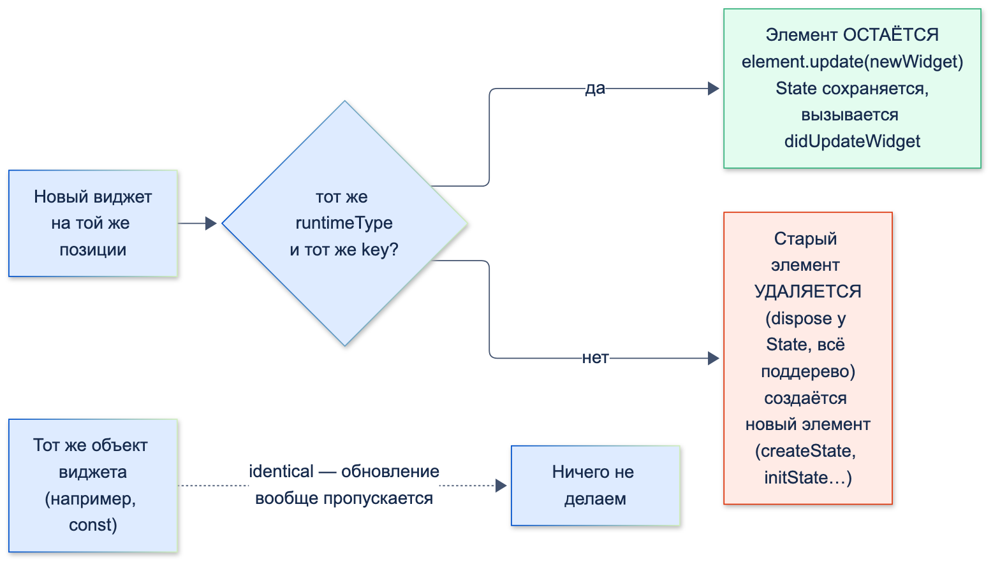
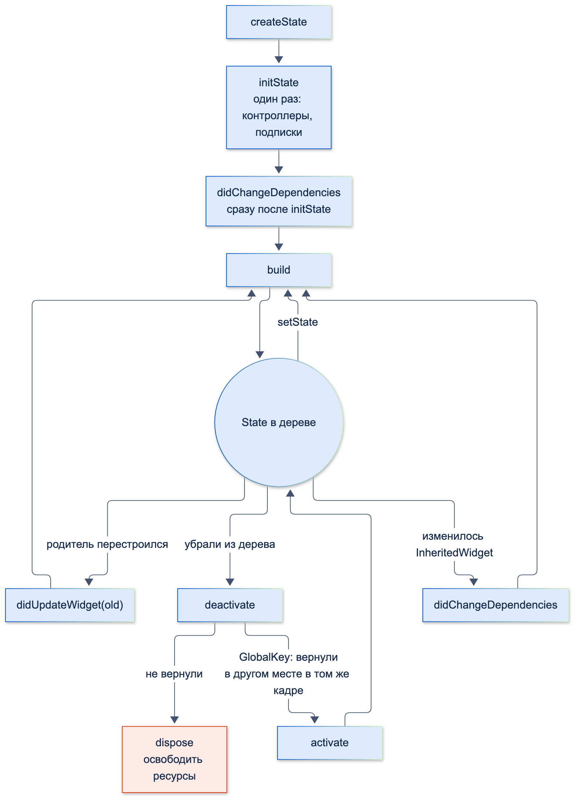

# Базовое устройство фреймворка (виджеты, элементы, контекст)

| Грейд | Время на изучение | Статус |
|-------|-------------------|--------|
| ⭐ | ~30 мин лекция + практика | ✅ Готово |

---

## 📚 Ресурсы

| Ресурс | Формат | Язык | Уровень | Зачем читать |
|--------|--------|------|---------|--------------|
| [Хендбук Яндекса по Flutter: StatefulWidget](https://contest.yandex.ru/tracks/flutter/crash-course/stateful-widget) | Учебник | 🇷🇺 | ⭐ | Жизненный цикл `State` по шагам, `mounted`. Про `deactivate` там не написано — оно есть ниже |
| [Flutter под капотом](https://habr.com/ru/articles/501862/) | Статья (Habr, Surf) | 🇷🇺 | ⭐⭐ | Виджеты, элементы и `RenderObject`: как они связаны и почему элементы переиспользуются |
| [Ключи во Flutter](https://habr.com/ru/companies/surfstudio/articles/813939/) | Статья (Habr, Surf) | 🇷🇺 | ⭐⭐ | Все виды ключей на примере списка задач, разница `ValueKey` и `ObjectKey` |
| [Flutter. Keys! Для чего они?](https://habr.com/ru/articles/446050/) | Статья (Habr, перевод) | 🇷🇺 | ⭐ | Классическое объяснение, зачем нужны ключи, с картинками |
| [When to Use Keys — Flutter Widgets 101](https://www.youtube.com/watch?v=kn0EOS-ZiIc) | Видео (команда Flutter) | 🇬🇧 | ⭐ | 8 минут, лучшее наглядное объяснение ключей |
| [Flutter architectural overview](https://docs.flutter.dev/resources/architectural-overview) | Документация | 🇬🇧 | ⭐⭐ | Официальное описание устройства фреймворка |
| [State class](https://api.flutter.dev/flutter/widgets/State-class.html) | Справочник API | 🇬🇧 | ⭐⭐ | Точное описание каждого метода жизненного цикла |

---

## 🎓 Лекция

### 1. Виджет, элемент, RenderObject

Во Flutter интерфейс описывается тремя связанными деревьями. В этой теме — первые два: на них держится вся повседневная работа.
Третье дерево и отрисовка подробно разбираются в теме «Flutter под капотом».

| | Widget | Element | RenderObject |
|---|--------|---------|--------------|
| Что это | **Описание** (конфигурация) части интерфейса | **Экземпляр** виджета в конкретном месте дерева | Объект раскладки и отрисовки |
| Изменяемость | Неизменяемый (`final`-поля, часто `const`) | Изменяемый, живёт долго | Изменяемый, живёт долго |
| Сколько живёт | Пересоздаётся при каждом `build` | Пока виджет того же типа (и ключа) стоит на этом месте | Пока жив его элемент |
| Что хранит | Параметры | Ссылки на родителя и детей, `State`, зависимости от `InheritedWidget` | Размер, позицию, как рисовать |
| Аналогия | Чертёж | Построенный по чертежу дом | Стены, которые видно |

Главное следствие: **виджеты дешёвые**. Создать новый виджет — это создать маленький неизменяемый объект. Дорого
пересоздавать **элементы** и `RenderObject` — и Flutter старается этого не делать.

### 2. Как Flutter решает: обновить или пересоздать

Когда родитель перестраивается и возвращает новое дерево виджетов, Flutter сравнивает каждый новый виджет со старым
на той же позиции. Правило — одна строка из исходников Flutter:

```dart
static bool canUpdate(Widget oldWidget, Widget newWidget) {
  return oldWidget.runtimeType == newWidget.runtimeType && oldWidget.key == newWidget.key;
}
```



- **Тот же тип и тот же ключ** → элемент **остаётся**, ему просто дают новый виджет (`element.update`). У `StatefulWidget`
  сохраняется `State` и вызывается `didUpdateWidget`.
- **Другой тип или другой ключ** → старый элемент **удаляется** вместе со своим `State` и поддеревом, создаётся новый.

Всё, что ниже — жизненный цикл, `BuildContext`, ключи, — следствия этого правила.

### 3. Виды виджетов

| Вид | Зачем | Пример |
|-----|-------|--------|
| `StatelessWidget` | Интерфейс полностью определяется параметрами | Строка операции в выписке |
| `StatefulWidget` + `State` | Есть своё изменяемое состояние, которое живёт между перестроениями | Поле ввода суммы, анимация, «скрыть баланс» |
| `InheritedWidget` | Передать данные **вниз** по дереву всем, кому нужно, с подпиской на изменения | `Theme`, `MediaQuery`, провайдеры состояния |
| `RenderObjectWidget` | Создаёт `RenderObject`: раскладка и отрисовка | `Padding`, `Row`, `CustomPaint` |

Важно: **`State` хранится не в виджете, а в элементе.** Виджет `StatefulWidget` пересоздаётся на каждом `build` родителя,
а его `State` живёт, пока жив элемент.

### 4. BuildContext

**`BuildContext` — это и есть `Element`**: интерфейс, который элемент даёт своему виджету. Через него виджет узнаёт,
**где он находится в дереве**.

Что можно делать через `context`:
- искать вверх по дереву: `Theme.of(context)`, `MediaQuery.sizeOf(context)`, `Navigator.of(context)` (сложность этих поисков
  разобрана в теме «Оценка сложности вычислений»);
- подписываться на `InheritedWidget`: `context.dependOnInheritedWidgetOfExactType<T>()`;
- проверять, жив ли элемент: `context.mounted`.

Три правила, которые объясняют почти все ошибки с контекстом.

#### Правило 1. `context` виджета находится ВЫШЕ всего, что этот виджет строит

```dart
import 'package:flutter/material.dart';

class WrongContextScreen extends StatelessWidget {
  const WrongContextScreen({super.key});

  @override
  Widget build(BuildContext context) => Scaffold(
        drawer: const Drawer(child: Text('Счета и карты')),
        body: TextButton(
          // ❌ context — элемент WrongContextScreen, а Scaffold создаётся НИЖЕ него
          onPressed: () => Scaffold.of(context).openDrawer(),
          child: const Text('Меню'),
        ),
      );
}
```

```text
Scaffold.of() called with a context that does not contain a Scaffold.
```

`Scaffold.of` ищет `Scaffold` **выше** переданного контекста. Но `Scaffold` — ребёнок `WrongContextScreen`, а не предок.
Решение — взять контекст, который находится **ниже** `Scaffold`: обернуть в `Builder` (или вынести кнопку в отдельный виджет).

```dart
import 'package:flutter/material.dart';

class MenuScreen extends StatelessWidget {
  const MenuScreen({super.key});

  @override
  Widget build(BuildContext context) => Scaffold(
        drawer: const Drawer(child: Text('Счета и карты')),
        body: Builder(
          // ✅ innerContext — элемент Builder, он НИЖЕ Scaffold, поэтому Scaffold.of его находит
          builder: (innerContext) => TextButton(
            onPressed: () => Scaffold.of(innerContext).openDrawer(),
            child: const Text('Меню'),
          ),
        ),
      );
}
```

#### Правило 2. В `initState` нельзя подписываться на `InheritedWidget`

```dart
import 'package:flutter/material.dart';

class AccentTile extends StatefulWidget {
  const AccentTile({super.key});

  @override
  State<AccentTile> createState() => _AccentTileState();
}

class _AccentTileState extends State<AccentTile> {
  late Color _accent;

  @override
  void initState() {
    super.initState();
    _accent = Theme.of(context).colorScheme.primary; // ❌ подписка на Theme в initState
  }

  @override
  Widget build(BuildContext context) => ColoredBox(color: _accent, child: const SizedBox(width: 10, height: 10));
}
```

```text
dependOnInheritedWidgetOfExactType<_InheritedTheme>() or dependOnInheritedElement() was called before _AccentTileState.initState() completed.
```

`Theme.of` не просто читает тему, а **подписывает** элемент на её изменения. В `initState` элемент ещё не готов к подпискам.
Правильное место — `didChangeDependencies`: он вызывается сразу после `initState` и потом при каждом изменении того,
на что подписан виджет. Достаточно заменить `initState` на:

```dart
  @override
  void didChangeDependencies() {
    super.didChangeDependencies();
    _accent = Theme.of(context).colorScheme.primary; // ✅ здесь подписки уже можно
  }
```

Или просто читать `Theme.of(context)` прямо в `build`.

#### Правило 3. `context` живёт столько же, сколько элемент

- После `await` элемент мог быть удалён (пользователь ушёл с экрана) — проверяй `mounted` / `context.mounted`
  перед `setState`, навигацией и показом диалогов (подробно — в теме «Event Loop»).
- **Не сохраняй `context` в долгоживущих объектах** (BLoC, сервисы, синглтоны): после удаления элемента он недействителен,
  а сам элемент не освободится из памяти.

### 5. Жизненный цикл StatefulWidget



| Метод | Когда вызывается | Что делать | Чего не делать |
|-------|------------------|------------|----------------|
| `createState` | Элемент создан | Вернуть новый `State` | Ничего больше |
| `initState` | Один раз, сразу после создания `State` | Создать контроллеры, подписаться на потоки, запустить загрузку | Подписываться на `InheritedWidget` (`Theme.of`, `MediaQuery.of`) |
| `didChangeDependencies` | Сразу после `initState` и при каждом изменении `InheritedWidget`, на который подписан | Читать данные из `InheritedWidget`, если нужно что-то пересчитать | Тяжёлую работу без проверки, что зависимость действительно изменилась |
| `build` | Много раз: после `initState`, `setState`, `didUpdateWidget`, `didChangeDependencies` | Вернуть дерево виджетов | **Побочные эффекты**: запросы, подписки, `setState`, создание потоков |
| `didUpdateWidget(old)` | Родитель перестроился и дал новый виджет того же типа и ключа | Сравнить `oldWidget` и `widget`, обновить контроллеры и подписки, если параметры изменились | Забыть сравнение и перезапускать всё на каждое перестроение родителя |
| `setState(fn)` | Вызываешь сам | Изменить состояние внутри `fn` — элемент перестроится в следующем кадре | Вызывать после `dispose` или во время `build` |
| `deactivate` | Элемент убирают из дерева (возможно, временно) | Редко нужен | — |
| `activate` | Элемент с `GlobalKey` вернули в дерево в другом месте в том же кадре | Редко нужен | — |
| `dispose` | Элемент удалён навсегда | **Освободить всё**: `controller.dispose()`, `subscription.cancel()`, `focusNode.dispose()` | Вызывать `setState` |

Плюс `reassemble` — вызывается при hot reload в режиме отладки.

#### Проверено: что вызывается и когда

Виджет баланса подписан на своё `InheritedWidget` с валютой и умеет скрывать баланс через `setState`:

```dart
import 'package:flutter/material.dart';

/// Своё InheritedWidget: в какой валюте показывать суммы
class CurrencyScope extends InheritedWidget {
  const CurrencyScope({super.key, required this.currency, required super.child});

  final String currency;

  static String of(BuildContext context) =>
      context.dependOnInheritedWidgetOfExactType<CurrencyScope>()!.currency;

  @override
  bool updateShouldNotify(CurrencyScope oldWidget) => currency != oldWidget.currency;
}

class BalanceTile extends StatefulWidget {
  const BalanceTile({super.key, required this.kopecks});

  final int kopecks;

  @override
  State<BalanceTile> createState() {
    debugPrint('createState'); // ignore: no_logic_in_create_state — только для демонстрации порядка вызовов
    return _BalanceTileState();
  }
}

class _BalanceTileState extends State<BalanceTile> {
  var _hidden = false;

  void toggle() => setState(() => _hidden = !_hidden);

  @override
  void initState() {
    super.initState();
    debugPrint('initState');
  }

  @override
  void didChangeDependencies() {
    super.didChangeDependencies();
    debugPrint('didChangeDependencies');
  }

  @override
  void didUpdateWidget(BalanceTile oldWidget) {
    super.didUpdateWidget(oldWidget);
    debugPrint('didUpdateWidget: ${oldWidget.kopecks} → ${widget.kopecks}');
  }

  @override
  void deactivate() {
    debugPrint('deactivate');
    super.deactivate();
  }

  @override
  void activate() {
    super.activate();
    debugPrint('activate');
  }

  @override
  void dispose() {
    debugPrint('dispose');
    super.dispose();
  }

  @override
  Widget build(BuildContext context) {
    final currency = CurrencyScope.of(context);
    debugPrint('build ($currency, hidden=$_hidden)');
    return Text(_hidden ? '•••' : '${widget.kopecks ~/ 100} $currency');
  }
}
```

Шесть сценариев, прогнанных widget-тестом (`BalanceTile` с `GlobalKey`):

```text
--- 1. первый показ
createState
initState
didChangeDependencies
build (₽, hidden=false)
--- 2. родитель перестроился с новыми параметрами
didUpdateWidget: 150000 → 93000
build (₽, hidden=false)
--- 3. изменилось InheritedWidget, от которого зависит build
didUpdateWidget: 93000 → 93000
didChangeDependencies
build (RUB, hidden=false)
--- 4. setState внутри State
build (RUB, hidden=true)
--- 5. виджет с GlobalKey перенесли в другое место дерева
deactivate
activate
didUpdateWidget: 93000 → 93000
didChangeDependencies
build (RUB, hidden=true)
--- 6. виджет убрали из дерева
deactivate
dispose
```

Что из этого стоит запомнить:
1. **`didChangeDependencies` вызывается сразу после `initState`** — поэтому туда и переносят чтение `Theme.of`.
2. **`didUpdateWidget` вызывается при каждом перестроении родителя**, даже с теми же значениями (`93000 → 93000`):
   родитель создал **новый экземпляр** виджета. Поэтому в `didUpdateWidget` всегда сравнивают `oldWidget` с `widget`.
   Если бы виджет был `const` с теми же параметрами, Flutter увидел бы тот же объект и пропустил бы обновление.
3. **`setState` вызывает только `build`** — без `didUpdateWidget` и других методов.
4. **`State` пережил перенос в другое место дерева** (`hidden=true` сохранилось) — это работа `GlobalKey`, о нём ниже.
5. **`dispose` вызывается после `deactivate`**, когда стало ясно, что элемент не вернётся.

### 6. Ключи

#### Зачем: состояние «прилипает» к позиции

Правило `canUpdate` сравнивает только **тип** и **ключ**. Если у виджетов в списке нет ключей, Flutter сопоставляет их
**по позиции**. Пока у виджетов нет своего состояния, это незаметно. Когда есть — получается баг:

```dart
import 'package:flutter/material.dart';

class BankCardData {
  const BankCardData(this.id, this.title);

  final String id;
  final String title;
}

/// Плитка карты с ЛОКАЛЬНЫМ состоянием: скрыт ли баланс
class CardTile extends StatefulWidget {
  const CardTile({super.key, required this.card});

  final BankCardData card;

  @override
  State<CardTile> createState() => _CardTileState();
}

class _CardTileState extends State<CardTile> {
  var _hidden = false;

  @override
  Widget build(BuildContext context) => GestureDetector(
        onTap: () => setState(() => _hidden = !_hidden),
        child: Text('${widget.card.title}: ${_hidden ? 'скрыт' : 'виден'}'),
      );
}

Widget cardsList(List<BankCardData> cards, {required bool withKeys}) => Column(
      children: [
        for (final card in cards) CardTile(key: withKeys ? ValueKey(card.id) : null, card: card),
      ],
    );
```

Пользователь скрыл баланс зарплатной карты, затем карты поменялись местами (например, после сортировки):

```text
Без ключей, до перестановки: Зарплатная: скрыт | Кредитная: виден
Без ключей, после перестановки: Кредитная: скрыт | Зарплатная: виден
С ключами, до перестановки: Зарплатная: скрыт | Кредитная: виден
С ключами, после перестановки: Кредитная: виден | Зарплатная: скрыт
```

**Без ключей** «скрыт» остался на **первой позиции** и теперь прячет баланс кредитной карты: на первом месте по-прежнему
`CardTile`, тип совпал, элемент и его `State` переиспользованы, просто с другими данными. **С `ValueKey(card.id)`**
Flutter сопоставил элементы по ключам, и состояние переехало вместе со своей картой.

#### Виды ключей

| Ключ | Сравнение | Когда использовать |
|------|-----------|--------------------|
| `ValueKey(value)` | По `==` значения | **Основной выбор**: стабильный id из данных (`card.id`, `operation.id`) |
| `ObjectKey(object)` | По `identical` — тот же ли объект | Нет уникального поля, но сам объект стабилен |
| `UniqueKey()` | Равен только сам себе | Принудительно пересоздать виджет (например, перезапустить анимацию) |
| `GlobalKey` | Уникален во **всём** приложении | Доступ к `State` извне (`formKey.currentState!.validate()`), перенос виджета с сохранением состояния в другое место дерева |
| `PageStorageKey(value)` | Как `ValueKey` | Сохранять позицию прокрутки списков, например на вкладках |

#### Когда ключи нужны

- Список **однотипных** виджетов **со своим состоянием**, которые переставляют, удаляют или добавляют в середину.
- `AnimatedSwitcher` и другие переходы между виджетами **одного типа**: без ключа Flutter решит, что виджет тот же,
  и анимации не будет.
- `Form`, состояние которой нужно из обработчика: `GlobalKey<FormState>`.

В остальных случаях ключи не нужны: большинству виджетов достаточно сопоставления по позиции.

#### Ошибки с ключами

- **`UniqueKey()` прямо в `build`** — на каждом перестроении новый ключ, элемент и `State` пересоздаются, состояние
  постоянно сбрасывается.
- **Индекс как ключ** (`ValueKey(index)`) — то же, что без ключа: при перестановке индексы остаются на местах.
- **Ключ не на верхнем виджете элемента списка.** Если `CardTile` обёрнут в `Padding`, ключ должен быть у `Padding`:
  сравниваются соседи на одном уровне.
- **`GlobalKey` без необходимости.** Они дороже обычных (регистрация в глобальном реестре) и должны быть уникальны:
  один `GlobalKey` на двух виджетах одновременно — ошибка. И не создавай `GlobalKey` в `build` — только в `State` или выше.

### ⚠️ Частые ошибки

- **Побочные эффекты в `build`**: запросы, подписки, `setState`. `build` вызывается сколько угодно раз.
- **`Theme.of`/`MediaQuery.of` в `initState`** — переноси в `didChangeDependencies` или `build`.
- **`didUpdateWidget` без сравнения `oldWidget` и `widget`** — лишний перезапуск загрузки на каждое перестроение родителя.
- **Незакрытые контроллеры и подписки в `dispose`** — утечки и `setState() called after dispose()`.
- **`Scaffold.of(context)` с контекстом виджета, который сам создаёт `Scaffold`.**
- **Список виджетов со состоянием без ключей**, который сортируют, фильтруют или из которого удаляют элементы.
- **Сохранение `BuildContext` в BLoC или сервисе.**

---

## ✅ Самопроверка

**⭐ Junior**
1. Чем виджет отличается от элемента? Что из них живёт дольше?
2. Что такое `BuildContext`?
3. Назови методы жизненного цикла `State` по порядку при первом показе виджета.
4. Где освобождать контроллеры и отменять подписки?

**⭐⭐ Middle**
1. Как Flutter решает, обновить существующий элемент или создать новый?
2. Почему `Scaffold.of(context)` в `build` экрана, который сам создаёт `Scaffold`, падает? Как исправить?
3. Почему нельзя вызывать `Theme.of(context)` в `initState`? Куда перенести?
4. Почему `didUpdateWidget` вызывается, даже если параметры виджета не изменились?

**⭐⭐⭐ Senior**
1. В списке карт со своим состоянием после сортировки «скрытый баланс» оказался не у той карты. Что произошло и как исправить?
2. Чем `ValueKey`, `ObjectKey`, `UniqueKey` и `GlobalKey` отличаются? Что будет, если создать `UniqueKey()` в `build`?
3. Что происходит с `State` при переносе виджета с `GlobalKey` в другое место дерева? Какие методы вызываются?
4. Почему `State` хранится в элементе, а не в виджете?

<details>
<summary>Ответы</summary>

**Junior**
1. Виджет — неизменяемое описание интерфейса, пересоздаётся при каждом `build`. Элемент — экземпляр виджета в конкретном месте дерева, хранит `State` и связи с соседями, живёт, пока на этом месте стоит виджет того же типа и ключа.
2. Это элемент виджета, то есть его место в дереве. Через него ищут предков (`Theme.of`), подписываются на `InheritedWidget`, проверяют `mounted`.
3. `createState` → `initState` → `didChangeDependencies` → `build`.
4. В `dispose`.

**Middle**
1. `Widget.canUpdate`: если у нового и старого виджета на одной позиции совпадают тип и ключ, элемент обновляется новым виджетом (у `StatefulWidget` вызывается `didUpdateWidget`, `State` сохраняется). Иначе старый элемент удаляется вместе со своим `State`, и создаётся новый.
2. `Scaffold.of` ищет `Scaffold` выше переданного контекста, а `context` экрана находится выше созданного им `Scaffold`. Исправление: `Builder` внутри `Scaffold` и его контекст, или вынести кнопку в отдельный виджет.
3. `Theme.of` подписывает элемент на изменения темы, а в `initState` элемент ещё не готов к подпискам: будет ошибка `dependOnInheritedWidgetOfExactType … was called before … initState() completed`. Переносят в `didChangeDependencies` (вызывается сразу после `initState`) или читают в `build`.
4. Родитель при перестроении создаёт новый экземпляр виджета (если он не `const`). Flutter не сравнивает поля, он видит другой объект того же типа и ключа и вызывает `didUpdateWidget`. Поэтому внутри нужно самим сравнивать `oldWidget` и `widget`.

**Senior**
1. У элементов списка нет ключей, и Flutter сопоставил их по позициям: на первой позиции тот же тип `CardTile`, поэтому элемент и его `State` со «скрыт» остались на месте и получили данные другой карты. Исправление: `ValueKey(card.id)` у верхнего виджета каждого элемента списка.
2. `ValueKey` сравнивает значения через `==`, `ObjectKey` — по `identical`, `UniqueKey` равен только сам себе, `GlobalKey` уникален во всём приложении и даёт доступ к `State` и перенос с сохранением состояния. `UniqueKey()` в `build` даёт новый ключ на каждом перестроении: элемент и `State` каждый раз пересоздаются, состояние сбрасывается.
3. `State` сохраняется. Вызываются `deactivate` (элемент сняли со старого места), `activate` (вставили в новое), затем `didUpdateWidget`, `didChangeDependencies` (новые предки) и `build`. Это работает, только если перенос произошёл в том же кадре.
4. Виджеты неизменяемые и пересоздаются на каждом `build` родителя, поэтому хранить в них изменяемое состояние нельзя — оно терялось бы. Элемент живёт долго и переиспользуется, поэтому состояние живёт в нём.

</details>
