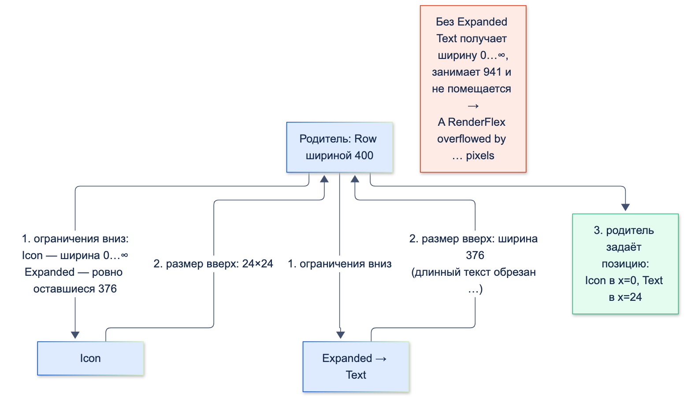

# Стандартные виджеты

| Грейд | Время на изучение | Статус |
|-------|-------------------|--------|
| ⭐ | ~30 мин лекция + практика | ✅ Готово |

---

## 📚 Ресурсы

| Ресурс | Формат | Язык | Уровень | Зачем читать |
|--------|--------|------|---------|--------------|
| [Хендбук Яндекса: виджеты — лейаут](https://contest.yandex.ru/tracks/flutter/crash-course/widget-layout) и [основные лейаут-виджеты](https://contest.yandex.ru/tracks/flutter/crash-course/core-layout-widgets) | Учебник | 🇷🇺 | ⭐ | Как Flutter раскладывает виджеты и главные виджеты раскладки |
| [Хендбук Яндекса: формы и кнопки](https://contest.yandex.ru/tracks/flutter/crash-course/forms-and-buttons) | Учебник | 🇷🇺 | ⭐ | `TextField`, `Form`, кнопки |
| [Такие разные Slivers. Часть 1](https://habr.com/ru/articles/876068/) | Статья (Habr) | 🇷🇺 | ⭐⭐ | Обзор `SliverList`, `SliverGrid`, `SliverFixedExtentList` и других с примерами |
| [Understanding constraints](https://docs.flutter.dev/ui/layout/constraints) | Документация | 🇬🇧 | ⭐⭐ | **Главная статья о раскладке во Flutter**: 29 примеров «почему виджет такого размера». Обязательно к прочтению |
| [Widget catalog](https://docs.flutter.dev/ui/widgets) | Каталог | 🇬🇧 | ⭐ | Все стандартные виджеты по категориям |
| [Build a form with validation](https://docs.flutter.dev/cookbook/forms/validation) | Документация | 🇬🇧 | ⭐ | Официальный рецепт формы с валидацией |

---

## 🎓 Лекция

### 1. Главное правило раскладки

> ℹ️ **Важно:** **Ограничения идут вниз. Размеры идут вверх. Позицию задаёт родитель.**
> (*Constraints go down. Sizes go up. Parent sets position.* — из статьи «Understanding constraints».)

1. Родитель передаёт ребёнку **ограничения**: минимальную и максимальную ширину и высоту.
2. Ребёнок выбирает свой **размер** в этих пределах и сообщает его родителю.
3. Родитель решает, **где** расположить ребёнка.



Отсюда главный сюрприз для новичков: **виджет не может быть любого размера, какого захочет**. Он выбирает размер только
в пределах того, что разрешил родитель.

```dart
import 'package:flutter/material.dart';

const box = SizedBox(width: 100, height: 100, child: ColoredBox(color: Colors.blue));

// runApp(box)               → квадрат на весь экран 400×800: экран требует «ровно мой размер»
// runApp(Center(child: box)) → квадрат 100×100: Center разрешает «от 0 до размера экрана»
```

Проверено widget-тестом на экране 400×800: `SizedBox(100×100)` в корне получил размер `Size(400.0, 800.0)`, внутри `Center` —
`Size(100.0, 100.0)`. Экран даёт **жёсткие** ограничения (min = max), и `SizedBox` обязан их выполнить, а `Center`
ослабляет их до «от нуля до максимума».

### 2. Виджеты раскладки

| Задача | Виджеты | Неочевидное |
|--------|---------|-------------|
| Отступы и размеры | `Padding`, `SizedBox`, `ConstrainedBox`, `AspectRatio` | `SizedBox.shrink()` — пустое место нулевого размера, дешевле `Container()` |
| «Всё сразу» | `Container` | Удобен, но собирает внутри `Padding`, `DecoratedBox`, `ConstrainedBox`, `Align`. Если нужен только отступ — `Padding` |
| Выравнивание | `Center`, `Align` | Растягиваются на всё доступное место и ставят ребёнка внутри |
| Ряд и колонка | `Row`, `Column` | Главная ось (`mainAxisAlignment`) и поперечная (`crossAxisAlignment`). `mainAxisSize: MainAxisSize.min` — сжаться по содержимому |
| Поделить место | `Expanded`, `Flexible`, `Spacer` | Работают **только** прямо внутри `Row`, `Column`, `Flex`. `Expanded` заставляет занять место, `Flexible` разрешает, но не заставляет |
| Наложение | `Stack`, `Positioned` | `Positioned` — только прямо внутри `Stack` |
| Перенос | `Wrap` | Как `Row`, но переносит на новую строку вместо переполнения: чипы фильтров, теги |
| Масштаб | `FittedBox` | Уменьшить содержимое, чтобы влезло: крупная сумма на маленьком экране |
| Зависимость от места | `LayoutBuilder` | Получить ограничения родителя и выбрать раскладку (телефон или планшет) |

#### Четыре ошибки раскладки, которые встречаются у всех

Тексты ошибок получены widget-тестом:

| Код | Ошибка | Почему | Исправление |
|-----|--------|--------|-------------|
| `Row(children: [Icon(…), Text('Очень длинное название счёта…')])` | `A RenderFlex overflowed by … pixels on the right.` | `Row` даёт детям **неограниченную** ширину, текст занимает столько, сколько хочет | `Expanded(child: Text(…, overflow: TextOverflow.ellipsis))` |
| `Column(children: [Text(…), ListView(…)])` | `Vertical viewport was given unbounded height.` | `Column` даёт детям неограниченную высоту, а списку нужно знать, сколько места ему отведено | `Expanded(child: ListView(…))` |
| `Center(child: Expanded(child: …))` | `Incorrect use of ParentDataWidget.` | `Expanded` работает только как **прямой** ребёнок `Row`/`Column`/`Flex` | Убрать `Expanded` или поставить его прямо в `Row`/`Column` |
| `Row(children: [Text('Сумма'), TextField()])` | `An InputDecorator, which is typically created by a TextField, cannot have an unbounded width.` | `TextField` растягивается на всю ширину, а `Row` не говорит, какая она | `Expanded(child: TextField())` |

Все четыре — следствие одного правила: **`Row` и `Column` не ограничивают детей по своей главной оси**. Ограничение
даёт `Expanded`/`Flexible`.

### 3. Списки

| Виджет | Когда |
|--------|-------|
| `ListView(children: […])` | Короткий список, все элементы известны заранее (до пары десятков) |
| `ListView.builder` | **Длинные и бесконечные** списки: элементы строятся по мере прокрутки |
| `ListView.separated` | То же, с разделителями между элементами |
| `GridView.builder` | Сетка: карточки продуктов, иконки сервисов |
| `CustomScrollView` + slivers | Несколько разных частей в **одной** прокрутке: шапка, сворачивающийся `SliverAppBar`, список, сетка |

#### Ленивость: проверено на 1000 операций

```dart
import 'package:flutter/material.dart';

Widget operationTile(BuildContext context, int index) =>
    SizedBox(height: 50, child: Text('Операция $index'));

// ✅ Строит только видимое
final lazyList = ListView.builder(itemCount: 1000, itemBuilder: operationTile);

// ❌ «Чтобы список жил внутри Column»: shrinkWrap строит ВСЕ элементы
final eagerList = SingleChildScrollView(
  child: Column(
    children: [
      const Text('Операции'),
      ListView.builder(
        shrinkWrap: true,
        physics: const NeverScrollableScrollPhysics(),
        itemCount: 1000,
        itemBuilder: operationTile,
      ),
    ],
  ),
);

// ✅ Шапка + список в одной прокрутке, и всё равно лениво
final sliverList = CustomScrollView(
  slivers: [
    const SliverToBoxAdapter(child: Text('Операции')),
    SliverList.builder(itemCount: 1000, itemBuilder: operationTile),
  ],
);
```

Сколько элементов построено на экране 400×800 (подсчёт вызовов `itemBuilder` в widget-тесте):

| Вариант | Построено элементов |
|---------|---------------------|
| `ListView.builder` | 21 |
| `shrinkWrap: true` внутри `SingleChildScrollView` | **1000** |
| `CustomScrollView` + `SliverList.builder` | 21 |

21 — это видимые 16 строк плюс запас за краем экрана (`cacheExtent`). С `shrinkWrap` списку нужно знать **свою полную высоту**,
поэтому он строит и раскладывает всё. На тысячах операций выписки это заметные тормоза. Когда нужны шапка и список
в одной прокрутке — используй `CustomScrollView`.

Ещё про списки:
- **Ключи у элементов** нужны, если у них есть своё состояние и список сортируют или фильтруют (тема «Базовое устройство фреймворка»).
- **`itemExtent` или `prototypeItem`**, если все строки одной высоты: Flutter не измеряет каждую строку, прокрутка быстрее.
- **Обновление потягиванием** — `RefreshIndicator(onRefresh: …, child: ListView…)`.
- **Подгрузка страниц** — слушать `ScrollController` и загружать следующую страницу, когда до конца осталось немного.

### 4. Формы и ввод

Форма перевода по номеру телефона — типичная банковская задача:

```dart
import 'package:flutter/material.dart';
import 'package:flutter/services.dart';

class TransferForm extends StatefulWidget {
  const TransferForm({super.key});

  @override
  State<TransferForm> createState() => _TransferFormState();
}

class _TransferFormState extends State<TransferForm> {
  final _formKey = GlobalKey<FormState>(); // доступ к FormState: validate(), save(), reset()
  final _phone = TextEditingController();
  final _amount = TextEditingController();
  final _amountFocus = FocusNode();

  @override
  void dispose() {
    _phone.dispose(); // контроллеры и FocusNode обязательно освобождать
    _amount.dispose();
    _amountFocus.dispose();
    super.dispose();
  }

  void _submit() {
    if (!_formKey.currentState!.validate()) return; // покажет ошибки под полями
    ScaffoldMessenger.of(context).showSnackBar(
      SnackBar(content: Text('Перевод ${_amount.text} ₽ на +7${_phone.text}')),
    );
  }

  @override
  Widget build(BuildContext context) => Form(
        key: _formKey,
        autovalidateMode: AutovalidateMode.onUserInteraction, // проверять поле после первого ввода
        child: Column(
          children: [
            TextFormField(
              controller: _phone,
              decoration: const InputDecoration(labelText: 'Телефон', prefixText: '+7 '),
              keyboardType: TextInputType.phone,
              textInputAction: TextInputAction.next, // кнопка «Далее» на клавиатуре
              onFieldSubmitted: (_) => _amountFocus.requestFocus(), // и переход к сумме
              inputFormatters: [
                FilteringTextInputFormatter.digitsOnly,
                LengthLimitingTextInputFormatter(10),
              ],
              validator: (value) => value?.length == 10 ? null : 'Введите 10 цифр номера',
            ),
            TextFormField(
              controller: _amount,
              focusNode: _amountFocus,
              decoration: const InputDecoration(labelText: 'Сумма', suffixText: '₽'),
              keyboardType: TextInputType.number,
              textInputAction: TextInputAction.done,
              onFieldSubmitted: (_) => _submit(),
              inputFormatters: [FilteringTextInputFormatter.digitsOnly],
              validator: (value) => (int.tryParse(value ?? '') ?? 0) > 0 ? null : 'Введите сумму',
            ),
            FilledButton(onPressed: _submit, child: const Text('Перевести')),
          ],
        ),
      );
}
```

Проверено widget-тестом:

```text
Нажали «Перевести» с пустой формой: Введите 10 цифр номера | Введите сумму
Ввели в телефон "(900) 123-45-67 доб.89": 9001234567
Ввели в сумму "1 500 руб.": 1500
SnackBar: Перевод 1500 ₽ на +79001234567
```

Что здесь важно:
- **`Form` + `GlobalKey<FormState>`** — один `validate()` проверяет все поля и показывает ошибки под ними.
- **`inputFormatters` фильтруют ввод ещё до того, как он попадёт в поле**: из `(900) 123-45-67 доб.89` осталось `9001234567`
  (цифры, обрезанные до 10). `keyboardType` только выбирает клавиатуру, а вставку из буфера не запрещает. Защищают именно форматтеры.
- **`TextEditingController` и `FocusNode` освобождают в `dispose`.**
- **`textInputAction` + `onFieldSubmitted` + `FocusNode`** — переход между полями кнопкой клавиатуры.
- **`autovalidateMode: onUserInteraction`** — ошибки появляются после того, как пользователь начал вводить, а не сразу при открытии.
- Для чувствительного ввода (PIN, CVV): `obscureText: true`, `enableSuggestions: false`, `autocorrect: false`.

> ⚠️ **Внимание:** клавиатура перекрывает поля внизу экрана. `Scaffold` по умолчанию (`resizeToAvoidBottomInset: true`)
> уменьшает `body` на высоту клавиатуры, но если содержимое не помещается, будет переполнение. Длинные формы
> оборачивают в `SingleChildScrollView` или `ListView`.

### 5. Scaffold

`Scaffold` — каркас экрана Material: `appBar`, `body`, `floatingActionButton`, `drawer`, `bottomNavigationBar`, `bottomSheet`.

| Задача | Как |
|--------|-----|
| Показать снекбар | `ScaffoldMessenger.of(context).showSnackBar(…)`. `ScaffoldMessenger` живёт выше всех экранов, поэтому снекбар переживает переход на другой экран |
| Не залезть под вырез и системные панели | `SafeArea` (у `AppBar` уже учтено) |
| Открыть боковое меню | `Scaffold.of(context).openDrawer()` с контекстом **ниже** `Scaffold` (тема «Базовое устройство фреймворка») |
| Нижняя навигация | `NavigationBar` (Material 3) или `BottomNavigationBar` + **`IndexedStack`** |

#### Нижняя навигация: где теряется состояние вкладок

```dart
import 'package:flutter/material.dart';

class AccountsTab extends StatelessWidget {
  const AccountsTab({super.key});

  @override
  Widget build(BuildContext context) => const Center(child: Text('Счета'));
}

class PaymentsTab extends StatelessWidget {
  const PaymentsTab({super.key});

  @override
  Widget build(BuildContext context) => const Center(child: Text('Платежи'));
}

class HomeScreen extends StatefulWidget {
  const HomeScreen({super.key});

  @override
  State<HomeScreen> createState() => _HomeScreenState();
}

class _HomeScreenState extends State<HomeScreen> {
  var _tab = 0;

  @override
  Widget build(BuildContext context) => Scaffold(
        // ✅ IndexedStack держит все вкладки в дереве и показывает одну: состояние каждой сохраняется
        body: IndexedStack(index: _tab, children: const [AccountsTab(), PaymentsTab()]),
        bottomNavigationBar: NavigationBar(
          selectedIndex: _tab,
          onDestinationSelected: (index) => setState(() => _tab = index),
          destinations: const [
            NavigationDestination(icon: Icon(Icons.account_balance_wallet), label: 'Счета'),
            NavigationDestination(icon: Icon(Icons.payments), label: 'Платежи'),
          ],
        ),
      );
}
```

Проверено widget-тестом: на каждой вкладке был счётчик со своим состоянием. На «Счетах» нажали два раза, перешли
на «Платежи» и вернулись:

| Как переключаются вкладки | На «Платежах» | После возврата на «Счета» |
|---------------------------|---------------|----------------------------|
| `body: pages[_tab]`, вкладки **разных** классов | 0 | **0 — состояние потеряно** |
| `body: pages[_tab]`, вкладки **одного** класса | **2 — чужое состояние!** | 2 |
| `IndexedStack` | 0 | **2 — всё правильно** |

Второй случай — тот же эффект, что с ключами: виджет того же типа на той же позиции, и Flutter переиспользовал элемент
вместе с состоянием. Когда вкладки — разные классы, элемент пересоздаётся, и состояние теряется. `IndexedStack` держит
**все** вкладки в дереве, поэтому каждая сохраняет своё. Цена — все вкладки построены сразу. Для тяжёлых вкладок
применяют ленивое создание при первом открытии. В приложениях с навигацией на `go_router` для того же есть
`StatefulShellRoute`.

### ⚠️ Частые ошибки

- **`ListView` прямо в `Column`** и «лечение» через `shrinkWrap: true` для длинных списков — все элементы строятся сразу.
- **`Expanded` вне `Row`/`Column`/`Flex`** — `Incorrect use of ParentDataWidget`.
- **Длинный текст в `Row` без `Expanded`/`Flexible`** — переполнение с жёлто-чёрной полосой.
- **`Container` везде**, когда нужен только `Padding` или `SizedBox`.
- **Ввод суммы без `inputFormatters`**, только с `keyboardType` — из буфера вставляется что угодно.
- **Не освобождённые `TextEditingController` и `FocusNode`.**
- **Нижняя навигация через `body: pages[index]`** — потеря или «перетекание» состояния вкладок.

---

## ✅ Самопроверка

**⭐ Junior**
1. Сформулируй главное правило раскладки Flutter.
2. Почему длинный `Text` внутри `Row` вызывает переполнение? Как исправить?
3. Чем `ListView` отличается от `ListView.builder`? Когда что использовать?
4. Как проверить все поля формы разом?

**⭐⭐ Middle**
1. Почему `SizedBox(width: 100, height: 100)` в корне приложения занимает весь экран?
2. Что означает `Vertical viewport was given unbounded height` и как это исправить правильно?
3. Почему `shrinkWrap: true` плох для длинных списков? Что использовать вместо него?
4. Зачем `inputFormatters`, если уже указан `keyboardType: TextInputType.number`?

**⭐⭐⭐ Senior**
1. Как сделать экран с шапкой, сворачивающимся `AppBar` и списком из тысяч операций в одной прокрутке?
2. Почему при переключении вкладок через `body: pages[index]` состояние иногда теряется, а иногда «перетекает» на другую вкладку?
3. Чем `Expanded` отличается от `Flexible`?

<details>
<summary>Ответы</summary>

**Junior**
1. Ограничения идут вниз, размеры идут вверх, позицию задаёт родитель.
2. `Row` не ограничивает детей по ширине, и текст занимает всю свою длину. Исправление: `Expanded(child: Text(…, overflow: TextOverflow.ellipsis))`.
3. `ListView(children: …)` строит все элементы сразу — для коротких списков. `ListView.builder` строит только видимые по мере прокрутки — для длинных.
4. Обернуть поля в `Form` с `GlobalKey<FormState>` и вызвать `formKey.currentState!.validate()`.

**Middle**
1. Экран передаёт жёсткие ограничения: ширина и высота ровно как у экрана. `SizedBox` обязан их соблюдать. Внутри `Center` ограничения ослаблены до «от нуля до размера экрана», и `SizedBox` получает свои 100×100.
2. Список внутри `Column` получил неограниченную высоту и не знает, сколько места занять. Правильно — `Expanded(child: ListView…)`, чтобы список занял оставшееся место.
3. С `shrinkWrap` список вычисляет свою полную высоту и поэтому строит все элементы: на 1000 элементах — 1000 вместо ~20. Вместо него — `Expanded` или `CustomScrollView` со slivers.
4. `keyboardType` только выбирает клавиатуру, но не мешает вставить текст из буфера или ввести с внешней клавиатуры. Форматтеры фильтруют любой ввод.

**Senior**
1. `CustomScrollView` со slivers: `SliverAppBar` (с `pinned`/`floating`), `SliverToBoxAdapter` для шапки и `SliverList.builder` для операций. Всё в одной прокрутке и лениво.
2. Срабатывает правило `canUpdate`. Если вкладки — виджеты разных классов, на позиции `body` меняется тип, элемент пересоздаётся, и состояние теряется. Если одного класса, элемент переиспользуется вместе со своим `State`, и состояние одной вкладки оказывается в другой. Решение — `IndexedStack` (или `StatefulShellRoute` в `go_router`).
3. Оба делят свободное место в `Row`/`Column`. `Expanded` заставляет ребёнка занять всю отведённую долю. `Flexible` разрешает занять до этой доли, но ребёнок может быть меньше. `Expanded` — это `Flexible` с `fit: FlexFit.tight`.

</details>
