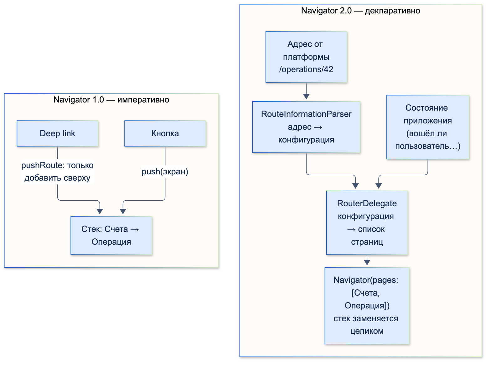
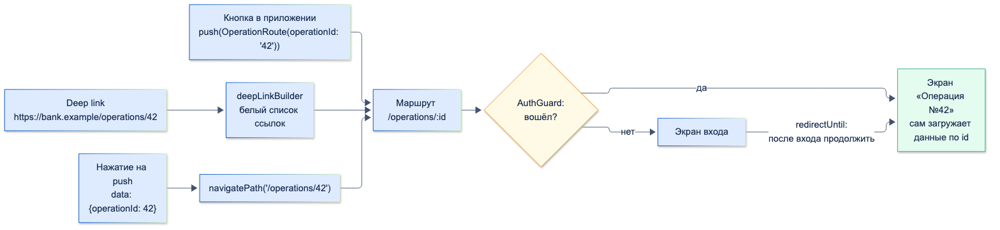

# Навигация

| Грейд | Время на изучение | Статус |
|-------|-------------------|--------|
| ⭐ | ~35 мин лекция + практика | ✅ Готово |

---

## 📚 Ресурсы

| Ресурс | Формат | Язык | Уровень | Зачем читать |
|--------|--------|------|---------|--------------|
| [Хендбук Яндекса: основы навигации](https://contest.yandex.ru/tracks/flutter/crash-course/project-navigation-basics) | Учебник | 🇷🇺 | ⭐ | `Navigator`, маршруты, передача данных между экранами |
| [auto_route](https://pub.dev/packages/auto_route) | Пакет и документация | 🇬🇧 | ⭐⭐ | Подробный README: маршруты, аргументы, guards, вложенная навигация, deep links |
| [Flutter: Navigation and routing](https://docs.flutter.dev/ui/navigation) | Документация | 🇬🇧 | ⭐ | Официальный обзор: `Navigator`, `Router`, когда что использовать |
| [Flutter: Deep linking](https://docs.flutter.dev/ui/navigation/deep-linking) | Документация | 🇬🇧 | ⭐⭐ | Как ссылка попадает в приложение на Android, iOS и вебе. Чем отличается поведение `Navigator` и `Router` |
| [Set up app links for Android](https://docs.flutter.dev/cookbook/navigation/set-up-app-links) и [universal links for iOS](https://docs.flutter.dev/cookbook/navigation/set-up-universal-links) | Документация | 🇬🇧 | ⭐⭐ | Пошаговая настройка платформ и файлов на сервере |
| [firebase_messaging](https://pub.dev/packages/firebase_messaging) | Пакет | 🇬🇧 | ⭐⭐ | Push-уведомления: получение, нажатие, разные состояния приложения |

---

## 🎓 Лекция

### 1. Navigator 1.0: императивный стек

`Navigator` хранит **стек экранов** (маршрутов). Код сам говорит, что сделать: положить экран сверху (`push`), снять
верхний (`pop`), заменить (`pushReplacement`), очистить до нужного (`pushAndRemoveUntil`).

```dart
import 'package:flutter/material.dart';

class OperationArgs {
  const OperationArgs(this.operationId);

  final String operationId;
}

/// Все именованные маршруты в одном месте: аргументы приводим к типу здесь, а не на каждом экране
Route<Object?> onGenerateRoute(RouteSettings settings) => switch (settings.name) {
      '/operation' => MaterialPageRoute(
          settings: settings,
          builder: (_) => OperationScreen(args: settings.arguments! as OperationArgs),
        ),
      _ => MaterialPageRoute(settings: settings, builder: (_) => const AccountsScreen()),
    };

class AccountsScreen extends StatelessWidget {
  const AccountsScreen({super.key});

  @override
  Widget build(BuildContext context) => Scaffold(
        body: Column(
          children: [
            TextButton(
              onPressed: () => Navigator.of(context).pushNamed('/operation', arguments: const OperationArgs('42')),
              child: const Text('Операция'),
            ),
            TextButton(
              onPressed: () async {
                // push возвращает Future, который завершится значением из pop
                final kopecks = await Navigator.of(context).push<int>(
                  MaterialPageRoute(builder: (_) => const AmountScreen()),
                );
                debugPrint('Выбрана сумма: $kopecks');
              },
              child: const Text('Выбрать сумму'),
            ),
          ],
        ),
      );
}

class OperationScreen extends StatelessWidget {
  const OperationScreen({super.key, required this.args});

  final OperationArgs args;

  @override
  Widget build(BuildContext context) => Scaffold(body: Text('Операция №${args.operationId}'));
}

class AmountScreen extends StatelessWidget {
  const AmountScreen({super.key});

  @override
  Widget build(BuildContext context) => Scaffold(
        body: TextButton(onPressed: () => Navigator.of(context).pop(150000), child: const Text('1500 ₽')),
      );
}
```

Проверено widget-тестом: «Операция» открывает экран «Операция №42», а «Выбрать сумму» после нажатия «1500 ₽» печатает
`Выбрана сумма: 150000`.

Что важно:
- **`push` возвращает `Future`, который завершается значением из `pop`** — так экран возвращает результат.
- **`arguments` у именованных маршрутов — `Object?`.** Тип не проверяется при компиляции, ошибка будет только во время
  работы. Поэтому приведение типов собирают в одном месте, в `onGenerateRoute`, а лучше вообще не использовать
  именованные маршруты с `arguments`.

Ограничения Navigator 1.0, из-за которых появился 2.0:
- **Deep link только добавляет экран сверху** (`pushRoute`). Построить из ссылки правильный стек «Счета → Операция»
  и заменить им текущий — неудобно.
- **Стек нельзя описать как функцию от состояния.** Например, «если пользователь не вошёл — только экран входа»
  приходится реализовывать вручную при каждом переходе.
- **На вебе адресная строка плохо синхронизируется** с текущим экраном.

### 2. Navigator 2.0: Router API

Navigator 2.0 — **декларативный** подход: стек экранов описывается **списком страниц**, который строится из состояния
приложения. Изменилось состояние — изменился список — Flutter сам анимирует переходы.

| Часть | Что делает |
|-------|------------|
| `RouteInformationProvider` | Получает адрес от платформы: начальный, deep link, адресная строка браузера |
| `RouteInformationParser` | Превращает адрес (`/operations/42`) в объект конфигурации приложения |
| `RouterDelegate` | По конфигурации строит `Navigator(pages: […])` и сообщает текущий адрес обратно |
| `BackButtonDispatcher` | Обрабатывает системную кнопку «Назад» |
| `MaterialApp.router(routerConfig: …)` | Подключает всё это к приложению |



| | Navigator 1.0 | Navigator 2.0 (Router) |
|---|---------------|------------------------|
| Стиль | Императивный: «сделай push» | Декларативный: «стек = список страниц от состояния» |
| Deep link на Android, приложение уже запущено | `pushRoute` — экран добавляется сверху | Адрес разбирается, стек **заменяется** нужным набором страниц |
| Deep link на iOS, приложение запускается | Сначала `/`, затем через небольшую задержку `pushRoute` | Сначала `/`, затем адрес разбирается и передаётся в `RouterDelegate` |
| Веб, адресная строка | Плохо синхронизируется | Синхронизируется |
| Кода для простого приложения | Мало | Много: парсер, делегат, конфигурация |

Чистый Router API почти никто не пишет руками: слишком много кода. Используют пакеты поверх него:
- **`go_router`** — официальный пакет команды Flutter, маршруты описываются путями;
- **`auto_route`** — типизированные маршруты через кодогенерацию, удобные guards и вложенная навигация.

Оба внутри используют Router API и дают все его плюсы.

### 3. auto_route

Ниже — мини-приложение банка: счета, экран операции по пути `/operations/:id`, закрытый проверкой авторизации,
и экран выбора суммы, который возвращает результат. Весь код собран с `auto_route` 11.1.0, сгенерирован
`auto_route_generator` 10.4.0 и проверен widget-тестами.

#### Экраны

Каждый экран помечается `@RoutePage()`. Генератор создаст для него класс маршрута: `AccountsPage` → `AccountsRoute`.

```dart
import 'package:auto_route/auto_route.dart';
import 'package:flutter/material.dart';

import 'app_router.dart';
import 'session.dart';

@RoutePage()
class AccountsPage extends StatelessWidget {
  const AccountsPage({super.key});

  @override
  Widget build(BuildContext context) => Scaffold(
        appBar: AppBar(title: const Text('Счета')),
        body: Center(
          child: FilledButton(
            // Типизированный маршрут: ошибку в аргументах поймает компилятор
            onPressed: () => context.router.push(OperationRoute(operationId: '42')),
            child: const Text('Операция №42'),
          ),
        ),
      );
}

@RoutePage()
class OperationPage extends StatelessWidget {
  const OperationPage({super.key, @PathParam('id') required this.operationId});

  final String operationId; // приходит и из кода, и из пути /operations/:id

  @override
  Widget build(BuildContext context) => Scaffold(
        appBar: AppBar(title: Text('Операция №$operationId')),
        body: Center(
          child: FilledButton(
            onPressed: () async {
              // Ждём результат от экрана выбора суммы
              final kopecks = await context.router.push<int>(const AmountRoute());
              debugPrint('Выбрана сумма: $kopecks');
            },
            child: const Text('Повторить платёж'),
          ),
        ),
      );
}

@RoutePage()
class AmountPage extends StatelessWidget {
  const AmountPage({super.key});

  @override
  Widget build(BuildContext context) => Scaffold(
        body: Center(
          child: FilledButton(
            onPressed: () => context.router.maybePop(150000), // вернуть результат
            child: const Text('1500 ₽'),
          ),
        ),
      );
}

@RoutePage()
class LoginPage extends StatelessWidget {
  const LoginPage({super.key, required this.onResult});

  final void Function(bool didLogin) onResult;

  @override
  Widget build(BuildContext context) => Scaffold(
        body: Center(
          child: FilledButton(
            onPressed: () {
              session.isAuthenticated = true;
              onResult(true); // сообщаем guard'у: можно продолжать исходную навигацию
            },
            child: const Text('Войти'),
          ),
        ),
      );
}
```

```dart
/// Упрощённая сессия: в реальном приложении — токен из безопасного хранилища
class Session {
  var isAuthenticated = false;
}

final session = Session();
```

#### Роутер и guard

```dart
import 'package:auto_route/auto_route.dart';
import 'package:flutter/material.dart'; // нужен сгенерированному part-файлу (Key, Widget)

import 'pages.dart';
import 'session.dart';

export 'pages.dart';

part 'app_router.gr.dart';

@AutoRouterConfig(replaceInRouteName: 'Page,Route')
class AppRouter extends RootStackRouter {
  @override
  List<AutoRoute> get routes => [
        AutoRoute(page: AccountsRoute.page, path: '/', initial: true),
        AutoRoute(page: OperationRoute.page, path: '/operations/:id', guards: [AuthGuard()]),
        AutoRoute(page: AmountRoute.page, path: '/amount'),
        AutoRoute(page: LoginRoute.page, path: '/login'),
      ];
}

/// Защищённые экраны: без входа — на экран входа, после входа — туда, куда шли
class AuthGuard extends AutoRouteGuard {
  @override
  void onNavigation(NavigationResolver resolver, StackRouter router) {
    if (session.isAuthenticated) {
      resolver.next();
    } else {
      resolver.redirectUntil(LoginRoute(onResult: (didLogin) => resolver.next(didLogin)));
    }
  }
}
```

После `dart run build_runner build` появляется `app_router.gr.dart` с классами `AccountsRoute`, `OperationRoute`,
`AmountRoute`, `LoginRoute`. Например, у `OperationRoute` обязательный именованный параметр `operationId`, у `LoginRoute` —
`onResult`. Перепутать аргументы не даст компилятор.

> ⚠️ **Внимание:** сгенерированный `.gr.dart` — это `part` файла роутера и использует **его** импорты. Без
> `import 'package:flutter/material.dart'` в `app_router.dart` сгенерированный код не компилируется: `Undefined class 'Key'`.
> Проверено.

Подключение к приложению:

```dart
final _router = AppRouter(); // создать ОДИН раз, не в build

MaterialApp.router(routerConfig: _router.config());
```

#### Проверено: guard, результат, deep link

```text
Старт: AccountsRoute
Нажали «Операция №42» без входа: AccountsRoute → LoginRoute
После входа: AccountsRoute → OperationRoute
Открыли выбор суммы: AccountsRoute → OperationRoute → AmountRoute
Выбрана сумма: 150000; стек: AccountsRoute → OperationRoute
Deep link /operations/77 без входа: AccountsRoute → LoginRoute
После входа: AccountsRoute → OperationRoute; заголовок «Операция №77»
```

- **Guard** перехватил переход к закрытому экрану и показал вход. `redirectUntil` после `resolver.next(true)` сам убрал
  экран входа из стека и **продолжил исходный переход** — без ручной логики «запомнить, куда шли».
- **Результат** вернулся из `maybePop(150000)` в `await context.router.push<int>(…)`.
- **Deep link** в тесте доставлен так же, как его доставляет платформа (`handlePushRoute`). `auto_route` разобрал путь,
  взял `id` через `@PathParam('id')`, построил стек «Счета → Операция» и прогнал ссылку **через тот же guard**.

#### Фильтр входящих ссылок: `deepLinkBuilder`

Не каждый экран можно открыть по ссылке. Проверено: ссылка `/login` **без фильтра роняет навигацию**:

```text
Missing or invalid required parameter
LoginRouteArgs can not be null because the corresponding page has a required parameter
```

У экрана входа обязательный аргумент-колбэк `onResult`, а из адреса его взять неоткуда. Поэтому входящие ссылки
фильтруют белым списком:

```dart
MaterialApp.router(
  routerConfig: _router.config(
    deepLinkBuilder: (deepLink) =>
        deepLink.path.startsWith('/operations') ? deepLink : DeepLink.defaultPath, // остальное — на главный
  ),
);
```

С фильтром та же ссылка `/login` просто открывает главный экран.

#### auto_route или go_router

| | `auto_route` | `go_router` |
|---|-------------|-------------|
| Кто поддерживает | Сообщество | Команда Flutter |
| Аргументы | Типизированные классы маршрутов из кодогенерации | Путь, `query` и `extra`; типизация — через `go_router_builder` |
| Защита экранов | Guards на маршрут или глобально, `redirectUntil` | Функция `redirect` |
| Вложенная навигация, вкладки | `AutoTabsRouter`, вложенные роутеры | `ShellRoute`, `StatefulShellRoute` |
| Нужна кодогенерация | Да | Нет (опционально) |

Оба подходят для банковского приложения. Важнее выбрать **один** подход на весь проект и не смешивать его
с `Navigator.push` по всему коду.

### 4. Передача аргументов

| Способ | Тип проверяется при компиляции | Можно открыть по ссылке | Когда |
|--------|:------------------------------:|:-----------------------:|-------|
| Конструктор экрана + `MaterialPageRoute` | ✅ | ❌ | Navigator 1.0, простые случаи |
| `RouteSettings.arguments` (`pushNamed`) | ❌ (`Object?`) | ❌ | Лучше избегать |
| Путь и `query` (`/operations/42?tab=details`) | Строки | ✅ | Всё, что должно открываться по ссылке и из push |
| Сгенерированный маршрут `OperationRoute(operationId: '42')` | ✅ | ✅, если параметры из пути | `auto_route` |
| Объекты и колбэки (`onResult`, модель операции) | ✅ | ❌ | Только для переходов внутри приложения |

Правила:
- **Через ссылку и push передавай идентификаторы, а не объекты.** Экран сам загрузит операцию по `id`.
- **Результат экрана** возвращай через `pop(value)` / `maybePop(value)`, а не через глобальное состояние.
- **Экраны, которые открываются по ссылке, не должны требовать объектов и колбэков** — иначе падение, как с `/login` выше.

### 5. Deep links

| Тип ссылки | Пример | Особенности |
|------------|--------|-------------|
| Своя схема | `bankapp://operations/42` | Настраивается просто, но любое приложение может зарегистрировать ту же схему. Нет проверки владельца |
| **Android App Links** | `https://bank.example/operations/42` | Домен подтверждается файлом `/.well-known/assetlinks.json` на сайте. Открывает приложение без диалога выбора |
| **iOS Universal Links** | `https://bank.example/operations/42` | Домен подтверждается файлом `/.well-known/apple-app-site-association` и правом `applinks:bank.example` |

Для банковского приложения нужны **App Links и Universal Links**: проверка домена не даёт чужому приложению
перехватить ссылку.

Настройка платформ (по официальной документации Flutter):

```xml
<!-- android/app/src/main/AndroidManifest.xml, внутри <activity> -->
<intent-filter android:autoVerify="true">
    <action android:name="android.intent.action.VIEW" />
    <category android:name="android.intent.category.DEFAULT" />
    <category android:name="android.intent.category.BROWSABLE" />
    <data android:scheme="https" android:host="bank.example" />
</intent-filter>
```

```xml
<!-- ios/Runner/Runner.entitlements -->
<key>com.apple.developer.associated-domains</key>
<array>
    <string>applinks:bank.example</string>
</array>
```

> ℹ️ **Важно:** **с Flutter 3.27 обработка deep link включена по умолчанию.** Флаги `flutter_deeplinking_enabled`
> (Android) и `FlutterDeepLinkingEnabled` (iOS) теперь нужны только чтобы её **выключить** — например, если ссылки
> обрабатывает пакет `app_links`. Во многих статьях до сих пор написано, что флаг нужно включать — это устарело.

Как проверить ссылку без сайта и почты:

```bash
adb shell am start -a android.intent.action.VIEW -d "https://bank.example/operations/42"
xcrun simctl openurl booted "https://bank.example/operations/42"
```

Безопасность:
- **Ссылка — это ввод от пользователя.** Проверяй параметры: формат `id`, существование, права доступа.
- **Ссылка не должна выполнять действия.** `…/transfer?to=…&amount=…` может только **предзаполнить** форму. Перевод —
  только после подтверждения пользователем.
- **Закрытые экраны — через тот же guard,** что и обычные переходы. `auto_route` делает это автоматически.

### 6. Push-уведомления

Нажатие на push — это тот же «вход по ссылке», только адрес лежит в данных уведомления. Главная сложность в том,
что **у приложения три состояния, и в каждом нажатие приходит по-разному**:

| Состояние приложения | Как получить нажатие (`firebase_messaging`) |
|----------------------|---------------------------------------------|
| **Закрыто** — запущено нажатием | `await FirebaseMessaging.instance.getInitialMessage()` при старте |
| **В фоне** | Поток `FirebaseMessaging.onMessageOpenedApp` |
| **Открыто** | Системное уведомление **не показывается**, сообщение приходит в `FirebaseMessaging.onMessage`. Свой баннер или локальное уведомление (`flutter_local_notifications`) показывают сами |

```dart
import 'dart:async';

import 'package:firebase_messaging/firebase_messaging.dart';

import 'app_router.dart';

/// Открывает экран из push-уведомления: {"operationId": "42"} в data
class PushNavigation {
  PushNavigation(this._router);

  final AppRouter _router;
  StreamSubscription<RemoteMessage>? _subscription;

  Future<void> init() async {
    // 1. Приложение было ЗАКРЫТО, его запустили нажатием на уведомление
    final initial = await FirebaseMessaging.instance.getInitialMessage();
    if (initial != null) _open(initial);

    // 2. Приложение было в ФОНЕ, пользователь нажал на уведомление
    _subscription = FirebaseMessaging.onMessageOpenedApp.listen(_open);

    // 3. Приложение ОТКРЫТО: системное уведомление не показывается, приходит в onMessage.
    //    Здесь показывают свой баннер или локальное уведомление (flutter_local_notifications)
  }

  void _open(RemoteMessage message) {
    final operationId = message.data['operationId'];
    if (operationId is String) {
      // Тот же путь, что и у deep link: сработают guard'ы, построится правильный стек
      _router.navigatePath('/operations/$operationId');
    }
  }

  Future<void> dispose() async => _subscription?.cancel();
}
```

Код проверен анализатором с `firebase_messaging` 16.4.3. Названия методов сверены с исходниками пакета.



Главная идея — **один путь для всех входов**. Кнопка в приложении, deep link и push ведут в один и тот же маршрут
`/operations/:id`. Поэтому guard, построение стека и загрузка данных работают одинаково, а не реализуются
трижды по-разному.

Подводные камни:
- **`getInitialMessage` читай после того, как роутер готов** и пройдены заставка и проверка сессии. Иначе переход
  потеряется или откроет экран до входа.
- **Не клади чувствительные данные в push** — суммы, остатки, ФИО. Только идентификатор, всё остальное экран
  загрузит после авторизации.
- **Отписывайся** от `onMessageOpenedApp` при выходе из аккаунта, если подписка привязана к сессии.

### ⚠️ Частые ошибки

- **`Navigator.push` по всему коду вперемешку с `auto_route`/`go_router`.** Ломается синхронизация стека, deep links и guards.
- **Роутер создаётся в `build`** — при каждом перестроении новый роутер и потеря стека.
- **`RouteSettings.arguments` с приведением типа на каждом экране** — ошибки только во время работы.
- **Экран, который открывается по ссылке, требует объект или колбэк** — падение `Missing or invalid required parameter`.
- **Нет фильтра входящих ссылок** (`deepLinkBuilder`, `redirect`).
- **Флаг `flutter_deeplinking_enabled = true` «по старой статье»** вместе с пакетом `app_links` — две системы обрабатывают одну ссылку.
- **Обработан только `onMessageOpenedApp`**, а запуск из закрытого состояния (`getInitialMessage`) забыт.
- **Навигация из push до проверки сессии.**

---

## ✅ Самопроверка

**⭐ Junior**
1. Как открыть экран и вернуть из него результат в Navigator 1.0?
2. Чем `push` отличается от `pushReplacement` и `pushAndRemoveUntil`?
3. Зачем в `auto_route` аннотация `@RoutePage()` и команда `build_runner build`?

**⭐⭐ Middle**
1. Чем Navigator 2.0 отличается от Navigator 1.0? Почему его редко пишут руками?
2. Какие способы передачи аргументов ты знаешь? Какие из них работают при открытии по ссылке?
3. Как сделать, чтобы закрытый экран без входа вёл на экран входа, а после входа — туда, куда шёл пользователь?
4. В каких трёх состояниях может быть приложение при нажатии на push и как обработать каждое?

**⭐⭐⭐ Senior**
1. Чем своя схема ссылок отличается от App Links / Universal Links? Что выбрать для банка и почему?
2. Почему ссылка `/login` в примере роняет навигацию? Как защититься от таких ссылок?
3. Как устроить так, чтобы кнопка, deep link и push вели к экрану одинаково, с одними и теми же проверками?
4. Что изменилось в настройке deep linking во Flutter 3.27?

<details>
<summary>Ответы</summary>

**Junior**
1. `final result = await Navigator.of(context).push<T>(MaterialPageRoute(builder: …));` а на открытом экране — `Navigator.of(context).pop(value)`.
2. `push` кладёт экран сверху. `pushReplacement` заменяет текущий экран новым. `pushAndRemoveUntil` кладёт новый экран и снимает все экраны под ним, пока условие не вернёт `true` (например, после входа очистить стек).
3. `@RoutePage()` помечает экран как маршрут, а генератор по нему создаёт типизированный класс маршрута (`OperationPage` → `OperationRoute` с параметрами конструктора).

**Middle**
1. 1.0 императивный: код командует `push`/`pop`. 2.0 декларативный: стек — список страниц, построенный из состояния, плюс разбор адресов от платформы и синхронизация адреса. Руками это много кода (парсер, делегат), поэтому берут `go_router` или `auto_route`.
2. Конструктор экрана, `RouteSettings.arguments`, путь и `query`, сгенерированные типизированные маршруты, объекты и колбэки. По ссылке работают только путь и `query` (и сгенерированные маршруты, если их параметры берутся из пути).
3. Guard на маршруте: если пользователь не вошёл — `resolver.redirectUntil(LoginRoute(onResult: (ok) => resolver.next(ok)))`. После успешного входа `redirectUntil` уберёт экран входа и продолжит исходный переход.
4. Закрыто — `getInitialMessage()` при старте. В фоне — `onMessageOpenedApp`. Открыто — `onMessage`, системное уведомление не показывается, поэтому показывают свой баннер или локальное уведомление.

**Senior**
1. Свою схему может зарегистрировать любое приложение и перехватить ссылку. App Links и Universal Links подтверждают владение доменом файлами на сайте, и ссылку откроет только ваше приложение. Для банка — App Links и Universal Links.
2. У `LoginPage` обязательный аргумент-колбэк, его нельзя получить из адреса, поэтому `auto_route` падает с `LoginRouteArgs can not be null`. Защита: белый список ссылок в `deepLinkBuilder` и правило, что экраны для ссылок принимают только параметры из пути и `query`.
3. Один маршрут с путём (`/operations/:id`) для всех входов. Кнопка вызывает типизированный маршрут, deep link приходит в роутер от платформы, push вызывает `router.navigatePath('/operations/$id')`. Все три проходят одни guard'ы и одинаково строят стек.
4. С 3.27 обработка deep link включена по умолчанию. Флаги `flutter_deeplinking_enabled` и `FlutterDeepLinkingEnabled` нужны только для отключения, например когда ссылки обрабатывает `app_links`.

</details>
