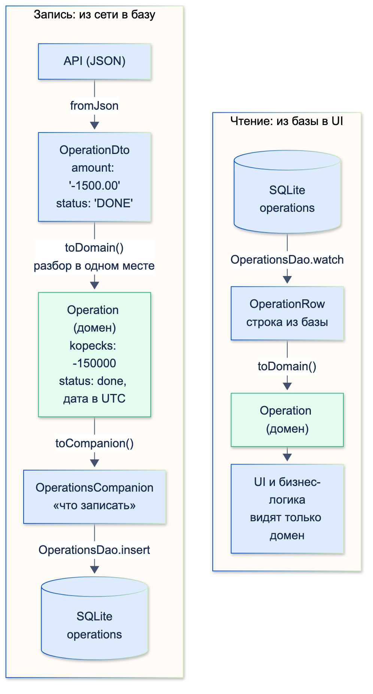
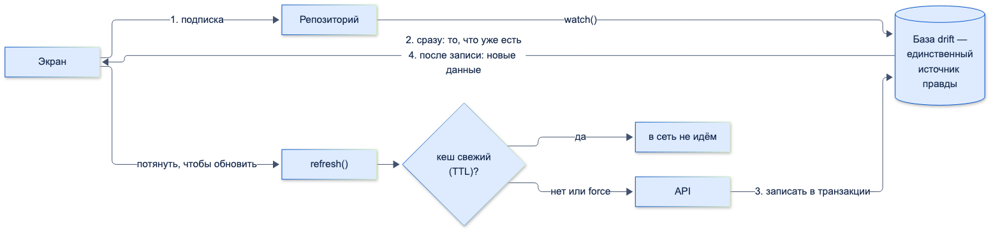

# Локальное хранение данных (DB/Cache)

| Грейд | Время на изучение | Статус |
|-------|-------------------|--------|
| ⭐⭐ | ~40 мин лекция + практика | ✅ Готово |

---

## 📚 Ресурсы

| Ресурс | Формат | Язык | Уровень | Зачем читать |
|--------|--------|------|---------|--------------|
| [Секреты запуска Flutter в production](https://habr.com/ru/company/atisu/blog/597709) | Статья (Habr, ATI.SU) | 🇷🇺 | ⭐⭐⭐ | Опыт `drift` в продакшене: WAL-режим для работы из нескольких изолятов, DAO в модульной архитектуре, свой подход к миграциям |
| [Flutter: Все способы защиты данных](https://habr.com/ru/articles/659999/) | Статья (Habr) | 🇷🇺 | ⭐⭐ | Сравнение хранилищ и шифрования: `shared_preferences`, secure storage, NoSQL-базы. Статья 2022 года: `hive` и `isar` в ней — уже необновляемые пакеты |
| [drift: документация](https://drift.simonbinder.eu/) | Документация | 🇬🇧 | ⭐⭐ | Таблицы, запросы, потоки, миграции, транзакции, изоляты — всё про `drift` |
| [drift](https://pub.dev/packages/drift) | Пакет | 🇬🇧 | ⭐ | Быстрый старт и ссылки на примеры |
| [sqlite3: hooks и шифрование](https://github.com/simolus3/sqlite3.dart/blob/main/sqlite3/doc/hook.md) | Документация | 🇬🇧 | ⭐⭐⭐ | Как SQLite попадает в приложение и как включить шифрованную базу (SQLite3MultipleCiphers, SQLCipher) |
| [Flutter: Persist data](https://docs.flutter.dev/cookbook/persistence) | Документация | 🇬🇧 | ⭐ | Официальные рецепты: key-value, файлы, SQLite |
| [flutter_secure_storage](https://pub.dev/packages/flutter_secure_storage) | Пакет | 🇬🇧 | ⭐ | Хранение токенов и ключей в Keychain/Keystore |

---

## 🎓 Лекция

### 1. Виды локальных хранилищ

| Хранилище | Пакеты | Что хранить | Чего не хранить |
|-----------|--------|-------------|-----------------|
| **Key-value** | `shared_preferences` | Настройки: тема, язык, «показывали ли онбординг» | Токены, персональные данные: хранится **открытым текстом** |
| **Защищённое key-value** | `flutter_secure_storage` (Keychain на iOS, Keystore на Android) | Токены, ключ шифрования базы, флаг биометрии | Большие объёмы: медленно |
| **Реляционная база (SQLite)** | `drift`, `sqflite` | Структурированные данные со связями и запросами: операции, счета, справочники | — |
| **NoSQL / объектные базы** | `hive_ce`, `isar_community`, `objectbox` | Документы и объекты без сложных связей | — |
| **Файлы** | `dart:io` + `path_provider` | PDF-выписки, изображения, экспорт | Структурированные данные, которые нужно искать |
| **Кеш в памяти** | `Map`, LRU-кеш | То, что нужно быстро в пределах сессии | То, что должно пережить перезапуск |
| **Кеш изображений** | `cached_network_image` | Аватары, логотипы | — |

> ⚠️ **Внимание:** оригинальные пакеты `hive` и `isar` не обновлялись с 2022 и 2023 годов (данные pub.dev). Сообщество
> поддерживает их форки — `hive_ce` и `isar_community`. Для нового проекта это важно учитывать.

### 2. SQLite коротко

SQLite — встраиваемая реляционная база: один файл, таблицы, SQL, транзакции, индексы, внешние ключи. На Android и iOS
есть системная, но пакет `sqlite3` по умолчанию **кладёт в приложение свою сборку**, чтобы версия и возможности
были одинаковыми на всех устройствах.

| | `sqflite` | `drift` |
|---|-----------|---------|
| Запросы | Строки SQL, результат — `List<Map<String, Object?>>` | Типизированный Dart API (или SQL, проверенный при генерации) |
| Типы | Приводить вручную | Генерируются классы строк |
| Ошибки в запросах | Во время работы | Большинство — при компиляции |
| Потоки (реактивные запросы) | Нет | **Есть**: запрос перевыполняется при изменении таблиц |
| Миграции | Вручную | Помощники, проверка схем в тестах |
| Шифрование | Нет (есть отдельные форки) | Через `sqlite3` + SQLite3MultipleCiphers / SQLCipher |

Для банковского приложения с офлайн-режимом выбор обычно `drift`.

### 3. drift: база операций

Ниже — база банковского приложения: счета и операции со связью, DAO с CRUD, потоки и транзакция.

Зависимости и генерация:

```yaml
dependencies:
  drift: ^2.34.0
  drift_flutter: ^0.3.0   # открытие базы во Flutter: путь к файлу, фоновый изолят
dev_dependencies:
  drift_dev: ^2.34.0
  build_runner: ^2.15.0
```

```bash
dart run build_runner build
```

#### Код базы

Пояснения — прямо в комментариях над строками.

```dart
import 'package:drift/drift.dart';

// Генератор создаст database.g.dart: классы строк, Companion-классы, базовый класс базы
// и миксин DAO. Это часть (part) этого файла.
part 'database.g.dart';

enum OperationStatus { pending, done, declined }

// Таблица — класс-наследник Table. Имя таблицы в SQL — accounts (имя класса в snake_case).
class Accounts extends Table {
  // Колонка: тип (text, integer, dateTime, boolean, real, blob) и двойные скобки:
  // первые — построитель колонки, вторые — завершить описание.
  TextColumn get id => text()();

  // Ограничение длины проверяется при вставке.
  TextColumn get title => text().withLength(min: 1, max: 64)();

  // Значение по умолчанию. Деньги — integer в копейках, никогда не real.
  IntColumn get balance => integer().withDefault(const Constant(0))();

  // Первичный ключ. Без него drift добавит автоинкрементный rowid.
  @override
  Set<Column> get primaryKey => {id};
}

// Имя генерируемого класса строки. По умолчанию было бы Operation —
// и столкнулось бы с доменной моделью Operation.
@DataClassName('OperationRow')
class Operations extends Table {
  TextColumn get id => text()();

  // Внешний ключ на accounts.id: удаление счёта удалит и его операции (cascade).
  TextColumn get accountId => text().references(Accounts, #id, onDelete: KeyAction.cascade)();

  IntColumn get kopecks => integer()();

  TextColumn get category => text()();

  // Перечисление хранится ТЕКСТОМ ('done'). intEnum хранил бы индекс: переставил значения
  // в enum — и уже сохранённые данные поменяли смысл.
  TextColumn get status => textEnum<OperationStatus>()();

  // Как хранится DateTime — важно, см. «Ловушку с датами» ниже.
  DateTimeColumn get createdAt => dateTime()();

  @override
  Set<Column> get primaryKey => {id};
}

// Описание базы: какие таблицы и DAO в неё входят.
@DriftDatabase(tables: [Accounts, Operations], daos: [OperationsDao])
// _$BankDatabase — сгенерированный базовый класс с геттерами таблиц (accounts, operations)
// и DAO (operationsDao).
class BankDatabase extends _$BankDatabase {
  // executor — куда подключаться: файл на устройстве, база в памяти для тестов, фоновый изолят.
  BankDatabase(super.executor);

  // Версия схемы. Изменил таблицы — увеличь её и опиши переход в onUpgrade.
  @override
  int get schemaVersion => 1;

  @override
  MigrationStrategy get migration => MigrationStrategy(
        // При первом создании файла базы создаются все таблицы.
        onCreate: (m) => m.createAll(),
        // SQLite по умолчанию НЕ проверяет внешние ключи — их включают при каждом открытии.
        // Без этой строки references выше ничего бы не гарантировал.
        beforeOpen: (details) => customStatement('PRAGMA foreign_keys = ON'),
      );
}

// DAO (Data Access Object) — класс с запросами для части базы.
// Миксин _$OperationsDaoMixin даёт доступ к таблицам accounts и operations.
@DriftAccessor(tables: [Accounts, Operations])
class OperationsDao extends DatabaseAccessor<BankDatabase> with _$OperationsDaoMixin {
  OperationsDao(super.db);

  // CREATE. Companion — «что записать»: можно указать не все поля.
  // insertOrReplace — вставить или заменить, если операция с таким id уже есть.
  Future<void> addOperation(OperationsCompanion operation) =>
      into(operations).insert(operation, mode: InsertMode.insertOrReplace);

  // READ. select(...)..where(...) — построитель запроса, getSingleOrNull — одна строка или null.
  Future<OperationRow?> findById(String id) =>
      (select(operations)..where((o) => o.id.equals(id))).getSingleOrNull();

  // UPDATE. Меняются ТОЛЬКО поля, переданные в Companion (Value(category)), остальные не трогаются.
  Future<int> changeCategory(String id, String category) => (update(operations)
        ..where((o) => o.id.equals(id)))
      .write(OperationsCompanion(category: Value(category)));

  // DELETE. go() выполняет удаление и возвращает число удалённых строк.
  Future<int> deleteOperation(String id) =>
      (delete(operations)..where((o) => o.id.equals(id))).go();

  // STREAM. watch() вместо get(): запрос перевыполняется при КАЖДОМ изменении таблицы operations.
  Stream<List<OperationRow>> watchForAccount(String accountId) => (select(operations)
        ..where((o) => o.accountId.equals(accountId))
        ..orderBy([(o) => OrderingTerm.desc(o.createdAt)]))
      .watch();

  // STREAM одного значения: сумма расходов счёта.
  Stream<int> watchExpenses(String accountId) {
    // Агрегат SUM как выражение Dart.
    final total = operations.kopecks.sum();
    // selectOnly — запрос только нужных колонок, а не целых строк.
    final query = selectOnly(operations)
      ..addColumns([total])
      ..where(operations.accountId.equals(accountId) & operations.kopecks.isSmallerThanValue(0));
    // watchSingle() — поток одного значения.
    return query.map((row) => -(row.read(total) ?? 0)).watchSingle();
  }

  // TRANSACTION. Всё внутри выполняется атомарно: при исключении изменения откатываются.
  Future<void> applyOperation(OperationsCompanion operation) => transaction(() async {
        await into(operations).insert(operation);
        await customUpdate(
          'UPDATE accounts SET balance = balance + ? WHERE id = ?',
          variables: [Variable.withInt(operation.kopecks.value), Variable.withString(operation.accountId.value)],
          // Для «сырого» SQL нужно явно указать, какие таблицы он меняет,
          // иначе потоки по accounts не узнают об изменении.
          updates: {accounts},
        );
      });
}
```

#### Проверка: CRUD, потоки, транзакция

```dart
import 'dart:async';

import 'package:drift/native.dart';
import 'package:driftcheck/db/database.dart';
import 'package:driftcheck/db/models.dart';
import 'package:driftcheck/db/repository.dart';

class FakeApi implements OperationsApi {
  var calls = 0;
  @override
  Future<List<OperationDto>> fetchOperations(String accountId) async {
    calls++;
    return [
      OperationDto.fromJson({'id': 'op-3', 'account_id': accountId, 'amount': '-1500.00', 'category': 'Кафе', 'status': 'DONE', 'created_at': '2026-10-06T09:15:00Z'}),
    ];
  }
}

Future<void> tick() => Future<void>.delayed(const Duration(milliseconds: 20));

Future<void> main() async {
  final db = BankDatabase(NativeDatabase.memory());
  final dao = db.operationsDao;
  await db.into(db.accounts).insert(AccountsCompanion.insert(id: 'acc-1', title: 'Зарплатная'));

  final sub1 = dao.watchForAccount('acc-1').listen((rows) => print('watchForAccount: ${rows.map((r) => '${r.id}:${r.category}').toList()}'));
  final sub2 = dao.watchExpenses('acc-1').listen((sum) => print('watchExpenses: $sum'));
  await tick();

  print('--- CREATE');
  await dao.addOperation(OperationsCompanion.insert(id: 'op-1', accountId: 'acc-1', kopecks: -45000, category: 'Такси', status: OperationStatus.done, createdAt: DateTime.utc(2026, 10, 1)));
  await tick();
  print('--- READ: ${(await dao.findById('op-1'))?.category}');
  print('--- UPDATE');
  await dao.changeCategory('op-1', 'Транспорт');
  await tick();
  print('--- TRANSACTION');
  await dao.applyOperation(OperationsCompanion.insert(id: 'op-2', accountId: 'acc-1', kopecks: 15000000, category: 'Зарплата', status: OperationStatus.done, createdAt: DateTime.utc(2026, 10, 5)));
  await tick();
  final account = await (db.select(db.accounts)..where((a) => a.id.equals('acc-1'))).getSingle();
  print('баланс после транзакции: ${account.balance}');
  print('--- DELETE');
  await dao.deleteOperation('op-1');
  await tick();
  print('--- FOREIGN KEY');
  try {
    await dao.addOperation(OperationsCompanion.insert(id: 'op-x', accountId: 'нет-такого', kopecks: 1, category: 'x', status: OperationStatus.done, createdAt: DateTime.utc(2026)));
  } on Exception catch (e) {
    print('ошибка: ${e.toString().split('\n').first}');
  }
  await sub1.cancel();
  await sub2.cancel();

  print('--- REPOSITORY (offline-first + TTL)');
  final api = FakeApi();
  final repo = OperationsRepository(dao, api);
  final sub3 = repo.watchOperations('acc-1').listen((ops) => print('UI видит: ${ops.map((o) => '${o.id} ${o.kopecks} ${o.status.name}').toList()}'));
  await tick();
  await repo.refresh('acc-1');
  await tick();
  await repo.refresh('acc-1'); // кеш свежий — сеть не трогаем
  await repo.refresh('acc-1', force: true);
  await tick();
  print('запросов в сеть: ${api.calls}');
  await sub3.cancel();
  await db.close();
}
```

```text
watchForAccount: []
watchExpenses: 0
--- CREATE
watchForAccount: [op-1:Такси]
watchExpenses: 45000
--- READ: Такси
--- UPDATE
watchForAccount: [op-1:Транспорт]
watchExpenses: 45000
--- TRANSACTION
watchForAccount: [op-2:Зарплата, op-1:Транспорт]
watchExpenses: 45000
баланс после транзакции: 15000000
--- DELETE
watchForAccount: [op-2:Зарплата]
watchExpenses: 0
--- FOREIGN KEY
ошибка: SqliteException(787): while executing statement, FOREIGN KEY constraint failed, constraint failed (code 787)
--- REPOSITORY (offline-first + TTL)
UI видит: [op-2 15000000 done]
UI видит: [op-3 -150000 done, op-2 15000000 done]
UI видит: [op-3 -150000 done, op-2 15000000 done]
запросов в сеть: 2
```

Что видно из вывода:
- **Потоки сами присылают новые данные** после каждого `insert`, `update`, `delete`. Экрану достаточно подписаться,
  дёргать «обновить список» вручную не нужно.
- **Поток перевыполняется при любом изменении таблицы**, даже если его результат не изменился: после смены категории
  `watchExpenses` снова прислал `45000`. Для UI добавляй `.distinct()` (для списков — со сравнением содержимого),
  иначе лишние перестроения.
- **Транзакция** записала операцию и изменила баланс вместе.
- **Внешний ключ сработал** благодаря `PRAGMA foreign_keys = ON` в `beforeOpen`.

#### Ловушка с датами

По умолчанию `drift` хранит `DateTime` как unix-время **с точностью до секунды**. Пример для пользователя в часовом поясе Москвы:

```text
записали: 2026-10-06 09:15:30.123Z (isUtc: true)
прочитали: 2026-10-06 12:15:30.000 (isUtc: false)
равны: false
```

Пропали миллисекунды, а дата вернулась в **местном** времени. Сравнения дат,
сортировка операций внутри одной секунды и проверки «не изменилась ли операция» начинают сбоить. Решение — хранить
даты текстом в ISO 8601. Это настройка генератора в `build.yaml`:

```yaml
targets:
  $default:
    builders:
      drift_dev:
        options:
          store_date_time_values_as_text: true
```

С ней дата возвращается точно такой, какой её записали: `2026-10-06 09:15:30.123Z (isUtc: true)`, `равны: true`. Включай её **в начале проекта**:
смена способа хранения потом потребует миграции существующих данных.

#### Открытие базы во Flutter и шифрование

```dart
import 'package:drift_flutter/drift_flutter.dart';

final database = BankDatabase(driftDatabase(name: 'bank')); // файл в папке приложения
```

- Тяжёлые запросы не должны блокировать UI: `drift` умеет работать с базой в **фоновом изоляте**
  (`NativeDatabase.createInBackground`, возможности `drift_flutter`).
- **Шифрование базы** — сборка SQLite3MultipleCiphers или SQLCipher вместо обычного SQLite: в `pubspec.yaml`
  `hooks: user_defines: sqlite3: source: sqlite3mc` (или `sqlcipher`), а ключ задаётся командой `PRAGMA key` при открытии.
  Сам ключ хранят в `flutter_secure_storage`, а не в коде. Подробно — в разделе о безопасности.

### 4. Модели: DTO, домен, строка базы

В приложении одна и та же «операция» существует в нескольких видах. Смешивать их — главный источник ошибок.

| Модель | Где живёт | Типы | Пример |
|--------|-----------|------|--------|
| **DTO** (Data Transfer Object) | Ответ и запрос API | Как прислал сервер: строки, `snake_case`, суммы строкой | `OperationDto` |
| **Доменная модель** | Бизнес-логика и UI | Правильные типы: копейки `int`, `DateTime` в UTC, `enum` | `Operation` |
| **Строка базы** (data class) | Чтение из базы | Генерирует `drift` по таблице | `OperationRow` |
| **Companion** | Запись в базу | Те же поля, каждое может быть «не задано» (`Value.absent()`) | `OperationsCompanion` |

**DAO** (Data Access Object) — это **не модель**, а класс с запросами к базе (`OperationsDao`). Модели проходят через него.



```dart
import 'database.dart';

/// DTO — данные в том виде, в каком их прислал сервер (JSON)
class OperationDto {
  const OperationDto({
    required this.id,
    required this.accountId,
    required this.amount,
    required this.category,
    required this.status,
    required this.createdAt,
  });

  factory OperationDto.fromJson(Map<String, dynamic> json) => OperationDto(
        id: json['id'] as String,
        accountId: json['account_id'] as String,
        amount: json['amount'] as String, // сервер присылает сумму строкой: "-1500.00"
        category: json['category'] as String,
        status: json['status'] as String, // "DONE", "PENDING", "DECLINED"
        createdAt: json['created_at'] as String, // ISO 8601
      );

  final String id;
  final String accountId;
  final String amount;
  final String category;
  final String status;
  final String createdAt;
}

/// Доменная модель — то, с чем работает приложение: правильные типы, без привязки к API и базе
class Operation {
  const Operation({
    required this.id,
    required this.accountId,
    required this.kopecks,
    required this.category,
    required this.status,
    required this.createdAt,
  });

  final String id;
  final String accountId;
  final int kopecks;
  final String category;
  final OperationStatus status;
  final DateTime createdAt;

  bool get isExpense => kopecks < 0;
}

/// DTO → домен: разбор строк в нормальные типы в одном месте
extension OperationDtoMapper on OperationDto {
  Operation toDomain() => Operation(
        id: id,
        accountId: accountId,
        kopecks: (double.parse(amount) * 100).round(),
        category: category,
        status: OperationStatus.values.byName(status.toLowerCase()),
        createdAt: DateTime.parse(createdAt).toUtc(),
      );
}

/// Домен → запись в базу (Companion — «что записать»)
extension OperationToDb on Operation {
  OperationsCompanion toCompanion() => OperationsCompanion.insert(
        id: id,
        accountId: accountId,
        kopecks: kopecks,
        category: category,
        status: status,
        createdAt: createdAt,
      );
}

/// Строка из базы → домен
extension OperationRowMapper on OperationRow {
  Operation toDomain() => Operation(
        id: id,
        accountId: accountId,
        kopecks: kopecks,
        category: category,
        status: status,
        createdAt: createdAt,
      );
}
```

Правила:
- **Разбор «сырых» данных — в одном месте**, в маппере DTO → домен. Сумма `"-1500.00"` становится `-150000` копеек,
  статус `"DONE"` — `OperationStatus.done`, дата — UTC.
- **Экраны и бизнес-логика видят только доменные модели.** Тогда смена формата API или схемы базы меняет только мапперы.
- **Мапперы — расширения или отдельные функции**, а не методы моделей: доменная модель не должна знать ни про JSON, ни про `drift`.
- В больших проектах DTO генерируют (`json_serializable`, `freezed`), а мапперы покрывают тестами.

### 5. Кеширование

#### Стратегии

| Стратегия | Как работает | Когда |
|-----------|--------------|-------|
| **Сначала сеть** (network-first) | Идём в сеть, при ошибке берём кеш | Данные должны быть максимально свежими: баланс перед переводом |
| **Сначала кеш** (cache-first) | Есть в кеше — берём оттуда, иначе сеть | Редко меняющееся: справочники банков, курсы на день |
| **Кеш, потом сеть** (stale-while-revalidate) | Сразу показываем кеш, параллельно обновляем и показываем свежее | Ленты и списки: история операций, уведомления |
| **Offline-first** | UI **всегда** читает из базы, сеть только обновляет базу | Приложения, которые должны работать без сети |

#### Offline-first репозиторий с TTL

```dart
import 'database.dart';
import 'models.dart';

/// Источник данных из сети (в приложении — HTTP-клиент)
abstract interface class OperationsApi {
  Future<List<OperationDto>> fetchOperations(String accountId);
}

/// Offline-first: экран всегда слушает базу, сеть только обновляет базу
class OperationsRepository {
  OperationsRepository(this._dao, this._api, {this.ttl = const Duration(minutes: 5)});

  final OperationsDao _dao;
  final OperationsApi _api;
  final Duration ttl;
  final _lastSync = <String, DateTime>{};

  /// Единственный источник правды для UI — база
  Stream<List<Operation>> watchOperations(String accountId) =>
      _dao.watchForAccount(accountId).map((rows) => [for (final row in rows) row.toDomain()]);

  /// Обновить из сети, если кеш устарел (или принудительно — «потянуть, чтобы обновить»)
  Future<void> refresh(String accountId, {bool force = false}) async {
    final last = _lastSync[accountId];
    if (!force && last != null && DateTime.now().difference(last) < ttl) return; // кеш свежий
    final dtos = await _api.fetchOperations(accountId);
    await _dao.transaction(() async {
      for (final dto in dtos) {
        await _dao.addOperation(dto.toDomain().toCompanion());
      }
    });
    _lastSync[accountId] = DateTime.now();
  }
}
```

Вывод той же программы (раздел «REPOSITORY» выше):

```text
UI видит: [op-2 15000000 done]
UI видит: [op-3 -150000 done, op-2 15000000 done]
UI видит: [op-3 -150000 done, op-2 15000000 done]
запросов в сеть: 2
```

1. Экран подписался и **сразу** получил то, что уже есть в базе.
2. `refresh` сходил в сеть, записал операцию в базу — поток **сам** прислал обновлённый список.
3. Повторный `refresh` в пределах TTL сеть **не трогал**.
4. `refresh(force: true)` («потянуть, чтобы обновить») сходил в сеть ещё раз. Данные те же, но поток прислал список
   снова — ещё один повод для `.distinct()`.



#### Инвалидация — самое сложное в кешировании

- **По времени (TTL):** время последнего обновления хранят **в базе**, а не в памяти, если кеш должен пережить перезапуск.
- **После изменения:** после перевода инвалидировать баланс и историю счёта.
- **При выходе из аккаунта — очистить всё:** базу, кеши, защищённое хранилище. Иначе следующий пользователь устройства
  увидит чужие операции.
- **HTTP-кеш:** `ETag` + `If-None-Match` — сервер ответит `304`, и не придётся гнать данные заново (тема «Сетевые протоколы»).

### 6. Когда что применять

| Задача | Решение |
|--------|---------|
| Тема, язык, флаги онбординга | `shared_preferences` |
| Access/refresh-токены, ключ шифрования базы | `flutter_secure_storage` |
| История операций, счета, офлайн-режим | `drift` (SQLite), offline-first |
| Справочник банков, БИК — читать часто, менять редко | `drift` + cache-first с TTL |
| Выписки в PDF | Файлы в папке приложения (`path_provider`) |
| Результат тяжёлого вычисления на время сессии | Кеш в памяти |

### ⚠️ Частые ошибки

- **Токены и персональные данные в `shared_preferences`** — хранятся открытым текстом.
- **Деньги в `real`/`double`** — ошибки округления. Только целые копейки.
- **`intEnum` для статусов** — смена порядка значений `enum` ломает старые данные. Используй `textEnum`.
- **`DateTime` по умолчанию (unix-секунды)** — потеря миллисекунд и часового пояса. `store_date_time_values_as_text: true` с начала проекта.
- **Забытый `PRAGMA foreign_keys = ON`** — внешние ключи молча не проверяются.
- **Потоки `drift` в UI без `.distinct()`** — лишние перестроения на каждое изменение таблицы.
- **Несколько записей без `transaction`** — при сбое на середине данные остаются наполовину записанными.
- **Изменили таблицы, но не увеличили `schemaVersion` и не написали миграцию** — у пользователей со старой базой приложение упадёт.
- **Доменная модель с `fromJson` и аннотациями `drift`** — один класс на три слоя, любое изменение API ломает базу и UI.
- **Кеш не очищается при выходе из аккаунта.**

---

## ✅ Самопроверка

**⭐ Junior**
1. Какие виды локальных хранилищ ты знаешь и что в каждом хранить?
2. Почему токен нельзя хранить в `shared_preferences`?
3. Чем `sqflite` отличается от `drift`?

**⭐⭐ Middle**
1. Что такое `Companion` в `drift` и чем он отличается от класса строки (`OperationRow`)?
2. Как получить список операций, который сам обновляется при изменении базы?
3. Зачем нужен `PRAGMA foreign_keys = ON`?
4. Чем DTO отличается от доменной модели и где их преобразовывать?

**⭐⭐⭐ Senior**
1. Опиши offline-first: откуда UI берёт данные, что делает сеть, как работает TTL и инвалидация?
2. Почему `intEnum` и хранение дат по умолчанию в `drift` опасны? Как правильно?
3. Как зашифровать базу и где хранить ключ?
4. Что нужно сделать при изменении схемы базы в новой версии приложения?

<details>
<summary>Ответы</summary>

**Junior**
1. Key-value (`shared_preferences`) — настройки. Защищённое хранилище (`flutter_secure_storage`) — токены и ключи. SQLite (`drift`, `sqflite`) — структурированные данные. NoSQL-базы — объекты без сложных связей. Файлы — документы и изображения. Кеш в памяти — данные сессии.
2. `shared_preferences` хранит данные открытым текстом в обычном файле приложения: их можно прочитать на устройстве с root или из резервной копии. Токены хранят в Keychain/Keystore через `flutter_secure_storage`.
3. `sqflite` — строки SQL и `Map` в ответ, типы и ошибки проверяются во время работы. `drift` — типизированные запросы и сгенерированные классы, ошибки при компиляции, реактивные потоки, помощь с миграциями и шифрованием.

**Middle**
1. Класс строки — результат чтения, все поля заполнены. `Companion` — описание записи: каждое поле может быть `Value(…)` или `Value.absent()`. Поэтому `update(...).write(Companion)` меняет только переданные поля.
2. Использовать `.watch()` (или `watchSingle()`) вместо `.get()`: запрос перевыполняется при каждом изменении таблиц, от которых он зависит. Для UI добавить `.distinct()`.
3. SQLite по умолчанию не проверяет внешние ключи. Без этой команды при каждом открытии базы `references` ничего не гарантирует, и в таблице появятся операции несуществующих счетов.
4. DTO повторяет формат API (строки, `snake_case`), доменная модель — правильные типы для логики и UI. Преобразовывать в мапперах на границе слоя данных, чтобы остальной код видел только доменные модели.

**Senior**
1. UI подписан на поток из базы — единственный источник правды. Сеть только загружает данные и записывает их в базу (в транзакции), а поток сам доставляет изменения в UI. TTL: время последней синхронизации хранится, и `refresh` ходит в сеть, только если кеш устарел или обновление принудительное. Инвалидация — после изменений (перевод), при выходе из аккаунта — полная очистка.
2. `intEnum` хранит индекс значения: перестановка или вставка значения в `enum` меняет смысл уже сохранённых данных. Нужен `textEnum`. Даты по умолчанию — unix-секунды: теряются миллисекунды, при чтении получается местное время, сравнения ломаются. Нужен `store_date_time_values_as_text: true` с самого начала.
3. Подключить SQLite3MultipleCiphers или SQLCipher через `hooks: user_defines: sqlite3: source: sqlite3mc` (или `sqlcipher`) и задавать ключ `PRAGMA key` при открытии. Ключ генерировать случайно при первом запуске и хранить в `flutter_secure_storage`.
4. Увеличить `schemaVersion` и описать переход в `MigrationStrategy.onUpgrade` (добавить колонки и таблицы, перенести данные). Проверять миграции тестами: `drift_dev` умеет сохранять схемы версий и генерировать тесты миграций.

</details>
