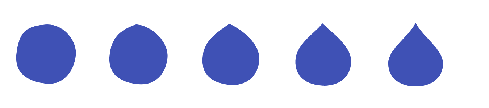

# Анимации (implicit, explicit, custom)

| Грейд | Время на изучение | Статус |
|-------|-------------------|--------|
| ⭐⭐ | ~35 мин лекция + практика | ✅ Готово |

---

## 📚 Ресурсы

| Ресурс | Формат | Язык | Уровень | Зачем читать |
|--------|--------|------|---------|--------------|
| [Хендбук Яндекса: неявные анимации](https://contest.yandex.ru/tracks/flutter/ui-framework/implicit-animations) и [явные анимации](https://contest.yandex.ru/tracks/flutter/ui-framework/explicit-animations) | Учебник | 🇷🇺 | ⭐ → ⭐⭐ | Основы обоих подходов по шагам |
| [Flutter-Анимации 2025: Полный Гайд](https://habr.com/ru/articles/918822/) | Статья (Habr) | 🇷🇺 | ⭐⭐ | Неявные и явные анимации, staggered, Hero, физика, сравнение Lottie и Rive. Про `CustomPainter` там нет — он разобран ниже |
| [Flutter: Animations](https://docs.flutter.dev/ui/animations) | Документация | 🇬🇧 | ⭐ | Официальный обзор и схема выбора подхода |
| [Flutter: Fragment shaders](https://docs.flutter.dev/ui/design/graphics/fragment-shaders) | Документация | 🇬🇧 | ⭐⭐⭐ | Шейдеры во Flutter: подключение, uniforms, ограничения |
| [Rive](https://pub.dev/packages/rive) и [Lottie](https://pub.dev/packages/lottie) | Пакеты | 🇬🇧 | ⭐ | Анимации, нарисованные дизайнером в отдельном редакторе |

---

## 🎓 Лекция

### 1. Из чего состоит анимация во Flutter

Анимация — это значение, которое меняется **кадр за кадром**, и виджеты, которые на каждом кадре перерисовываются с новым значением.

| Часть | Что делает |
|-------|------------|
| `Ticker` | Вызывает колбэк на **каждом кадре** экрана (60 или 120 раз в секунду) |
| `AnimationController` | Превращает время в число от 0 до 1 за `duration`. Умеет `forward`, `reverse`, `repeat`, `stop`, `animateTo` |
| `Curve` | Характер движения: `linear`, `easeInOut`, `elasticOut`, `easeInOutBack`… |
| `Tween<T>` | Переводит 0…1 в нужный диапазон: размеры, цвета, `Offset`, `BorderRadius` |
| `Animation<T>` | Текущее значение плюс подписка на изменения (`Listenable`) |

**`vsync`** — источник тиков для контроллера. `SingleTickerProviderStateMixin` (или `TickerProviderStateMixin` для нескольких
контроллеров) связывает тики с жизнью `State`: когда экран не виден, тики останавливаются и не тратят батарею.

### 2. Неявные анимации (implicit)

Меняешь параметр — виджет сам плавно переходит от старого значения к новому. Контроллер не нужен.

```dart
import 'package:flutter/material.dart';

/// Неявная анимация: меняем параметры — виджет сам плавно переходит к новым значениям
class BalanceCard extends StatefulWidget {
  const BalanceCard({super.key});

  @override
  State<BalanceCard> createState() => _BalanceCardState();
}

class _BalanceCardState extends State<BalanceCard> {
  var _hidden = false;

  @override
  Widget build(BuildContext context) => GestureDetector(
        onTap: () => setState(() => _hidden = !_hidden),
        child: AnimatedContainer(
          duration: const Duration(milliseconds: 300),
          curve: Curves.easeInOut,
          height: _hidden ? 56 : 120, // меняется только значение — анимацию Flutter строит сам
          color: _hidden ? Colors.grey : Colors.indigo,
          child: AnimatedOpacity(
            duration: const Duration(milliseconds: 300),
            opacity: _hidden ? 0 : 1,
            child: const Text('150 000 ₽'),
          ),
        ),
      );
}
```

Значения во время анимации (widget-тест, 300 мс):

```text
до нажатия:     высота 120.0, прозрачность 1.00
сразу после:    высота 120.0, прозрачность 1.00
через 150 мс:   высота 88.0, прозрачность 0.50
через 300 мс:   высота 56.0, прозрачность 0.00
```

| Виджет | Что анимирует |
|--------|---------------|
| `AnimatedContainer` | Размер, отступы, цвет, `decoration` (в том числе скругления) |
| `AnimatedOpacity`, `AnimatedScale`, `AnimatedRotation`, `AnimatedSlide` | Прозрачность, масштаб, поворот, сдвиг |
| `AnimatedAlign`, `AnimatedPadding`, `AnimatedPositioned` | Положение |
| `AnimatedDefaultTextStyle` | Стиль текста |
| `AnimatedSwitcher` | Смена одного виджета на другой. Если тип тот же — нужен **ключ**, иначе Flutter решит, что виджет не сменился (тема «Базовое устройство фреймворка») |
| `TweenAnimationBuilder<T>` | Что угодно: `Tween` и `builder`, когда готового `Animated*` нет |

Когда хватит неявных: анимация **реагирует на смену состояния** и идёт от одного значения к другому.

### 3. Явные анимации (explicit)

Нужны, когда анимацией надо **управлять**: повторять, ставить на паузу, запускать по жесту, синхронизировать несколько анимаций.

```dart
import 'package:flutter/material.dart';

/// Явная анимация: AnimationController управляет временем, мы — всем остальным
class PayButtonPulse extends StatefulWidget {
  const PayButtonPulse({super.key});

  @override
  State<PayButtonPulse> createState() => _PayButtonPulseState();
}

class _PayButtonPulseState extends State<PayButtonPulse> with SingleTickerProviderStateMixin {
  // vsync: this — контроллер получает тики от Ticker, привязанного к кадрам экрана
  late final _controller = AnimationController(vsync: this, duration: const Duration(milliseconds: 800));

  // Tween задаёт диапазон, CurvedAnimation — характер движения
  late final _scale = Tween<double>(begin: 1, end: 1.1).animate(
    CurvedAnimation(parent: _controller, curve: Curves.easeInOut),
  );

  @override
  void initState() {
    super.initState();
    _controller.repeat(reverse: true); // 0 → 1 → 0 → … бесконечно
  }

  @override
  void dispose() {
    _controller.dispose(); // обязательно: иначе Ticker продолжит тикать
    super.dispose();
  }

  @override
  Widget build(BuildContext context) => ScaleTransition(
        scale: _scale, // *Transition-виджеты перестраивают только себя, а не весь экран
        child: FilledButton(onPressed: () {}, child: const Text('Оплатить')),
      );
}
```

Значения масштаба по времени:

```text
0 мс: scale 1.000
400 мс: scale 1.050
800 мс: scale 1.100
1200 мс: scale 1.050
1600 мс: scale 1.000
```

Что важно:
- **`dispose()` контроллера обязателен:** иначе тикер продолжит работать после ухода с экрана.
- **`*Transition`-виджеты** (`FadeTransition`, `ScaleTransition`, `SlideTransition`, `RotationTransition`) и **`AnimatedBuilder`**
  перестраивают только себя на каждом кадре. Вызывать `setState` в слушателе контроллера — значит перестраивать весь экран
  60 раз в секунду.
- **`AnimatedBuilder(child: …)`**: всё, что не зависит от значения анимации, передавай в `child` — оно построится один раз.
- **Последовательные анимации (staggered)** — один контроллер и несколько `CurvedAnimation` с `Interval(0.0, 0.5)`,
  `Interval(0.5, 1.0)`: элементы появляются по очереди.
- **Физика** — `controller.animateWith(SpringSimulation(…))`: пружина вместо фиксированной длительности,
  например «оттянуть и отпустить».

### 4. Свои анимации (custom)

| Задача | Инструмент |
|--------|------------|
| Анимировать свою графику: график баланса, прогресс-кольцо, форма | `CustomPainter` с `repaint: animation` |
| Анимировать свой тип значения | Свой `Tween<T>` с методом `lerp` |
| Переход элемента между экранами (карта → детали карты) | `Hero` |
| Свой переход между экранами | `PageRouteBuilder` с `transitionsBuilder` |
| Сложная анимация от дизайнера | Lottie, Rive |
| Эффекты на уровне пикселей: жидкость, свечение, искажения | Фрагментные шейдеры |

### 5. Задача с собеседования: аморфная кнопка «клякса → капля»

> ✍️ **Условие.** Нужна аморфная кнопка в виде кляксы. По нажатию форма анимационно меняется с кляксы на каплю.
> Какие высокоуровневые и низкоуровневые способы есть во Flutter, чтобы сделать такую кнопку?



**Почему не контейнеры.** `Container`, `AnimatedContainer` и `BorderRadius` умеют только скруглять углы **прямоугольника**.
Произвольный контур кляксы и плавное перетекание одной формы в другую так не построить. Нужна своя форма: либо готовая
анимация из редактора, либо свой контур (`Path`).

#### Способ 1. Lottie или Rive — самый высокий уровень

Дизайнер рисует анимацию в отдельном редакторе, разработчик подключает файл и запускает анимацию по нажатию.

| | Lottie | Rive |
|---|--------|------|
| Откуда | After Effects → экспорт в JSON (плагин Bodymovin) | Свой редактор Rive |
| Интерактивность | Проигрывание отрезков: «от кадра A до кадра B» | **State Machine**: состояния «клякса», «капля», переходы по входам (нажатие, наведение) |
| Для кляксы | Подходит: два отрезка «туда» и «обратно» | Подходит лучше всего: переход между состояниями настраивает дизайнер |

Плюсы: красиво, почти без кода, дизайнер меняет анимацию без релиза логики. Минусы: зависимость от дизайнера и редактора,
отдельный файл, ограниченный контроль из кода. Область нажатия — по-прежнему прямоугольник виджета.

#### Способ 2. CustomPainter — основной способ «в коде»

Идея: описать кляксу и каплю **одинаковым набором точек** (кривые Безье) и на каждом кадре рисовать промежуточный контур,
интерполируя каждую точку. Раз число точек совпадает, любая промежуточная форма получается автоматически.

```dart
import 'dart:ui';

// Обе формы — одинаковый набор точек: старт + 4 кривые Безье (по 3 точки). Координаты в долях 0…1
const _blob = [
  Offset(.45, .05), Offset(.75, 0), Offset(1, .3), Offset(.95, .55), Offset(.9, .85), Offset(.7, 1), Offset(.45, .95),
  Offset(.15, .9), Offset(0, .75), Offset(.05, .45), Offset(.1, .15), Offset(.2, .08), Offset(.45, .05),
];
const _drop = [
  Offset(.5, .02), Offset(.62, .25), Offset(.92, .42), Offset(.92, .65), Offset(.92, .88), Offset(.73, 1), Offset(.5, 1),
  Offset(.27, 1), Offset(.08, .88), Offset(.08, .65), Offset(.08, .42), Offset(.38, .25), Offset(.5, .02),
];

/// Форма при прогрессе t: 0 — клякса, 1 — капля. Каждая точка интерполируется отдельно
Path blobPath(Size size, double t) {
  final p = [for (var i = 0; i < 13; i++) Offset.lerp(_blob[i], _drop[i], t)!.scale(size.width, size.height)];
  final path = Path()..moveTo(p[0].dx, p[0].dy);
  for (var i = 1; i < 13; i += 3) {
    path.cubicTo(p[i].dx, p[i].dy, p[i + 1].dx, p[i + 1].dy, p[i + 2].dx, p[i + 2].dy);
  }
  return path..close();
}
```

```dart
import 'package:flutter/material.dart';

import 'blob_path.dart';

class BlobPainter extends CustomPainter {
  BlobPainter(this.progress) : super(repaint: progress); // перерисовка на каждом тике без build

  final Animation<double> progress;
  var _size = Size.zero;

  @override
  void paint(Canvas canvas, Size size) {
    _size = size;
    canvas.drawPath(blobPath(size, progress.value), Paint()..color = Colors.indigo);
  }

  @override
  bool hitTest(Offset position) => blobPath(_size, progress.value).contains(position); // нажатие — только по фигуре

  @override
  bool shouldRepaint(BlobPainter old) => false;
}

class BlobButton extends StatefulWidget {
  const BlobButton({super.key, required this.onPressed});

  final VoidCallback onPressed;

  @override
  State<BlobButton> createState() => _BlobButtonState();
}

class _BlobButtonState extends State<BlobButton> with SingleTickerProviderStateMixin {
  late final _controller = AnimationController(vsync: this, duration: const Duration(milliseconds: 700));
  late final _progress = CurvedAnimation(parent: _controller, curve: Curves.elasticOut); // «жидкое» дрожание

  @override
  void dispose() {
    _controller.dispose();
    super.dispose();
  }

  @override
  Widget build(BuildContext context) => GestureDetector(
        onTap: () {
          _controller.isForwardOrCompleted ? _controller.reverse() : _controller.forward();
          widget.onPressed();
        },
        child: CustomPaint(size: const Size(120, 120), painter: BlobPainter(_progress)),
      );
}
```

- **`repaint: progress`** — на каждом кадре только перерисовка, без перестроения виджетов.
- **`Curves.elasticOut`** выходит за 1 (максимум ≈ 1,27 при t ≈ 0,17; в замере по кадрам — 1,23, потому что кадр попадает не точно в пик) и возвращается: капля «дрожит», как жидкость.
- **`hitTest`** засчитывает нажатие только **внутри фигуры**. Проверено тестом: нажатие в угол квадрата 120×120, где фигуры нет,
  кнопку не нажимает, нажатие в центр — нажимает.

#### Способ 3. RenderObject — самый низкий уровень на Dart

Свой `RenderBox` сам задаёт размер, рисует и определяет область нажатия. Форма та же (`blobPath`).

```dart
import 'package:flutter/material.dart';
import 'package:flutter/rendering.dart';

import 'blob_path.dart';

class BlobBox extends LeafRenderObjectWidget {
  const BlobBox({super.key, required this.progress});

  final Animation<double> progress;

  @override
  RenderBlob createRenderObject(BuildContext context) => RenderBlob(progress);

  @override
  void updateRenderObject(BuildContext context, RenderBlob renderObject) => renderObject.progress = progress;
}

class RenderBlob extends RenderBox {
  RenderBlob(this._progress);

  Animation<double> _progress;

  set progress(Animation<double> value) {
    if (value == _progress) return;
    if (attached) _progress.removeListener(markNeedsPaint);
    _progress = value;
    if (attached) _progress.addListener(markNeedsPaint);
    markNeedsPaint();
  }

  // Подписка на анимацию живёт, пока объект в дереве: каждый тик — только перерисовка, без раскладки
  @override
  void attach(PipelineOwner owner) {
    super.attach(owner);
    _progress.addListener(markNeedsPaint);
  }

  @override
  void detach() {
    _progress.removeListener(markNeedsPaint);
    super.detach();
  }

  @override
  void performLayout() => size = constraints.constrain(const Size(120, 120)); // свой размер в рамках ограничений

  @override
  void paint(PaintingContext context, Offset offset) =>
      context.canvas.drawPath(blobPath(size, _progress.value).shift(offset), Paint()..color = Colors.indigo);

  @override
  bool hitTestSelf(Offset position) => blobPath(size, _progress.value).contains(position); // нажатие — только по фигуре
}
```

Использование: `GestureDetector(onTap: …, child: BlobBox(progress: controller))`.

Когда это нужно вместо `CustomPainter`: своя **раскладка** (размер зависит от содержимого или ограничений), дети со
своим положением, особая обработка нажатий, максимальный контроль над перерисовкой. Для одной кнопки обычно
достаточно `CustomPainter`. `RenderObject` — то, на чём `CustomPainter` построен сам. Подробно — в теме «Создание
собственных RenderObject».

#### Способ 4. Фрагментные шейдеры — на уровне пикселей

Шейдер — маленькая программа на GLSL, которую **видеокарта** выполняет для **каждого пикселя** области.

- **Как подключается:** файл `.frag` объявляется в `pubspec.yaml` в секции `flutter: shaders:`, загружается через
  `FragmentProgram.fromAsset`, из программы создаётся `fragmentShader()`. Параметры передаются uniform-переменными через
  `shader.setFloat(индекс, значение)`. Рисуется через `Paint()..shader = shader` в `CustomPainter`.
- **Как сделать кляксу:** форма задаётся функцией расстояния (SDF): для каждого пикселя шейдер считает, внутри фигуры он
  или снаружи. Классический приём для «жидких» форм — **metaballs**: несколько окружностей, поля которых складываются
  и плавно сливаются. Морфинг в каплю — смена параметров (`progress`, `time`) через uniform-переменные.
- **Плюсы:** выполняется на GPU, доступны эффекты, которые путями (`Path`) не нарисовать: мягкие края, свечение,
  «студенистость», искажения.
- **Минусы:** нужен GLSL. Шейдер **только рисует**: область нажатия считать отдельно. Отладка сложнее.
  Есть ограничения: только фрагментные шейдеры, без вершинных.

#### Способ 5. Нативная отрисовка на C++ через FFI

Технически кнопку можно нарисовать и на C++: Dart вызывает нативную библиотеку через `dart:ffi`. Есть три пути:

| Путь | Как | Когда оправдан |
|------|-----|----------------|
| C++ считает только **геометрию**, рисует Flutter | FFI возвращает точки контура, Dart строит `Path` и рисует его в `CustomPainter` | Сложная математика формы уже написана на C++ и общая с другими платформами |
| C++ рисует **пиксели в буфер** | На каждом кадре C++ заполняет буфер RGBA, Dart превращает его в `ui.Image` (`ImageDescriptor.raw`) и показывает через `RawImage` | Небольшие или редко меняющиеся изображения |
| C++ рисует **на GPU в текстуру** | Нативный рендер (Metal, OpenGL, Vulkan) в текстуру, Flutter показывает её виджетом `Texture` | Видео, карты, игровые движки. Одного FFI мало: текстуру регистрирует платформенный код плагина на каждой ОС |

Почему для кнопки это почти всегда хуже `CustomPainter`:
- **Пиксели на CPU плюс копирование в движок на каждом кадре.** Кнопка 120×120 логических пикселей на экране с плотностью 3x —
  это 360×360 физических пикселей. При простой растеризации на C++ кадр занимает десятки миллисекунд при бюджете 16 мс:
  анимация дёргается. `CustomPainter` рисует тот же `Path` на видеокарте, без копирования пикселей.
- **Сложность:** сборка нативной библиотеки под каждую платформу, ручное управление памятью (`calloc`/`free`,
  `ui.Image.dispose()`), отладка на двух языках.
- **Область нажатия** всё равно проверяется отдельно: функцией на C++ или на Dart.

> 💡 **Совет:** ответ для собеседования — «технически возможно (геометрия, пиксели или нативная текстура), но для кнопки
> это избыточно: `CustomPainter` рисует ту же форму на GPU». Подробно FFI разбирается в теме «Работа с FFI».

#### Сравнение

| Способ | Уровень | Кто делает форму | Гибкость | Область нажатия по форме |
|--------|---------|------------------|----------|--------------------------|
| Lottie / Rive | Высокий | Дизайнер | Ограничена файлом | Нет, прямоугольник |
| `CustomPainter` | Средний | Разработчик (`Path`) | Высокая | Да, через `hitTest` |
| `RenderObject` | Низкий | Разработчик (`Path`) | Максимальная, включая раскладку | Да, через `hitTestSelf` |
| Шейдер | Самый низкий, GPU | Разработчик (GLSL) | Пиксельные эффекты | Нет, считать отдельно |
| C++ через FFI | Нативный | Разработчик (C++) | Любая, но дорого: CPU и копирование на каждом кадре | Да, функцией на C++ |

Хороший ответ на собеседовании: назвать все способы, объяснить, почему контейнеры не подходят, выбрать
`CustomPainter` как разумный по умолчанию, упомянуть морфинг через одинаковое число точек, упругую кривую
и область нажатия по форме.

### ⚠️ Частые ошибки

- **Незакрытый `AnimationController`** — тикер работает после ухода с экрана.
- **`setState` в слушателе контроллера** — перестройка всего экрана на каждом кадре. Используй `*Transition` или `AnimatedBuilder`.
- **Тяжёлые виджеты внутри `AnimatedBuilder` без параметра `child`.**
- **`AnimatedSwitcher` без ключа** при смене виджетов одного типа — анимации нет.
- **`CustomPainter` без `repaint: animation`**, но с `shouldRepaint: true` — лишние перерисовки или их отсутствие.
- **Морфинг форм с разным числом точек** — промежуточные кадры «ломаются».
- **Аморфная кнопка с прямоугольной областью нажатия** — нажатие «мимо» фигуры срабатывает.

---

## ✅ Самопроверка

**⭐ Junior**
1. Чем неявные анимации отличаются от явных? Приведи пример каждой.
2. Зачем `AnimationController` нужен `vsync`?
3. Почему контроллер нужно освобождать в `dispose`?

**⭐⭐ Middle**
1. Что делают `Tween` и `Curve`? Как они связаны с `AnimationController`?
2. Чем `ScaleTransition` лучше, чем `setState` в слушателе контроллера?
3. Зачем у `AnimatedBuilder` параметр `child`?
4. Почему `AnimatedSwitcher` иногда не анимирует смену виджета?

**⭐⭐⭐ Senior**
1. Какими способами можно сделать аморфную кнопку «клякса → капля»? Почему не контейнерами? Можно ли нарисовать её на C++?
2. Как сделать плавный переход одной произвольной формы в другую?
3. Как сделать, чтобы нажатие срабатывало только по фигуре, а не по прямоугольнику виджета?
4. Когда стоит писать свой `RenderObject` вместо `CustomPainter`? Что дают шейдеры, чего нет у `Path`?

<details>
<summary>Ответы</summary>

**Junior**
1. Неявные (`AnimatedContainer`, `AnimatedOpacity`) сами анимируют переход к новому значению параметра, контроллер не нужен. Явные управляются `AnimationController`: повтор, пауза, запуск по жесту (`repeat(reverse: true)` для пульсации кнопки).
2. `vsync` — источник тиков, привязанный к кадрам экрана. Через миксин `TickerProviderStateMixin` тики останавливаются, когда экран не виден.
3. Иначе тикер продолжит вызывать колбэки после ухода с экрана: лишняя работа, утечка, ошибки.

**Middle**
1. Контроллер даёт значение 0…1 по времени, `Curve` меняет характер движения (ускорение, упругость), `Tween` переводит его в нужный диапазон или тип. Связка: `Tween(...).animate(CurvedAnimation(parent: controller, curve: …))`.
2. `ScaleTransition` подписан на анимацию и перестраивает только себя. `setState` в слушателе перестраивает весь `State` на каждом кадре.
3. Поддерево из `child` строится один раз и переиспользуется на каждом кадре, а в `builder` перестраивается только то, что зависит от анимации.
4. Если новый виджет того же типа и без ключа, Flutter считает его тем же виджетом и просто обновляет. Нужен разный `key`.

**Senior**
1. Lottie/Rive (анимация от дизайнера), `CustomPainter` с интерполяцией контура, свой `RenderObject`, фрагментный шейдер. Контейнеры и `BorderRadius` умеют только скруглять углы прямоугольника, произвольный контур кляксы ими не построить. На C++ через FFI технически можно (геометрия, пиксели в `ui.Image` или нативная текстура), но для кнопки это избыточно: растеризация на CPU и копирование на каждом кадре дороже, чем `Path` в `CustomPainter`, который рисуется на GPU.
2. Описать обе формы одинаковым числом точек (кривых Безье), на каждом кадре интерполировать каждую точку (`Offset.lerp`) по значению анимации и рисовать получившийся `Path`.
3. В `CustomPainter` переопределить `hitTest(position)` → `path.contains(position)`, в `RenderBox` — `hitTestSelf`. Шейдер и Lottie/Rive этого сами не дают.
4. `RenderObject` — когда нужна своя раскладка, размещение детей, особая обработка нажатий или полный контроль над перерисовкой. Шейдеры работают на GPU попиксельно и дают эффекты, недоступные путям: мягкие края, свечение, «жидкие» слияния форм (metaballs), искажения.

</details>
