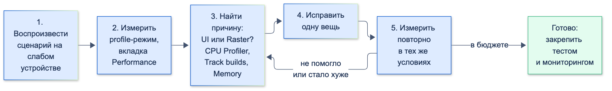

# Инструменты отладки (DevTools)

| Грейд | Время на изучение | Статус |
|-------|-------------------|--------|
| ⭐⭐ | ~30 мин лекция + практика | ✅ Готово |

---

## 📚 Ресурсы

| Ресурс | Формат | Язык | Уровень | Зачем читать |
|--------|--------|------|---------|--------------|
| [Flutter DevTools: анализируем и улучшаем Flutter-приложения на примере «Росбанк Инвест»](https://habr.com/ru/companies/rosbank/articles/753252/) | Статья (Habr) | 🇷🇺 | ⭐⭐ | Обзор вкладок на настоящем банковском приложении: Trace widget builds, CPU Profiler, Memory, размер сборки. Есть замеры «до и после» |
| [Оптимизация Flutter-приложения: списки, build() и утечки памяти](https://habr.com/ru/companies/friflex/articles/1018320/) | Статья (Habr) | 🇷🇺 | ⭐⭐ | Типовые причины тормозов и утечек: контроллеры, подписки, таймеры. Поиск утечек через вкладку Memory и `leak_tracker` |
| [Хендбук Яндекса: виды сборки](https://contest.yandex.ru/tracks/flutter/crash-course/flutter-build-modes) | Учебник | 🇷🇺 | ⭐ | Режимы debug, profile и release, JIT и AOT: почему профилируют только в profile |
| [Flutter: DevTools](https://docs.flutter.dev/tools/devtools) | Документация | 🇬🇧 | ⭐ → ⭐⭐⭐ | Официальное описание каждой вкладки. Самые полезные разделы — [Performance](https://docs.flutter.dev/tools/devtools/performance), [CPU profiler](https://docs.flutter.dev/tools/devtools/cpu-profiler), [Memory](https://docs.flutter.dev/tools/devtools/memory) |
| [Flutter: Flutter performance profiling](https://docs.flutter.dev/perf/ui-performance) | Документация | 🇬🇧 | ⭐⭐ | Потоки движка, Performance Overlay, как понять, в каком потоке проблема |
| [Flutter: Debugging Flutter apps programmatically](https://docs.flutter.dev/testing/code-debugging) | Документация | 🇬🇧 | ⭐⭐ | Логирование, точки останова и отладочные флаги прямо в коде |

---

## 🎓 Лекция

### 1. Что такое DevTools и как его открыть

**DevTools** — набор инструментов для отладки и профилирования Dart- и Flutter-приложений. Это веб-приложение: оно открывается
в браузере или во вкладке IDE и подключается к запущенной программе.

Подключение идёт через **VM Service** — служебный протокол виртуальной машины Dart. Через него можно ставить точки останова,
читать память, получать события кадров и вызывать **service extensions** — служебные команды, которые фреймворк
регистрирует в приложении («включи подсветку перерисовок», «пришли дерево виджетов»).

Как открыть:

| Откуда | Как |
|--------|-----|
| VS Code | Команда «Flutter: Open DevTools» или кнопка в панели отладки |
| Android Studio / IntelliJ | Панель «Flutter DevTools» / кнопка «Open Flutter DevTools» в окне запуска |
| Командная строка | `flutter run` печатает ссылку вида `http://127.0.0.1:9100?uri=…` — открыть её в браузере |
| Отдельно | `dart devtools` запускает DevTools, затем в него вставляют адрес VM Service из лога приложения |

DevTools входит в Flutter SDK и обновляется вместе с ним (`flutter upgrade`).

### 2. Режимы сборки: где что измерять

| | Debug | Profile | Release |
|-|-------|---------|---------|
| Компиляция | JIT (Just-In-Time — во время работы) | AOT (Ahead-Of-Time — заранее в машинный код) | AOT |
| Hot reload | ✅ | ❌ | ❌ |
| `assert` и отладочные проверки | ✅ | ❌ | ❌ |
| Inspector, точки останова, отладочные флаги | ✅ | ❌ | ❌ |
| Performance, CPU Profiler, Memory, Network | ✅, но цифры не показательны | ✅ **цифры близки к release** | ❌ |
| Эмулятор Android / симулятор iOS | ✅ / ✅ | ⚠️ / ❌ | ⚠️ / ❌ |
| Для чего | Разработка, вёрстка, логика | **Замер производительности** | Пользователи |

⚠️ — на эмуляторе Android с процессором arm64 или x86_64 profile- и release-сборки запускаются (проверено: profile —
на эмуляторе Android 16 arm64, release — в теме «FFI»), хотя документация Flutter их там не поддерживает, а цифры эмулятора не показательны.
На симуляторе iOS profile и release недоступны. Точки останова в profile не работают: DevTools подключается, но
отладчик отвечает `Debugger is disabled in AOT mode` (проверено через VM Service на profile-сборке).

Главное правило: **скорость измеряют только в profile-режиме на реальном устройстве.**
- В debug код работает через JIT с проверками `assert` — он в разы медленнее, и «тормоза» там бывают ложными.
- Эмулятор работает на процессоре и видеокарте компьютера: его цифры не совпадают ни с одним телефоном.
- Лучше всего мерить на **слабом** устройстве из тех, что поддерживает приложение: на флагмане проблему можно не увидеть.

```bash
flutter run --profile
```

> ℹ️ **Важно:** вёрстку и логику отлаживают в debug (Inspector, точки останова), а скорость — в profile.
> Это разные задачи и разные запуски.

### 3. Процесс: от жалобы к исправлению



1. **Воспроизвести.** Найти конкретный сценарий: «прокрутка ленты операций на Android среднего уровня дёргается».
   Жалоба «приложение тормозит» — это ещё не задача.
2. **Измерить.** Запустить в profile, записать сценарий во вкладке Performance, запомнить цифры: сколько кадров
   вышли за бюджет, сколько миллисекунд занимает худший кадр.
3. **Найти причину.** По графику понять, какой поток не успевает (раздел 5), и спуститься глубже:
   CPU Profiler, Trace widget builds, Memory.
4. **Исправить одну вещь.** Если поменять сразу пять мест, будет непонятно, что помогло, а что навредило.
5. **Измерить повторно** в тех же условиях и сравнить с шагом 2. Нет разницы в цифрах — нет улучшения.

**Не оптимизируй без замера.** Догадка «наверное, тормозит `Opacity`» часто оказывается неверной, а код становится сложнее.

С какой вкладки начинать:

| Симптом | Куда смотреть |
|---------|---------------|
| Дёргается прокрутка или анимация | Performance → график кадров, затем Trace widget builds или CPU Profiler |
| Экран долго открывается, кнопка «залипает» | CPU Profiler: какая функция занимает время |
| Память растёт, приложение падает через час работы | Memory → Diff Snapshots |
| Вёрстка «поехала», ошибка переполнения | Inspector → Layout Explorer |
| Не тот ответ сервера, долгая загрузка | Network |
| Большой размер APK/IPA | App Size |

### 4. Flutter Inspector — вёрстка и дерево виджетов

Работает **только в debug.** Показывает дерево виджетов и свойства выбранного виджета.

- **Select Widget Mode** — нажимаешь на элемент на экране устройства, Inspector выделяет его в дереве.
- **Widget Properties / Render Object** — свойства виджета и его объекта отрисовки. Для ошибок вёрстки главное —
  поля `constraints` (какие ограничения пришли от родителя) и `size` (какой размер выбрал виджет).
- **Flex Explorer** (Layout Explorer) — для `Row`, `Column`, `Flex`: оси, `flex`, `fit`, переполнения. Параметры можно
  менять прямо в DevTools и смотреть результат без правки кода (изменения сбросятся при hot reload).
- **Show implementation widgets** — показать и служебные виджеты фреймворка, а не только написанные в проекте.

Кнопки отладочной отрисовки (у каждой есть флаг в коде, раздел 9):

| Кнопка | Что делает | Когда нужна |
|--------|-----------|-------------|
| Show Guidelines | Рамки виджетов, отступы, выравнивания | Разобраться, откуда взялся отступ |
| Show Baselines | Базовые линии текста | Выровнять текст разных размеров |
| Highlight Repaints | Рамка, которая меняет цвет при каждой перерисовке | Найти области, которые перерисовываются без нужды |
| Highlight Oversized Images | Переворачивает картинки, декодированные крупнее, чем показаны | Найти картинки, которые зря занимают память |
| Slow Animations | Замедляет анимации в 5 раз | Рассмотреть анимацию по кадрам |

### 5. Performance — почему кадр не успел

#### Бюджет кадра и потоки

Чтобы анимация была плавной, кадр нужно подготовить за **16,7 мс** при 60 Гц и за **8,3 мс** при 120 Гц.
Если не успели — кадр пропущен, пользователь видит рывок (**jank**).

Кадр готовят два потока:

| Поток | Что делает | Что его перегружает |
|-------|-----------|---------------------|
| **UI** | Выполняет Dart-код: обработку событий, `build`, раскладку (layout), запись команд отрисовки (paint). На выходе — дерево слоёв | Тяжёлые вычисления в обработчиках, лишние перестроения, разбор JSON, синхронная работа с файлами |
| **Raster** | Превращает дерево слоёв в команды для видеокарты (через Impeller или Skia) | Сложная сцена: `saveLayer`, полупрозрачность больших областей, обрезка (clip) со сглаживанием, тени, большие картинки |

> ℹ️ **Важно:** с Flutter 3.29 на Android и iOS Dart-код выполняется в главном потоке приложения: отдельного UI-потока
> больше нет. В DevTools он по-прежнему называется UI, и бюджет у него тот же.

#### Что есть на экране Performance

- **График кадров (Flutter frames).** Каждый кадр — пара столбиков: время UI и время Raster. Столбики выше бюджета красные.
  Тёмно-красный цвет у Raster — кадр, где компилировались шейдеры (подробно об этом — в теме «Производительность и профилирование»).
- **Frame Analysis.** Выбираешь медленный кадр — DevTools показывает, на что ушло время (build, layout, paint, raster)
  и подсказывает возможные причины.
- **Timeline Events.** Подробная лента событий выбранного кадра: какие функции и виджеты сколько заняли.
  Сюда же попадают HTTP-запросы, сборка мусора и **ваши собственные метки** (раздел 9).
- **Enhance Tracing** — добавляет в Timeline подробности:
  - **Trace widget builds** — каждый вызов `build` с именем виджета;
  - **Trace layouts** — каждая раскладка;
  - **Trace paints** — каждая отрисовка.
- **Rebuild Stats** — сколько раз перестроился каждый виджет (нужна настройка «Count widget builds», режим debug).
  Это **количество**, а не время: удобно искать виджеты, которые перестраиваются чаще, чем меняются их данные.
- **More debugging options** — отключение отрисовки слоёв обрезки, полупрозрачности и теней. Если после отключения
  Raster уложился в бюджет — причина найдена.
- **Performance Overlay** — два графика поверх приложения (вверху Raster, внизу UI). Включается кнопкой в DevTools,
  клавишей `P` в терминале `flutter run` или `showPerformanceOverlay: true` в `MaterialApp`.

> ⚠️ **Внимание:** Trace widget builds / layouts / paints сами замедляют кадры. Включай их, чтобы **найти**, какие виджеты
> перестраиваются, но для **замера времени** до и после исправления выключай.

#### Как читать график

- **Красный UI, зелёный Raster** — проблема в Dart-коде. Идём в CPU Profiler или включаем Trace widget builds.
- **Зелёный UI, красный Raster** — сцена дорогая для отрисовки. Проверяем More debugging options и Highlight Repaints.
- **Красные оба** — начинаем с UI: часто Raster «тормозит» из-за того, что UI построил слишком сложное дерево слоёв.
- **Одиночный красный кадр при первом показе экрана** — смотрим, что делается при открытии: загрузка, разбор данных, компиляция шейдеров.
- **Интерфейс замирает, а столбики низкие.** Столбик UI — это время самого кадра (build, layout, paint). Если тяжёлая
  работа выполняется **между кадрами** (в обработчике нажатия, после `await` сетевого запроса, в таймере), кадр просто
  не может начаться: эта пауза называется **vsync overhead** (задержка от сигнала экрана до начала кадра). Ищем её
  в Frame Analysis и Timeline Events, а причину — в CPU Profiler.

### 6. CPU Profiler — на что уходит процессорное время

Профилировщик **сэмплирующий**: несколько тысяч раз в секунду он запоминает, какая функция сейчас выполняется,
и по этим снимкам считает, где программа проводит время.

- **Record / Stop** — записать сценарий. **Load all CPU samples** — забрать всё, что виртуальная машина уже накопила.
- **Частота сэмплов:** низкая (1 000 Гц), средняя (4 000 Гц, по умолчанию), высокая (20 000 Гц). Чем выше, тем точнее
  картина, но тем сильнее профилирование влияет на скорость.
- Для замера старта приложения: `flutter run --profile --profile-startup`, иначе первые сэмплы могут быть перезаписаны.

Два времени у каждой функции:
- **Self time** — время в коде самой функции;
- **Total time** — время самой функции и всего, что она вызвала.

Четыре представления:

| Представление | Что показывает | Когда открывать |
|---------------|----------------|-----------------|
| **Bottom up** | Функции, на которых «стоял» процессор, и кто их вызвал | Найти **самую дорогую функцию** (сортировка по Self time) |
| **Call tree** | Дерево вызовов сверху вниз, от точек входа | Найти **путь** из своего кода к дорогой функции |
| **Method table** | Таблица методов с Self/Total time, граф вызовов выбранного | Быстро сравнить методы между собой |
| **Flame chart** | Стек вызовов во времени, ширина полосы — длительность | Увидеть, **когда** что происходило в записи |

Порядок работы: Bottom up → сортировка по Self time → нашли функцию из своего кода (или библиотеку вроде `jsonDecode`)
→ раскрыли, кто её вызвал → Call tree, чтобы понять, почему это происходит в UI-потоке.

### 7. Memory — утечки и лишняя память

**Утечка (leak)** — память растёт с каждым повторением сценария: объект больше не нужен, но на него осталась ссылка.
**Раздувание (bloat)** — памяти занято больше, чем нужно, но она не растёт: например, фото 4000×3000 показано в аватаре 48×48.

График памяти показывает:
- **Dart/Flutter Heap** — объекты Dart;
- **Dart/Flutter Native** — память вне кучи Dart: декодированные картинки, нативные буферы;
- **Raster Cache** — кеш растеризованных слоёв движка;
- **RSS** (Resident Set Size) — вся память процесса в оперативной памяти;
- **GC** — моменты сборки мусора.

Вкладки:

| Вкладка | Что делает |
|---------|-----------|
| **Profile Memory** | Сколько памяти занимают объекты каждого класса прямо сейчас |
| **Diff Snapshots** | Снимок кучи (heap snapshot) до сценария и после, разница по классам |
| **Trace Instances** | Какие методы создают объекты выбранных классов (Bottom up и Call tree, как в CPU Profiler) |

Термины из снимков памяти:
- **Shallow size** — размер самого объекта, без того, на что он ссылается;
- **Retained size** — сколько памяти освободится, если удалить объект: он сам и всё, что живёт только благодаря ему;
- **Retaining path** — цепочка ссылок от корня (глобальной переменной, статического поля, активного кадра стека)
  до объекта. Именно она отвечает на вопрос «почему объект не удалён».

Как искать утечку экрана:
1. Открыть приложение, сделать снимок.
2. Пять раз войти на экран и выйти с него.
3. Сделать второй снимок и сравнить (Diff).
4. Если объектов `_PaymentScreenState` стало пять, а экрана на стеке нет — утечка. Открыть **retaining path** у одного из них
   и найти, кто держит ссылку.

> 💡 **Совет:** снимок кучи нужно делать в debug или profile, а сравнивать — после нескольких повторений сценария.
> Один лишний объект после одного захода может быть кешем, а пять после пяти — уже утечка.

### 8. Остальные инструменты

- **Network** — HTTP-запросы: метод, адрес, статус, длительность, заголовки и тела запроса и ответа. Видит `dart:io HttpClient`
  и всё, что построено на нём (`package:http`, `dio`), а также `cupertino_http`, `cronet_http`, `ok_http`.
  Фильтры: `m:get`, `s:500`, `t:json`. Запросы при старте: `flutter run --start-paused`, включить запись и продолжить.
  Для веб-приложений не работает — там Chrome DevTools.
- **Logging** — сообщения `print`, `debugPrint`, `log` из `dart:developer`, события фреймворка и сборки мусора.
  У `log` есть категория (`name`), уровень, ошибка и стек: по ним удобно фильтровать.
- **Debugger** — точки останова, в том числе **условные** (срабатывают, только если выражение истинно) и **logpoint**
  (печатают сообщение без остановки). Работает в debug.
- **App Size** — разбор размера сборки по пакетам, библиотекам и ресурсам. Файл для анализа создаёт команда
  `flutter build apk --analyze-size --target-platform=android-arm64` (только profile/release).
  Вкладка **Diff** сравнивает два файла: удобно проверить, сколько добавил новый пакет.
- **Deep Links** — проверка настроек deep link для Android и iOS.
- **Extensions** — пакеты могут добавлять в DevTools свои вкладки (например, для инспекции базы данных или состояния).

### 9. Инструменты в коде

Логи и собственные метки в Timeline:

```dart
import 'dart:convert';
import 'dart:developer' as developer;

/// Разбор выписки с меткой в Timeline:
/// во вкладке Performance появится отрезок «statement.parse» с длительностью и размером ответа
List<Object?> parseStatement(String body) {
  return developer.Timeline.timeSync(
    'statement.parse',
    () => jsonDecode(body) as List<Object?>,
    arguments: {'bytes': body.length},
  );
}

/// Асинхронная операция: TimelineTask связывает начало и конец, между которыми есть await
Future<String> loadStatement(Future<String> Function() request) async {
  final task = developer.TimelineTask()..start('statement.load');
  try {
    return await request();
  } catch (error, stackTrace) {
    // Попадёт во вкладку Logging с категорией, ошибкой и стеком
    developer.log(
      'Не удалось загрузить выписку',
      name: 'bank.statement',
      error: error,
      stackTrace: stackTrace,
    );
    rethrow;
  } finally {
    task.finish();
  }
}
```

Отладочные флаги (меняют глобальную переменную, работают **только в debug**; удобно включать в `main` или по hot reload):

| Флаг | Что делает | Аналог в DevTools |
|------|-----------|-------------------|
| `debugPaintSizeEnabled` | Рамки и отступы виджетов | Show Guidelines |
| `debugRepaintRainbowEnabled` | Рамка меняет цвет при перерисовке | Highlight Repaints |
| `debugInvertOversizedImages` | Отмечает картинки, декодированные слишком крупно | Highlight Oversized Images |
| `debugPrintRebuildDirtyWidgets` | Печатает в консоль каждый перестроенный виджет | Rebuild Stats |
| `debugProfileBuildsEnabled` | Добавляет в Timeline событие на каждый `build` (работает и в profile) | Trace widget builds |
| `timeDilation = 5.0` | Замедляет анимации | Slow Animations |

`debugger(when: …)` из `dart:developer` — программная точка останова, срабатывает при условии.
`debugDumpApp()` и `debugDumpRenderTree()` печатают дерево виджетов и дерево отрисовки в консоль.

DevTools есть только у разработчика. Чтобы знать, как приложение работает у пользователей, время кадров можно собирать
и в release-сборке:

```dart
import 'dart:developer' as developer;

import 'package:flutter/scheduler.dart';

/// Отправляет в лог (а в реальном приложении — в аналитику) медленные кадры.
/// Работает и в release: движок присылает пачку FrameTiming примерно раз в секунду
void watchSlowFrames({Duration budget = const Duration(milliseconds: 16)}) {
  SchedulerBinding.instance.addTimingsCallback((timings) {
    for (final timing in timings) {
      // totalSpan — от сигнала экрана до конца растеризации. Проверяем его, а не только build и raster:
      // тяжёлая работа между кадрами видна лишь как vsyncOverhead (кадр ждал, пока освободится поток)
      if (timing.totalSpan > budget) {
        developer.log(
          'Медленный кадр: ожидание ${timing.vsyncOverhead.inMilliseconds} мс, '
          'UI ${timing.buildDuration.inMilliseconds} мс, '
          'Raster ${timing.rasterDuration.inMilliseconds} мс',
          name: 'bank.performance',
        );
      }
    }
  });
}
```

### 10. Практика: три типовых сценария

#### Сценарий 1. Лента операций дёргается при прокрутке

**Симптом.** На экране счёта есть строка «Курс USD», которая обновляется каждую секунду. Прокрутка ленты операций
под ней неровная.

**Что показывает DevTools.** В Performance красные столбики UI раз в секунду. Включаем Trace widget builds: в каждом
таком кадре заново строятся `AccountScreen`, `TransactionList` и все видимые `TransactionTile`. Rebuild Stats
подтверждает: строки ленты перестраиваются столько же раз, сколько обновлялся курс.

**Причина.** `setState` вызывается в состоянии всего экрана, хотя меняется одна строка.

```dart
import 'dart:async';

import 'package:flutter/material.dart';

/// ❌ Курс хранится в состоянии всего экрана: каждую секунду перестраивается и лента операций
class AccountScreen extends StatefulWidget {
  const AccountScreen({super.key, required this.rates, required this.operations});

  final Stream<int> rates;
  final List<String> operations;

  @override
  State<AccountScreen> createState() => _AccountScreenState();
}

class _AccountScreenState extends State<AccountScreen> {
  late final StreamSubscription<int> _subscription;
  var _rate = 0;

  @override
  void initState() {
    super.initState();
    _subscription = widget.rates.listen((rate) => setState(() => _rate = rate));
  }

  @override
  void dispose() {
    _subscription.cancel();
    super.dispose();
  }

  @override
  Widget build(BuildContext context) => Column(
        children: [
          Text('Курс USD: ${_rate ~/ 100},${(_rate % 100).toString().padLeft(2, '0')} ₽'),
          Expanded(child: TransactionList(operations: widget.operations)),
        ],
      );
}

class TransactionList extends StatelessWidget {
  const TransactionList({super.key, required this.operations});

  final List<String> operations;

  @override
  Widget build(BuildContext context) => ListView.builder(
        itemCount: operations.length,
        itemBuilder: (context, index) => TransactionTile(title: operations[index]),
      );
}

class TransactionTile extends StatelessWidget {
  const TransactionTile({super.key, required this.title});

  final String title;

  @override
  Widget build(BuildContext context) => ListTile(title: Text(title));
}
```

**Исправление.** Опустить состояние туда, где оно используется: строку курса — в отдельный виджет со своей подпиской.

```dart
/// ✅ Экран больше не хранит курс и не перестраивается каждую секунду
class AccountScreenFixed extends StatelessWidget {
  const AccountScreenFixed({super.key, required this.rates, required this.operations});

  final Stream<int> rates;
  final List<String> operations;

  @override
  Widget build(BuildContext context) => Column(
        children: [
          // Перестраивается только Text внутри StreamBuilder
          StreamBuilder<int>(
            stream: rates,
            initialData: 0,
            builder: (context, snapshot) {
              final rate = snapshot.requireData;
              return Text('Курс USD: ${rate ~/ 100},${(rate % 100).toString().padLeft(2, '0')} ₽');
            },
          ),
          Expanded(child: TransactionList(operations: operations)),
        ],
      );
}
```

**Повторный замер.** Подсчёт перестроений (виджет-тест со счётчиком в `TransactionTile.build`, лента из 100 операций, 3 обновления курса):

```text
До исправления: TransactionTile.build вызван 45 раз
После исправления: TransactionTile.build вызван 15 раз
```

15 вызовов — первое построение строк, которые видны или попадают в запас прокрутки. Остальные 30 в первом варианте — лишние: по 15 на каждое обновление курса. Затем — повторная запись
в Performance в profile-режиме: красных столбиков раз в секунду больше нет.

#### Сценарий 2. Выписка открывается с задержкой

**Симптом.** После нажатия «Выписка за год» индикатор загрузки замирает на заметную долю секунды.

**Что показывает DevTools.** Разбор ответа идёт в UI-потоке сразу после `await` сетевого запроса, то есть **между кадрами**.
Поэтому `build` следующего кадра короткий, а почти всё время уходит в vsync overhead: кадр ждёт, пока освободится
поток. Замер такой ситуации через `FrameTiming`: разбор 150 000 операций занимает около 165 мс, и кадр получается таким:

```text
build=0 мс, raster=0 мс, vsyncOverhead=152 мс, total=153 мс
```

В Timeline Events видно длинное событие между кадрами. В CPU Profiler (Bottom up, сортировка по Self time) наверху —
`jsonDecode` и `Transaction.fromJson`, вызванные из `StatementRepository.load`.

**Исправление.** Тяжёлый разбор — в отдельный изолят: UI-поток продолжает рисовать индикатор загрузки.

```dart
import 'dart:convert';
import 'dart:isolate';

/// Операция по счёту; сумма — в копейках
class Transaction {
  const Transaction({required this.id, required this.amount});

  factory Transaction.fromJson(Map<String, Object?> json) =>
      Transaction(id: json['id']! as String, amount: json['amount']! as int);

  final String id;
  final int amount;
}

/// ✅ Разбор в изоляте: в UI-поток вернётся готовый список
Future<List<Transaction>> parseTransactions(String body) => Isolate.run(
      () => (jsonDecode(body) as List<Object?>)
          .map((item) => Transaction.fromJson(item! as Map<String, Object?>))
          .toList(),
    );
```

**Повторный замер.** Задержки кадров больше нет, индикатор крутится; в CPU Profiler `jsonDecode` ушёл из UI-потока.
Общее время загрузки почти не изменилось — изменилось то, что интерфейс в это время не замирает.

> 💡 **Совет:** изолят не бесплатный: запуск и передача результата тоже стоят времени. Для ответа в несколько килобайт
> он не нужен — проверь замером, что разбор действительно занимает больше нескольких миллисекунд.

#### Сценарий 3. Память растёт после каждого платежа

**Симптом.** После 30–40 платежей подряд приложение заметно занимает больше памяти и начинает тормозить.

**Что показывает DevTools.** Memory → Diff Snapshots до и после пяти заходов на экран платежа: появилось пять объектов
`_PaymentScreenState` и пять деревьев их виджетов, хотя экран закрыт. Retaining path у одного из них:

```text
BalanceRepository (живёт всё время работы приложения)
  → StreamController
    → подписка (_ControllerSubscription)
      → замыкание из initState
        → _PaymentScreenState
```

В Logging к тому же видна ошибка `setState() called after dispose()` — закрытый экран продолжает получать обновления баланса.

**Причина и исправление.**

```dart
import 'dart:async';

import 'package:flutter/material.dart';

/// Репозиторий баланса живёт всё время работы приложения
class BalanceRepository {
  final _controller = StreamController<int>.broadcast();

  Stream<int> get balance => _controller.stream;

  void update(int kopecks) => _controller.add(kopecks);

  bool get hasListeners => _controller.hasListener;
}

class PaymentScreen extends StatefulWidget {
  const PaymentScreen({super.key, required this.repository});

  final BalanceRepository repository;

  @override
  State<PaymentScreen> createState() => _PaymentScreenState();
}

class _PaymentScreenState extends State<PaymentScreen> {
  // Подписка хранится в поле, чтобы её можно было отменить
  late final StreamSubscription<int> _subscription;
  var _balance = 0;

  @override
  void initState() {
    super.initState();
    _subscription = widget.repository.balance.listen((value) => setState(() => _balance = value));
  }

  // ✅ Без этого метода подписка останется в репозитории и будет держать State всего экрана
  @override
  void dispose() {
    _subscription.cancel();
    super.dispose();
  }

  @override
  Widget build(BuildContext context) => Text('Доступно: ${_balance ~/ 100} ₽');
}
```

**Повторная проверка.** Снова Diff Snapshots после пяти заходов: объектов `_PaymentScreenState` не прибавилось.

Тот же класс ошибок — забытый `dispose` у `AnimationController`, `TextEditingController`, `ScrollController`, `FocusNode` —
можно ловить автоматически в виджет-тестах пакетом `leak_tracker_flutter_testing`. Он отслеживает объекты Flutter,
у которых есть `dispose`, и сообщает о тех, что не были освобождены:

```dart
// test/flutter_test_config.dart — файл, который flutter test подхватывает автоматически
import 'dart:async';

import 'package:leak_tracker_flutter_testing/leak_tracker_flutter_testing.dart';

FutureOr<void> testExecutable(FutureOr<void> Function() testMain) async {
  // Включаем отслеживание утечек для всех виджет-тестов
  LeakTesting.enable();
  await testMain();
}
```

Если экран создал `TextEditingController` и не вызвал у него `dispose`, после всех тестов файла придёт отчёт об утечке, и запуск завершится ошибкой:

```text
Expected: leak free
  Actual: <Instance of 'Leaks'>
   Which: contains leaks:
  # The text is generated by leak_tracker.
  # For leak troubleshooting tips open:
  # https://github.com/dart-lang/leak_tracker/blob/main/doc/leak_tracking/TROUBLESHOOT.md
  notDisposed:
    total: 1
    objects:
      TextEditingController:
```

### ⚠️ Частые ошибки

- **Замер скорости в debug или на эмуляторе.** Цифры не имеют отношения к тому, что увидит пользователь.
- **Оптимизация без замера.** Код усложнили, а проблема была в другом месте.
- **Включённые Trace widget builds / layouts / paints во время замера времени.** Они сами замедляют кадры.
- **Исправление нескольких мест сразу.** Непонятно, что именно помогло.
- **Путаница UI- и Raster-потока.** `RepaintBoundary` не поможет, если не успевает Dart-код, а перенос вычислений
  в изолят не поможет, если дорогая сама сцена.
- **Замер только на флагманском телефоне.** Проблемы видны на слабых устройствах.
- **Вывод об утечке по одному снимку памяти.** Нужно сравнение снимков после нескольких повторений сценария.
- **`print` и `debugPrint` в release.** Они не удаляются при сборке и пишут в системный лог: и лишняя работа,
  и риск утечки данных клиента (номера карт, суммы).

### 🎤 На собеседовании: «Пользователи жалуются, что приложение лагает. Что будешь делать?»

| Уровень | Как выглядит ответ |
|---------|--------------------|
| ⭐ Junior | «Открою DevTools, посмотрю вкладку Performance, найду красные кадры». Знает, что есть Inspector и логи |
| ⭐⭐ Middle | Уточнит сценарий и устройство, запустит в **profile на реальном устройстве**, по графику определит поток (UI или Raster), для UI — CPU Profiler и Trace widget builds, для утечек — Diff Snapshots. После исправления — повторный замер |
| ⭐⭐⭐ Senior | Всё из Middle, плюс: сначала **данные из продакшена** (FrameTiming, медленные кадры и старт в аналитике, модели устройств), чтобы понять масштаб и приоритет; воспроизведение на слабом устройстве; одна гипотеза — одно изменение; закрепление результата автотестом производительности или проверкой утечек в CI; объяснение, почему выбранное исправление дешевле альтернатив |

---

## ✅ Самопроверка

**⭐ Junior**
1. Как открыть DevTools для запущенного приложения?
2. Почему скорость приложения не измеряют в debug-режиме и на эмуляторе?
3. Какая вкладка поможет разобраться, почему виджет вылез за границы экрана? На какие два поля смотреть?

**⭐⭐ Middle**
1. Чем UI-поток отличается от Raster-потока? Что делать, если красный только Raster?
2. Чем Self time отличается от Total time? В каком представлении CPU Profiler удобнее всего найти самую дорогую функцию?
3. Как найти утечку памяти экрана с помощью DevTools?
4. Почему Trace widget builds нельзя оставлять включённым во время замера?
5. Как отметить в Timeline свой участок кода, в том числе асинхронный?

**⭐⭐⭐ Senior**
1. Как узнать, что приложение тормозит у пользователей, если DevTools у них нет?
2. Объясни shallow size, retained size и retaining path. Как по ним найти, кто держит закрытый экран?
3. Пользователи жалуются, что приложение лагает. Опиши свои действия от жалобы до закрытия задачи.
4. Разбор большого JSON перенесли в изолят, а время загрузки не изменилось. Это ошибка?
5. Интерфейс замирает на 150 мс после загрузки данных, а столбики UI в графике кадров низкие. Как такое возможно и где искать?

<details>
<summary>Ответы</summary>

**Junior**
1. Из IDE (команда «Open DevTools» в VS Code или кнопка в Android Studio) или по ссылке, которую печатает `flutter run`.
   Можно запустить `dart devtools` и вставить адрес VM Service.
2. В debug код выполняется через JIT с проверками `assert` и работает намного медленнее release. Эмулятор использует
   процессор и видеокарту компьютера. Скорость измеряют в profile-режиме на реальном, лучше слабом, устройстве.
3. Flutter Inspector, режим debug. Смотреть `constraints` (что пришло от родителя) и `size` (что выбрал виджет).
   Для `Row`/`Column` — Flex Explorer.

**Middle**
1. UI выполняет Dart-код: события, `build`, layout, paint, и строит дерево слоёв. Raster превращает дерево слоёв
   в команды для видеокарты. Если красный только Raster — сцена дорогая: проверить `saveLayer`, полупрозрачность,
   обрезку, тени, большие картинки через More debugging options и Highlight Repaints.
2. Self time — время в коде самой функции, Total time — вместе с вызванными функциями. Самую дорогую функцию удобно
   искать в Bottom up с сортировкой по Self time.
3. Снимок кучи → несколько раз открыть и закрыть экран → второй снимок → Diff Snapshots. Если объекты `State` экрана
   накапливаются — открыть retaining path и найти, кто держит ссылку (часто незакрытая подписка, контроллер или таймер).
4. Он добавляет событие на каждый `build`, и это само по себе замедляет кадр. Его используют, чтобы найти лишние
   перестроения, а время до и после измеряют без него.
5. Синхронный участок — `Timeline.timeSync('имя', () {...})` или пара `Timeline.startSync` / `finishSync`.
   Асинхронный — `TimelineTask()..start('имя')` и `finish()` в `finally`. Всё из `dart:developer`.

**Senior**
1. Собирать время кадров в release через `SchedulerBinding.instance.addTimingsCallback` (`FrameTiming`: `buildDuration`,
   `rasterDuration`, `vsyncOverhead`, `totalSpan`) и отправлять медленные кадры и время старта в аналитику с моделью устройства.
   Накладные расходы минимальны.
2. Shallow size — размер самого объекта. Retained size — сколько памяти освободится, если объект удалить (он сам и всё,
   что живёт только благодаря ему). Retaining path — цепочка ссылок от корня до объекта. Берём `_SomeScreenState`
   из разницы снимков, открываем retaining path и идём от корня: например, «долгоживущий репозиторий → контроллер
   стрима → подписка → замыкание → State». Разрываем звено: отменяем подписку в `dispose`.
3. Данные из продакшена (на каких устройствах и экранах) → конкретный сценарий → воспроизведение в profile на слабом
   устройстве → базовый замер в Performance → определение потока → CPU Profiler, Trace widget builds или Memory →
   одно исправление → повторный замер в тех же условиях → закрепление: тест на перестроения или утечки, мониторинг
   медленных кадров после релиза.
4. Нет. Изолят не ускоряет сам разбор — он убирает его из UI-потока. Цель — чтобы интерфейс не замирал: длинного
   красного кадра нет, индикатор загрузки крутится. Ускорить загрузку можно иначе: пагинацией, меньшим ответом
   сервера, кешем.
5. Столбик UI показывает время самого кадра (build, layout, paint). Если тяжёлая работа идёт между кадрами — после `await`,
   в обработчике нажатия или таймере, — кадр не может начаться, и время уходит в vsync overhead, а не в build.
   Искать в Frame Analysis и Timeline Events (длинное событие между кадрами), причину — в CPU Profiler. В продакшене
   такие заморозки ловят по `FrameTiming.totalSpan` и `vsyncOverhead`, а не только по `buildDuration`.

</details>
