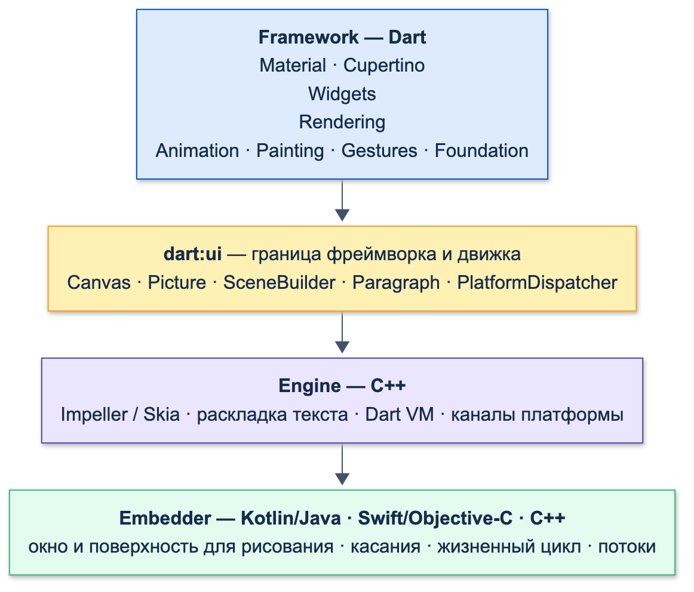
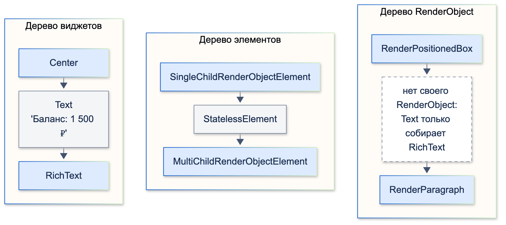
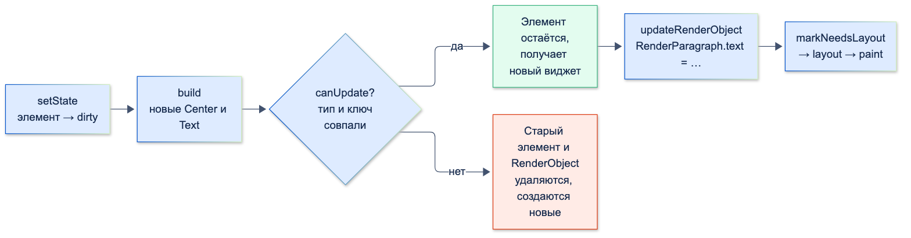
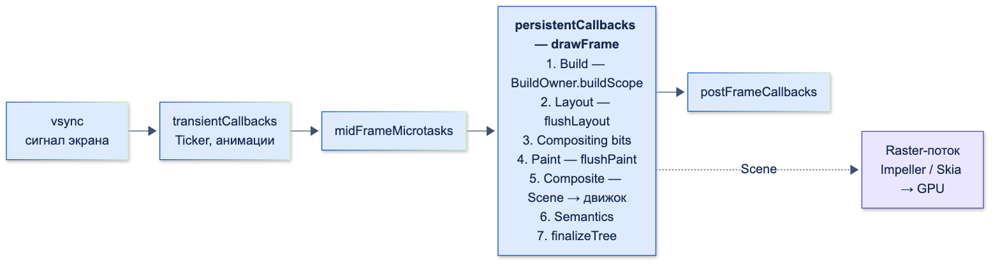
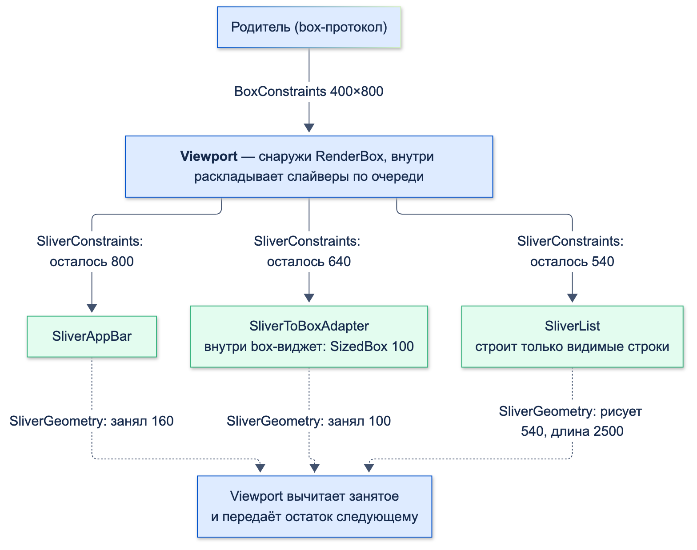
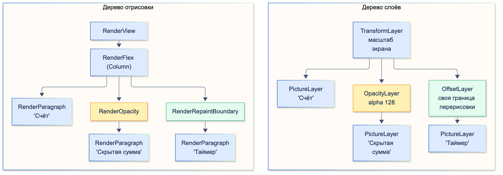

# Flutter под капотом (рендеринг, деревья)

| Грейд | Время на изучение | Статус |
|-------|-------------------|--------|
| ⭐⭐ | ~35 мин лекция + практика | ✅ Готово |

---

## 📚 Ресурсы

| Ресурс | Формат | Язык | Уровень | Зачем читать |
|--------|--------|------|---------|--------------|
| Серия Михаила Зотьева: [Flutter под капотом](https://habr.com/ru/articles/501862/), [Binding](https://habr.com/ru/articles/512326/), [Owners](https://habr.com/ru/articles/533210/) | Статьи (Habr) | 🇷🇺 | ⭐⭐ → ⭐⭐⭐ | Классика по теме: три дерева с картинками на примерах `Padding`, `Center`, `Text`; как фреймворк связан с движком; `BuildOwner` и `PipelineOwner` по фазам кадра. Статьям несколько лет, но устройство с тех пор почти не поменялось |
| Хендбук Яндекса: [Painting Context](https://contest.yandex.ru/tracks/flutter/ui-framework/painting-context-screen-rendering), [Слои и RenderObject](https://contest.yandex.ru/tracks/flutter/ui-framework/layers-and-render-objects), [Слои и PaintingContext](https://contest.yandex.ru/tracks/flutter/ui-framework/layers-and-painting-context) | Учебник | 🇷🇺 | ⭐⭐⭐ | Как `RenderObject` рисует на `Canvas`, какие бывают слои, как `SceneBuilder` собирает сцену |
| [Flutter: Architectural overview](https://docs.flutter.dev/resources/architectural-overview) | Документация | 🇬🇧 | ⭐⭐ | Официальная схема слоёв, конвейер кадра, раскладка за один проход, потоки |
| [Flutter: Impeller rendering engine](https://docs.flutter.dev/perf/impeller) | Документация | 🇬🇧 | ⭐⭐ | Зачем нужен Impeller, где он включён по умолчанию, как его отключить |

---

## 🎓 Лекция

> ℹ️ **Важно:** что такое виджет, элемент и `RenderObject`, как работают `canUpdate`, ключи и жизненный цикл `State`,
> разобрано в теме «Базовое устройство фреймворка». Здесь — что происходит дальше: как из деревьев получаются пиксели.

### 1. Архитектура слоями



| Слой | Язык | Что делает |
|------|------|------------|
| **Framework** | Dart | Виджеты, Material и Cupertino, раскладка, отрисовка, жесты, анимации. Всё, с чем работает прикладной разработчик |
| **Engine** | C++ | Растеризация (Impeller или Skia), раскладка текста, Dart VM, работа с файлами и сетью. Наружу выставляет библиотеку `dart:ui` |
| **Embedder** | Kotlin/Java, Swift/Objective-C, C++ | Код под конкретную платформу: создаёт окно и поверхность для рисования, передаёт касания, жизненный цикл, доступность |

**`dart:ui`** — граница между фреймворком и движком. В ней самые низкоуровневые классы: `Canvas`, `Picture`, `SceneBuilder`,
`Paragraph`, `PlatformDispatcher`. Весь фреймворк — это Dart-код поверх `dart:ui`: при желании можно нарисовать
приложение без единого виджета, напрямую через `dart:ui`.

Flutter **не использует нативные кнопки и поля ввода**: всё рисуется самим движком на одной поверхности. Поэтому интерфейс
одинаков на всех платформах, а нативные элементы (карты, WebView) встраиваются отдельным механизмом platform views.

### 2. Три дерева на одном примере

Возьмём `Center(child: Text('Баланс: 1 500 ₽'))` и посмотрим, что лежит в каждом дереве. Небольшая функция обходит элементы:

```dart
import 'package:flutter/widgets.dart';

/// Печатает для каждого элемента: виджет → элемент → RenderObject
void dumpTrees(Element element, [int depth = 0]) {
  final renderObject =
      element is RenderObjectElement ? '${element.renderObject.runtimeType}' : '—';
  debugPrint('${'  ' * depth}${element.widget.runtimeType} → ${element.runtimeType} → $renderObject');
  element.visitChildren((child) => dumpTrees(child, depth + 1));
}
```

Вывод для элемента `Center`:

```text
Center → SingleChildRenderObjectElement → RenderPositionedBox
  Text → StatelessElement → —
    RichText → MultiChildRenderObjectElement → RenderParagraph
```



Что здесь видно:
- **Виджетов больше, чем объектов отрисовки.** `Text` — это `StatelessWidget`: он ничего не рисует сам, а в `build`
  возвращает `RichText`. Его элемент — `StatelessElement`, у которого нет своего `RenderObject`.
- **Объекты отрисовки создают только `RenderObjectWidget`.** `Center` (через `Align`) создаёт `RenderPositionedBox`,
  `RichText` — `RenderParagraph`, который раскладывает и рисует текст.
- **Тип элемента зависит от числа детей:** `SingleChildRenderObjectElement` для одного ребёнка,
  `MultiChildRenderObjectElement` — для нескольких (у `RichText` дети — встроенные в текст виджеты, `WidgetSpan`).

Два вида элементов:

| Вид | Примеры | Что делает |
|-----|---------|-----------|
| `ComponentElement` | `StatelessElement`, `StatefulElement`, `InheritedElement` | Собирает другие виджеты: вызывает `build` и держит одного ребёнка |
| `RenderObjectElement` | `LeafRenderObjectElement`, `SingleChild…`, `MultiChild…` | Создаёт `RenderObject` и обновляет его свойства из виджета |

### 3. Что происходит, когда меняется текст

Сменим текст `Баланс: 1 500 ₽` на `Баланс: 900 ₽` через `setState` и сравним объекты до и после:

```text
Виджет новый: true
Элемент тот же: true
RenderParagraph тот же: true
Текст в RenderParagraph: Баланс: 900 ₽
```



1. `setState` помечает элемент «грязным» (dirty) и просит движок о новом кадре.
2. На кадре элемент вызывает `build` и получает **новые** объекты `Center` и `Text` — виджеты неизменяемы, их всегда создают заново.
3. Для каждого ребёнка проверяется `canUpdate` (тот же тип и ключ). Совпало — **элемент остаётся** и получает новый виджет.
4. `RichText`-элемент вызывает `updateRenderObject`: `RenderParagraph` получает новый текст в поле `text`.
5. Сеттер `text` сравнивает значения и, раз текст изменился, вызывает `markNeedsLayout` — новый текст может быть другой ширины.
6. На этом же кадре `RenderParagraph` раскладывается и перерисовывается.

**Виджеты дешёвые и одноразовые, элементы и `RenderObject` — долгоживущие и переиспользуются.** Поэтому пересоздание
виджетов в каждом `build` — нормальная работа фреймворка, а не проблема производительности.

### 4. Binding — как фреймворк связан с движком

**Binding** — прослойка между `dart:ui` и фреймворком. Каждая её часть — миксин, который подписывается на события движка
и даёт синглтон-сервис фреймворку. Приложение использует `WidgetsFlutterBinding` — он собран из всех миксинов:

| Миксин | За что отвечает |
|--------|-----------------|
| `GestureBinding` | Принимает касания от движка, проводит hit test и раздаёт события распознавателям жестов |
| `SchedulerBinding` | Планирует кадры, запускает колбэки кадра (анимации, post-frame), следит за фазами |
| `ServicesBinding` | Сообщения платформы: каналы (`MethodChannel`), жизненный цикл приложения, клавиатура |
| `PaintingBinding` | Кеш изображений (`imageCache`), прогрев шейдеров для Skia |
| `SemanticsBinding` | Дерево семантики для экранных читалок |
| `RendererBinding` | Корень дерева отрисовки (`RenderView`) и `PipelineOwner`: раскладка, отрисовка, композиция |
| `WidgetsBinding` | Корень дерева элементов и `BuildOwner`: перестроение «грязных» элементов |

Что делает `runApp(app)`:
1. `WidgetsFlutterBinding.ensureInitialized()` — создаёт binding, если его ещё нет. Поэтому `ensureInitialized` вызывают
   вручную, когда до `runApp` нужны каналы платформы (например, Firebase или чтение настроек).
2. Прикрепляет корневой виджет: создаёт корневой элемент, связанный с `RenderView`, и строит под ним три дерева.
3. **Warm-up frame** — рисует первый кадр сразу, не дожидаясь сигнала экрана, чтобы приложение появилось как можно раньше.

### 5. Конвейер кадра

Экран присылает сигнал **vsync** (вертикальная синхронизация — «пора готовить следующий кадр») 60 или 120 раз в секунду.
Flutter готовит кадр, только если его попросили (`setState`, анимация, прокрутка): статичный экран кадров не строит.



Фазы `SchedulerBinding` (enum `SchedulerPhase`):

| Фаза | Что выполняется |
|------|-----------------|
| `transientCallbacks` | `handleBeginFrame`: колбэки из `scheduleFrameCallback` — сюда подключены все `Ticker`, то есть анимации обновляют значения |
| `midFrameMicrotasks` | Микрозадачи, которые появились в колбэках анимаций |
| `persistentCallbacks` | `handleDrawFrame` → `drawFrame`: build, layout, paint, композиция, семантика |
| `postFrameCallbacks` | `addPostFrameCallback` — один раз после кадра. Здесь безопасно читать размеры и позиции |
| `idle` | Кадра нет. Здесь выполняются обычные события, таймеры, ответы сети |

Внутри `drawFrame` (код `WidgetsBinding` и `RendererBinding`):
1. **Build** — `buildOwner.buildScope`: перестраиваются «грязные» элементы.
2. **Layout** — `pipelineOwner.flushLayout`: раскладка `RenderObject`, помеченных `markNeedsLayout`.
3. **Compositing bits** — `flushCompositingBits`: какие объекты нуждаются в отдельном слое.
4. **Paint** — `flushPaint`: перерисовка объектов, помеченных `markNeedsPaint`.
5. **Composite** — `renderView.compositeFrame()`: из дерева слоёв собирается `Scene` и отправляется в движок.
6. **Semantics** — `flushSemantics`: обновление дерева доступности.
7. **Finalize** — `buildOwner.finalizeTree`: окончательно удаляются элементы, которые не вернулись в дерево за этот кадр.

Порядок можно увидеть своими глазами. Виджет записывает в лог, на каком этапе выполняется его код:

```dart
import 'dart:async';

import 'package:flutter/scheduler.dart';
import 'package:flutter/widgets.dart';

/// Записывает в log, в каком порядке выполняются этапы кадра
class FramePhasesDemo extends StatefulWidget {
  const FramePhasesDemo({super.key, required this.log});

  final List<String> log;

  @override
  State<FramePhasesDemo> createState() => FramePhasesDemoState();
}

class FramePhasesDemoState extends State<FramePhasesDemo> {
  var _version = 0;

  /// Регистрирует колбэки на этапы следующего кадра и запрашивает кадр через setState
  void refresh() {
    // Так подключаются Ticker и анимации: колбэк в начале кадра
    SchedulerBinding.instance.scheduleFrameCallback((_) {
      widget.log.add('transient callback (анимации)');
      scheduleMicrotask(() => widget.log.add('microtask'));
    });
    // Один раз после того, как кадр построен
    SchedulerBinding.instance.addPostFrameCallback((_) => widget.log.add('post-frame callback'));
    setState(() => _version++);
  }

  @override
  Widget build(BuildContext context) {
    widget.log.add('build');
    // builder у LayoutBuilder вызывается на этапе раскладки, когда известны ограничения
    return LayoutBuilder(builder: (context, constraints) {
      widget.log.add('layout (LayoutBuilder)');
      return CustomPaint(painter: _LogPainter(widget.log, _version));
    });
  }
}

class _LogPainter extends CustomPainter {
  _LogPainter(this.log, this.version);

  final List<String> log;
  final int version;

  @override
  void paint(Canvas canvas, Size size) => log.add('paint (CustomPainter)');

  @override
  bool shouldRepaint(_LogPainter oldDelegate) => oldDelegate.version != version;
}
```

Вывод после `refresh()`:

```text
transient callback (анимации)
microtask
build
layout (LayoutBuilder)
paint (CustomPainter)
post-frame callback
```

> 💡 **Совет:** отсюда практические правила. Размер виджета нельзя узнать в `build` — раскладки ещё не было; его читают
> в `addPostFrameCallback` или используют `LayoutBuilder`. А `LayoutBuilder` вызывает свой `builder` на этапе layout:
> это единственный штатный способ построить виджеты в зависимости от размера.

### 6. «Грязные» списки: почему обновление дешёвое

Flutter не перестраивает и не перерисовывает весь экран. Каждое дерево ведёт список того, что изменилось:

| Что пометили | Чем | Кто обработает |
|--------------|-----|----------------|
| Элемент | `setState`, смена зависимостей `InheritedWidget` → `markNeedsBuild` | `BuildOwner` на этапе build. Список сортируется по глубине: сначала родители, чтобы ребёнок не строился дважды |
| `RenderObject` | `markNeedsLayout` (изменился размер или положение) | `PipelineOwner.flushLayout` |
| `RenderObject` | `markNeedsPaint` (изменился только вид) | `PipelineOwner.flushPaint` |

Проверим, что перестраивается при `setState` во вложенном виджете. Включаем `debugPrintRebuildDirtyWidgets` для экрана, где
есть `const Text('Заголовок')` и `StatefulBuilder`, возвращающий `const Text('Курс')`:

```text
Building StatefulBuilder(dirty, state: _StatefulBuilderState#30072)
```

Перестроился только «грязный» элемент. Его ребёнок `const Text` — тот же самый объект (`identical`), поэтому фреймворк
даже не проверял его поддерево. Соседний заголовок не затронут вовсе.

**Как не распространять изменения дальше нужного:**
- **Relayout boundary.** `markNeedsLayout` поднимается вверх по дереву, пока не встретит объект, раскладку которого
  родитель не зависит от размера ребёнка. Объект становится такой границей, если выполняется хотя бы одно:
  родитель вызвал `layout` с `parentUsesSize: false`, объект `sizedByParent` (размер зависит только от ограничений),
  ограничения жёсткие (`constraints.isTight` — минимум равен максимуму). Дальше границы раскладка не идёт.
- **Repaint boundary.** `markNeedsPaint` поднимается до ближайшего объекта с `isRepaintBoundary == true` — у него свой слой,
  и перерисовывается только этот слой. Границу ставит виджет `RepaintBoundary`; кроме того, каждый элемент
  `ListView` по умолчанию обёрнут в неё (`addRepaintBoundaries: true`).

### 7. Раскладка изнутри

Правило «ограничения идут вниз, размеры — вверх, позицию задаёт родитель» разобрано в теме «Стандартные виджеты».
Под капотом оно даёт раскладку **за один проход** по дереву, сложность O(n):

1. Родитель вызывает `child.layout(constraints, parentUsesSize: …)`.
2. Ребёнок в `performLayout` выбирает размер в пределах ограничений и раскладывает своих детей.
3. Родитель записывает позицию ребёнка в его `parentData` (`offset`).

Почему один проход возможен и почему он быстрый:
- **Ограничения не изменились и `markNeedsLayout` не вызывали** — `layout` ребёнка сразу возвращается, поддерево пропускается.
- **`parentUsesSize: false`** — родитель обещает не зависеть от размера ребёнка, ребёнок становится relayout boundary.
- **Жёсткие ограничения** — размер ребёнка известен заранее, его изменение не может затронуть родителя.
- **Intrinsic-размеры** (`IntrinsicHeight`, `IntrinsicWidth`) нарушают однопроходность: родитель спрашивает у детей
  «какой высоты ты хочешь быть» до раскладки. Глубокая вложенность таких виджетов даёт квадратичную сложность.

### 8. Два протокола раскладки: box и sliver

Всё, о чём шла речь выше, — **box-протокол**: `RenderBox` получает `BoxConstraints` (минимум и максимум ширины и высоты)
и возвращает `Size`. Так раскладывается почти всё: `Padding`, `Row`, `Text`, `Container`.

Для прокрутки этого мало. Ребёнку прокручиваемой области нужно знать не «сколько у меня места», а «какая моя часть
сейчас видна». Для этого есть второй протокол — **sliver** («ломтик»): кусок прокручиваемого содержимого, который
умеет показать только видимую часть себя.

| | Box | Sliver |
|-|-----|--------|
| Базовый класс | `RenderBox` | `RenderSliver` |
| Вход | `BoxConstraints`: min/max ширины и высоты | `SliverConstraints`: насколько прокручено начало слайвера (`scrollOffset`), сколько места осталось на экране (`remainingPaintExtent`), сколько его закрывают закреплённые шапки (`overlap`), направление и ширина по поперечной оси |
| Выход | `Size` | `SliverGeometry`: полная длина при прокрутке (`scrollExtent`), сколько рисуется сейчас (`paintExtent`), сколько места занимает для следующих слайверов (`layoutExtent`) |
| Родитель | Любой box-виджет | **Viewport** — окно прокрутки |
| Примеры | `Text`, `Row`, `SizedBox`, `ListTile` | `SliverList`, `SliverGrid`, `SliverAppBar`, `SliverToBoxAdapter`, `SliverPadding`, `SliverFillRemaining` |

**Viewport** (`RenderViewport`) — мост между протоколами. Снаружи это обычный `RenderBox`: родитель даёт ему размер
экрана. Внутри он по очереди раскладывает слайверы, передавая каждому, сколько места осталось после предыдущих.



Посмотрим на реальные значения. Экран счёта: сворачивающаяся шапка, блок карт и лента операций в одной прокрутке.
Функция печатает, что viewport передал каждому слайверу и что получил обратно:

```dart
import 'package:flutter/material.dart';
import 'package:flutter/rendering.dart';

/// Экран счёта: шапка 160 → 56 при прокрутке, блок карт 100, лента из 50 операций по 50
Widget accountScreen(ScrollController controller) => CustomScrollView(
      controller: controller,
      slivers: [
        const SliverAppBar(pinned: true, expandedHeight: 160, title: Text('Счёт')),
        // Обычный box-виджет в прокрутке — только через адаптер
        const SliverToBoxAdapter(child: SizedBox(height: 100, child: Text('Карты'))),
        SliverList.builder(
          itemCount: 50,
          itemBuilder: (context, index) => SizedBox(height: 50, child: Text('Операция $index')),
        ),
      ],
    );

/// Печатает для каждого слайвера: что пришло (SliverConstraints) → что вернул (SliverGeometry)
void dumpSlivers(RenderViewport viewport) {
  for (var sliver = viewport.firstChild; sliver != null; sliver = viewport.childAfter(sliver)) {
    final c = sliver.constraints;
    final g = sliver.geometry!;
    debugPrint('${sliver.runtimeType}: scrollOffset=${c.scrollOffset}, overlap=${c.overlap} '
        '→ scrollExtent=${g.scrollExtent}, paintExtent=${g.paintExtent}, layoutExtent=${g.layoutExtent}');
  }
}
```

Экран 400×800, сразу после открытия:

```text
_RenderSliverPinnedPersistentHeaderForWidgets: scrollOffset=0.0, overlap=0.0 → scrollExtent=160.0, paintExtent=160.0, layoutExtent=160.0
RenderSliverToBoxAdapter: scrollOffset=0.0, overlap=0.0 → scrollExtent=100.0, paintExtent=100.0, layoutExtent=100.0
RenderSliverList: scrollOffset=0.0, overlap=0.0 → scrollExtent=2500.0, paintExtent=540.0, layoutExtent=540.0
```

После прокрутки на 300:

```text
_RenderSliverPinnedPersistentHeaderForWidgets: scrollOffset=300.0, overlap=0.0 → scrollExtent=160.0, paintExtent=56.0, layoutExtent=0.0
RenderSliverToBoxAdapter: scrollOffset=140.0, overlap=56.0 → scrollExtent=100.0, paintExtent=0.0, layoutExtent=0.0
RenderSliverList: scrollOffset=40.0, overlap=56.0 → scrollExtent=2500.0, paintExtent=800.0, layoutExtent=800.0
```

Как это читать:
- **`scrollExtent` у ленты — 2500** (50 × 50): viewport знает полную длину для полосы прокрутки, но построены только
  видимые строки и запас (`cacheExtent`). Именно протокол sliver делает ленивость возможной: слайвер сам решает,
  какие дети нужны для его видимой части.
- **Сначала лента рисует 540** — после шапки (160) и карт (100) на экране 800 осталось 540.
- **После прокрутки на 300** шапка ушла вверх на всю длину, но закреплена: рисует 56 (свёрнутая панель), а места
  для следующих не занимает (`layoutExtent=0`). Поэтому остальные получили `overlap=56` — верх их видимой части закрыт шапкой.
- **Блок карт прокручен на 140** при длине 100 — он полностью ушёл с экрана, `paintExtent=0`.
- **Лента прокручена на 40** (300 − 160 − 100): «Операция 0» сдвинута на 40 вверх, и верх ленты закрыт свёрнутой шапкой.

Что из этого следует на практике:
- **`ListView` и `GridView` — это тот же `Viewport` с одним слайвером внутри.** `ListView` строит
  `Scrollable` → `Viewport` → `SliverPadding` → `SliverList`. `CustomScrollView` просто даёт положить в этот viewport
  несколько слайверов.
- **Протоколы не смешиваются.** Box-виджет нельзя положить в `slivers` напрямую, а слайвер — в `Column`:

```text
A RenderViewport expected a child of type RenderSliver but received a child of type RenderParagraph.
A RenderFlex expected a child of type RenderBox but received a child of type RenderSliverList.
```

  Для перехода из sliver в box есть `SliverToBoxAdapter` (один box-виджет целиком) и `SliverFillRemaining`
  (box-виджет на оставшееся место). Обратного адаптера нет: чтобы слайверы оказались внутри box-раскладки, нужен viewport,
  то есть `CustomScrollView`.
- **`shrinkWrap: true`** заменяет обычный viewport на `ShrinkWrappingViewport`: тот должен узнать свою высоту,
  а значит — раскладывает все слайверы на полную длину. Отсюда потеря ленивости (замер — в теме «Стандартные виджеты»).
- **`SliverAppBar` с `pinned`/`floating`**, «липкие» заголовки (`SliverPersistentHeader`), сетка и список в одной
  прокрутке возможны только потому, что каждый слайвер сам решает, сколько рисовать при данном `scrollOffset`.

### 9. Отрисовка и слои

На этапе paint каждый `RenderObject` рисует себя в `paint(PaintingContext context, Offset offset)`:
- `context.canvas` — `Canvas` из `dart:ui`. Команды (`drawRect`, `drawPath`, `drawParagraph`) **не рисуют пиксели**,
  а записываются в `Picture` — список команд для движка.
- `context.paintChild(child, offset)` — рисует ребёнка. Если ребёнок — repaint boundary, у него свой слой.
- `context.pushOpacity`, `pushClipRect`, `pushTransform` — создают слой-эффект и рисуют детей внутри него.

Результат этапа — **дерево слоёв** (layer tree):

| Слой | Что хранит |
|------|-----------|
| `PictureLayer` | Записанные команды рисования (`Picture`). Листья дерева слоёв |
| `OffsetLayer` | Сдвиг. Его создаёт каждая repaint boundary: слой можно переиспользовать без перерисовки |
| `OpacityLayer`, `ClipRectLayer`, `ClipRRectLayer`, `TransformLayer`, `ColorFilterLayer`, `BackdropFilterLayer` | Эффект для всех дочерних слоёв |
| `TextureLayer`, `PlatformViewLayer` | Внешнее содержимое: видео, камера, нативные виджеты |

Вот как выглядит дерево слоёв для колонки из трёх строк: обычного `Text`, `Text` внутри `Opacity` и `Text` внутри
`RepaintBoundary`. Вывод `debugDumpLayerTree()` сокращён:

```text
TransformLayer                    ← корень: масштаб под плотность экрана (3.0)
 ├─child 1: PictureLayer          ← обычный Text рисуется в общий слой
 ├─child 2: OpacityLayer          ← Opacity: alpha: 128
 │ └─child 1: PictureLayer
 └─child 3: OffsetLayer           ← RepaintBoundary: свой слой
   └─child 1: PictureLayer
```



Что из этого следует:
- Обычные виджеты **делят один `PictureLayer`**: изменение одного перерисовывает всех соседей по слою до ближайшей границы.
- `RepaintBoundary` выделяет поддерево в свой слой. Если внутри меняется таймер, перерисовывается только этот слой,
  а остальной экран движок переиспользует.
- Слой — это не бесплатно: память и работа на композицию. Поэтому граница нужна там, где часть экрана меняется
  **часто и независимо** от остального (анимация, таймер, видео), а не «на всякий случай» вокруг каждого виджета.

В конце `RenderView.compositeFrame()` проходит по дереву слоёв, через `SceneBuilder` собирает `Scene`
(`pushOffset`, `pushOpacity`, `addPicture`, `pop`…) и передаёт её движку: `FlutterView.render(scene)`.
На этом работа Dart-кода над кадром закончена.

### 10. Движок: Raster-поток, Skia и Impeller

Дальше работает движок. **Raster-поток** получает `Scene` и превращает её в команды для видеокарты: проходит по слоям,
применяет эффекты, растеризует `Picture`. Пока Raster рисует кадр N, UI-поток уже может строить кадр N+1.

> ℹ️ **Важно:** с Flutter 3.29 на Android и iOS Dart-код (то, что раньше называли UI-потоком) выполняется в главном
> потоке платформы. Raster-поток остался отдельным.

**Skia** — графическая библиотека, на которой Flutter работал изначально (её же использует Chrome). Её слабое место во Flutter —
**компиляция шейдеров во время работы**. Шейдер — маленькая программа для видеокарты: как закрасить пиксели градиента,
тени, размытия. Skia создавала нужные шейдеры, когда эффект впервые появлялся на экране. Компиляция занимала десятки
миллисекунд, и первая анимация «дёргалась» (shader compilation jank), даже если весь Dart-код был быстрым.

**Impeller** — новый движок отрисовки Flutter. Главное отличие: **все шейдеры компилируются заранее, при сборке движка**,
поэтому во время работы компиляции нет и время кадра предсказуемо. Кроме того, Impeller:
- работает напрямую с современными графическими API: **Metal** (iOS, macOS) и **Vulkan** (Android);
- может распределять работу над кадром по нескольким ядрам процессора;
- помечает ресурсы видеокарты так, что их удобно исследовать в профилировщиках.

Где Impeller включён по умолчанию:

| Платформа | Статус |
|-----------|--------|
| iOS | Единственный движок, Skia отключить нельзя |
| Android API 29+ | По умолчанию (с Flutter 3.27). На старых устройствах и без поддержки Vulkan — откат на OpenGL |
| macOS, Windows, Linux | По умолчанию с Flutter 3.47, можно временно отключить |
| Web | Не поддерживается, используется Skia (CanvasKit) |

Отключить для проверки: `flutter run --no-enable-impeller`; для Android-сборки — `meta-data`
`io.flutter.embedding.android.EnableImpeller` со значением `false` в `AndroidManifest.xml`.

Как узнать, какой движок работает: в DevTools на вкладке Performance над графиком кадров написано `Engine: Impeller`
или `Engine: Skia`.

### ⚠️ Частые ошибки и заблуждения

- **«`setState` перерисовывает весь экран».** Перестраивается поддерево «грязного» элемента, раскладка — до relayout boundary,
  перерисовка — до repaint boundary. Но `setState` в корне экрана действительно перестроит всё под ним — держи состояние ниже.
- **«Виджеты тяжёлые, их нельзя создавать в `build`».** Виджет — лёгкая неизменяемая конфигурация. Тяжёлые объекты —
  элементы и `RenderObject`, и они переиспользуются.
- **«`const` ускоряет отрисовку».** `const` экономит **build**: тот же объект виджета — поддерево не проверяется. На layout и
  paint он не влияет.
- **Чтение размера в `build` или `initState`.** Раскладки ещё не было. Используй `LayoutBuilder` или `addPostFrameCallback`.
- **`RepaintBoundary` вокруг всего подряд.** Каждый слой стоит памяти и времени композиции. Ставь границу там, где
  перерисовки частые и независимые, и проверяй эффект в DevTools.
- **Тяжёлая работа в `paint`.** `paint` вызывается при каждой перерисовке; вычисления пути, разбор данных и создание
  `Paint` с шейдерами — заранее или с кешированием.
- **Вложенные `IntrinsicHeight`/`IntrinsicWidth` в длинных списках.** Они ломают раскладку за один проход.
- **`ListView` с `shrinkWrap: true` внутри `Column` или `SingleChildScrollView`, чтобы добавить шапку.** Список теряет ленивость.
  Шапку и список собирают в одну прокрутку через `CustomScrollView` и слайверы.

---

## ✅ Самопроверка

**⭐ Junior**
1. Какие три дерева есть во Flutter? Что хранится в каждом?
2. Почему у `Text` нет своего `RenderObject`? Кто рисует текст?
3. Почему создавать новые виджеты в каждом `build` — нормально?

**⭐⭐ Middle**
1. Что происходит по шагам, когда `setState` меняет текст в `Text`? Какие объекты пересоздаются, а какие — нет?
2. Назови этапы `drawFrame` по порядку. Где выполняются колбэки анимаций и `addPostFrameCallback`?
3. Почему размер виджета нельзя узнать в `build`? Как его получить?
4. Что такое Binding и зачем вызывать `WidgetsFlutterBinding.ensureInitialized()` до `runApp`?
5. Чем `markNeedsLayout` отличается от `markNeedsPaint`?

**⭐⭐⭐ Senior**
1. Что такое relayout boundary и repaint boundary? Когда объект становится каждой из них?
2. Что такое дерево слоёв? Какие слои создают `Opacity` и `RepaintBoundary`? Почему не стоит ставить `RepaintBoundary` везде?
3. Что происходит с кадром после `compositeFrame`? Чем занят Raster-поток?
4. Что такое shader compilation jank и как его решает Impeller? Где Impeller включён по умолчанию?
5. Почему раскладка во Flutter однопроходная? Что ломает это свойство?
6. Чем `RenderSliver` отличается от `RenderBox`? Что такое viewport и почему `ListView` — это тоже слайверы?
7. Почему `Text` нельзя положить в `slivers`, а `SliverList` — в `Column`? Как правильно совместить?

<details>
<summary>Ответы</summary>

**Junior**
1. Дерево виджетов — неизменяемые описания интерфейса. Дерево элементов — экземпляры виджетов на конкретных местах,
   хранят `State` и связи (это и есть `BuildContext`). Дерево `RenderObject` — раскладка, отрисовка, нажатия.
2. `Text` — `StatelessWidget`, он только собирает `RichText` с учётом стиля по умолчанию. `RichText` — `RenderObjectWidget`,
   он создаёт `RenderParagraph`, который раскладывает и рисует текст.
3. Виджеты — лёгкие неизменяемые объекты-описания. Долгоживущие элементы и `RenderObject` переиспользуются,
   если тип и ключ совпали (`canUpdate`).

**Middle**
1. `setState` помечает элемент грязным и запрашивает кадр → на кадре `build` создаёт новые виджеты → `canUpdate` совпал,
   элементы остаются → `RichText`-элемент вызывает `updateRenderObject` → `RenderParagraph` получает новый текст
   и вызывает `markNeedsLayout` → раскладка и перерисовка. Пересоздаются только виджеты.
2. Build → layout → compositing bits → paint → composite (отправка сцены) → semantics → finalizeTree. Колбэки анимаций
   (`scheduleFrameCallback`, `Ticker`) — до этого, в фазе transientCallbacks, затем микрозадачи.
   `addPostFrameCallback` — после всего кадра.
3. Build идёт раньше layout: в момент `build` размер ещё не вычислен. Получить: `LayoutBuilder` (известны ограничения
   на этапе раскладки) или `addPostFrameCallback` + `context.size` / `RenderBox`.
4. Binding — набор миксинов, который связывает фреймворк с движком: кадры, жесты, сообщения платформы, деревья.
   `ensureInitialized` создаёт его заранее, если до `runApp` нужны каналы платформы (плагины, настройки, Firebase).
5. `markNeedsLayout` — изменились размер или положение: нужна раскладка, а после неё и перерисовка.
   `markNeedsPaint` — изменился только вид (цвет, прогресс), раскладка не нужна.

**Senior**
1. Relayout boundary — объект, дальше которого `markNeedsLayout` не поднимается: родитель не зависит от его размера.
   Становится, если `parentUsesSize: false`, или `sizedByParent`, или ограничения жёсткие. Repaint boundary — объект
   со своим слоем (`isRepaintBoundary`), дальше него не поднимается `markNeedsPaint`. Ставится виджетом `RepaintBoundary`,
   есть у элементов `ListView` по умолчанию.
2. Результат этапа paint: `PictureLayer` с командами рисования и слои-эффекты над ними. `Opacity` создаёт `OpacityLayer`,
   `RepaintBoundary` — `OffsetLayer`, который можно переиспользовать без перерисовки. Каждый слой стоит памяти и работы
   на композицию, а польза есть только когда часть экрана меняется часто и независимо.
3. `SceneBuilder` собирает `Scene`, `FlutterView.render` передаёт её движку. Raster-поток проходит по слоям, применяет
   эффекты, растеризует `Picture` через Impeller или Skia и отправляет команды видеокарте. Параллельно UI-поток может
   готовить следующий кадр.
4. Skia компилировала шейдеры при первом появлении эффекта, и первый кадр анимации дёргался. Impeller компилирует все
   шейдеры при сборке движка, поэтому время кадра предсказуемо. По умолчанию: iOS (единственный вариант), Android API 29+
   (с откатом на OpenGL), десктоп — с Flutter 3.47. Web — пока Skia.
5. Ограничения идут вниз, размеры вверх, каждый ребёнок раскладывается один раз за кадр; неизменённые поддеревья
   пропускаются, relayout boundary ограничивают распространение. Intrinsic-запросы (`IntrinsicHeight` и т. п.) заставляют
   спрашивать детей до раскладки, и при вложенности сложность становится квадратичной.
6. `RenderBox` получает `BoxConstraints` и возвращает `Size`. `RenderSliver` получает `SliverConstraints` (смещение прокрутки,
   оставшееся место, перекрытие шапкой) и возвращает `SliverGeometry` (полная длина, сколько рисует, сколько места занимает).
   Viewport — `RenderBox` снаружи, который внутри по очереди раскладывает слайверы. `ListView` строит `Scrollable` →
   `Viewport` → `SliverPadding` → `SliverList`: это viewport с одним слайвером.
7. Протоколы раскладки разные: viewport ждёт `RenderSliver`, `RenderFlex` — `RenderBox`, и в debug это ошибка
   «expected a child of type …». Box в слайверах — через `SliverToBoxAdapter` или `SliverFillRemaining`; слайверы
   внутри box-раскладки — через `CustomScrollView` (viewport).

</details>
