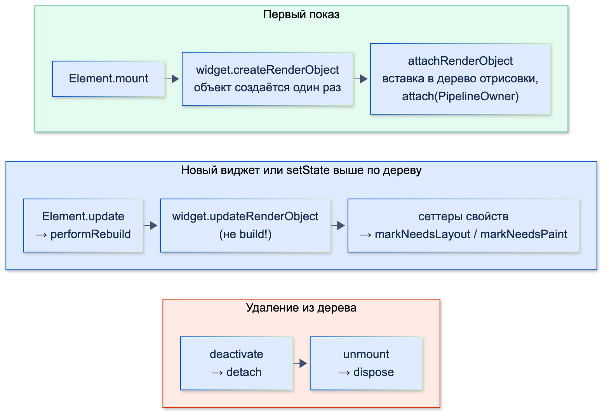
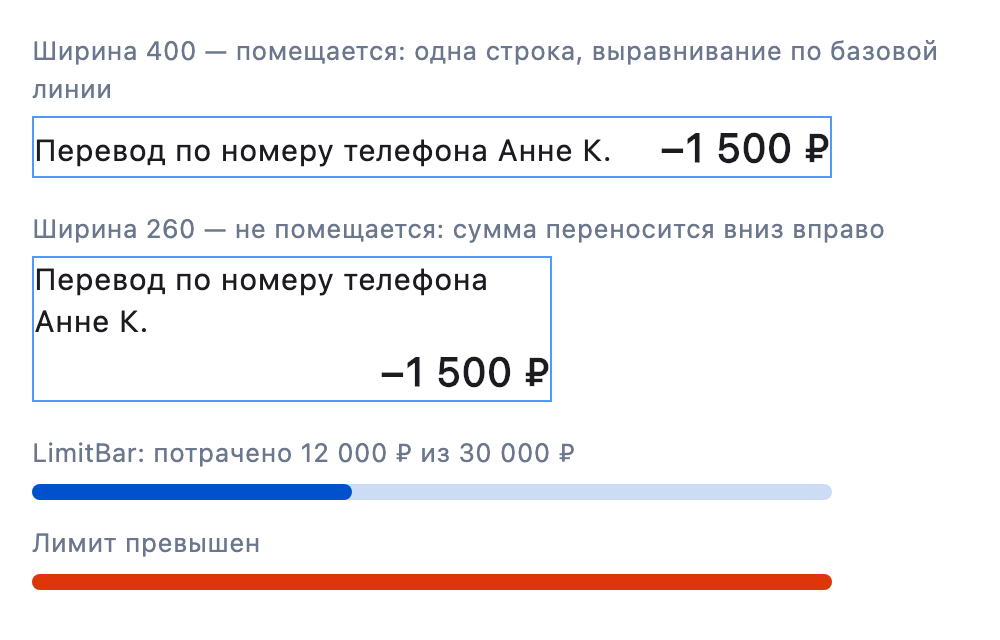

# Создание собственных RenderObject / кастомный рендеринг

| Грейд | Время на изучение | Статус |
|-------|-------------------|--------|
| ⭐⭐⭐ | ~35 мин лекция + практика | ✅ Готово |

---

## 📚 Ресурсы

| Ресурс | Формат | Язык | Уровень | Зачем читать |
|--------|--------|------|---------|--------------|
| Хендбук Яндекса: [RenderObject: первое погружение](https://contest.yandex.ru/tracks/flutter/ui-framework/render-object-first-look) и [продвинутые концепции](https://contest.yandex.ru/tracks/flutter/ui-framework/advanced-render-object-concepts) | Учебник | 🇷🇺 | ⭐⭐ → ⭐⭐⭐ | Аналоговые часы на `RenderBox` со всеми методами, включая семантику и отладку; затем объекты с детьми, `ParentData`, intrinsic-размеры, слайверы |
| [Как создать собственный RenderObject](https://habr.com/ru/companies/surfstudio/articles/947394/) | Статья (Habr, Surf) | 🇷🇺 | ⭐⭐⭐ | Галерея-«кирпичная кладка» (masonry): раскладка детей по колонкам, `hitTestChildren`, семантика |
| [Когда виджетов мало: создаём свой RenderObject во Flutter](https://habr.com/ru/companies/otus/articles/971050/) | Статья (Habr, OTUS) | 🇷🇺 | ⭐⭐ | Короткий вход: прогресс-бар на `RenderBox`, когда вообще стоит спускаться на этот уровень |
| [RenderBox class](https://api.flutter.dev/flutter/rendering/RenderBox-class.html) | Документация | 🇬🇧 | ⭐⭐⭐ | Подробное описание контракта `RenderBox`: раскладка, intrinsic-размеры, базовая линия, нажатия |

---

## 🎓 Лекция

> ℹ️ **Важно:** как устроены три дерева, конвейер кадра, `markNeedsLayout` и `markNeedsPaint`, слои и протокол sliver —
> в теме «Flutter под капотом». Здесь — практика: как написать свой объект отрисовки.

### 1. В каком кейсе нужно спускаться до RenderObject

Свой `RenderObject` — самый низкий уровень на Dart. Он даёт полный контроль, но кода заметно больше, чем у виджета,
и вся ответственность (семантика, intrinsic-размеры, базовая линия) — на тебе. Поэтому сначала идём по лестнице снизу вверх и останавливаемся на первой
ступени, которая решает задачу:

| Задача | Инструмент |
|--------|------------|
| Собрать из готовых виджетов | `Row`, `Column`, `Stack`, `Wrap`, `Align`, `LayoutBuilder` |
| Только нарисовать что-то своё (график, кольцо, форма) | `CustomPaint` + `CustomPainter` |
| Разместить **одного** ребёнка по своему правилу | `CustomSingleChildLayout` |
| Разместить **нескольких** детей по своему правилу, но размер контейнера известен заранее | `CustomMultiChildLayout` |
| Быстро двигать, масштабировать, вращать детей в анимации без новой раскладки | `Flow` |
| Всё остальное — см. кейсы ниже | **Свой `RenderBox`** (или `RenderSliver` для прокрутки) |

**Кейсы, когда спускаться нужно:**
1. **Размер контейнера зависит от размеров детей по нестандартному правилу.** `CustomMultiChildLayout` этого
   не умеет: его размер задаётся до раскладки детей. Пример — строка операции ниже: «поместились в одну строку —
   высота одна, не поместились — сумма уходит вниз».
2. **Нужно выравнивание по базовой линии текста или участие в intrinsic-размерах.** Например, своя строка должна
   правильно работать внутри `IntrinsicHeight`, таблицы или `Row` с `CrossAxisAlignment.baseline`.
3. **Нестандартная обработка нажатий:** область нажатия по форме, передача нажатия только части детей, своё правило,
   кто «под пальцем» (карта мест, схема зала, диаграмма).
4. **Производительность на большом числе объектов.** Тысячи точек графика, ячейки календаря, «свечи» биржевого графика:
   свой объект рисует их за один `paint` без тысяч элементов и виджетов. Если детей нет, часто хватает `CustomPainter`;
   свой `RenderObject` нужен, когда эти объекты ещё и раскладываются или принимают нажатия.
5. **Точный контроль над тем, что пересчитывается.** Анимация, которая меняет только отрисовку, — `markNeedsPaint`
   без раскладки; подписка на `Listenable` прямо в объекте отрисовки, без перестроения виджетов.
6. **Своя прокрутка:** «липкие» заголовки особого вида, сетки с разной высотой колонок, бесконечный календарь —
   свой `RenderSliver`.
7. **Переиспользуемый примитив для дизайн-системы или библиотеки,** которым будут пользоваться сотни экранов.
   Так написаны сами `Padding`, `Align`, `Flex`, `Wrap`, `RichText`.

**Кейсы, когда не нужно:**
- «Хочу оптимизировать» без замера в DevTools: обычно проблема в лишних перестроениях, а не в виджетах.
- Нужен один нестандартный рисунок — это `CustomPainter`.
- Раскладку можно получить `LayoutBuilder` + готовыми виджетами и она не в горячем месте (не в длинном списке).

### 2. Три части: виджет, элемент и объект отрисовки

Свой объект отрисовки всегда идёт в паре с виджетом-конфигурацией:

| Виджет | Детей | Пример во фреймворке |
|--------|-------|----------------------|
| `LeafRenderObjectWidget` | нет | `RawImage`, `ErrorWidget` |
| `SingleChildRenderObjectWidget` | один `child` | `Padding`, `Opacity`, `ClipRRect` |
| `MultiChildRenderObjectWidget` | список `children` | `Flex` (`Row`, `Column`), `Stack`, `Wrap` |
| `SlottedMultiChildRenderObjectWidget` | именованные слоты | `ListTile` (`leading`, `title`, `trailing`…), `InputDecorator` |

Что делает элемент `RenderObjectElement` (код фреймворка):



- **`mount`** — элемент встраивается в дерево: вызывает `widget.createRenderObject(context)` и `attachRenderObject` —
  вставляет объект в дерево отрисовки, тот получает `attach(owner)` и начинает участвовать в кадрах.
- **`update` / `performRebuild`** — пришёл новый виджет (родитель перестроился) или элемент помечен грязным.
  У `RenderObjectElement` `performRebuild` вызывает **`widget.updateRenderObject(context, renderObject)`** — **не `build`**.
  Для сравнения: у `ComponentElement` (`StatelessElement`, `StatefulElement`) `performRebuild` вызывает `build()`
  и обновляет ребёнка. Объект отрисовки при этом **не пересоздаётся**: он живёт, пока жив элемент.
- **`deactivate` / `unmount`** — элемент уходит из дерева: объект отрисовки сначала отцепляется (`detach`), а при окончательном
  удалении элемента освобождается (`dispose`).

Из этого правило: **`updateRenderObject` переносит каждое свойство через сеттер, а сеттер решает, что нужно
пересчитать.** Если забыть свойство в `updateRenderObject`, изменение виджета просто не дойдёт до экрана.

### 3. Контракт RenderBox: что переопределять

| Метод | Обязателен | Что делает |
|-------|------------|-----------|
| `performLayout` | ✅ | Выбрать `size` в пределах `constraints`, разложить детей, записать их позиции в `parentData` |
| `computeDryLayout` | ✅ желательно всегда | Тот же размер, что даст `performLayout`, но **без** раскладки детей и изменения состояния. Его вызывают родители, которые считают размер заранее (`getDryLayout`); без него в debug — ошибка «cannot compute dry layout» |
| `sizedByParent` + `computeDryLayout` | — | Если размер зависит **только** от ограничений: объект становится relayout boundary |
| `computeMin/MaxIntrinsicWidth/Height` | ✅ если есть дети или собственный размер | Ответ на вопрос «какого размера ты хочешь быть» до раскладки |
| `computeDistanceToActualBaseline` | — | Базовая линия для выравнивания с текстом |
| `paint` | ✅ | Нарисовать себя и детей (`context.paintChild`) со сдвигом `offset` |
| `hitTestSelf` / `hitTestChildren` | ✅ если принимает нажатия | Попало ли нажатие в сам объект / передать его детям |
| `describeSemanticsConfiguration` | ✅ если есть смысл для читалок | Подпись, значение, действия для TalkBack и VoiceOver |
| `attach` / `detach` | — | Подписаться на `Listenable` и отписаться — только пока объект в дереве |
| `setupParentData` | — | Свой тип `parentData` у детей (по умолчанию `BoxParentData` с `offset`) |
| `debugFillProperties` | — | Свойства для Flutter Inspector и `debugDumpRenderTree` |

**Правило сеттеров:** значение не изменилось — выходим; изменилось — помечаем ровно то, что зависит от свойства:

| Свойство влияет на… | Вызов |
|---------------------|-------|
| размер или положение (толщина, отступ, текст) | `markNeedsLayout()` — после раскладки объект перерисуется автоматически |
| только вид (цвет, прогресс заливки) | `markNeedsPaint()` |
| то, что озвучивает читалка | `markNeedsSemanticsUpdate()` |
| нужен ли отдельный слой | `markNeedsCompositingBitsUpdate()` |

### 4. Пример 1. Листовой объект: индикатор лимита по карте

Полоса «потрачено X из лимита Y»: заливка синяя, при превышении лимита — красная. Детей нет, размер — вся ширина
и высота по толщине.

```dart
import 'package:flutter/rendering.dart';
import 'package:flutter/widgets.dart';

/// Полоса «потрачено из лимита». Суммы — в копейках
class LimitBar extends LeafRenderObjectWidget {
  const LimitBar({
    super.key,
    required this.spent,
    required this.limit,
    this.color = const Color(0xFF0052CC),
    this.thickness = 8,
  });

  final int spent;
  final int limit;
  final Color color;
  final double thickness;

  // Вызывается один раз, когда элемент монтируется в дерево
  @override
  RenderLimitBar createRenderObject(BuildContext context) => RenderLimitBar(
        spent: spent,
        limit: limit,
        color: color,
        thickness: thickness,
        // Направление текста нужно семантике: подпись без него — ошибка в debug
        textDirection: Directionality.maybeOf(context),
      );

  // Вызывается из performRebuild элемента при каждом новом виджете: переносим свойства в живой объект
  @override
  void updateRenderObject(BuildContext context, RenderLimitBar renderObject) {
    renderObject
      ..spent = spent
      ..limit = limit
      ..color = color
      ..thickness = thickness
      ..textDirection = Directionality.maybeOf(context);
  }
}

class RenderLimitBar extends RenderBox {
  RenderLimitBar({
    required int spent,
    required int limit,
    required Color color,
    required double thickness,
    TextDirection? textDirection,
  })  : _spent = spent,
        _limit = limit,
        _color = color,
        _thickness = thickness,
        _textDirection = textDirection;

  int _spent;
  int get spent => _spent;
  set spent(int value) {
    if (value == _spent) return; // значение то же — ничего не помечаем
    _spent = value;
    markNeedsPaint(); // меняется только заливка, размер прежний
    markNeedsSemanticsUpdate(); // экранная читалка должна узнать новое значение
  }

  int _limit;
  int get limit => _limit;
  set limit(int value) {
    if (value == _limit) return;
    _limit = value;
    markNeedsPaint();
    markNeedsSemanticsUpdate();
  }

  Color _color;
  Color get color => _color;
  set color(Color value) {
    if (value == _color) return;
    _color = value;
    markNeedsPaint(); // цвет не влияет на размер — раскладка не нужна
  }

  double _thickness;
  double get thickness => _thickness;
  set thickness(double value) {
    if (value == _thickness) return;
    _thickness = value;
    markNeedsLayout(); // от толщины зависит высота — нужна раскладка (и перерисовка после неё)
  }

  TextDirection? _textDirection;
  TextDirection? get textDirection => _textDirection;
  set textDirection(TextDirection? value) {
    if (value == _textDirection) return;
    _textDirection = value;
    markNeedsSemanticsUpdate();
  }

  double get _fraction => _limit <= 0 ? 0 : (_spent / _limit).clamp(0.0, 1.0);

  // Размер зависит только от ограничений: вся доступная ширина, высота — толщина полосы
  @override
  Size computeDryLayout(BoxConstraints constraints) {
    final width = constraints.hasBoundedWidth ? constraints.maxWidth : 200.0;
    return constraints.constrain(Size(width, _thickness));
  }

  @override
  void performLayout() => size = computeDryLayout(constraints);

  // Intrinsic-размеры: родитель вроде IntrinsicHeight спрашивает высоту до раскладки
  @override
  double computeMinIntrinsicHeight(double width) => _thickness;

  @override
  double computeMaxIntrinsicHeight(double width) => _thickness;

  @override
  void paint(PaintingContext context, Offset offset) {
    final canvas = context.canvas;
    final radius = Radius.circular(size.height / 2);
    // offset — положение объекта на холсте; свои координаты считаем от него
    canvas.drawRRect(
      RRect.fromRectAndRadius(offset & size, radius),
      Paint()..color = _color.withValues(alpha: 0.2),
    );
    if (_fraction == 0) return;
    final filled = Rect.fromLTWH(offset.dx, offset.dy, size.width * _fraction, size.height);
    final overLimit = _spent >= _limit;
    canvas.drawRRect(
      RRect.fromRectAndRadius(filled, radius),
      Paint()..color = overLimit ? const Color(0xFFDE350B) : _color,
    );
  }

  // Нажатие засчитывается по всей полосе (по умолчанию RenderBox нажатия не принимает)
  @override
  bool hitTestSelf(Offset position) => true;

  // Что озвучат TalkBack и VoiceOver
  @override
  void describeSemanticsConfiguration(SemanticsConfiguration config) {
    super.describeSemanticsConfiguration(config);
    config
      ..isSemanticBoundary = true
      ..textDirection = _textDirection
      ..label = 'Лимит по карте'
      ..value = 'потрачено ${(_fraction * 100).round()} процентов';
  }

  // Свойства, которые покажет Flutter Inspector и debugDumpRenderTree
  @override
  void debugFillProperties(DiagnosticPropertiesBuilder properties) {
    super.debugFillProperties(properties);
    properties
      ..add(IntProperty('spent', _spent))
      ..add(IntProperty('limit', _limit))
      ..add(ColorProperty('color', _color))
      ..add(DoubleProperty('thickness', _thickness));
  }
}
```

Что проверили тестом (код теста — в разделе 6):

```text
Размер: Size(300.0, 8.0)
Сменили color: needsLayout=false, needsPaint=true
Сменили thickness: needsLayout=true, needsPaint=false
Размер: Size(300.0, 12.0)
Семантика: «Лимит по карте», «потрачено 40 процентов»
```

- Смена цвета — только перерисовка, раскладки нет.
- Смена толщины — раскладка. `needsPaint=false` сразу после смены — это нормально: флаг перерисовки ставится
  на этапе раскладки, когда объект получает новый размер.
- Подпись для читалки работает только вместе с `textDirection`: без него в debug — ошибка
  `A SemanticsData object with label "Лимит по карте" had a null textDirection`.

### 5. Пример 2. Объект с детьми: строка операции

Задача из выписки: название операции слева, сумма справа, по одной базовой линии. Если вместе не помещаются —
название занимает всю ширину, а сумма переносится вниз и прижимается вправо. `Row` так не умеет, а `LayoutBuilder`
с подсчётом ширины текста получается сложнее и медленнее.

Детей ровно два и у каждого своя роль — удобно взять **слоты** (`SlottedMultiChildRenderObjectWidget`): дети
доступны по имени, а не по индексу.

```dart
import 'dart:math' as math;

import 'package:flutter/rendering.dart';
import 'package:flutter/widgets.dart';

enum TransactionRowSlot { title, amount }

/// Строка операции: название и сумма в одну строку по базовой линии,
/// а если не помещаются — сумма переносится вниз и прижимается вправо
class TransactionRow extends SlottedMultiChildRenderObjectWidget<TransactionRowSlot, RenderBox> {
  const TransactionRow({super.key, required this.title, required this.amount, this.gap = 8});

  final Widget title;
  final Widget amount;
  final double gap;

  @override
  Iterable<TransactionRowSlot> get slots => TransactionRowSlot.values;

  // Какой виджет в каком слоте: фреймворк сам создаст для них элементы и RenderObject
  @override
  Widget? childForSlot(TransactionRowSlot slot) => switch (slot) {
        TransactionRowSlot.title => title,
        TransactionRowSlot.amount => amount,
      };

  @override
  RenderTransactionRow createRenderObject(BuildContext context) => RenderTransactionRow(gap: gap);

  @override
  void updateRenderObject(BuildContext context, RenderTransactionRow renderObject) =>
      renderObject.gap = gap;
}

/// Результат раскладки: размер строки и положения детей
typedef TransactionRowLayout = ({Size size, Offset title, Offset amount, bool oneLine});

class RenderTransactionRow extends RenderBox
    with SlottedContainerRenderObjectMixin<TransactionRowSlot, RenderBox> {
  RenderTransactionRow({required double gap}) : _gap = gap;

  double _gap;
  double get gap => _gap;
  set gap(double value) {
    if (value == _gap) return;
    _gap = value;
    markNeedsLayout(); // от отступа зависит, поместится ли всё в одну строку
  }

  RenderBox get _title => childForSlot(TransactionRowSlot.title)!;
  RenderBox get _amount => childForSlot(TransactionRowSlot.amount)!;

  /// Одна функция для настоящей раскладки и для «сухой» (вычислить размер, ничего не меняя)
  TransactionRowLayout _compute(
    BoxConstraints constraints, {
    required ChildLayouter layoutChild,
    required ChildBaselineGetter getBaseline,
  }) {
    assert(constraints.hasBoundedWidth, 'TransactionRow занимает всю ширину: нужна ограниченная ширина');
    final width = constraints.maxWidth;
    final loose = BoxConstraints(maxWidth: width);

    final amount = layoutChild(_amount, loose);
    // Ширина названия, если писать его в одну строку
    final titleWidth = _title.getMaxIntrinsicWidth(double.infinity);

    if (titleWidth + gap + amount.width <= width) {
      final titleConstraints = BoxConstraints(maxWidth: width - gap - amount.width);
      final title = layoutChild(_title, titleConstraints);
      // Выравниваем по базовой линии: у суммы шрифт крупнее, по верхнему краю было бы криво
      final titleBaseline = getBaseline(_title, titleConstraints, TextBaseline.alphabetic) ?? title.height;
      final amountBaseline = getBaseline(_amount, loose, TextBaseline.alphabetic) ?? amount.height;
      final baseline = math.max(titleBaseline, amountBaseline);
      final height = math.max(
        baseline - titleBaseline + title.height,
        baseline - amountBaseline + amount.height,
      );
      return (
        size: constraints.constrain(Size(width, height)),
        title: Offset(0, baseline - titleBaseline),
        amount: Offset(width - amount.width, baseline - amountBaseline),
        oneLine: true,
      );
    }

    final title = layoutChild(_title, loose);
    return (
      size: constraints.constrain(Size(width, title.height + amount.height)),
      title: Offset.zero,
      amount: Offset(width - amount.width, title.height),
      oneLine: false,
    );
  }

  // «Сухая» раскладка: дети не раскладываются по-настоящему, только спрашиваем их размеры
  @override
  Size computeDryLayout(BoxConstraints constraints) => _compute(
        constraints,
        layoutChild: ChildLayoutHelper.dryLayoutChild,
        getBaseline: ChildLayoutHelper.getDryBaseline,
      ).size;

  /// Последняя раскладка — для тестов и отладки
  late TransactionRowLayout lastLayout;

  @override
  void performLayout() {
    // ChildLayoutHelper.layoutChild вызывает child.layout(constraints, parentUsesSize: true):
    // мы читаем размер ребёнка, значит, его изменение должно перекладывать и нас
    lastLayout = _compute(
      constraints,
      layoutChild: ChildLayoutHelper.layoutChild,
      getBaseline: ChildLayoutHelper.getBaseline,
    );
    // Позицию ребёнка хранит его parentData — её читают paint и hitTest
    (_title.parentData! as BoxParentData).offset = lastLayout.title;
    (_amount.parentData! as BoxParentData).offset = lastLayout.amount;
    size = lastLayout.size;
  }

  @override
  double computeMinIntrinsicWidth(double height) =>
      math.max(_title.getMinIntrinsicWidth(height), _amount.getMinIntrinsicWidth(height));

  @override
  double computeMaxIntrinsicWidth(double height) =>
      _title.getMaxIntrinsicWidth(height) + gap + _amount.getMaxIntrinsicWidth(height);

  @override
  double computeMinIntrinsicHeight(double width) =>
      computeDryLayout(BoxConstraints(maxWidth: width)).height;

  @override
  double computeMaxIntrinsicHeight(double width) => computeMinIntrinsicHeight(width);

  // Базовая линия строки — базовая линия названия: строку можно выровнять с текстом снаружи
  @override
  double? computeDistanceToActualBaseline(TextBaseline baseline) {
    final childBaseline = _title.getDistanceToActualBaseline(baseline);
    if (childBaseline == null) return null;
    return childBaseline + (_title.parentData! as BoxParentData).offset.dy;
  }

  @override
  void paint(PaintingContext context, Offset offset) {
    for (final child in children) {
      context.paintChild(child, offset + (child.parentData! as BoxParentData).offset);
    }
  }

  // Нажатие передаём ребёнку, в которого оно попало, в его собственных координатах
  @override
  bool hitTestChildren(BoxHitTestResult result, {required Offset position}) {
    for (final child in children) {
      final hit = result.addWithPaintOffset(
        offset: (child.parentData! as BoxParentData).offset,
        position: position,
        hitTest: (result, transformed) => child.hitTest(result, position: transformed),
      );
      if (hit) return true;
    }
    return false;
  }
}
```



Результат раскладки при двух ширинах (название — шрифт 15, сумма — 20):

```text
Ширина 400.0: одна строка, размер Size(400.0, 24.0), название Offset(0.0, 4.8), сумма Offset(316.7, 0.0)
  dry layout совпадает: true
Ширина 260.0: две строки, размер Size(260.0, 60.0), название Offset(0.0, 0.0), сумма Offset(176.7, 36.0)
  dry layout совпадает: true
```

Что здесь важно:
- **Название сдвинуто вниз на 4,8** — так базовые линии текста шрифтом 15 и шрифтом 20 совпадают.
- **Одна функция `_compute` для двух режимов.** Настоящая раскладка (`ChildLayoutHelper.layoutChild`) и «сухая»
  (`ChildLayoutHelper.dryLayoutChild`) обязаны давать одинаковый размер — тест это проверяет. Так раскладку пишут
  и во фреймворке (`RenderFlex`, `RenderWrap`).
- **`parentUsesSize: true`** (внутри `ChildLayoutHelper.layoutChild`): мы читаем размер ребёнка, поэтому при его изменении
  нужно перекладывать и нас. Без этого флага `child.size` читать нельзя — в debug это ошибка.
- **Позиции детей живут в их `parentData`**, а `paint` и `hitTestChildren` их только читают.
- **`addWithPaintOffset`** переводит координату нажатия в систему ребёнка — нажатие в промежуток между детьми
  никуда не попадает.

### 6. Как проверять свой RenderObject

Свой объект отрисовки проверяют виджет-тестами: размеры, флаги «что пересчитывать», нажатия, «сухую» раскладку.

```dart
import 'package:flutter/widgets.dart';
import 'package:flutter_test/flutter_test.dart';

import 'package:bank_ui/limit_bar.dart';
import 'package:bank_ui/transaction_row.dart';

Widget screen({required double width, required Widget child}) => Directionality(
      textDirection: TextDirection.ltr,
      child: Align(alignment: Alignment.topLeft, child: SizedBox(width: width, child: child)),
    );

void main() {
  testWidgets('LimitBar: цвет — только перерисовка, толщина — раскладка', (tester) async {
    await tester.pumpWidget(screen(width: 300, child: const LimitBar(spent: 1200000, limit: 3000000)));
    final bar = tester.renderObject<RenderLimitBar>(find.byType(LimitBar));
    expect(bar.size, const Size(300, 8));

    // EnginePhase.build — остановить кадр после build: новые свойства уже в RenderObject, раскладки ещё не было
    await tester.pumpWidget(
      screen(width: 300, child: const LimitBar(spent: 1200000, limit: 3000000, color: Color(0xFF36B37E))),
      phase: EnginePhase.build,
    );
    expect(bar.debugNeedsLayout, isFalse);
    expect(bar.debugNeedsPaint, isTrue);

    await tester.pumpWidget(
      screen(width: 300, child: const LimitBar(spent: 1200000, limit: 3000000, thickness: 12)),
      phase: EnginePhase.build,
    );
    expect(bar.debugNeedsLayout, isTrue);

    // Полный кадр: раскладка с новой толщиной
    await tester.pumpWidget(screen(width: 300, child: const LimitBar(spent: 1200000, limit: 3000000, thickness: 12)));
    expect(bar.size, const Size(300, 12));
  });

  testWidgets('TransactionRow: перенос суммы и нажатия по детям', (tester) async {
    final taps = <String>[];
    Widget row(double width) => screen(
          width: width,
          child: TransactionRow(
            title: GestureDetector(onTap: () => taps.add('название'), child: const Text('Кофе')),
            amount: GestureDetector(onTap: () => taps.add('сумма'), child: const Text('−250 ₽')),
          ),
        );

    await tester.pumpWidget(row(400));
    final render = tester.renderObject<RenderTransactionRow>(find.byType(TransactionRow));
    expect(render.lastLayout.oneLine, isTrue);
    // «Сухая» раскладка должна давать тот же размер, что и настоящая
    expect(render.getDryLayout(const BoxConstraints(maxWidth: 400)), render.size);

    await tester.tapAt(tester.getCenter(find.text('−250 ₽')));
    await tester.tapAt(tester.getCenter(find.text('Кофе')));
    await tester.tapAt(Offset(200, render.size.height / 2)); // в промежуток между детьми
    expect(taps, ['сумма', 'название']);

    await tester.pumpWidget(row(120));
    expect(render.lastLayout.oneLine, isFalse);
    expect(render.getDryLayout(const BoxConstraints(maxWidth: 120)), render.size);
  });
}
```

- **`phase: EnginePhase.build`** останавливает кадр после build: `updateRenderObject` уже вызван, а раскладки ещё не было.
  Так видно, какие флаги поставили сеттеры.
- В тестах по умолчанию шрифт, где каждый символ — квадрат размером с кегль. Поэтому тексты в тесте короткие,
  а проверяется поведение (одна строка или две), а не точные пиксели.
- Внешний вид проверяют golden-тестами (`matchesGoldenFile`) — сравнение с эталонной картинкой.

### 7. Что ещё бывает

- **`isRepaintBoundary => true`** — объект рисуется в свой слой (как `RepaintBoundary`). Имеет смысл для объекта,
  который часто перерисовывается независимо от соседей, например, анимированного индикатора.
- **`alwaysNeedsCompositing`** и `context.pushLayer`, `pushOpacity`, `pushClipRect` — когда объекту нужны свои слои-эффекты
  (как у `RenderOpacity`). Не забывать `markNeedsCompositingBitsUpdate` в сеттере, который меняет эту потребность.
- **Свой `RenderSliver`** — для прокрутки. Сложнее, чем `RenderBox`: нужно корректно заполнить `SliverGeometry`
  (`scrollExtent`, `paintExtent`, `layoutExtent`, `cacheExtent`) для любого `scrollOffset` и лениво создавать детей
  (через `RenderSliverBoxChildManager`). Прежде чем писать свой, проверь `SliverList`, `SliverGrid`,
  `SliverPersistentHeader`, `SliverMainAxisGroup`.
- **Свой `Element`** нужен очень редко: когда управление детьми не укладывается в готовые варианты
  (так сделаны `LayoutBuilder` и ленивые списки).
- **Подписка на анимацию прямо в объекте** — через `attach`/`detach`, как у кнопки-кляксы в теме «Анимации»:
  каждый тик — только `markNeedsPaint`, без перестроения виджетов.

### ⚠️ Частые ошибки

- **Забытое свойство в `updateRenderObject`.** Виджет поменялся, а на экране — старое значение.
- **Сеттер без проверки равенства или с неверным `markNeeds…`.** Лишние раскладки на каждом `build` или, наоборот,
  смена размера без раскладки.
- **Чтение `child.size` без `parentUsesSize: true`.** В debug — ошибка, в release — устаревший размер.
- **Нет `computeDryLayout` и intrinsic-методов.** Объект падает внутри `IntrinsicHeight`, `Wrap` или диалога, которые
  спрашивают размер до раскладки.
- **«Сухая» раскладка не совпадает с настоящей.** Родитель рассчитал место под один размер, а объект занял другой.
- **Изменение состояния в `computeDryLayout`** (например, раскладка детей) — он должен быть без побочных эффектов.
- **Подписка на `Listenable` в конструкторе без `attach`/`detach`.** Утечка и вызовы `markNeedsPaint` у объекта,
  которого уже нет в дереве.
- **Тяжёлые вычисления в `paint`** (построение сложных путей, разбор данных) — `paint` вызывается при каждой перерисовке.
  Считай заранее в `performLayout` или в сеттере и кешируй.
- **Подпись в семантике без `textDirection`** — ошибка в debug.
- **Свой `RenderObject` там, где хватило бы `CustomPainter` или `CustomMultiChildLayout`.** Больше кода и ответственности
  (семантика, intrinsic-размеры, базовая линия, тесты) без выигрыша.

### 🎤 На собеседовании: «Как сделаешь виджет с нестандартной раскладкой?»

| Уровень | Как выглядит ответ |
|---------|--------------------|
| ⭐ Junior | Попробует собрать из `Row`/`Column`/`Stack`, при необходимости — `LayoutBuilder` |
| ⭐⭐ Middle | Знает лестницу: готовые виджеты → `CustomPaint` → `CustomSingleChildLayout`/`CustomMultiChildLayout` → свой `RenderBox`. Может написать листовой `RenderBox` с `performLayout`, `paint`, `hitTestSelf` и правильными `markNeeds…` в сеттерах |
| ⭐⭐⭐ Senior | Объясняет, почему именно этот уровень (размер зависит от детей, базовая линия, нажатия, производительность), пишет объект с детьми: `parentData`, `parentUsesSize`, `computeDryLayout` с общей функцией раскладки, intrinsic-размеры, базовая линия, `hitTestChildren`, семантика. Покрывает тестами флаги, «сухую» раскладку и нажатия, golden-тестами — вид |

---

## ✅ Самопроверка

**⭐ Junior**
1. Какие готовые инструменты стоит попробовать, прежде чем писать свой `RenderObject`?
2. Что делают `createRenderObject` и `updateRenderObject`? Сколько раз вызывается каждый?
3. Чем `LeafRenderObjectWidget` отличается от `SingleChildRenderObjectWidget` и `MultiChildRenderObjectWidget`?

**⭐⭐ Middle**
1. Что делает `performRebuild` у `RenderObjectElement` и чем это отличается от `ComponentElement`?
2. Свойство `color` поменялось. Что вызвать в сеттере? А если поменялась толщина?
3. Что обязан сделать `performLayout`? Где хранятся позиции детей?
4. Зачем переопределять `hitTestSelf`? Что вернёт `RenderBox` по умолчанию?

**⭐⭐⭐ Senior**
1. Назови кейсы, когда действительно нужно спускаться до своего `RenderObject`, и когда нет.
2. Зачем `computeDryLayout` и intrinsic-методы? Как гарантировать, что «сухая» раскладка совпадает с настоящей?
3. Что означает `parentUsesSize: true` и как он связан с relayout boundary?
4. Как в объекте с детьми передать нажатие нужному ребёнку?
5. Как подписаться на анимацию внутри `RenderObject`, чтобы не было утечек и лишних перестроений?
6. Как проверить свой `RenderObject` тестами?

<details>
<summary>Ответы</summary>

**Junior**
1. Готовые виджеты и `LayoutBuilder`, `CustomPaint`, `CustomSingleChildLayout`, `CustomMultiChildLayout`, `Flow`.
2. `createRenderObject` создаёт объект отрисовки — один раз, при монтировании элемента. `updateRenderObject` переносит
   свойства нового виджета в существующий объект — при каждом обновлении элемента.
3. Числом детей: нет, один `child`, список `children`. Для детей с ролями есть ещё `SlottedMultiChildRenderObjectWidget`.

**Middle**
1. У `RenderObjectElement` `performRebuild` вызывает `widget.updateRenderObject(context, renderObject)`: объект не
   пересоздаётся, получает новые свойства. У `ComponentElement` `performRebuild` вызывает `build()` и обновляет ребёнка.
2. Цвет — `markNeedsPaint()`, раскладка не нужна. Толщина влияет на размер — `markNeedsLayout()`, перерисовка будет
   после раскладки. Сначала — проверка «значение не изменилось → выход».
3. Установить `size` в пределах `constraints` и разложить всех детей (`child.layout`). Позиции детей хранятся в их
   `parentData` (`BoxParentData.offset`); `paint` и `hitTestChildren` их читают.
4. По умолчанию `RenderBox` нажатия на себя не принимает (`hitTestSelf` → `false`), без этого `GestureDetector`
   вокруг объекта не сработает на пустом месте. В `hitTestSelf` можно задать и форму области нажатия.

**Senior**
1. Нужно: размер зависит от детей по нестандартному правилу; базовая линия и intrinsic-размеры; нестандартные нажатия;
   тысячи объектов с раскладкой или нажатиями; точный контроль над пересчётом; своя прокрутка (`RenderSliver`);
   примитив дизайн-системы. Не нужно: без замера «для скорости», один рисунок (`CustomPainter`), раскладка решается
   готовыми виджетами не в горячем месте.
2. Родители вроде `IntrinsicHeight`, `Wrap`, диалогов спрашивают размер до раскладки. Без этих методов объект
   в них падает или занимает не то место. Совпадение гарантирует одна функция раскладки, в которую передаётся способ
   раскладки детей (`ChildLayoutHelper.layoutChild` или `dryLayoutChild`), плюс тест «dry == size».
3. Родитель обещает зависеть от размера ребёнка: при изменении ребёнка будет переложен и родитель. При `false` ребёнок
   становится relayout boundary, но читать его `size` родителю нельзя.
4. В `hitTestChildren` для каждого ребёнка вызвать `result.addWithPaintOffset(offset: parentData.offset, position, hitTest: …)` —
   координата переводится в систему ребёнка, вызывается `child.hitTest`. Порядок — сверху вниз по отрисовке.
5. Подписаться в `attach` и отписаться в `detach`, в слушателе — только `markNeedsPaint` (или `markNeedsLayout`, если
   меняется размер). В сеттере анимации — переподписка, если объект уже `attached`.
6. Виджет-тесты: размеры при разных ограничениях; `debugNeedsLayout`/`debugNeedsPaint` после
   `pumpWidget(…, phase: EnginePhase.build)`; совпадение `getDryLayout` с `size`; нажатия через `tapAt`;
   семантика через `getSemantics`; внешний вид — golden-тесты.

</details>
