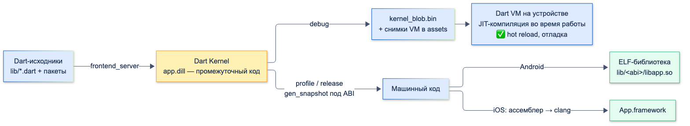
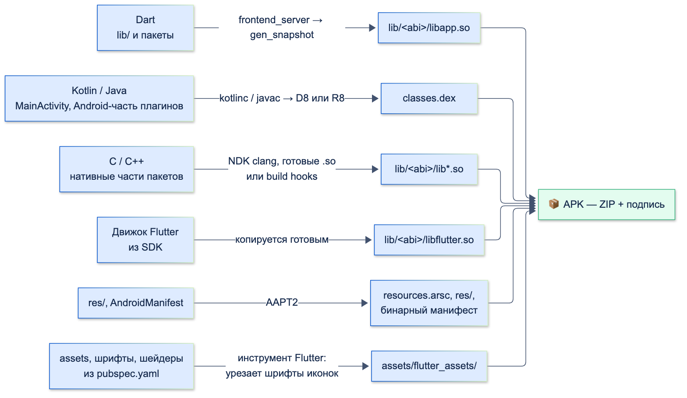
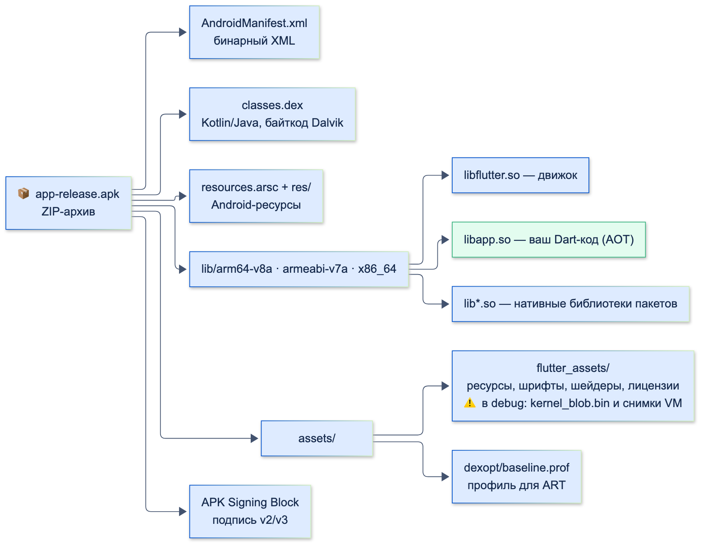

# Компиляция (AOT/JIT, процессы сборки)

| Грейд | Время на изучение | Статус |
|-------|-------------------|--------|
| ⭐⭐⭐ | ~35 мин лекция + практика | ✅ Готово |

---

## 📚 Ресурсы

| Ресурс | Формат | Язык | Уровень | Зачем читать |
|--------|--------|------|---------|--------------|
| [Хендбук Яндекса: виды сборки](https://contest.yandex.ru/tracks/flutter/crash-course/flutter-build-modes) | Учебник | 🇷🇺 | ⭐ | Debug, profile и release, JIT и AOT — короткое введение |
| [Flutter: Build modes](https://docs.flutter.dev/testing/build-modes) | Документация | 🇬🇧 | ⭐⭐ | Что включено в каждом режиме и где он запускается |
| [Flutter: Measuring your app's size](https://docs.flutter.dev/perf/app-size) | Документация | 🇬🇧 | ⭐⭐ | Как правильно измерять размер и что его уменьшает |
| [Flutter: Obfuscate Dart code](https://docs.flutter.dev/deployment/obfuscate) | Документация | 🇬🇧 | ⭐⭐⭐ | Обфускация, файлы символов, `flutter symbolize`, ограничения |
| [Flutter: Deferred components](https://docs.flutter.dev/perf/deferred-components) | Документация | 🇬🇧 | ⭐⭐⭐ | Загрузка частей Dart-кода и ресурсов по требованию на Android |

---

## 🎓 Лекция

### 1. JIT и AOT

- **JIT** (Just-In-Time) — компиляция **во время работы**: виртуальная машина получает промежуточный код и переводит
  в машинный те функции, которые реально выполняются.
- **AOT** (Ahead-Of-Time) — компиляция **заранее**, при сборке: на устройство попадает готовый машинный код
  под конкретный процессор.

| | JIT | AOT |
|-|-----|-----|
| Когда компилируется | Во время работы | При сборке |
| Старт | Медленнее: нужно загрузить VM и компилировать | Быстрый: код готов |
| Скорость работы | Сначала медленно, потом разгоняется | Стабильная с первой секунды |
| Размер | Промежуточный код + компилятор | Только машинный код |
| Hot reload, отладка | ✅ | ❌ |
| Во Flutter | Только debug | Profile и release |

Dart умеет и то и другое. Общее у обоих путей — **Dart Kernel** (файл `.dill`): промежуточное представление программы,
которое строит `frontend_server` из исходников. Дальше Kernel либо исполняет Dart VM через JIT, либо `gen_snapshot`
компилирует его в машинный код.



### 2. Режимы сборки Flutter

| | Debug | Profile | Release |
|-|-------|---------|---------|
| Компиляция Dart | JIT (Kernel в `kernel_blob.bin`) | AOT | AOT |
| `assert`, отладочные проверки | ✅ | ❌ | ❌ |
| Hot reload / hot restart | ✅ | ❌ | ❌ |
| Точки останова, Inspector | ✅ | ❌ | ❌ |
| Профилирование (DevTools Performance, CPU, Memory) | ✅, цифры не показательны | ✅ | ❌ |
| Эмулятор Android / симулятор iOS | ✅ / ✅ | ⚠️ / ❌ | ⚠️ / ❌ |
| Команда | `flutter run` | `flutter run --profile` | `flutter run --release`, `flutter build …` |

⚠️ — на эмуляторе Android с процессором arm64 или x86_64 profile- и release-сборки запускаются (проверено: profile —
на эмуляторе Android 16 arm64, release — в теме «FFI»), хотя документация Flutter их там не поддерживает, а цифры эмулятора не показательны.
На симуляторе iOS profile и release недоступны. Точки останова в profile не работают: DevTools подключается, но
отладчик отвечает `Debugger is disabled in AOT mode` (проверено через VM Service на profile-сборке).

**Константы режима:** `kDebugMode`, `kProfileMode`, `kReleaseMode` из `package:flutter/foundation.dart`. Это константы
времени компиляции, поэтому код под `if (kDebugMode)` **полностью вырезается** из release-сборки (tree shaking —
удаление недостижимого кода). Проверка на реальном APK — в разделе 6.

```dart
import 'package:flutter/foundation.dart';
import 'package:flutter/material.dart';

const apiKey = 'sk_live_BANK_SECRET_12345';

class PaymentGateway {
  String describe() => 'gateway';
}

void main() {
  if (kDebugMode) {
    // В release этой строки в бинарнике нет: условие — константа false
    debugPrint('DEBUG_ONLY_MARKER: подробный лог для разработки');
  }
  // ❌ Ключ в коде: он попадёт в бинарник как есть, обфускация его не спрячет
  debugPrint(Uri.https('api.bank.example', '/v1/pay', {'key': apiKey}).toString());
  debugPrint('${PaymentGateway().runtimeType}');
  runApp(const MaterialApp(home: Text('Банк')));
}
```

**Hot reload и hot restart** работают только в debug, потому что им нужна JIT-машина:
- **Hot reload** — `flutter` компилирует только изменённые библиотеки в новый Kernel, передаёт их в Dart VM на устройстве,
  VM подменяет код, а **состояние сохраняется** (объекты в памяти остаются), затем дерево перестраивается.
  Не применяется к коду, который уже выполнился: изменения в `main`, `initState`, инициализаторах статических полей,
  в нативном коде.
- **Hot restart** — перезапуск Dart-кода с `main`: состояние теряется, но нативная часть и движок не перезапускаются.

### 3. Процесс сборки Android целиком

`flutter build apk` запускает Gradle, а плагин Flutter для Gradle вызывает инструменты Flutter. Из чего собирается APK:

| Исходники | Инструмент | Результат |
|-----------|-----------|-----------|
| Dart (`lib/`, Dart-часть всех пакетов) | `frontend_server` → `app.dill`; в release и profile — `gen_snapshot` | debug: `kernel_blob.bin`; release: `libapp.so` |
| Kotlin / Java (`MainActivity`, Android-часть плагинов) | `kotlinc` / `javac` → `.class`, затем D8 (debug) или R8 (release) | `classes.dex` |
| C / C++ (плагины, пакеты с нативным кодом) | Android NDK (clang) или готовые библиотеки из Maven, а в новых пакетах — build hooks Dart (native assets) | `lib/<abi>/lib*.so` |
| Движок Flutter | Не компилируется: берётся готовым из Flutter SDK под каждую ABI | `libflutter.so` |
| Ресурсы Android (`res/`, манифест) | AAPT2 | `resources.arsc`, `res/`, бинарный `AndroidManifest.xml` |
| Ресурсы Flutter (`assets`, шрифты, шейдеры) | Инструмент Flutter: копирует, урезает шрифты иконок, компилирует шейдеры | `assets/flutter_assets/` |



Важные детали:
- **`gen_snapshot` сразу выдаёт ELF-библиотеку** — тот же формат, что у библиотек на C. Отдельного шага линковки нет.
  Промежуточные файлы можно найти в проекте: `.dart_tool/flutter_build/<хеш>/app.dill` (Kernel, 22 МБ у пустого проекта)
  и `.dart_tool/flutter_build/<хеш>/arm64-v8a/app.so`, `file` про него пишет `ELF 64-bit LSB shared object, ARM aarch64`.
- **`gen_snapshot` свой для каждой ABI и режима** — лежит в Flutter SDK
  (`bin/cache/artifacts/engine/android-arm64-release/…/gen_snapshot`). Поэтому `libapp.so` собирается отдельно
  под каждую архитектуру.
- **R8 в release включён по умолчанию:** удаляет неиспользуемый Kotlin/Java-код (shrinking) и переименовывает
  классы (obfuscation) — отсюда правила `proguard-rules.pro` для плагинов, которые используют рефлексию.

### 4. Что из себя представляет APK-файл, что там под капотом

**APK** (Android Package) — обычный ZIP-архив с определённой структурой. Его можно открыть любым архиватором
или посмотреть содержимое командой `unzip -l app-release.apk`.

Содержимое release-APK пустого проекта с двумя плагинами (`shared_preferences` и `sqlite3_flutter_libs`), без
`res/` и служебных файлов `META-INF/*.version`:

```text
AndroidManifest.xml                                    6 388   ← манифест, бинарный XML
classes.dex                                          998 784   ← весь Kotlin/Java-код после R8
resources.arsc                                       143 076   ← таблица Android-ресурсов
res/…                                                          ← иконки, темы (имена файлов сокращены R8)
assets/dexopt/baseline.prof                              174   ← профиль для ART (раздел ниже)
assets/flutter_assets/AssetManifest.bin                  117   ← список ресурсов Flutter
assets/flutter_assets/FontManifest.json                  208
assets/flutter_assets/NOTICES.Z                      103 617   ← лицензии пакетов, сжатые
assets/flutter_assets/NativeAssetsManifest.json           45
assets/flutter_assets/fonts/MaterialIcons-Regular.otf   1 368   ← только использованные иконки
assets/flutter_assets/packages/cupertino_icons/…    257 628
assets/flutter_assets/shaders/ink_sparkle.frag        21 320   ← шейдеры эффектов Material
lib/arm64-v8a/libapp.so                            3 146 672   ← ваш Dart-код, машинный код ARM64
lib/arm64-v8a/libflutter.so                       11 107 920   ← движок Flutter
lib/arm64-v8a/libsqlite3.so                        1 526 536   ← нативная библиотека плагина
lib/arm64-v8a/libdatastore_shared_counter.so           7 112   ← нативная часть AndroidX DataStore
lib/armeabi-v7a/…                                              ← то же для 32-битных ARM
lib/x86_64/…                                                   ← то же для x86-64 (эмуляторы, Chromebook)
```



| Что | Что внутри |
|-----|-----------|
| `AndroidManifest.xml` | Пакет, разрешения, активности, `minSdk`. В архиве — в бинарном формате, читается `aapt2 dump` или Android Studio (Build → Analyze APK) |
| `classes*.dex` | Байткод Dalvik: `MainActivity`, Android-часть плагинов, AndroidX, Kotlin stdlib. Это **не** машинный код |
| `resources.arsc`, `res/` | Скомпилированные Android-ресурсы: строки, темы, иконка приложения, splash |
| `lib/<abi>/` | Нативные библиотеки по архитектурам процессора (ABI — Application Binary Interface): `arm64-v8a` — почти все современные телефоны, `armeabi-v7a` — старые 32-битные, `x86_64` — эмуляторы и Chromebook |
| `lib/<abi>/libflutter.so` | Движок Flutter на C++: Impeller/Skia, раскладка текста, Dart runtime (среда выполнения без JIT-компилятора в release) |
| `lib/<abi>/libapp.so` | Весь Dart-код приложения и пакетов, скомпилированный AOT. Только в profile и release |
| `assets/flutter_assets/` | Ресурсы из `pubspec.yaml`, шрифты, шейдеры, лицензии. В debug — ещё и Kernel с VM-снимками |
| Подпись | Подпись схемы v2/v3 хранится **не в `META-INF`**, а в отдельном блоке APK Signing Block внутри ZIP. Старая подпись v1 (файлы в `META-INF`) в современных сборках обычно не нужна: `apksigner verify --verbose` показывает `v1 … false, v2 … true` |

#### Debug-APK против release-APK

Та же программа, собранная `flutter build apk --debug` и `--release`:

| | Debug | Release |
|-|-------|---------|
| Размер APK | **150 МБ** | **47,1 МБ** (три ABI) |
| Dart-код | `assets/flutter_assets/kernel_blob.bin` (41,7 МБ) + `isolate_snapshot_data` (11 МБ) + `vm_snapshot_data` | `lib/<abi>/libapp.so` (3,1 МБ на arm64) |
| Движок | `libflutter.so` 36,7 МБ (с JIT и отладкой) | `libflutter.so` 11,1 МБ |
| Kotlin/Java | 6 файлов `classes*.dex`, 10,7 МБ (D8, без сжатия) | 1 `classes.dex`, 1 МБ (R8) |
| Шрифт иконок Material | 1,6 МБ (полный) | 1,4 КБ (только использованные) |
| Прочее | `libVkLayer_khronos_validation.so` (15 МБ) — проверки Vulkan для отладки | — |

Поэтому размер приложения **никогда не оценивают по debug-сборке**.

#### Во что превращаются плагины

| Вид плагина | Примеры | Куда попадает |
|-------------|---------|---------------|
| Только Dart | `http`, `dio`, `provider` | В `libapp.so` вместе с вашим кодом |
| Kotlin/Java (Android-часть через `MethodChannel` и т. п.) | `shared_preferences`, `url_launcher`, `camera` | Gradle подключает как Android-библиотеку → `classes.dex` |
| С нативной библиотекой C/C++ | `sqlite3_flutter_libs`, `realm`, `ffmpeg_kit` | `lib/<abi>/lib*.so`, своя копия под каждую ABI |
| Пакет с build hooks (native assets, новый механизм Dart) | Новые версии `sqlite3` | Хук собирает или скачивает библиотеку при сборке → `lib/<abi>/`, список — в `NativeAssetsManifest.json` |

У одного плагина может быть и Kotlin-часть, и нативная библиотека: `shared_preferences` через AndroidX DataStore
принёс в сборку `libdatastore_shared_counter.so`.

#### Что ART делает с `classes.dex` на устройстве

ART (Android Runtime) исполняет `.dex` гибридно:
1. **При установке** компилирует в машинный код только «горячие» методы по профилю. Профиль приходит
   из `assets/dexopt/baseline.prof` в самом APK (Baseline Profile, его добавляет библиотека AndroidX `profileinstaller`)
   или из Google Play (Cloud Profiles — профили, собранные с устройств других пользователей).
2. **Во время работы** остальной код интерпретируется и компилируется JIT, ART записывает, какие методы используются.
3. **Когда телефон заряжается и простаивает**, фоновый `dex2oat` компилирует часто используемый код по накопленному
   профилю.

Компиляция по профилю использования называется **PGO** (Profile-Guided Optimization). Для Flutter-приложения это
касается только Kotlin/Java-части: Dart-код в `libapp.so` уже скомпилирован заранее и ART его не трогает.

#### APK или App Bundle

| | APK (`flutter build apk`) | App Bundle (`flutter build appbundle`) |
|-|---------------------------|----------------------------------------|
| Что это | Готовый к установке архив | Формат публикации: Google Play сам собирает из него APK под устройство |
| Размер | Все ABI в одном файле — 47,1 МБ | Файл 41,5 МБ, но пользователь скачивает только своё |
| Под одно устройство | `--split-per-abi`: arm64 — 16,8 МБ, armeabi-v7a — 14,2 МБ, x86_64 — 18,2 МБ | Play выдаёт части (split APK) по ABI, плотности экрана и языку |
| Когда | Внутреннее распространение, RuStore, тестировщики | Публикация в Google Play (обязательный формат) |

### 5. iOS коротко

- Dart-код компилируется AOT в **`App.framework`**, движок — **`Flutter.framework`**; оба лежат в `.app` внутри `.ipa`
  (тоже ZIP-архив).
- `gen_snapshot` для iOS выдаёт ассемблер, который собирается Xcode-инструментами (clang) в `App.framework`.
- **JIT в release на iOS невозможен:** система запрещает приложениям создавать исполняемый код во время работы.
  Поэтому release — только AOT, а отладка с hot reload на реальном iPhone работает лишь при подключённом отладчике.
- Нативная часть (Swift/Objective-C, плагины) собирается Xcode как обычно, зависимости — CocoaPods или Swift Package Manager.

### 6. Размер приложения

**Как мерить:**
- только release или profile, никогда не debug;
- `flutter build apk --analyze-size --target-platform android-arm64` — сводка в терминале и JSON-файл для
  DevTools → App Size (дерево, сравнение двух сборок);
- реальный размер скачивания — Google Play Console (Android vitals → App size) и App Store Connect.

Фрагмент `--analyze-size` для того же проекта (arm64, `--split-debug-info`):

```text
app-release.apk (total compressed)                                         19 MB
  assets/
    flutter_assets                                                        222 KB
  classes.dex                                                             443 KB
  lib/
    arm64-v8a                                                              15 MB
    Dart AOT symbols accounted decompressed size                            3 MB
      package:flutter                                                       2 MB
      dart:core                                                           223 KB
      dart:ui                                                             163 KB
      dart:typed_data                                                     158 KB
      package:material_color_utilities                                     76 KB
```

Из этого видно, что у маленького приложения основную часть занимает **движок** (`libflutter.so`), а сам Dart-код —
это в основном `package:flutter`. По мере роста приложения растут `libapp.so`, ресурсы и нативные библиотеки
пакетов.

**Как уменьшить:**

| Способ | Эффект (замер на этом проекте) |
|--------|-------------------------------|
| App Bundle или `--split-per-abi` | 47,1 МБ → 16,8 МБ на arm64: пользователь получает только свою архитектуру |
| `--split-debug-info=<папка>` (+ `--obfuscate`) | `libapp.so` 3,1 МБ → 2,6 МБ (−17%): символы для отладки уходят в отдельный файл `app.android-arm64.symbols` (1,4 МБ) |
| Tree shaking шрифтов иконок (включён по умолчанию в release) | `MaterialIcons-Regular.otf` 1,6 МБ → 1,4 КБ. Если иконки создаются динамически (`IconData(код)`), release-сборка падает с ошибкой «cannot tree shake icons fonts» и предлагает `--no-tree-shake-icons` |
| R8 (включён по умолчанию) | `classes.dex` 10,7 МБ → 1 МБ |
| Сжатие и формат картинок | WebP вместо PNG, векторные иконки, картинки нужного разрешения |
| Аудит зависимостей | Каждый пакет с нативной библиотекой добавляет мегабайты на каждую ABI (`libsqlite3.so` — 1,5 МБ × 3) |
| Deferred components (Android) | Редкие разделы (`import … deferred as …`) скачиваются отдельно, когда понадобятся |
| Не тащить лишние ресурсы | Неиспользуемые картинки и шрифты в `pubspec.yaml`, лишние локали |

#### Обфускация и файлы символов

```bash
flutter build apk --release --obfuscate --split-debug-info=build/symbols
```

- `--split-debug-info` выносит отладочную информацию из `libapp.so` в файлы `*.symbols` — **их обязательно
  сохраняют** для каждого релиза (артефакт CI, загрузка в Crashlytics или Sentry), иначе стектрейсы из продакшена
  не прочитать.
- `--obfuscate` переименовывает классы и методы. Проверка на обфусцированной release-сборке (macOS) такой программы:

```dart
import 'dart:io';

import 'package:flutter/widgets.dart';

class PaymentService {
  int commission(int amount) => amount ~/ 0; // деление на ноль — ошибка
}

void main() {
  WidgetsFlutterBinding.ensureInitialized();
  try {
    PaymentService().commission(1500);
  } catch (e, st) {
    stdout.writeln('$e');
    stdout.writeln('$st');
    stdout.writeln('runtimeType: ${PaymentService().runtimeType}');
  }
  exit(0);
}
```

  Вывод:

```text
IntegerDivisionByZeroException
*** *** *** *** *** *** *** *** *** *** *** *** *** *** *** ***
build_id: '931db48baac33727b8082c5eb4169e08'
    #00 abs 000000011c80d38f _kDartIsolateSnapshotInstructions+0x8a78f
    #01 abs 000000011c7feabb _kDartIsolateSnapshotInstructions+0x7bebb
    …
runtimeType: yn
```

  Стектрейс — только адреса, а `PaymentService().runtimeType` вместо имени класса возвращает `yn`.
  Восстановить: `flutter symbolize -i trace.txt -d build/symbols/app.darwin-arm64.symbols`:

```text
#0      main (…/lib/crash_main.dart)
#1      main (…/lib/crash_main.dart:9:1)
#2      _Closure.call (third_party/dart/sdk/lib/_internal/vm/lib/function.dart)
#3      _runMain.<anonymous closure> (lib/ui/hooks.dart:345:23)
```

  Метода `PaymentService.commission` в восстановленном стектрейсе нет: AOT-компилятор встроил его в `main` (inlining).

**Обфускация не защищает секреты.** Проверка `strings` на `libapp.so` обфусцированной release-сборки примера из раздела 2:

```text
sk_live_BANK_SECRET_12345
api.bank.example
```

- Ключ API и адрес лежат **открытым текстом**: строки не шифруются.
- Строки `DEBUG_ONLY_MARKER` нет — код под `kDebugMode` вырезан.
- Имени `PaymentGateway` нет — обфускация переименовала класс.

Секреты в мобильном приложении не хранят вообще: только на сервере, а приложение получает временные токены
(подробнее — в разделе «Качество и безопасность»).

### ⚠️ Частые ошибки

- **Оценивать размер или скорость по debug-сборке.** Debug-APK в 3 раза больше и в разы медленнее.
- **Публиковать «толстый» APK со всеми ABI** вместо App Bundle или `--split-per-abi`.
- **Release, подписанный debug-ключом.** Шаблон Flutter по умолчанию подписывает release ключом отладки
  (`signingConfig = signingConfigs.getByName("debug")`) — для публикации нужен свой ключ и настройка `signingConfigs`.
- **Потерянные файлы символов** после `--split-debug-info`: стектрейсы из продакшена больше не прочитать.
- **Логика на именах типов** (`runtimeType.toString()`, сравнение имён классов) — ломается после `--obfuscate`.
- **Секреты в коде** в надежде на обфускацию.
- **Нет правил R8 для плагинов с рефлексией** — release падает с `ClassNotFoundException`, хотя debug работает.
- **Ожидать, что hot reload применит изменения в `main` или `initState`** — нужен hot restart.
- **Динамические иконки (`IconData(код)`)** — release-сборка падает на tree shaking иконок. Либо константные иконки,
  либо `--no-tree-shake-icons` (и полный шрифт в сборке).

---

## ✅ Самопроверка

**⭐ Junior**
1. Чем JIT отличается от AOT? Где во Flutter используется каждый?
2. Почему hot reload работает только в debug?
3. Чем hot reload отличается от hot restart?

**⭐⭐ Middle**
1. Из чего состоит APK Flutter-приложения? Где лежит ваш Dart-код в debug и в release?
2. Почему debug-APK в 3 раза больше release? Что именно его раздувает?
3. Что такое ABI и почему в `lib/` несколько папок? Как не отдавать пользователю лишние?
4. Что произойдёт с кодом под `if (kDebugMode)` в release-сборке?

**⭐⭐⭐ Senior**
1. Опиши путь Dart-кода от исходника до `libapp.so`. Чем путь отличается на iOS?
2. Во что превращается Kotlin-код и что ART делает с `.dex` на устройстве? Касается ли это Dart-кода?
3. Что делают `--split-debug-info` и `--obfuscate`? Что нужно сохранить после релиза и почему?
4. Защищает ли обфускация ключи API в коде? Что из кода видно в `libapp.so`?
5. Как найти, что занимает место в сборке, и какие способы уменьшения дают больше всего?

<details>
<summary>Ответы</summary>

**Junior**
1. JIT компилирует во время работы, AOT — заранее при сборке. Во Flutter debug — JIT (быстрая разработка, hot reload),
   profile и release — AOT (быстрый старт и стабильная скорость).
2. Hot reload подменяет код в работающей Dart VM, а это возможно только при JIT. В AOT-сборке машинный код готов
   заранее, подменять нечего.
3. Hot reload подставляет новый код и сохраняет состояние, не перевыполняя `main` и `initState`. Hot restart
   перезапускает Dart-код с `main`, состояние теряется.

**Middle**
1. ZIP-архив: `AndroidManifest.xml`, `classes.dex` (Kotlin/Java), `resources.arsc` и `res/` (Android-ресурсы),
   `lib/<abi>/` (`libflutter.so` — движок, `libapp.so` — Dart-код, библиотеки плагинов), `assets/flutter_assets/`
   (ресурсы Flutter), блок подписи. Dart-код: в debug — `kernel_blob.bin` и VM-снимки в `assets`, в release — `libapp.so`.
2. Kernel (42 МБ) и VM-снимки вместо машинного кода, движок с JIT и отладкой (37 МБ против 11 МБ), `.dex` без R8
   (10,7 МБ против 1 МБ), полный шрифт иконок, слои проверки Vulkan.
3. ABI — двоичный интерфейс процессора (`arm64-v8a`, `armeabi-v7a`, `x86_64`). Нативные библиотеки собираются под каждую
   отдельно. App Bundle (Google Play отдаёт только нужное) или `--split-per-abi`.
4. `kDebugMode` — константа `false` в release, ветка недостижима и вырезается вместе со строками (проверено: строки
   из этой ветки в `libapp.so` нет).

**Senior**
1. `frontend_server` → Kernel `app.dill` → `gen_snapshot` под нужную ABI и режим → ELF-библиотека `app.so` →
   `lib/<abi>/libapp.so` в APK. На iOS `gen_snapshot` выдаёт ассемблер, Xcode-инструменты собирают `App.framework`;
   JIT в release на iOS запрещён системой.
2. `kotlinc` → `.class` → D8 (debug) / R8 (release: сжатие и обфускация) → `classes.dex`. ART компилирует при
   установке горячие методы по профилю (Baseline Profile из APK, Cloud Profiles из Play), остальное — JIT
   и фоновый `dex2oat` по накопленному профилю (PGO). Dart-код это не затрагивает: `libapp.so` уже машинный код.
3. `--split-debug-info` выносит отладочную информацию в `*.symbols` (минус около 17% `libapp.so` в замере),
   `--obfuscate` переименовывает классы и методы. Файлы символов сохраняют для каждого релиза: без них
   `flutter symbolize` и сервисы крэш-репортов не восстановят стектрейсы.
4. Нет. Строки лежат открытым текстом (проверено `strings`: ключ и адрес видны), переименовываются только символы.
   Секреты — на сервере, в приложении — временные токены.
5. `--analyze-size` + DevTools App Size (и сравнение двух сборок), Play Console для размера скачивания. Больше всего
   дают: App Bundle / split по ABI, `--split-debug-info`, аудит пакетов с нативными библиотеками, сжатие картинок,
   deferred components для редких разделов.

</details>
