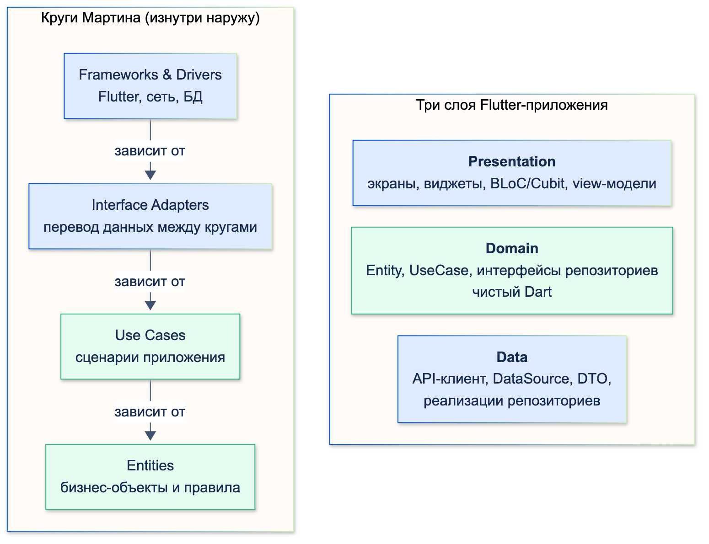
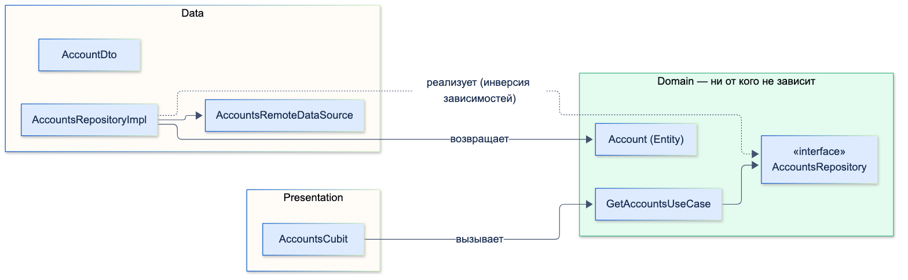
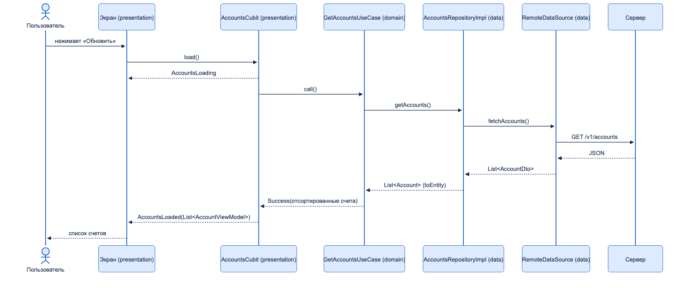

# Понимание слоёв приложения (data / domain / presentation)

| Грейд | Время на изучение | Статус |
|-------|-------------------|--------|
| ⭐ | ~20 мин лекция + практика | ✅ Готово |

---

## 📚 Ресурсы

| Ресурс | Формат | Язык | Уровень | Зачем читать |
|--------|--------|------|---------|--------------|
| Роберт Мартин, «Чистая архитектура» (Питер, 2018), часть V | Книга | 🇷🇺 | ⭐⭐ → ⭐⭐⭐ | Первоисточник: границы, правило зависимостей, «кричащая архитектура» |
| [Хендбук Яндекса: Clean Architecture](https://contest.yandex.ru/tracks/flutter/architecture/clean-architecture) и [структура файлов проекта](https://contest.yandex.ru/tracks/flutter/architecture/project-file-structure) | Учебник | 🇷🇺 | ⭐ → ⭐⭐ | Слои data — domain — presentation во Flutter, контракты между ними, layer-first и feature-first |
| [Структура Flutter-приложения: feature-first или layer-first](https://habr.com/ru/articles/772802/) | Статья (Habr, перевод) | 🇷🇺 | ⭐⭐ | Как раскладывать слои по папкам, когда проект растёт |
| [The Clean Architecture](https://blog.cleancoder.com/uncle-bob/2012/08/13/the-clean-architecture.html) | Статья | 🇬🇧 | ⭐⭐ | Исходная статья Мартина 2012 года: четыре круга и правило зависимостей на одной странице |
| [Flutter: Guide to app architecture](https://docs.flutter.dev/app-architecture/guide) | Документация | 🇬🇧 | ⭐⭐ | Официальный взгляд команды Flutter: UI, data и необязательный domain-слой, когда нужны use case |

---

## 🎓 Лекция

### 1. Clean Architecture в двух словах

**Чистая архитектура** (Clean Architecture) — подход Роберта Мартина (2012): приложение делится на слои так,
чтобы **бизнес-логика не зависела от деталей** — фреймворка, базы данных, сети, интерфейса.

Мартин рисует её кругами. В центре — то, что меняется реже всего, снаружи — то, что меняется чаще:

| Круг (изнутри наружу) | Что это | Во Flutter-приложении |
|------------------------|---------|-----------------------|
| **Entities** | Бизнес-объекты и правила, которые не зависят от приложения | Entity: `Account`, `Payment` |
| **Use Cases** | Сценарии приложения: что делает пользователь | `GetAccountsUseCase`, `MakePaymentUseCase` |
| **Interface Adapters** | Перевод данных между форматом сценариев и внешним миром | Репозитории, DTO, BLoC/Cubit |
| **Frameworks & Drivers** | Фреймворк, БД, сеть, UI | Flutter, dio, drift |

**Правило зависимостей** (Dependency Rule) — главное в подходе: *зависимости в коде направлены только внутрь.
Внутренний круг ничего не знает о внешних*: Entity не знает о репозитории, UseCase не знает о Flutter и HTTP.

Во Flutter-приложениях круги обычно сводят к **трём слоям**.



### 2. Три слоя и их назначение

| Слой | Назначение | Что внутри | О чём не знает |
|------|-----------|------------|----------------|
| **Presentation** | Показать данные и принять действия пользователя | Экраны и виджеты, BLoC/Cubit (состояние экрана), view-модели, навигация | О том, откуда берутся данные: сеть это, БД или кеш |
| **Domain** | Бизнес-логика: что делает приложение и по каким правилам | Entity, интерфейсы репозиториев, UseCase | О Flutter, сети, БД, JSON — это чистый Dart |
| **Data** | Получить и сохранить данные | API-клиент, DataSource (remote, local), DTO, реализации репозиториев | Об экранах и состоянии UI |

- **Presentation** отвечает на вопрос «**как показать**». Отформатировать сумму, показать загрузку, обработать нажатие.
- **Domain** — «**что и по каким правилам**». Отсортировать счета, проверить, можно ли платить, посчитать комиссию.
  Это самый устойчивый слой: дизайн и API меняются, а правила банка — гораздо реже.
- **Data** — «**откуда и куда**». Сходить в API, прочитать кеш, превратить JSON в объекты.

### 3. Направление зависимостей



```text
presentation  ──►  domain  ◄──  data
```

- **Presentation зависит от domain**: Cubit вызывает UseCase и получает Entity.
- **Data зависит от domain**: реализация репозитория реализует интерфейс из domain и возвращает Entity из domain.
- **Domain не зависит ни от кого.**

Но ведь UseCase вызывает репозиторий, который ходит в сеть, — как domain может не зависеть от data?
Через **инверсию зависимостей** (принцип D из SOLID, тема «Принципы SOLID, DRY, KISS»): domain объявляет
**интерфейс** `AccountsRepository` — «мне нужны счета», а data **реализует** его. UseCase во время работы вызывает
реализацию, но в коде знает только об интерфейсе. Связывает их DI при запуске приложения.

### 4. Путь данных: от кнопки до API и обратно

Экран «Мои счета», кнопка «Обновить»:



**Domain** — модель, контракт и сценарий (`Result` — общий класс из `core/`):

`accounts/domain/entities/account.dart`

```dart
/// Счёт клиента — модель предметной области. Ничего не знает о JSON, БД и UI
final class Account {
  const Account({required this.id, required this.title, required this.balanceKopecks, required this.isBlocked});

  final String id;
  final String title;
  final int balanceKopecks; // деньги — в целых копейках
  final bool isBlocked;

  /// Бизнес-правило живёт в Entity: со счёта можно платить, если он не заблокирован и на нём есть деньги
  bool get canPay => !isBlocked && balanceKopecks > 0;
}
```

`accounts/domain/repositories/accounts_repository.dart`

```dart
import '../entities/account.dart';

/// Контракт domain-слоя: что нужно бизнес-логике. Как это получить — решает data-слой
abstract interface class AccountsRepository {
  Future<List<Account>> getAccounts();
}
```

`accounts/domain/use_cases/get_accounts_use_case.dart`

```dart
import '../../../core/result.dart';
import '../entities/account.dart';
import '../repositories/accounts_repository.dart';

/// Сценарий «показать счета»: открытые сначала, по убыванию баланса
final class GetAccountsUseCase {
  const GetAccountsUseCase(this._repository);

  final AccountsRepository _repository; // зависит от интерфейса, а не от реализации

  Future<Result<List<Account>>> call() async {
    try {
      final accounts = await _repository.getAccounts();
      final sorted = [...accounts]..sort((a, b) {
          if (a.isBlocked != b.isBlocked) return a.isBlocked ? 1 : -1;
          return b.balanceKopecks.compareTo(a.balanceKopecks);
        });
      return Success(sorted);
    } on Exception catch (error) {
      return Failure(error);
    }
  }
}
```

`core/result.dart`

```dart
/// Результат операции domain-слоя: успех с данными или ошибка
sealed class Result<T> {
  const Result();
}

final class Success<T> extends Result<T> {
  const Success(this.data);

  final T data;
}

final class Failure<T> extends Result<T> {
  const Failure(this.error);

  final Exception error;
}
```

**Data** — описание эндпоинта, DTO, источник данных и реализация репозитория:

`accounts/data/network/accounts_api.dart`

```dart
/// Описание эндпоинтов. В проекте это retrofit-интерфейс, реализацию генерирует build_runner
abstract interface class AccountsApi {
  /// GET /v1/accounts — сырой JSON-список счетов
  Future<List<Object?>> fetchAccounts();
}
```

`accounts/data/models/account_dto.dart`

```dart
import '../../domain/entities/account.dart';

/// Формат ответа сервера. Знает о JSON и названиях полей API
final class AccountDto {
  const AccountDto({required this.id, required this.name, required this.balance, required this.status});

  factory AccountDto.fromJson(Map<String, Object?> json) => AccountDto(
        id: json['id']! as String,
        name: json['name']! as String,
        balance: json['balance']! as int,
        status: json['status']! as String,
      );

  final String id;
  final String name;
  final int balance;
  final String status; // 'ACTIVE' | 'BLOCKED' — детали API, которые domain знать не должен

  /// Преобразование на границе слоёв: DTO → Entity
  Account toEntity() => Account(id: id, title: name, balanceKopecks: balance, isBlocked: status == 'BLOCKED');
}
```

`accounts/data/data_sources/accounts_remote_data_source.dart`

```dart
import '../models/account_dto.dart';
import '../network/accounts_api.dart';

/// Источник данных: один способ получить данные — сеть
abstract interface class AccountsRemoteDataSource {
  Future<List<AccountDto>> fetchAccounts();
}

final class AccountsRemoteDataSourceImpl implements AccountsRemoteDataSource {
  const AccountsRemoteDataSourceImpl(this._api);

  final AccountsApi _api;

  @override
  Future<List<AccountDto>> fetchAccounts() async {
    final json = await _api.fetchAccounts();
    return json.map((item) => AccountDto.fromJson(item! as Map<String, Object?>)).toList();
  }
}
```

`accounts/data/repositories/accounts_repository_impl.dart`

```dart
import '../../domain/entities/account.dart';
import '../../domain/repositories/accounts_repository.dart';
import '../data_sources/accounts_remote_data_source.dart';

/// Реализация контракта domain-слоя: берёт DTO из источника и отдаёт Entity
final class AccountsRepositoryImpl implements AccountsRepository {
  const AccountsRepositoryImpl(this._remote);

  final AccountsRemoteDataSource _remote;

  @override
  Future<List<Account>> getAccounts() async {
    final dtos = await _remote.fetchAccounts();
    return dtos.map((dto) => dto.toEntity()).toList();
  }
}
```

**Presentation** — модель экрана, маппер, состояния и Cubit:

`accounts/presentation/models/account_view_model.dart`

```dart
/// Модель для экрана: уже отформатированные строки, ничего лишнего
final class AccountViewModel {
  const AccountViewModel({required this.title, required this.balance, required this.canPay});

  final String title;
  final String balance;
  final bool canPay;
}
```

`accounts/presentation/mappers/account_view_model_mapper.dart`

```dart
import '../../domain/entities/account.dart';
import '../models/account_view_model.dart';

/// Entity → ViewModel: форматирование для экрана живёт здесь, а не в Cubit
extension AccountViewModelMapper on Account {
  AccountViewModel toViewModel() => AccountViewModel(
        title: title,
        balance: '${balanceKopecks ~/ 100} ₽',
        canPay: canPay,
      );
}
```

`accounts/presentation/pages/accounts/cubit/accounts_state.dart`

```dart
import '../../../models/account_view_model.dart';

sealed class AccountsState {
  const AccountsState();
}

final class AccountsLoading extends AccountsState {
  const AccountsLoading();
}

final class AccountsLoaded extends AccountsState {
  const AccountsLoaded(this.accounts);

  final List<AccountViewModel> accounts;
}

final class AccountsError extends AccountsState {
  const AccountsError(this.message);

  final String message;
}
```

`accounts/presentation/pages/accounts/cubit/accounts_cubit.dart`

```dart
import 'package:flutter_bloc/flutter_bloc.dart';

import '../../../../../core/result.dart';
import '../../../../domain/use_cases/get_accounts_use_case.dart';
import '../../../mappers/account_view_model_mapper.dart';
import 'accounts_state.dart';

/// Состояние экрана «Мои счета». Знает только о UseCase, не о репозитории и сети
final class AccountsCubit extends Cubit<AccountsState> {
  AccountsCubit(this._getAccounts) : super(const AccountsLoading());

  final GetAccountsUseCase _getAccounts;

  /// Вызывается при открытии экрана и по кнопке «Обновить»
  Future<void> load() async {
    emit(const AccountsLoading());
    final result = await _getAccounts();
    emit(switch (result) {
      Success(:final data) => AccountsLoaded(data.map((account) => account.toViewModel()).toList()),
      Failure() => const AccountsError('Не удалось загрузить счета'),
    });
  }
}
```

Сборка цепочки (в приложении это делает DI) и результат на тестовом API, который возвращает три счёта:

```dart
final cubit = AccountsCubit(
  GetAccountsUseCase(
    AccountsRepositoryImpl(
      AccountsRemoteDataSourceImpl(accountsApi),
    ),
  ),
);
await cubit.load();
```

```text
API: GET /v1/accounts
Состояние: AccountsLoading
Состояние: AccountsLoaded
Зарплатный: 150000 ₽, можно платить: true
Кредитка: 0 ₽, можно платить: false
Старый счёт: 9900 ₽, можно платить: false
```

Если API бросает исключение, UseCase возвращает `Failure`, и экран показывает `Не удалось загрузить счета`.

**Три модели одного счёта** и где они превращаются друг в друга:

| Модель | Слой | Что знает | Где создаётся |
|--------|------|-----------|---------------|
| `AccountDto` | data | Формат API: `name`, `balance`, `status: 'BLOCKED'` | `fromJson` в DataSource |
| `Account` | domain | Бизнес-смысл: `title`, `balanceKopecks`, `isBlocked`, правило `canPay` | `dto.toEntity()` в репозитории |
| `AccountViewModel` | presentation | Готовые строки для экрана: `'150000 ₽'` | `toViewModel()` в маппере, вызывает Cubit |

Если сервер переименует `status` в `state`, поменяется только `AccountDto`. Если дизайнер захочет показывать
копейки — только маппер `AccountViewModelMapper`. Domain не трогаем ни в одном из случаев.

### 5. Структура папок модуля

Каждая фича — **отдельный модуль** (Dart-пакет со своим `pubspec.yaml`), и все модули устроены **одинаково**.
Открыв любой модуль, разработчик сразу знает, где лежит запрос к API, где бизнес-правило, а где экран.

```text
accounts/                                ← модуль фичи «Счета», отдельный пакет
├── pubspec.yaml                         ← зависимости модуля: общие пакеты ядра, flutter_bloc, get_it, retrofit…
└── lib/
    ├── accounts.dart                    ← точка входа модуля: регистрация зависимостей (DI) и экранов
    ├── data/
    │   ├── network/
    │   │   └── accounts_api.dart        ← описание эндпоинтов (retrofit): GET /v1/accounts
    │   ├── data_sources/
    │   │   ├── accounts_remote_data_source.dart   ← интерфейс + Impl: ходит в AccountsApi
    │   │   └── accounts_local_data_source.dart    ← интерфейс + Impl: кеш в БД (если нужен)
    │   ├── models/
    │   │   ├── account_dto.dart         ← DTO с fromJson и toEntity()
    │   │   └── response/
    │   │       └── accounts_response.dart        ← обёртка ответа сервера
    │   ├── repositories/
    │   │   └── accounts_repository_impl.dart     ← реализация интерфейса из domain
    │   └── analytics/
    │       └── accounts_analytics_interactor_impl.dart
    ├── domain/
    │   ├── entities/
    │   │   └── account.dart             ← Entity: бизнес-модель и правила
    │   ├── repositories/
    │   │   └── accounts_repository.dart ← интерфейс (abstract interface class)
    │   ├── use_cases/
    │   │   └── get_accounts_use_case.dart
    │   ├── exceptions/
    │   │   └── account_blocked_exception.dart   ← ошибки предметной области
    │   ├── features/
    │   │   └── accounts_redesign/       ← фича-флаги модуля: ключ флага и проверка «включено ли»
    │   └── analytics/
    │       └── accounts_analytics_interactor.dart  ← интерфейс аналитики модуля
    ├── presentation/
    │   ├── pages/
    │   │   └── accounts/
    │   │       ├── cubit/
    │   │       │   ├── accounts_cubit.dart
    │   │       │   └── accounts_state.dart
    │   │       └── accounts_screen.dart
    │   ├── widgets/                     ← виджеты, общие для экранов модуля
    │   ├── models/
    │   │   └── account_view_model.dart  ← модели для экрана
    │   └── mappers/
    │       └── account_view_model_mapper.dart   ← Entity → ViewModel
    ├── navigation/
    │   ├── accounts_navigator.dart      ← интерфейс: «открыть детали счёта», «назад»
    │   └── accounts_navigator_impl.dart ← реализация на роутере приложения
    ├── l10n/                            ← строки модуля
    └── resources/                       ← константы, ключи аналитики, иконки
```

На что обратить внимание:
- **Слои — папки верхнего уровня внутри модуля**, а не отдельные модули. Внутри каждого слоя — папки по виду класса.
- **У каждого DataSource и репозитория есть интерфейс и реализация** (`…Impl`). Интерфейсы DataSource лежат в data
  (это внутреннее дело слоя), интерфейс репозитория — в domain.
- **`network/` и `data_sources/` разделены:** `network` только описывает эндпоинты (сгенерированный retrofit-клиент),
  а DataSource решает, какие вызовы сделать и как обработать сетевые ошибки.
- **Экран с его Cubit или BLoC лежат рядом** в `presentation/pages/<экран>/`. Маппинг Entity → ViewModel вынесен
  в `mappers/`, чтобы Cubit не разрастался.
- **Навигация — тоже за интерфейсом.** Cubit вызывает `navigator.openAccountDetails(id)` и не знает о роутере:
  так его проще тестировать, а модуль не зависит от того, как устроена навигация приложения.
- **Аналитика и фича-флаги — часть domain** как интерфейсы: бизнес-сценарий решает, что отправить и что показать,
  а как отправить — реализация в data.
- **Точка входа `accounts.dart`** регистрирует зависимости модуля в DI: API, DataSource и репозитории — одним
  экземпляром на приложение, UseCase — новым экземпляром на каждый запрос, и связывает экраны с маршрутами.

Как модули связаны между собой и что выносится в общие пакеты — в теме «Многомодульность».

### 6. Зачем всё это

- **Тестируемость.** Domain — чистый Dart: UseCase проверяется обычным `test` с фейковым репозиторием, без Flutter,
  сети и эмулятора. Cubit — с фейковым UseCase.
- **Замена деталей.** Новый API, другой HTTP-клиент, кеш в БД — меняется data-слой, остальное не трогаем.
- **Параллельная работа.** Договорились об интерфейсе репозитория — один разработчик делает экран на фейковых данных,
  другой — интеграцию с API.
- **Понятность.** В любом модуле одинаковая структура: новый человек сразу знает, где искать правило, а где — запрос.

### 🚫 Чрезмерное применение

- **UseCase-«прокладка» для каждого вызова**, который просто передаёт данные из репозитория без логики.
  Официальное руководство Flutter считает domain-слой **необязательным** и советует use case, когда логика объединяет
  несколько репозиториев, сложная или переиспользуется несколькими экранами. Многие команды всё равно требуют UseCase
  везде — ради единообразия и единой обработки ошибок. Это нормально, если решение осознанное и записано в правилах команды.
- **Три копии одной модели без различий** (DTO, Entity и ViewModel с одинаковыми полями) в простом модуле —
  много кода маппинга без пользы. Разделять модели стоит, когда они реально отличаются.
- **Полная архитектура в прототипе** или в экране из одной кнопки, который проживёт месяц.

### ⚠️ Частые ошибки

- **Domain импортирует data.** Интерфейс репозитория в domain возвращает DTO:

```dart
// ❌ domain/repositories/accounts_repository.dart
import '../../data/models/account_dto.dart'; // domain знает о формате API

abstract interface class AccountsRepository {
  Future<List<AccountDto>> getAccounts(); // DTO уходит в domain, а дальше — в Cubit
}
```

  Тогда маппинг DTO → Entity размазывается по Cubit-ам, а смена поля в API ломает экраны.
  ✅ Репозиторий возвращает Entity, маппинг — внутри `AccountsRepositoryImpl`.
- **Domain импортирует Flutter** (`package:flutter/material.dart` ради `Color` или `debugPrint`) — слой перестаёт
  быть чистым Dart и тестироваться без Flutter.
- **Cubit ходит в API или в DataSource напрямую** в обход UseCase и репозитория.
- **Бизнес-логика в виджете:** проверка `balance > 0 && !blocked` в `build` вместо правила в Entity или UseCase.
- **Entity с `fromJson`/`toJson`** — формат API протёк в domain.
- **Исключения сети долетают до UI** — экран ловит `DioException`. Ошибки переводятся в понятный domain-формат
  (`Result`, свои исключения) на границе слоёв.

> 💡 **Совет:** правило зависимостей легко проверить автоматически: файлы из `domain/` не должны импортировать
> `package:flutter`, `package:dio` и файлы из `data/` и `presentation/`. Такую проверку делают линтером
> (например, правилами `custom_lint`) или простым тестом, который читает импорты.

---

## ✅ Самопроверка

**⭐ Junior**
1. Назови три слоя Flutter-приложения и назначение каждого.
2. Где должна жить проверка «можно ли платить с этого счёта»? Почему не в виджете?
3. Чем DTO отличается от Entity?

**⭐⭐ Middle**
1. Сформулируй правило зависимостей. В каком направлении зависят слои?
2. Как UseCase вызывает репозиторий, который ходит в сеть, и при этом domain не зависит от data?
3. Сервер переименовал поле `status`. Какие файлы поменяются, а какие — нет?
4. Почему domain-слой должен быть чистым Dart?

**⭐⭐⭐ Senior**
1. Как круги Мартина соотносятся с тремя слоями Flutter-приложения?
2. Когда UseCase нужен, а когда это лишняя прокладка? Как договориться об этом в команде?
3. Чем плох интерфейс репозитория, который возвращает DTO? Как это исправить?
4. Как автоматически следить за соблюдением правила зависимостей в большом проекте?

<details>
<summary>Ответы</summary>

**Junior**
1. Presentation — показать данные и принять действия пользователя (экраны, BLoC/Cubit). Domain — бизнес-логика
   (Entity, UseCase, интерфейсы репозиториев). Data — получить и сохранить данные (API, БД, DTO, реализации репозиториев).
2. В domain: правило в Entity (`canPay`) или в UseCase. Тогда оно одно на все экраны, тестируется без UI и не
   дублируется в каждом виджете.
3. DTO повторяет формат API или БД и живёт в data. Entity — модель предметной области в domain, без JSON и деталей хранения.

**Middle**
1. Зависимости в коде направлены только внутрь: внутренний слой ничего не знает о внешних. Presentation → domain ← data.
2. Через инверсию зависимостей: domain объявляет интерфейс `AccountsRepository`, data его реализует. UseCase знает только
   интерфейс, конкретную реализацию подставляет DI.
3. Только `AccountDto` (`fromJson` и `toEntity`). Entity, UseCase, Cubit и экран не меняются.
4. Чтобы бизнес-правила не зависели от фреймворка и тестировались обычными unit-тестами без Flutter, сети и эмулятора;
   чтобы правила переживали смену UI и API.

**Senior**
1. Entities и Use Cases — domain; Interface Adapters — репозитории и DTO (data), BLoC/Cubit (presentation);
   Frameworks & Drivers — Flutter, HTTP-клиент, БД. Три слоя — практичное упрощение четырёх кругов.
2. Нужен, когда логика объединяет несколько репозиториев, сложная или переиспользуется. Лишний — когда просто передаёт
   вызов. Договориться и записать правило: «UseCase везде» (единообразие, единая обработка ошибок) или «только когда есть
   логика» (меньше кода) — главное, чтобы решение было одно на проект.
3. Domain начинает зависеть от data, формат API протекает в бизнес-логику и UI, маппинг расползается по Cubit-ам.
   Исправление: репозиторий возвращает Entity, преобразование DTO → Entity — в реализации репозитория.
4. Линтер с правилами импортов (например, на `custom_lint`), тест, который проверяет импорты файлов `domain/`,
   разнесение слоёв по отдельным пакетам (domain-пакет физически не может импортировать data, если её нет в зависимостях).

</details>
