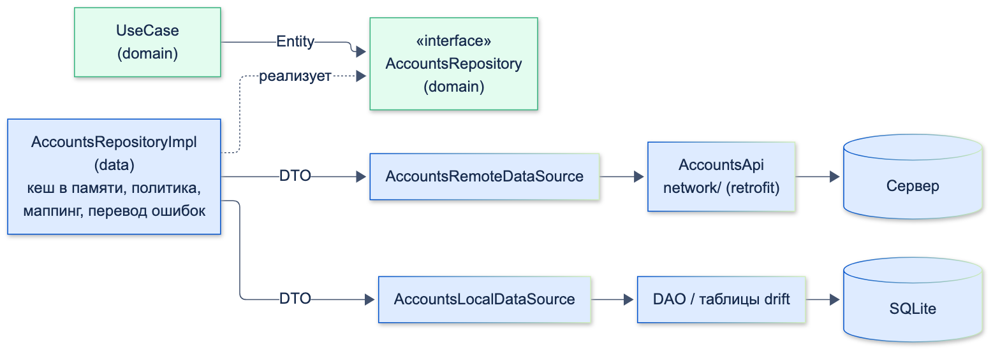
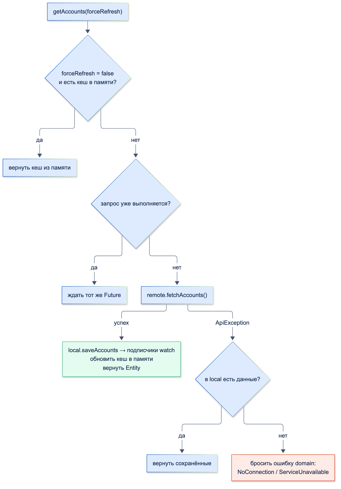

# Паттерн Repository

| Грейд | Время на изучение | Статус |
|-------|-------------------|--------|
| ⭐ | ~30 мин лекция + практика | ✅ Готово |

---

## 📚 Ресурсы

| Ресурс | Формат | Язык | Уровень | Зачем читать |
|--------|--------|------|---------|--------------|
| Мартин Фаулер, «Шаблоны корпоративных приложений» (Вильямс), глава про Repository | Книга | 🇷🇺 | ⭐⭐ | Первоисточник паттерна: репозиторий как «коллекция» объектов предметной области |
| Эрик Эванс, «Предметно-ориентированное проектирование (DDD)» (Вильямс), глава 6 | Книга | 🇷🇺 | ⭐⭐⭐ | Репозиторий для агрегата: почему один репозиторий на сущность-корень, а не на таблицу или эндпоинт |
| [Хендбук Яндекса: Clean Architecture](https://contest.yandex.ru/tracks/flutter/architecture/clean-architecture) | Учебник | 🇷🇺 | ⭐ | Слой доступа к данным и контракты между слоями во Flutter |
| [Martin Fowler: Repository](https://martinfowler.com/eaaCatalog/repository.html) | Статья | 🇬🇧 | ⭐ | Определение паттерна на одной странице |
| [Flutter: Data layer (case study)](https://docs.flutter.dev/app-architecture/case-study/data-layer) | Документация | 🇬🇧 | ⭐⭐ | Как команда Flutter видит репозитории: источник истины для типа данных, кеш, повторы, модели domain, `Result` |

---

## 🎓 Лекция

### 1. Что такое Repository

Определение Фаулера: репозиторий — посредник между предметной областью и слоем данных, который даёт доступ
к объектам предметной области **как к коллекции**. Тот, кто вызывает `getAccounts()`, получает счета и не знает,
пришли они с сервера, из базы или из памяти.

В Clean Architecture (тема «Понимание слоёв приложения»):
- **интерфейс** репозитория лежит в **domain** — это требование бизнес-логики «мне нужны счета»;
- **реализация** лежит в **data** — это ответ «вот откуда и как их взять»;
- для domain-слоя репозиторий — **единственная точка доступа к данным** фичи. Руководство Flutter называет его
  «источником истины» (source of truth) для своего типа данных: только через него эти данные читаются и меняются.

### 2. Кто есть кто: Repository, DataSource, API, DAO, Service

| Класс | Слой | Ответственность | Пример |
|-------|------|-----------------|--------|
| **Repository** (интерфейс) | domain | Контракт: какие данные нужны бизнес-логике, в виде Entity | `AccountsRepository` |
| **RepositoryImpl** | data | Координирует источники, кеширует, переводит DTO в Entity и ошибки — в ошибки domain | `AccountsRepositoryImpl` |
| **DataSource** | data | Один способ получить данные: сеть **или** БД **или** файл. Работает с DTO | `AccountsRemoteDataSource`, `AccountsLocalDataSource` |
| **API** (`network/`) | data | Описание эндпоинтов, HTTP-клиент | `AccountsApi` (retrofit) |
| **DAO** | data | Запросы к таблицам БД (в drift) — внутренняя деталь local DataSource | `AccountsDao` |
| **Service** | data | Обёртка над платформой или внешним SDK без состояния: геолокация, биометрия, push | `BiometryService` |



### 3. ✅ Что может быть в репозитории

- **Реализация контракта domain** — методы возвращают Entity (или `Stream` Entity), а не DTO.
- **Координация источников** — решение, откуда брать данные: память, локальная БД, сеть.
- **Политика кеширования** — одна из стандартных:

| Политика | Как работает | Где уместна |
|----------|--------------|-------------|
| **Сначала сеть, при ошибке — сохранённые** (network-first) | Идём на сервер; не получилось — отдаём из БД | Счета, баланс: важна свежесть, но лучше старые данные, чем пустой экран |
| **Сначала кеш** (cache-first) | Есть в кеше — отдаём, нет — идём в сеть | Справочники: курсы на день, список банков, отделения |
| **Показать кеш и обновить** (stale-while-revalidate) | Сразу отдаём сохранённое, параллельно обновляем, новые данные приходят через `Stream` | Ленты, история операций |
| **Только сеть** | Без кеша | Операции, где устаревшие данные опасны: подтверждение платежа |

- **Маппинг DTO ↔ Entity** — и ответов, и параметров запроса.
- **Перевод ошибок**: `DioException`, ошибки БД → ошибки предметной области (`NoConnectionException`).
- **Объединение параллельных запросов**: три виджета одновременно просят счета — запрос один.
- **`watch…`-методы** — `Stream` из локальной БД, чтобы экраны узнавали об изменениях.
- **Инвалидация кеша** после изменений (`blockAccount` → сбросить и обновить счета).
- **Пагинация, повтор запроса (retry)** — если это свойство получения данных, а не бизнес-правило.

### 4. ❌ Чего в репозитории быть не может

| Нельзя | Почему | Где должно быть |
|--------|--------|-----------------|
| Форматирование для экрана (`'150 000 ₽'`), тексты ошибок, `BuildContext`, навигация, диалоги | Это presentation: репозиторий не знает, как данные покажут | Маппер ViewModel, Cubit |
| Бизнес-правила и сценарии: «хватает ли денег», расчёт комиссии, «если счёт заблокирован, то…» | Правила должны быть в одном месте, проверяемом без data-слоя | Entity (`canPay`) или UseCase |
| DTO, `Response`, `DioException` в сигнатурах интерфейса | Формат API протекает в domain и UI | Внутри `RepositoryImpl`; наружу — Entity и ошибки domain |
| Вызов другого репозитория | Появляются скрытые связи между фичами и циклы зависимостей; руководство Flutter прямо говорит, что репозитории не должны знать друг о друге | UseCase, который вызывает оба |
| Состояние экрана, подписка на Cubit, флаги вида `isLoading` | Это состояние UI, а не данных | Cubit/BLoC |
| «Сырой» HTTP (`dio.get` прямо в репозитории) | Смешивание координации и транспорта, тяжело тестировать | DataSource и `network/` |
| Аналитика и логика экранов («пользователь открыл счёт») | Не относится к данным | Интерактор аналитики, вызываемый из Cubit или UseCase |

### 5. Проектирование интерфейса

- **Гранулярность — по сущности, а не по эндпоинту.** `AccountsRepository` со всеми операциями над счетами, а не
  `GetAccountsRepository`, `BlockAccountRepository`. Но и не один `BankRepository` на всё приложение.
- **Имена — на языке предметной области:** `getAccounts`, `watchAccounts`, `blockAccount`, а не `fetchV2AccountsList`.
- **`Future` — для однократного запроса, `Stream` — для наблюдения** за данными, которые меняются.
- **Контракт ошибок — явный.** Либо репозиторий бросает свои исключения domain (`AccountsException`), а UseCase
  оборачивает их в `Result`, либо сам возвращает `Result`. Главное — одно правило на проект и никаких `DioException` наружу.
- **Параметры — тоже модели domain:** `blockAccount(String id)`, `getHistory(HistoryFilter filter)`, а не `Map<String, dynamic>`.

### 6. Пример: репозиторий счетов с кешем

Продолжаем фичу «Мои счета». Ошибки предметной области и контракт:

```dart
/// Ошибки предметной области: их понимают UseCase и экран. О HTTP-кодах они не знают
sealed class AccountsException implements Exception {
  const AccountsException();
}

/// Нет связи с сервером, и показать нечего
final class NoConnectionException extends AccountsException {
  const NoConnectionException();
}

/// Сервер ответил ошибкой
final class ServiceUnavailableException extends AccountsException {
  const ServiceUnavailableException();
}

/// Бизнес-ошибка: на счёте недостаточно денег или он заблокирован
final class InsufficientFundsException extends AccountsException {
  const InsufficientFundsException();
}

/// Счёта с таким id у клиента нет
final class AccountNotFoundException extends AccountsException {
  const AccountNotFoundException();
}
```

```dart
import '../entities/account.dart';

/// Контракт domain-слоя. Ошибки — только AccountsException
abstract interface class AccountsRepository {
  /// Счета клиента. [forceRefresh] — не брать из кеша в памяти (жест «потянуть, чтобы обновить»)
  Future<List<Account>> getAccounts({bool forceRefresh = false});

  /// Сохранённые счета и все их будущие изменения
  Stream<List<Account>> watchAccounts();

  Future<void> blockAccount(String id);
}
```

Источники данных (`network/` и два DataSource):

```dart
/// Ошибка сетевого уровня. В проекте её роль играет DioException
final class ApiException implements Exception {
  const ApiException({this.statusCode});

  final int? statusCode; // null — запрос не дошёл до сервера
}

/// Описание эндпоинтов (в проекте — retrofit-интерфейс)
abstract interface class AccountsApi {
  Future<List<Object?>> fetchAccounts(); // GET /v1/accounts
  Future<void> blockAccount(String id); // POST /v1/accounts/{id}/block
}
```

```dart
import '../models/account_dto.dart';
import '../network/accounts_api.dart';

abstract interface class AccountsRemoteDataSource {
  Future<List<AccountDto>> fetchAccounts();
  Future<void> blockAccount(String id);
}

final class AccountsRemoteDataSourceImpl implements AccountsRemoteDataSource {
  const AccountsRemoteDataSourceImpl(this._api);

  final AccountsApi _api;

  @override
  Future<List<AccountDto>> fetchAccounts() async {
    final json = await _api.fetchAccounts();
    return json.map((item) => AccountDto.fromJson(item! as Map<String, Object?>)).toList();
  }

  @override
  Future<void> blockAccount(String id) => _api.blockAccount(id);
}
```

```dart
import '../models/account_dto.dart';

/// Локальное хранилище счетов. В проекте реализация — на drift (тема «Локальное хранение данных»)
abstract interface class AccountsLocalDataSource {
  /// null — в хранилище ещё ничего нет
  Future<List<AccountDto>?> readAccounts();

  Future<void> saveAccounts(List<AccountDto> accounts);

  Stream<List<AccountDto>> watchAccounts();
}
```

Реализация:

```dart
import '../../domain/entities/account.dart';
import '../../domain/exceptions/accounts_exceptions.dart';
import '../../domain/repositories/accounts_repository.dart';
import '../data_sources/accounts_local_data_source.dart';
import '../data_sources/accounts_remote_data_source.dart';
import '../models/account_dto.dart';
import '../network/accounts_api.dart';

final class AccountsRepositoryImpl implements AccountsRepository {
  AccountsRepositoryImpl({
    required AccountsRemoteDataSource remote,
    required AccountsLocalDataSource local,
  })  : _remote = remote,
        _local = local;

  final AccountsRemoteDataSource _remote;
  final AccountsLocalDataSource _local;

  // Кеш в памяти: повторный вход на экран не ходит в сеть
  List<Account>? _memoryCache;

  // Запрос, который уже выполняется: параллельные вызовы ждут его, а не создают новый
  Future<List<Account>>? _inFlight;

  @override
  Future<List<Account>> getAccounts({bool forceRefresh = false}) {
    final cached = _memoryCache;
    if (!forceRefresh && cached != null) return Future.value(cached);
    return _inFlight ??= _loadFromNetwork().whenComplete(() => _inFlight = null);
  }

  /// Политика «сначала сеть, при ошибке — сохранённые данные»
  Future<List<Account>> _loadFromNetwork() async {
    try {
      final dtos = await _remote.fetchAccounts();
      await _local.saveAccounts(dtos); // подписчики watchAccounts получат свежие данные
      return _memoryCache = _toEntities(dtos);
    } on ApiException catch (error) {
      final saved = await _local.readAccounts();
      if (saved != null) return _memoryCache = _toEntities(saved);
      throw _toDomainError(error); // наружу — только ошибки domain
    }
  }

  @override
  Stream<List<Account>> watchAccounts() => _local.watchAccounts().map(_toEntities);

  @override
  Future<void> blockAccount(String id) async {
    try {
      await _remote.blockAccount(id);
    } on ApiException catch (error) {
      throw _toDomainError(error);
    }
    _memoryCache = null; // данные устарели: сбрасываем кеш
    await getAccounts(forceRefresh: true); // и обновляем хранилище — экраны получат изменения через watch
  }

  List<Account> _toEntities(List<AccountDto> dtos) => dtos.map((dto) => dto.toEntity()).toList();

  AccountsException _toDomainError(ApiException error) => error.statusCode == null
      ? const NoConnectionException()
      : const ServiceUnavailableException();
}
```

Поведение, проверенное тестом на фейковых источниках:

```text
1. Первый вызов: запросов к API — 1, в хранилище — 2 счёта
2. Повторный вызов: запросов к API — 1 (из кеша в памяти)
3. Три параллельных обновления: запросов к API — 2 (три вызова — один запрос)
4. Нет сети, но есть сохранённые: Зарплатный, Накопительный
5. Нет сети и нечего показать: NoConnectionException
6. Сервер ответил 500: ServiceUnavailableException
7. После blockAccount подписчик watchAccounts получил: Зарплатный (заблокирован), Накопительный
```



**А где правило «хватает ли денег»?** Не в репозитории. Перевод между счетами использует **два** репозитория
и бизнес-правило — это UseCase:

```dart
import '../../../core/result.dart';
import '../exceptions/accounts_exceptions.dart';
import '../repositories/accounts_repository.dart';
import '../repositories/transfers_repository.dart';

/// Перевод между своими счетами. Правила и работа с двумя репозиториями — здесь, а не в репозиториях
final class TransferBetweenAccountsUseCase {
  const TransferBetweenAccountsUseCase(this._accounts, this._transfers);

  final AccountsRepository _accounts;
  final TransfersRepository _transfers;

  Future<Result<void>> call({required String fromId, required String toId, required int amountKopecks}) async {
    try {
      final accounts = await _accounts.getAccounts();
      // firstWhere бросил бы StateError — это Error, а не Exception, и catch ниже его не поймал бы
      final from = accounts.where((account) => account.id == fromId).firstOrNull;
      if (from == null) return const Failure(AccountNotFoundException());
      // Бизнес-правило: со счёта можно платить и денег хватает
      if (!from.canPay || from.balanceKopecks < amountKopecks) {
        return const Failure(InsufficientFundsException());
      }
      await _transfers.transfer(fromId: fromId, toId: toId, amountKopecks: amountKopecks);
      await _accounts.getAccounts(forceRefresh: true); // балансы изменились — обновляем данные
      return const Success(null);
    } on Exception catch (error) {
      return Failure(error);
    }
  }
}
```

```text
8. Перевод 1000 ₽ с накопительного: Success<void>
9. Перевод 999 000 ₽ с зарплатного: InsufficientFundsException
```

### 7. Как тестировать репозиторий

Репозиторий тестируют обычными unit-тестами с **фейковыми DataSource**: они считают вызовы, умеют «падать»
и хранят данные в памяти. Проверяют политику кеша, объединение запросов и перевод ошибок:

```dart
import 'dart:async';

import 'package:flutter_test/flutter_test.dart';

import 'package:accounts/data/data_sources/accounts_local_data_source.dart';
import 'package:accounts/data/data_sources/accounts_remote_data_source.dart';
import 'package:accounts/data/models/account_dto.dart';
import 'package:accounts/data/network/accounts_api.dart';
import 'package:accounts/data/repositories/accounts_repository_impl.dart';
import 'package:accounts/domain/exceptions/accounts_exceptions.dart';

/// Фейковый сервер: считает запросы и умеет «падать»
final class FakeRemote implements AccountsRemoteDataSource {
  var calls = 0;
  ApiException? failWith;

  @override
  Future<List<AccountDto>> fetchAccounts() async {
    calls++;
    if (failWith case final error?) throw error;
    return const [AccountDto(id: '1', name: 'Зарплатный', balance: 15000000, status: 'ACTIVE')];
  }

  @override
  Future<void> blockAccount(String id) async {}
}

/// Фейковое хранилище в памяти
final class FakeLocal implements AccountsLocalDataSource {
  List<AccountDto>? stored;
  final _changes = StreamController<List<AccountDto>>.broadcast();

  @override
  Future<List<AccountDto>?> readAccounts() async => stored;

  @override
  Future<void> saveAccounts(List<AccountDto> accounts) async => _changes.add(stored = accounts);

  @override
  Stream<List<AccountDto>> watchAccounts() => _changes.stream;
}

void main() {
  late FakeRemote remote;
  late FakeLocal local;
  late AccountsRepositoryImpl repository;

  setUp(() {
    remote = FakeRemote();
    local = FakeLocal();
    repository = AccountsRepositoryImpl(remote: remote, local: local);
  });

  test('параллельные обновления — один запрос к серверу', () async {
    await Future.wait([for (var i = 0; i < 3; i++) repository.getAccounts(forceRefresh: true)]);
    expect(remote.calls, 1);
  });

  test('нет сети — отдаёт сохранённые счета', () async {
    await repository.getAccounts(); // данные сохранились в local
    remote.failWith = const ApiException(); // сеть пропала
    final accounts = await repository.getAccounts(forceRefresh: true);
    expect(accounts.single.title, 'Зарплатный');
  });

  test('нет сети и нечего показать — ошибка domain, а не ApiException', () {
    remote.failWith = const ApiException();
    expect(repository.getAccounts(), throwsA(isA<NoConnectionException>()));
  });
}
```

### 🚫 Чрезмерное применение

- **Репозиторий-«прокладка»** над единственным remote DataSource, который просто переводит DTO в Entity. Это нормально:
  контракт в domain и маппинг уже ценны, а кеш и local DataSource добавятся без изменений в domain и UI. Но если
  команда ради «единообразия» создаёт и пустой local DataSource «на будущее» — это лишний код.
- **«God-репозиторий»** — `BankRepository` с сотней методов для всех фич. Его невозможно понять, а каждое изменение
  задевает всех.
- **Универсальный `BaseRepository<T>` с CRUD** (`getAll`, `getById`, `save`, `delete`) для всех сущностей. У счетов
  нет `delete`, у курсов валют — `save`; общий интерфейс заставляет писать пустые методы и скрывает настоящий язык
  предметной области.
- **Кеш везде.** Кешировать то, что не нужно кешировать (подтверждение платежа, одноразовые коды), — риск показать
  устаревшие или чужие данные.

### ⚠️ Частые ошибки

- **Интерфейс возвращает DTO** — формат API протекает в domain и Cubit.
- **`DioException` долетает до экрана** — нет перевода ошибок на границе.
- **Репозиторий вызывает другой репозиторий** — вместо UseCase, который объединяет данные.
- **Бизнес-правила в репозитории**: проверки лимитов, расчёт комиссий.
- **Состояние в репозитории без синхронизации**: кеш в памяти, который не сбрасывается после изменения данных
  (`blockAccount` прошёл, а экран показывает старый статус).
- **`on Exception catch` и `Error`.** `firstWhere` без совпадения, `!` у `null`, выход за границы списка бросают
  наследников `Error` (`StateError`, `TypeError`, `RangeError`), а не `Exception` — такой `catch` их не ловит, и
  ошибка роняет экран вместо `Failure`. Не допускать таких ситуаций в коде: `where(...).firstOrNull` и явная
  ошибка domain (`AccountNotFoundException`), как в UseCase выше.
- **Пять одинаковых запросов** при открытии экрана, где пять виджетов просят одни данные.
- **Репозиторий — синглтон с кешем данных пользователя**, который не очищается при выходе из аккаунта: следующий
  пользователь увидит чужие счета. Кеш сбрасывают при выходе (или репозиторий живёт в области видимости сессии).

---

## ✅ Самопроверка

**⭐ Junior**
1. Что такое репозиторий? Где лежит его интерфейс, а где реализация?
2. Чем репозиторий отличается от DataSource?
3. Что возвращают методы репозитория: DTO или Entity? Почему?

**⭐⭐ Middle**
1. Перечисли, что может быть в репозитории, а что — нет.
2. Назови политики кеширования и приведи пример данных для каждой.
3. Где должна быть проверка «хватает ли денег для перевода»? Почему не в репозитории?
4. Как экран узнает, что после блокировки счёта данные изменились?

**⭐⭐⭐ Senior**
1. Почему репозиторий не должен вызывать другой репозиторий? Как получить данные из двух?
2. Как сделать, чтобы три одновременных вызова `getAccounts` дали один запрос?
3. Какой контракт ошибок выбрать: исключения domain или `Result`? Где переводить `DioException`?
4. Чем плох универсальный `BaseRepository<T>`? А «God-репозиторий»?
5. Какие риски у кеша в репозитории в банковском приложении?

<details>
<summary>Ответы</summary>

**Junior**
1. Посредник между domain и источниками данных, дающий доступ к данным как к коллекции объектов предметной области.
   Интерфейс — в domain, реализация — в data.
2. DataSource — один способ получения данных (сеть, БД), работает с DTO. Репозиторий координирует несколько источников,
   кеширует, переводит DTO в Entity и ошибки — в ошибки domain.
3. Entity: domain и presentation не должны знать формат API. Перевод DTO → Entity — внутри реализации репозитория.

**Middle**
1. Может: контракт domain, координация источников, политика кеша, маппинг DTO ↔ Entity, перевод ошибок, объединение
   запросов, `watch`-методы, инвалидация, пагинация. Нельзя: UI и форматирование, бизнес-правила и сценарии, DTO и
   `DioException` в сигнатурах, вызовы других репозиториев, состояние экрана, «сырой» HTTP.
2. Network-first (счета, баланс), cache-first (справочники, курсы на день), stale-while-revalidate (ленты, история),
   только сеть (подтверждение платежа).
3. В Entity (`canPay`) или UseCase перевода: это бизнес-правило, оно должно быть в одном месте и тестироваться без data-слоя.
4. Через `watchAccounts()`: репозиторий после `blockAccount` обновляет локальное хранилище, а `Stream` из него сообщает
   всем подписанным экранам.

**Senior**
1. Появляются скрытые связи и циклы между фичами, репозиторий начинает принимать бизнес-решения. Данные из двух
   репозиториев объединяет UseCase.
2. Хранить `Future` выполняющегося запроса: следующие вызовы получают тот же `Future`
   (`_inFlight ??= _load().whenComplete(() => _inFlight = null)`).
3. Любой, но один на проект. Частый вариант: репозиторий бросает исключения domain, UseCase оборачивает в `Result`.
   `DioException` переводится внутри data (DataSource или `RepositoryImpl`) и наружу не выходит.
4. `BaseRepository<T>` навязывает операции, которых у сущности нет, и прячет язык предметной области. «God-репозиторий» —
   огромный класс, связывающий все фичи; его изменение задевает всех.
5. Устаревшие данные там, где они опасны (балансы после операции, подтверждения), утечка данных между пользователями,
   если кеш не очищается при выходе, хранение чувствительных данных в незашифрованной БД.

</details>
