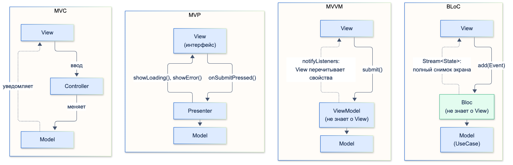
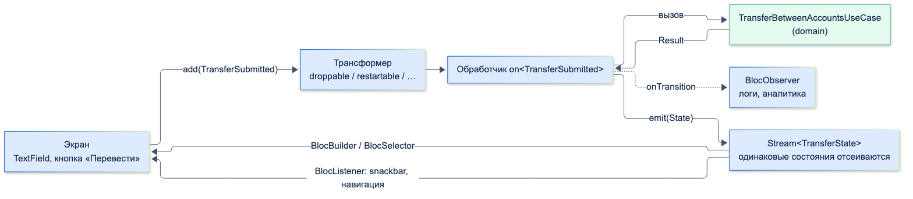
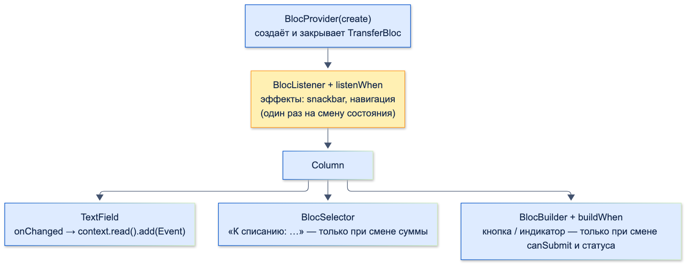

# Паттерны презентационного слоя (BLoC, MVP, MVVM, MVC)

| Грейд | Время на изучение | Статус |
|-------|-------------------|--------|
| ⭐⭐ | ~40 мин лекция + практика | ✅ Готово |

---

## 📚 Ресурсы

| Ресурс | Формат | Язык | Уровень | Зачем читать |
|--------|--------|------|---------|--------------|
| Хендбук Яндекса: [BLoC: разбор паттерна](https://contest.yandex.ru/tracks/flutter/architecture/bloc-pattern) и [BLoC: библиотека](https://contest.yandex.ru/tracks/flutter/architecture/bloc-library) | Учебник | 🇷🇺 | ⭐ → ⭐⭐ | Идея паттерна «события на вход, состояния на выход» и устройство библиотеки bloc |
| [Использование Provider, Riverpod, Bloc (Cubit), Redux, MobX на одном простом примере](https://habr.com/ru/articles/747062/) | Статья (Habr) | 🇷🇺 | ⭐⭐ | Одна и та же корзина на пяти подходах — удобно сравнить объём кода и идеи |
| [Bloc: Core Concepts](https://bloclibrary.dev/bloc-concepts/) и [Flutter Bloc Concepts](https://bloclibrary.dev/flutter-bloc-concepts/) | Документация | 🇬🇧 | ⭐ → ⭐⭐⭐ | Официальное описание Cubit, Bloc, трансформеров, виджетов flutter_bloc |
| [Bloc: Architecture](https://bloclibrary.dev/architecture/) | Документация | 🇬🇧 | ⭐⭐⭐ | Как блоки общаются между собой и почему Bloc не должен знать о другом Bloc |
| [Bloc: Testing](https://bloclibrary.dev/testing/) | Документация | 🇬🇧 | ⭐⭐ | `bloc_test`: build, seed, act, expect, verify |
| [Flutter: UI layer (case study)](https://docs.flutter.dev/app-architecture/case-study/ui-layer) | Документация | 🇬🇧 | ⭐⭐ | MVVM так, как его видит команда Flutter: ViewModel на `ChangeNotifier` и команды |

---

## 🎓 Лекция

> ℹ️ **Важно:** примеры продолжают фичу «Мои счета» из тем «Понимание слоёв приложения» и «Паттерн Repository».
> Экран — «Перевод между своими счетами»: поле суммы, кнопка «Перевести», загрузка и ошибки.
> Бизнес-правила живут в `TransferBetweenAccountsUseCase`, презентационный слой их не дублирует.

### 1. Зачем паттерны презентационного слоя

Виджет должен **показывать**, а не решать. Как только в `onPressed` появляются запрос, проверка баланса и обработка
ошибок, экран невозможно протестировать без запуска UI, а логика размазывается по виджетам.

Все паттерны ниже делают одно: выносят логику экрана из виджета в отдельный класс-посредник между **View** (виджеты)
и **Model** (domain: UseCase, Entity). Различаются они тем, **кто о ком знает** и **как данные текут** между частями.



### 2. MVC, MVP, MVVM

#### MVC — Model-View-Controller

Самый старый паттерн (1970-е, язык Smalltalk). **Controller** принимает ввод пользователя и меняет **Model**,
**View** отображает Model и узнаёт о её изменениях. View и Controller знают о Model, Model о них не знает.

Во Flutter MVC в чистом виде почти не встречается: виджет сам и показывает, и принимает ввод, поэтому роли View и
Controller сливаются. Встречается слово «контроллер» в названиях (`TextEditingController`, `AnimationController`),
но это не паттерн MVC, а объекты, которые управляют одним виджетом.

#### MVP — Model-View-Presenter

**Presenter** получает действия от View, обращается к Model и **сам командует экраном**: «покажи загрузку»,
«покажи ошибку». View — «пассивная»: реализует интерфейс и ничего не решает.

```dart
import 'package:accounts/domain/use_cases/transfer_between_accounts_use_case.dart';
import 'package:core/result.dart';

/// MVP: экран реализует интерфейс, Presenter сам говорит ему, что показать
abstract interface class TransferView {
  void showLoading();
  void showSuccess();
  void showError(String message);
}

final class TransferPresenter {
  TransferPresenter(this._view, this._transfer);

  final TransferView _view; // Presenter знает о View (через интерфейс)
  final TransferBetweenAccountsUseCase _transfer;

  Future<void> onSubmitPressed({required String fromId, required String toId, required int amountKopecks}) async {
    _view.showLoading();
    final result = await _transfer(fromId: fromId, toId: toId, amountKopecks: amountKopecks);
    switch (result) {
      case Success():
        _view.showSuccess();
      case Failure():
        _view.showError('Не удалось выполнить перевод');
    }
  }
}
```

- ✅ Presenter легко тестировать с фейковой View: проверяем, какие методы вызваны.
- ❌ Presenter знает о View и управляет ею императивно. Если вызовы пришли в неправильном порядке, экран окажется
  в несогласованном состоянии («загрузка» и «ошибка» одновременно). Во Flutter, где UI — функция от состояния, это
  выглядит чужеродно. Распространён в Android-разработке до появления MVVM и Jetpack.

#### MVVM — Model-View-ViewModel

**ViewModel** хранит состояние экрана в виде наблюдаемых свойств и методы-действия. Она **не знает о View**.
View подписывается на ViewModel и перестраивается при изменениях. Именно этот паттерн описывает официальное руководство
по архитектуре Flutter: ViewModel на `ChangeNotifier`, экран — `ListenableBuilder`.

```dart
import 'package:flutter/foundation.dart';

import 'package:accounts/domain/use_cases/transfer_between_accounts_use_case.dart';
import 'package:core/result.dart';

/// MVVM: ViewModel ничего не знает об экране. Экран подписывается (ListenableBuilder) и читает свойства
final class TransferViewModel extends ChangeNotifier {
  TransferViewModel(this._transfer);

  final TransferBetweenAccountsUseCase _transfer;

  bool isLoading = false;
  String? error;
  bool isDone = false;

  Future<void> submit({required String fromId, required String toId, required int amountKopecks}) async {
    isLoading = true;
    error = null;
    notifyListeners();

    final result = await _transfer(fromId: fromId, toId: toId, amountKopecks: amountKopecks);
    isLoading = false;
    switch (result) {
      case Success():
        isDone = true;
      case Failure():
        error = 'Не удалось выполнить перевод';
    }
    notifyListeners();
  }
}
```

- ✅ ViewModel не зависит от UI, тестируется без виджетов.
- ❌ Изменяемые поля и ручной `notifyListeners()`: легко забыть вызов, получить промежуточное состояние
  (`isLoading = false`, а `error` ещё не выставлен) или изменить поле из нескольких мест.

| | MVC | MVP | MVVM |
|-|-----|-----|------|
| Посредник | Controller | Presenter | ViewModel |
| Знает ли посредник о View | Да | Да, через интерфейс | **Нет** |
| Как View узнаёт об изменениях | Наблюдает за Model | Presenter вызывает её методы | Подписывается на ViewModel |
| Направление данных | Треугольник | Двустороннее: View ↔ Presenter | View → методы VM, VM → состояние → View |
| Во Flutter | Почти не встречается | Редко | `ChangeNotifier`, Provider, Riverpod; официальный пример Flutter |

### 3. BLoC подробно

#### Идея

**BLoC** (Business Logic Component) представили на Google I/O 2018. Идея — **однонаправленный поток данных**:

- View **не вызывает методы** логики, а отправляет **события** (Event): «сумма изменилась», «нажата кнопка»;
- Bloc обрабатывает события и выпускает новые **состояния** (State);
- View **перестраивается по состоянию**. Состояние — неизменяемый объект, который полностью описывает экран.



Изначально паттерн реализовывали «руками» на `Stream` и `Sink`. Сейчас стандарт — библиотеки `bloc`
(чистый Dart) и `flutter_bloc` (виджеты). Ниже — их устройство.

#### События

```dart
/// События — всё, что может произойти на экране. Имена в прошедшем времени: «сумма изменилась», «нажата кнопка»
sealed class TransferEvent {
  const TransferEvent();
}

final class TransferAmountChanged extends TransferEvent {
  const TransferAmountChanged(this.text);

  final String text;
}

final class TransferSubmitted extends TransferEvent {
  const TransferSubmitted();
}
```

- **`sealed`-класс** — компилятор проверяет, что все события обработаны.
- **Имена — что произошло**, а не что сделать: `TransferSubmitted`, а не `DoTransfer`. Bloc сам решает, как реагировать.

#### Состояние

Два распространённых способа описать состояние:

| Способ | Как выглядит | Когда удобно |
|--------|--------------|--------------|
| **Набор `sealed`-классов** | `Loading`, `Loaded(accounts)`, `Error(message)` | Экран целиком в одном из режимов: список счетов из темы «Понимание слоёв приложения» |
| **Один класс со `status` и `copyWith`** | `TransferState(amountText, status, error)` | Форма: введённые данные должны сохраняться во всех режимах (сумма не пропадает при ошибке) |

```dart
import 'package:equatable/equatable.dart';

enum TransferStatus { editing, submitting, success, failure }

/// Одно неизменяемое состояние экрана. Equatable даёт сравнение по полям:
/// Bloc не эмитит состояние, равное текущему, и экран не перестраивается зря
final class TransferState extends Equatable {
  const TransferState({this.amountText = '', this.status = TransferStatus.editing, this.error});

  final String amountText;
  final TransferStatus status;
  final String? error;

  /// Сумма в копейках или null, если введено не число
  int? get amountKopecks {
    final rubles = int.tryParse(amountText);
    return rubles == null ? null : rubles * 100;
  }

  bool get canSubmit => (amountKopecks ?? 0) > 0 && status != TransferStatus.submitting;

  /// error не переносится: ошибка живёт ровно в одном состоянии
  TransferState copyWith({String? amountText, TransferStatus? status, String? error}) => TransferState(
        amountText: amountText ?? this.amountText,
        status: status ?? this.status,
        error: error,
      );

  @override
  List<Object?> get props => [amountText, status, error];
}
```

**Почему важно сравнение состояний.** Bloc **не выпускает состояние, равное текущему** (`==`). Без `Equatable` (или
своего `==`) каждый `copyWith` — новый объект, «не равный» старому, и экран перестраивается зря. С `Equatable`
два одинаковых события `TransferAmountChanged('1000')` дают **одно** состояние: это проверено тестом `bloc_test`,
второе такое же состояние Bloc не выпустил.

#### Bloc

```dart
import 'package:bloc_concurrency/bloc_concurrency.dart';
import 'package:flutter_bloc/flutter_bloc.dart';

import 'package:accounts/domain/exceptions/accounts_exceptions.dart';
import 'package:accounts/domain/use_cases/transfer_between_accounts_use_case.dart';
import 'package:core/result.dart';
import 'transfer_event.dart';
import 'transfer_state.dart';

final class TransferBloc extends Bloc<TransferEvent, TransferState> {
  TransferBloc({
    required TransferBetweenAccountsUseCase transfer,
    required String fromId,
    required String toId,
  })  : _transfer = transfer,
        _fromId = fromId,
        _toId = toId,
        super(const TransferState()) {
    // Каждому событию — свой обработчик
    on<TransferAmountChanged>(_onAmountChanged);
    // droppable: пока идёт перевод, повторные нажатия отбрасываются — двойного списания не будет
    on<TransferSubmitted>(_onSubmitted, transformer: droppable());
  }

  final TransferBetweenAccountsUseCase _transfer;
  final String _fromId;
  final String _toId;

  void _onAmountChanged(TransferAmountChanged event, Emitter<TransferState> emit) {
    emit(state.copyWith(amountText: event.text, status: TransferStatus.editing));
  }

  Future<void> _onSubmitted(TransferSubmitted event, Emitter<TransferState> emit) async {
    final amount = state.amountKopecks;
    if (amount == null || amount <= 0) return;

    emit(state.copyWith(status: TransferStatus.submitting));
    // Бизнес-правила — в UseCase. Bloc только переводит результат в состояние экрана
    final result = await _transfer(fromId: _fromId, toId: _toId, amountKopecks: amount);
    emit(switch (result) {
      Success() => state.copyWith(status: TransferStatus.success),
      Failure(error: InsufficientFundsException()) =>
        state.copyWith(status: TransferStatus.failure, error: 'Недостаточно средств'),
      Failure() => state.copyWith(status: TransferStatus.failure, error: 'Не удалось выполнить перевод'),
    });
  }
}
```

- **`on<Event>(handler)`** — регистрирует обработчик события. Внутри — `emit(newState)` сколько угодно раз.
- **`Emitter`** живёт, пока выполняется обработчик. Вызвать `emit` после его завершения (например, из забытого
  `Future` без `await`) нельзя — ошибка в debug. Для подписки на поток внутри обработчика есть `emit.forEach` и
  `emit.onEach`: они корректно завершаются, когда Bloc закрывается.
- **`close()`** закрывает Bloc: события больше не принимаются, `emit` после закрытия — `StateError`.

#### Трансформеры событий

По умолчанию события **одного типа обрабатываются параллельно** (`concurrent`). Это опасно для платежей:

```text
Bloc + droppable, двойное нажатие: переводов — 1
Bloc без трансформера (concurrent), двойное нажатие: переводов — 2
Cubit с проверкой canSubmit, двойное нажатие: переводов — 1
```

Трансформеры из пакета `bloc_concurrency`:

| Трансформер | Что делает с новым событием, пока обрабатывается предыдущее | Пример |
|-------------|-----------------------------------------------------------|--------|
| `concurrent()` (по умолчанию) | Обрабатывает параллельно | Независимые действия: «лайк» разных операций |
| `sequential()` | Ставит в очередь | Операции, порядок которых важен: изменения одного черновика |
| `droppable()` | Отбрасывает | Отправка формы, перевод, оплата — защита от двойного нажатия |
| `restartable()` | Отменяет предыдущее, начинает новое | Поиск по мере ввода: важен только последний запрос |

Свой трансформер — функция над потоком событий. Поиск получателя: ждём паузу в наборе 300 мс, а устаревший запрос отменяем:

```dart
import 'package:flutter_bloc/flutter_bloc.dart';
import 'package:rxdart/rxdart.dart';

/// Поиск получателя по имени: событие на каждую введённую букву
final class RecipientQueryChanged {
  const RecipientQueryChanged(this.query);

  final String query;
}

abstract interface class RecipientsRepository {
  Future<List<String>> search(String query);
}

/// Ждём паузу в наборе, а если пришёл новый запрос — старый отменяем (как restartable)
EventTransformer<E> debounceRestartable<E>(Duration duration) =>
    (events, mapper) => events.debounceTime(duration).switchMap(mapper);

final class RecipientSearchBloc extends Bloc<RecipientQueryChanged, List<String>> {
  RecipientSearchBloc(this._repository) : super(const []) {
    on<RecipientQueryChanged>(
      (event, emit) async => emit(await _repository.search(event.query)),
      transformer: debounceRestartable(const Duration(milliseconds: 300)),
    );
  }

  final RecipientsRepository _repository;
}
```

```text
Набрали «А», «Ан», «Анн» с паузами 50 мс: запросов к серверу — 1, запрос: [Анн]
```

#### Виджеты flutter_bloc



```dart
import 'package:flutter/material.dart';
import 'package:flutter_bloc/flutter_bloc.dart';

import 'package:accounts/domain/use_cases/transfer_between_accounts_use_case.dart';
import 'bloc/transfer_bloc.dart';
import 'bloc/transfer_event.dart';
import 'bloc/transfer_state.dart';

class TransferScreen extends StatelessWidget {
  const TransferScreen({super.key, required this.transfer, required this.fromId, required this.toId});

  final TransferBetweenAccountsUseCase transfer;
  final String fromId;
  final String toId;

  // BlocProvider с create: создаёт Bloc и сам закроет его, когда экран уйдёт из дерева
  @override
  Widget build(BuildContext context) => BlocProvider(
        create: (_) => TransferBloc(transfer: transfer, fromId: fromId, toId: toId),
        child: const _TransferView(),
      );
}

class _TransferView extends StatelessWidget {
  const _TransferView();

  @override
  Widget build(BuildContext context) {
    // BlocListener — для побочных эффектов: snackbar, навигация. Вызывается один раз на смену состояния
    return BlocListener<TransferBloc, TransferState>(
      listenWhen: (previous, current) => previous.status != current.status,
      listener: (context, state) {
        final message = switch (state.status) {
          TransferStatus.success => 'Перевод выполнен',
          TransferStatus.failure => state.error,
          _ => null,
        };
        if (message != null) {
          ScaffoldMessenger.of(context).showSnackBar(SnackBar(content: Text(message)));
        }
      },
      child: Column(
        children: [
          TextField(
            keyboardType: TextInputType.number,
            // context.read — получить Bloc без подписки, чтобы отправить событие
            onChanged: (text) => context.read<TransferBloc>().add(TransferAmountChanged(text)),
          ),
          // BlocSelector — перестраивается только когда меняется выбранное значение
          BlocSelector<TransferBloc, TransferState, int?>(
            selector: (state) => state.amountKopecks,
            builder: (context, amount) => Text(amount == null ? '' : 'К списанию: ${amount ~/ 100} ₽'),
          ),
          // BlocBuilder + buildWhen — кнопка не перестраивается на каждую введённую цифру
          BlocBuilder<TransferBloc, TransferState>(
            buildWhen: (previous, current) =>
                previous.canSubmit != current.canSubmit || previous.status != current.status,
            builder: (context, state) => state.status == TransferStatus.submitting
                ? const CircularProgressIndicator()
                : FilledButton(
                    onPressed: state.canSubmit
                        ? () => context.read<TransferBloc>().add(const TransferSubmitted())
                        : null,
                    child: const Text('Перевести'),
                  ),
          ),
        ],
      ),
    );
  }
}
```

| Виджет / метод | Зачем | Важное |
|----------------|-------|--------|
| `BlocProvider(create: …)` | Создать Bloc и дать его поддереву | **Сам закрывает** Bloc. По умолчанию ленивый: Bloc создаётся при первом обращении |
| `BlocProvider.value(value: bloc)` | Передать **существующий** Bloc на другой экран | **Не закрывает** Bloc: им владеет тот, кто создал. Никогда не создавать Bloc в `value:` — утечка |
| `BlocBuilder` + `buildWhen` | Построить UI по состоянию | `buildWhen` отсекает лишние перестроения |
| `BlocSelector` | Перестроиться только при изменении выбранного значения | Удобно для одного поля из большого состояния |
| `BlocListener` + `listenWhen` | **Побочные эффекты**: snackbar, навигация, диалог | Вызывается **один раз** на смену состояния, в отличие от `builder` |
| `BlocConsumer` | `BlocBuilder` + `BlocListener` в одном | Когда нужны оба для одного Bloc |
| `MultiBlocProvider`, `MultiBlocListener` | Несколько провайдеров без «лесенки» вложенности | Только синтаксис |
| `RepositoryProvider` | Дать поддереву репозиторий или другой сервис | В проектах с get_it обычно не нужен |
| `context.read<B>()` | Получить Bloc **без подписки** | В обработчиках нажатий, чтобы отправить событие |
| `context.watch<B>()` | Получить Bloc **с подпиской** на состояние | В `build`: перестроение при каждом состоянии |
| `context.select<B, T>(…)` | Подписка на часть состояния | Аналог `BlocSelector` |

Проверено виджет-тестом (ввод «1», «15», «150», «1500», затем «Перевести»):

```text
Без buildWhen: кнопка построена 5 раз
С buildWhen: кнопка построена 2 раз
Во время перевода индикатор: 1
Snackbar «Перевод выполнен»: 1
После ещё одной смены состояния snackbar-ов: 1
```

> ⚠️ **Внимание:** snackbar, навигация, диалоги — только в `BlocListener`. В `builder` они сработают на каждое
> перестроение: повторные переходы и стопка одинаковых snackbar-ов.

#### Наблюдение: onChange, onTransition, BlocObserver

У каждого Bloc и Cubit есть хуки `onChange` (любая смена состояния), `onError`, а у Bloc ещё `onTransition` —
смена состояния **вместе с событием**, которое её вызвало. Один `BlocObserver` на всё приложение собирает логи,
аналитику и ошибки:

```dart
import 'dart:developer' as developer;

import 'package:flutter_bloc/flutter_bloc.dart';

/// Один наблюдатель на все Bloc и Cubit приложения: логи, аналитика, отчёты об ошибках.
/// Подключается в main: Bloc.observer = const AppBlocObserver();
final class AppBlocObserver extends BlocObserver {
  const AppBlocObserver();

  // Только у Bloc: видно, какое событие привело к смене состояния
  @override
  void onTransition(Bloc<dynamic, dynamic> bloc, Transition<dynamic, dynamic> transition) {
    super.onTransition(bloc, transition);
    developer.log('${bloc.runtimeType}: ${transition.event.runtimeType} → ${transition.nextState}', name: 'bloc');
  }

  @override
  void onError(BlocBase<dynamic> bloc, Object error, StackTrace stackTrace) {
    developer.log('${bloc.runtimeType}', name: 'bloc', error: error, stackTrace: stackTrace);
    super.onError(bloc, error, stackTrace);
  }
}
```

Что видит наблюдатель при вводе суммы и переводе (и для сравнения — у Cubit):

```text
onTransition TransferBloc: TransferAmountChanged → status=editing, amount=1000
onTransition TransferBloc: TransferSubmitted → status=submitting, amount=1000
onTransition TransferBloc: TransferSubmitted → status=success, amount=1000
onChange TransferCubit: → amount=5 (события нет)
```

#### Как Bloc общаются между собой

Рекомендация авторов библиотеки: **ни один Bloc не должен знать о другом Bloc**. Bloc получает данные только из
событий и из репозиториев, переданных в конструктор. Если один экран должен реагировать на другой:
- **через domain** — оба Bloc подписаны на `Stream` репозитория (`watchAccounts()` из темы «Паттерн Repository»):
  перевод обновил счета, экран счетов узнал об этом сам;
- **через presentation** — `BlocListener` первого Bloc отправляет событие второму.

#### Граница с domain

Bloc — часть **presentation**. Он переводит события в вызовы UseCase и результат — в состояние экрана.
Правило «хватает ли денег» — в UseCase, текст «Недостаточно средств» — в Bloc. Если в Bloc появляется расчёт
комиссии или проверка лимитов, это бизнес-логика, ей место в domain.

#### Тестирование

Пакет `bloc_test`: `build` — создать Bloc, `seed` — начальное состояние, `act` — отправить события,
`expect` — какие состояния выйдут, `verify` — дополнительные проверки:

```dart
import 'package:bloc_test/bloc_test.dart';
import 'package:flutter_test/flutter_test.dart';

import 'package:accounts/domain/entities/account.dart';
import 'package:accounts/domain/repositories/accounts_repository.dart';
import 'package:accounts/domain/repositories/transfers_repository.dart';
import 'package:accounts/domain/use_cases/transfer_between_accounts_use_case.dart';
import 'package:transfer/presentation/pages/transfer/bloc/transfer_bloc.dart';
import 'package:transfer/presentation/pages/transfer/bloc/transfer_event.dart';
import 'package:transfer/presentation/pages/transfer/bloc/transfer_state.dart';

/// UseCase объявлен как final class — его нельзя замокать (implements запрещён вне библиотеки).
/// Поэтому подставляем настоящий UseCase с фейковыми репозиториями
final class FakeAccounts implements AccountsRepository {
  @override
  Future<List<Account>> getAccounts({bool forceRefresh = false}) async =>
      const [Account(id: '1', title: 'Зарплатный', balanceKopecks: 15000000, isBlocked: false)];

  @override
  Stream<List<Account>> watchAccounts() => const Stream.empty();

  @override
  Future<void> blockAccount(String id) async {}
}

final class FakeTransfers implements TransfersRepository {
  var calls = 0;

  @override
  Future<void> transfer({required String fromId, required String toId, required int amountKopecks}) async {
    calls++;
    await Future<void>.delayed(const Duration(milliseconds: 50)); // перевод занимает время
  }
}

void main() {
  late FakeTransfers transfers;

  setUp(() => transfers = FakeTransfers());

  TransferBloc buildBloc() => TransferBloc(
        transfer: TransferBetweenAccountsUseCase(FakeAccounts(), transfers),
        fromId: '1',
        toId: '2',
      );

  blocTest<TransferBloc, TransferState>(
    'двойное нажатие «Перевести» — один перевод',
    build: buildBloc,
    seed: () => const TransferState(amountText: '1000'), // начальное состояние для теста
    act: (bloc) => bloc
      ..add(const TransferSubmitted())
      ..add(const TransferSubmitted()),
    wait: const Duration(milliseconds: 100),
    expect: () => const [
      TransferState(amountText: '1000', status: TransferStatus.submitting),
      TransferState(amountText: '1000', status: TransferStatus.success),
    ],
    verify: (_) => expect(transfers.calls, 1),
  );

  blocTest<TransferBloc, TransferState>(
    'сумма больше баланса — ошибка «Недостаточно средств»',
    build: buildBloc,
    seed: () => const TransferState(amountText: '999000'),
    act: (bloc) => bloc.add(const TransferSubmitted()),
    expect: () => const [
      TransferState(amountText: '999000', status: TransferStatus.submitting),
      TransferState(amountText: '999000', status: TransferStatus.failure, error: 'Недостаточно средств'),
    ],
    verify: (_) => expect(transfers.calls, 0),
  );
}
```

### 4. BLoC vs Cubit

**Cubit** — упрощённый Bloc: вместо событий — обычные методы, внутри — тот же `emit`. Оба наследуются от общего
`BlocBase`, используют одни и те же виджеты и `BlocObserver`. Тот же экран на Cubit:

```dart
import 'package:flutter_bloc/flutter_bloc.dart';

import 'package:accounts/domain/exceptions/accounts_exceptions.dart';
import 'package:accounts/domain/use_cases/transfer_between_accounts_use_case.dart';
import 'package:core/result.dart';
import '../bloc/transfer_state.dart';

/// Тот же экран на Cubit: вместо событий — обычные методы
final class TransferCubit extends Cubit<TransferState> {
  TransferCubit({
    required TransferBetweenAccountsUseCase transfer,
    required String fromId,
    required String toId,
  })  : _transfer = transfer,
        _fromId = fromId,
        _toId = toId,
        super(const TransferState());

  final TransferBetweenAccountsUseCase _transfer;
  final String _fromId;
  final String _toId;

  void amountChanged(String text) => emit(state.copyWith(amountText: text, status: TransferStatus.editing));

  Future<void> submit() async {
    // Трансформеров у Cubit нет: защиту от двойного нажатия пишем руками
    if (!state.canSubmit) return;

    emit(state.copyWith(status: TransferStatus.submitting));
    final result = await _transfer(fromId: _fromId, toId: _toId, amountKopecks: state.amountKopecks!);
    emit(switch (result) {
      Success() => state.copyWith(status: TransferStatus.success),
      Failure(error: InsufficientFundsException()) =>
        state.copyWith(status: TransferStatus.failure, error: 'Недостаточно средств'),
      Failure() => state.copyWith(status: TransferStatus.failure, error: 'Не удалось выполнить перевод'),
    });
  }
}
```

| | Cubit | Bloc |
|-|-------|------|
| Вход | Методы: `cubit.submit()` | События: `bloc.add(TransferSubmitted())` |
| Код | Меньше: нет классов событий | Больше: события, обработчики |
| Трассировка | `onChange`: видно новое состояние | `onTransition`: видно и событие, которое привело к нему |
| Трансформеры (`droppable`, `restartable`, debounce) | Нет — писать руками (флаги, таймеры) | Да, одной строкой |
| Порядок обработки | Как вызвали методы; параллельные `Future` перемешиваются | Управляется трансформером |
| Тестирование | `bloc_test`, вызовы методов в `act` | `bloc_test`, события в `act` |

**Когда что:**
- **Cubit** — простые экраны: загрузить и показать, переключатель, форма без сложной логики ввода.
  Рекомендация авторов библиотеки: если сомневаешься — начни с Cubit, перейти на Bloc можно позже.
- **Bloc** — когда нужны трансформеры (поиск с debounce, защита от повторов, очередь операций), важна трассировка
  «какое событие привело к состоянию» (платежи, авторизация, сложные сценарии с аналитикой), много источников
  событий (пользователь, push, таймеры, потоки данных).

### 5. BLoC vs MVVM

**Что общего:** логика вынесена из виджетов, посредник **не знает о View**, View подписывается на изменения.
Поэтому BLoC часто называют разновидностью MVVM.

**Чем отличаются:**

| | MVVM (ViewModel на `ChangeNotifier`) | BLoC |
|-|---------------------------------------|------|
| Вход | Методы ViewModel | События (у Cubit — методы) |
| Состояние | Несколько **изменяемых** свойств | **Одно неизменяемое** состояние |
| Как View узнаёт об изменениях | `notifyListeners()` — «что-то изменилось», View перечитывает свойства | Поток состояний: каждое состояние — полный снимок экрана |
| Согласованность | Можно увидеть промежуточное состояние, если `notifyListeners` вызван между изменениями полей | Состояние меняется целиком одним `emit` |
| Поток данных | Двусторонний: View читает и вызывает | Строго однонаправленный: события → Bloc → состояния → View |
| История изменений | Нет | `onTransition`: событие → старое → новое состояние |
| Управление конкурентностью | Руками | Трансформеры |

**Итог:** Cubit с неизменяемым состоянием — это почти MVVM с более строгими правилами. Bloc добавляет к ним события,
трассировку и трансформеры.

### 6. Коротко о других подходах

| Подход | На что похож |
|--------|--------------|
| Provider + `ChangeNotifier` | MVVM; Provider — способ передать ViewModel в дерево |
| Riverpod (`Notifier`, `AsyncNotifier`) | MVVM с неизменяемым состоянием, ближе к Cubit; провайдеры заменяют и DI |
| Redux | Однонаправленный поток, как BLoC, но **одно хранилище** на всё приложение, редьюсеры — чистые функции |
| MobX | MVVM с автоматическим отслеживанием наблюдаемых полей (кодогенерация) |

### ⚠️ Частые ошибки

- **Изменяемое состояние** (`state.items.add(x); emit(state)`) — объект тот же, Bloc считает его равным и не выпускает.
- **Нет `Equatable`/`==`** — лишние перестроения; или, наоборот, `==` сравнивает не все поля — нужные состояния теряются.
- **Snackbar и навигация в `builder`** — срабатывают на каждое перестроение.
- **`BlocProvider.value(value: MyBloc())`** — Bloc никто не закроет: утечка.
- **Нет `droppable`** (или проверки в Cubit) на отправке формы — двойное списание.
- **Bloc получает другой Bloc в конструктор** — скрытая связь экранов; использовать репозиторий или `BlocListener`.
- **Бизнес-логика в Bloc** — лимиты, комиссии, правила; им место в UseCase или Entity.
- **`BuildContext`, навигатор или тексты из `l10n` через контекст внутри Bloc** — Bloc зависит от UI. Навигация —
  через интерфейс навигатора или `BlocListener`.
- **Один огромный Bloc на весь экран** с десятками событий — разделять по независимым частям экрана.
- **`emit` после завершения обработчика** (забытый `await`) — ошибка в debug.
- **`final class` для UseCase и попытка замокать его через mocktail** — `implements` запрещён вне библиотеки;
  тестировать с фейковыми репозиториями или объявить UseCase как `interface class`.

### 🎤 На собеседовании: «BLoC или Cubit для формы перевода? Чем BLoC отличается от MVVM?»

| Уровень | Как выглядит ответ |
|---------|--------------------|
| ⭐ Junior | Cubit проще, Bloc — с событиями. Оба выдают состояния, экран строится через `BlocBuilder` |
| ⭐⭐ Middle | Объясняет события и состояния, `Equatable`, `BlocListener` для эффектов, `buildWhen`. Для формы перевода — Bloc с `droppable` на отправке (или Cubit с защитой от повтора). MVVM — изменяемые свойства и `notifyListeners`, BLoC — одно неизменяемое состояние и однонаправленный поток |
| ⭐⭐⭐ Senior | Всё из Middle, плюс: трансформеры и их выбор под задачу, `onTransition` и `BlocObserver` для аудита платёжных сценариев, правила общения Bloc между собой, граница с domain, тестирование через `bloc_test`, осознанный выбор Cubit по умолчанию и перехода на Bloc по критериям |

---

## ✅ Самопроверка

**⭐ Junior**
1. Зачем выносить логику из виджета в отдельный класс?
2. Что такое событие и состояние в BLoC?
3. Чем Cubit отличается от Bloc?
4. Чем `BlocBuilder` отличается от `BlocListener`?

**⭐⭐ Middle**
1. Чем MVP отличается от MVVM? Почему во Flutter почти не используют MVP?
2. Почему состояние должно быть неизменяемым и зачем `Equatable`?
3. Как защитить отправку перевода от двойного нажатия в Bloc и в Cubit?
4. Чем `BlocProvider(create:)` отличается от `BlocProvider.value`?
5. Где показывать snackbar после успешного перевода и почему?

**⭐⭐⭐ Senior**
1. Какие бывают трансформеры событий? Какой выбрать для поиска, отправки формы, очереди изменений?
2. Чем BLoC отличается от MVVM? Почему Cubit называют «почти MVVM»?
3. Как два экрана с разными Bloc узнают об изменении общих данных?
4. Когда выбрать Bloc вместо Cubit? Какие критерии?
5. Как организовать логирование и аудит всех переходов состояний в приложении?

<details>
<summary>Ответы</summary>

**Junior**
1. Чтобы виджет только показывал данные, логику можно было тестировать без UI и переиспользовать, а экран не зависел
   от того, откуда берутся данные.
2. Событие — что произошло на экране (ввод, нажатие). Состояние — неизменяемый снимок всего, что нужно для отрисовки.
   Bloc превращает события в состояния.
3. В Cubit вместо событий — методы. Меньше кода, но нет трансформеров событий и трассировки «событие → состояние».
4. `BlocBuilder` строит UI по состоянию и может вызываться много раз. `BlocListener` выполняет действие (snackbar,
   навигация) один раз на смену состояния и ничего не строит.

**Middle**
1. Presenter знает о View (через интерфейс) и командует ею. ViewModel не знает о View, отдаёт наблюдаемое состояние.
   Во Flutter UI — функция от состояния, поэтому императивные команды MVP выглядят чужеродно.
2. Изменяемое состояние, изменённое «на месте», равно самому себе — Bloc его не выпустит, экран не обновится.
   `Equatable` сравнивает по полям: одинаковое состояние не выпускается, лишних перестроений нет.
3. Bloc — `transformer: droppable()` на событии отправки. Cubit — проверка в начале метода (`if (!state.canSubmit) return;`,
   где статус `submitting` запрещает отправку). Замер: без защиты — 2 перевода, с защитой — 1.
4. `create` создаёт Bloc и закрывает его вместе с поддеревом. `value` передаёт уже существующий Bloc и не закрывает его.
5. В `BlocListener` с `listenWhen` по смене статуса: он вызывается один раз на смену состояния. В `builder` snackbar
   показывался бы на каждое перестроение.

**Senior**
1. `concurrent` (по умолчанию, параллельно), `sequential` (очередь), `droppable` (отбросить, пока занято),
   `restartable` (отменить предыдущее). Поиск — `restartable` с debounce, отправка формы — `droppable`,
   очередь изменений одного черновика — `sequential`.
2. MVVM: методы, несколько изменяемых свойств, `notifyListeners`, двусторонний поток. BLoC: события, одно неизменяемое
   состояние, однонаправленный поток, трассировка и трансформеры. Cubit с неизменяемым состоянием — ViewModel
   с методами, но со строгим «одно состояние — один `emit`».
3. Через domain: оба подписаны на `Stream` репозитория (`watchAccounts`). Или через presentation: `BlocListener`
   одного Bloc отправляет событие другому. Передавать Bloc в Bloc нельзя.
4. Нужны трансформеры (debounce, защита от повторов, очередь), важна трассировка событий (платежи, авторизация,
   аудит), много источников событий. Иначе — Cubit.
5. Один `BlocObserver` (`Bloc.observer = …` в `main`): `onTransition` для Bloc (событие и состояния), `onChange` для Cubit,
   `onError` — в систему отчётов об ошибках. Чувствительные данные в логах — маскировать.

</details>
