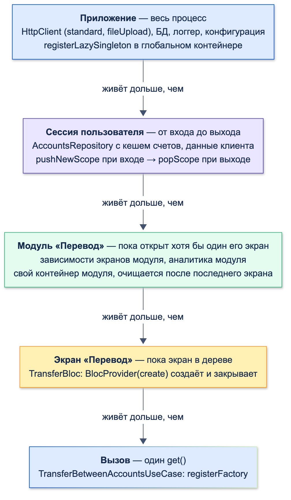
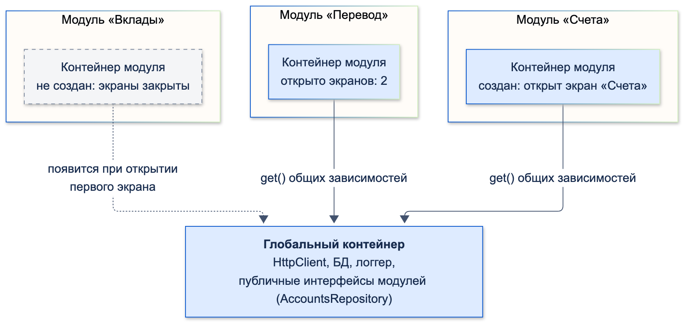

# Внедрение зависимостей (DI)

| Грейд | Время на изучение | Статус |
|-------|-------------------|--------|
| ⭐⭐ | ~30 мин лекция + практика | ✅ Готово |

---

## 📚 Ресурсы

| Ресурс | Формат | Язык | Уровень | Зачем читать |
|--------|--------|------|---------|--------------|
| Хендбук Яндекса: [IoC на практике](https://contest.yandex.ru/tracks/flutter/architecture/inversion-of-control-in-practice), [смежные паттерны](https://contest.yandex.ru/tracks/flutter/architecture/related-ioc-patterns), [без сторонних библиотек](https://contest.yandex.ru/tracks/flutter/architecture/dependency-management-without-libraries), [GetIt](https://contest.yandex.ru/tracks/flutter/architecture/get-it) | Учебник | 🇷🇺 | ⭐ → ⭐⭐ | Инверсия управления, DI и Service Locator с плюсами и минусами, ручной DI, get_it |
| [Martin Fowler: Inversion of Control Containers and the Dependency Injection pattern](https://martinfowler.com/articles/injection.html) | Статья | 🇬🇧 | ⭐⭐ | Классическое сравнение DI и Service Locator: кто инициирует получение зависимости и что из этого следует |
| Марк Симан, Стивен ван Дерсен, «Внедрение зависимостей на платформе .NET» (Питер) | Книга | 🇷🇺 | ⭐⭐⭐ | Главная книга о DI. Примеры на C#, но идеи общие: Composition Root, время жизни, почему Service Locator — антипаттерн |
| [get_it](https://pub.dev/packages/get_it) | Документация | 🇬🇧 | ⭐⭐ | Виды регистрации, именованные регистрации, области (scopes), асинхронная инициализация |
| [Riverpod: Providers](https://riverpod.dev/docs/concepts2/providers) | Документация | 🇬🇧 | ⭐⭐ | Провайдеры как DI-контейнер, `ProviderScope`, подмена через overrides |
| [Flutter: Dependency injection (case study)](https://docs.flutter.dev/app-architecture/case-study/dependency-injection) | Документация | 🇬🇧 | ⭐⭐ | Внедрение через конструктор во всех слоях и сборка графа наверху дерева (через `provider`) |

---

## 🎓 Лекция

> ℹ️ **Важно:** примеры продолжают модули «Счета» и «Перевод» из предыдущих тем раздела. Импорты между модулями
> записаны как `package:accounts/…`, `package:transfer/…`, `package:core/…` — каждый модуль отдельный пакет.

### 1. Какую проблему решает DI

Любому объекту в приложении нужны другие объекты: экрану — UseCase, UseCase — репозиторий, репозиторию — источники
данных, источнику — HTTP-клиент. Вопрос в том, **кто их создаёт**.

Самый очевидный ответ — «тот, кому они нужны». Экран счетов сам собирает всю цепочку:

```dart
import 'package:flutter_bloc/flutter_bloc.dart';

import 'package:accounts/data/data_sources/accounts_remote_data_source.dart';
import 'package:accounts/data/repositories/accounts_repository_impl.dart';
import 'package:accounts/domain/entities/account.dart';
import 'accounts_data_impl.dart';
import 'http_client.dart';

// ❌ Без DI: экран сам собирает всю цепочку зависимостей
final class NaiveAccountsCubit extends Cubit<List<Account>> {
  NaiveAccountsCubit() : super(const []);

  // Конкретные классы, конкретные настройки — прямо внутри экрана
  final _repository = AccountsRepositoryImpl(
    remote: AccountsRemoteDataSourceImpl(
      AccountsApiImpl(HttpClient(timeout: const Duration(seconds: 30))),
    ),
    local: InMemoryAccountsLocalDataSource(),
  );

  Future<void> load() async => emit(await _repository.getAccounts());
}
```

Код работает. Проблемы начинаются, когда приложение растёт:

1. **Жёсткая связь с реализациями.** Экран знает о `AccountsRepositoryImpl`, `AccountsApiImpl`, `HttpClient` и его
   таймауте. Решили добавить кеш в БД, сменить HTTP-клиент или поменять таймаут — правим **каждый экран**, который
   собирает эту цепочку. Принцип инверсии зависимостей нарушен: верхний уровень зависит от деталей нижнего.
2. **Невозможно протестировать.** В тесте `NaiveAccountsCubit` пойдёт в настоящую сеть. Подставить фейковый
   репозиторий, проверить реакцию на ошибку сервера или пустой список нельзя — класс не даёт ничего заменить.
3. **Несколько экземпляров того, что должно быть одним.** Каждый экран создаёт свой HTTP-клиент и свой репозиторий,
   а значит — свой кеш. Кеш, объединение запросов, общий `Stream` изменений из темы «Паттерн Repository» перестают
   работать. Замер: главный экран и экран «Мои счета» открыли по очереди:

```text
Без DI: HttpClient создано — 2, запросов к серверу — 2
С DI: HttpClient создано — 1, запросов к серверу — 1
```

4. **Каскад изменений.** В конструктор репозитория добавили логгер — правим все места, где репозиторий создаётся.
   В большом приложении это десятки файлов в разных фичах.
5. **Скрытые зависимости.** По сигнатуре `NaiveAccountsCubit()` не видно, что он ходит в сеть и пишет в хранилище.
   Чтобы понять, что нужно классу, надо читать его целиком.
6. **Нет управления временем жизни.** Нельзя в одном месте сбросить данные пользователя при выходе, закрыть
   соединения, пересоздать клиент после смены сервера: объекты разбросаны по экранам, и ссылок на них ни у кого нет.
7. **Окружения и режимы.** Боевой сервер, тестовый стенд, демо-режим без сети, моки для автотестов: без DI в каждом
   классе появляются `if (isDemo) … else …`.

**Решение — DI:** экран только **объявляет**, что ему нужно, а создаёт и связывает объекты отдельное место:

```dart
// ✅ Экран получает репозиторий — и только интерфейс. Что за реализация и откуда она, решают снаружи
final class AccountsCubit extends Cubit<List<Account>> {
  AccountsCubit(this._repository) : super(const []);

  final AccountsRepository _repository;

  Future<void> load() async => emit(await _repository.getAccounts());
}
```

Теперь один репозиторий на всех (проблемы 1, 3, 4), в тесте передаём фейк (2), зависимости видны в конструкторе (5),
временем жизни управляет место сборки (6), окружение выбирается там же одной строкой (7).

### 2. Что такое DI

**Зависимость** — объект, который нужен классу для работы: `AccountsRepositoryImpl` нужны два DataSource,
`TransferBloc` — UseCase перевода.

**Внедрение зависимостей** (Dependency Injection, DI) — класс **не создаёт** зависимости сам, а **получает** их снаружи,
обычно через конструктор:

```text
// ❌ Сам создаёт: жёстко привязан к реализации, в тесте не подменить
final _repository = AccountsRepositoryImpl(remote: AccountsRemoteDataSourceImpl(AccountsApiImpl(HttpClient())), …);

// ✅ Получает через конструктор — и только интерфейс
TransferBetweenAccountsUseCase(this._accounts, this._transfers);
```

Как это связано с соседними понятиями:
- **Принцип инверсии зависимостей** (D из SOLID) говорит, **от чего** зависеть: от абстракций (`AccountsRepository`),
  а не от реализаций. DI — способ **доставить** реализацию, не нарушая этого принципа.
- **Инверсия управления** (Inversion of Control, IoC) — общий принцип «не ты управляешь, тобой управляют»: класс
  не решает, какие объекты создать, это решают снаружи. DI — частный случай IoC.

Каждая из проблем раздела 1 решается этой одной идеей: **создание объектов отделено от их использования.**
Класс использует зависимости, а создаёт и связывает их одно отдельное место (раздел 4).

### 3. Способы внедрения

| Способ | Как | Когда |
|--------|-----|-------|
| **Через конструктор** | `TransferBloc({required TransferBetweenAccountsUseCase transfer})` | **По умолчанию.** Объект не может существовать без зависимости, поле `final` |
| Через сеттер или поле | `bloc.analytics = …` | Необязательная зависимость, которую можно поменять. Риск: объект в неполном состоянии |
| Через параметр метода | `transfer(… , clock: clock)` | Зависимость нужна одному методу и меняется от вызова к вызову |

### 4. DI и Service Locator: в чём разница

Это два разных способа дать объекту его зависимости.

- **Dependency Injection** — зависимости **передают** объекту снаружи (push). Объект ничего не знает о том, откуда
  они взялись: он объявил их в конструкторе, и кто-то другой их туда положил.
- **Service Locator** — объект **сам запрашивает** зависимости у общего реестра (pull): «дай мне реализацию
  `AccountsRepository`». Реестр знает, как её создать или где взять готовую.

Мартин Фаулер в статье о контейнерах и DI формулирует разницу так: при Service Locator класс явно просит зависимость
у локатора, а при DI явного запроса нет — зависимость просто появляется в классе. Именно поэтому DI — это инверсия
управления, а Service Locator — нет: управление получением зависимостей остаётся у класса.

| | Dependency Injection | Service Locator |
|-|----------------------|-----------------|
| Кто инициирует | Внешний код передаёт зависимости (push) | Класс сам запрашивает их (pull) |
| Знает ли класс о реестре | Нет | Да: импортирует локатор и вызывает его |
| Видны ли зависимости | Да, в конструкторе | Нет: они спрятаны внутри методов и полей |
| Когда обнаружится, что зависимости нет | Сразу: код не скомпилируется без аргумента | Только при выполнении: `get()` бросит ошибку |
| Тестирование | Передать фейк в конструктор | Настроить глобальный реестр перед тестом и очистить после |
| Переиспользование класса | В любом окружении | Только там, где есть такой же настроенный локатор |
| Сборка графа | В одном месте — Composition Root | Размазана по всем классам, которые вызывают `get()` |

#### get_it — это Service Locator, а не DI-контейнер

`get_it` сам описывает себя как service locator: это **реестр объектов по типу**. Он не анализирует конструкторы
и не подставляет зависимости автоматически. Каждую регистрацию мы пишем сами, и внутри неё сами же вызываем `di.get()`:

```text
di.registerLazySingleton<AccountsRepository>(
  () => AccountsRepositoryImpl(remote: di.get(), local: di.get()),   ← это pull-запросы к локатору
);
```

Настоящий **DI-контейнер** (в других языках — Dagger и Hilt на Android, Spring на Java) умеет **автоматическое
связывание**: смотрит на конструктор класса и сам находит и передаёт нужные объекты. В Dart рефлексии нет,
поэтому такое возможно только через кодогенерацию — пакет `injectable` генерирует регистрации для get_it по
аннотациям. Но и тогда «под капотом» остаётся сервис-локатор.

**Как получить DI, используя get_it.** Разница между DI и Service Locator — не в библиотеке, а в том, **где**
вызывается `get()`:
- `get()` вызывается **только в Composition Root** — в регистрациях модуля и фабриках экранов;
- все остальные классы получают зависимости **через конструктор** и о get_it не знают.

Тогда для всего кода приложения это DI: классы не знают о локаторе, их можно создать и протестировать без него.
Локатор остаётся внутренней деталью места сборки. Если же `GetIt.I` появляется внутри Cubit, репозитория или
виджета — это уже Service Locator со всеми его минусами:

```dart
import 'package:flutter_bloc/flutter_bloc.dart';
import 'package:get_it/get_it.dart';

import 'package:accounts/domain/use_cases/transfer_between_accounts_use_case.dart';

// ❌ Cubit сам достаёт зависимость из контейнера: зависимость скрыта, в тесте нужен настроенный GetIt
final class BadTransferCubit extends Cubit<bool> {
  BadTransferCubit() : super(false);

  final _transfer = GetIt.I<TransferBetweenAccountsUseCase>();

  Future<void> submit() async => _transfer(fromId: '1', toId: '2', amountKopecks: 100);
}

// ✅ Зависимость приходит через конструктор: видно из сигнатуры, в тесте передаём что угодно
final class GoodTransferCubit extends Cubit<bool> {
  GoodTransferCubit(this._transfer) : super(false);

  final TransferBetweenAccountsUseCase _transfer;

  Future<void> submit() async => _transfer(fromId: '1', toId: '2', amountKopecks: 100);
}
```

**Правило: `get()` — только в Composition Root.** Внутри классов — конструктор.

> ℹ️ **Важно:** Riverpod устроен похоже: внутри провайдера зависимости тоже «вытягиваются» через `ref.watch`.
> Отличие от get_it в том, что провайдер — это ссылка, проверяемая компилятором, а не поиск по типу во время работы.
> Сами классы (репозитории, UseCase) и в Riverpod лучше писать с внедрением через конструктор.

#### Composition Root и ручной DI

**Composition Root** — единственное место, где граф объектов собирается из реализаций. Все остальные классы о сборке
ничего не знают и просто получают зависимости через конструктор.

Собирать граф можно:
- **руками** — вызовами конструкторов (`AccountsCubit(GetAccountsUseCase(AccountsRepositoryImpl(…)))`, как в теме
  «Понимание слоёв приложения»). Для небольшого приложения этого достаточно — это DI в чистом виде, без библиотек;
- **с помощью библиотеки** — регистрируем, как создавать каждый тип (get_it, injectable, Riverpod), а библиотека
  создаёт объекты и помнит синглтоны. Так удобнее управлять временем жизни в большом приложении.

### 5. Инструменты во Flutter

| Инструмент | Как устроен | Плюсы | Минусы |
|------------|-------------|-------|--------|
| **Ручной DI** | Конструкторы и фабричные функции | Ноль зависимостей, всё видно | Много кода в большом приложении, время жизни — вручную |
| **get_it** | Service Locator: реестр объектов по типу, регистрации пишутся вручную | Не зависит от дерева виджетов, работает в любом слое, области (scopes), именованные регистрации | Легко скатиться в Service Locator; ошибки регистрации видны только при запуске |
| **injectable** | Кодогенерация регистраций для get_it по аннотациям (`@lazySingleton`, `@injectable`) — автоматическое связывание через конструкторы | Меньше ручных регистраций | Магия аннотаций, build_runner, сложнее понять граф |
| **Provider** / `RepositoryProvider` | Зависимости кладутся в дерево виджетов, получаются через `context.read` | Время жизни привязано к дереву; так делает официальный пример Flutter | Нужен `BuildContext`; вне дерева виджетов не работает |
| **Riverpod** | Свой контейнер: провайдеры описывают, как создать объект, и связывают граф через `ref` | Проверка на этапе компиляции, автоматическое освобождение (`autoDispose`), удобная подмена в тестах | Свой подход ко всему приложению: DI и состояние вместе |

### 6. get_it подробно

Дальше для краткости экземпляр `GetIt` называется **контейнером** («глобальный контейнер», «контейнер модуля»):
так его называют и в документации. По устройству это реестр сервис-локатора, и все вызовы `get()` ниже —
только в местах сборки.

| Регистрация | Когда создаётся | Сколько экземпляров | Для чего |
|-------------|-----------------|--------------------|----------|
| `registerSingleton(obj)` | Сразу, при регистрации | Один | Уже созданный объект: конфигурация, результат инициализации |
| `registerLazySingleton(() => …)` | При первом `get()` | Один | HTTP-клиент, БД, DataSource, **репозиторий с кешем** |
| `registerFactory(() => …)` | При каждом `get()` | Новый каждый раз | **UseCase**, объекты без общего состояния |
| `registerFactoryParam((p1, p2) => …)` | При каждом `get(param1: …)` | Новый | Объект, которому нужен параметр (id счёта) |
| `registerSingletonAsync(() async => …)` + `allReady()` | Асинхронно при старте | Один | Зависимость, которой нужна асинхронная инициализация: открыть БД, прочитать настройки |

Регистрация приложения — **ленивая** и с **именованными** зависимостями:

```dart
import 'package:get_it/get_it.dart';

import 'http_client.dart';

/// Зависимости уровня приложения: живут, пока живёт процесс
void registerCoreDependencies(GetIt di) {
  // Два клиента одного типа: обычные запросы и загрузка файлов с длинным таймаутом
  di.registerLazySingleton<HttpClient>(
    () => HttpClient(timeout: const Duration(seconds: 30)),
    instanceName: HttpClientKind.standard.name,
  );
  di.registerLazySingleton<HttpClient>(
    () => HttpClient(timeout: const Duration(minutes: 2)),
    instanceName: HttpClientKind.fileUpload.name,
  );
}
```

Регистрация модуля «Счета» — по слоям, **по интерфейсу**:

```dart
import 'package:get_it/get_it.dart';

import 'package:accounts/data/data_sources/accounts_local_data_source.dart';
import 'package:accounts/data/data_sources/accounts_remote_data_source.dart';
import 'package:accounts/data/network/accounts_api.dart';
import 'package:accounts/data/repositories/accounts_repository_impl.dart';
import 'package:accounts/domain/repositories/accounts_repository.dart';
import 'package:accounts/domain/repositories/transfers_repository.dart';
import 'package:accounts/domain/use_cases/transfer_between_accounts_use_case.dart';
import 'accounts_data_impl.dart';
import 'http_client.dart';

/// Регистрация модуля «Счета». Вызывается из точки входа модуля
void registerAccountsDependencies(GetIt di) {
  // data: по одному экземпляру — репозиторий хранит кеш, API и источники не имеют состояния экрана
  di.registerLazySingleton<AccountsApi>(
    () => AccountsApiImpl(di.get(instanceName: HttpClientKind.standard.name)),
  );
  di.registerLazySingleton<AccountsRemoteDataSource>(() => AccountsRemoteDataSourceImpl(di.get()));
  di.registerLazySingleton<AccountsLocalDataSource>(InMemoryAccountsLocalDataSource.new);
  // Регистрируем по интерфейсу: остальной код знает только AccountsRepository
  di.registerLazySingleton<AccountsRepository>(
    () => AccountsRepositoryImpl(remote: di.get(), local: di.get()),
  );
  di.registerLazySingleton<TransfersRepository>(TransfersRepositoryImpl.new);

  // domain: UseCase без состояния — новый экземпляр на каждый запрос
  di.registerFactory(() => TransferBetweenAccountsUseCase(di.get(), di.get()));
}
```

Проверка тестом:

```text
1. После регистрации создано HttpClient: 0
2. HttpClient создан, таймаут 30 с
3. AccountsRepository (lazySingleton): один и тот же объект — true
4. UseCase (factory): один и тот же объект — false
5. По имени fileUpload: таймаут 120 с
```

Регистрация ничего не создаёт. Первый `get<AccountsRepository>()` создаёт цепочку и **только** нужный HTTP-клиент:
клиент для файлов не создан, пока его никто не попросил.

Фабрика экрана модуля «Перевод» — Composition Root на уровне экрана:

```dart
import 'package:flutter/widgets.dart';
import 'package:get_it/get_it.dart';

import 'package:transfer/presentation/pages/transfer/transfer_screen.dart';

/// Composition Root модуля «Перевод»: единственное место, где модуль обращается к контейнеру.
/// Дальше всё передаётся через конструкторы: экран → BlocProvider → TransferBloc
Widget buildTransferScreen(GetIt di, {required String fromId, required String toId}) =>
    TransferScreen(transfer: di.get(), fromId: fromId, toId: toId);
```

### 7. Время жизни зависимостей



| Область | Сколько живёт | Что в ней | Как сделать |
|---------|---------------|-----------|-------------|
| **Приложение** | Весь процесс | HTTP-клиенты, БД, логгер, конфигурация | `registerLazySingleton` в глобальном контейнере |
| **Сессия пользователя** | От входа до выхода | Репозитории с данными клиента и их кеш | Область get_it (`pushNewScope` / `popScope`) |
| **Модуль (фича)** | Пока открыт хотя бы один экран модуля | Зависимости экранов модуля, аналитика модуля | Отдельный контейнер модуля |
| **Экран** | Пока экран в дереве | Bloc / Cubit | `BlocProvider(create: …)` — создаёт и закрывает |
| **Вызов** | Один `get()` | UseCase | `registerFactory` |

**Сессия пользователя.** Всё, что содержит данные клиента, должно исчезать при выходе: иначе следующий пользователь
на этом устройстве увидит чужие счета из кеша. Области get_it решают это одной строкой:

```dart
import 'package:get_it/get_it.dart';

import 'accounts_dependencies.dart';

/// Вход и выход пользователя: всё, что относится к данным клиента, живёт в области «session»
final class Session {
  Session(this._di);

  final GetIt _di;

  void onLoggedIn() => _di.pushNewScope(scopeName: 'session', init: registerAccountsDependencies);

  /// Выход: области «session» больше нет — репозитории с кешем счетов удалены, dispose вызваны
  Future<void> onLoggedOut() => _di.popScopesTill('session');
}
```

```text
После выхода AccountsRepository зарегистрирован: false
После нового входа — новый репозиторий с пустым кешем: true
```

**Контейнер модуля.** В многомодульном приложении удобна схема из двух уровней:
- **глобальный контейнер** — общие зависимости приложения, доступные всем модулям;
- **контейнер модуля** — создаётся, когда открывается **первый** экран модуля, и очищается, когда закрывается
  **последний**. Модуль считает открытые экраны, а при очистке у зарегистрированных объектов вызываются `dispose`.



```dart
import 'package:get_it/get_it.dart';

/// Свой контейнер фичи: создаётся при открытии первого экрана фичи и очищается при закрытии последнего.
/// Глобальный контейнер (общие зависимости приложения) передаётся рядом
final class FeatureScope {
  FeatureScope({required GetIt global, required this.register}) : _global = global;

  final GetIt _global;
  final void Function(GetIt local, GetIt global) register;
  final GetIt local = GetIt.asNewInstance();

  var _openScreens = 0;

  /// Экран фичи открылся. Первый экран регистрирует зависимости фичи
  void activate() {
    if (_openScreens++ == 0) register(local, _global);
  }

  /// Экран фичи закрылся. После последнего контейнер фичи очищается, срабатывают dispose
  Future<void> deactivate() async {
    if (--_openScreens == 0) await local.reset();
  }

  bool get isActive => _openScreens > 0;
}
```

```text
Закрыли один из двух экранов: фича активна — true, dispose: []
Закрыли последний экран: фича активна — false, dispose: [AccountsRepository], зарегистрировано: false
```

Так память под зависимости модуля, в который пользователь заходит редко (вклады, страхование), занята только пока
он открыт, а модули не видят внутренних зависимостей друг друга.

### 8. Riverpod как DI-контейнер

В Riverpod провайдер — одновременно и **регистрация** («как создать»), и **способ получить** зависимость.
Граф связывается через `ref.watch`, контейнер — `ProviderContainer` (во Flutter его создаёт `ProviderScope`
в корне приложения). Отдельный get_it не нужен.

```dart
import 'package:riverpod/riverpod.dart';

import 'package:accounts/data/data_sources/accounts_remote_data_source.dart';
import 'package:accounts/data/repositories/accounts_repository_impl.dart';
import 'package:accounts/domain/repositories/accounts_repository.dart';
import 'package:accounts/domain/repositories/transfers_repository.dart';
import 'package:accounts/domain/use_cases/transfer_between_accounts_use_case.dart';
import 'accounts_data_impl.dart';
import 'http_client.dart';

/// В Riverpod провайдер — это и регистрация, и способ получить зависимость.
/// Граф собирается через ref.watch, контейнер — ProviderContainer (во Flutter — ProviderScope)
final httpClientProvider = Provider<HttpClient>((ref) => HttpClient(timeout: const Duration(seconds: 30)));

final accountsRepositoryProvider = Provider<AccountsRepository>(
  (ref) => AccountsRepositoryImpl(
    remote: AccountsRemoteDataSourceImpl(AccountsApiImpl(ref.watch(httpClientProvider))),
    local: InMemoryAccountsLocalDataSource(),
  ),
);

final transfersRepositoryProvider = Provider<TransfersRepository>((ref) => TransfersRepositoryImpl());

// autoDispose: объект живёт, пока его кто-то использует, и освобождается, когда подписчиков не осталось
final transferUseCaseProvider = Provider.autoDispose(
  (ref) => TransferBetweenAccountsUseCase(ref.watch(accountsRepositoryProvider), ref.watch(transfersRepositoryProvider)),
);
```

Особенности по сравнению с get_it:
- **Ошибка «забыли зарегистрировать» невозможна:** провайдер — глобальная константа, к нему обращаются по ссылке,
  а не по типу.
- **Время жизни — автоматически:** `autoDispose` освобождает объект, когда у него не осталось подписчиков;
  `ref.onDispose` — место для очистки.
- **Подмена — через `overrides`** у `ProviderScope` или `ProviderContainer`: в тестах и для разных окружений.
- Обычно Riverpod берут **целиком**: и для DI, и для состояния экранов (`Notifier`). Смешивать его с BLoC и get_it
  в одном проекте можно, но получается два способа делать одно и то же.

### 9. Тестирование

- **С внедрением через конструктор** класс тестируется без контейнера: передаём фейки.
- **Контейнер** в тестах — свой на каждый тест (`GetIt.asNewInstance()` в `setUp`) или `reset()` после теста,
  чтобы тесты не влияли друг на друга.
- **Тест «граф собирается»** ловит забытые регистрации до запуска приложения.

```dart
import 'package:flutter_test/flutter_test.dart';
import 'package:get_it/get_it.dart';
import 'package:riverpod/riverpod.dart';

import 'package:accounts/domain/entities/account.dart';
import 'package:accounts/domain/repositories/accounts_repository.dart';
import 'package:accounts/domain/use_cases/transfer_between_accounts_use_case.dart';
import 'package:app/di/accounts_dependencies.dart';
import 'package:app/di/core_dependencies.dart';
import 'package:app/di/riverpod_providers.dart';
import 'package:app/di/session.dart';
import 'package:core/result.dart';

final class FakeAccounts implements AccountsRepository {
  @override
  Future<List<Account>> getAccounts({bool forceRefresh = false}) async =>
      const [Account(id: '1', title: 'Зарплатный', balanceKopecks: 15000000, isBlocked: false)];

  @override
  Stream<List<Account>> watchAccounts() => const Stream.empty();

  @override
  Future<void> blockAccount(String id) async {}
}

void main() {
  late GetIt di;

  // Свой контейнер на каждый тест — тесты не влияют друг на друга
  setUp(() {
    di = GetIt.asNewInstance();
    registerCoreDependencies(di);
  });

  test('граф зависимостей модуля собирается', () {
    registerAccountsDependencies(di);
    // Падает, если какую-то зависимость забыли зарегистрировать
    expect(() => di<TransferBetweenAccountsUseCase>(), returnsNormally);
  });

  test('после выхода данные пользователя недоступны', () async {
    final session = Session(di)..onLoggedIn();
    final repository = di<AccountsRepository>();
    await session.onLoggedOut();
    expect(di.isRegistered<AccountsRepository>(), isFalse);

    session.onLoggedIn();
    expect(identical(di<AccountsRepository>(), repository), isFalse); // новый пользователь — новый кеш
  });

  test('Riverpod: подмена репозитория через overrides', () async {
    final container = ProviderContainer.test(
      overrides: [accountsRepositoryProvider.overrideWithValue(FakeAccounts())],
    );
    final transfer = container.read(transferUseCaseProvider);
    final result = await transfer(fromId: '1', toId: '2', amountKopecks: 100000);
    expect(result, isA<Success<void>>());
  });
}
```

### 🚫 Чрезмерное применение

- **Интерфейс на каждый класс «чтобы был DI».** Интерфейсы нужны на границах слоёв и там, где есть или будет вторая
  реализация (фейк в тестах тоже считается). Мапперу или форматтеру без зависимостей интерфейс не нужен.
- **Контейнер в маленьком приложении** из трёх экранов — ручной сборки достаточно.
- **Аннотации injectable на всём**, включая классы, которые создаются в одном месте, — граф становится невидимым.
- **Регистрация Bloc в контейнере «для удобства»** — время жизни экрана лучше отдать `BlocProvider`.

### ⚠️ Частые ошибки

- **`GetIt.I` внутри классов** (Service Locator) — скрытые зависимости, сложные тесты.
- **Cubit или Bloc зарегистрирован как singleton** — состояние «переезжает» между экранами, закрытый Bloc
  получают заново.
- **Репозиторий с кешем зарегистрирован как factory** — новый экземпляр на каждый `get()`, кеш и объединение
  запросов не работают.
- **Данные пользователя в области приложения** — не очищаются при выходе.
- **Циклическая зависимость** (A нужен B, B нужен A) — переполнение стека при первом `get()`. Признак того,
  что ответственность распределена неверно.
- **`get()` до завершения асинхронной инициализации** — дождаться `allReady()` перед `runApp`.
- **Регистрация по реализации** (`registerLazySingleton(() => AccountsRepositoryImpl(…))` без `<AccountsRepository>`) —
  получать придётся по реализации, интерфейс теряет смысл.
- **Повторная регистрация** того же типа при повторном входе в модуль — ошибка get_it; регистрировать в области
  или контейнере, который очищается.

### 🎤 На собеседовании: «Как организуешь DI в многомодульном приложении?»

| Уровень | Как выглядит ответ |
|---------|--------------------|
| ⭐ Junior | «Через get_it: регистрирую репозитории и UseCase, получаю через `GetIt.I`» |
| ⭐⭐ Middle | Внедрение через конструктор во всех слоях, `get()` только при сборке. Singleton для клиентов, БД и репозиториев, factory для UseCase, Bloc — через `BlocProvider`. Регистрация по интерфейсу. Тест «граф собирается» |
| ⭐⭐⭐ Senior | Всё из Middle, плюс: области времени жизни (приложение, сессия, модуль, экран), очистка данных пользователя при выходе, глобальный контейнер и контейнеры модулей, модули видят только публичные зависимости друг друга, асинхронная инициализация, выбор между get_it, Provider и Riverpod под проект |

---

## ✅ Самопроверка

**⭐ Junior**
1. Что такое внедрение зависимостей? Почему класс не должен создавать зависимости сам?
2. Чем `registerFactory` отличается от `registerLazySingleton`?
3. Какой способ внедрения используется по умолчанию и почему?

**⭐⭐ Middle**
1. Чем DI отличается от Service Locator? Является ли get_it DI-контейнером? Почему `GetIt.I` внутри Cubit — плохо?
2. Что такое Composition Root? Где он в многомодульном приложении?
3. Как зарегистрировать UseCase, репозиторий с кешем, HTTP-клиент и Bloc? Почему именно так?
4. Как зарегистрировать два HTTP-клиента одного типа с разными таймаутами?
5. Как Riverpod выполняет роль DI-контейнера?

**⭐⭐⭐ Senior**
1. Какие бывают области времени жизни зависимостей? Что в какой живёт?
2. Как сделать, чтобы после выхода пользователя его данные не остались в памяти?
3. Как устроить контейнеры в многомодульном приложении, чтобы модули не мешали друг другу и не держали память?
4. Как проверить, что граф зависимостей собирается, до запуска приложения?
5. get_it, Provider или Riverpod: как выбрать для нового проекта?

<details>
<summary>Ответы</summary>

**Junior**
1. Класс получает зависимости снаружи, а не создаёт их. Иначе он жёстко привязан к реализациям, его нельзя
   протестировать с фейками и нельзя заменить источник данных без правки класса.
2. Factory — новый объект на каждый `get()`. LazySingleton — один объект, создаётся при первом `get()`.
3. Через конструктор: зависимость обязательна, поле `final`, все зависимости видны из сигнатуры.

**Middle**
1. При DI зависимости передают объекту снаружи (push, через конструктор), при Service Locator объект сам запрашивает
   их у реестра (pull). get_it — сервис-локатор; DI получается, если вызывать `get()` только в Composition Root.
   `GetIt.I` в Cubit — это Service Locator: зависимости скрыты, ошибки видны только при запуске, в тестах нужен
   настроенный глобальный реестр.
2. Единственное место сборки графа. В многомодульном приложении — точка входа приложения (общие зависимости)
   и точка входа каждого модуля (регистрация модуля, фабрики экранов).
3. UseCase — factory (без состояния). Репозиторий с кешем — lazySingleton (иначе кеш теряется). HTTP-клиент —
   lazySingleton. Bloc — не в контейнере, а через `BlocProvider(create:)` на экране: время жизни экрана.
4. Именованные регистрации: `registerLazySingleton<HttpClient>(…, instanceName: 'fileUpload')` и
   `get<HttpClient>(instanceName: 'fileUpload')`.
5. Провайдер описывает, как создать объект, `ref.watch` связывает граф, `ProviderContainer`/`ProviderScope` хранит
   экземпляры, `overrides` подменяют реализации, `autoDispose` управляет временем жизни.

**Senior**
1. Приложение (клиенты, БД, логгер), сессия пользователя (данные клиента), модуль (зависимости экранов модуля),
   экран (Bloc), вызов (UseCase).
2. Держать всё с данными клиента в отдельной области (`pushNewScope` при входе, `popScope` при выходе) или
   явно очищать кеши при выходе. Проверять тестом: после выхода репозиторий не зарегистрирован, новый вход — новый объект.
3. Глобальный контейнер для общего и свой контейнер на модуль, который создаётся при открытии первого экрана модуля
   и очищается при закрытии последнего (счётчик экранов, `dispose` у зависимостей). Модули обмениваются только
   публичными интерфейсами из глобального контейнера.
4. Тест, который регистрирует модуль в чистом контейнере и получает из него корневые типы (UseCase, фабрики экранов):
   забытая регистрация упадёт в тесте, а не у пользователя.
5. get_it — независимость от дерева виджетов, понятные области; хорош с BLoC в большом многомодульном проекте.
   Provider — минимум, официальный пример Flutter. Riverpod — если проект целиком строится на нём (DI и состояние),
   нужна безопасность на этапе компиляции и автоматическое освобождение. Главное — один подход на проект.

</details>
