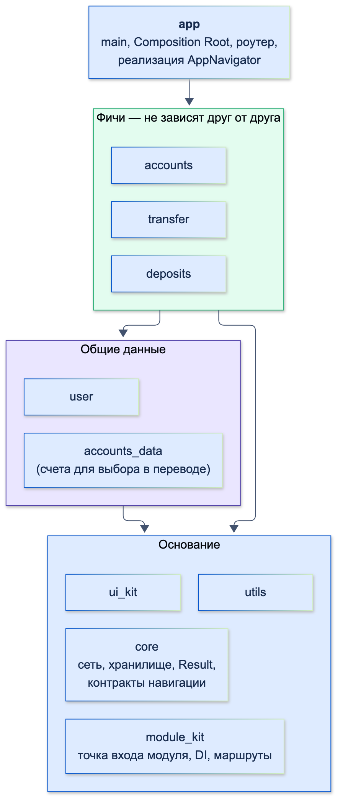
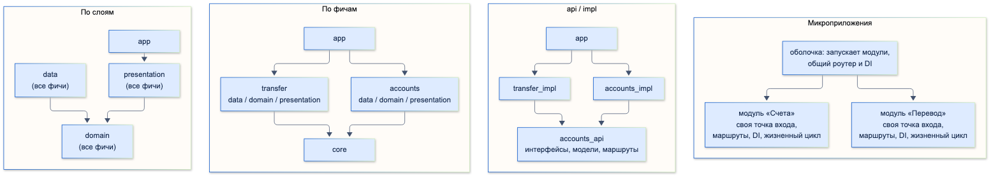
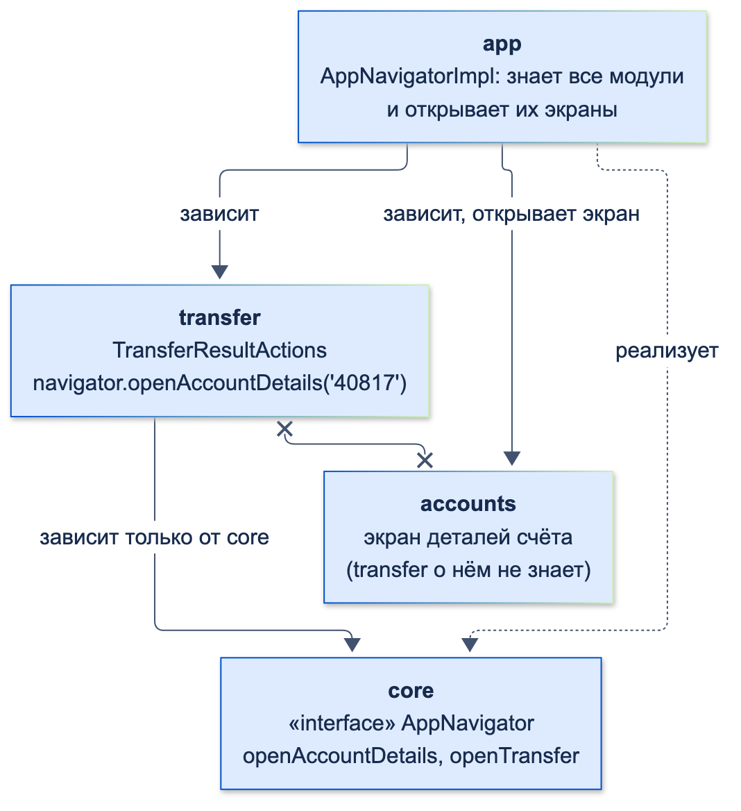

# Многомодульность

| Грейд | Время на изучение | Статус |
|-------|-------------------|--------|
| ⭐⭐⭐ | ~35 мин лекция + практика | ✅ Готово |

---

## 📚 Ресурсы

| Ресурс | Формат | Язык | Уровень | Зачем читать |
|--------|--------|------|---------|--------------|
| [Об одном способе реализации архитектуры крупного Flutter-приложения](https://habr.com/ru/companies/beeline_tech/articles/785730/) | Статья (Habr) | 🇷🇺 | ⭐⭐⭐ | Опыт команды с приложением на 100+ экранов: UI-kit, core-модули, фичи, модуль приложения |
| [Feature-Based Flutter Architecture](https://habr.com/ru/articles/821671/) | Статья (Habr) | 🇷🇺 | ⭐⭐ | Монорепозиторий на melos: несколько приложений, фичи, отдельные модули данных под разных провайдеров |
| [Хендбук Яндекса: структура файлов проекта](https://contest.yandex.ru/tracks/flutter/architecture/project-file-structure) | Учебник | 🇷🇺 | ⭐ | Layer-first и feature-first — с чего начинается разбиение |
| [Dart: Pub workspaces](https://dart.dev/tools/pub/workspaces) | Документация | 🇬🇧 | ⭐⭐ | Монорепозиторий средствами pub: один lock-файл на все пакеты |
| [Melos](https://melos.invertase.dev/) | Документация | 🇬🇧 | ⭐⭐ | Скрипты и версии для монорепозитория с десятками пакетов |
| [mason_cli](https://pub.dev/packages/mason_cli) | Документация | 🇬🇧 | ⭐⭐ | Шаблоны: новый модуль одной командой, у всех одинаковая структура |

---

## 🎓 Лекция

### 1. Что такое многомодульность

**Модуль** — отдельный Dart-пакет со своим `pubspec.yaml`. **Многомодульное приложение** собирается из многих таких
пакетов: фичи, общие данные, ядро, дизайн-система, а сам проект приложения только подключает их и связывает.

Чем модуль отличается от папки:
- **Границы проверяет инструмент, а не договорённость.** Модуль может использовать только то, что объявил
  в зависимостях. Папка `features/transfer` может импортировать что угодно из `features/accounts` — и рано или поздно
  импортирует.
- **У модуля есть публичный API.** Всё, что лежит в `lib/src`, — внутренняя кухня модуля. Наружу отдаётся только то,
  что экспортирует файл `lib/<модуль>.dart`.
- **У модуля свои зависимости, тесты, анализ, ресурсы, локализация и владелец.**

> ℹ️ **Важно:** структура слоёв **внутри** модуля — в теме «Понимание слоёв приложения», внедрение зависимостей между
> модулями — в теме «Внедрение зависимостей (DI)». Здесь — как разбить приложение на модули и связать их.

### 2. Зачем

- **Жёсткие границы.** Правило зависимостей (фичи не знают друг о друге, domain не знает о data) проверяется
  анализатором и графом пакетов, а не код-ревью.
- **Несколько команд.** У каждой команды свои модули: меньше конфликтов при слиянии, понятно, кто отвечает за код
  и кто должен ревьюить изменения.
- **Быстрее анализ и тесты.** Можно запускать анализатор и тесты только для изменённых модулей и тех, кто от них зависит.
- **Переиспользование.** Модули подключаются в несколько приложений: основное приложение банка, приложение
  для бизнеса, white-label для партнёров.
- **Единообразие.** Модули создаются по шаблону с одинаковой структурой — новый разработчик ориентируется в любом.
- **Отключаемость.** Фичу можно убрать из сборки или закрыть фича-флагом целиком.

**Чего многомодульность не даёт:** итоговое приложение всё равно компилируется **целиком** — AOT-компилятор собирает
весь Dart-код в один бинарник: `libapp.so` на Android, `App.framework` на iOS (тема «Компиляция»). Время release-сборки само по себе не уменьшается.

### 3. Когда внедрять: критерии

| Признак | О чём говорит |
|---------|---------------|
| Над приложением работают больше 5–7 разработчиков или несколько команд | Нужны владение кодом и границы между командами |
| Фич десятки, экранов — от 50 | Без жёстких границ связи между фичами расползаются |
| Частые конфликты при слиянии в одних и тех же файлах | Код разных фич перемешан |
| Один код нужен в нескольких приложениях | Без модулей — копирование и расхождение версий |
| Изменение в одной фиче ломает другую | Скрытые зависимости между фичами |
| Анализ и тесты всего проекта идут слишком долго | Нужно проверять только затронутое |
| Требования к изоляции: платёжные сценарии, безопасность, аудит | Нужно гарантировать, что модуль не видит лишнего |

**Пора, если совпадает 3 признака и больше.** Если совпадает 1–2 — достаточно feature-first структуры папок внутри
одного пакета и правил импорта.

**Рано:**
- MVP, прототип, продукт ещё ищет себя — границы фич будут меняться, и модули придётся постоянно перекраивать;
- 1–3 разработчика — накладные расходы (pubspec-и, версии, навигация между модулями) больше пользы.

**Хорошее промежуточное решение:** feature-first папки в одном пакете с первого дня. Тогда выделить папку в модуль
потом — механическая работа.

### 4. Виды модулей

| Вид | Что внутри | Пример |
|-----|-----------|--------|
| **Приложение** (`app`) | `main`, Composition Root, роутер, подключение всех модулей, конфигурация окружений | `app` |
| **Фича** | Экраны, Bloc, UseCase, репозитории одной функции продукта — все три слоя внутри | `accounts`, `transfer`, `deposits` |
| **Общие данные** | Данные, которые нужны нескольким фичам: domain и data без экранов | пользователь, профиль, список счетов для выбора в переводе |
| **Ядро** (`core`) | Сеть, хранилище, логгер, аналитика, `Result`, базовые ошибки, контракты навигации | `core`, `network`, `storage` |
| **Дизайн-система** | Цвета, шрифты, компоненты UI | `ui_kit` |
| **Инфраструктура модулей** | Базовый класс модуля, точка входа, жизненный цикл, регистрация маршрутов и DI | `module_kit` |
| **Утилиты** | Форматирование денег и дат, расширения | `utils` |

**Правила графа:**
- зависимости идут **только вниз**: приложение → фичи → общие данные → ядро и утилиты;
- **фича не зависит от другой фичи.** Если двум фичам нужны одни данные — выносим их в модуль общих данных;
  если фиче нужно открыть экран другой фичи — через контракт навигации (раздел 6);
- **циклов нет.**



### 5. Варианты разбиения



| Вариант | Как устроен | Плюсы | Минусы | Когда подходит |
|---------|-------------|-------|--------|----------------|
| **По слоям** | Пакеты `data`, `domain`, `presentation` на всё приложение | Правило зависимостей между слоями проверяет компилятор | Фича размазана по трём пакетам, любое изменение задевает все три; команды работают в одних и тех же пакетах | Небольшое приложение, где важнее всего чистота слоёв |
| **По фичам** | Пакет на фичу, слои — папками внутри (структура из темы «Понимание слоёв приложения») | Фича целиком в одном месте, у команды — свои пакеты | Слои внутри фичи разделены только договорённостью и линтерами | **Самый распространённый вариант** для средних и больших приложений |
| **Фичи с api / impl** | `accounts_api` (интерфейсы, модели, маршруты) и `accounts_impl` (реализация). Другие модули зависят только от `_api` | Самая строгая изоляция: чужая реализация недоступна физически; изменения реализации не пересобирают зависимые модули | Вдвое больше пакетов, больше рутины | Крупные проекты с многими командами, общими SDK для нескольких приложений |
| **Микроприложения** | Каждая фича — мини-приложение: своя точка входа, маршруты, DI-контейнер, локализация, жизненный цикл. Приложение — оболочка, которая их запускает | Фичи максимально независимы, подключаются и отключаются целиком, своя область зависимостей у каждой | Нужна своя инфраструктура (базовый класс модуля, реестр, навигация), сложнее отладка связей | Большие продукты с десятками независимых бизнес-направлений: банковские приложения, супераппы |

Варианты сочетаются: например, фичи-модули + модули общих данных + ядро, а для фич, от которых зависят многие, —
отдельный `_api`-пакет.

### 6. Как модули общаются, не зная друг о друге

**Навигация.** Модуль «Перевод» после успешного перевода предлагает кнопку «К счёту» — это экран модуля «Счета».
Импортировать экран чужой фичи нельзя. Решение — **контракт навигации в `core`**, реализация — в приложении,
которое знает обо всех модулях:



```dart
/// Контракт навигации между фичами. Лежит в core: о нём знают все, а реализация — в app
abstract interface class AppNavigator {
  /// Открыть детали счёта — экран модуля «Счета»
  void openAccountDetails(String accountId);

  /// Открыть перевод — экран модуля «Перевод»
  void openTransfer({required String fromAccountId});
}
```

```dart
import 'package:core/navigation.dart';

/// Экран результата перевода: кнопка «К счёту» ведёт в модуль «Счета»,
/// но модуль «Перевод» о нём не знает — только об интерфейсе из core
final class TransferResultActions {
  const TransferResultActions(this._navigator);

  final AppNavigator _navigator;

  void onOpenAccountPressed(String accountId) => _navigator.openAccountDetails(accountId);
}
```

```dart
import 'package:accounts/accounts.dart';
import 'package:core/navigation.dart';
import 'package:transfer/transfer.dart';

/// Приложение знает обо всех модулях и связывает их: реализует навигацию между ними
final class AppNavigatorImpl implements AppNavigator {
  final log = <String>[];

  @override
  void openAccountDetails(String accountId) => log.add('Открыт экран счёта $accountId (модуль accounts)');

  @override
  void openTransfer({required String fromAccountId}) => log.add('Открыт перевод со счёта $fromAccountId (модуль transfer)');
}

void main() {
  final navigator = AppNavigatorImpl();
  AccountsRepositoryImpl(); // модуль «Счета» подключён
  TransferResultActions(navigator).onOpenAccountPressed('40817');
  print(navigator.log.single);
}
```

```text
Открыт экран счёта 40817 (модуль accounts)
```

Альтернатива интерфейсу с методами — **строковые маршруты** (`/accounts/40817`) через общий роутер: связь ещё
слабее, но ошибка в маршруте видна только при запуске.

Остальные способы связи:

| Что нужно | Как |
|-----------|-----|
| Общие данные (список счетов нужен и «Счетам», и «Переводу») | Модуль общих данных или `_api`-пакет с интерфейсом репозитория |
| Узнать об изменениях в другом модуле | `Stream` в общем модуле (`watchAccounts`) или шина событий в `core` |
| Получить реализацию интерфейса | Глобальный DI-контейнер: регистрирует владелец реализации, получает потребитель |
| Свои строки и картинки | Локализация в каждом модуле; ресурсы — с префиксом пакета: `Image.asset('icons/card.png', package: 'accounts')` |
| Включить или выключить фичу | Фича-флаг в модуле фичи, проверка в точке входа |

### 7. Организация репозитория

| Способ | Как | Плюсы | Минусы |
|--------|-----|-------|--------|
| **Монорепозиторий + `path`** | Все пакеты в одном репозитории, зависимости `path: ../core` | Просто, атомарные изменения сразу в нескольких модулях | У каждого пакета свой lock-файл: версии сторонних пакетов могут разойтись; `pub get` в каждом пакете |
| **Монорепозиторий + pub workspaces** (Dart 3.6+) | Корневой `pubspec.yaml` со списком пакетов, у пакетов `resolution: workspace` | Один `pubspec.lock` — одна версия каждого пакета на весь проект; один `pub get`; IDE работает быстрее | Конфликт версий в одном модуле блокирует всех; **границы модулей слабее** (раздел 8) |
| **Melos** | Надстройка над монорепозиторием | Скрипты для всех пакетов (`melos run test`), запуск только для изменённых, версии и changelog | Ещё один инструмент |
| **Git submodules** | Внутренние библиотеки — отдельные репозитории, подключённые в основной | Библиотеку можно развивать отдельно и подключать в разные проекты | Сложная работа с сабмодулями, легко закоммитить не ту версию |
| **Отдельные репозитории** | Зависимости через `git: ref: v1.2.0` или приватный pub-сервер | Независимые релизы и версии модулей | Изменение «через несколько модулей» — несколько PR и релизов |

Корневой `pubspec.yaml` рабочего пространства и `pubspec.yaml` фичи:

```yaml
name: bank_workspace
publish_to: none
environment:
  sdk: ^3.10.0
workspace:
  - packages/core
  - packages/accounts
  - packages/transfer
  - packages/app
dev_dependencies:
  yaml: ^3.1.0
```

```yaml
name: transfer
publish_to: none
environment:
  sdk: ^3.10.0
resolution: workspace
dependencies:
  core:
dev_dependencies:
  lints: any
```

Граф зависимостей приложения (`dart pub deps --style=tree --no-dev`, вывод сокращён: строки с версиями SDK и
корневой пакет workspace опущены):

```text
accounts 0.0.0
└── core...
app 0.0.0
├── accounts...
├── core...
└── transfer...
core 0.0.0
transfer 0.0.0
└── core...
```

### 8. Как инструменты охраняют границы: проверено

Мини-проект из четырёх пакетов (`core`, `accounts`, `transfer`, `app`). Два нарушения:
- `transfer` импортирует `package:accounts/…`, хотя **не объявил** зависимость;
- `app` импортирует `package:accounts/src/…` — **внутренности** модуля.

**С `path`-зависимостями** у каждого пакета свой список пакетов, и первое нарушение — ошибка компиляции
(вывод `dart analyze` сокращён: убраны подсказки «Try …»):

```text
error - transfer/lib/transfer.dart:2:8 - Target of URI doesn't exist: 'package:accounts/accounts.dart'. - uri_does_not_exist
 info - app/lib/app.dart:2:8 - Import of a library in the 'lib/src' directory of another package. - implementation_imports
```

**В pub workspace** список пакетов общий на весь проект, поэтому `transfer` **видит** `accounts` и код компилируется.
Оба нарушения — только подсказки уровня `info` (вывод сокращён так же):

```text
info - app/lib/app.dart:2:8 - Import of a library in the 'lib/src' directory of another package. - implementation_imports
info - transfer/lib/transfer.dart:2:8 - The imported package 'accounts' isn't a dependency of the importing package. - depend_on_referenced_packages
```

Чтобы границы работали, эти правила делают **ошибками** в `analysis_options.yaml` каждого модуля:

```yaml
include: package:lints/recommended.yaml

analyzer:
  errors:
    # Нарушение границ модулей — ошибка, а не подсказка
    depend_on_referenced_packages: error
    implementation_imports: error
```

```text
error - app/lib/app.dart:2:8 - Import of a library in the 'lib/src' directory of another package. - implementation_imports
error - transfer/lib/transfer.dart:2:8 - The imported package 'accounts' isn't a dependency of the importing package. - depend_on_referenced_packages
```

**Циклы `pub` не запрещает.** Добавили `accounts → transfer` и `transfer → accounts` — `dart pub get` ответил
`Got dependencies!` без единого предупреждения. Поэтому граф модулей проверяют в CI отдельным скриптом:

```dart
import 'dart:io';

import 'package:yaml/yaml.dart';

/// Проверка графа модулей в CI: нет циклов, фичи не зависят друг от друга напрямую.
/// Запуск из корня репозитория: dart run tool/check_module_graph.dart
void main() {
  final root = loadYaml(File('pubspec.yaml').readAsStringSync()) as YamlMap;
  final paths = (root['workspace'] as YamlList).cast<String>();

  // Граф: модуль → модули рабочего пространства, от которых он зависит
  final graph = <String, List<String>>{};
  for (final path in paths) {
    final pubspec = loadYaml(File('$path/pubspec.yaml').readAsStringSync()) as YamlMap;
    final deps = (pubspec['dependencies'] as YamlMap?)?.keys.cast<String>() ?? const <String>[];
    graph[pubspec['name'] as String] = deps.toList();
  }
  for (final module in graph.keys) {
    graph[module] = graph[module]!.where(graph.containsKey).toList();
  }

  const features = {'accounts', 'transfer'}; // модули-фичи
  final errors = <String>[];

  // Правило 1: фича не зависит от другой фичи
  for (final MapEntry(key: module, value: deps) in graph.entries) {
    if (!features.contains(module)) continue;
    for (final dep in deps.where(features.contains)) {
      errors.add('Фича $module зависит от фичи $dep');
    }
  }

  // Правило 2: нет циклов (поиск в глубину)
  final state = <String, int>{}; // 1 — в обходе, 2 — проверен
  void visit(String module, List<String> stack) {
    if (state[module] == 2) return;
    if (state[module] == 1) {
      errors.add('Цикл: ${[...stack.skip(stack.indexOf(module)), module].join(' → ')}');
      return;
    }
    state[module] = 1;
    for (final dep in graph[module]!) {
      visit(dep, [...stack, module]);
    }
    state[module] = 2;
  }
  graph.keys.forEach((module) => visit(module, []));

  if (errors.isEmpty) {
    stdout.writeln('Граф модулей в порядке, модулей: ${graph.length}');
  } else {
    errors.forEach(stderr.writeln);
    exitCode = 1;
  }
}
```

```text
$ dart run tool/check_module_graph.dart        ← чистый граф
Граф модулей в порядке, модулей: 4

$ dart run tool/check_module_graph.dart        ← accounts ↔ transfer
Фича accounts зависит от фичи transfer
Фича transfer зависит от фичи accounts
Цикл: accounts → transfer → accounts
```

Скрипт завершается с кодом 1 — CI не пропустит такое изменение.

### 9. Шаблоны модулей

Когда модулей десятки, их создают **по шаблону**, а не копированием соседнего: пакет `mason` хранит шаблоны (bricks)
нового модуля, нового экрана с Bloc или Cubit, нового UseCase. Одна команда — и модуль со структурой папок,
`pubspec.yaml`, точкой входа, регистрацией DI и тестами готов. Шаблоны лежат в отдельном репозитории и версионируются,
как код.

### 10. Миграция монолита на модули

1. **Сначала — папки.** Привести проект к feature-first структуре внутри одного пакета, убрать импорты между фичами.
2. **Ядро.** Вынести `core` (сеть, хранилище, логгер, `Result`, ошибки) — от него зависят все, сам он ни от кого.
3. **Дизайн-систему** — в `ui_kit`.
4. **Общие данные.** То, что используют несколько фич (пользователь, счета), — в модули общих данных.
5. **Фичи — по одной.** Начать с самой независимой. Связи с другими фичами заменить контрактами навигации и данными
   из общих модулей.
6. **Закрепить:** правила анализатора (`depend_on_referenced_packages`, `implementation_imports` как ошибки),
   проверка графа в CI, шаблоны для новых модулей.

Каждый шаг — отдельный релиз: приложение работает на всём пути миграции.

### 🚫 Чрезмерное применение

- **Модуль на каждый экран** — сотни пакетов, навигация через контракты там, где хватило бы обычного перехода.
- **api / impl для фичи из двух экранов**, от которой никто не зависит.
- **`common` / `shared` как свалка** — всё «общее» в одном модуле, от которого зависят все; в итоге любое изменение
  задевает весь проект. Общее делить по смыслу: `network`, `storage`, `ui_kit`, `utils`.
- **Многомодульность в MVP** «на вырост».

### ⚠️ Частые ошибки

- **Фичи импортируют друг друга** — через `path`-зависимость «временно», которая становится постоянной.
- **Циклические зависимости** — `pub` их пропускает, нужен свой контроль.
- **В pub workspace не настроены правила анализатора** — модуль импортирует чужой модуль без объявленной зависимости.
- **Импорт `lib/src` чужого модуля** — зависимость от внутренностей, которые владелец модуля вправе менять.
- **Разные версии одного пакета** в модулях на `path`-зависимостях — разное поведение и конфликт при сборке.
- **Ресурсы модуля без `package:`** — картинка не находится, потому что ищется в ресурсах приложения.
- **Регистрация зависимостей модуля в приложении** — приложение знает внутренности модуля; модуль должен
  регистрировать себя сам в своей точке входа.
- **Модуль общих данных с экранами** — он превращается в ещё одну фичу, от которой зависят другие фичи.

### 🎤 На собеседовании: «Когда и как бы ты разбил приложение на модули?»

| Уровень | Как выглядит ответ |
|---------|--------------------|
| ⭐ Junior | «Вынесу фичи в отдельные пакеты и подключу через `path`» |
| ⭐⭐ Middle | Критерии (команды, число фич, переиспользование), виды модулей (app, фичи, общие данные, core, ui_kit), правило «фича не зависит от фичи», навигация через контракт, монорепозиторий на pub workspaces или melos |
| ⭐⭐⭐ Senior | Всё из Middle, плюс: выбор варианта разбиения под масштаб (фичи, api/impl, микроприложения), DI на двух уровнях, контроль границ (правила анализатора как ошибки, проверка графа и циклов в CI), шаблоны модулей, поэтапная миграция монолита без остановки релизов, понимание, чего модули **не** дают (скорость release-сборки) |

---

## ✅ Самопроверка

**⭐ Junior**
1. Что такое модуль во Flutter-проекте? Чем он отличается от папки?
2. Какие виды модулей бывают?
3. Зачем нужен файл `lib/<модуль>.dart` и папка `lib/src`?

**⭐⭐ Middle**
1. Назови критерии, по которым пора разбивать приложение на модули. Когда это рано?
2. Как модулю «Перевод» открыть экран модуля «Счета», не завися от него?
3. Чем отличаются разбиение по слоям, по фичам и api / impl?
4. Чем pub workspace отличается от обычных `path`-зависимостей?

**⭐⭐⭐ Senior**
1. Ускоряет ли многомодульность release-сборку Flutter-приложения? Что она реально ускоряет?
2. Почему в pub workspace модуль может импортировать чужой модуль без объявленной зависимости и как это запретить?
3. Как защититься от циклических зависимостей между модулями?
4. Что такое «микроприложения» и когда они оправданы?
5. Как перевести большой монолит на модули, не останавливая релизы?

<details>
<summary>Ответы</summary>

**Junior**
1. Отдельный Dart-пакет со своим `pubspec.yaml`. В отличие от папки, модуль может использовать только объявленные
   зависимости и отдаёт наружу только свой публичный API — границы проверяет инструмент.
2. Приложение, фичи, общие данные, ядро (`core`), дизайн-система, инфраструктура модулей, утилиты.
3. `lib/<модуль>.dart` экспортирует публичный API модуля. `lib/src` — внутренняя реализация, которую другие модули
   импортировать не должны (линтер `implementation_imports`).

**Middle**
1. Много разработчиков или команд, десятки фич, конфликты слияния, общий код в нескольких приложениях, изменения
   одной фичи ломают другую, долгие анализ и тесты, требования к изоляции. Рано — MVP, 1–3 разработчика,
   нестабильные границы фич.
2. Через контракт навигации в `core` (`AppNavigator.openAccountDetails`), который реализует приложение, знающее
   обо всех модулях. Или через строковый маршрут общего роутера.
3. По слоям — пакеты `data`/`domain`/`presentation`, фича размазана. По фичам — пакет на фичу, слои внутри.
   api / impl — у фичи публичный пакет с контрактами и закрытый с реализацией, остальные зависят только от api.
4. В workspace один `pubspec.lock` и один список пакетов на весь проект, один `pub get`, одна версия каждого
   стороннего пакета. С `path` у каждого пакета свои lock и список пакетов — зато необъявленный модуль даже не виден.

**Senior**
1. Нет: AOT собирает весь Dart-код в один бинарник (`libapp.so` на Android, `App.framework` на iOS). Ускоряются анализ и тесты (можно гонять только затронутые
   модули), работа IDE и параллельная работа команд.
2. Потому что список пакетов общий на весь workspace. Запретить — сделать `depend_on_referenced_packages` и
   `implementation_imports` ошибками в `analysis_options.yaml` каждого модуля (проверено: из `info` становятся `error`).
3. `pub` циклы не запрещает (проверено). Скрипт проверки графа в CI: читает `pubspec.yaml` всех модулей,
   ищет циклы и запрещённые связи «фича → фича», завершается с ошибкой.
4. Каждая фича — мини-приложение со своей точкой входа, маршрутами, DI-контейнером, локализацией и жизненным циклом;
   приложение — оболочка. Оправданы в больших продуктах с десятками независимых направлений и команд.
5. Поэтапно: feature-first папки → `core` → `ui_kit` → общие данные → фичи по одной, начиная с самой независимой →
   правила анализатора и проверка графа в CI. Каждый шаг — отдельный релиз.

</details>
