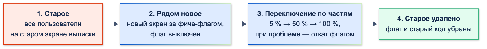

# Управление техническим долгом и рефакторинг

| Грейд | Время на изучение | Статус |
|-------|-------------------|--------|
| ⭐⭐⭐ | ~35 мин лекция + практика | ✅ Готово |

---

## 📚 Ресурсы

| Ресурс | Формат | Язык | Уровень | Зачем читать |
|--------|--------|------|---------|--------------|
| Мартин Фаулер, «Рефакторинг. Улучшение проекта существующего кода», 2-е изд. (Диалектика, 2019) | Книга | 🇷🇺 | ⭐⭐ → ⭐⭐⭐ | Главная книга о рефакторинге: что это, когда делать, каталог приёмов с примерами |
| Майкл Физерс, «Эффективная работа с унаследованным кодом» (Вильямс) | Книга | 🇷🇺 | ⭐⭐⭐ | Как менять код без тестов: характеризационные тесты, «швы», безопасные первые шаги |
| [Refactoring.Guru: запахи кода](https://refactoring.guru/ru/refactoring/smells) и [техники рефакторинга](https://refactoring.guru/ru/refactoring/techniques) | Каталог | 🇷🇺 | ⭐ → ⭐⭐ | Каталог Фаулера в удобном виде: признаки проблем и приёмы их исправления |
| [Как мы научились эффективно работать с техническим долгом](https://habr.com/ru/companies/tbank/articles/905102/) | Статья (Habr, Т-Банк) | 🇷🇺 | ⭐⭐⭐ | Реестр долга с причинами появления, связь долга с числом дефектов, 20 % времени на долг, метрики |
| [Практики управления техническим долгом в отдельно взятой команде](https://habr.com/ru/companies/ncloudtech/articles/337308/) | Статья (Habr) | 🇷🇺 | ⭐⭐ | Долг в общем бэклоге, привязка к фичам, улучшения маленькими шагами без долгих веток |
| [Martin Fowler: Technical Debt Quadrant](https://martinfowler.com/bliki/TechnicalDebtQuadrant.html) | Статья | 🇬🇧 | ⭐⭐ | Четыре вида долга: осознанный или случайный, оправданный или безрассудный |
| [Martin Fowler: Strangler Fig](https://martinfowler.com/bliki/StranglerFigApplication.html) | Статья | 🇬🇧 | ⭐⭐⭐ | Как постепенно заменить старую систему новой, не переписывая всё сразу |

---

## 🎓 Лекция

### 1. Что такое технический долг

**Технический долг** — метафора Уорда Каннингема: решение, которое ускоряет работу сейчас, но делает дороже каждое
следующее изменение. Как с кредитом: **основной долг** — работа, чтобы привести код в порядок; **проценты** —
лишнее время, которое команда платит при каждом изменении этого кода, пока долг не погашен.

Долг — это не «любой некрасивый код». Плохо написанный модуль, который никто не трогает годами, процентов не берёт.
Долгом его делает **цена изменений**: дорого менять, страшно трогать, часто ломается.

**Квадрант Фаулера** — четыре вида долга:

| | Безрассудный | Оправданный |
|-|--------------|-------------|
| **Осознанный** | «Нет времени на проектирование» — знали, как правильно, но сделали «быстро и грязно» без плана расплаты | «Выпускаем сейчас, разберёмся с последствиями» — осознанный компромисс ради срока с задачей на погашение |
| **Случайный** | «Что такое слои?» — команда не знала, как правильно | «Теперь мы знаем, как надо было» — хорошая работа, но понимание пришло позже, с опытом и ростом продукта |

Выводы:
- **Оправданный осознанный долг — нормальный инструмент бизнеса**, если он записан и у него есть план погашения.
- **Оправданный случайный долг неизбежен**: продукт растёт, требования меняются, и вчерашнее хорошее решение
  перестаёт подходить.
- **Безрассудный долг** лечится не рефакторингом, а процессами: ревью, правилами, обучением.

Виды долга в мобильном приложении: код и архитектура; **отсутствие тестов**; устаревшие зависимости (Flutter,
пакеты, Gradle, минимальная версия iOS/Android); инфраструктура (ручная сборка, нет CI); документация; дизайн-система
(разные кнопки на разных экранах).

### 2. Как находить и измерять

**Главный сигнал — время и страх.** Простые задачи в одном модуле оцениваются в 3 раза дольше, чем в соседнем;
разработчики просят «не трогать этот экран»; после каждого релиза — баги в одном и том же месте.

**«Горячие точки».** Самый полезный объективный признак — файлы, которые **и большие, и часто меняются**:
именно там долг берёт самые большие проценты. Число изменений файла берут из истории git:

```bash
git log --since=2024-12-01 --format= --name-only -- packages/flutter/lib/src | grep '\.dart$' | sort | uniq -c | sort -rn | head -8
```

Пример на истории самого Flutter SDK: число изменений — этой командой, размер — `wc -l`
(вывод объединён в одну таблицу, пути сокращены):

```text
изменений  строк  файл
   52      6480   semantics/semantics.dart
   36      6068   material/input_decorator.dart
   31      1578   material/dropdown_menu.dart
   26      3975   material/time_picker.dart
   26      3570   cupertino/nav_bar.dart
   25      6727   widgets/editable_text.dart
   24      2812   material/tabs.dart
   23      6536   rendering/object.dart
```

Файл на 6 000 строк, который меняют каждую неделю, — первый кандидат на внимание. Файл на 6 000 строк, который
не трогали два года, — нет.

**Другие инструменты:**
- **Анализатор и линтеры** (`dart analyze`, строгие правила): число предупреждений и подавлений `// ignore:`.
- **Покрытие тестами** (`flutter test --coverage` → `coverage/lcov.info`): особенно покрытие горячих точек.
- **Устаревшие зависимости**: `flutter pub outdated`.
- **Число дефектов по модулям** из трекера задач. Т-Банк в статье из ресурсов показывает прямую связь: чем больше
  у команды долга, тем больше дефектов.
- **Время на типовые изменения** — сколько занимает добавить поле в форму или экран в модуль.

### 3. Как вести техдолг

**Реестр.** Долг, которого нет в бэклоге, не будет погашен. Каждый пункт — задача с полями:

| Поле | Пример |
|------|--------|
| Что | Расчёт комиссии: строковые типы, деньги в `double`, нет тестов |
| Где | Модуль «Переводы», `fee()` |
| Проценты — во что обходится сейчас | Каждое изменение тарифа — 2–3 дня вместо 2 часов, 2 бага с копейками за квартал |
| Цена погашения | 3 дня: характеризационные тесты + рефакторинг |
| Риск, если не гасить | Ошибка в комиссии — финансовые потери и жалобы клиентов |
| Причина появления | Срочный запуск СБП в 2023 году |

**Приоритизация.** Сначала гасим долг, у которого **высокие проценты и дешёвое погашение**: горячие точки, через
которые пойдут ближайшие фичи. Долг в модуле, который скоро удалят, не гасим вообще.

**Как выделять время** — подходы, которые часто сочетают:
- **Фиксированная доля** каждого спринта (обычно 15–20 %) — долг гасится постоянно, а не «когда-нибудь».
- **Вместе с фичей:** фича идёт через проблемный модуль — оценка фичи включает его приведение в порядок.
  Так долг гасится там, где это сразу окупается.
- **Правило бойскаута:** оставь код немного чище, чем он был до тебя, — переименовать, вынести метод, добавить тест
  в рамках текущей задачи.
- **Отдельные проекты** — только для крупного долга (обновление Flutter, смена навигации), с планом по шагам.

### 4. Рефакторинг

**Рефакторинг** — изменение внутреннего устройства кода **без изменения его наблюдаемого поведения**, чтобы его было
проще понимать и менять. Ключевое — «без изменения поведения».

Чем рефакторинг **не** является:
- исправлением багов (это изменение поведения — отдельный коммит);
- добавлением функциональности;
- переписыванием «с нуля»;
- «рефакторингом» на две недели в отдельной ветке, после которого ничего не работает.

**Правила безопасного рефакторинга:**
1. **Сначала тесты.** Нет тестов — напиши характеризационные (ниже).
2. **Маленькие шаги**: каждый шаг — компилируется и проходит тесты.
3. **Не смешивать** рефакторинг с изменением поведения: отдельные коммиты, отдельные PR.
4. **Пользоваться инструментами IDE** (переименование, выделение метода, перенос класса) — они не ошибаются в опечатках.

**Запахи кода** — признаки, что код просит рефакторинга (полный каталог — на Refactoring.Guru): длинный метод,
большой класс, длинный список параметров, «одержимость примитивами» (строки и числа вместо типов), операторы
`switch` по строковым типам, дублирование, «стрельба дробью» (одно изменение требует правок во многих местах).

### 5. Пример: рефакторинг расчёта комиссии под защитой тестов

Унаследованный код. Работает, но тариф меняют раз в квартал, и каждый раз страшно:

```dart
// ignore_for_file: prefer_final_locals, curly_braces_in_flow_control_structures

/// ❌ Унаследованный код: комиссия за перевод в копейках.
/// Строковые типы, магические числа, деньги через double, всё в одной функции
int fee(String type, int amount, bool premium, int monthTotal) {
  var f = 0;
  if (type == 'sbp') {
    if (monthTotal + amount <= 10000000) {
      f = 0;
    } else {
      f = (amount * 0.005).round();
      if (f > 150000) f = 150000;
    }
  } else if (type == 'card') {
    f = (amount * 0.01).round();
    if (f < 3000) f = 3000;
    if (premium) f = 0;
  } else if (type == 'account') {
    f = 0;
  } else {
    throw Exception('unknown type');
  }
  return f;
}
```

Запахи: строковые типы (`'sbp'`, опечатка — исключение в рантайме), «одержимость примитивами» (`bool premium`,
`int monthTotal` имеют смысл только для одного типа), магические числа, **деньги через `double`**, тестов нет.

**Шаг 1. Характеризационные тесты.** Это тесты, которые фиксируют, как код работает **сейчас**, — даже если где-то
он работает неправильно. Ожидаемые значения не придумывают, а **записывают из запуска** старого кода. Плюс сравнение
старой и новой реализации на тысячах случайных входов:

```dart
import 'dart:math';

import 'package:flutter_test/flutter_test.dart';

import 'package:transfer/domain/legacy_fee.dart';
import 'package:transfer/domain/transfer_fee.dart';

/// Характеризационные тесты фиксируют, как код работает СЕЙЧАС, — до того, как его трогать.
/// Ожидаемые значения не придуманы, а записаны из запуска старой функции fee()
void main() {
  test('известные случаи: новая функция даёт те же суммы, что старая', () {
    const cases = {
      (SbpTransfer(monthTotalKopecks: 0), 500000): 0, // в пределах бесплатного лимита
      (SbpTransfer(monthTotalKopecks: 9800000), 500000): 2500, // лимит превышен: 0,5 %
      (SbpTransfer(monthTotalKopecks: 10000000), 50000000): 150000, // не больше 1 500 ₽
      (SbpTransfer(monthTotalKopecks: 10000000), 333): 2, // 1,665 коп. округляется до 2
      (CardTransfer(isPremium: false), 100000): 3000, // не меньше 30 ₽
      (CardTransfer(isPremium: false), 1000000): 10000, // 1 %
      (CardTransfer(isPremium: true), 1000000): 0,
      (OwnAccountTransfer(), 1000000): 0,
    };
    cases.forEach((input, expected) => expect(transferFee(input.$2, input.$1), expected));
  });

  test('на 10 000 случайных входах новая функция совпадает со старой', () {
    final random = Random(42); // фиксированный seed: при падении тест воспроизводится
    for (var i = 0; i < 10000; i++) {
      final type = ['sbp', 'card', 'account'][random.nextInt(3)];
      final amount = random.nextInt(50000000);
      final premium = random.nextBool();
      final monthTotal = random.nextInt(20000000);
      final kind = switch (type) {
        'sbp' => SbpTransfer(monthTotalKopecks: monthTotal),
        'card' => CardTransfer(isPremium: premium),
        _ => const OwnAccountTransfer(),
      };
      expect(transferFee(amount, kind), fee(type, amount, premium, monthTotal), reason: '$type, $amount коп.');
    }
  });
}
```

**Шаг 2. Рефакторинг.** Типы перевода — `sealed`-классы (у каждого — только свои параметры), тарифы — именованные
константы, деньги — только `int`:

```dart
/// ✅ После рефакторинга: типы перевода — sealed-класс, тарифы — именованные константы, деньги — только int
sealed class TransferKind {
  const TransferKind();
}

/// Перевод по номеру телефона (СБП): бесплатно до лимита в месяц
final class SbpTransfer extends TransferKind {
  const SbpTransfer({required this.monthTotalKopecks});

  final int monthTotalKopecks; // сумма переводов по СБП с начала месяца
}

final class CardTransfer extends TransferKind {
  const CardTransfer({required this.isPremium});

  final bool isPremium;
}

final class OwnAccountTransfer extends TransferKind {
  const OwnAccountTransfer();
}

abstract final class Tariffs {
  static const sbpFreeMonthLimit = 10000000; // 100 000 ₽
  static const sbpPercentTenths = 5; // 0,5 %
  static const sbpMaxFee = 150000; // 1 500 ₽
  static const cardPercentTenths = 10; // 1 %
  static const cardMinFee = 3000; // 30 ₽
}

/// Процент от суммы в целых копейках с округлением до ближайшего (как .round() у положительных чисел)
int percentOf(int amountKopecks, int tenthsOfPercent) => (amountKopecks * tenthsOfPercent + 500) ~/ 1000;

int transferFee(int amountKopecks, TransferKind kind) => switch (kind) {
      SbpTransfer(:final monthTotalKopecks) => monthTotalKopecks + amountKopecks <= Tariffs.sbpFreeMonthLimit
          ? 0
          : percentOf(amountKopecks, Tariffs.sbpPercentTenths).clamp(0, Tariffs.sbpMaxFee),
      CardTransfer(isPremium: true) => 0,
      CardTransfer() => percentOf(amountKopecks, Tariffs.cardPercentTenths).clamp(Tariffs.cardMinFee, 1 << 62),
      OwnAccountTransfer() => 0,
    };
```

**Шаг 3. Тесты поймали ошибку.** Первая версия считала процент «как в учебнике» — умножить и поделить нацело
(`amount * 5 ~/ 1000`). Это **отбрасывает** дробную часть, а старый код **округлял** (`.round()`). Сравнение на
10 000 случайных входах:

```text
Наивный рефакторинг: расхождений 1708 из 10000. Пример: sbp, сумма 12868723 коп.: было 64344, стало 64343
Исправленный рефакторинг: расхождений 0 из 10000
```

Одна копейка в 17 % переводов. Без характеризационных тестов это ушло бы в релиз как «рефакторинг без изменения
поведения». Исправление — округление в целых числах: `(amount * 5 + 500) ~/ 1000`.

**Шаг 4. Новая фича стала дешёвой.** Добавляем оплату по QR-коду — новый класс `QrPayment`. Если забыть добавить
для него тариф, **код не скомпилируется**:

```text
error • The type 'TransferKind' isn't exhaustively matched by the switch cases since it doesn't match the pattern 'QrPayment()' • lib/tech_debt/transfer_fee.dart:39:58 • non_exhaustive_switch_expression
```

В старом коде такой перевод упал бы с `Exception('unknown type')` уже у пользователя.

> 💡 **Совет:** если характеризационный тест зафиксировал **ошибочное** поведение (например, неправильное округление),
> его не исправляют в рамках рефакторинга. Сначала рефакторинг с тем же поведением, потом — отдельный коммит
> «исправить округление», где тест меняется осознанно и это видно на ревью.

### 6. Большие изменения: заменять, а не переписывать

**Переписать всё с нуля** — самый рискованный способ гасить долг: месяцы без новых фич, старая система продолжает
меняться, а новая повторяет забытые старые баги. Вместо этого:

- **«Фикус-душитель»** (Strangler Fig). Новое растёт рядом со старым и постепенно забирает его функции. Новый экран
  выписки делают отдельно, на него переключают сначала 5 % пользователей фича-флагом, затем всех, затем удаляют
  старый. Приложение работает на каждом шаге.



- **Ветвление через абстракцию** (Branch by Abstraction). Вводим интерфейс перед старой реализацией (например,
  `AccountsRepository` перед старым кодом работы со счетами), переводим всех потребителей на интерфейс, пишем новую
  реализацию, переключаем, удаляем старую. Всё — в основной ветке, маленькими PR.
- **Фича-флаги** для переключения и быстрого отката, если новая реализация ведёт себя не так.

Многомодульность (тема «Многомодульность») помогает и здесь: старый модуль заменяется новым целиком, граница уже есть.

### 7. Как обосновать бизнесу

Бизнес не покупает «рефакторинг» и «красивый код». Он покупает **скорость, надёжность и снижение рисков**.
Переводите долг на этот язык:

| ❌ Так не продаётся | ✅ Так продаётся |
|--------------------|------------------|
| «Надо отрефакторить модуль переводов» | «Изменение тарифа сейчас занимает 3 дня и дважды за квартал приводило к ошибкам в комиссии. После 5 дней работы — 2 часа и защита тестами» |
| «Код плохой, всё надо переписать» | «Три ближайшие фичи из роадмапа идут через этот модуль. Приведём его в порядок вместе с первой — две следующие будут на 40 % дешевле» |
| «Нужно обновить Flutter» | «На текущей версии через полгода нельзя будет публиковать в стор: новые требования к targetSdk. Обновление — 2 недели сейчас или авральные 4 недели потом» |

Помогают **цифры**: время на типовые задачи, число дефектов в модуле, сколько раз за квартал откладывали фичи
из-за этого кода, риски безопасности и требования регулятора.

### 🚫 Чрезмерное применение

- **Рефакторинг ради красоты** кода, который никто не меняет и не будет менять: проценты нулевые, погашение не окупится.
- **Бесконечный рефакторинг** без связи с фичами и целями — команда «улучшает код», а продукт стоит.
- **Переписывание с нуля** вместо постепенной замены.
- **Абстракции «на будущее»** при рефакторинге: интерфейсы и фабрики там, где вторая реализация не появится.

### ⚠️ Частые ошибки

- **Рефакторинг без тестов** — «поведение не изменилось» никто не проверил.
- **Рефакторинг и исправление багов в одном коммите** — на ревью не отличить намеренное изменение от случайного.
- **Долгоживущая ветка рефакторинга** — конфликты слияния, отставание от основной ветки, большой взрыв при слиянии.
- **Долг, которого нет в бэклоге**, — «потом сделаем» не наступает.
- **Деньги в `double`** — копеечные ошибки округления. Деньги хранят в целых копейках (`int`).
- **Отказ от любого долга** — тоже ошибка: осознанный долг ради важного срока — нормальное решение, если он записан.

### 🎤 Задача с собеседования: «Тебе достался модуль без тестов, в него нужно добавить фичу. Твои действия?»

| Уровень | Как выглядит ответ |
|---------|--------------------|
| ⭐ Junior | «Разберусь в коде и аккуратно добавлю фичу» или «перепишу модуль нормально» |
| ⭐⭐ Middle | Разберусь, где пройдёт изменение, напишу характеризационные тесты на этот участок, сделаю небольшой рефакторинг, чтобы фича легла естественно, добавлю фичу с тестами. Рефакторинг и фича — отдельными коммитами |
| ⭐⭐⭐ Senior | Всё из Middle, плюс: оценю, горячая ли это точка (как часто меняется, сколько багов), заложу приведение участка в порядок в оценку фичи и объясню пользу бизнесу, остальной долг модуля — в реестр с приоритетом, при большой переделке — постепенная замена (фича-флаг, ветвление через абстракцию), а не переписывание; договорюсь о правилах, чтобы долг не копился снова (тесты обязательны для изменений, линтеры) |

---

## ✅ Самопроверка

**⭐ Junior**
1. Что такое технический долг? Почему его сравнивают с кредитом?
2. Что такое рефакторинг? Чем он отличается от исправления бага?
3. Назови несколько запахов кода.

**⭐⭐ Middle**
1. Опиши квадрант Фаулера. Какой долг нормален, а какой нет?
2. Что такое характеризационные тесты и откуда в них берутся ожидаемые значения?
3. Почему нельзя смешивать рефакторинг и изменение поведения в одном коммите?
4. Как выделять время на долг в команде?

**⭐⭐⭐ Senior**
1. Как найти, какой долг гасить в первую очередь? Что такое «горячие точки»?
2. Что такое «фикус-душитель» и ветвление через абстракцию? Почему они лучше переписывания с нуля?
3. Что должно быть в записи реестра техдолга?
4. Как обосновать бизнесу погашение долга?
5. Рефакторинг показал, что старый код считал комиссию с ошибкой. Что делать?

<details>
<summary>Ответы</summary>

**Junior**
1. Решение, которое ускоряет работу сейчас, но удорожает каждое следующее изменение. Основной долг — работа по
   исправлению, проценты — лишнее время на каждое изменение, пока долг не погашен.
2. Изменение устройства кода без изменения поведения. Исправление бага меняет поведение — это отдельная работа.
3. Длинный метод, большой класс, длинный список параметров, примитивы вместо типов, `switch` по строковым типам,
   дублирование, «стрельба дробью».

**Middle**
1. Осознанный/случайный × безрассудный/оправданный. Нормальны оправданный осознанный (компромисс ради срока с планом
   погашения) и оправданный случайный (понимание пришло позже). Безрассудный лечится процессами.
2. Тесты, которые фиксируют текущее поведение кода перед изменениями. Ожидаемые значения записываются из запуска
   старого кода, а не придумываются; дополнительно — сравнение старой и новой реализации на множестве входов.
3. На ревью и при поиске причины бага не отличить намеренное изменение поведения от случайного, и откатить одно
   без другого нельзя.
4. Фиксированная доля спринта, погашение вместе с фичами через проблемный модуль, правило бойскаута, отдельные проекты
   для крупного долга.

**Senior**
1. Высокие проценты и дешёвое погашение: горячие точки (большие и часто меняемые файлы — из истории git), модули
   с дефектами, места, через которые пойдут ближайшие фичи.
2. «Фикус-душитель» — новое растёт рядом и постепенно забирает функции старого (фича-флаги, переключение по частям).
   Ветвление через абстракцию — интерфейс перед старой реализацией, перевод потребителей, новая реализация,
   переключение, удаление. Приложение работает на каждом шаге, нет месяцев без фич и «большого взрыва».
3. Что и где, проценты (во что обходится сейчас), цена погашения, риск, если не гасить, причина появления.
4. На языке бизнеса: время на изменения, дефекты, риски (безопасность, регулятор, сторы), ускорение ближайших фич;
   с цифрами.
5. Сначала закончить рефакторинг с тем же (ошибочным) поведением, чтобы тесты подтвердили, что ничего другого
   не изменилось. Затем отдельным коммитом исправить ошибку и тест, согласовав с бизнесом: изменение суммы комиссии
   влияет на клиентов.

</details>
