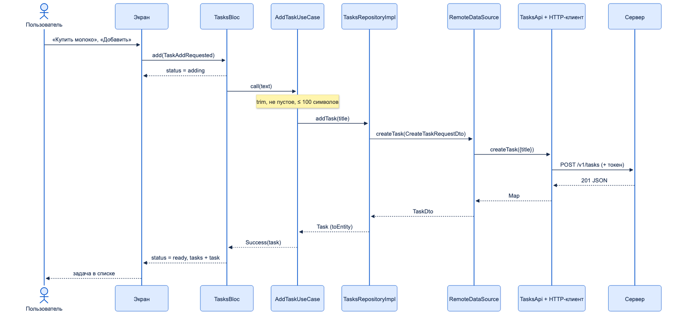
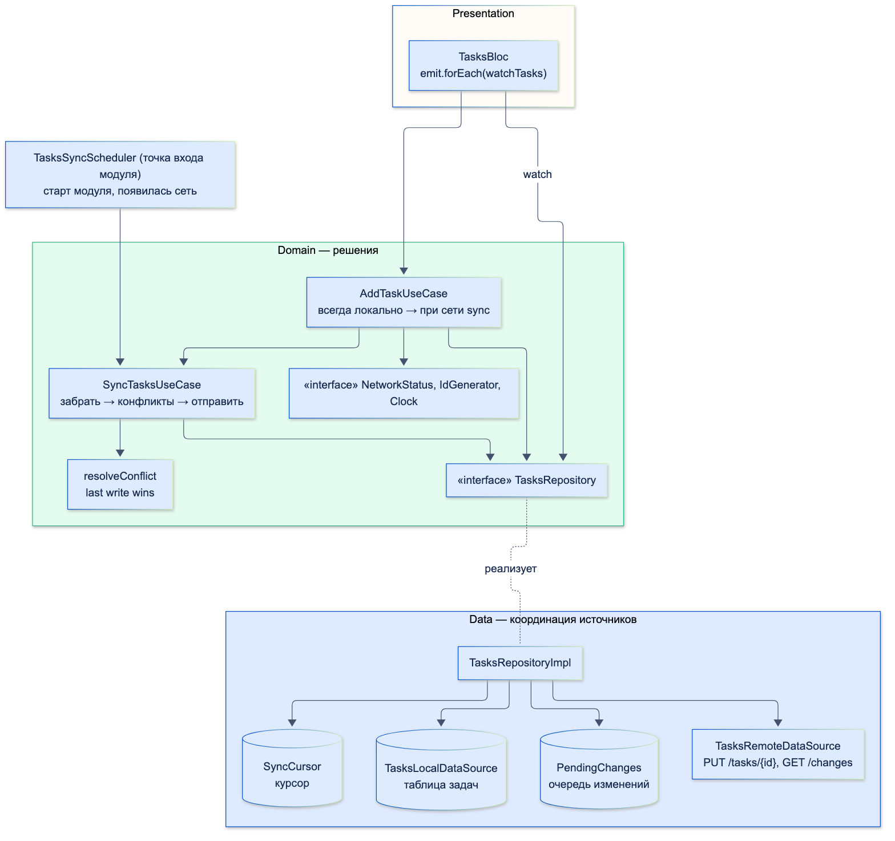
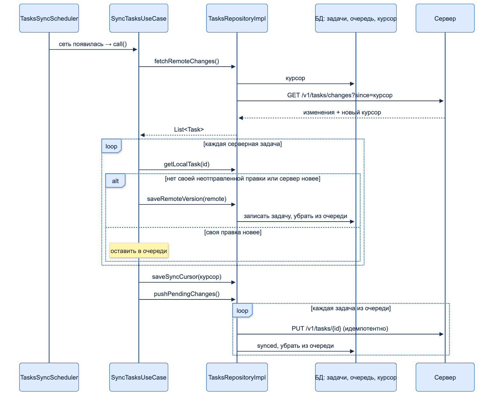

# Проектирование архитектуры с нуля

| Грейд | Время на изучение | Статус |
|-------|-------------------|--------|
| ⭐⭐⭐ | ~45 мин лекция + практика | ✅ Готово |

---

## 📚 Ресурсы

| Ресурс | Формат | Язык | Уровень | Зачем читать |
|--------|--------|------|---------|--------------|
| Роберт Мартин, «Чистая архитектура» (Питер, 2018) | Книга | 🇷🇺 | ⭐⭐ → ⭐⭐⭐ | Как принимать архитектурные решения и откладывать детали: БД, фреймворк и сеть — подробности, которые можно заменить |
| [Офлайн-режим в мобильном приложении: когда он нужен и как его реализовать](https://nordclan.com/blog/offlajn-rezhim-v-mobilnom-prilozhenii-kogda-on-nuzhen-i-kak-ego-realizovat) | Статья | 🇷🇺 | ⭐⭐ | Очередь изменений, стратегии синхронизации и конфликтов, фоновая синхронизация на платформах |
| [Не одним CRDT едины, или P2P vs Authoritative в local-first приложениях](https://habr.com/ru/articles/946722/) | Статья (Habr) | 🇷🇺 | ⭐⭐⭐ | Глубже про конфликты: «последнее изменение побеждает», CRDT, разрешение на сервере |
| [Flutter: Offline-first support](https://docs.flutter.dev/app-architecture/design-patterns/offline-first) | Документация | 🇬🇧 | ⭐⭐ | Официальный разбор: стратегии чтения и записи, флаг синхронизации, фоновая синхронизация |
| [Flutter: Guide to app architecture](https://docs.flutter.dev/app-architecture/guide) | Документация | 🇬🇧 | ⭐⭐ | Общая схема слоёв, с которой удобно сверить свой ответ |

---

## 🎓 Лекция

> ℹ️ **Важно:** это задача с собеседования, которая проверяет весь раздел «Архитектура» сразу. Отдельные части
> подробно разобраны в темах «Понимание слоёв приложения», «Паттерн Repository», «Паттерны презентационного слоя»,
> «Внедрение зависимостей (DI)» и «Многомодульность». Здесь — как собрать их в один связный ответ.

## Часть 1. Основная задача

> **Условие.** Спроектируй приложение «TODO list» по чистой архитектуре. Расскажи устно: какие будут слои
> и абстракции — от нажатия кнопки «Добавить задачу» до API-клиента и обратно до экрана.

### Как отвечать

Сильный ответ — не перечисление классов, а рассказ в понятном порядке:

1. **Требования** — что умеет приложение, какие правила у предметной области.
2. **Модуль** — где живёт фича и как устроены папки.
3. **Domain** — Entity, интерфейс репозитория, UseCase, ошибки.
4. **Data** — API, DTO, DataSource, реализация репозитория.
5. **Presentation** — события, состояние, Bloc, экран.
6. **DI** — кто и где всё связывает.
7. **Путь запроса туда и обратно** — главная часть ответа.
8. **Путь ошибки** — что видит пользователь, если нет сети.
9. **Тесты** — как проверить каждый слой.

Типичные ловушки: начать с виджетов, забыть domain («Bloc вызывает репозиторий, который ходит в API»), не сказать,
где проверяется название задачи, и не упомянуть ошибки.

### Шаг 1. Требования и модель

- Показать список задач, добавить задачу, отметить выполненной.
- **Правила предметной области:** название не пустое (пробелы по краям обрезаются), не длиннее 100 символов.
- Сервер: `GET /v1/tasks`, `POST /v1/tasks`.

### Шаг 2. Модуль

```text
tasks/                                   ← модуль фичи «Задачи»
├── pubspec.yaml
└── lib/
    ├── tasks_module.dart                ← точка входа: регистрация DI, фабрика Bloc
    ├── data/
    │   ├── network/tasks_api.dart       ← эндпоинты (retrofit), ApiException
    │   ├── models/task_dto.dart         ← TaskDto, CreateTaskRequestDto
    │   ├── data_sources/tasks_remote_data_source.dart
    │   └── repositories/tasks_repository_impl.dart
    ├── domain/
    │   ├── entities/task.dart
    │   ├── exceptions/tasks_exceptions.dart
    │   ├── repositories/tasks_repository.dart
    │   └── use_cases/{add_task_use_case.dart, get_tasks_use_case.dart}
    └── presentation/pages/tasks/
        ├── bloc/{tasks_bloc.dart, tasks_event.dart, tasks_state.dart}
        └── tasks_screen.dart
```

### Шаг 3. Domain

```dart
/// Задача — модель предметной области
final class Task {
  const Task({required this.id, required this.title, required this.isDone});

  final String id;
  final String title;
  final bool isDone;
}
```

```dart
/// Ошибки предметной области: о HTTP и JSON ничего не знают
sealed class TasksException implements Exception {
  const TasksException();
}

final class EmptyTitleException extends TasksException {
  const EmptyTitleException();
}

final class TitleTooLongException extends TasksException {
  const TitleTooLongException(this.maxLength);

  final int maxLength;
}

final class NoConnectionException extends TasksException {
  const NoConnectionException();
}

final class ServerErrorException extends TasksException {
  const ServerErrorException();
}
```

```dart
import '../entities/task.dart';

/// Контракт domain: что нужно бизнес-логике. Ошибки — только TasksException
abstract interface class TasksRepository {
  Future<List<Task>> getTasks();

  Future<Task> addTask(String title);
}
```

```dart
import 'package:core/result.dart';
import '../entities/task.dart';
import '../exceptions/tasks_exceptions.dart';
import '../repositories/tasks_repository.dart';

/// Сценарий «добавить задачу»: правила проверки — здесь, а не в Bloc и не на сервере
final class AddTaskUseCase {
  const AddTaskUseCase(this._repository);

  static const maxTitleLength = 100;

  final TasksRepository _repository;

  Future<Result<Task>> call(String rawTitle) async {
    final title = rawTitle.trim();
    if (title.isEmpty) return const Failure(EmptyTitleException());
    if (title.length > maxTitleLength) return const Failure(TitleTooLongException(maxTitleLength));
    try {
      return Success(await _repository.addTask(title));
    } on TasksException catch (error) {
      return Failure(error);
    }
  }
}
```

`GetTasksUseCase` устроен так же: вызывает `getTasks()` и переводит `TasksException` в `Failure`.

### Шаг 4. Data

```dart
/// Ошибка сетевого уровня (в проекте — DioException)
final class ApiException implements Exception {
  const ApiException({this.statusCode});

  final int? statusCode; // null — запрос не дошёл до сервера
}

/// Эндпоинты задач (в проекте — retrofit-интерфейс поверх dio с перехватчиками авторизации и логов)
abstract interface class TasksApi {
  Future<List<Object?>> getTasks(); // GET /v1/tasks

  Future<Map<String, Object?>> createTask(Map<String, Object?> body); // POST /v1/tasks
}
```

```dart
import '../../domain/entities/task.dart';

/// Задача в формате API
final class TaskDto {
  const TaskDto({required this.id, required this.title, required this.completed});

  factory TaskDto.fromJson(Map<String, Object?> json) => TaskDto(
        id: json['id']! as String,
        title: json['title']! as String,
        completed: json['completed']! as bool,
      );

  final String id;
  final String title;
  final bool completed;

  Task toEntity() => Task(id: id, title: title, isDone: completed);
}

/// Тело запроса на создание
final class CreateTaskRequestDto {
  const CreateTaskRequestDto(this.title);

  final String title;

  Map<String, Object?> toJson() => {'title': title};
}
```

```dart
import '../models/task_dto.dart';
import '../network/tasks_api.dart';

abstract interface class TasksRemoteDataSource {
  Future<List<TaskDto>> getTasks();

  Future<TaskDto> createTask(CreateTaskRequestDto request);
}

final class TasksRemoteDataSourceImpl implements TasksRemoteDataSource {
  const TasksRemoteDataSourceImpl(this._api);

  final TasksApi _api;

  @override
  Future<List<TaskDto>> getTasks() async =>
      (await _api.getTasks()).map((item) => TaskDto.fromJson(item! as Map<String, Object?>)).toList();

  @override
  Future<TaskDto> createTask(CreateTaskRequestDto request) async =>
      TaskDto.fromJson(await _api.createTask(request.toJson()));
}
```

```dart
import '../../domain/entities/task.dart';
import '../../domain/exceptions/tasks_exceptions.dart';
import '../../domain/repositories/tasks_repository.dart';
import '../data_sources/tasks_remote_data_source.dart';
import '../models/task_dto.dart';
import '../network/tasks_api.dart';

final class TasksRepositoryImpl implements TasksRepository {
  const TasksRepositoryImpl(this._remote);

  final TasksRemoteDataSource _remote;

  @override
  Future<List<Task>> getTasks() => _guard(() async => [for (final dto in await _remote.getTasks()) dto.toEntity()]);

  @override
  Future<Task> addTask(String title) =>
      _guard(() async => (await _remote.createTask(CreateTaskRequestDto(title))).toEntity());

  /// Перевод сетевых ошибок в ошибки domain — на границе слоёв
  Future<T> _guard<T>(Future<T> Function() call) async {
    try {
      return await call();
    } on ApiException catch (error) {
      throw error.statusCode == null ? const NoConnectionException() : const ServerErrorException();
    }
  }
}
```

### Шаг 5. Presentation

```dart
sealed class TasksEvent {
  const TasksEvent();
}

final class TasksLoadRequested extends TasksEvent {
  const TasksLoadRequested();
}

/// Пользователь нажал «Добавить задачу»
final class TaskAddRequested extends TasksEvent {
  const TaskAddRequested(this.title);

  final String title;
}
```

```dart
import 'package:equatable/equatable.dart';

import '../../../../domain/entities/task.dart';

enum TasksStatus { loading, ready, adding }

final class TasksState extends Equatable {
  const TasksState({this.status = TasksStatus.loading, this.tasks = const [], this.error});

  final TasksStatus status;
  final List<Task> tasks;
  final String? error; // текст для snackbar; живёт ровно в одном состоянии

  TasksState copyWith({TasksStatus? status, List<Task>? tasks, String? error}) =>
      TasksState(status: status ?? this.status, tasks: tasks ?? this.tasks, error: error);

  @override
  List<Object?> get props => [status, tasks, error];
}
```

```dart
import 'package:bloc_concurrency/bloc_concurrency.dart';
import 'package:flutter_bloc/flutter_bloc.dart';

import 'package:core/result.dart';
import '../../../../domain/exceptions/tasks_exceptions.dart';
import '../../../../domain/use_cases/add_task_use_case.dart';
import '../../../../domain/use_cases/get_tasks_use_case.dart';
import 'tasks_event.dart';
import 'tasks_state.dart';

final class TasksBloc extends Bloc<TasksEvent, TasksState> {
  TasksBloc({required GetTasksUseCase getTasks, required AddTaskUseCase addTask})
      : _getTasks = getTasks,
        _addTask = addTask,
        super(const TasksState()) {
    on<TasksLoadRequested>(_onLoad);
    // droppable: двойное нажатие «Добавить» не создаст две одинаковые задачи
    on<TaskAddRequested>(_onAdd, transformer: droppable());
  }

  final GetTasksUseCase _getTasks;
  final AddTaskUseCase _addTask;

  Future<void> _onLoad(TasksLoadRequested event, Emitter<TasksState> emit) async {
    emit(state.copyWith(status: TasksStatus.loading));
    final result = await _getTasks();
    emit(switch (result) {
      Success(:final data) => state.copyWith(status: TasksStatus.ready, tasks: data),
      Failure(:final error) => state.copyWith(status: TasksStatus.ready, error: _message(error)),
    });
  }

  Future<void> _onAdd(TaskAddRequested event, Emitter<TasksState> emit) async {
    emit(state.copyWith(status: TasksStatus.adding));
    final result = await _addTask(event.title);
    emit(switch (result) {
      Success(:final data) => state.copyWith(status: TasksStatus.ready, tasks: [...state.tasks, data]),
      Failure(:final error) => state.copyWith(status: TasksStatus.ready, error: _message(error)),
    });
  }

  /// Ошибка domain → текст для пользователя (в проекте — строки из l10n)
  String _message(Exception error) => switch (error) {
        EmptyTitleException() => 'Введите название задачи',
        TitleTooLongException(:final maxLength) => 'Не длиннее $maxLength символов',
        NoConnectionException() => 'Нет соединения с интернетом',
        _ => 'Что-то пошло не так, попробуйте ещё раз',
      };
}
```

Экран: `BlocProvider` создаёт Bloc, кнопка «Добавить» отправляет `TaskAddRequested(controller.text)`,
`BlocBuilder` рисует список, `BlocListener` показывает snackbar, когда в состоянии появилась `error`
(тема «Паттерны презентационного слоя»).

### Шаг 6. DI

```dart
import 'package:get_it/get_it.dart';

import 'data/data_sources/tasks_remote_data_source.dart';
import 'data/repositories/tasks_repository_impl.dart';
import 'domain/repositories/tasks_repository.dart';
import 'domain/use_cases/add_task_use_case.dart';
import 'domain/use_cases/get_tasks_use_case.dart';
import 'presentation/pages/tasks/bloc/tasks_bloc.dart';

/// Точка входа модуля «Задачи»: регистрация зависимостей. TasksApi регистрирует сетевой слой приложения
void registerTasksDependencies(GetIt di) {
  di.registerLazySingleton<TasksRemoteDataSource>(() => TasksRemoteDataSourceImpl(di.get()));
  di.registerLazySingleton<TasksRepository>(() => TasksRepositoryImpl(di.get()));
  di.registerFactory(() => GetTasksUseCase(di.get()));
  di.registerFactory(() => AddTaskUseCase(di.get()));
}

/// Фабрика Bloc для экрана: BlocProvider(create: (_) => createTasksBloc(di)..add(const TasksLoadRequested()))
TasksBloc createTasksBloc(GetIt di) => TasksBloc(getTasks: di.get(), addTask: di.get());
```

### Шаг 7. Путь туда и обратно



1. **Экран.** Пользователь ввёл «  Купить молоко  » и нажал «Добавить» → `bloc.add(TaskAddRequested(text))`.
2. **TasksBloc** (presentation). Трансформер `droppable` отбрасывает повторное нажатие. Выпускает состояние
   `adding` (на экране — индикатор) и вызывает `AddTaskUseCase(text)`.
3. **AddTaskUseCase** (domain). Обрезает пробелы, проверяет правила (не пустое, до 100 символов), вызывает
   `TasksRepository.addTask('Купить молоко')` — интерфейс, реализацию подставил DI.
4. **TasksRepositoryImpl** (data). Превращает строку в `CreateTaskRequestDto`, вызывает DataSource,
   ловит `ApiException`.
5. **TasksRemoteDataSourceImpl** (data). `dto.toJson()` → `TasksApi.createTask({'title': 'Купить молоко'})`.
6. **TasksApi + HTTP-клиент** (data). Перехватчики добавляют токен и логируют запрос: `POST /v1/tasks`.
7. **Сервер** отвечает `201 {"id": "srv-1", "title": "Купить молоко", "completed": false}`.
8. **Обратно:** JSON → `TaskDto.fromJson` (DataSource) → `dto.toEntity()` → `Task` (репозиторий) →
   `Success(task)` (UseCase) → `state.copyWith(status: ready, tasks: [...tasks, task])` (Bloc) →
   `BlocBuilder` перестраивает список.

Трассировка этого пути (тест с фейковым API и `BlocObserver`):

```text
  Bloc TasksLoadRequested → status=loading, задач=0
  API  ← GET /v1/tasks
  Bloc TasksLoadRequested → status=ready, задач=0
Нажата «Добавить задачу» с текстом «Купить молоко»:
  Bloc TaskAddRequested → status=adding, задач=0
  API  ← POST /v1/tasks {title: Купить молоко}
  API  → 201 {id: srv-1, title: Купить молоко, completed: false}
  Bloc TaskAddRequested → status=ready, задач=1
На экране: srv-1 «Купить молоко»
```

### Шаг 8. Путь ошибки

```text
Пустое название:
  Bloc TaskAddRequested → status=adding, задач=1
  Bloc TaskAddRequested → status=ready, задач=1, error=«Введите название задачи»
Нет сети:
  Bloc TaskAddRequested → status=adding, задач=1
  API  ← POST /v1/tasks {title: Позвонить в банк}
  Bloc TaskAddRequested → status=ready, задач=1, error=«Нет соединения с интернетом»
```

- Пустое название **не доходит до сети**: правило проверил UseCase.
- Нет сети: `ApiException(statusCode: null)` → репозиторий переводит в `NoConnectionException` (domain) →
  UseCase возвращает `Failure` → Bloc переводит в текст → `BlocListener` показывает snackbar.
  Ни один слой выше data не знает про HTTP.

### Шаг 9. Тесты по слоям

| Слой | Что проверяем | С чем |
|------|---------------|-------|
| Entity, UseCase | Правила: пустое название, длина, обработка ошибок репозитория | Фейковый репозиторий, обычный `test` |
| RepositoryImpl | Маппинг DTO ↔ Entity, перевод `ApiException` в ошибки domain | Фейковый DataSource |
| DataSource | Разбор JSON, формат запроса | Фейковый API или записанные ответы |
| Bloc | Последовательность состояний, `droppable`, тексты ошибок | `bloc_test`, настоящие UseCase с фейковым репозиторием |
| Экран | Snackbar, индикатор, список | Виджет-тест с Bloc на фейковых данных |
| Модуль | Граф зависимостей собирается | Тест регистрации DI |

### Ответы на основной вопрос

| Уровень | Как выглядит ответ |
|---------|--------------------|
| ⭐ Junior | Называет три слоя: «экран и Bloc — presentation, бизнес-логика — domain, работа с API — data». Путь: Bloc → репозиторий → API. Про ошибки и DI — не говорит |
| ⭐⭐ Middle | Полная цепочка с классами: Bloc → UseCase (валидация) → интерфейс репозитория → RepositoryImpl → DataSource → API; DTO и Entity и где маппинг; перевод ошибок; регистрация в DI. Путь обратно до `BlocBuilder` |
| ⭐⭐⭐ Senior | Всё из Middle, плюс: начинает с требований и правил, модуль и его границы, `droppable` от двойного нажатия, тексты ошибок через l10n, перехватчики HTTP-клиента, тесты по слоям, и **сам** поднимает вопросы: нужен ли офлайн, оптимистичное добавление, синхронизация между устройствами — что и приводит к дополнительному вопросу |

---

## Часть 2. Дополнительный вопрос: офлайн и синхронизация

> **Вопрос.** Как поменяется архитектура, если приложение должно работать без сети и синхронизировать данные,
> полученные онлайн, с данными, сохранёнными офлайн? Какие абстракции появятся? Кто будет решать, по какому пути идти?

Главная смена мышления: **экран больше не ждёт сервер.** Источник истины для экрана — локальная БД. Сервер —
место, с которым БД синхронизируется.

### Что меняется в модели

```dart
enum SyncStatus { synced, pending }

/// Задача в офлайн-режиме: id создаёт клиент, у задачи есть статус синхронизации и время изменения
final class Task {
  const Task({
    required this.id,
    required this.title,
    required this.isDone,
    required this.updatedAt,
    required this.syncStatus,
  });

  final String id; // UUID с клиента: задача получает id сразу, без сервера
  final String title;
  final bool isDone;
  final DateTime updatedAt; // для разрешения конфликтов
  final SyncStatus syncStatus; // pending — изменение ещё не на сервере

  Task copyWith({String? title, bool? isDone, DateTime? updatedAt, SyncStatus? syncStatus}) => Task(
        id: id,
        title: title ?? this.title,
        isDone: isDone ?? this.isDone,
        updatedAt: updatedAt ?? this.updatedAt,
        syncStatus: syncStatus ?? this.syncStatus,
      );
}
```

- **`id` создаёт клиент** (UUID). В онлайн-версии `id` выдавал сервер, но без сети его не получить, а задачу нужно
  показать и редактировать сразу. Тот же `id` делает отправку идемпотентной.
- **`syncStatus`** — синхронизирована задача или её изменение ещё ждёт отправки (на экране — значок «облачко»).
- **`updatedAt`** — для разрешения конфликтов.
- **Удаление** офлайн делают пометкой (tombstone — «надгробие»): задача скрыта на экране, но запись остаётся, пока
  удаление не дойдёт до сервера. Иначе синхронизация не узнает, что её надо удалить на сервере.

### Новые абстракции

| Абстракция | Слой | Зачем |
|------------|------|-------|
| `TasksLocalDataSource` | data | Таблица задач в БД (drift). Экран читает отсюда через `watch` |
| `PendingChangesLocalDataSource` | data | **Очередь исходящих изменений** (outbox): что ещё не отправлено на сервер |
| `SyncCursorLocalDataSource` | data | Курсор: с какого места забирать изменения с сервера, чтобы не качать всё |
| `TasksRemoteDataSource` + `TasksSyncApi` | data | Идемпотентный `PUT /v1/tasks/{id}` и `GET /v1/tasks/changes?since=…` |
| `NetworkStatus`, `IdGenerator`, `Clock` | domain (интерфейсы) | Сеть, id и время — внешний мир, который UseCase-ам нужен, но который надо подменять в тестах |
| `SyncTasksUseCase` | domain | Сценарий синхронизации и правило конфликта |
| `TasksSyncScheduler` | точка входа модуля | **Когда** синхронизировать: старт, появление сети |

```dart
/// Есть ли сеть. Реализация — в data или core (например, на connectivity_plus)
abstract interface class NetworkStatus {
  bool get isOnline;

  Stream<bool> get onChanged;
}

/// Генерация id на клиенте (UUID). Интерфейс — чтобы в тестах id были предсказуемыми
abstract interface class IdGenerator {
  String next();
}

/// Текущее время. Интерфейс — чтобы в тестах управлять временем
abstract interface class Clock {
  DateTime now();
}
```

```dart
import '../models/task_models.dart';

/// Таблица задач
abstract interface class TasksLocalDataSource {
  Stream<List<TaskRecord>> watchAll();

  Future<TaskRecord?> get(String id);

  Future<void> upsert(TaskRecord record);
}

/// Очередь исходящих изменений (outbox): id задач, которые нужно отправить.
/// Несколько изменений одной задачи — одна запись: отправится последняя версия
abstract interface class PendingChangesLocalDataSource {
  Future<void> add(String taskId);

  Future<List<String>> all();

  Future<void> remove(String taskId);
}

/// Метаданные синхронизации: с какого места забирать изменения с сервера
abstract interface class SyncCursorLocalDataSource {
  Future<int> read();

  Future<void> write(int cursor);
}
```

```dart
/// Эндпоинты для синхронизации
abstract interface class TasksSyncApi {
  /// PUT /v1/tasks/{id} — создать или заменить. Идемпотентно: повтор с тем же id не создаёт дубль
  Future<void> putTask(String id, Map<String, Object?> body);

  /// GET /v1/tasks/changes?since={cursor} → {"tasks": [...], "cursor": 42}
  Future<Map<String, Object?>> getChanges(int since);
}
```



### Кто решает, по какому пути идти

**Решает UseCase через репозиторий, у которого несколько локальных DataSource.**

- **UseCase** принимает решения — это бизнес-сценарий: «задача всегда сохраняется локально; если есть сеть —
  синхронизируем сразу; если нет — она подождёт в очереди»; «в конфликте побеждает более позднее изменение».
- **Репозиторий** даёт операции над источниками и координирует их: записать в таблицу и в очередь одной операцией,
  забрать изменения сервера, отправить очередь. Сам он не решает ни «когда», ни «кто прав».

| | Решает репозиторий | Решает UseCase (наш выбор) |
|-|--------------------|-----------------------------|
| Где правило «офлайн → в очередь» | Внутри `addTask` в data | В `AddTaskUseCase`, явно |
| Где правило конфликта | Спрятано в data | В domain: `resolveConflict`, тестируется без БД и сети |
| Разные сценарии для разных операций | Флаги и ветки внутри репозитория | Разные UseCase: перевод — только онлайн, заметка — офлайн |
| Репозиторий | Толстый: данные + решения | Тонкий: только данные |
| Когда уместно | Простой кеш «сеть, иначе сохранённое» (тема «Паттерн Repository») | Настоящий офлайн с очередью, синхронизацией и конфликтами |

Контракт репозитория для офлайн-режима и сценарий добавления:

```dart
import '../entities/task.dart';

/// Контракт для офлайн-режима: репозиторий даёт операции над источниками данных,
/// а решения (когда синхронизировать, кто прав в конфликте) принимают UseCase
abstract interface class TasksRepository {
  /// Задачи из локальной БД — единственный источник истины для экрана
  Stream<List<Task>> watchTasks();

  Future<Task?> getLocalTask(String id);

  /// Сохранить изменение пользователя: задача в БД со статусом pending + операция в очередь
  Future<void> saveLocalChange(Task task);

  /// Изменения с сервера с прошлой синхронизации и новый курсор
  Future<({List<Task> tasks, int cursor})> fetchRemoteChanges();

  /// Записать серверную версию задачи в БД и убрать её операцию из очереди
  Future<void> saveRemoteVersion(Task task);

  Future<void> saveSyncCursor(int cursor);

  /// Отправить очередь операций. Возвращает, сколько отправлено
  Future<int> pushPendingChanges();
}
```

```dart
import 'package:core/result.dart';
import '../exceptions/tasks_exceptions.dart';
import '../entities/task.dart';
import '../repositories/tasks_repository.dart';
import '../services/platform_services.dart';
import 'sync_tasks_use_case.dart';

/// Добавление задачи в офлайн-режиме. UseCase решает путь:
/// всегда сохранить локально → если есть сеть, сразу синхронизировать
final class AddTaskUseCase {
  const AddTaskUseCase({
    required TasksRepository repository,
    required SyncTasksUseCase sync,
    required NetworkStatus network,
    required IdGenerator ids,
    required Clock clock,
  })  : _repository = repository,
        _sync = sync,
        _network = network,
        _ids = ids,
        _clock = clock;

  /// То же правило предметной области, что в онлайн-версии: офлайн не отменяет проверок
  static const maxTitleLength = 100;

  final TasksRepository _repository;
  final SyncTasksUseCase _sync;
  final NetworkStatus _network;
  final IdGenerator _ids;
  final Clock _clock;

  Future<Result<Task>> call(String rawTitle) async {
    final title = rawTitle.trim();
    if (title.isEmpty) return const Failure(EmptyTitleException());
    if (title.length > maxTitleLength) return const Failure(TitleTooLongException(maxTitleLength));

    final task = Task(
      id: _ids.next(),
      title: title,
      isDone: false,
      updatedAt: _clock.now(),
      syncStatus: SyncStatus.pending,
    );
    await _repository.saveLocalChange(task); // экран увидит задачу сразу — через watchTasks
    if (_network.isOnline) await _sync(); // ошибка синхронизации не ошибка добавления: задача в очереди
    return Success(task);
  }
}
```

Реализация репозитория — координация четырёх источников:

```dart
import '../../domain/entities/task.dart';
import '../../domain/repositories/tasks_repository.dart';
import '../data_sources/tasks_local_data_sources.dart';
import '../data_sources/tasks_remote_data_source.dart';
import '../models/task_models.dart';

/// Координирует четыре источника: удалённый, таблицу задач, очередь изменений и курсор.
/// Решений «когда синхронизировать» и «кто прав в конфликте» здесь нет — их принимают UseCase
final class TasksRepositoryImpl implements TasksRepository {
  const TasksRepositoryImpl({
    required TasksRemoteDataSource remote,
    required TasksLocalDataSource tasks,
    required PendingChangesLocalDataSource pending,
    required SyncCursorLocalDataSource cursor,
  })  : _remote = remote,
        _tasks = tasks,
        _pending = pending,
        _cursor = cursor;

  final TasksRemoteDataSource _remote;
  final TasksLocalDataSource _tasks;
  final PendingChangesLocalDataSource _pending;
  final SyncCursorLocalDataSource _cursor;

  @override
  Stream<List<Task>> watchTasks() =>
      _tasks.watchAll().map((records) => [for (final record in records) record.toEntity()]);

  @override
  Future<Task?> getLocalTask(String id) async => (await _tasks.get(id))?.toEntity();

  @override
  Future<void> saveLocalChange(Task task) async {
    await _tasks.upsert(TaskRecord.fromEntity(task.copyWith(syncStatus: SyncStatus.pending)));
    await _pending.add(task.id);
  }

  @override
  Future<({List<Task> tasks, int cursor})> fetchRemoteChanges() async {
    final changes = await _remote.getChanges(await _cursor.read());
    return (tasks: [for (final dto in changes.tasks) dto.toEntity()], cursor: changes.cursor);
  }

  @override
  Future<void> saveRemoteVersion(Task task) async {
    await _tasks.upsert(TaskRecord.fromEntity(task.copyWith(syncStatus: SyncStatus.synced)));
    await _pending.remove(task.id); // серверная версия победила — своё изменение больше не отправляем
  }

  @override
  Future<void> saveSyncCursor(int cursor) => _cursor.write(cursor);

  @override
  Future<int> pushPendingChanges() async {
    var sent = 0;
    for (final id in await _pending.all()) {
      final record = await _tasks.get(id);
      if (record == null) continue;
      // Ошибка сети прервёт цикл: оставшиеся изменения останутся в очереди до следующей попытки
      await _remote.putTask(TaskDto.fromEntity(record.toEntity()));
      await _tasks.upsert(TaskRecord.fromEntity(record.toEntity().copyWith(syncStatus: SyncStatus.synced)));
      await _pending.remove(id);
      sent++;
    }
    return sent;
  }
}
```

### Синхронизация

```dart
import '../entities/task.dart';

/// Бизнес-правило конфликта: побеждает более позднее изменение (last write wins)
Task resolveConflict({required Task local, required Task remote}) =>
    remote.updatedAt.isAfter(local.updatedAt) ? remote : local;
```

```dart
import 'package:core/result.dart';
import '../entities/task.dart';
import '../repositories/tasks_repository.dart';
import 'resolve_conflict.dart';

/// Синхронизация: сначала забрать изменения сервера и разрешить конфликты, потом отправить свои
final class SyncTasksUseCase {
  const SyncTasksUseCase(this._repository);

  final TasksRepository _repository;

  Future<Result<int>> call() async {
    try {
      final changes = await _repository.fetchRemoteChanges();
      for (final remote in changes.tasks) {
        final local = await _repository.getLocalTask(remote.id);
        final hasLocalChange = local != null && local.syncStatus == SyncStatus.pending;
        // Нет своих несинхронизированных изменений — просто берём серверную версию
        if (!hasLocalChange || identical(resolveConflict(local: local, remote: remote), remote)) {
          await _repository.saveRemoteVersion(remote);
        }
        // Иначе своё изменение новее: оставляем его в очереди, оно уйдёт на сервер ниже
      }
      await _repository.saveSyncCursor(changes.cursor);
      return Success(await _repository.pushPendingChanges());
    } on Exception catch (error) {
      return Failure(error); // не получилось — изменения остаются в очереди до следующей попытки
    }
  }
}
```

```dart
import 'dart:async';

import 'domain/services/platform_services.dart';
import 'domain/use_cases/sync_tasks_use_case.dart';

/// Когда синхронизировать: при старте модуля и каждый раз, когда появляется сеть.
/// Запускается из точки входа модуля, живёт, пока модуль активен
final class TasksSyncScheduler {
  TasksSyncScheduler(this._network, this._sync);

  final NetworkStatus _network;
  final SyncTasksUseCase _sync;
  StreamSubscription<bool>? _subscription;

  void start() {
    if (_network.isOnline) unawaited(_sync());
    _subscription = _network.onChanged.where((online) => online).listen((_) => _sync());
  }

  Future<void> stop() async => _subscription?.cancel();
}
```



**Порядок: сначала забрать, потом отправить.** Забираем изменения сервера с прошлого курсора, для каждой задачи с
нашим неотправленным изменением решаем конфликт, сохраняем курсор и только потом отправляем очередь. Так мы не
перезапишем на сервере более новую правку с другого устройства.

**Когда запускать:**
- при старте модуля и при появлении сети — `TasksSyncScheduler`;
- сразу после изменения, если сеть есть, — в UseCase;
- по жесту «потянуть, чтобы обновить»;
- в фоне по расписанию — `workmanager` на Android, BackgroundTasks на iOS (система сама решает, когда дать время).

**Идемпотентность.** `PUT /v1/tasks/{id}` с клиентским `id`: повторная отправка того же изменения не создаёт дубль.
Это важно, потому что ответ сервера может потеряться **после** того, как он сохранил данные (тема «Проектирование API»).

**Повторы.** Если отправка не удалась, изменение остаётся в очереди и уйдёт при следующей синхронизации.
В проде добавляют паузу между попытками, которая растёт (exponential backoff), и счётчик попыток: изменения, которые
сервер раз за разом отвергает как ошибочные (400), не должны блокировать очередь навсегда.

### Конфликты

Задачу изменили офлайн на телефоне, а на сервере её за это время изменили с другого устройства.

| Стратегия | Как | Когда подходит |
|-----------|-----|----------------|
| **Последнее изменение побеждает** (last write wins) | Сравнить `updatedAt`, оставить более позднее | Заметки, задачи, настройки — потеря чужой правки не критична |
| **Сервер побеждает** | Всегда брать серверную версию | Данные, которые меняет только сервер или которые важнее локальных: балансы, лимиты |
| **Слияние по полям** | Разные поля — взять оба изменения, одно поле — по правилу | Объекты, где разные пользователи меняют разные поля |
| **Спросить пользователя** | Показать обе версии | Важные документы, где автоматика может ошибиться |
| **Разрешение на сервере** | Клиент отправляет операции, сервер применяет и решает | Совместное редактирование, сложная логика |

> ⚠️ **Внимание:** «последнее изменение побеждает» полагается на часы устройств, а они могут идти неверно. Надёжнее,
> когда сервер выдаёт номер версии записи, и клиент отправляет изменение с той версией, на которой оно основано.
> Сервер принимает его, только если версия не изменилась.

**Офлайн подходит не для всех операций.** Задачу можно создать без сети. Перевод денег, подтверждение платежа,
смену лимита — нельзя: результат зависит от состояния на сервере в момент операции. Их делают только онлайн и сразу
сообщают пользователю об отсутствии сети. Решение «какие операции работают офлайн» — тоже бизнес-правило и тоже
живёт в UseCase.

### Проверено

Модель всей схемы с фейковым сервером, переключателем сети, управляемыми часами и `id`:

```text
1. Онлайн, добавили задачу → экран: «Купить молоко» synced | очередь: 0 | на сервере: 1
2. Офлайн, добавили задачу → экран: «Купить молоко» synced, «Оплатить ЖКХ» pending | очередь: 1 | на сервере: 1
3. Сеть появилась, планировщик запустил синхронизацию → экран: «Купить молоко» synced, «Оплатить ЖКХ» synced | очередь: 0 | на сервере: 2
4. Сервер сохранил изменение, но ответ потерялся → очередь: 1, PUT-запросов: 3
   Повторная синхронизация → очередь: 0, PUT-запросов: 4, задач на сервере: 2
5. Конфликт: офлайн-правка 11:00, правка с другого устройства 11:05 → Оплатить ЖКХ и интернет
6. Конфликт: офлайн-правка 12:10, правка с другого устройства 12:00 → у нас: Купить молоко и хлеб, на сервере: Купить молоко и хлеб
```

- **2:** задача видна сразу, хотя сети нет: экран читает локальную БД.
- **4:** запрос отправили повторно, а задач на сервере по-прежнему две — идемпотентный `PUT` с клиентским `id`.
- **5 и 6:** более позднее изменение побеждает в обе стороны; в шестом случае наша правка ушла на сервер.
- **Правила предметной области те же, что онлайн:** офлайн-`AddTaskUseCase` отклоняет пустое название и название
  длиннее 100 символов (`TitleTooLongException`) и не кладёт такую задачу в очередь — проверено тестом.

### Ответы на дополнительный вопрос

| Уровень | Как выглядит ответ |
|---------|--------------------|
| ⭐ Junior | «Буду кешировать ответы сервера в БД и показывать их без сети» — только чтение, про изменения офлайн не думает |
| ⭐⭐ Middle | Локальная БД — источник истины для экрана (`watch`), изменения сначала в БД со статусом «не синхронизировано», при появлении сети — отправка. Несколько локальных DataSource, решает UseCase через репозиторий |
| ⭐⭐⭐ Senior | Всё из Middle, плюс: клиентский UUID и идемпотентность, очередь изменений (outbox) и курсор, порядок «забрать → разрешить конфликты → отправить», стратегии конфликтов и проблема часов, удаление пометкой, когда запускать синхронизацию (сеть, старт, фон), повторы с backoff, какие операции **нельзя** делать офлайн, тесты с управляемыми сетью и временем |

---

### ⚠️ Частые ошибки на собеседовании

- **Нет domain:** «Bloc вызывает репозиторий, репозиторий — API». Где валидация и бизнес-правила — непонятно.
- **Bloc ходит в API** или знает про DTO и HTTP-коды.
- **Валидация только на сервере** или в виджете.
- **Не рассказан путь ошибки** — а это половина пути «туда и обратно».
- **Офлайн = «кешировать ответы»** — работает только для чтения.
- **id задачи с сервера в офлайн-режиме** — задачу нельзя создать без сети.
- **Нет идемпотентности** — повтор после потерянного ответа создаёт дубль.
- **Синхронизация в Bloc** — привязана к открытому экрану; закрыли экран — синхронизация пропала.
- **Решения о синхронизации в репозитории** вперемешку с кодом БД — правила не протестировать без инфраструктуры.
- **Платёжные операции «офлайн»** — опасно: результат зависит от состояния на сервере.

---

## ✅ Самопроверка

**⭐ Junior**
1. Назови слои TODO-приложения и что в каждом.
2. Где проверяется, что название задачи не пустое? Почему не в виджете?
3. Что такое DTO и где он превращается в Entity?

**⭐⭐ Middle**
1. Опиши путь от нажатия «Добавить» до сервера и обратно по классам.
2. Как ошибка «нет сети» доходит до пользователя? Какие слои о ней знают в каком виде?
3. Зачем `droppable` на событии добавления?
4. Как сделать, чтобы задачи были видны без сети? Что станет источником истины для экрана?

**⭐⭐⭐ Senior**
1. Какие абстракции появятся для офлайн-режима с синхронизацией и в каком слое каждая?
2. Кто решает, по какому пути идти: UseCase или репозиторий? Почему?
3. Почему `id` задачи должен создавать клиент? Как это связано с идемпотентностью?
4. В каком порядке синхронизировать и почему?
5. Какие стратегии конфликтов бывают? Чем опасно «последнее изменение побеждает»?
6. Какие операции нельзя разрешать офлайн?

<details>
<summary>Ответы</summary>

**Junior**
1. Presentation — экран и TasksBloc; domain — `Task`, интерфейс `TasksRepository`, `AddTaskUseCase`, ошибки;
   data — `TasksApi`, DTO, `TasksRemoteDataSource`, `TasksRepositoryImpl`.
2. В `AddTaskUseCase`: это правило предметной области. Тогда оно одно для всех экранов, тестируется без UI
   и не зависит от сервера.
3. Формат задачи в API. Превращается в Entity в репозитории (`dto.toEntity()`), запрос — в DTO там же.

**Middle**
1. Экран → `TaskAddRequested` → TasksBloc (`adding`) → `AddTaskUseCase` (валидация) → `TasksRepository` (интерфейс)
   → `TasksRepositoryImpl` (`CreateTaskRequestDto`) → `TasksRemoteDataSource` (`toJson`) → `TasksApi` → `POST /v1/tasks`
   → 201 JSON → `TaskDto` → `Task` → `Success` → состояние `ready` с новым списком → `BlocBuilder`.
2. data: `ApiException(statusCode: null)` → репозиторий: `NoConnectionException` (domain) → UseCase: `Failure` →
   Bloc: текст «Нет соединения» в состоянии → `BlocListener`: snackbar. Выше data никто не знает про HTTP.
3. Чтобы двойное нажатие не отправило две одинаковые задачи: пока первое добавление идёт, повторные события отбрасываются.
4. Хранить задачи в локальной БД и показывать их через `watch`: БД — источник истины, сервер синхронизируется с ней.

**Senior**
1. data: локальные DataSource задач, очереди изменений и курсора; удалённый DataSource с идемпотентным PUT и
   «изменениями с курсора». domain: `NetworkStatus`, `IdGenerator`, `Clock` (интерфейсы), `SyncTasksUseCase`,
   правило конфликта. Точка входа модуля: планировщик синхронизации.
2. UseCase: «сохранить локально, синхронизировать при сети», «кто прав в конфликте», «какие операции офлайн» — бизнес-
   правила, их место в domain, и тестируются они без БД и сети. Репозиторий — тонкий: координирует источники.
3. Без сети серверный `id` не получить, а задачу надо показать и менять сразу. Клиентский `id` в `PUT /tasks/{id}`
   делает повтор безопасным: если ответ потерялся после сохранения, повторная отправка не создаст дубль (проверено).
4. Забрать изменения сервера → разрешить конфликты с неотправленными локальными → сохранить курсор → отправить очередь.
   Иначе можно перезаписать на сервере более новую правку с другого устройства.
5. Последнее изменение побеждает, сервер побеждает, слияние по полям, спросить пользователя, разрешение на сервере.
   «Последнее побеждает» зависит от часов устройств, которые могут врать; надёжнее версии записей от сервера.
6. Те, результат которых зависит от состояния на сервере в момент операции: переводы и платежи, подтверждения,
   изменение лимитов, всё, что связано с деньгами и безопасностью.

</details>
