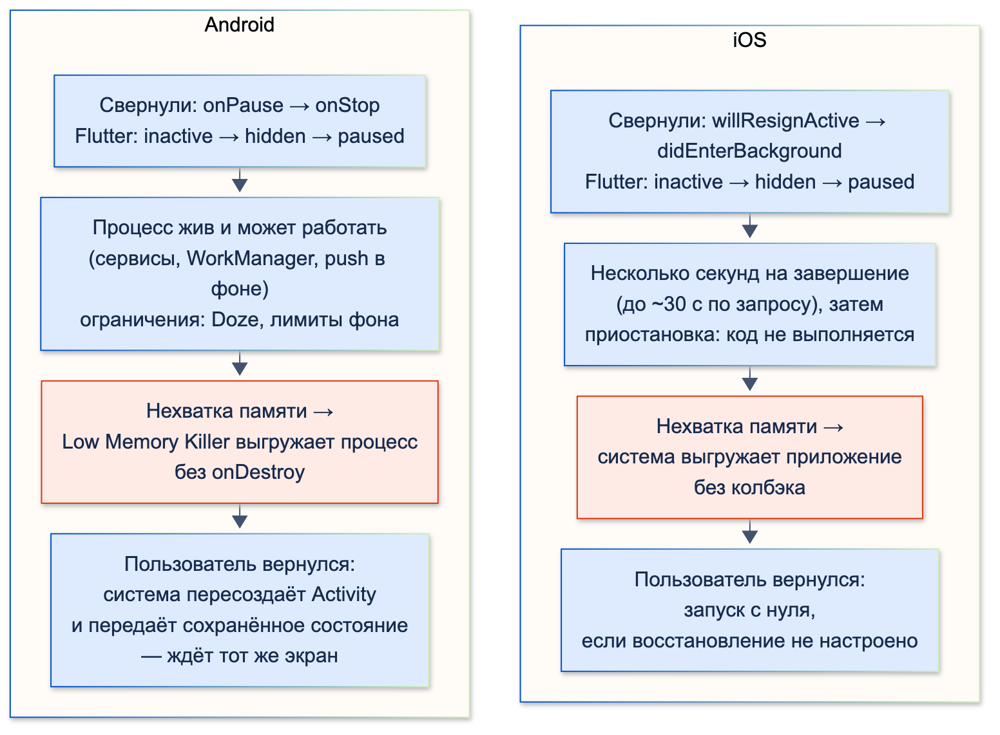
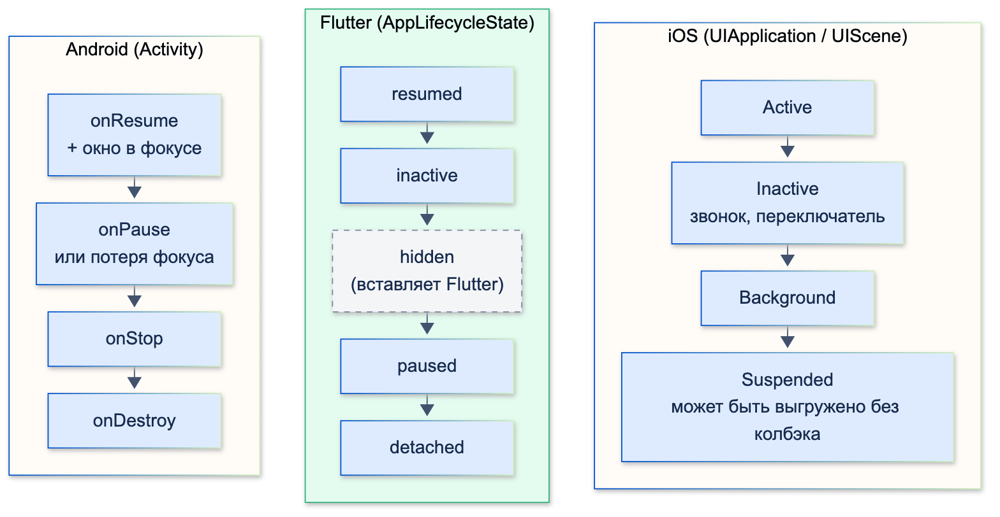
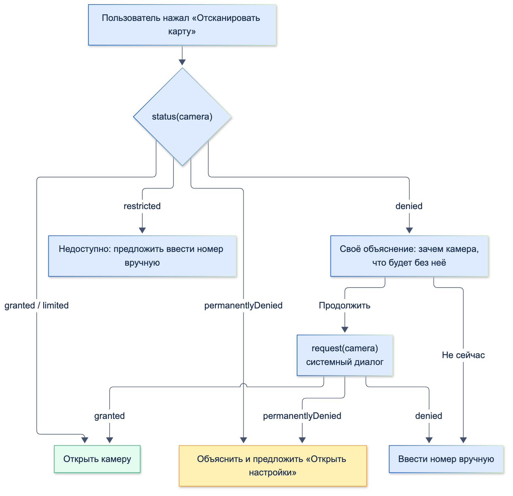

# Различия Android / iOS (жизненный цикл, permissions)

| Грейд | Время на изучение | Статус |
|-------|-------------------|--------|
| ⭐ | ~45 мин лекция + практика | ✅ Готово |

---

## 📚 Ресурсы

| Ресурс | Формат | Язык | Уровень | Зачем читать |
|--------|--------|------|---------|--------------|
| [Android: жизненный цикл Activity](https://developer.android.com/guide/components/activities/activity-lifecycle?hl=ru) | Документация | 🇷🇺 | ⭐ → ⭐⭐ | Все колбэки Activity, смена конфигурации, сохранение состояния и гибель процесса |
| [Android: запрос разрешений во время работы](https://developer.android.com/training/permissions/requesting?hl=ru) | Документация | 🇷🇺 | ⭐ → ⭐⭐ | Порядок запроса, объяснение перед запросом, что делать при отказе |
| [Новый способ прослушивания событий жизненного цикла приложения во Flutter](https://habr.com/ru/articles/759628/) | Статья (Habr, перевод) | 🇷🇺 | ⭐⭐ | `AppLifecycleListener`: переходы между состояниями и колбэки на каждый из них |
| [Жизненный цикл приложения на Flutter](https://habr.com/ru/articles/789750/) | Статья (Habr) | 🇷🇺 | ⭐ | Состояния приложения во Flutter и примеры, когда на них реагировать |
| [Урок 23. Activity Lifecycle](https://startandroid.ru/ru/uroki/vse-uroki-spiskom/60-urok-23-activity-lifecycle-v-kakih-sostojanijah-mozhet-byt-activity.html) | Учебник | 🇷🇺 | ⭐ | Классическое простое объяснение состояний Activity — для первого знакомства |
| [Apple: Managing your app's life cycle](https://developer.apple.com/documentation/uikit/managing-your-app-s-life-cycle) | Документация | 🇬🇧 | ⭐⭐ | Состояния iOS-приложения и переход на жизненный цикл сцен |
| [Apple HIG: Privacy](https://developer.apple.com/design/human-interface-guidelines/privacy) | Гайдлайн | 🇬🇧 | ⭐ | Как и когда просить доступ, как писать тексты запросов |
| [permission_handler](https://pub.dev/packages/permission_handler) | Пакет | 🇬🇧 | ⭐⭐ | Разрешения во Flutter, настройка Android и iOS |

---

## 🎓 Лекция

### 1. Платформы в целом

| | Android | iOS |
|-|---------|-----|
| Языки нативной части | Kotlin (Java — в старом коде) | Swift |
| Дизайн-система | Material Design | Human Interface Guidelines |
| «Назад» | Системная кнопка и жест от края; с Android 14 — предиктивный жест (видно, куда вернёшься) | Свайп от левого края, кнопка «Назад» в навигационной панели |
| Устройства | Сотни производителей, экраны, версии ОС; оболочки производителей по-разному ограничивают фон | Несколько моделей, большинство пользователей быстро обновляет iOS |
| Распространение | Google Play, RuStore, AppGallery, установка APK напрямую | App Store, TestFlight для тестировщиков; другие способы — только для корпоративного распространения |
| Проверка в магазине | Автоматическая, обычно часы | Ручная, от суток; строгие правила к текстам разрешений и платежам |
| Фоновая работа | `WorkManager`, foreground service с уведомлением | `BGTaskScheduler`; приложение в фоне быстро приостанавливается |
| Push-уведомления | FCM | APNs (FCM работает поверх него) |
| Безопасное хранилище | Android Keystore (+ шифрованные настройки) | Keychain — **переживает удаление и переустановку приложения** |
| Диплинки | App Links | Universal Links |
| Защита экрана от скриншотов | `FLAG_SECURE` у окна | Системного флага нет: скрывают содержимое при уходе в фон |

> ℹ️ **Важно:** push-уведомления и диплинки подробно — в теме «Навигация», нативный код Android и iOS — в темах
> «Нативные API Android» и «Нативные API iOS».

### 2. Жизненный цикл на Android

Flutter-приложение на Android — это одна `FlutterActivity` (экран Android), внутри которой работает движок Flutter.
Жизненный цикл приложения — это жизненный цикл этой Activity.

| Колбэк | Когда | Что видит пользователь |
|--------|-------|------------------------|
| `onCreate` | Activity создаётся | Ещё ничего |
| `onStart` | Activity становится видимой | Экран появляется |
| `onResume` | Activity на переднем плане и получает ввод | Можно работать |
| `onPause` | Activity теряет передний план: диалог поверх, разделённый экран, переход к другому экрану | Экран может быть частично виден |
| `onStop` | Activity больше не видна | Приложение свёрнуто |
| `onDestroy` | Activity уничтожается | — |

**Смена конфигурации.** По умолчанию при повороте экрана, смене языка или темы Android **уничтожает и создаёт
Activity заново**. Flutter-приложение этого не замечает, потому что шаблон Flutter объявляет в манифесте, что
Activity сама обрабатывает эти изменения:

```text
android:configChanges="orientation|keyboardHidden|keyboard|screenSize|smallestScreenSize|locale|layoutDirection|fontScale|screenLayout|density|uiMode"
```

**Гибель процесса (process death).** Свёрнутое приложение система может выгрузить из памяти целиком — без
`onDestroy` и без предупреждения. Когда пользователь вернётся, Android создаст процесс заново и откроет Activity,
передав ей сохранённое состояние. Для Flutter это **холодный старт**: все объекты в памяти потеряны. Что делать:
- всё важное (черновик перевода, введённые данные) сохранять при уходе в фон;
- для восстановления экранов есть механизм `RestorationMixin` и `restorationScopeId` у `MaterialApp`;
- проверить поведение: в настройках разработчика включить «Не сохранять действия» (Don't keep activities)
  и свернуть приложение.

### 3. Жизненный цикл на iOS

| Состояние | Что значит |
|-----------|-----------|
| Not running | Приложение не запущено или выгружено системой |
| Inactive | На экране, но не получает события: звонок, Центр управления, переключатель приложений, запрос Face ID |
| Active | На экране и получает события |
| Background | Не на экране, код ещё выполняется — недолго, обычно секунды |
| Suspended | В памяти, но код не выполняется. Система может выгрузить приложение **без какого-либо колбэка** |

Переходы приходят в `AppDelegate` (`applicationWillResignActive`, `applicationDidEnterBackground`,
`applicationWillEnterForeground`, `applicationDidBecomeActive`) или — в приложениях на сценах — в `SceneDelegate`.

> ⚠️ **Внимание:** Apple переводит приложения на жизненный цикл сцен (`UIScene`): в версии iOS после iOS 26
> приложение на последнем SDK без сцен не запустится. Во Flutter сцены включены по умолчанию с версии 3.41: если
> `AppDelegate` не менялся, Flutter переведёт проект сам при сборке; если в `AppDelegate` есть свой код (регистрация
> плагинов, обработка ссылок), его переносят по руководству «UIScene adoption» на docs.flutter.dev. Плагинам с
> нативным кодом нужна поддержка `FlutterSceneLifeCycleDelegate`.

### 4. Чем на самом деле отличаются жизненные циклы

Названия состояний похожи («на экране», «в фоне»), но **модели устроены по-разному**:
- **Android** строит жизненный цикл вокруг **компонентов** (Activity, Service, BroadcastReceiver), а процесс
  приложения живёт отдельно от них. Свёрнутое приложение продолжает работать, пока системе хватает памяти.
- **iOS** управляет **приложением целиком** и жёстко его замораживает: через несколько секунд после ухода в фон код
  перестаёт выполняться вообще.

| Аспект | Android | iOS | Что это значит для Flutter-приложения |
|--------|---------|-----|---------------------------------------|
| **Единица жизненного цикла** | Компонент: каждая Activity, сервис, приёмник событий живёт по своему циклу. У приложения может быть несколько Activity и задач (task) | Приложение (`UIApplication`) и его сцены (`UIScene`, на iPad — несколько окон). Жизненный цикл контроллеров экранов — отдельный | Во Flutter обычно одна Activity и один контроллер, поэтому разница видна в основном в нативном коде и плагинах |
| **Процесс и интерфейс** | Процесс может жить без интерфейса: сервис, обработчик push, `WorkManager` | Без интерфейса приложение запускается только в разрешённых фоновых режимах | На Android push-обработчик FCM может поднять Dart-код без экрана — в отдельном изоляте |
| **Код в фоне** | Выполняется, пока процесс жив. Ограничения: Doze (глубокий сон), лимиты фоновой работы с Android 8, оболочки производителей | Несколько секунд после ухода в фон, затем — приостановка. Дополнительное время на завершение задачи — порядка 30 секунд, без гарантий | Таймер «через минуту отправить» в фоне на iOS не сработает. Длинная работа — только через системные механизмы |
| **Долгая фоновая работа** | `WorkManager` (отложенные задачи), foreground service с постоянным уведомлением | Только разрешённые режимы: `BGTaskScheduler` (когда решит система), фоновая загрузка через `URLSession`, аудио, навигация, VoIP, «тихие» push | Синхронизацию из темы «Проектирование архитектуры с нуля» запускают через `workmanager`, на iOS она пойдёт, когда разрешит система |
| **Кто и как завершает** | Low Memory Killer выгружает процессы по приоритету: на экране → видимый → сервис → в кеше (свёрнутые — первые кандидаты) | Система выгружает приостановленные приложения (jetsam) при нехватке памяти | Завершение без колбэка — норма на обеих платформах; на iOS — почти гарантированно для долго свёрнутого приложения |
| **Колбэк перед смертью** | `onDestroy` — не гарантирован при гибели процесса | `applicationWillTerminate` — только если приложение не было приостановлено | Ни на что «последнее» не рассчитывать: сохранять при уходе в фон (`paused`) |
| **Смена конфигурации** | Поворот, язык, тема, размер окна — Activity **пересоздаётся** (если не объявлены `configChanges`) | Ничего не пересоздаётся: экран получает уведомление об изменении размера или стиля | Во Flutter — одинаково: шаблон объявляет `configChanges`, изменения приходят как новые `MediaQuery` |
| **Возврат после выгрузки** | Система **помнит стек экранов** и пересоздаёт его, передавая сохранённое состояние: пользователь ожидает увидеть тот же экран | По умолчанию — **запуск с нуля**; восстановление — только если приложение его реализовало | На Android без `restorationScopeId` пользователь, ушедший с формы перевода, вернётся на стартовый экран — это выглядит как «приложение сбросилось». На iOS для восстановления нужна ещё настройка в Xcode |
| **«Выход» из приложения** | Кнопка «назад» на первом экране закрывает Activity (`onDestroy`), процесс может остаться | Способа выйти нет: пользователь только сворачивает или смахивает приложение в переключателе | Не делать кнопку «Выход из приложения»; на Android обрабатывать «назад» через `PopScope` |
| **Несколько окон** | Разделённый экран, свободные окна, картинка в картинке: приложение может быть видимым, но без фокуса | iPad — несколько сцен одного приложения; iPhone — одно окно | Состояние `inactive` на Android бывает долгим (соседнее окно в фокусе) — не останавливать в нём то, что видит пользователь |
| **Точки входа** | Любая экспортированная Activity, сервис, приёмник; App Links | Иконка, Universal Link, push, виджет, фоновый режим — через параметры запуска (в сценах — при подключении сцены) | Обработка диплинков и push при холодном старте пишется отдельно от «приложение уже открыто» (тема «Навигация») |



**Что из этого следует на практике:**
- **Всё важное сохранять при `paused`** — на iOS после этого код может больше не выполниться, на Android процесс
  могут выгрузить в любой момент.
- **Не рассчитывать на код в фоне.** Отправку заявки или загрузку выписки, начатые перед сворачиванием, нужно либо
  успеть завершить за секунды, либо передать системному механизму (`workmanager`, фоновая загрузка), либо повторить
  при возвращении.
- **Решить, что видит пользователь после выгрузки.** На Android он ждёт тот же экран — либо реализовать
  восстановление (`restorationScopeId`, `RestorationMixin`, `restorablePush`), либо осознанно начинать со входа
  (для банковского приложения после долгого фона это обычно и правильно: сессия всё равно истекла).
- **Проверять выгрузку на обеих платформах.** Android — «Не сохранять действия» в настройках разработчика.
  iOS — свернуть приложение и остановить его из Xcode: так система ведёт себя как при выгрузке из памяти
  (если смахнуть приложение в переключателе, iOS нарочно забывает сохранённое состояние).

### 5. Жизненный цикл во Flutter

Flutter сводит обе платформы к одному набору состояний `AppLifecycleState`:

| Состояние | Смысл | Android | iOS |
|-----------|-------|---------|-----|
| `resumed` | На экране, есть фокус | `onResume` и окно в фокусе | Active |
| `inactive` | Виден, но без фокуса | `onPause` или потеря фокуса окна: шторка уведомлений, системный диалог, разделённый экран | Inactive: звонок, Центр управления, переключатель приложений |
| `hidden` | Не виден (Flutter вставляет это состояние на мобильных между `inactive` и `paused` в обе стороны) | — | — |
| `paused` | Не виден и не получает ввод, кадры не рисуются | `onStop` | Background |
| `detached` | Движок работает без экрана | Activity уничтожена, движок жив | Нет видимых view |



**`AppLifecycleListener`** (Flutter 3.13+) — удобная обёртка: колбэк на каждый **переход**, а не просто новое
состояние. `onInactive`, `onHide`, `onPause` — при уходе; `onRestart`, `onShow`, `onResume` — при возвращении;
`onDetach`. Старый способ — миксин `WidgetsBindingObserver` с методом `didChangeAppLifecycleState`.

**Банковский сценарий 1. Скрыть баланс в переключателе приложений.** iOS делает снимок экрана для переключателя
приложений, когда приложение становится неактивным. Если в этот момент закрыть экран «шторкой», баланс в
переключателе не виден:

```dart
import 'package:flutter/material.dart';

/// Закрывает экран, когда приложение теряет фокус: на iOS снимок для переключателя приложений
/// делается в этот момент, и баланс в нём не виден
class PrivacyShield extends StatefulWidget {
  const PrivacyShield({super.key, required this.child});

  final Widget child;

  @override
  State<PrivacyShield> createState() => _PrivacyShieldState();
}

class _PrivacyShieldState extends State<PrivacyShield> {
  late final AppLifecycleListener _listener;
  var _covered = false;

  @override
  void initState() {
    super.initState();
    _listener = AppLifecycleListener(
      onInactive: () => setState(() => _covered = true), // звонок, Центр управления, переключатель приложений
      onResume: () => setState(() => _covered = false),
    );
  }

  @override
  void dispose() {
    _listener.dispose(); // иначе слушатель останется в WidgetsBinding
    super.dispose();
  }

  @override
  Widget build(BuildContext context) => Stack(
        children: [
          widget.child,
          if (_covered)
            const Positioned.fill(
              child: ColoredBox(color: Color(0xFF0052CC), child: Center(child: Icon(Icons.lock, size: 64))),
            ),
        ],
      );
}
```

На Android снимок для списка недавних приложений делает система, и закрыть экран из Flutter вовремя нельзя.
Надёжный способ — флаг окна `FLAG_SECURE` в `MainActivity`: он запрещает скриншоты и запись экрана, а в списке
недавних показывает пустое окно:

```kotlin
package ru.bank.natcheck

import android.os.Bundle
import android.view.WindowManager
import io.flutter.embedding.android.FlutterActivity

class MainActivity : FlutterActivity() {
    override fun onCreate(savedInstanceState: Bundle?) {
        super.onCreate(savedInstanceState)
        // Запрет скриншотов и записи экрана; в списке недавних приложений вместо экрана — пустое окно
        window.setFlags(WindowManager.LayoutParams.FLAG_SECURE, WindowManager.LayoutParams.FLAG_SECURE)
    }
}
```

**Банковский сценарий 2. Требовать PIN после долгого фона.**

```dart
import 'package:flutter/widgets.dart';

/// Требует повторный вход (PIN или биометрию), если приложение пробыло в фоне дольше таймаута
final class SessionGuard {
  SessionGuard({
    required DateTime Function() now,
    required VoidCallback onLockRequired,
    this.timeout = const Duration(minutes: 5),
  })  : _now = now,
        _onLockRequired = onLockRequired {
    _listener = AppLifecycleListener(
      onPause: () => _pausedAt = _now(), // ушли в фон
      onRestart: _checkTimeout, // вернулись из фона (paused → hidden)
    );
  }

  final DateTime Function() _now;
  final VoidCallback _onLockRequired;
  final Duration timeout;
  late final AppLifecycleListener _listener;
  DateTime? _pausedAt;

  void _checkTimeout() {
    final pausedAt = _pausedAt;
    if (pausedAt != null && _now().difference(pausedAt) > timeout) _onLockRequired();
    _pausedAt = null;
  }

  void dispose() => _listener.dispose();
}
```

Проверка тестом (приложение свернули, через 7 минут вернули):

```text
Свернули приложение:
  onInactive → inactive (экран закрыт) → onHide → hidden (экран закрыт) → onPause → paused (экран закрыт)
Вернулись через 7 минут:
  onRestart → требуется PIN → hidden (экран закрыт) → onShow → inactive (экран закрыт) → onResume → resumed
```

- Шторка закрывает экран уже на `inactive` — до того, как iOS сделает снимок.
- Переходы идут строго по цепочке. Если передать состояние «через ступеньку», `AppLifecycleListener` остановит
  отладочную сборку ошибкой:

```text
Invalid state transition from AppLifecycleState.resumed to AppLifecycleState.paused
```

  В приложении промежуточные состояния за вас генерирует Flutter; это важно знать, если подменяете состояния в тестах.

Что ещё делают при смене состояния:
- **уход в фон:** сохранить черновик, остановить таймеры, анимации, видео, отписаться от тяжёлых потоков;
- **возврат:** проверить сессию, обновить данные (баланс мог измениться), перезапустить остановленное.

### 6. Разрешения на Android

**Шаг 1 — объявить в `AndroidManifest.xml`.** Без объявления запрос не покажет диалог.

**Шаг 2 — запросить во время работы** — для **опасных** разрешений (с Android 6.0, API 23).

| Вид | Примеры | Как получить |
|-----|---------|--------------|
| Обычные | Интернет, `USE_BIOMETRIC`, вибрация | Только объявить: выдаются при установке |
| Опасные | Камера, контакты, геолокация, микрофон, уведомления (Android 13+) | Объявить и запросить во время работы |
| Специальные | Показ поверх других окон, точные будильники, доступ ко всем файлам | Объявить и отправить пользователя в системные настройки |

Особенности:
- **Повторный отказ = «больше не спрашивать».** После двух отказов (или галочки «Не спрашивать снова» на старых
  версиях) диалог больше не появляется — только переход в настройки приложения.
- **`shouldShowRequestPermissionRationale`** — `true`, если пользователь уже отказывал, но спросить ещё можно:
  самое время объяснить, зачем нужен доступ.
- **Уведомления с Android 13** (`POST_NOTIFICATIONS`) — тоже опасное разрешение, запрос во время работы.
- **Геолокация с Android 12:** пользователь может дать **примерную** вместо точной; фоновая геолокация — отдельное
  разрешение и отдельная декларация в Google Play.
- **Фото без разрешения:** системный выбор фото (Photo Picker) не требует доступа ко всей галерее.
- **Google Play** требует объяснять использование чувствительных разрешений (SMS, звонки, фоновая геолокация,
  доступ ко всем файлам) — без этого приложение не опубликуют.

```xml
<manifest xmlns:android="http://schemas.android.com/apk/res/android">
    <!-- Опасные разрешения: объявить здесь И запросить во время работы -->
    <uses-permission android:name="android.permission.CAMERA" />
    <uses-permission android:name="android.permission.READ_CONTACTS" />
    <uses-permission android:name="android.permission.ACCESS_COARSE_LOCATION" />
    <uses-permission android:name="android.permission.ACCESS_FINE_LOCATION" />
    <!-- Android 13+: уведомления тоже запрашиваются во время работы -->
    <uses-permission android:name="android.permission.POST_NOTIFICATIONS" />
    <!-- Обычное разрешение: выдаётся при установке, запрашивать не нужно -->
    <uses-permission android:name="android.permission.USE_BIOMETRIC" />
    <!-- Камера желательна, но не обязательна: иначе Google Play скроет приложение для устройств без камеры -->
    <uses-feature android:name="android.hardware.camera" android:required="false" />
    <application …>
```

Итоговый список разрешений в собранном APK (`aapt2 dump permissions app-release.apk`):

```text
uses-permission: name='android.permission.CAMERA'
uses-permission: name='android.permission.READ_CONTACTS'
uses-permission: name='android.permission.ACCESS_COARSE_LOCATION'
uses-permission: name='android.permission.ACCESS_FINE_LOCATION'
uses-permission: name='android.permission.POST_NOTIFICATIONS'
uses-permission: name='android.permission.USE_BIOMETRIC'
permission: ru.bank.natcheck.DYNAMIC_RECEIVER_NOT_EXPORTED_PERMISSION
uses-permission: name='ru.bank.natcheck.DYNAMIC_RECEIVER_NOT_EXPORTED_PERMISSION'
```

`permission_handler` **не добавляет разрешения сам** — в APK только объявленные нами. Последние две строки добавила
библиотека AndroidX для внутренних системных событий. Командой `aapt2` полезно проверять релизную сборку:
разрешения приходят и из манифестов подключённых пакетов.

### 7. Разрешения на iOS

- **Описание в `Info.plist` обязательно.** Ключ вида `NSCameraUsageDescription` с текстом, который пользователь
  увидит в системном диалоге. Без него приложение **падает** при первом обращении к камере, контактам, геолокации,
  Face ID. Пустой или формальный текст («Нужен доступ к камере») — частая причина отказа в App Store: текст должен
  объяснять, **зачем**.
- **Системный диалог показывается один раз.** После отказа приложение больше не может его вызвать — только
  предложить перейти в «Настройки».
- **Ограниченный доступ к фото** (iOS 14+): пользователь выбирает, какие фото видны приложению.
- **Тихие (provisional) уведомления** — приходят без запроса, но только в Центр уведомлений.
- **App Tracking Transparency** — отдельный запрос, если приложение отслеживает пользователя для рекламы.
- **Face ID** требует `NSFaceIDUsageDescription`: при первом использовании система сама спросит разрешение
  с этим текстом.

```xml
<dict>
	<!-- Без этих строк приложение упадёт при первом обращении к камере, контактам, геолокации, Face ID -->
	<key>NSCameraUsageDescription</key>
	<string>Камера нужна, чтобы отсканировать банковскую карту или QR-код для оплаты</string>
	<key>NSContactsUsageDescription</key>
	<string>Контакты нужны, чтобы выбрать получателя перевода по номеру телефона</string>
	<key>NSLocationWhenInUseUsageDescription</key>
	<string>Геолокация нужна, чтобы показать ближайшие банкоматы и офисы</string>
	<key>NSFaceIDUsageDescription</key>
	<string>Face ID нужен для быстрого и безопасного входа в приложение</string>
	…
</dict>
```

### 8. Разрешения во Flutter

Пакет `permission_handler` даёт единый API для обеих платформ. Статусы:

| Статус | Android | iOS |
|--------|---------|-----|
| `granted` | Разрешено | Разрешено |
| `denied` | Ещё не спрашивали, отказали, но спросить можно, **или** (в `status`) отказали окончательно — см. ниже | Ещё не спрашивали |
| `permanentlyDenied` | Отказали окончательно — **только в результате `request()`** | Отказали (на iOS любой отказ окончательный) |
| `restricted` | — | Запрещено родительским контролем или политикой устройства |
| `limited` | — | Частичный доступ (выбранные фото) |
| `provisional` | — | Тихие уведомления |

> ⚠️ **Внимание: ловушка Android.** Android не сообщает заранее, что пользователь отказал окончательно: `status`
> в этом случае возвращает `denied`, и только `request()` вернёт `permanentlyDenied` (системный диалог при этом
> не появится). Поэтому кнопку «Открыть настройки» показывают по результату `request()`, а не `status`.

> ⚠️ **Внимание: ловушка iOS.** При сборке через CocoaPods `permission_handler` по умолчанию **выключает все
> разрешения**, включая уведомления (макрос `PERMISSION_NOTIFICATIONS` по умолчанию 0 — проверено в исходниках
> `permission_handler_apple` 9.6.2), чтобы не тянуть в приложение лишний код. Нужные включаются макросами в `Podfile`.
> Если забыть, запрос не покажет диалог, хотя в `Info.plist` всё есть. При сборке через Swift Package Manager
> разрешения включаются сами — по ключам в `Info.plist`.

```ruby
post_install do |installer|
  installer.pods_project.targets.each do |target|
    flutter_additional_ios_build_settings(target)

    # permission_handler по умолчанию выключает все разрешения: включаем только нужные приложению
    target.build_configurations.each do |config|
      config.build_settings['GCC_PREPROCESSOR_DEFINITIONS'] ||= [
        '$(inherited)',
        'PERMISSION_CAMERA=1',            # сканирование карты и QR
        'PERMISSION_CONTACTS=1',          # перевод по номеру из контактов
        'PERMISSION_LOCATION_WHENINUSE=1', # банкоматы рядом
        'PERMISSION_NOTIFICATIONS=1',     # пуши об операциях
      ]
    end
  end
end
```

Сборка с этими настройками (`flutter build ios --no-codesign`) прошла, ключи из `Info.plist` в собранном приложении:

```text
"NSCameraUsageDescription" => "Камера нужна, чтобы отсканировать банковскую карту или QR-код для оплаты"
"NSContactsUsageDescription" => "Контакты нужны, чтобы выбрать получателя перевода по номеру телефона"
"NSFaceIDUsageDescription" => "Face ID нужен для быстрого и безопасного входа в приложение"
"NSLocationWhenInUseUsageDescription" => "Геолокация нужна, чтобы показать ближайшие банкоматы и офисы"
```

#### Правильный порядок запроса



1. **Спрашивать в момент, когда нужно**, а не при старте приложения: камеру — когда пользователь нажал
   «Отсканировать карту».
2. **Сначала своё объяснение** — экран или диалог приложения: что даст доступ и что будет без него. Системный диалог
   на iOS можно показать только один раз, поэтому его не тратят на пользователя, который ещё не понимает, зачем.
3. **Системный запрос.**
4. **Отказ** — функция работает без доступа, если это возможно (ввести номер карты вручную), и объясняет, чего не хватает.
5. **Окончательный отказ** — предложить перейти в настройки.

Логику запроса удобно держать в domain за интерфейсом (тема «Внедрение зависимостей (DI)»): её можно тестировать
без плагина и устройства, а реализация на `permission_handler` живёт в data.

```dart
/// Разрешения, которые нужны банковскому приложению
enum AppPermission { camera, contacts, notifications, locationWhenInUse }

/// Статус разрешения на языке приложения — без типов плагина
enum PermissionState {
  granted,
  denied, // можно спросить ещё раз
  permanentlyDenied, // системный диалог больше не появится — только «Настройки»
  restricted, // запрещено родительским контролем или политикой устройства (iOS)
  limited, // частичный доступ: выбранные фото (iOS 14+)
}

/// Интерфейс в domain: логику запроса можно тестировать без плагина и устройства
abstract interface class PermissionService {
  Future<PermissionState> status(AppPermission permission);

  Future<PermissionState> request(AppPermission permission);

  Future<bool> openSettings();
}
```

```dart
import 'permission_service.dart';

/// Что делать экрану после проверки разрешения
sealed class PermissionOutcome {
  const PermissionOutcome();
}

final class PermissionGranted extends PermissionOutcome {
  const PermissionGranted();
}

/// Пользователь отказал, но спросить можно снова — показать, без чего не работает функция
final class PermissionDenied extends PermissionOutcome {
  const PermissionDenied();
}

/// Спросить больше нельзя — предложить перейти в «Настройки»
final class PermissionNeedsSettings extends PermissionOutcome {
  const PermissionNeedsSettings();
}

/// Нельзя вообще (родительский контроль, политика устройства) — предложить другой способ
final class PermissionUnavailable extends PermissionOutcome {
  const PermissionUnavailable();
}

/// Сценарий «получить доступ». Экран вызывает его ПОСЛЕ своего объяснения, зачем нужен доступ
final class RequestPermissionUseCase {
  const RequestPermissionUseCase(this._service);

  final PermissionService _service;

  Future<PermissionOutcome> call(AppPermission permission) async {
    final current = await _service.status(permission);
    switch (current) {
      case PermissionState.granted || PermissionState.limited:
        return const PermissionGranted(); // уже есть — системный диалог не показываем
      case PermissionState.permanentlyDenied:
        return const PermissionNeedsSettings(); // запрос ничего не покажет, сразу ведём в настройки
      case PermissionState.restricted:
        return const PermissionUnavailable();
      case PermissionState.denied:
        break;
    }
    return switch (await _service.request(permission)) {
      PermissionState.granted || PermissionState.limited => const PermissionGranted(),
      PermissionState.permanentlyDenied => const PermissionNeedsSettings(),
      PermissionState.restricted => const PermissionUnavailable(),
      PermissionState.denied => const PermissionDenied(),
    };
  }
}
```

```dart
import 'package:permission_handler/permission_handler.dart' as ph;

import '../domain/permission_service.dart';

/// Реализация на пакете permission_handler. Типы плагина не выходят за пределы этого файла
final class PermissionHandlerService implements PermissionService {
  const PermissionHandlerService();

  @override
  Future<PermissionState> status(AppPermission permission) async => _map(await _toPlugin(permission).status);

  @override
  Future<PermissionState> request(AppPermission permission) async => _map(await _toPlugin(permission).request());

  @override
  Future<bool> openSettings() => ph.openAppSettings();

  ph.Permission _toPlugin(AppPermission permission) => switch (permission) {
        AppPermission.camera => ph.Permission.camera,
        AppPermission.contacts => ph.Permission.contacts,
        AppPermission.notifications => ph.Permission.notification,
        AppPermission.locationWhenInUse => ph.Permission.locationWhenInUse,
      };

  PermissionState _map(ph.PermissionStatus status) => switch (status) {
        ph.PermissionStatus.granted => PermissionState.granted,
        ph.PermissionStatus.limited => PermissionState.limited,
        ph.PermissionStatus.permanentlyDenied => PermissionState.permanentlyDenied,
        ph.PermissionStatus.restricted => PermissionState.restricted,
        // provisional — «тихие» уведомления на iOS без явного согласия: для нас это уже можно
        ph.PermissionStatus.provisional => PermissionState.granted,
        ph.PermissionStatus.denied => PermissionState.denied,
      };
}
```

Проверка сценария на фейковой реализации:

```text
Первый раз, пользователь разрешил → PermissionGranted, системных диалогов: 1
Первый раз, пользователь отказал → PermissionDenied, системных диалогов: 1
Отказал с «больше не спрашивать» → PermissionNeedsSettings, системных диалогов: 1
Доступ уже есть → PermissionGranted, системных диалогов: 0
Раньше отказал навсегда → PermissionNeedsSettings, системных диалогов: 0
Запрещено политикой устройства → PermissionUnavailable, системных диалогов: 0
```

### 9. Различия, которые встречаются каждый день

| Что | Android | iOS | Во Flutter |
|-----|---------|-----|-----------|
| «Назад» | Кнопка и жест; предиктивный жест показывает предыдущий экран | Свайп от края | `PopScope(canPop: …, onPopInvokedWithResult: …)` — подтверждение выхода из формы перевода. `WillPopScope` устарел: не работает с предиктивным жестом |
| Переход между экранами | Анимация Material | Сдвиг справа, свайп назад | `MaterialPageRoute` выбирает анимацию по платформе, `CupertinoPageRoute` — всегда как в iOS |
| Прокрутка | Останавливается у края, эффект растяжения | «Пружинит» у края | `ScrollPhysics` по платформе: `ClampingScrollPhysics` / `BouncingScrollPhysics` |
| Вырез экрана, «чёлка», полоска «домой» | Разные у производителей | Dynamic Island, полоска «домой» | `SafeArea`, `MediaQuery.paddingOf(context)` |
| Хранилище секретов | Keystore: удаляется вместе с приложением | Keychain: **остаётся после переустановки** | При первом запуске после установки очищать Keychain, иначе вернутся токены прежнего пользователя |
| Определение платформы | — | — | `Theme.of(context).platform` или `defaultTargetPlatform` (подменяются в тестах), а не `Platform.isIOS` из `dart:io` (не работает на вебе и не подменяется) |

### ⚠️ Частые ошибки

- **Запрос всех разрешений при старте** — пользователь отказывает «на всякий случай», а на iOS второго шанса нет.
- **Нет описания в `Info.plist`** — падение при первом обращении к камере или Face ID.
- **Забыли макрос в `Podfile`** (сборка через CocoaPods) — диалог не появляется, статус — отказ.
- **Не обработан окончательный отказ** — кнопка «Отсканировать» молча ничего не делает.
- **Разрешение не объявлено в манифесте** — запрос на Android ничего не показывает.
- **`uses-feature` камеры без `required="false"`** — Google Play скрывает приложение для устройств без камеры.
- **Баланс виден в переключателе приложений** — нет шторки на iOS и `FLAG_SECURE` на Android.
- **Расчёт на `onDestroy` или `detached` для сохранения данных** — при выгрузке из памяти их не будет.
  Сохранять при уходе в фон (`paused`).
- **Токены в Keychain после переустановки** — новое приложение «вспоминает» старую сессию.
- **`Platform.isIOS` в виджетах** — код не тестируется и падает на вебе.

### 🎤 На собеседовании: «Что происходит с банковским приложением, когда пользователь свернул его, а через час вернулся?»

| Уровень | Как выглядит ответ |
|---------|--------------------|
| ⭐ Junior | Приложение переходит в `paused`, при возвращении — `resumed`. Можно отследить через `WidgetsBindingObserver` |
| ⭐⭐ Middle | Цепочка `inactive → hidden → paused` и обратно, `AppLifecycleListener`. При уходе — сохранить черновик, остановить таймеры, скрыть данные; при возвращении — проверить сессию (PIN после таймаута), обновить баланс. За час приложение могли выгрузить — тогда это холодный старт |
| ⭐⭐⭐ Senior | Всё из Middle, плюс: различия платформ (iOS приостанавливает почти сразу, Android выгружает процесс по памяти, проверка через «Не сохранять действия»), восстановление состояния, шторка на `inactive` для снимка iOS и `FLAG_SECURE` на Android, что пришло за это время (push, диплинк) и как его обработать при старте, переход iOS на сцены (`UIScene`) |

---

## ✅ Самопроверка

**⭐ Junior**
1. Назови основные колбэки жизненного цикла Activity и состояния iOS-приложения.
2. Какие состояния есть у `AppLifecycleState`?
3. Чем объявление разрешения в манифесте отличается от запроса во время работы?
4. Что будет, если не добавить `NSCameraUsageDescription` в `Info.plist`?

**⭐⭐ Middle**
1. Почему Flutter-приложение не пересоздаётся при повороте экрана на Android?
2. Что такое гибель процесса и как её проверить?
3. Как скрыть баланс в переключателе приложений на iOS и на Android?
4. Чем отличается отказ в разрешении на Android и на iOS? Что такое `permanentlyDenied`?
5. Почему нельзя запрашивать все разрешения при старте?
6. Чем модель жизненного цикла Android отличается от модели iOS? Назови три главных отличия.

**⭐⭐⭐ Senior**
1. Почему между `inactive` и `paused` на мобильных есть `hidden`? Что будет, если в тесте перейти из `resumed` сразу в `paused`?
2. Почему `permission_handler` на iOS может не показать диалог, хотя ключ в `Info.plist` есть?
3. Что меняет переход iOS на жизненный цикл сцен (`UIScene`) для Flutter-приложения и плагинов?
4. Чем Keychain отличается от Keystore с точки зрения безопасности сессии?
5. Как спроектировать запрос разрешений, чтобы логику можно было тестировать?
6. Пользователь заполнял форму перевода, свернул приложение, система его выгрузила. Что он увидит при возвращении на Android и на iOS и как этим управлять?

<details>
<summary>Ответы</summary>

**Junior**
1. Android: `onCreate`, `onStart`, `onResume`, `onPause`, `onStop`, `onDestroy`. iOS: not running, inactive, active,
   background, suspended.
2. `resumed`, `inactive`, `hidden`, `paused`, `detached`.
3. Объявление в `AndroidManifest.xml` говорит, что приложению вообще может понадобиться доступ; обычные разрешения
   этим и выдаются. Опасные нужно ещё и запросить во время работы — пользователь увидит диалог.
4. Приложение упадёт при первом обращении к камере.

**Middle**
1. Шаблон Flutter объявляет в манифесте `android:configChanges` (orientation, screenSize, locale, uiMode и др.):
   Activity обрабатывает эти изменения сама, а не пересоздаётся.
2. Система выгружает свёрнутое приложение из памяти без колбэков; при возврате — холодный старт с потерей состояния
   в памяти. Проверка — «Не сохранять действия» в настройках разработчика.
3. iOS — закрыть экран на `inactive` (шторка через `AppLifecycleListener`), до снимка для переключателя.
   Android — `FLAG_SECURE` в `MainActivity`: запрет скриншотов и пустое окно в списке недавних.
4. На Android после отказа можно спросить ещё раз; после повторного отказа диалог больше не появляется. На iOS
   системный диалог показывается один раз. `permanentlyDenied` — спросить нельзя, только перевести в настройки. На Android его возвращает только `request()`:
   `status` после окончательного отказа показывает `denied`.
5. Пользователь не понимает, зачем доступ, и отказывает; на iOS второго системного диалога не будет. Спрашивают
   в момент использования функции и после своего объяснения.
6. Android — жизненный цикл компонентов, процесс живёт отдельно и может работать в фоне, пока хватает памяти;
   iOS — приложение целиком, через секунды после ухода в фон код замораживается. Android пересоздаёт Activity при
   смене конфигурации, iOS — нет. После выгрузки Android восстанавливает стек экранов и ждёт тот же экран,
   iOS по умолчанию запускает приложение с нуля.

**Senior**
1. Чтобы на всех платформах была одна машина состояний: обработчик «скрыто» пишется один раз. `AppLifecycleListener`
   проверяет переходы и в отладочной сборке падает с `Invalid state transition from … resumed to … paused`.
   В приложении промежуточные состояния генерирует Flutter, в тестах их нужно передавать самому.
2. При сборке через CocoaPods пакет по умолчанию выключает все разрешения, включая уведомления; нужные включаются
   макросами `PERMISSION_CAMERA=1` и т. д. в `Podfile`. При SPM — включаются по ключам `Info.plist`.
3. UI-события жизненного цикла приходят в `SceneDelegate`, а не в `AppDelegate`; регистрация плагинов и обработка
   ссылок переезжают; launch options в старом месте пусты. Flutter 3.41+ переводит проект сам, если `AppDelegate`
   не менялся. Плагины с нативным кодом должны поддержать `FlutterSceneLifeCycleDelegate`. Без сцен приложение
   на SDK после iOS 26 не запустится.
4. Keychain сохраняется после удаления приложения, Keystore — нет. Токены в Keychain «вернутся» после переустановки,
   поэтому при первом запуске после установки Keychain очищают.
5. Интерфейс `PermissionService` и свои статусы в domain, UseCase с правилами (не спрашивать, если уже есть;
   при окончательном отказе — в настройки), реализация на `permission_handler` в data. Логика тестируется
   на фейковом сервисе.
6. Android пересоздаст Activity и ждёт тот же экран, но Flutter без восстановления начнёт со стартового — форма
   пропадёт. iOS по умолчанию запустит приложение с нуля. Управлять: `restorationScopeId` и `RestorationMixin`
   (на iOS — плюс настройка в Xcode) или сохранять черновик при `paused` и предлагать продолжить; для банковского
   приложения после долгого фона часто правильно начинать со входа.

</details>
