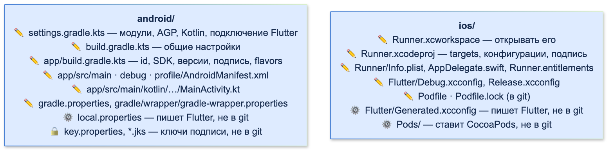
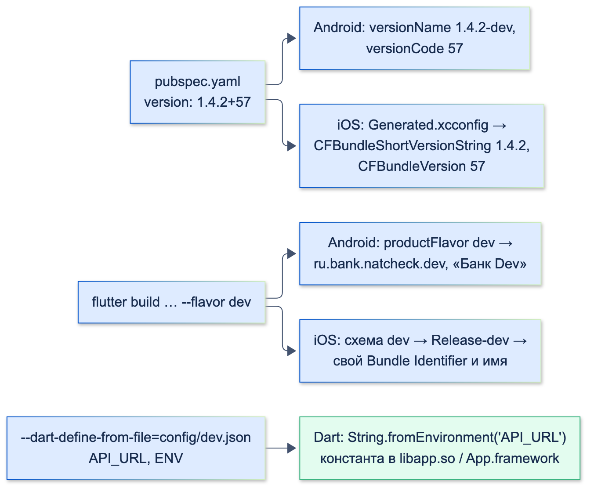

# Базовая настройка нативных проектов (Gradle, Xcode, plist, Manifest)

| Грейд | Время на изучение | Статус |
|-------|-------------------|--------|
| ⭐ | ~40 мин лекция + практика | ✅ Готово |

---

## 📚 Ресурсы

| Ресурс | Формат | Язык | Уровень | Зачем читать |
|--------|--------|------|---------|--------------|
| [Android: настройка сборки](https://developer.android.com/build?hl=ru) | Документация | 🇷🇺 | ⭐ → ⭐⭐ | Как устроена Gradle-сборка: модули, типы сборок, flavors, подпись |
| [Android: обзор манифеста приложения](https://developer.android.com/guide/topics/manifest/manifest-intro?hl=ru) | Документация | 🇷🇺 | ⭐ | Что объявляется в `AndroidManifest.xml` и как манифесты сливаются |
| [Flutter Flavoring in a breeze](https://habr.com/ru/articles/556382/) | Статья (Habr) | 🇷🇺 | ⭐⭐ | Пошаговая настройка dev и prod для Android и iOS: id, имена, иконки, отдельные проекты Firebase |
| [Flutter: Build and release an Android app](https://docs.flutter.dev/deployment/android) и [iOS app](https://docs.flutter.dev/deployment/ios) | Документация | 🇬🇧 | ⭐ → ⭐⭐ | Иконки, подпись, версии, публикация — официальный чек-лист для обеих платформ |
| [Flutter: Flavors](https://docs.flutter.dev/deployment/flavors) | Документация | 🇬🇧 | ⭐⭐ | Официальная настройка окружений для Android и iOS |
| [Бить или не бить? Модули в Xcode: сравниваем XcodeGen и Tuist](https://habr.com/ru/company/surfstudio/blog/590263/) | Статья (Habr) | 🇷🇺 | ⭐⭐⭐ | Генерация проекта из описания: зачем, как устроены XcodeGen и Tuist, плюсы и минусы |
| [The new JSON project format in Xcode 27.2](https://sarunw.com/posts/xcode-json-project-format-xcproj/) | Статья | 🇬🇧 | ⭐⭐ | Новый формат `project.xcproj`: как выглядит, как включить, совместимость |
| [Google Play: требования к target API](https://support.google.com/googleplay/android-developer/answer/11926878?hl=ru) | Справка | 🇷🇺 | ⭐ | Какой `targetSdk` нужен, чтобы приложение приняли в Google Play |
| [Apple: Privacy manifest files](https://developer.apple.com/documentation/bundleresources/privacy-manifest-files) | Документация | 🇬🇧 | ⭐⭐ | Манифест приватности: обязательное требование App Store |

---

## 🎓 Лекция

> ℹ️ **Важно:** разрешения в манифесте и `Info.plist`, `FLAG_SECURE` и макросы `permission_handler` в `Podfile` —
> в теме «Различия Android / iOS». Подпись, R8 и обфускация подробно — в теме «Компиляция (AOT/JIT, процессы сборки)».
> Все файлы ниже — из шаблона Flutter 3.38, доработанные под банковское приложение и проверенные сборкой.

### 1. Что создаёт Flutter, а что правим руками



✏️ — правим руками, ⚙️ — создаёт инструмент при сборке, 🔒 — секреты.

| Файл | Кто создаёт | Править руками? | В git? |
|------|-------------|-----------------|--------|
| `android/settings.gradle.kts`, `build.gradle.kts`, `app/build.gradle.kts` | `flutter create` | Да: версии, подпись, flavors | Да |
| `android/app/src/{main,debug,profile}/AndroidManifest.xml` | `flutter create` | Да | Да |
| `android/app/src/main/kotlin/…/MainActivity.kt` | `flutter create` | При необходимости | Да |
| `android/gradle.properties`, `gradle/wrapper/gradle-wrapper.properties` | `flutter create` | Да: память Gradle, версия Gradle | Да |
| `android/local.properties` | Flutter при каждой сборке | Нет — пути к SDK на вашей машине | **Нет** |
| `android/key.properties`, `*.jks` | Вы | — | **Никогда** |
| `GeneratedPluginRegistrant.java` (Android), `GeneratedPluginRegistrant.m` (iOS) | Flutter при `pub get` | Нет — регистрация плагинов | Нет |
| `ios/Runner.xcodeproj`, `ios/Runner/Info.plist`, `AppDelegate.swift`, `*.entitlements` | `flutter create` / Xcode | Да (`.xcodeproj` — через Xcode) | Да |
| `ios/Flutter/Debug.xcconfig`, `Release.xcconfig` | `flutter create` | Можно дописывать свои настройки | Да |
| `ios/Flutter/Generated.xcconfig` | Flutter при каждой сборке | Нет — версия, пути, `dart-define` | **Нет** |
| `ios/Podfile` | Flutter при первой сборке с плагинами | Да | Да |
| `ios/Podfile.lock` | CocoaPods | Нет | **Да** — фиксирует версии нативных зависимостей |
| `ios/Pods/` | CocoaPods | Нет | Нет |

Шаблоны `.gitignore` в `android/` и `ios/` Flutter создаёт сам — не удаляйте из них строки.

### 2. Android: Gradle по файлам

**Gradle** — система сборки Android. Сборку описывают скриптами на Kotlin (`.kts`, так сейчас создаёт Flutter)
или на Groovy (`.gradle`, в старых проектах). Цепочка файлов:

**`settings.gradle.kts`** — какие модули в проекте и откуда брать плагины. Здесь подключается Flutter
и задаются версии **Android Gradle Plugin** (AGP) и **Kotlin**:

```kotlin
pluginManagement {
    val flutterSdkPath =
        run {
            val properties = java.util.Properties()
            file("local.properties").inputStream().use { properties.load(it) }
            val flutterSdkPath = properties.getProperty("flutter.sdk")
            require(flutterSdkPath != null) { "flutter.sdk not set in local.properties" }
            flutterSdkPath
        }

    includeBuild("$flutterSdkPath/packages/flutter_tools/gradle")

    repositories {
        google()
        mavenCentral()
        gradlePluginPortal()
    }
}

plugins {
    id("dev.flutter.flutter-plugin-loader") version "1.0.0"
    id("com.android.application") version "8.11.1" apply false
    id("org.jetbrains.kotlin.android") version "2.2.20" apply false
}

include(":app")
```

**`gradle/wrapper/gradle-wrapper.properties`** — версия самого Gradle (`gradle-8.14`). `./gradlew` скачает её сам.

**Совместимость.** Gradle, AGP, Kotlin и Java связаны: AGP 8.11 требует определённых версий Gradle и JDK 17+,
плагины требуют свои минимальные версии AGP и Kotlin. Поэтому версии обновляют **вместе** и по таблицам
совместимости, а не по одной. Самая частая ошибка сборки после обновления Flutter или плагина — именно несовместимые версии.

**`gradle.properties`** — настройки Gradle: память (`org.gradle.jvmargs`), `android.useAndroidX=true`.

**`app/build.gradle.kts`** — сборка самого приложения. Вариант банковского проекта: подпись release из файла
вне git и два окружения:

```kotlin
import java.util.Properties

plugins {
    id("com.android.application")
    id("kotlin-android")
    // The Flutter Gradle Plugin must be applied after the Android and Kotlin Gradle plugins.
    id("dev.flutter.flutter-gradle-plugin")
}

// Ключ подписи release лежит вне git: android/key.properties + файл .jks (оба в .gitignore)
val keystoreProperties = Properties().apply {
    val file = rootProject.file("key.properties")
    if (file.exists()) file.inputStream().use { load(it) }
}

android {
    namespace = "ru.bank.natcheck"
    compileSdk = flutter.compileSdkVersion
    ndkVersion = flutter.ndkVersion

    compileOptions {
        sourceCompatibility = JavaVersion.VERSION_17
        targetCompatibility = JavaVersion.VERSION_17
    }

    kotlinOptions {
        jvmTarget = JavaVersion.VERSION_17.toString()
    }

    defaultConfig {
        // TODO: Specify your own unique Application ID (https://developer.android.com/studio/build/application-id.html).
        applicationId = "ru.bank.natcheck"
        // You can update the following values to match your application needs.
        // For more information, see: https://flutter.dev/to/review-gradle-config.
        minSdk = flutter.minSdkVersion
        targetSdk = flutter.targetSdkVersion
        versionCode = flutter.versionCode
        versionName = flutter.versionName
    }

    signingConfigs {
        create("release") {
            keyAlias = keystoreProperties.getProperty("keyAlias")
            keyPassword = keystoreProperties.getProperty("keyPassword")
            storeFile = keystoreProperties.getProperty("storeFile")?.let { file(it) }
            storePassword = keystoreProperties.getProperty("storePassword")
        }
    }

    buildTypes {
        release {
            // Без key.properties (локально, у разработчика) — debug-подпись, в CI — настоящая
            signingConfig = if (keystoreProperties.isEmpty) signingConfigs.getByName("debug") else signingConfigs.getByName("release")
        }
    }

    // Окружения: две сборки с разными id ставятся на телефон рядом
    flavorDimensions += "env"
    productFlavors {
        create("dev") {
            dimension = "env"
            applicationIdSuffix = ".dev"
            versionNameSuffix = "-dev"
            resValue("string", "app_name", "Банк Dev")
        }
        create("prod") {
            dimension = "env"
            resValue("string", "app_name", "Банк")
        }
    }
}

flutter {
    source = "../.."
}
```

`android/key.properties` (в `.gitignore`):

```text
storePassword=…
keyPassword=…
keyAlias=upload
storeFile=/путь/к/upload-keystore.jks
```

> ⚠️ **Внимание:** запасной вариант «нет `key.properties` — подписать debug-ключом» удобен локально, но в CI он
> опасен: если файл не подложили, в магазин уйдёт сборка с ключом отладки. В пайплайне проверяйте, что файл есть,
> или делайте отсутствие ключа ошибкой сборки.

**Три версии SDK — в чём разница:**

| Параметр | Что значит | В шаблоне Flutter 3.38 |
|----------|-----------|------------------------|
| `minSdk` | Минимальная версия Android, на которую приложение **установится** | 24 (Android 7.0) |
| `targetSdk` | Для какой версии приложение **проверено**: Android включает поведение и ограничения этой версии (разрешения, фоновая работа) | 36 (Android 16) |
| `compileSdk` | С какими API **компилируется** код. На поведение во время работы не влияет | 36 |

Правило: `minSdk ≤ targetSdk ≤ compileSdk`. Google Play с 31 августа 2026 года принимает новые приложения и
обновления только с `targetSdk` 36. Повышение `targetSdk` — не формальность: новая версия Android может запретить
то, что раньше работало, поэтому после повышения приложение проверяют на свежей ОС.

**`namespace` и `applicationId`** — разные вещи. `namespace` — пакет для сгенерированного класса `R` и путь к
`MainActivity` в коде. `applicationId` — уникальный идентификатор приложения на устройстве и в Google Play;
его нельзя менять после публикации. Flavors меняют `applicationId` (суффикс `.dev`), не трогая `namespace`.

**Версия** берётся из `pubspec.yaml`: `version: 1.4.2+57` → `versionName = 1.4.2`, `versionCode = 57`.
`versionCode` должен расти с каждой загрузкой в магазин.

### 3. AndroidManifest подробно

Манифестов у приложения несколько: `src/main` (общий), `src/debug`, `src/profile`, плюс манифесты всех подключённых
библиотек. При сборке они **сливаются** в один (manifest merger). Конфликты решают атрибутами `tools:replace`,
`tools:remove`, `tools:node`.

**Ловушка шаблона Flutter.** Разрешение `INTERNET` в шаблоне объявлено **только в `src/debug` и `src/profile`**: оно нужно
инструментам Flutter для hot reload и отладки. В release-сборке его нет. Проверка `aapt2 dump badging` исходного
шаблона показала список разрешений без `INTERNET`. Приложение, которое ходит в сеть, должно объявить его
в `src/main` — после этого в обеих сборках:

```text
package: name='ru.bank.natcheck.dev' versionCode='57' versionName='1.4.2-dev'
uses-permission: name='android.permission.INTERNET'
application-label:'Банк Dev'
package: name='ru.bank.natcheck' versionCode='57' versionName='1.4.2'
uses-permission: name='android.permission.INTERNET'
application-label:'Банк'
```

Что ещё бывает в манифесте:

| Элемент | Зачем | Пример |
|---------|-------|--------|
| `<application android:label>` | Имя под иконкой | `@string/app_name` — своё для каждого flavor |
| `android:launchMode="singleTop"` | Не создавать вторую Activity, если она уже наверху (важно для диплинков и push) | Есть в шаблоне |
| `android:exported="true"` | Activity может запускаться извне (обязательно указывать с Android 12, если есть `intent-filter`) | Главная Activity |
| `<intent-filter>` | Как Activity запускается: иконка (`LAUNCHER`), App Links (`VIEW` + `https`) | Тема «Навигация» |
| `<meta-data>` | Настройки движка и библиотек | Отключение Impeller, ключи SDK |
| `<queries>` | **Видимость других приложений с Android 11**: без объявления приложение их «не видит» | Открыть банковское приложение, Telegram, звонилку через `url_launcher` |
| `android:networkSecurityConfig` | Доверенные сертификаты, запрет HTTP | Банк: только HTTPS, сертификаты из своей конфигурации (тема «Качество и безопасность») |
| `android:usesCleartextTraffic` | Разрешить HTTP без шифрования | Не включать в банковском приложении |
| `android:allowBackup` | Резервная копия данных приложения в облако Google | Для банка обычно `false` или правила исключения: токены не должны попасть в бэкап |

### 4. iOS: Xcode по частям

- **`Runner.xcworkspace` и `Runner.xcodeproj`.** Если есть плагины, **открывать нужно `.xcworkspace`**: в нём проект
  приложения и проект `Pods`. Открытый `.xcodeproj` не видит зависимостей — ошибки «модуль не найден».
- **Target** `Runner` — то, что собирается в приложение: исходники, ресурсы, настройки сборки.
- **Build configurations** — наборы настроек: `Debug`, `Release` и `Profile` (Flutter добавляет его для режима профилирования).
- **Scheme** — что и в какой конфигурации собирать для запуска, тестов, профилирования, архива.
- **`.xcconfig`** — настройки сборки в текстовом файле вместо галочек Xcode. `Debug.xcconfig` подключает настройки
  Pods и `Generated.xcconfig`, который Flutter пишет перед каждой сборкой:

```text
FLUTTER_TARGET=lib/main.dart
FLUTTER_BUILD_NAME=1.4.2
FLUTTER_BUILD_NUMBER=57
DART_DEFINES=QVBJX1VSTD1odHRwczovL2FwaS5iYW5rLmV4YW1wbGU=,RU5WPXByb2Q=,…
DART_OBFUSCATION=false
TREE_SHAKE_ICONS=true
```

  `DART_DEFINES` — значения `--dart-define` в base64: `QVBJX1VSTD1…` — это `API_URL=https://api.bank.example`.
  Значения `dart-define` **не секретны**: они лежат в файлах сборки и в бинарнике.
- **Bundle Identifier** (`PRODUCT_BUNDLE_IDENTIFIER`) — аналог `applicationId`, у разных окружений — разные.
- **Deployment Target** — минимальная версия iOS. В шаблоне Flutter 3.38 — 13.0. Должна быть не ниже, чем
  у самого требовательного плагина (и в `Podfile`: `platform :ios, '13.0'`).
- **Signing & Capabilities:**
  - **Team** и профиль подписи: автоматическая подпись удобна разработчику, в CI обычно ручная с сертификатами
    из защищённого хранилища;
  - **Capabilities** — возможности, которые нужно явно включить: Push Notifications, Associated Domains
    (Universal Links), Keychain Sharing, Sign in with Apple. Каждая записывается в файл `Runner.entitlements`
    и должна быть разрешена в профиле подписи — иначе сборка не подпишется.

Проверить настройки без открытия Xcode:

```bash
xcodebuild -workspace ios/Runner.xcworkspace -scheme Runner -configuration Release -showBuildSettings | grep -E "PRODUCT_BUNDLE_IDENTIFIER|IPHONEOS_DEPLOYMENT_TARGET"
```

```text
    IPHONEOS_DEPLOYMENT_TARGET = 13.0
    PRODUCT_BUNDLE_IDENTIFIER = ru.bank.natcheck
```

### 5. Как уйти от ручного `project.pbxproj`

`ios/Runner.xcodeproj/project.pbxproj` — файл, в котором Xcode хранит весь проект: файлы, группы, таргеты, фазы
сборки, настройки. Формат — старый «plist в стиле NeXTSTEP», где каждый объект — запись с 24-символьным
идентификатором, а ссылки между объектами — эти идентификаторы. Каждое добавление или перемещение файла меняет
несколько мест сразу, поэтому файл почти не читается на ревью и **постоянно конфликтует при слиянии веток**.

Во Flutter-проекте нативных файлов немного, но в банковском приложении конфликты всё равно случаются: расширения
(уведомления, виджеты), свои Swift-файлы, capabilities, настройки подписи. Есть три способа сделать жизнь проще.

#### Способ 1. Синхронизированные папки (Xcode 16+)

С Xcode 16 группа в проекте может быть **синхронизированной папкой** (buildable folder): проект хранит только ссылку
на папку на диске, а все файлы внутри Xcode подхватывает сам. Добавили Swift-файл в папку — `project.pbxproj`
**не меняется вообще**.
- **Новые проекты** в Xcode 16+ создаются так автоматически.
- **Существующую группу** переводят правой кнопкой → **Convert to Folder** (обратно — Convert to Group).
- Исключения (файл в папке, который не должен попасть в таргет) описываются отдельно, в самом проекте.
- Минусы: такой проект открывается только Xcode 16+ (версия формата проекта меняется); перед конвертацией структура
  групп должна совпадать с папками на диске.

Шаблон Flutter 3.38 создаёт проект в старом формате с явным списком файлов. Папку `Runner` можно перевести
в синхронизированную вручную, если вся команда и CI на Xcode 16+ и используемая версия CocoaPods умеет работать
с новым форматом проекта — проверьте сборкой `flutter build ios` перед тем, как коммитить.

#### Способ 2. Новый JSON-формат проекта `project.xcproj` (Xcode 27.2)

В Xcode 27.2 появился новый формат файла проекта — **`project.xcproj` в JSON** вместо `project.pbxproj`:
- нет «облака» объектов с идентификаторами: структура иерархическая — файлы, таргеты, настройки сборки;
- файл сам указывает, в какие таргеты входит (`target-membership`), — добавление файла меняет одну строку;
- настройки для разных конфигураций записываются компактно: `"DEBUG_INFORMATION_FORMAT[config=Debug]": "dwarf"`.

Как включить:
- **новые проекты** в Xcode 27.2 сразу создаются в JSON-формате;
- **существующий проект**: выделить проект в навигаторе → File inspector (⌥⌘1) → Project Document →
  **Project Format: JSON**. Xcode удалит `project.pbxproj` и создаст `project.xcproj`.

> ⚠️ **Внимание: для Flutter-проектов пока рано** (на начало октября 2026 года). Инструменты Flutter и CocoaPods ищут
> файл именно по пути `project.pbxproj`: Flutter только начал изучать переход (задача #193474 в репозитории Flutter),
> библиотека Xcodeproj, на которой работают CocoaPods и fastlane, новый формат пока не поддерживает (задача #1052).
> После конвертации сборка Flutter-проекта сломается. Следите за этими задачами и за списком изменений Flutter.

#### Способ 3. Генерация проекта: XcodeGen и Tuist

Проект Xcode **не хранят в git вообще**, а генерируют из короткого описания:
- **XcodeGen** — описание в `project.yml` (или JSON): таргеты, папки с исходниками, настройки, зависимости.
  Команда `xcodegen` создаёт `.xcodeproj`;
- **Tuist** — описание на Swift (`Project.swift`) с подсказками IDE; умеет больше (модули, кеш сборки).

`.xcodeproj` добавляют в `.gitignore` — конфликтов в нём больше нет. Подходы популярны в больших нативных iOS-проектах
с десятками модулей. Для Flutter-проекта это редкость: инструменты Flutter сами вносят изменения в
`project.pbxproj` (миграции при обновлении Flutter, фазы сборки), и при генерации их придётся повторять в описании проекта.

#### Не путать: `plutil -convert json`

Старый `project.pbxproj` — это plist, и утилита `plutil` переводит его в JSON или XML. Xcode такой файл действительно
открывает (`xcodebuild -list` видит таргеты и конфигурации), но **CocoaPods — нет**: сборка Flutter-проекта
с плагинами падает на `pod install`:

```text
Nanaimo::Reader::ParseError - [!] Dictionary missing value for key "classes", expected '=' and found ":"
```

Это не новый формат проекта, а тот же объектный граф с идентификаторами в другой обёртке. Читаемость не улучшается.

| Способ | Что даёт | Для Flutter-проекта сейчас |
|--------|----------|----------------------------|
| Синхронизированные папки (Xcode 16+) | Добавление файлов не меняет `project.pbxproj` | Можно, если вся команда на Xcode 16+ и сборка с CocoaPods проверена |
| JSON-формат `project.xcproj` (Xcode 27.2) | Читаемый проект, понятные диффы | **Пока нет**: не поддерживают инструменты Flutter и CocoaPods |
| XcodeGen / Tuist | Проект не в git, нет конфликтов | Редко: нужно поддерживать описание вместе с миграциями Flutter |
| `plutil -convert json` | Ничего полезного | **Нет**: ломает `pod install` |

### 6. Info.plist кроме разрешений

| Ключ | Что значит |
|------|-----------|
| `CFBundleDisplayName` | Имя под иконкой |
| `CFBundleShortVersionString` | Версия для пользователя: в шаблоне `$(FLUTTER_BUILD_NAME)` → `1.4.2` |
| `CFBundleVersion` | Номер сборки: `$(FLUTTER_BUILD_NUMBER)` → `57`, растёт с каждой загрузкой |
| `LSApplicationQueriesSchemes` | Аналог `<queries>`: какие схемы других приложений можно проверять через `canOpenURL` |
| `UIBackgroundModes` | Разрешённые фоновые режимы: `remote-notification` для «тихих» push, `fetch`, `processing` для `BGTaskScheduler` |
| `NSAppTransportSecurity` | Правила ATS: по умолчанию разрешён только HTTPS с надёжной конфигурацией. Исключения — с объяснением для проверки App Store |
| `ITSAppUsesNonExemptEncryption` | Использует ли приложение шифрование сверх стандартного (HTTPS и системные API). Для банка вопрос не формальный: собственная криптография требует документов для экспортного контроля. `false`, если шифрование только стандартное |
| `UIApplicationSceneManifest` | Настройки сцен (тема «Различия Android / iOS», переход на `UIScene`) |

Проверка версий в собранном приложении (`plutil -p Runner.app/Info.plist`):

```text
  "CFBundleIdentifier" => "ru.bank.natcheck"
  "CFBundleShortVersionString" => "1.4.2"
  "CFBundleVersion" => "57"
  "MinimumOSVersion" => "13.0"
```

**Манифест приватности** (`PrivacyInfo.xcprivacy`) — обязателен для App Store с мая 2024 года. В нём приложение
описывает, какие данные собирает, отслеживает ли пользователя и зачем использует API из списка Apple «required
reason API» (например, `UserDefaults`, время загрузки системы, свободное место на диске). У Flutter-движка и
популярных плагинов свои манифесты; манифест приложения нужен для его собственного нативного кода и для данных,
которые оно собирает (аналитика, антифрод).

### 7. Зависимости iOS: CocoaPods и Swift Package Manager

| | CocoaPods | Swift Package Manager |
|-|-----------|------------------------|
| Файлы | `Podfile`, `Podfile.lock`, папка `Pods/` | Встроено в Xcode, отдельных файлов в `ios/` почти нет |
| Как включается во Flutter | По умолчанию в Flutter 3.38 | Флаг `flutter config --enable-swift-package-manager`; плагины должны его поддерживать |
| Установка | `pod install` (Flutter вызывает сам) | Xcode скачивает пакеты сам |
| Особенности | Нужен Ruby и CocoaPods; `pod install --repo-update`, если не находится новая версия pod | Команда CocoaPods объявила о переходе проекта в режим поддержки — будущее iOS-зависимостей за SPM |

`Podfile` задаёт минимальную версию iOS для всех pod-ов (`platform :ios, '13.0'`) и дополнительные настройки сборки
(как макросы `permission_handler` в теме «Различия Android / iOS»).

### 8. Окружения: dev, stage, prod



Банковскому приложению нужны минимум две сборки: **dev** (тестовый сервер, отладочные меню) и **prod**. Чтобы обе
стояли на одном телефоне, у них должны быть **разные идентификаторы** приложения.

**Android** — `productFlavors` в `app/build.gradle.kts` (выше): `applicationIdSuffix = ".dev"`, своё имя через
`resValue`, своя иконка в `src/dev/res`.

**iOS** — схемы и конфигурации: для каждого окружения схема (`dev`, `prod`, отмечены как Shared) и три конфигурации
(`Debug-dev`, `Profile-dev`, `Release-dev` и так же для `prod`), в каждой — свой Bundle Identifier, имя и иконка.
Имя схемы должно совпадать с флагом `--flavor`. В `Podfile` новые конфигурации нужно сопоставить с `:debug` / `:release`.

**Настройки окружения** (адрес сервера, ключи публичных SDK) — не в коде, а при сборке:

```json
{"API_URL": "https://api.bank.example", "ENV": "prod"}
```

```dart
/// Настройки окружения приходят при сборке: flutter build … --dart-define-from-file=config/prod.json
/// Это константы времени компиляции: в коде нет ни URL тестового сервера, ни веток if (isDev)
abstract final class AppConfig {
  static const apiUrl = String.fromEnvironment('API_URL');
  static const env = String.fromEnvironment('ENV', defaultValue: 'dev');
}
```

```bash
flutter build apk --release --flavor prod --dart-define-from-file=config/prod.json
flutter build apk --release --flavor dev --dart-define-from-file=config/dev.json
```

Проверка: в бинарнике каждой сборки — только свой адрес сервера:

```text
dev: ['https://api-dev.bank.example']
prod: ['https://api.bank.example']
```

Обычный `strings` эти адреса не нашёл: компилятор склеил константы в одну строку с кириллицей, а такие строки Dart
хранит в 16-битной кодировке. Нашёл поиск строк UTF-16.

Текущее окружение в коде — константа `appFlavor` из `package:flutter/services.dart` (значение `--flavor`).
Но настройки удобнее брать из `dart-define`: тогда одно и то же окружение можно собрать с разными параметрами.

> ⚠️ **Внимание:** `dart-define` — не место для секретов: значения видны в `Generated.xcconfig` (base64) и в самом
> бинарнике. Секреты получают с сервера после входа (тема «Компиляция», раздел про обфускацию).

### 9. Обновление и диагностика

**Обновление нативной части:**
- после обновления Flutter прочитать раздел «Breaking changes» и «Migration guides» — часть миграций
  (Gradle, UIScene) Flutter выполняет сам при сборке, часть — вручную;
- Gradle, AGP и Kotlin обновлять вместе; Android Studio предлагает AGP Upgrade Assistant;
- если проект безнадёжно отстал — создать свежий шаблон рядом (`flutter create --platforms android,ios tmp`)
  и перенести настройки по файлам, сравнивая. Запуск `flutter create .` в существующем проекте **дописывает**
  недостающие файлы, но не обновляет изменённые.

**Полезные команды:**

| Команда | Что показывает |
|---------|----------------|
| `flutter build apk -v` | Подробный лог сборки, включая вызовы Gradle |
| `cd android && ./gradlew app:dependencies` | Дерево нативных зависимостей Android: какая библиотека какой версии и откуда |
| `aapt2 dump badging app.apk` | Пакет, версии, `minSdk`/`targetSdk`, разрешения, имя — что реально попало в APK |
| `aapt2 dump permissions app.apk` | Итоговые разрешения после слияния манифестов |
| `xcodebuild … -showBuildSettings` | Все настройки сборки iOS |
| `plutil -p Runner.app/Info.plist` | Что реально попало в `Info.plist` собранного приложения |
| `cd ios && pod install --repo-update` | Обновить список pod-ов, если CocoaPods не находит новую версию |
| `flutter clean` | Удалить артефакты сборки — когда сборка «залипла» на старых файлах |

### ⚠️ Частые ошибки

- **Нет `INTERNET` в `src/main`** — в debug сеть работает, в release — нет.
- **Несовместимые версии Gradle, AGP, Kotlin, JDK** после обновления одного из них.
- **Открыт `Runner.xcodeproj` вместо `Runner.xcworkspace`** — «модуль не найден».
- **Ключи подписи, `key.properties`, `.jks` в git.**
- **`versionCode` / `CFBundleVersion` не увеличен** — магазин отклоняет загрузку.
- **Deployment Target или `minSdk` ниже, чем требует плагин** — ошибка сборки после добавления пакета.
- **Забытый `<queries>` / `LSApplicationQueriesSchemes`** — `canLaunchUrl` возвращает `false`, хотя приложение установлено.
- **Одинаковые `applicationId` / Bundle Identifier у dev и prod** — сборки затирают друг друга на телефоне.
- **Секреты в `dart-define`** или в `Info.plist`.
- **Capability включена в Xcode, но не в профиле подписи** — сборка не подписывается.
- **`Podfile.lock` не в git** — у разработчиков и в CI разные версии нативных зависимостей.

### 🎤 На собеседовании: «Как сделать сборки dev и prod, чтобы обе стояли на одном телефоне и ходили на разные серверы?»

| Уровень | Как выглядит ответ |
|---------|--------------------|
| ⭐ Junior | Две точки входа `main_dev.dart` и `main_prod.dart` с разными URL |
| ⭐⭐ Middle | Flavors: на Android `productFlavors` с `applicationIdSuffix` и своим именем, на iOS — схемы и конфигурации со своими Bundle Identifier. Адрес сервера через `--dart-define-from-file`. Запуск `flutter run --flavor dev` |
| ⭐⭐⭐ Senior | Всё из Middle, плюс: свои иконки и проекты Firebase на окружение, подпись в CI из защищённого хранилища, `dart-define` не для секретов, проверка результата (`aapt2 dump badging`, `plutil`), окружения в CI-пайплайне, отладочное меню только в dev (вырезается из prod как недостижимый код) |

---

## ✅ Самопроверка

**⭐ Junior**
1. Какие файлы в `android/` и `ios/` создаёт Flutter при сборке и почему их не коммитят?
2. Откуда берутся `versionName` / `versionCode` и `CFBundleShortVersionString` / `CFBundleVersion`?
3. Что открывать в Xcode: `.xcworkspace` или `.xcodeproj`? Почему?

**⭐⭐ Middle**
1. Чем отличаются `minSdk`, `targetSdk` и `compileSdk`?
2. Почему release-сборка из шаблона Flutter может не ходить в сеть, хотя debug работает?
3. Чем `namespace` отличается от `applicationId`?
4. Что такое `<queries>` и `LSApplicationQueriesSchemes`, когда они нужны?
5. Как настроить подпись release, чтобы ключи не попали в git?

**⭐⭐⭐ Senior**
1. Как сделать dev и prod сборки на обеих платформах? Где хранить адрес сервера?
2. Почему `dart-define` не подходит для секретов?
3. Что такое Capabilities и entitlements? Почему сборка может не подписаться после включения Push?
4. Что такое манифест приватности Apple и кто его должен предоставить во Flutter-приложении?
5. Как безопасно обновлять Gradle, AGP и Kotlin?
6. Почему `project.pbxproj` постоянно конфликтует и какие есть способы это исправить? Что из них подходит Flutter-проекту?

<details>
<summary>Ответы</summary>

**Junior**
1. `android/local.properties` (пути к SDK), `ios/Flutter/Generated.xcconfig` (версия, пути, `dart-define`),
   `GeneratedPluginRegistrant.*`, `ios/Pods/`. Они зависят от машины и пересоздаются при сборке.
2. Из `version:` в `pubspec.yaml`: `1.4.2+57` → имя версии `1.4.2`, номер сборки `57`. На Android через
   `flutter.versionName/versionCode`, на iOS через `$(FLUTTER_BUILD_NAME)` / `$(FLUTTER_BUILD_NUMBER)`.
3. `.xcworkspace`: в нём и проект приложения, и проект `Pods` с нативными зависимостями плагинов.

**Middle**
1. `minSdk` — на какие версии устанавливается; `targetSdk` — под какую версию проверено, определяет поведение и
   ограничения ОС; `compileSdk` — с какими API компилируется. `minSdk ≤ targetSdk ≤ compileSdk`.
2. В шаблоне `INTERNET` объявлен только в `src/debug` и `src/profile` (`AndroidManifest.xml`), в release его нет. Нужно объявить в `src/main`.
3. `namespace` — пакет для класса `R` и кода; `applicationId` — идентификатор приложения на устройстве и в магазине,
   не меняется после публикации.
4. Объявление других приложений или схем, которые приложение проверяет или открывает: с Android 11 без `<queries>`
   их не видно, на iOS без `LSApplicationQueriesSchemes` не работает `canOpenURL`.
5. Параметры в `android/key.properties`, файл ключа `.jks` — вне репозитория, оба в `.gitignore`;
   `build.gradle.kts` читает их при сборке; в CI файлы подкладываются из защищённого хранилища.

**Senior**
1. Android: `productFlavors` с `applicationIdSuffix`, `resValue` для имени, свои ресурсы. iOS: схемы и
   конфигурации `Debug/Profile/Release-<flavor>` со своими Bundle Identifier, `Podfile` знает о новых конфигурациях.
   Адрес сервера — `--dart-define-from-file=config/<env>.json` и `String.fromEnvironment`.
2. Значения попадают в `Generated.xcconfig` (base64) и в бинарник (`String.fromEnvironment` — константа). Их легко
   извлечь. Секреты получают с сервера после аутентификации.
3. Capabilities — возможности приложения (Push, Associated Domains, Keychain Sharing), записываются в файл
   `.entitlements`. Профиль подписи должен содержать те же возможности; если App ID в портале разработчика
   их не разрешает, подпись падает.
4. Файл `PrivacyInfo.xcprivacy`: собираемые данные, отслеживание, причины использования «required reason API».
   Обязателен с мая 2024. У движка Flutter и плагинов — свои; приложение добавляет свой для своего кода и данных.
5. Вместе и по таблицам совместимости, в отдельной ветке; прочитать миграции Flutter; собрать обе платформы
   и все flavors; проверить release на устройствах; при сильном отставании — сравнить со свежим шаблоном.
6. Старый формат хранит граф объектов с 24-символьными идентификаторами, любое изменение файлов затрагивает
   несколько мест. Способы: синхронизированные папки (Xcode 16+, файлы не перечисляются), JSON-формат
   `project.xcproj` (Xcode 27.2), генерация через XcodeGen/Tuist. Для Flutter сейчас реально только первое
   (при проверке сборки с CocoaPods); JSON-формат пока не поддерживают инструменты Flutter и CocoaPods,
   генерация требует повторять миграции Flutter.

</details>
