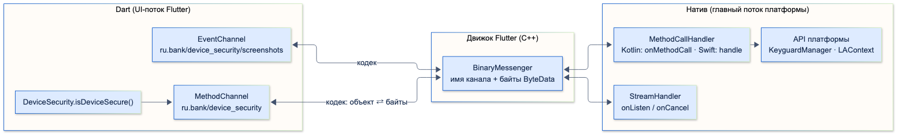
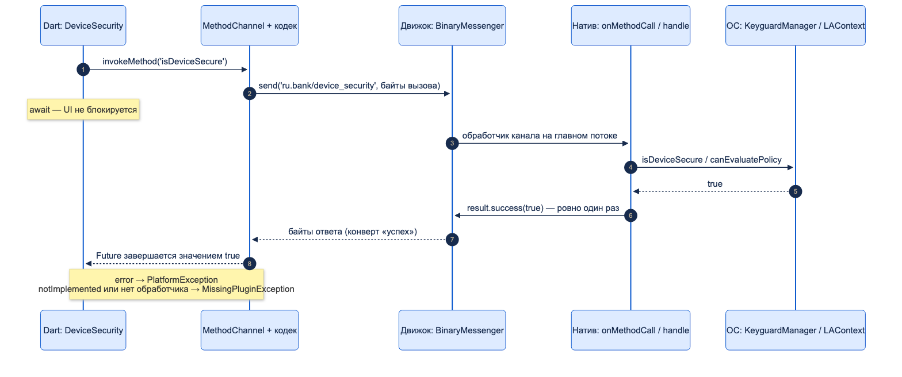
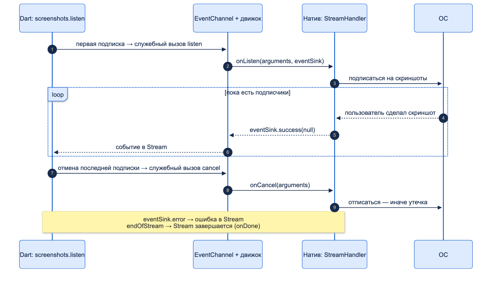

# Platform Channels (MethodChannel, EventChannel)

| Грейд | Время на изучение | Статус |
|-------|-------------------|--------|
| ⭐⭐ | ~60 мин лекция + практика (мини-плагин) | ✅ Готово |

---

## 📚 Ресурсы

| Ресурс | Формат | Язык | Уровень | Зачем читать |
|--------|--------|------|---------|--------------|
| [Flutter и натив. Пример с Яндекс OAuth](https://habr.com/ru/articles/815313/) | Статья (Habr) | 🇷🇺 | ⭐⭐ | Реальный нативный SDK через MethodChannel на обеих платформах: Dart, Kotlin, Swift |
| [Подключаем SberPay во Flutter-приложение](https://habr.com/ru/companies/friflex/articles/771354/) | Статья (Habr) | 🇷🇺 | ⭐⭐ | Банковский пример: обёртка над нативным SDK оплаты через каналы |
| [Flutter: о разработке плагинов с интерфейсом ActivityAware](https://habr.com/ru/articles/579482/) | Статья (Habr) | 🇷🇺 | ⭐⭐ → ⭐⭐⭐ | Зачем плагину Activity и как правильно её получать и отпускать |
| [Writing custom platform-specific code](https://docs.flutter.dev/platform-integration/platform-channels) | Документация | 🇬🇧 | ⭐⭐ | Главный источник: таблица типов, потоки, TaskQueue, примеры для всех платформ |
| [Developing packages & plugins](https://docs.flutter.dev/packages-and-plugins/developing-packages) | Документация | 🇬🇧 | ⭐⭐ | Как создать плагин, блок `flutter: plugin:` в `pubspec.yaml` |
| [pigeon](https://pub.dev/packages/pigeon) | Пакет | 🇬🇧 | ⭐⭐ → ⭐⭐⭐ | Генератор типобезопасных каналов — рекомендация Flutter вместо ручных строк |

---

## 🎓 Лекция

> ℹ️ **Важно:** здесь — как устроены каналы и мини-плагин в одном пакете. Федеративные плагины
> (`platform_interface`, отдельные пакеты под платформы), публикация и версионирование — в теме «Разработка плагинов».
> Весь код ниже собран под Android и iOS, Dart-часть покрыта тестами, вызов проверен на симуляторе iPhone.

### 1. Зачем нужны каналы

Dart не может напрямую вызвать Kotlin или Swift: это разные языки и разные среды выполнения. Код Dart работает
в движке Flutter, нативный код — в процессе Android/iOS вокруг него. Когда нужно то, чего нет во Flutter, —
системный API (`KeyguardManager`, `LAContext`), нативный SDK (оплата, антифрод, сканер документов), — нужен мост.

**Platform Channel** — этот мост. Это обмен **асинхронными сообщениями** по имени:

- у канала есть **имя** — строка, одинаковая на обеих сторонах (`ru.bank/device_security`);
- сообщение — это **байты** (`ByteData`); объект превращает в байты и обратно **кодек**;
- байты доставляет **`BinaryMessenger`** — транспорт движка Flutter.



Ничего не «вызывается напрямую»: Dart кладёт сообщение в движок, движок находит обработчик с таким же именем
на нативной стороне, тот отвечает сообщением обратно. Поэтому:

- любой вызов **асинхронный** — в Dart это всегда `Future` или `Stream`;
- ошибка в имени канала или метода не ловится компилятором — только в рантайме;
- типы проверяются только в рантайме: кодек передаёт то, что вы положили.

### 2. Кодеки и типы

| Кодек | Что передаёт | Где используется |
|-------|--------------|------------------|
| `StandardMessageCodec` | `null`, `bool`, числа, `String`, списки, словари, типизированные массивы | По умолчанию в `MethodChannel` и `EventChannel` (через `StandardMethodCodec`) |
| `JSONMessageCodec` | То, что сериализуется в JSON | Редко, когда натив уже работает с JSON |
| `StringCodec` | Строка UTF-8 | `BasicMessageChannel` для простых строк |
| `BinaryCodec` | Байты как есть | Большие бинарные данные без преобразования |

Таблица типов `StandardMessageCodec`:

| Dart | Kotlin | Swift |
|------|--------|-------|
| `null` | `null` | `nil` (`NSNull` во вложенных) |
| `bool` | `Boolean` | `NSNumber(value: Bool)` |
| `int` (умещается в 32 бита) | `Int` | `NSNumber(value: Int32)` |
| `int` (больше 32 бит) | `Long` | `NSNumber(value: Int)` |
| `double` | `Double` | `NSNumber(value: Double)` |
| `String` | `String` | `String` |
| `Uint8List`, `Int32List`, `Int64List`, `Float64List` | `ByteArray`, `IntArray`, `LongArray`, `DoubleArray` | `FlutterStandardTypedData` |
| `List` | `List` | `Array` |
| `Map` | `HashMap` | `Dictionary` |

Своих классов в таблице нет: модель передают как `Map` и собирают на другой стороне (или берут Pigeon, раздел 10).

**Ловушка `Int` / `Long`.** Кодек записывает перед значением **тег типа** и выбирает его по величине числа,
а не по типу в Dart. Проверка на реальном кодеке:

```dart
const codec = StandardMessageCodec();
for (final value in <Object>[150000, 1 << 40, 3.14, 'Баланс', true, <int>[1, 2], {'id': 1}]) {
  final bytes = codec.encodeMessage(value)!;
  print('${value.runtimeType} $value → тип ${bytes.getUint8(0)}, байт: ${bytes.lengthInBytes}');
}
```

```console
int 150000 → тип 3, байт: 5
int 1099511627776 → тип 4, байт: 9
double 3.14 → тип 6, байт: 16
String Баланс → тип 7, байт: 14
bool true → тип 1, байт: 1
List<int> [1, 2] → тип 12, байт: 12
_Map<String, int> {id: 1} → тип 13, байт: 11
```

Тег 3 — 32-битное число, на Android придёт `Int`; тег 4 — 64-битное, придёт `Long`. Сумма в копейках
`150000` приходит как `Int`, а `5_000_000_000` — как `Long`. Код `call.arguments as Long` упадёт
с `ClassCastException` на маленьких суммах. Правильно: `(call.arguments as Number).toLong()`.

### 3. Три вида каналов

| Канал | Модель | Dart API | Когда |
|-------|--------|----------|-------|
| `MethodChannel` | Запрос → один ответ | `invokeMethod` → `Future` | «Сделай и верни результат»: проверить, запросить, запустить SDK |
| `EventChannel` | Подписка → поток событий от натива | `receiveBroadcastStream` → `Stream` | Натив сам сообщает о событиях: датчики, сеть, скриншоты, статус платежа |
| `BasicMessageChannel` | Сообщения в обе стороны без имени метода | `send` / `setMessageHandler` | Свой протокол или свой кодек; на нём построен Pigeon |

Все три работают поверх одного `BinaryMessenger`. `MethodChannel` и `EventChannel` — удобные надстройки:
первый добавляет имя метода и конверт «успех/ошибка», второй — служебные вызовы `listen` / `cancel`.

### 4. MethodChannel подробно



**Что уходит по каналу.** `invokeMethod('isDeviceSecure', args)` кодирует пару «имя метода + аргументы»
через `StandardMethodCodec` и отправляет байты в канал. Обратно приходит **конверт** одного из видов:

| Нативная сторона вызвала | В Dart |
|--------------------------|--------|
| `result.success(value)` / `result(value)` | `Future` завершается значением |
| `result.error(code, message, details)` / `result(FlutterError(...))` | `PlatformException(code, message, details)` |
| `result.notImplemented()` / `result(FlutterMethodNotImplemented)` | `MissingPluginException` |
| Обработчика с таким именем канала нет | `MissingPluginException` |
| Ничего не вызвала | `Future` не завершится **никогда** |

**Правило одного ответа.** `result` вызывают **ровно один раз** на каждый вызов: на всех ветках, включая
ошибки и `catch`. Ноль раз — `await` в Dart висит вечно. Два раза — ошибка (на Android `IllegalStateException`
«Reply already submitted»). Если результат приходит асинхронно (колбэк SDK), сохраните `result` и вызовите
его в колбэке — один раз.

**Ошибки в Dart.** Обрабатывайте оба исключения:

```dart
try {
  final secure = await DeviceSecurity.isDeviceSecure();
} on PlatformException catch (e) {
  // Нативная сторона сообщила об ошибке: e.code — ваш контракт с нативом ('UNAVAILABLE', 'NO_ACTIVITY')
} on MissingPluginException {
  // Плагина нет на этой платформе или он не зарегистрирован (часто — после hot restart без пересборки)
}
```

`code` — часть контракта: договоритесь о списке кодов с нативной стороной и описывайте их рядом с методом.

**Вызов из натива в Dart.** Канал двусторонний. Dart регистрирует обработчик, натив вызывает метод —
например, нативный SDK сообщает, что сессия истекла:

```dart
const auth = MethodChannel('ru.bank/auth');

auth.setMethodCallHandler((call) async {
  switch (call.method) {
    case 'onTokenExpired':
      await sessionManager.logout(reason: call.arguments as String);
      return true; // уйдёт в натив как результат
    default:
      throw MissingPluginException(); // натив получит notImplemented
  }
});
```

```kotlin
// Вызывать Dart можно только с главного потока
Handler(Looper.getMainLooper()).post {
    channel.invokeMethod("onTokenExpired", sessionId, object : MethodChannel.Result {
        override fun success(result: Any?) { /* Dart вернул значение */ }
        override fun error(errorCode: String, errorMessage: String?, errorDetails: Any?) {}
        override fun notImplemented() { /* в Dart нет обработчика */ }
    })
}
```

```swift
DispatchQueue.main.async { // вызывать Dart — только с главного потока
  self.channel.invokeMethod("onTokenExpired", arguments: sessionId) { result in
    if let error = result as? FlutterError { print(error.code) }
    else if (result as? NSObject) == FlutterMethodNotImplemented { print("нет обработчика в Dart") }
    else { print("Dart вернул \(String(describing: result))") }
  }
}
```

Пока Dart не вызвал `setMethodCallHandler`, сообщения от натива копятся в буфере движка (`ChannelBuffers`),
но по умолчанию он хранит **одно** сообщение на канал: при переполнении старые выбрасываются. Регистрируйте
обработчик до того, как натив может начать звонить (например, в `main` до `runApp`).

**Потоки.**

- Обработчики на нативной стороне вызываются на **главном потоке** платформы. Обращаться к каналу
  (`invokeMethod`, `result`, `eventSink`) тоже нужно с главного потока. Из фонового — переключиться через
  `Handler(Looper.getMainLooper())` / `DispatchQueue.main.async`.
- Долгая работа в обработчике (шифрование, чтение файла) блокирует главный поток — интерфейс приложения
  зависает. Варианты: запустить работу в фоне и ответить `result` с главного потока, или получать вызовы
  сразу в фоне через **TaskQueue**:

```kotlin
val taskQueue = binding.binaryMessenger.makeBackgroundTaskQueue()
val channel = MethodChannel(binding.binaryMessenger, "ru.bank/crypto", StandardMethodCodec.INSTANCE, taskQueue)
channel.setMethodCallHandler { call, result ->
    // Здесь уже фоновый поток: можно считать хэш большого файла, не блокируя UI
    result.success(call.arguments.hashCode())
}
```

```swift
let taskQueue = registrar.messenger().makeBackgroundTaskQueue?()
let channel = FlutterMethodChannel(
  name: "ru.bank/crypto", binaryMessenger: registrar.messenger(),
  codec: FlutterStandardMethodCodec.sharedInstance(), taskQueue: taskQueue)
channel.setMethodCallHandler { call, result in
  result((call.arguments as? String)?.hashValue) // фоновый поток
}
```

- На стороне Dart ответ всегда приходит в главный изолят. Из фонового изолята каналы работают
  только после `BackgroundIsolateBinaryMessenger.ensureInitialized(token)`.

### 5. EventChannel подробно



`EventChannel` — это поток **от натива к Dart**. Под капотом это тот же `MethodChannel` плюс договорённость:

1. `receiveBroadcastStream()` в Dart создаёт широковещательный `Stream` и ставит обработчик сообщений на имя канала.
2. **Первая** подписка (`listen`) отправляет в натив служебный вызов `listen` → на нативной стороне вызывается
   `onListen(arguments, eventSink)`. Здесь натив подписывается на системный источник.
3. Натив шлёт события через `eventSink`:

| Натив | В Dart |
|-------|--------|
| `eventSink.success(value)` / `eventSink(value)` | Событие в `Stream` |
| `eventSink.error(code, message, details)` / `eventSink(FlutterError(...))` | Ошибка в `Stream` (`PlatformException`) |
| `eventSink.endOfStream()` / `eventSink(FlutterEndOfEventStream)` | `Stream` завершается (`onDone`) |

4. Отмена **последней** подписки отправляет служебный вызов `cancel` → `onCancel`. Здесь натив **обязан**
   отписаться от системного источника и забыть `eventSink`, иначе утечка памяти и работа впустую.

**Один слушатель на канал.** У имени канала в Dart — один обработчик, у нативной стороны — один `StreamHandler`
с одним `eventSink`. Отсюда правило: создавайте `receiveBroadcastStream()` **один раз** и раздавайте один поток.
Проверка тестом:

- общий поток, два подписчика: `onListen` один раз, `onCancel` — только после отписки обоих;
- `receiveBroadcastStream()` на каждую подписку: второй поток перехватывает канал, события идут только в него,
  а когда он отписывается, натив получает `onCancel` и выключает слежение, хотя первый экран ещё подписан
  (журнал вызовов: `onListen, onListen, onCancel`).

**Аргументы.** `receiveBroadcastStream(arguments)` передаёт значение в `onListen` — например, интервал
опроса датчика. Аргументы задаются один раз на поток; для другого набора параметров — отдельный канал.

### 6. MethodChannel или EventChannel

| Вопрос | MethodChannel | EventChannel |
|--------|---------------|--------------|
| Кто начинает | Dart спрашивает | Натив сообщает, Dart слушает |
| Сколько ответов | Ровно один | Сколько угодно, пока есть подписка |
| Что в Dart | `Future<T>` | `Stream<T>` |
| Ресурсы на нативной стороне | На время вызова | С `onListen` до `onCancel` |
| Примеры в банке | Проверить код блокировки, получить ID устройства, запустить SDK оплаты, зашифровать данные | Скриншоты, смена сети, статус NFC-оплаты, геопозиция, push-токен обновился |

Как выбирать:

- **Нужен результат действия** — `MethodChannel`. Даже если действие долгое (SDK оплаты показывает свой экран),
  результат один — сохраните `result` и ответьте в колбэке.
- **Событий много или неизвестно когда** — `EventChannel`. Не делайте опрос `invokeMethod` по таймеру.
- **Редкое событие от натива, на которое Dart должен ответить** — вызов Dart из натива через `MethodChannel`
  (раздел 4): у `EventChannel` нет ответа.
- **Нужно и то и другое** — два канала в одном плагине, как в примере ниже.

### 7. Мини-плагин: от Flutter до натива и обратно

Задача: банку нельзя включать вход по биометрии, если на телефоне нет кода блокировки. Плагин `device_security`
с одним методом `isDeviceSecure()`, плюс поток событий о скриншотах (раздел 8).

**Создание.**

```bash
flutter create --template=plugin --platforms=android,ios --org ru.bank device_security
```

Шаблон по умолчанию — Kotlin и Swift. Структура после доработки:

```text
device_security/
├── pubspec.yaml                    ← описание плагина: какие классы регистрировать
├── lib/device_security.dart        ← Dart API для приложения
├── android/
│   ├── build.gradle                ← Android-библиотека (namespace, minSdk)
│   └── src/main/
│       ├── AndroidManifest.xml     ← разрешения плагина, сливаются в манифест приложения
│       └── kotlin/ru/bank/device_security/DeviceSecurityPlugin.kt
├── ios/
│   ├── device_security.podspec     ← pod: исходники, минимальная iOS
│   ├── Classes/DeviceSecurityPlugin.swift
│   └── Resources/PrivacyInfo.xcprivacy
├── example/                        ← приложение для ручной проверки
└── test/device_security_test.dart
```

> ℹ️ Шаблон Flutter создаёт ещё слой `platform_interface` (`device_security_platform_interface.dart`,
> `device_security_method_channel.dart`). Он нужен для федеративных плагинов — тема «Разработка плагинов».
> Здесь он убран, чтобы путь вызова был виден целиком.

**`pubspec.yaml` плагина.**

```yaml
name: device_security
description: "Проверки безопасности устройства для банковского приложения."
version: 0.0.1

environment:
  sdk: ^3.10.4
  flutter: '>=3.3.0'

dependencies:
  flutter:
    sdk: flutter

flutter:
  plugin:
    platforms:
      android:
        package: ru.bank.device_security   # пакет Kotlin-класса
        pluginClass: DeviceSecurityPlugin  # класс, который зарегистрирует Flutter
      ios:
        pluginClass: DeviceSecurityPlugin
```

Блок `flutter: plugin:` — то, что отличает плагин от обычного пакета. По нему Flutter при `pub get`
генерирует регистрацию: `GeneratedPluginRegistrant.java` на Android и `GeneratedPluginRegistrant.m` на iOS.
Нет платформы в списке — на ней вызов закончится `MissingPluginException`.

**`pubspec.yaml` приложения.**

```yaml
dependencies:
  flutter:
    sdk: flutter
  device_security:
    path: ../device_security   # локальный плагин; в банке чаще git или внутренний pub-репозиторий
```

После `flutter pub get` плагин попадает в `.flutter-plugins-dependencies`, Android-модуль подключается
в Gradle-сборку, iOS — как pod при `pod install`. Новый плагин требует **полной пересборки**: hot reload
и hot restart нативный код не подхватывают.

**Dart: `lib/device_security.dart`.**

```dart
import 'package:flutter/services.dart';

/// Мини-плагин: проверки безопасности устройства
abstract final class DeviceSecurity {
  // Имя канала — «адрес» сообщения. Должно совпадать с нативной стороной символ в символ
  static const _methods = MethodChannel('ru.bank/device_security');
  static const _screenshots = EventChannel('ru.bank/device_security/screenshots');

  /// Установлен ли на устройстве код блокировки (PIN, пароль, графический ключ).
  /// Без него банку нельзя включать вход по биометрии
  static Future<bool> isDeviceSecure() async {
    // invokeMethod возвращает Future: ответ придёт асинхронно, когда натив вызовет result
    final secure = await _methods.invokeMethod<bool>('isDeviceSecure');
    return secure ?? false;
  }

  /// События «пользователь сделал скриншот». Первая подписка включает слежение на нативной стороне,
  /// отмена последней — выключает. Поток создаётся один раз: каждый новый receiveBroadcastStream
  /// перехватывает канал у предыдущего
  static final Stream<void> screenshots = _screenshots.receiveBroadcastStream().map((_) {});
}
```

Наружу не торчат ни каналы, ни строки: приложение видит обычные `Future<bool>` и `Stream<void>`.

**Android: `DeviceSecurityPlugin.kt`.**

```kotlin
package ru.bank.device_security

import android.app.Activity
import android.app.KeyguardManager
import android.content.Context
import android.os.Build
import io.flutter.embedding.engine.plugins.FlutterPlugin
import io.flutter.embedding.engine.plugins.activity.ActivityAware
import io.flutter.embedding.engine.plugins.activity.ActivityPluginBinding
import io.flutter.plugin.common.EventChannel
import io.flutter.plugin.common.MethodCall
import io.flutter.plugin.common.MethodChannel

class DeviceSecurityPlugin :
    FlutterPlugin,
    MethodChannel.MethodCallHandler, // обработчик MethodChannel
    EventChannel.StreamHandler, // обработчик EventChannel
    ActivityAware { // доступ к Activity: нужен для слежения за скриншотами

    private lateinit var methods: MethodChannel
    private lateinit var screenshots: EventChannel
    private lateinit var context: Context
    private var activity: Activity? = null
    private var eventSink: EventChannel.EventSink? = null
    private var screenCaptureCallback: Activity.ScreenCaptureCallback? = null

    // Движок подключил плагин: создаём каналы с теми же именами, что в Dart
    override fun onAttachedToEngine(binding: FlutterPlugin.FlutterPluginBinding) {
        context = binding.applicationContext
        methods = MethodChannel(binding.binaryMessenger, "ru.bank/device_security")
        methods.setMethodCallHandler(this)
        screenshots = EventChannel(binding.binaryMessenger, "ru.bank/device_security/screenshots")
        screenshots.setStreamHandler(this)
    }

    // Вызов из Dart. Выполняется на главном потоке Android
    override fun onMethodCall(call: MethodCall, result: MethodChannel.Result) {
        when (call.method) {
            "isDeviceSecure" -> {
                val keyguard = context.getSystemService(KeyguardManager::class.java)
                result.success(keyguard.isDeviceSecure) // ответ уходит обратно в Dart: ровно один раз
            }
            else -> result.notImplemented() // в Dart станет MissingPluginException
        }
    }

    // Dart подписался на поток: начинаем следить
    override fun onListen(arguments: Any?, events: EventChannel.EventSink) {
        eventSink = events
        registerScreenCaptureCallback()
    }

    // Dart отменил подписку: обязательно отписаться от системы, иначе утечка
    override fun onCancel(arguments: Any?) {
        unregisterScreenCaptureCallback()
        eventSink = null
    }

    private fun registerScreenCaptureCallback() {
        val activity = activity ?: return
        if (Build.VERSION.SDK_INT < Build.VERSION_CODES.UPSIDE_DOWN_CAKE) return // API 34+
        val callback = Activity.ScreenCaptureCallback { eventSink?.success(null) }
        activity.registerScreenCaptureCallback(activity.mainExecutor, callback)
        screenCaptureCallback = callback
    }

    private fun unregisterScreenCaptureCallback() {
        if (Build.VERSION.SDK_INT < Build.VERSION_CODES.UPSIDE_DOWN_CAKE) return
        screenCaptureCallback?.let { activity?.unregisterScreenCaptureCallback(it) }
        screenCaptureCallback = null
    }

    override fun onAttachedToActivity(binding: ActivityPluginBinding) {
        activity = binding.activity
        if (eventSink != null) registerScreenCaptureCallback() // подписка была раньше Activity
    }

    override fun onDetachedFromActivity() {
        unregisterScreenCaptureCallback()
        activity = null
    }

    override fun onReattachedToActivityForConfigChanges(binding: ActivityPluginBinding) = onAttachedToActivity(binding)

    override fun onDetachedFromActivityForConfigChanges() = onDetachedFromActivity()

    override fun onDetachedFromEngine(binding: FlutterPlugin.FlutterPluginBinding) {
        methods.setMethodCallHandler(null)
        screenshots.setStreamHandler(null)
    }
}
```

Жизненный цикл плагина на Android:

- `onAttachedToEngine` — движок создан, плагин подключён. Здесь создают каналы. Есть `applicationContext`,
  но **нет Activity**.
- `ActivityAware` — плагину нужна Activity (показать диалог, следить за скриншотами, запустить SDK с экраном).
  Activity может появиться позже движка, пересоздаться при повороте и исчезнуть раньше движка — поэтому
  четыре метода, и в каждом нужно корректно подписаться или отписаться.
- `onDetachedFromEngine` — снять обработчики.

**iOS: `DeviceSecurityPlugin.swift`.**

```swift
import Flutter
import LocalAuthentication
import UIKit

public class DeviceSecurityPlugin: NSObject, FlutterPlugin, FlutterStreamHandler {
  private var eventSink: FlutterEventSink?
  private var screenshotObserver: NSObjectProtocol?

  // Flutter вызывает register при старте приложения (через GeneratedPluginRegistrant)
  public static func register(with registrar: FlutterPluginRegistrar) {
    let instance = DeviceSecurityPlugin()
    let methods = FlutterMethodChannel(name: "ru.bank/device_security", binaryMessenger: registrar.messenger())
    registrar.addMethodCallDelegate(instance, channel: methods)
    let screenshots = FlutterEventChannel(name: "ru.bank/device_security/screenshots", binaryMessenger: registrar.messenger())
    screenshots.setStreamHandler(instance)
  }

  // Вызов из Dart. Выполняется на главном потоке
  public func handle(_ call: FlutterMethodCall, result: @escaping FlutterResult) {
    switch call.method {
    case "isDeviceSecure":
      // deviceOwnerAuthentication — биометрия или код-пароль. Без кода-пароля политика недоступна
      result(LAContext().canEvaluatePolicy(.deviceOwnerAuthentication, error: nil))
    default:
      result(FlutterMethodNotImplemented)
    }
  }

  // Dart подписался на поток
  public func onListen(withArguments arguments: Any?, eventSink events: @escaping FlutterEventSink) -> FlutterError? {
    eventSink = events
    screenshotObserver = NotificationCenter.default.addObserver(
      forName: UIApplication.userDidTakeScreenshotNotification, object: nil, queue: .main
    ) { [weak self] _ in
      self?.eventSink?(nil) // событие без данных
    }
    return nil
  }

  // Dart отменил подписку
  public func onCancel(withArguments arguments: Any?) -> FlutterError? {
    if let screenshotObserver { NotificationCenter.default.removeObserver(screenshotObserver) }
    screenshotObserver = nil
    eventSink = nil
    return nil
  }
}
```

На iOS `result` — это замыкание `FlutterResult`: в него передают значение, `FlutterError` или
`FlutterMethodNotImplemented`. `onListen` и `onCancel` возвращают `FlutterError?` — `nil`, если всё хорошо.

**Путь вызова `isDeviceSecure()` по шагам.**

1. При старте приложения `GeneratedPluginRegistrant` создаёт `DeviceSecurityPlugin`. На Android вызывается
   `onAttachedToEngine`, на iOS — `register(with:)`. Обработчики встают на имя `ru.bank/device_security`.
2. Экран вызывает `await DeviceSecurity.isDeviceSecure()`.
3. `MethodChannel.invokeMethod` кодирует `MethodCall('isDeviceSecure', null)` в байты и вызывает
   `BinaryMessenger.send(имя, байты)`. Dart получает `Future` и продолжает работу — UI не ждёт.
4. Движок передаёт байты на главный поток платформы и ищет обработчик по имени канала.
5. `MethodChannel` на нативной стороне декодирует байты обратно в `MethodCall` и вызывает
   `onMethodCall` / `handle`.
6. Код спрашивает систему: `KeyguardManager.isDeviceSecure` / `LAContext.canEvaluatePolicy`.
7. `result.success(true)` кодирует конверт «успех + true» и отправляет ответ.
8. Движок возвращает байты в Dart, кодек декодирует их, `Future` завершается значением `true`.

**Проверка.** Пример `example/lib/main.dart` вызывает метод и пишет результат в лог. Запуск на симуляторе
iPhone 16:

```console
flutter: device_security: isDeviceSecure = true
```

Симулятор считается защищённым. На реальном iPhone без кода-пароля и на Android-телефоне без блокировки экрана
метод вернёт `false`.

### 8. EventChannel на примере: скриншоты

Банковское приложение хочет знать, что пользователь сделал скриншот экрана с реквизитами: показать
предупреждение, записать событие в антифрод. Код уже в плагине выше — два канала в одном классе.

| | Android | iOS |
|---|---------|-----|
| Источник | `Activity.registerScreenCaptureCallback` (Android 14+, API 34) | `UIApplication.userDidTakeScreenshotNotification` |
| Разрешение | `DETECT_SCREEN_CAPTURE` — обычное, без диалога | Не нужно |
| Нужна Activity | Да — поэтому `ActivityAware` | Нет |
| Ниже версии | До Android 14 событий нет; запрет скриншотов — `FLAG_SECURE` (тема «Различия Android / iOS») | — |

Разрешение объявляет сам плагин в своём `AndroidManifest.xml` — при сборке оно сливается в манифест приложения:

```xml
<manifest xmlns:android="http://schemas.android.com/apk/res/android">
    <!-- Обычное разрешение (Android 14+): получать уведомления о скриншотах. Сольётся в манифест приложения -->
    <uses-permission android:name="android.permission.DETECT_SCREEN_CAPTURE" />
</manifest>
```

Использование на экране — подписка в `initState`, отмена в `dispose`:

```dart
class _SecurityScreenState extends State<SecurityScreen> {
  bool? _secure;
  var _screenshots = 0;
  StreamSubscription<void>? _subscription;

  @override
  void initState() {
    super.initState();
    DeviceSecurity.isDeviceSecure().then((secure) {
      debugPrint('device_security: isDeviceSecure = $secure');
      setState(() => _secure = secure);
    });
    _subscription = DeviceSecurity.screenshots.listen((_) {
      debugPrint('device_security: скриншот');
      setState(() => _screenshots++);
    });
  }

  @override
  void dispose() {
    _subscription?.cancel(); // на нативной стороне вызовется onCancel
    super.dispose();
  }

  @override
  Widget build(BuildContext context) => Scaffold(
        body: Center(
          child: Text(switch (_secure) {
            null => 'Проверяем…',
            true => 'Код блокировки установлен. Скриншотов: $_screenshots',
            false => 'Установите код блокировки, чтобы включить вход по биометрии',
          }),
        ),
      );
}
```

> ⚠️ Скриншот командой `xcrun simctl io booted screenshot` **не** вызывает `userDidTakeScreenshotNotification` —
> проверено: это снимок экрана симулятора со стороны Mac, а не действие пользователя. Сами события проверяйте
> на устройстве, а логику подписки — тестами из раздела 9.

### 9. Тестирование без устройства

Каналы в тестах подменяются через `TestDefaultBinaryMessengerBinding`: Dart-код плагина проверяется
без Android и iOS.

```dart
void main() {
  TestWidgetsFlutterBinding.ensureInitialized();
  final messenger = TestDefaultBinaryMessengerBinding.instance.defaultBinaryMessenger;
  const methods = MethodChannel('ru.bank/device_security');
  const screenshots = EventChannel('ru.bank/device_security/screenshots');

  tearDown(() {
    messenger.setMockMethodCallHandler(methods, null);
    messenger.setMockStreamHandler(screenshots, null);
  });

  test('isDeviceSecure: ответ нативной стороны приходит в Dart', () async {
    final calls = <MethodCall>[];
    // Подменяем нативную сторону: так тесты работают без устройства
    messenger.setMockMethodCallHandler(methods, (call) async {
      calls.add(call);
      return false; // «код блокировки не установлен»
    });

    expect(await DeviceSecurity.isDeviceSecure(), isFalse);
    expect(calls.single.method, 'isDeviceSecure');
  });

  test('нет обработчика на нативной стороне — MissingPluginException', () {
    expect(DeviceSecurity.isDeviceSecure(), throwsA(isA<MissingPluginException>()));
  });

  test('ошибка нативной стороны — PlatformException', () {
    messenger.setMockMethodCallHandler(methods, (call) async {
      throw PlatformException(code: 'UNAVAILABLE', message: 'KeyguardManager недоступен');
    });
    expect(DeviceSecurity.isDeviceSecure(), throwsA(isA<PlatformException>()));
  });

  test('screenshots: onListen при подписке, onCancel при отписке', () async {
    final log = <String>[];
    messenger.setMockStreamHandler(
      screenshots,
      MockStreamHandler.inline(
        onListen: (arguments, events) {
          log.add('onListen');
          events.success(null); // два скриншота
          events.success(null);
        },
        onCancel: (arguments) => log.add('onCancel'),
      ),
    );

    final received = <void>[];
    final subscription = DeviceSecurity.screenshots.listen(received.add);
    await pumpEventQueue();
    await subscription.cancel();
    await pumpEventQueue();

    expect(received.length, 2);
    expect(log, ['onListen', 'onCancel']);
  });
}
```

Что проверяют такие тесты: имена каналов и методов, аргументы, разбор ответа, обработку ошибок, подписку
и отписку. Что не проверяют: нативный код. Его проверяют unit-тестами на Kotlin/Swift и интеграционными
тестами в `example/` на устройстве (`integration_test`).

В приложении, которое использует плагин, удобнее подменять не канал, а сам класс — через интерфейс
и DI (тема «Dependency Injection»).

### 10. Pigeon и альтернативы

Ручные каналы — это строки и `as`: опечатка в имени метода или смена типа ломает вызов только в рантайме.
**Pigeon** генерирует код каналов из описания на Dart:

```dart
import 'package:pigeon/pigeon.dart';

@ConfigurePigeon(PigeonOptions(
  dartPackageName: 'device_security',
  dartOut: 'lib/src/device_security_api.g.dart',
  kotlinOut: 'android/src/main/kotlin/ru/bank/device_security/DeviceSecurityApi.g.kt',
  kotlinOptions: KotlinOptions(package: 'ru.bank.device_security'),
  swiftOut: 'ios/Classes/DeviceSecurityApi.g.swift',
))
@HostApi() // Dart → натив
abstract class DeviceSecurityApi {
  bool isDeviceSecure();
}
```

```bash
dart run pigeon --input pigeons/device_security_api.dart
```

Получается Dart-класс с `Future<bool> isDeviceSecure()`, Kotlin-интерфейс `fun isDeviceSecure(): Boolean`
и Swift-протокол `func isDeviceSecure() throws -> Bool` — нативной стороне остаётся их реализовать
и вызвать `DeviceSecurityApi.setUp(binaryMessenger, api)`. Под капотом — те же каналы (`BasicMessageChannel`
на каждый метод, имя вида `dev.flutter.pigeon.device_security.DeviceSecurityApi.isDeviceSecure`).
На один метод генерируется ~300 строк — Pigeon окупается, когда методов и моделей много.

| Способ | Когда |
|--------|-------|
| `MethodChannel` / `EventChannel` вручную | 1–3 метода, простые типы, понять механику |
| Pigeon | Много методов, свои модели, команда из нескольких человек; рекомендация Flutter |
| `dart:ffi` | Синхронный вызов C/C++ (криптография, обработка изображений) без кодека и потоков — тема «FFI» |
| Готовый плагин с pub.dev | Задача стандартная: `local_auth`, `connectivity_plus`, `screen_protector` |

### ⚠️ Частые ошибки

- **Имя канала или метода не совпадает** на сторонах — `MissingPluginException`, а не ошибка компиляции.
- **Hot restart после добавления плагина** — `MissingPluginException`. Нужна полная пересборка.
- **`result` не вызван** на какой-то ветке (например, в `catch`) — `await` в Dart висит вечно.
- **`result` вызван дважды** — падение на нативной стороне.
- **`call.arguments as Long`** для `int` из Dart — `ClassCastException` на числах до 2³¹. Используйте `Number`.
- **Долгая работа в обработчике на главном потоке** — интерфейс зависает. Фон или TaskQueue.
- **`eventSink` / `invokeMethod` из фонового потока** — падение или потерянные сообщения.
- **Нет отписки в `onCancel`** — системный колбэк живёт после ухода с экрана, утечка.
- **`receiveBroadcastStream()` на каждую подписку** — второй поток перехватывает канал у первого.
- **Использовать Activity в `onAttachedToEngine`** — её там нет; нужен `ActivityAware`.
- **Обработчик Dart для вызовов из натива поставлен поздно** — буфер хранит одно сообщение, остальные теряются.
- **Каналы и строки торчат из плагина наружу** — приложение зависит от деталей; наружу — только Dart API.

### 🎤 На собеседовании: «Как вызвать нативную функцию из Flutter и получать от неё события?»

| Уровень | Как выглядит ответ |
|---------|--------------------|
| ⭐ Junior | `MethodChannel` с одинаковым именем в Dart и в Kotlin/Swift, `invokeMethod` в Dart, `setMethodCallHandler` на нативной стороне |
| ⭐⭐ Middle | Каналы — асинхронные сообщения через `BinaryMessenger`, кодек `StandardMessageCodec`. `MethodChannel` — запрос с одним ответом (`success` / `error` / `notImplemented` → значение / `PlatformException` / `MissingPluginException`). События — `EventChannel`: `onListen` / `onCancel`, `eventSink`. Обработчики на главном потоке. Тесты через `setMockMethodCallHandler` |
| ⭐⭐⭐ Senior | Всё из Middle, плюс: один ответ на вызов и что будет при нарушении, TaskQueue для тяжёлой работы, `Int`/`Long`, один слушатель на `EventChannel`, `ActivityAware` и жизненный цикл Activity, вызов Dart из натива, Pigeon для типобезопасности, FFI для синхронных C-вызовов, скрыть каналы за Dart API, федеративный плагин для нескольких платформ |

---

## ✅ Самопроверка

**⭐ Junior**
1. Что такое Platform Channel и зачем он нужен?
2. Почему вызов через `MethodChannel` всегда возвращает `Future`?
3. Что должно совпадать в Dart и на нативной стороне, чтобы вызов дошёл?

**⭐⭐ Middle**
1. Чем `MethodChannel` отличается от `EventChannel`? Приведите по два примера из банковского приложения.
2. Какие исключения может выбросить `invokeMethod` и когда?
3. Когда на нативной стороне вызываются `onListen` и `onCancel`? Что в них нужно делать?
4. Для чего блок `flutter: plugin:` в `pubspec.yaml` плагина?
5. Как протестировать Dart-часть плагина без устройства?

**⭐⭐⭐ Senior**
1. Опишите путь `invokeMethod` от Dart до натива и обратно по шагам.
2. На каком потоке вызывается обработчик на нативной стороне? Как не заблокировать интерфейс?
3. Почему `call.arguments as Long` может упасть на Android?
4. Что произойдёт, если `result` не вызвать? Если вызвать дважды?
5. Почему `receiveBroadcastStream()` нужно создавать один раз?
6. Зачем плагину `ActivityAware`? Почему там четыре метода?
7. Когда выбрать Pigeon, а когда FFI вместо ручных каналов?

<details>
<summary>Ответы</summary>

**Junior**
1. Мост между Dart и нативным кодом (Kotlin/Swift): асинхронные сообщения по имени канала. Нужен для системных
   API и нативных SDK, которых нет во Flutter.
2. Вызов — это сообщение в движок; ответ приходит позже, когда нативная сторона вызовет `result`.
3. Имя канала и имя метода — символ в символ, и кодек (по умолчанию стандартный на обеих сторонах).

**Middle**
1. `MethodChannel` — запрос от Dart и один ответ (`Future`): проверить код блокировки, запустить SDK оплаты.
   `EventChannel` — поток событий от натива (`Stream`): скриншоты, смена сети.
2. `PlatformException` — натив вызвал `error`; `MissingPluginException` — натив вызвал `notImplemented`
   или обработчика с таким именем нет (опечатка, платформа не поддержана, hot restart после добавления плагина).
3. `onListen` — при первой подписке в Dart: подписаться на системный источник, сохранить `eventSink`.
   `onCancel` — при отмене последней подписки: отписаться и забыть `eventSink`.
4. Указывает платформы и классы плагина. По нему Flutter генерирует `GeneratedPluginRegistrant`
   и регистрирует плагин при старте.
5. `TestDefaultBinaryMessengerBinding.instance.defaultBinaryMessenger`: `setMockMethodCallHandler`
   и `setMockStreamHandler` подменяют нативную сторону.

**Senior**
1. `invokeMethod` → `StandardMethodCodec` кодирует имя и аргументы → `BinaryMessenger.send` → движок передаёт
   байты на главный поток платформы → обработчик по имени канала декодирует `MethodCall` → вызов API →
   `result.success` кодирует конверт → движок возвращает байты → Dart декодирует → `Future` завершается.
2. На главном потоке. Долгую работу — в фон с ответом через главный поток, или канал с TaskQueue
   (`makeBackgroundTaskQueue`).
3. Кодек выбирает тип по величине: до 32 бит — `Int`, больше — `Long`. Приводить через `Number`.
4. Не вызвать — `Future` не завершится никогда. Дважды — ошибка на нативной стороне
   (на Android `IllegalStateException`).
5. Каждый вызов ставит свой обработчик на имя канала и перехватывает его: события идут только в последний поток,
   а его отмена отправит `cancel` в натив, хотя другие подписчики ещё ждут.
6. Activity нужна для диалогов, экранов SDK, колбэков вроде скриншотов. Она появляется позже движка,
   пересоздаётся при смене конфигурации и уходит раньше движка — на каждый случай свой метод.
7. Pigeon — когда методов и моделей много и нужна типобезопасность; это те же каналы. FFI — когда нужен
   синхронный быстрый вызов C/C++ без кодека и переключения потоков.

</details>
