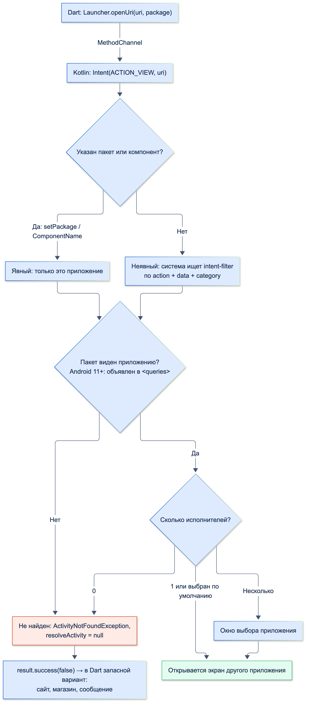
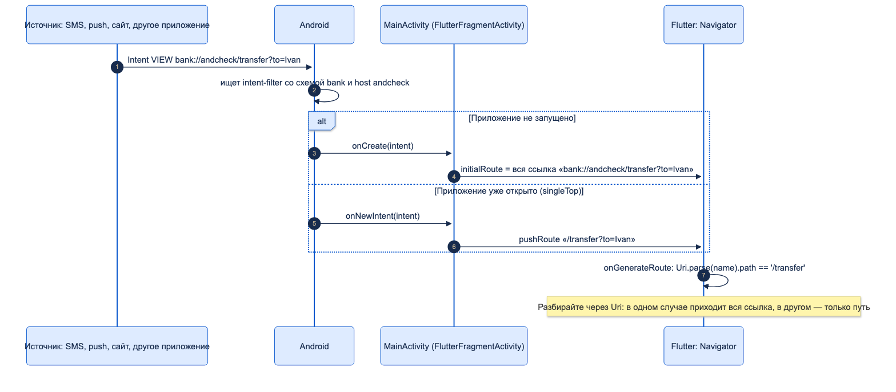
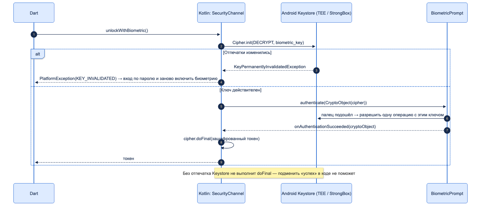
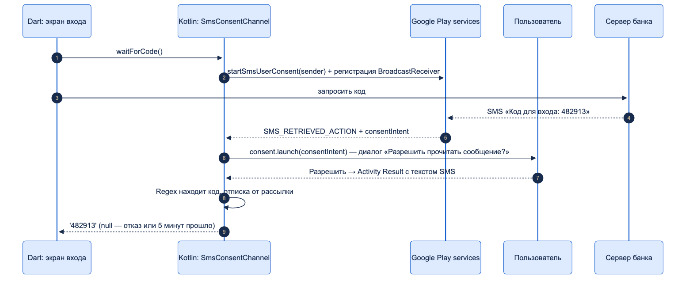

# Нативные API Android

| Грейд | Время на изучение | Статус |
|-------|-------------------|--------|
| ⭐⭐ | ~90 мин лекция + практика на эмуляторе | ✅ Готово |

---

## 📚 Ресурсы

| Ресурс | Формат | Язык | Уровень | Зачем читать |
|--------|--------|------|---------|--------------|
| [Intent и фильтры Intent](https://developer.android.com/guide/components/intents-filters?hl=ru) | Документация | 🇷🇺 | ⭐ → ⭐⭐ | Явные и неявные Intent, как система выбирает исполнителя |
| [Распространённые Intent](https://developer.android.com/guide/components/intents-common?hl=ru) | Документация | 🇷🇺 | ⭐⭐ | Готовые рецепты: звонилка, почта, карты, настройки, календарь — без сторонних пакетов |
| [Видимость пакетов (Android 11+)](https://developer.android.com/training/package-visibility?hl=ru) | Документация | 🇷🇺 | ⭐⭐ | Почему чужие приложения «не находятся» и что писать в `<queries>` |
| [Такие разные Android AppLinks, WebLinks, DeepLinks](https://habr.com/ru/articles/859904/) | Статья (Habr) | 🇷🇺 | ⭐⭐ | Три вида ссылок, проверка домена, попытки атак |
| [Flutter: Deep linking](https://docs.flutter.dev/ui/navigation/deep-linking) | Документация | 🇬🇧 | ⭐⭐ | Как Flutter сам передаёт входящую ссылку в Navigator/Router |
| [Получение результата от Activity](https://developer.android.com/training/basics/intents/result?hl=ru) | Документация | 🇷🇺 | ⭐⭐ | Activity Result API вместо `startActivityForResult` |
| [Android Keystore](https://developer.android.com/privacy-and-security/keystore?hl=ru) | Документация | 🇷🇺 | ⭐⭐ → ⭐⭐⭐ | Ключи в защищённом железе, ограничения использования |
| [Биометрическая аутентификация](https://developer.android.com/identity/sign-in/biometric-auth?hl=ru) | Документация | 🇷🇺 | ⭐⭐ → ⭐⭐⭐ | `BiometricPrompt`, классы биометрии, `CryptoObject` |
| [Обзор актуальных инструментов шифрования в Android](https://habr.com/ru/post/776728/) | Статья (Habr) | 🇷🇺 | ⭐⭐⭐ | Статистика реальных сбоев Keystore на миллионах устройств. ⚠️ `EncryptedSharedPreferences` из статьи с 2025 года устарела |
| [Одноразовое согласие на чтение SMS](https://developers.google.com/identity/sms-retriever/user-consent/request?hl=ru) | Документация | 🇷🇺 | ⭐⭐ | SMS User Consent: автоподстановка кода без `READ_SMS` |
| [Актуальные практики работы в фоне Android-приложений](https://habr.com/ru/companies/vk/articles/965220/) | Статья (Habr) | 🇷🇺 | ⭐⭐ → ⭐⭐⭐ | WorkManager, foreground service, ограничения Android 12–15 |
| [Каналы уведомлений](https://developer.android.com/develop/ui/views/notifications/channels?hl=ru) | Документация | 🇷🇺 | ⭐⭐ | Зачем каналы и что пользователь в них настраивает |
| [Обмен файлами через FileProvider](https://developer.android.com/training/secure-file-sharing/setup-sharing?hl=ru) | Документация | 🇷🇺 | ⭐⭐ | Как отдать файл другому приложению безопасно |
| [Play Integrity API](https://developer.android.com/google/play/integrity?hl=ru) | Документация | 🇷🇺 | ⭐⭐⭐ | Проверка устройства и приложения на стороне сервера |

---

## 🎓 Лекция

> ℹ️ **Важно:** жизненный цикл и разрешения — в теме «Различия Android / iOS», Gradle и манифест —
> в «Базовой настройке нативных проектов», устройство каналов — в «Platform Channels», язык — в «Kotlin / Java».
> Здесь — какие API Android встречаются в банковском приложении и как дотянуться до них **без сторонних пакетов**.
> Весь код собран и запущен на эмуляторе Android 16 (API 36): результаты вызовов приведены рядом с кодом.

### 1. Карта: задача → API Android → пакет

| Задача | API Android | Готовый пакет | Когда писать своё |
|--------|-------------|---------------|-------------------|
| Открыть настройки, другое приложение, звонилку, почту, карты | `Intent`, `Settings.ACTION_*` | `url_launcher`, `app_settings`, `android_intent_plus` | Почти всегда: 5–20 строк Kotlin, полный контроль над запасным вариантом |
| Принять ссылку в приложение | `intent-filter`, App Links | `app_links` | Обычно не нужно: Flutter умеет сам (раздел 5) |
| Выбрать контакт, файл, фото | Activity Result API | `flutter_contacts`, `file_picker` | Когда нужен один системный экран без разрешений |
| Хранить секреты | Android Keystore | `flutter_secure_storage` | Ключ с особыми условиями: биометрия, StrongBox |
| Вход по отпечатку | `BiometricPrompt` + `CryptoObject` | `local_auth` | **Банку — да:** `local_auth` не привязывает биометрию к ключу |
| Код из SMS | SMS User Consent / SMS Retriever | `smart_auth` | Одна функция — проще своё |
| Фоновая синхронизация | WorkManager | `workmanager` | Если работа на Kotlin; Dart в фоне — только через пакет или свой движок |
| Уведомления | `NotificationManager`, каналы | `flutter_local_notifications`, `firebase_messaging` | Своё — для 1–2 типов уведомлений |
| Поделиться файлом | `FileProvider` + `ACTION_SEND` | `share_plus` | Когда файл чувствительный и нужен контроль, кто его получит |
| Проверка устройства | Play Integrity API | — | Всегда в связке с сервером |

### 2. Где писать свой нативный код

Без плагина: прямо в `MainActivity` приложения — `configureFlutterEngine` вызывается, когда движок готов,
здесь создают свои каналы. Плагины из `pubspec.yaml` регистрирует `super.configureFlutterEngine`.

```kotlin
package ru.bank.andcheck

import android.os.Bundle
import io.flutter.embedding.android.FlutterFragmentActivity
import io.flutter.embedding.engine.FlutterEngine

// FlutterFragmentActivity, а не FlutterActivity: BiometricPrompt работает только с FragmentActivity
class MainActivity : FlutterFragmentActivity() {
    private lateinit var launcher: LauncherChannel
    private lateinit var security: SecurityChannel
    private lateinit var sms: SmsConsentChannel
    private lateinit var notifications: NotificationsChannel

    override fun onCreate(savedInstanceState: Bundle?) {
        // Контракты Activity Result регистрируют до того, как Activity стала видимой
        launcher = LauncherChannel(this)
        security = SecurityChannel(this)
        sms = SmsConsentChannel(this)
        notifications = NotificationsChannel(this)
        super.onCreate(savedInstanceState)
    }

    // Свои каналы приложения — без плагина: прямо в MainActivity
    override fun configureFlutterEngine(flutterEngine: FlutterEngine) {
        super.configureFlutterEngine(flutterEngine) // регистрирует плагины из pubspec
        val messenger = flutterEngine.dartExecutor.binaryMessenger
        launcher.attach(messenger)
        security.attach(messenger)
        sms.attach(messenger)
        notifications.attach(messenger)
        SyncWorker.schedule(applicationContext)
    }

    override fun onDestroy() {
        sms.dispose()
        super.onDestroy()
    }
}
```

| | Код в `MainActivity` | Свой плагин |
|---|---|---|
| Когда | Один-два метода, нужны только этому приложению | Код переиспользуется, нужен на iOS, тестируется отдельно |
| Доступ к Activity | Сразу (`this`) | Через `ActivityAware` (тема «Platform Channels») |
| Модульность | Код в модуле приложения | Отдельный пакет, свой `pubspec.yaml` |

**`FlutterActivity` или `FlutterFragmentActivity`.** Шаблон Flutter создаёт `FlutterActivity`. Банковскому приложению
почти всегда нужна `FlutterFragmentActivity`: на ней работают `BiometricPrompt` (и `local_auth`) и
`registerForActivityResult`.

**Context.** `applicationContext` живёт всё время процесса — для системных сервисов и WorkManager. Activity
живёт до поворота экрана или закрытия — для всего, что показывает UI (диалоги, `startActivity`, `BiometricPrompt`).
Хранить Activity в статическом поле или в объекте, который живёт дольше неё, — утечка памяти.

### 3. Intent — как Android открывает экраны

**Intent** — сообщение системе «хочу открыть экран / выполнить действие». В нём:

- **action** — что сделать: `ACTION_VIEW`, `ACTION_DIAL`, `ACTION_SEND`, `Settings.ACTION_WIFI_SETTINGS`;
- **data** — над чем: `https://…`, `tel:…`, `mailto:…`, `market://…`;
- **category**, **extras** — уточнения и параметры;
- **package / component** — кому именно.

| Вид | Как | Пример |
|-----|-----|--------|
| Явный | Указан пакет (`setPackage`) или класс экрана (`ComponentName`) | Открыть маршрут именно в Google Картах |
| Неявный | Только action и data, исполнителя выбирает система | Открыть ссылку — в браузере по умолчанию или в окне выбора |



**Видимость пакетов (Android 11+).** Приложение не видит другие установленные приложения, пока не объявит их
в `<queries>` манифеста. Это касается **проверок** (`resolveActivity`, `getLaunchIntentForPackage`). Сам запуск
неявного Intent (`startActivity`) работает и без объявления, но заранее узнать, есть ли исполнитель, нельзя —
остаётся ловить `ActivityNotFoundException`.

```xml
<queries>
    <!-- С Android 11 чужие приложения не видны, пока не объявлены здесь -->
    <package android:name="com.google.android.apps.maps" />
    <package android:name="com.google.android.gm" />
    <package android:name="com.android.vending" />
    <!-- Проверять, есть ли приложения со схемой bank (canOpenUri) -->
    <intent>
        <action android:name="android.intent.action.VIEW" />
        <data android:scheme="bank" />
    </intent>
</queries>
```

Объявлять всё подряд нельзя: разрешение `QUERY_ALL_PACKAGES` Google Play даёт только особым категориям
приложений (антивирусы, файловые менеджеры) — банку его не одобрят.

### 4. Открыть другое приложение, нужный экран, настройки ОС — без пакетов

Из чистого Dart это сделать нельзя: у Flutter нет API для Intent. Минимум — один `MethodChannel` в `MainActivity`.

**Dart: `lib/platform/launcher.dart`.**

```dart
import 'package:flutter/services.dart';

/// Экраны настроек Android, которые умеет открыть приложение
enum SettingsScreen { wifi, nfc, location, security, date, notifications, biometricEnroll, internetPanel }

/// Открыть другое приложение, экран настроек, страницу в магазине — без сторонних пакетов
abstract final class Launcher {
  static const _channel = MethodChannel('ru.bank/launcher');

  /// Экран «О приложении»: сюда отправляют, если пользователь запретил разрешение навсегда
  static Future<bool> openAppSettings() async => await _channel.invokeMethod<bool>('openAppSettings') ?? false;

  static Future<bool> openSettings(SettingsScreen screen) async =>
      await _channel.invokeMethod<bool>('openSettings', {'screen': screen.name}) ?? false;

  /// Открыть ссылку. [package] — открыть именно в этом приложении, а не спрашивать пользователя
  static Future<bool> openUri(Uri uri, {String? package}) async =>
      await _channel.invokeMethod<bool>('openUri', {'uri': '$uri', 'package': package}) ?? false;

  static Future<bool> canOpenUri(Uri uri) async => await _channel.invokeMethod<bool>('canOpenUri', {'uri': '$uri'}) ?? false;

  /// Главный экран другого приложения по его applicationId
  static Future<bool> openApp(String package) async =>
      await _channel.invokeMethod<bool>('openApp', {'package': package}) ?? false;

  static Future<bool> openStorePage(String package) async =>
      await _channel.invokeMethod<bool>('openStorePage', {'package': package}) ?? false;

  /// Звонилка с набранным номером. Звонит пользователь сам — разрешение CALL_PHONE не нужно
  static Future<bool> dial(String phone) async => await _channel.invokeMethod<bool>('dial', {'phone': phone}) ?? false;
}
```

Каждый метод возвращает `bool`: `false` — открыть не удалось, и приложение показывает запасной вариант.

**Kotlin: `LauncherChannel.kt`** (часть, которая отвечает за открытие; выбор контакта, PDF и буфер обмена — ниже).

```kotlin
class LauncherChannel(private val activity: FragmentActivity) {

    fun attach(messenger: BinaryMessenger) {
        MethodChannel(messenger, "ru.bank/launcher").setMethodCallHandler { call, result ->
            when (call.method) {
                "openAppSettings" -> result.success(start(appSettingsIntent()))
                "openSettings" -> result.success(start(settingsIntent(call.argument<String>("screen")!!)))
                "openUri" -> result.success(start(viewIntent(call.argument("uri")!!, call.argument("package"))))
                "canOpenUri" -> result.success(viewIntent(call.argument("uri")!!, null).resolveActivity(activity.packageManager) != null)
                "openApp" -> result.success(openApp(call.argument("package")!!))
                "openStorePage" -> result.success(openStorePage(call.argument("package")!!))
                "dial" -> result.success(start(Intent(Intent.ACTION_DIAL, Uri.parse("tel:${call.argument<String>("phone")}"))))
                else -> result.notImplemented()
            }
        }
    }

    // Любой startActivity может не найти исполнителя: приложения нет или экран убран производителем
    private fun start(intent: Intent): Boolean = try {
        activity.startActivity(intent)
        true
    } catch (e: ActivityNotFoundException) {
        false
    }

    // Экран «О приложении» нашего приложения: разрешения, уведомления, память
    private fun appSettingsIntent() =
        Intent(Settings.ACTION_APPLICATION_DETAILS_SETTINGS, Uri.fromParts("package", activity.packageName, null))

    private fun settingsIntent(screen: String): Intent = when (screen) {
        "wifi" -> Intent(Settings.ACTION_WIFI_SETTINGS)
        "nfc" -> Intent(Settings.ACTION_NFC_SETTINGS)
        "location" -> Intent(Settings.ACTION_LOCATION_SOURCE_SETTINGS)
        "security" -> Intent(Settings.ACTION_SECURITY_SETTINGS)
        "date" -> Intent(Settings.ACTION_DATE_SETTINGS)
        "notifications" -> Intent(Settings.ACTION_APP_NOTIFICATION_SETTINGS)
            .putExtra(Settings.EXTRA_APP_PACKAGE, activity.packageName)
        // Добавить отпечаток или лицо. Система сама покажет, какие классы биометрии подходят
        "biometricEnroll" -> if (Build.VERSION.SDK_INT >= Build.VERSION_CODES.R) {
            Intent(Settings.ACTION_BIOMETRIC_ENROLL)
        } else {
            Intent(Settings.ACTION_SECURITY_SETTINGS)
        }
        // Панель поверх приложения: пользователь включает интернет, не уходя из банка
        "internetPanel" -> Intent(Settings.Panel.ACTION_INTERNET_CONNECTIVITY)
        else -> Intent(Settings.ACTION_SETTINGS)
    }

    // Неявный Intent: «покажи этот адрес». packageName — открыть именно в этом приложении
    private fun viewIntent(uri: String, packageName: String?) =
        Intent(Intent.ACTION_VIEW, Uri.parse(uri)).apply { if (packageName != null) setPackage(packageName) }

    // Главный экран другого приложения. Пакет должен быть в <queries>, иначе с Android 11 вернётся null
    private fun openApp(packageName: String): Boolean {
        val intent = activity.packageManager.getLaunchIntentForPackage(packageName) ?: return false
        return start(intent)
    }

    // Страница приложения в магазине: сначала приложение Play Маркет, если его нет — сайт
    private fun openStorePage(packageName: String): Boolean =
        start(viewIntent("market://details?id=$packageName", "com.android.vending")) ||
            start(viewIntent("https://play.google.com/store/apps/details?id=$packageName", null))
}
```

**Вызовы из Dart.**

```dart
// Маршрут пешком до точки — сразу в Google Картах, на экране построения маршрута
final maps = Uri.parse('https://www.google.com/maps/dir/?api=1&destination=55.7539,37.6208&travelmode=walking');
await Launcher.openUri(maps, package: 'com.google.android.apps.maps');

// Новое письмо в поддержку с темой — в почтовом приложении
await Launcher.openUri(Uri.parse('mailto:support@bank.example.ru?subject=Вопрос по карте'));

// Пользователь навсегда запретил камеру — отправляем в настройки приложения
await Launcher.openAppSettings();
```

**Что открылось на эмуляторе** (журнал запусков `ActivityTaskManager`):

| Вызов | Что открыла система |
|-------|---------------------|
| `openAppSettings()` | `Settings` → `InstalledAppDetails` нашего пакета |
| `openSettings(wifi)` / `(nfc)` / `(notifications)` | Экран Wi-Fi / NFC / уведомлений **нашего** приложения |
| `openSettings(biometricEnroll)` | Сначала подтверждение PIN, затем мастер добавления отпечатка |
| `openSettings(internetPanel)` | Диалог «Интернет» **поверх** приложения: с Android 14 это окно System UI, а не отдельный экран |
| `openUri(maps, package: maps)` | `MapsActivity` с маршрутом |
| `openUri(mailto:…)` | Gmail, экран нового письма (`ComposeActivityGmailExternal`) |
| `openStorePage(maps)` | Play Маркет, страница приложения |
| `dial('+78001234567')` | Звонилка с набранным номером |
| `openApp('com.google.android.gm')` | Главный экран Gmail — пакет есть в `<queries>` |
| `openApp('com.google.android.apps.messaging')` | `false` — приложение установлено, но не объявлено в `<queries>` |
| `canOpenUri(otherbank://pay)` / `openUri(otherbank://pay)` | `false` / `false` — исполнителя нет, `ActivityNotFoundException` пойман |

**Как открыть конкретный экран другого приложения.** Решает не вызывающее приложение, а **то, которое
открывают**: экран доступен снаружи, только если оно его опубликовало.

| Способ | Пример | Надёжность |
|--------|--------|------------|
| Стандартное действие | `ACTION_DIAL tel:`, `mailto:`, `geo:`, `ACTION_SEND` | Высокая: работает с любым приложением, умеющим это действие |
| Документированная ссылка приложения | Маршрут в Картах (`https://www.google.com/maps/dir/?api=1…`), `market://details?id=` | Высокая: формат публичный |
| Своя схема или App Link другого приложения | `otherbank://pay?…` — если банк-партнёр это описал | Средняя: договорённость между приложениями |
| `ComponentName` чужого экрана | `ComponentName("com.android.settings", "…Settings$…Activity")` | **Низкая:** класс не публичный, сломается после обновления; неэкспортированный экран — `SecurityException` |
| Экраны настроек | `Settings.ACTION_*` | Высокая, но производитель может убрать экран — ловить исключение |

**Задача и кнопка «Назад».** Экран, открытый без флага `FLAG_ACTIVITY_NEW_TASK`, обычно встаёт в задачу
нашего приложения: «Назад» вернёт пользователя в банк. Это проверено: экраны настроек оказались в задаче
приложения. Отдельные приложения (Карты, Play Маркет) открываются в своей задаче.

### 5. Входящие ссылки: открыть **наше** приложение на нужном экране

Своя схема и App Link объявляются в `intent-filter` у `MainActivity`:

```xml
<!-- Своя схема: bank://andcheck/transfer?to=... Откроет любое приложение, которое знает схему -->
<intent-filter>
    <action android:name="android.intent.action.VIEW" />
    <category android:name="android.intent.category.DEFAULT" />
    <category android:name="android.intent.category.BROWSABLE" />
    <data android:scheme="bank" android:host="andcheck" />
</intent-filter>
<!-- App Link: https-ссылка банка открывается сразу в приложении. Нужен assetlinks.json на сайте -->
<intent-filter android:autoVerify="true">
    <action android:name="android.intent.action.VIEW" />
    <category android:name="android.intent.category.DEFAULT" />
    <category android:name="android.intent.category.BROWSABLE" />
    <data android:scheme="https" android:host="bank.example.ru" android:pathPrefix="/app/" />
</intent-filter>
```

| | Своя схема `bank://` | App Link `https://` |
|---|---|---|
| Кто ещё может перехватить | Любое приложение с такой же схемой | Никто: домен подтверждён файлом на сайте |
| Нет приложения | Ссылка не откроется | Откроется сайт |
| Нужно на сервере | Ничего | `https://bank.example.ru/.well-known/assetlinks.json` с отпечатком ключа подписи |
| Для банка | Только внутренние переходы (уведомления, свои виджеты) | Ссылки из SMS, писем, с сайта |

Проверка домена: `adb shell pm get-app-links ru.bank.andcheck`. У тестового приложения статус `1024` —
проверка не прошла (домена не существует); после успешной проверки — `verified`.

**Флаттер передаёт ссылку сам**, без пакетов: встроенная обработка включена по умолчанию
(`flutter_deeplinking_enabled`). Ссылка приходит в `Navigator` как имя маршрута:

```dart
MaterialApp(
  // Flutter сам передаёт сюда путь из входящей ссылки: bank://andcheck/transfer?to=… → /transfer?to=…
  onGenerateRoute: (settings) {
    final uri = Uri.parse(settings.name ?? '/');
    final page = switch (uri.path) {
      '/transfer' => TransferScreen(to: uri.queryParameters['to'] ?? '', amount: uri.queryParameters['amount']),
      '/operation' => Scaffold(body: Center(child: Text('Операция ${uri.queryParameters['id']}'))),
      _ => const HomeScreen(),
    };
    return MaterialPageRoute(builder: (_) => page, settings: settings);
  },
);
```



Проверка командой `adb shell am start -a android.intent.action.VIEW -d "bank://andcheck/transfer?to=Ivan&amount=500"`:

```console
холодный старт:          route bank://andcheck/transfer?to=Ivan&amount=500   → экран «Получатель: Ivan, сумма: 500»
приложение уже открыто:  route /operation?id=42                              → экран «Операция 42»
```

**Находка:** при холодном старте в маршрут приходит **вся ссылка**, когда приложение открыто — **только путь**.
Код, который сравнивает `settings.name == '/transfer'`, сработает во втором случае и не сработает в первом.
Разбирайте через `Uri.parse(name).path`. С `go_router` и `Router` это делает `RouteInformationParser`.

> ⚠️ Ссылка — это данные от **кого угодно**. Перевод по ссылке открывает форму с подставленными полями,
> но не выполняет операцию: подтверждение — только пользователем, после входа.

Если в приложении уже есть свой обработчик ссылок (через канал или пакет `app_links`), встроенный нужно
выключить: `<meta-data android:name="flutter_deeplinking_enabled" android:value="false" />` в `<activity>`.

### 6. Получить результат от системного экрана: Activity Result API

Старый способ — `startActivityForResult` + `onActivityResult` — устарел. Новый: зарегистрировать **контракт**
до показа Activity, затем запускать его когда нужно. Ответ в Dart отдаём, когда придёт результат — сохраняем `result`.

```kotlin
private var pendingContact: MethodChannel.Result? = null

// Выбор контакта: системный экран Контактов вернёт ссылку на выбранный номер. Разрешение READ_CONTACTS не нужно
private val pickPhone = activity.registerForActivityResult(ActivityResultContracts.StartActivityForResult()) { res ->
    val uri = res.data?.data
    val phone = uri?.let { readPhone(it) }
    pendingContact?.success(phone) // null — пользователь закрыл экран без выбора
    pendingContact = null
}

// в onMethodCall:
"pickPhone" -> {
    if (pendingContact != null) return@setMethodCallHandler result.error("BUSY", "Выбор уже открыт", null)
    pendingContact = result // ответим, когда экран Контактов вернёт результат
    pickPhone.launch(Intent(Intent.ACTION_PICK, ContactsContract.CommonDataKinds.Phone.CONTENT_URI))
}

private fun readPhone(uri: Uri): String? =
    activity.contentResolver.query(uri, arrayOf(ContactsContract.CommonDataKinds.Phone.NUMBER), null, null, null)
        ?.use { cursor -> if (cursor.moveToFirst()) cursor.getString(0) else null }
```

Почему разрешение не нужно: пользователь сам выбрал контакт, и система выдаёт временный доступ только к нему.
Для перевода по номеру телефона это лучше, чем `READ_CONTACTS` ко всей книге.

Проверено: экран Контактов открылся (`ACTION_PICK`), закрытие без выбора вернуло в Dart `null`.
`registerForActivityResult` после `onStart` бросает `IllegalStateException` — поэтому каналы создаются в `onCreate`
до `super.onCreate`.

### 7. Системные сервисы и версии Android

Сервисы получают через `context.getSystemService(Класс::class.java)`:

| Сервис | Для чего в банке |
|--------|------------------|
| `KeyguardManager` | Установлен ли код блокировки (тема «Platform Channels») |
| `ConnectivityManager` | Есть ли сеть, подписка на изменения (`registerDefaultNetworkCallback`) |
| `ClipboardManager` | Скопировать реквизиты с пометкой «чувствительные» |
| `NotificationManager` | Каналы уведомлений |
| `BiometricManager` (AndroidX) | Доступна ли биометрия |
| `TelephonyManager` | Оператор, страна SIM — для антифрода (часть данных — только с разрешением) |

**Проверка версии.** Новые API оборачивают в проверку `Build.VERSION.SDK_INT`, иначе на старых телефонах —
`NoSuchMethodError`. Библиотеки AndroidX (`ContextCompat`, `IntentCompat`, `NotificationManagerCompat`) делают
эту проверку за вас — предпочитайте их.

Пропущенные проверки находит **Android Lint**: `cd android && ./gradlew :app:lintDebug`. Проверка `NewApi`
показывает вызовы новее `minSdk` (у шаблона Flutter — 24). На коде этой страницы Lint нашёл четыре таких места:
`setUserAuthenticationParameters` (API 30), `KeyInfo.securityLevel` (API 31), каналы уведомлений (API 26) и
`notify()` без проверки разрешения рядом. Все исправлены ниже; после исправления — 0 ошибок. Константы вроде
`Settings.ACTION_APP_NOTIFICATION_SETTINGS` Lint отмечает только предупреждением `InlinedApi`: это строки, на старой
версии Intent просто не найдёт исполнителя, а `start()` поймает исключение.

**Буфер обмена.** С Android 13 система показывает всплывающее превью скопированного. Номер счёта в превью —
лишнее: пометьте данные как чувствительные.

```kotlin
// Android 13+ не показывает чувствительный текст во всплывающем превью буфера обмена
private fun copySensitive(text: String) {
    val clip = ClipData.newPlainText("Реквизиты", text)
    clip.description.extras = android.os.PersistableBundle().apply {
        putBoolean(ClipDescription.EXTRA_IS_SENSITIVE, true)
    }
    activity.getSystemService(ClipboardManager::class.java).setPrimaryClip(clip)
}
```

**Папки приложения.** `Directory.systemTemp` во Flutter на Android указывает на `code_cache`, а не на кэш
приложения (`getCacheDir`). Проверено: `FileProvider` отказался отдавать файл из `code_cache` —
`Failed to find configured root`. Нужная папка — из натива (`activity.cacheDir`) или пакета `path_provider`.

### 8. Android Keystore: ключ, который нельзя украсть

**Keystore** хранит ключи внутри защищённой среды: **TEE** (изолированная часть процессора) или **StrongBox**
(отдельный чип). Приложение получает «ручку» ключа и просит Keystore зашифровать или расшифровать данные —
байты ключа не выходят наружу даже к самому приложению.

```kotlin
// Ключ создаётся внутри Keystore и никогда не покидает его: приложение получает только «ручку»
private fun dataKey(): SecretKey {
    (keyStore.getKey(DATA_KEY, null) as SecretKey?)?.let { return it }
    val generator = KeyGenerator.getInstance(KeyProperties.KEY_ALGORITHM_AES, "AndroidKeyStore")
    generator.init(
        KeyGenParameterSpec.Builder(DATA_KEY, KeyProperties.PURPOSE_ENCRYPT or KeyProperties.PURPOSE_DECRYPT)
            .setBlockModes(KeyProperties.BLOCK_MODE_GCM)
            .setEncryptionPaddings(KeyProperties.ENCRYPTION_PADDING_NONE)
            .setKeySize(256)
            .build(),
    )
    return generator.generateKey()
}

// Результат: IV (12 байт) + шифротекст, в Base64. IV генерирует Keystore — свой задавать нельзя
private fun encrypt(text: String): String {
    val cipher = Cipher.getInstance(TRANSFORMATION).apply { init(Cipher.ENCRYPT_MODE, dataKey()) }
    return Base64.encodeToString(cipher.iv + cipher.doFinal(text.toByteArray()), Base64.NO_WRAP)
}

private fun decrypt(data: String): String {
    val bytes = Base64.decode(data, Base64.NO_WRAP)
    val cipher = Cipher.getInstance(TRANSFORMATION)
    cipher.init(Cipher.DECRYPT_MODE, dataKey(), GCMParameterSpec(128, bytes, 0, 12))
    return String(cipher.doFinal(bytes, 12, bytes.size - 12))
}
```

Результат на эмуляторе:

```console
keystore → 60 симв., назад: Секрет 42, {encoded: null, securityLevel: Software}
```

- `encoded: null` — байты ключа получить нельзя.
- `securityLevel: Software` — у эмулятора нет TEE. На реальных телефонах — `TEE` или `StrongBox`.
  Уровень проверяют через `KeyInfo.securityLevel` и передают в антифрод. Это API 31+: на Android 7–11 есть только
  устаревший `isInsideSecureHardware` («в защищённом железе или нет»), поэтому вызов — с проверкой версии:

```kotlin
// securityLevel появился в Android 12 (API 31). На старых версиях есть только «в защищённом железе или нет»
private fun securityLevel(info: KeyInfo): String =
    if (Build.VERSION.SDK_INT >= Build.VERSION_CODES.S) {
        when (info.securityLevel) {
            KeyProperties.SECURITY_LEVEL_STRONGBOX -> "StrongBox"
            KeyProperties.SECURITY_LEVEL_TRUSTED_ENVIRONMENT -> "TEE"
            KeyProperties.SECURITY_LEVEL_SOFTWARE -> "Software"
            else -> "Unknown"
        }
    } else {
        @Suppress("DEPRECATION")
        if (info.isInsideSecureHardware) "TEE" else "Software"
    }
```

**`EncryptedSharedPreferences` устарела.** С версии 1.1.0-alpha07 (апрель 2025; стабильная 1.1.0 — июль 2025) Google объявила устаревшей всю библиотеку
`security-crypto` и рекомендует Keystore напрямую. `flutter_secure_storage` тоже использует Keystore.

**Ключи теряются.** Сброс блокировки экрана, восстановление из резервной копии, ошибки прошивок — ключ становится
недоступен, расшифровать данные нельзя. Правило: в Keystore — только то, что можно получить заново
(токен — повторным входом). Не делайте `allowBackup` для зашифрованных данных: ключ в копию не попадёт.

### 9. Биометрия с `CryptoObject`

Два способа «войти по отпечатку»:

| | Только колбэк | С `CryptoObject` |
|---|---|---|
| Как | `onAuthenticationSucceeded` → «пустить» | Токен зашифрован ключом, который Keystore разрешает использовать **только после отпечатка** |
| Взлом приложения (Frida, патч) | Подменить колбэк — и пустило | Подмена ничего не даёт: без отпечатка `doFinal` не выполнится |
| `local_auth` | Так и работает | Не поддерживает |



```kotlin
private fun biometricKey(): SecretKey {
    (keyStore.getKey(BIO_KEY, null) as SecretKey?)?.let { return it }
    val spec = KeyGenParameterSpec.Builder(BIO_KEY, KeyProperties.PURPOSE_ENCRYPT or KeyProperties.PURPOSE_DECRYPT)
        .setBlockModes(KeyProperties.BLOCK_MODE_GCM)
        .setEncryptionPaddings(KeyProperties.ENCRYPTION_PADDING_NONE)
        .setUserAuthenticationRequired(true) // ключ работает только после проверки пользователя
        .setInvalidatedByBiometricEnrollment(true) // добавили новый отпечаток — ключ уничтожен
    if (Build.VERSION.SDK_INT >= Build.VERSION_CODES.R) {
        spec.setUserAuthenticationParameters(0, KeyProperties.AUTH_BIOMETRIC_STRONG) // 0 — на каждую операцию
    } else {
        @Suppress("DEPRECATION")
        spec.setUserAuthenticationValidityDurationSeconds(-1) // Android 7–10: то же «на каждую операцию»
    }
    val generator = KeyGenerator.getInstance(KeyProperties.KEY_ALGORITHM_AES, "AndroidKeyStore")
    generator.init(spec.build())
    return generator.generateKey()
}

private fun unlockWithBiometric(result: MethodChannel.Result) {
    val stored = prefs.getString("token", null) ?: return result.error("NOT_ENABLED", "Вход по биометрии не включён", null)
    val bytes = Base64.decode(stored, Base64.NO_WRAP)
    val cipher = Cipher.getInstance(TRANSFORMATION)
    try {
        cipher.init(Cipher.DECRYPT_MODE, biometricKey(), GCMParameterSpec(128, bytes, 0, 12))
    } catch (e: KeyPermanentlyInvalidatedException) {
        // Отпечатки изменились: ключ больше не работает, вход по биометрии нужно включать заново
        keyStore.deleteEntry(BIO_KEY)
        prefs.edit().remove("token").apply()
        return result.error("KEY_INVALIDATED", "Биометрия изменилась", null)
    }
    authenticate(cipher, result) { unlocked -> String(unlocked.doFinal(bytes, 12, bytes.size - 12)) }
}

// Cipher передаётся в BiometricPrompt как CryptoObject: Keystore «откроет» его только после отпечатка
private fun authenticate(cipher: Cipher, result: MethodChannel.Result, onUnlocked: (Cipher) -> Any) {
    val prompt = BiometricPrompt(
        activity,
        ContextCompat.getMainExecutor(activity),
        object : BiometricPrompt.AuthenticationCallback() {
            override fun onAuthenticationSucceeded(auth: BiometricPrompt.AuthenticationResult) {
                result.success(onUnlocked(auth.cryptoObject!!.cipher!!))
            }

            override fun onAuthenticationError(code: Int, message: CharSequence) {
                result.error("BIOMETRIC_$code", message.toString(), null) // отмена, блокировка после попыток
            }
            // onAuthenticationFailed — палец не подошёл, диалог остаётся открытым: ответ ещё не нужен
        },
    )
    val info = BiometricPrompt.PromptInfo.Builder()
        .setTitle("Вход в банк")
        .setSubtitle("Приложите палец")
        .setNegativeButtonText("Ввести код")
        .setAllowedAuthenticators(BIOMETRIC_STRONG)
        .build()
    prompt.authenticate(info, BiometricPrompt.CryptoObject(cipher))
}
```

Включение (`enableBiometric`) устроено так же: `Cipher` в режиме шифрования → отпечаток → токен шифруется
и сохраняется в `SharedPreferences` (там лежит только шифротекст).

**Классы биометрии.** `BIOMETRIC_STRONG` (Class 3) — сенсоры, которым Android разрешает открывать ключи Keystore.
`BIOMETRIC_WEAK` (Class 2) — например, распознавание лица по обычной камере на многих телефонах: с `CryptoObject`
не работает. Банку нужен `STRONG`.

**Проверено на эмуляторе** (PIN, отпечаток через `adb emu finger touch`):

```console
bioStatus → notEnrolled              # отпечатков нет → openSettings(biometricEnroll)
bioStatus → ready
bioEnable → ok                       # палец 1
bioUnlock → refresh-token-123        # палец 2 (чужой) — диалог остался открыт, затем палец 1
bioUnlock → BIOMETRIC_13             # «Ввести код» = ERROR_NEGATIVE_BUTTON
# в настройках добавлен второй отпечаток
bioUnlock → KEY_INVALIDATED          # ключ уничтожен системой
bioUnlock → NOT_ENABLED
```

`KEY_INVALIDATED` — поведение, которое банку нужно: кто-то добавил свой палец — вход по биометрии выключается,
нужен пароль.

### 10. Фоновая работа

Android усиливает ограничения с каждой версией: **Doze** откладывает работу, когда телефон лежит; **App Standby**
режет редко используемые приложения; с Android 12 из фона нельзя запустить foreground service.

| Задача | Инструмент |
|--------|------------|
| Отложенная, должна выполниться даже после перезагрузки: синхронизация, отправка логов | **WorkManager** |
| Срочная, но короткая (до нескольких минут) | WorkManager `setExpedited` |
| Долгая, пользователь её видит: загрузка большого файла, навигация | Foreground Service с типом (`dataSync`, `location`…) — с Android 14 тип обязателен, плюс разрешение `FOREGROUND_SERVICE_<ТИП>` |
| Точное время | `AlarmManager` (точные будильники — отдельное разрешение) |
| Пока приложение открыто | Обычный Dart-код, `Isolate` |

```kotlin
// Задача выполнится, даже если приложение закрыто или телефон перезагрузили. Код — на Kotlin, Dart здесь не работает
class SyncWorker(context: Context, params: WorkerParameters) : CoroutineWorker(context, params) {
    override suspend fun doWork(): Result {
        Log.i("SyncWorker", "Синхронизация курсов валют, попытка ${runAttemptCount + 1}")
        return Result.success() // Result.retry() — повторить позже с увеличением паузы
    }

    companion object {
        fun schedule(context: Context) {
            val request = PeriodicWorkRequestBuilder<SyncWorker>(6, TimeUnit.HOURS) // минимум — 15 минут
                .setConstraints(
                    Constraints.Builder()
                        .setRequiredNetworkType(NetworkType.CONNECTED) // только с интернетом
                        .setRequiresBatteryNotLow(true)
                        .build(),
                )
                .build()
            // KEEP: повторный вызов при каждом запуске приложения не создаёт дубликатов
            WorkManager.getInstance(context).enqueueUniquePeriodicWork("rates-sync", ExistingPeriodicWorkPolicy.KEEP, request)
        }
    }
}
```

Проверено: при первом запуске задача отработала сразу (`SyncWorker: Синхронизация курсов валют, попытка 1`),
следующая — через 6 часов. Принудительный запуск через `adb shell cmd jobscheduler run -f …` WorkManager
отклоняет (`being executed before schedule`). Посмотреть очередь: `adb shell am broadcast -a
androidx.work.diagnostics.REQUEST_DIAGNOSTICS -p <пакет>`.

**Dart в фоне.** Worker работает без Flutter-движка. Чтобы выполнить Dart-код, нужен отдельный движок
(`FlutterEngine` + `DartExecutor` с точкой входа `@pragma('vm:entry-point')`) — это делает пакет `workmanager`.
Банку чаще проще: фоновая логика на Kotlin, данные — в общее хранилище.

### 11. Уведомления

- **Каналы** (Android 8+): каждое уведомление относится к каналу, пользователь включает и выключает каналы
  по отдельности. Разделяйте «Операции по счёту» и «Предложения банка» — иначе пользователь выключит всё.
- **Разрешение** `POST_NOTIFICATIONS` (Android 13+) — обычный системный диалог, запрос через Activity Result.
- **Push** приходит через FCM: если в сообщении есть блок `notification` и приложение не на экране, его покажет
  система без вашего кода; блок `data` обрабатывает приложение. Если пользователь принудительно остановил
  приложение в настройках, push не доставляется до следующего запуска.

```kotlin
// Каналы создают при старте; пользователь управляет каждым отдельно в настройках. Повторный вызов безопасен
private fun createChannels() {
    if (Build.VERSION.SDK_INT < Build.VERSION_CODES.O) return // каналы — с Android 8 (API 26), раньше их нет
    val manager = activity.getSystemService(NotificationManager::class.java)
    manager.createNotificationChannel(
        NotificationChannel("operations", "Операции по счёту", NotificationManager.IMPORTANCE_HIGH)
            .apply { description = "Списания и зачисления" },
    )
    manager.createNotificationChannel(
        NotificationChannel("offers", "Предложения банка", NotificationManager.IMPORTANCE_LOW),
    )
}

// Нажатие на уведомление откроет приложение сразу на экране операции — через тот же deep link
private fun show(id: Int, title: String, text: String) {
    // Проверка в том же методе, что и notify(): так её видит и компилятор, и Android Lint (MissingPermission)
    if (Build.VERSION.SDK_INT >= Build.VERSION_CODES.TIRAMISU &&
        ContextCompat.checkSelfPermission(activity, Manifest.permission.POST_NOTIFICATIONS) != PackageManager.PERMISSION_GRANTED
    ) return
    val open = Intent(Intent.ACTION_VIEW, Uri.parse("bank://andcheck/operation?id=$id"), activity, MainActivity::class.java)
    val tap = PendingIntent.getActivity(activity, id, open, PendingIntent.FLAG_IMMUTABLE or PendingIntent.FLAG_UPDATE_CURRENT)
    val notification = NotificationCompat.Builder(activity, "operations")
        .setSmallIcon(R.mipmap.ic_launcher)
        .setContentTitle(title)
        .setContentText(text)
        .setContentIntent(tap)
        .setAutoCancel(true)
        .setVisibility(NotificationCompat.VISIBILITY_PRIVATE) // на экране блокировки — без суммы
        .build()
    NotificationManagerCompat.from(activity).notify(id, notification)
}
```

Проверено: диалог разрешения → `true`; уведомление «Списание 1 250 ₽» в канале `operations`; нажатие открыло
приложение на экране «Операция 7» — тем же путём, что входящая ссылка из раздела 5.

### 12. Банковские API

#### Код из SMS без разрешения на чтение SMS

Разрешение `READ_SMS` Google Play разрешает только приложениям для SMS и звонков по умолчанию — банку его не дадут.
Два способа без него:

| | SMS User Consent | SMS Retriever |
|---|---|---|
| Что видит пользователь | Диалог «Разрешить прочитать это сообщение?» | Ничего — код подставится сам |
| Требование к SMS | Нет | В конце SMS — 11-символьный хэш приложения |
| Когда | Текст SMS формирует не ваш сервер (шлюз, процессинг) | Сервер полностью под вашим контролем |



```kotlin
// SMS User Consent: Google Play services ловит одно SMS с кодом и спрашивает пользователя, отдать ли его приложению.
// Разрешение READ_SMS не нужно — Google Play запрещает его банковским приложениям без особого статуса
class SmsConsentChannel(private val activity: FragmentActivity) {
    private var pending: MethodChannel.Result? = null
    private var receiver: BroadcastReceiver? = null

    // Системный диалог согласия — это Activity: результат приходит сюда
    private val consent = activity.registerForActivityResult(ActivityResultContracts.StartActivityForResult()) { res ->
        val message = res.data?.getStringExtra(SmsRetriever.EXTRA_SMS_MESSAGE)
        // Код достаём из текста сами: формат SMS знает только банк
        finish(message?.let { Regex("\\b\\d{4,6}\\b").find(it)?.value })
    }

    fun attach(messenger: BinaryMessenger) {
        MethodChannel(messenger, "ru.bank/sms").setMethodCallHandler { call, result ->
            when (call.method) {
                "waitForCode" -> {
                    if (pending != null) return@setMethodCallHandler result.error("BUSY", "Ожидание уже идёт", null)
                    pending = result
                    listen(call.argument<String>("sender")) // номер отправителя или null — любой, кроме контактов
                }
                "cancel" -> { finish(null); result.success(null) }
                else -> result.notImplemented()
            }
        }
    }

    private fun listen(sender: String?) {
        // Слушаем 5 минут. Сначала подписка, потом — запрос кода у сервера
        SmsRetriever.getClient(activity).startSmsUserConsent(sender)
        val receiver = object : BroadcastReceiver() {
            override fun onReceive(context: Context, intent: Intent) {
                if (intent.action != SmsRetriever.SMS_RETRIEVED_ACTION) return
                val status = IntentCompat.getParcelableExtra(intent, SmsRetriever.EXTRA_STATUS, Status::class.java)
                when (status?.statusCode) {
                    CommonStatusCodes.SUCCESS -> {
                        val consentIntent = IntentCompat.getParcelableExtra(intent, SmsRetriever.EXTRA_CONSENT_INTENT, Intent::class.java)
                        consent.launch(consentIntent!!) // показать диалог «Разрешить приложению прочитать SMS?»
                    }
                    CommonStatusCodes.TIMEOUT -> finish(null)
                }
            }
        }
        // Рассылку шлёт Google Play services; SEND_PERMISSION не даёт подделать её другим приложениям
        ContextCompat.registerReceiver(
            activity, receiver, IntentFilter(SmsRetriever.SMS_RETRIEVED_ACTION),
            SmsRetriever.SEND_PERMISSION, null, ContextCompat.RECEIVER_EXPORTED,
        )
        this.receiver = receiver
    }

    private fun finish(code: String?) {
        receiver?.let { activity.unregisterReceiver(it) }
        receiver = null
        pending?.success(code) // null — время вышло или пользователь отказал
        pending = null
    }

    fun dispose() = finish(null)
}
```

Зависимость — библиотека Google, не пакет Flutter:
`implementation("com.google.android.gms:play-services-auth-api-phone:18.3.1")`.

Проверено: `adb emu sms send 900 "Kod dlya vhoda: 482913. Nikomu ne soobshayte"` → диалог Google Play services
с текстом SMS → «Разрешить» → в Dart пришло `482913`. Нет Google Play services (телефоны без сервисов Google) —
API не работает, остаётся ручной ввод.

#### Play Integrity API: проверка устройства на сервере

Самописный поиск root (файл `su`, Magisk) обходится за минуты. **Play Integrity** — проверка от Google:
приложение запрашивает подписанный токен, **сервер банка** отправляет его в Google и получает вердикт:
настоящее ли приложение (подпись, установлено из Play), настоящее ли устройство (`MEETS_DEVICE_INTEGRITY`,
`MEETS_STRONG_INTEGRITY`), лицензия. Решение принимает сервер: проверка на телефоне подделывается.
Нужен проект в Google Cloud и Play Console; работает только с Google Play services.

#### Поделиться выпиской: `FileProvider`

Путь к файлу `/data/data/…` другому приложению не передать: у него нет доступа к вашей папке. `FileProvider`
выдаёт ссылку `content://` и временное право на чтение одного файла.

```xml
<!-- AndroidManifest.xml, внутри <application> -->
<provider
    android:name="androidx.core.content.FileProvider"
    android:authorities="${applicationId}.files"
    android:exported="false"
    android:grantUriPermissions="true">
    <meta-data
        android:name="android.support.FILE_PROVIDER_PATHS"
        android:resource="@xml/file_paths" />
</provider>
```

```xml
<?xml version="1.0" encoding="utf-8"?>
<!-- Какие папки FileProvider может отдавать другим приложениям. Только папка выписок, не весь каталог -->
<paths>
    <cache-path name="statements" path="statements/" />
</paths>
```

```kotlin
// Отдать файл другому приложению: временное право на чтение через content://, а не путь к файлу
private fun sharePdf(path: String): Boolean {
    val uri = FileProvider.getUriForFile(activity, "${activity.packageName}.files", File(path))
    val send = Intent(Intent.ACTION_SEND)
        .setType("application/pdf")
        .putExtra(Intent.EXTRA_STREAM, uri)
        .addFlags(Intent.FLAG_GRANT_READ_URI_PERMISSION)
    // Право на чтение действует на data и ClipData. Без ClipData окно выбора не прочитает файл для превью
    send.clipData = ClipData.newRawUri("Выписка", uri)
    return start(Intent.createChooser(send, "Отправить выписку"))
}
```

Две ошибки, найденные при проверке:

1. Файл в `Directory.systemTemp` → `Failed to find configured root that contains …/code_cache/…`
   (раздел 7). Необработанное исключение Kotlin пришло в Dart как `PlatformException(error, …)`.
2. Без `clipData` окно выбора открылось, но в журнале — `Permission Denial: opening provider FileProvider`:
   окну не выдано право прочитать файл для превью. С `clipData` окно показало `statement.pdf`, Gmail открыл письмо
   с вложением.

### 13. Как проверять на эмуляторе

| Команда | Что делает |
|---------|------------|
| `adb shell am start -a android.intent.action.VIEW -d "bank://andcheck/transfer?to=Ivan"` | Открыть ссылку, как из SMS или браузера |
| `adb shell pm get-app-links <пакет>` | Статус проверки App Links |
| `adb logcat -s ActivityTaskManager \| grep "START u0"` | Какой Intent ушёл и какой экран его принял |
| `adb emu sms send 900 "Код: 123456"` | Входящее SMS |
| `adb shell locksettings set-pin 1111`, затем `adb emu finger touch 1` | PIN и отпечаток для проверки биометрии |
| `adb shell dumpsys notification --noredact` | Показанные уведомления, канал, видимость |
| `adb shell am broadcast -a androidx.work.diagnostics.REQUEST_DIAGNOSTICS -p <пакет>` | Очередь WorkManager |
| `adb shell pm clear <пакет>` | Чистая установка: данные, ключи Keystore, задачи |
| `cd android && ./gradlew :app:lintDebug` | Android Lint: вызовы API новее `minSdk` (`NewApi`), пропущенные проверки разрешений |

> ⚠️ Проверяйте на отдельном эмуляторе без своего аккаунта Google: тесты открывают Gmail и Контакты, ставят PIN.

### ⚠️ Частые ошибки

- **`ActivityNotFoundException` не пойман** — приложение падает, если у пользователя нет нужного приложения.
- **Пакет не в `<queries>`** — `getLaunchIntentForPackage` и `resolveActivity` возвращают `null`, хотя приложение стоит.
- **`ComponentName` чужого непубличного экрана** — ломается после обновления того приложения.
- **Маршрут из ссылки сравнивается строкой** — при холодном старте приходит вся ссылка, не только путь.
- **Операция выполняется прямо по ссылке** — ссылку может прислать кто угодно; только открывать форму.
- **Своя схема для ссылок из SMS и писем** — её может перехватить другое приложение; нужен App Link.
- **`FlutterActivity` с `BiometricPrompt`** — нужна `FlutterFragmentActivity`.
- **`registerForActivityResult` после старта Activity** — `IllegalStateException`.
- **Биометрия без `CryptoObject`** — успех подменяется в рантайме.
- **API новее `minSdk` без проверки `Build.VERSION.SDK_INT`** — на эмуляторе с новым Android всё работает, а у
  клиентов со старым — `NoSuchMethodError`. Запускать Android Lint (`NewApi`) в CI.
- **Нет обработки `KeyPermanentlyInvalidatedException`** — после смены отпечатков вход по биометрии ломается навсегда.
- **Важные данные только в Keystore** — ключи теряются; храните то, что можно получить заново.
- **`READ_SMS` в манифесте** — отказ в Google Play; нужен SMS User Consent или Retriever.
- **`Directory.systemTemp` для файлов, которыми делятся** — это `code_cache`, `FileProvider` их не отдаёт.
- **`ACTION_SEND` без `clipData`** — окну выбора не хватает прав на файл.
- **Уведомления в одном канале** — пользователь выключает всё сразу, включая операции.
- **Ожидание, что Dart выполнится в Worker** — движка там нет.

### 🎤 На собеседовании: «Как получить код из SMS без разрешения на чтение SMS?»

| Уровень | Как выглядит ответ |
|---------|--------------------|
| ⭐ Junior | Есть пакеты, которые подставляют код из SMS; поле с `autofillHints: [AutofillHints.oneTimeCode]` |
| ⭐⭐ Middle | `READ_SMS` банку не дадут в Google Play. SMS User Consent: подписка через `startSmsUserConsent` до запроса кода, `BroadcastReceiver` на `SMS_RETRIEVED_ACTION`, диалог согласия через Activity Result, код — регуляркой из текста. SMS Retriever — без диалога, но с хэшем приложения в SMS |
| ⭐⭐⭐ Senior | Всё из Middle, плюс: выбор между API по тому, кто формирует текст SMS; ограничение 5 минут и одно сообщение; зависимость от Google Play services и запасной ручной ввод; ресивер с `SEND_PERMISSION` от подделки; отписка при уходе с экрана; код — только удобство, проверка на сервере с ограничением попыток; одноразовый код в SMS — слабый фактор, критичные операции подтверждаются в приложении |

---

## ✅ Самопроверка

**⭐ Junior**
1. Чем явный Intent отличается от неявного?
2. Как без сторонних пакетов открыть настройки приложения из Flutter?
3. Зачем банковскому приложению `FlutterFragmentActivity`?

**⭐⭐ Middle**
1. Почему `getLaunchIntentForPackage` возвращает `null`, хотя приложение установлено?
2. Как открыть другое приложение сразу на нужном экране? Когда это невозможно?
3. Чем своя схема `bank://` отличается от App Link? Что нужно на сервере для App Link?
4. Почему при обработке ссылки маршрут нужно разбирать через `Uri`, а не сравнивать строку?
5. Как получить номер телефона из Контактов без разрешения `READ_CONTACTS`?
6. Зачем каналы уведомлений и как открыть приложение на нужном экране по нажатию?

**⭐⭐⭐ Senior**
1. Что даёт `CryptoObject` по сравнению с простым колбэком `BiometricPrompt`?
2. Что происходит с биометрическим ключом при добавлении отпечатка и как это обработать?
3. Почему `EncryptedSharedPreferences` больше не рекомендуют и что вместо неё?
4. Как выбрать между WorkManager и foreground service? Почему в Worker не работает Dart-код?
5. Чем SMS User Consent отличается от SMS Retriever?
6. Почему проверку root нельзя делать только на телефоне и как помогает Play Integrity?
7. Как безопасно поделиться PDF-выпиской с другим приложением?

<details>
<summary>Ответы</summary>

**Junior**
1. Явный указывает получателя (пакет или класс экрана), неявный — только действие и данные, получателя
   выбирает система по `intent-filter`.
2. `MethodChannel` в `MainActivity`, в Kotlin — `startActivity(Intent(Settings.ACTION_APPLICATION_DETAILS_SETTINGS,
   Uri.fromParts("package", packageName, null)))` с перехватом `ActivityNotFoundException`.
3. На ней работают `BiometricPrompt` (и `local_auth`) и Activity Result API.

**Middle**
1. С Android 11 чужие пакеты не видны без объявления в `<queries>`.
2. Через то, что приложение опубликовало: стандартные действия (`tel:`, `mailto:`, `geo:`), документированные
   ссылки (маршрут в Картах, `market://details`), его deep link или App Link. Невозможно, если экран не
   экспортирован и не описан — `ComponentName` к закрытому классу сломается или вызовет `SecurityException`.
3. Схему может объявить любое приложение и перехватить ссылку; App Link привязан к домену через
   `/.well-known/assetlinks.json` с отпечатком ключа подписи, при отсутствии приложения откроется сайт.
4. При холодном старте Flutter передаёт в маршрут всю ссылку (`bank://andcheck/transfer?…`), при открытом
   приложении — только путь (`/transfer?…`). `Uri.parse(name).path` одинаков в обоих случаях.
5. `ACTION_PICK` с `Phone.CONTENT_URI` через Activity Result: система выдаёт доступ только к выбранной записи.
6. Пользователь управляет каналами отдельно (операции важнее предложений). `PendingIntent` с `ACTION_VIEW`
   и ссылкой `bank://…/operation?id=` на `MainActivity` — откроется тем же путём, что входящая ссылка.

**Senior**
1. Ключ Keystore с `setUserAuthenticationRequired(true)` выполняет операцию только после настоящей проверки
   пальца. Подмена колбэка в рантайме не даёт расшифровать токен.
2. С `setInvalidatedByBiometricEnrollment(true)` система уничтожает ключ; `Cipher.init` бросает
   `KeyPermanentlyInvalidatedException`. Удалить ключ и токен, попросить вход по паролю, предложить включить биометрию заново.
3. Библиотека `security-crypto` объявлена устаревшей в 2025 году; рекомендуют Keystore напрямую. Плюс у неё были
   массовые сбои при потере ключей.
4. WorkManager — отложенные и гарантированные задачи с условиями; foreground service — долгая работа, которую
   пользователь видит, с обязательным типом (Android 14+). Worker запускается без Flutter-движка; для Dart нужен
   отдельный движок (пакет `workmanager`).
5. Consent показывает диалог согласия и не требует формата SMS; Retriever работает без диалога, но в SMS должен
   быть хэш приложения — нужен контроль над текстом.
6. Код на телефоне можно изменить или обойти. Play Integrity возвращает подписанный Google токен, который
   проверяет сервер: подпись приложения, источник установки, целостность устройства.
7. Файл — в папку, описанную в `file_paths.xml`; `FileProvider.getUriForFile` → `ACTION_SEND` с
   `FLAG_GRANT_READ_URI_PERMISSION` и `clipData`; провайдер `exported=false`.

</details>
