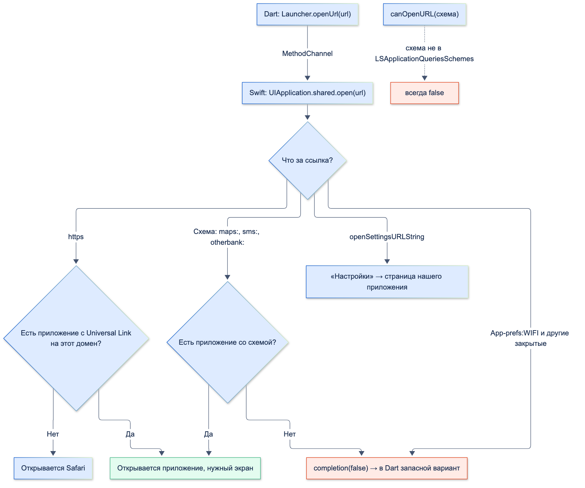
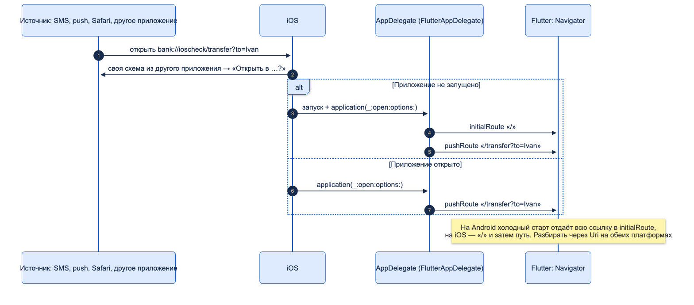
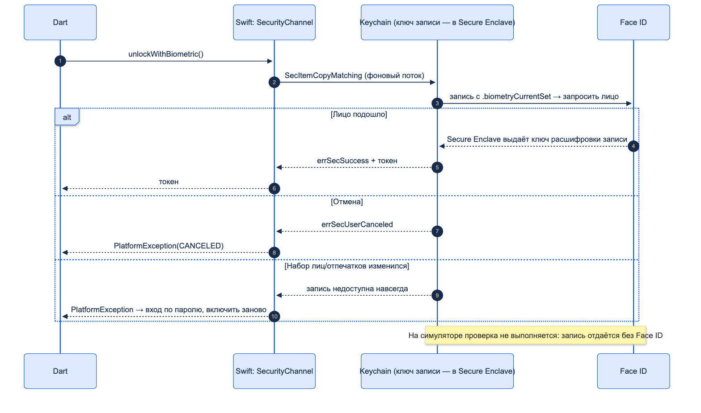
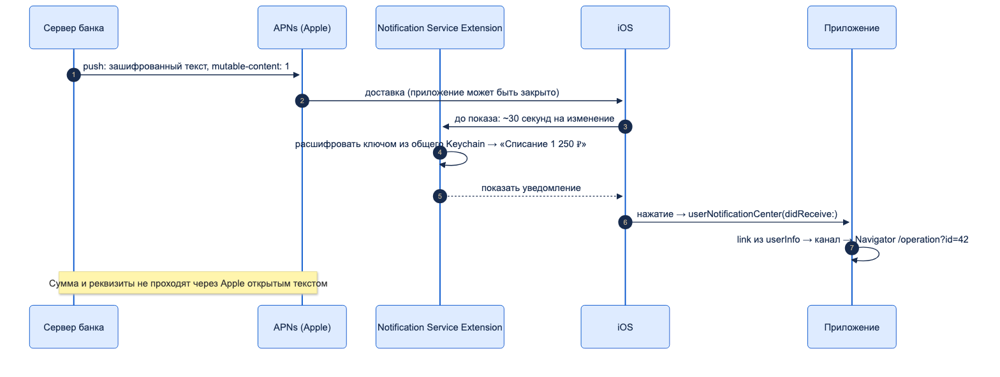

# Нативные API iOS

| Грейд | Время на изучение | Статус |
|-------|-------------------|--------|
| ⭐⭐ | ~90 мин лекция + практика на симуляторе | ✅ Готово |

---

## 📚 Ресурсы

| Ресурс | Формат | Язык | Уровень | Зачем читать |
|--------|--------|------|---------|--------------|
| [Deeplink-и во Flutter: динамические ссылки и app_links](https://habr.com/ru/articles/988262/) | Статья (Habr) | 🇷🇺 | ⭐⭐ | Universal Links и App Links во Flutter, настройка `apple-app-site-association`, замена Firebase Dynamic Links |
| [Теория Universal Links](https://habr.com/ru/articles/423315/) | Статья (Habr) | 🇷🇺 | ⭐⭐ | Как iOS проверяет домен и решает, открыть приложение или сайт |
| [Фоновое выполнение приложений в iOS 13](https://habr.com/ru/post/466857/) | Статья (Habr) | 🇷🇺 | ⭐⭐ | `BGTaskScheduler`: обновление и обработка в фоне, отладка через LLDB |
| [Flutter: Deep linking](https://docs.flutter.dev/ui/navigation/deep-linking) | Документация | 🇬🇧 | ⭐⭐ | Как Flutter передаёт ссылку в Navigator на iOS и Android |
| [Flutter: Migrating to UISceneDelegate](https://docs.flutter.dev/release/breaking-changes/uiscenedelegate) | Документация | 🇬🇧 | ⭐⭐ | Где регистрировать свои каналы после перехода на UIScene (Flutter 3.41+) |
| [Supporting associated domains](https://developer.apple.com/documentation/xcode/supporting-associated-domains) | Документация | 🇬🇧 | ⭐⭐ | Universal Links: entitlement, файл на сервере, режим разработчика |
| [Accessing keychain items with Face ID or Touch ID](https://developer.apple.com/documentation/localauthentication/accessing-keychain-items-with-face-id-or-touch-id) | Документация | 🇬🇧 | ⭐⭐⭐ | Face ID, привязанный к записи Keychain, — пример Apple |
| [Protecting keys with the Secure Enclave](https://developer.apple.com/documentation/security/protecting-keys-with-the-secure-enclave) | Документация | 🇬🇧 | ⭐⭐⭐ | Ключи в отдельном чипе: что можно и что нельзя |
| [Establishing your app’s integrity (App Attest)](https://developer.apple.com/documentation/devicecheck/establishing-your-app-s-integrity) | Документация | 🇬🇧 | ⭐⭐⭐ | Проверка подлинности приложения на сервере — аналог Play Integrity |
| [Modifying content in newly delivered notifications](https://developer.apple.com/documentation/usernotifications/modifying-content-in-newly-delivered-notifications) | Документация | 🇬🇧 | ⭐⭐⭐ | Notification Service Extension: расшифровать push до показа |
| [Using background tasks to update your app](https://developer.apple.com/documentation/uikit/using-background-tasks-to-update-your-app) | Документация | 🇬🇧 | ⭐⭐ | `BGTaskScheduler` от Apple |

---

## 🎓 Лекция

> ℹ️ **Важно:** страница построена зеркально «Нативным API Android» — те же разделы в том же порядке, чтобы
> сравнивать платформы. Жизненный цикл, разрешения и UIScene — в «Различиях Android / iOS», Xcode и `Info.plist` —
> в «Базовой настройке нативных проектов», каналы — в «Platform Channels», язык — в «Swift».
> Весь код собран (Flutter 3.38.5, Xcode 26.5, минимальная iOS 13.0) и запущен на симуляторах iOS 26.5 и iOS 18.
> Что симулятор проверить не может, отмечено отдельно (раздел 13).

### 1. Карта: задача → API iOS → пакет

| Задача | API iOS | Готовый пакет | Когда писать своё | На Android |
|--------|---------|---------------|-------------------|------------|
| Открыть настройки, другое приложение, почту, карты | `UIApplication.open`, URL-схемы | `url_launcher`, `app_settings` | Почти всегда: 5–20 строк Swift | `Intent`, `Settings.ACTION_*` |
| Принять ссылку в приложение | URL Types, Universal Links | `app_links` | Обычно не нужно: Flutter умеет сам | `intent-filter`, App Links |
| Выбрать контакт, фото, файл | `CNContactPickerViewController`, `PHPickerViewController`, `UIDocumentPickerViewController` | `flutter_contacts`, `image_picker`, `file_picker` | Один системный экран без разрешений | Activity Result API |
| Хранить секреты | Keychain | `flutter_secure_storage` | Особые условия доступа, общая группа с расширениями | Keystore |
| Вход по Face ID | Keychain + `SecAccessControl` | `local_auth` | **Банку — да:** `local_auth` даёт только «да/нет» | `BiometricPrompt` + `CryptoObject` |
| Код из SMS | Подсказка над клавиатурой (`oneTimeCode`) | — | Не нужно: `AutofillHints.oneTimeCode` во Flutter | SMS User Consent |
| Фоновая работа | `BGTaskScheduler`, фоновый `URLSession` | `workmanager` | Если работа на Swift | WorkManager |
| Уведомления | `UNUserNotificationCenter`, APNs | `flutter_local_notifications`, `firebase_messaging` | Расшифровка push — только своё расширение | `NotificationManager`, FCM |
| Поделиться файлом | `UIActivityViewController` | `share_plus` | Контроль, куда ушёл файл | `FileProvider` + `ACTION_SEND` |
| Проверка устройства | App Attest, DeviceCheck | — | Всегда в связке с сервером | Play Integrity |

### 2. Где писать свой нативный код

Без плагина — в `AppDelegate`. Свои каналы регистрируются через `registrar(forPlugin:)`: он даёт messenger движка
уже в `didFinishLaunchingWithOptions`, когда `FlutterViewController` может ещё не существовать.

```swift
import BackgroundTasks
import Flutter
import UIKit

@main
@objc class AppDelegate: FlutterAppDelegate {
  private var launcher: LauncherChannel?
  private var security: SecurityChannel?
  private var notifications: NotificationsChannel?

  override func application(
    _ application: UIApplication,
    didFinishLaunchingWithOptions launchOptions: [UIApplication.LaunchOptionsKey: Any]?
  ) -> Bool {
    GeneratedPluginRegistrant.register(with: self)

    // Свои каналы без плагина. registrar(forPlugin:) даёт messenger движка уже здесь,
    // когда FlutterViewController ещё может не существовать
    let messenger = registrar(forPlugin: "BankChannels")!.messenger()
    launcher = LauncherChannel(messenger: messenger)
    security = SecurityChannel(messenger: messenger)
    notifications = NotificationsChannel(messenger: messenger)

    // Фоновые задачи регистрируют до конца запуска приложения, иначе — исключение
    RatesSync.register()
    return super.application(application, didFinishLaunchingWithOptions: launchOptions)
  }

  override func applicationDidEnterBackground(_ application: UIApplication) {
    RatesSync.schedule() // планируем при уходе в фон
    super.applicationDidEnterBackground(application)
  }
}

/// Верхний экран приложения: от него показывают системные окна (выбор контакта, «Поделиться»)
func topViewController() -> UIViewController? {
  let window = UIApplication.shared.connectedScenes
    .compactMap { $0 as? UIWindowScene }
    .flatMap { $0.windows }
    .first { $0.isKeyWindow } // UIWindowScene.keyWindow — только с iOS 15
  var top = window?.rootViewController
  while let presented = top?.presentedViewController { top = presented }
  return top
}
```

**После перехода на UIScene** (по умолчанию с Flutter 3.41) Flutter рекомендует регистрировать каналы
в `didInitializeImplicitFlutterEngine` — по документации Flutter:

```swift
func didInitializeImplicitFlutterEngine(_ engineBridge: FlutterImplicitEngineBridge) {
  GeneratedPluginRegistrant.register(with: engineBridge.pluginRegistry)
  let messenger = engineBridge.applicationRegistrar.messenger()
  // каналы — как выше
}
```

Старый способ `window?.rootViewController as! FlutterViewController` в `didFinishLaunchingWithOptions` с UIScene
**падает**: окна там ещё нет.

| | iOS | Android |
|---|---|---|
| Где | `AppDelegate` | `MainActivity` |
| Что нужно для системных окон | Верхний `UIViewController` (`topViewController()`) | `FragmentActivity` |
| Особый базовый класс для биометрии | Не нужен | `FlutterFragmentActivity` |
| Результат системного экрана | Делегат (`CNContactPickerDelegate`) | Activity Result API |

**Минимальная версия iOS.** Шаблон Flutter задаёт iOS 13.0, поэтому всё новое — под `#available`. Проверено при
сборке: `Logger` (iOS 14), `.banner` у уведомлений (iOS 14), `UIWindowScene.keyWindow` (iOS 15) не компилируются
без проверки. Это аналог `Build.VERSION.SDK_INT` на Android.

### 3. URL-схемы: как iOS открывает другие приложения

На iOS нет Intent и нельзя открыть приложение по идентификатору (как `getLaunchIntentForPackage`). Есть только
**ссылки**:

| Вид | Пример | Кто откроет |
|-----|--------|-------------|
| Схема приложения | `otherbank://pay`, `comgooglemaps://` | Приложение, объявившее схему в `CFBundleURLTypes`. Объявить может любое — схему можно перехватить |
| Universal Link | `https://bank.example.ru/app/…` | Приложение, привязанное к домену; нет приложения — Safari |
| Системные | `tel:`, `sms:`, `mailto:`, `maps:` | Телефон, «Сообщения», почта по умолчанию, Карты |
| Настройки | `UIApplication.openSettingsURLString` | «Настройки» → страница **нашего** приложения |



**`canOpenURL` и `LSApplicationQueriesSchemes`** — аналог `<queries>`. Проверить, установлено ли приложение
со схемой, можно, только если схема перечислена в `Info.plist` (до 50 схем). Иначе — всегда `false`.
Сам `open` работает и без объявления.

```xml
<key>LSApplicationQueriesSchemes</key>
<array>
    <string>comgooglemaps</string>
    <string>otherbank</string>
</array>
```

### 4. Открыть другое приложение, нужный экран, настройки ОС — без пакетов

**Dart: `lib/platform/launcher.dart`.**

```dart
import 'package:flutter/services.dart';

/// Открыть настройки, другое приложение, App Store — без сторонних пакетов
abstract final class Launcher {
  static const _channel = MethodChannel('ru.bank/launcher');

  /// Настройки нашего приложения: разрешения, уведомления, Face ID
  static Future<bool> openAppSettings() async => await _channel.invokeMethod<bool>('openAppSettings') ?? false;

  /// Уведомления нашего приложения (iOS 16+; на старых — настройки приложения)
  static Future<bool> openNotificationSettings() async =>
      await _channel.invokeMethod<bool>('openNotificationSettings') ?? false;

  /// Открыть ссылку: схема другого приложения, https, tel:, mailto:, maps:
  static Future<bool> openUrl(Uri url) async => await _channel.invokeMethod<bool>('openUrl', {'url': '$url'}) ?? false;

  /// Для чужих схем — только если схема есть в LSApplicationQueriesSchemes
  static Future<bool> canOpenUrl(Uri url) async =>
      await _channel.invokeMethod<bool>('canOpenUrl', {'url': '$url'}) ?? false;

  /// Страница приложения в App Store — окном поверх нашего приложения.
  /// Окно может не ответить (нет сети, нет App Store) — тогда открываем ссылку на магазин
  static Future<bool> showStorePage(String appId) async {
    final shown = await _channel
        .invokeMethod<bool>('showStorePage', {'appId': appId})
        .timeout(const Duration(seconds: 5), onTimeout: () => false);
    return shown == true || await openUrl(Uri.parse('https://apps.apple.com/app/id$appId'));
  }
}
```

**Swift: `LauncherChannel.swift`** (часть про открытие; контакт, «Поделиться» и буфер обмена — ниже).

```swift
import ContactsUI
import Flutter
import StoreKit
import UIKit

final class LauncherChannel: NSObject {
  private var pendingContact: FlutterResult?

  init(messenger: FlutterBinaryMessenger) {
    super.init()
    FlutterMethodChannel(name: "ru.bank/launcher", binaryMessenger: messenger).setMethodCallHandler { [weak self] call, result in
      guard let self else { return }
      let args = call.arguments as? [String: Any] ?? [:]
      switch call.method {
      case "openAppSettings":
        // Единственный официальный экран Настроек — настройки нашего приложения
        self.open(UIApplication.openSettingsURLString, result)
      case "openNotificationSettings":
        if #available(iOS 16.0, *) {
          self.open(UIApplication.openNotificationSettingsURLString, result)
        } else {
          self.open(UIApplication.openSettingsURLString, result)
        }
      case "openUrl":
        self.open(args["url"] as! String, result)
      case "canOpenUrl":
        // Для чужих схем работает, только если схема есть в LSApplicationQueriesSchemes
        result(URL(string: args["url"] as! String).map { UIApplication.shared.canOpenURL($0) } ?? false)
      case "showStorePage":
        self.showStorePage(appId: args["appId"] as! String, result)
      default:
        result(FlutterMethodNotImplemented)
      }
    }
  }

  // open — асинхронный: completion сообщает, открылось ли. Ответ в Dart — из него
  private func open(_ string: String, _ result: @escaping FlutterResult) {
    guard let url = URL(string: string) else { return result(false) }
    UIApplication.shared.open(url, options: [:]) { opened in result(opened) }
  }

  private func showStorePage(appId: String, _ result: @escaping FlutterResult) {
    guard let top = topViewController() else { return result(false) }
    let store = SKStoreProductViewController()
    // Сначала загрузить, потом показать: иначе при ошибке пользователь увидит пустое окно.
    // На симуляторе App Store нет — completion не вызывается вовсе, поэтому в Dart стоит тайм-аут
    store.loadProduct(withParameters: [SKStoreProductParameterITunesItemIdentifier: appId]) { loaded, _ in
      if loaded { top.present(store, animated: true) }
      result(loaded)
    }
  }
}
```

**Вызовы из Dart.**

```dart
// Маршрут пешком — сразу в Картах Apple
await Launcher.openUrl(Uri.parse('maps://?daddr=55.7539,37.6208&dirflg=w'));

// Google Карты, если установлены (схема в LSApplicationQueriesSchemes), иначе — сайт
final opened = await Launcher.openUrl(Uri.parse('comgooglemaps://?daddr=55.7539,37.6208&directionsmode=walking')) ||
    await Launcher.openUrl(Uri.parse('https://www.google.com/maps/dir/?api=1&destination=55.7539,37.6208'));

// Новое SMS на номер поддержки
await Launcher.openUrl(Uri.parse('sms:+78001234567'));
```

**Что открылось на симуляторе** (журнал системы, `simctl spawn … log show`):

| Вызов | Результат |
|-------|-----------|
| `openAppSettings()` | iOS 18: «Настройки» → «Приложения» → страница приложения ✅. iOS 26.5: ссылка `app-prefs:ru.bank.ioscheck` дошла до «Настроек» (видно в журнале), но экран остался на корне — особенность симулятора этой версии |
| `openNotificationSettings()` | На обоих симуляторах — корень «Настроек», даже после разрешения уведомлений. Проверять на устройстве |
| `openUrl(App-prefs:WIFI)` | `false` — закрытые схемы «Настроек» заблокированы |
| `openUrl(maps://…)` | Карты Apple получили ссылку (`UIOpenURLAction`); при первом запуске — приветственные экраны |
| `comgooglemaps://` → сайт | Google Карт нет → `false` → открылся Safari с маршрутом |
| `canOpenUrl(comgooglemaps://)` | `false` — схема объявлена, но приложение не установлено |
| `canOpenUrl(tinkoffbank://)` | `false` — схема не объявлена в `LSApplicationQueriesSchemes` |
| `openUrl(otherbank://…)` | `false` — приложения нет, нужен запасной вариант |
| `openUrl(sms:…)` | «Сообщения», новое сообщение с номером |
| `openUrl(mailto:…)`, `openUrl(tel:…)` | `false` — на симуляторе нет «Почты» и звонков. На iPhone откроются |
| `showStorePage(…)` | Окно App Store не ответило (на симуляторе нет App Store) → через 5 с тайм-аут → открыта ссылка `apps.apple.com` |
| `openUrl(https://apps.apple.com/…)` | Открыта страница магазина |

**Как открыть конкретный экран другого приложения.** Как и на Android, решает приложение, которое открывают:
доступны только экраны, для которых оно опубликовало схему или Universal Link.

| Способ | Пример | Надёжность |
|--------|--------|------------|
| Системные ссылки | `tel:`, `sms:`, `mailto:`, `maps://?daddr=` | Высокая |
| Документированные ссылки приложения | `comgooglemaps://?daddr=`, `https://apps.apple.com/app/id…` | Высокая: формат публичный |
| Схема или Universal Link другого приложения | `otherbank://pay?…` — по договорённости с партнёром | Средняя |
| Экраны «Настроек» кроме своего | `App-prefs:WIFI`, `prefs:root=…` | **Нет:** закрыто, в iOS 18+ не работает, риск отказа в App Store |
| Свои настройки | `openSettingsURLString`, `openNotificationSettingsURLString` (iOS 16+) | Высокая |

**Отличие от Android:** открыть экран Wi-Fi, NFC или безопасности **нельзя**. Можно только свою страницу
в «Настройках», и в ней будут лишь те пункты, которые относятся к приложению: разрешения, уведомления,
обновление контента. Пользователю, у которого выключен интернет, показывают текст «Включите Wi-Fi или
сотовые данные», а не кнопку.

**Окно App Store внутри приложения** (`SKStoreProductViewController`) — пользователь не уходит из банка.
Ловушка, найденная при проверке: если App Store недоступен, `loadProduct` может не вызвать completion **никогда**,
и `Future` в Dart зависнет. Поэтому — сначала загрузка, потом показ, а в Dart тайм-аут и ссылка как запасной вариант.

### 5. Входящие ссылки: открыть **наше** приложение на нужном экране

**Своя схема** — в `Info.plist`:

```xml
<key>CFBundleURLTypes</key>
<array>
    <dict>
        <key>CFBundleURLName</key>
        <string>ru.bank.ioscheck</string>
        <key>CFBundleURLSchemes</key>
        <array>
            <string>bank</string>
        </array>
    </dict>
</array>
```

**Universal Link** — три части:

1. Capability **Associated Domains** в Xcode → в `Runner.entitlements` строка `applinks:bank.example.ru`.
2. Файл `https://bank.example.ru/.well-known/apple-app-site-association` (без расширения, `application/json`,
   без редиректов):

```json
{
  "applinks": {
    "details": [
      {
        "appIDs": ["TEAMID.ru.bank.ioscheck"],
        "components": [{ "/": "/app/*", "comment": "Только пути приложения, не весь сайт" }]
      }
    ]
  }
}
```

3. Apple скачивает файл через свой CDN при установке приложения и периодически обновляет. Для разработки —
   `applinks:bank.example.ru?mode=developer`, тогда устройство берёт файл напрямую.

| | Своя схема `bank://` | Universal Link `https://` |
|---|---|---|
| Перехват другим приложением | Возможен | Нет: домен подтверждён файлом |
| Из другого приложения или Safari | iOS спрашивает «Открыть в …?» (проверено) | Открывается сразу |
| Нет приложения | Ошибка | Открывается сайт |
| Для банка | Внутренние переходы (уведомления, виджеты) | Ссылки из SMS, писем, с сайта |

**Flutter передаёт ссылку сам** (`FlutterDeepLinkingEnabled` в `Info.plist` по умолчанию включён). Код маршрутов —
тот же, что на Android:

```dart
onGenerateRoute: (settings) {
  final uri = Uri.parse(settings.name ?? '/');
  final page = switch (uri.path) {
    '/transfer' => Scaffold(body: Center(child: Text('Перевод: ${uri.queryParameters['to']}, ${uri.queryParameters['amount']}'))),
    '/operation' => Scaffold(body: Center(child: Text('Операция ${uri.queryParameters['id']}'))),
    _ => const HomeScreen(),
  };
  return MaterialPageRoute(builder: (_) => page, settings: settings);
},
```



Проверка: `xcrun simctl openurl <симулятор> "bank://ioscheck/transfer?to=Ivan&amount=500"`.

```console
приложение открыто:   route /transfer?to=Ivan&amount=500
холодный старт:       route /
                      route /transfer?to=Ivan&amount=500
```

**Сравнение с Android:** на Android при холодном старте пришла **вся ссылка** одним маршрутом
(`bank://andcheck/transfer?…`), на iOS — сначала `/`, затем путь. Код, который разбирает `Uri.parse(name).path`,
работает на обеих платформах.

### 6. Системные экраны с результатом

Аналог Activity Result — **делегат**: системный экран сообщает о выборе через методы протокола. Ответ в Dart
отдаём из делегата — сохраняем `result`.

```swift
// Выбор контакта: разрешение на доступ к Контактам не нужно, приложение получает только выбранное
private func pickPhone(_ result: @escaping FlutterResult) {
  guard pendingContact == nil else { return result(FlutterError(code: "BUSY", message: "Выбор уже открыт", details: nil)) }
  guard let top = topViewController() else { return result(nil) }
  pendingContact = result
  let picker = CNContactPickerViewController()
  picker.delegate = self
  picker.displayedPropertyKeys = [CNContactPhoneNumbersKey]
  picker.predicateForSelectionOfProperty = NSPredicate(format: "key == 'phoneNumbers'")
  top.present(picker, animated: true)
}

extension LauncherChannel: CNContactPickerDelegate {
  func contactPicker(_ picker: CNContactPickerViewController, didSelect contactProperty: CNContactProperty) {
    pendingContact?((contactProperty.value as? CNPhoneNumber)?.stringValue)
    pendingContact = nil
  }

  func contactPickerDidCancel(_ picker: CNContactPickerViewController) {
    pendingContact?(nil)
    pendingContact = nil
  }
}
```

Проверено: окно Контактов открылось с плашкой «Private Access to Contacts — приложение получит только выбранные
контакты», выбран тестовый контакт → в Dart пришло `(555) 564-8583`. Так же без разрешений работают
`PHPickerViewController` (фото) и `UIDocumentPickerViewController` (файлы).

### 7. Системные сервисы и версии iOS

| API | Для чего в банке | На Android |
|-----|------------------|------------|
| `NWPathMonitor` (Network) | Есть ли сеть, Wi-Fi или сотовая | `ConnectivityManager` |
| `UIPasteboard` | Копировать реквизиты с ограничениями | `ClipboardManager` |
| `LAContext` | Есть ли Face ID / Touch ID, установлен ли код-пароль | `BiometricManager`, `KeyguardManager` |
| `UIScreen.isCaptured`, `userDidTakeScreenshotNotification` | Запись экрана, скриншот (тема «Platform Channels») | `ScreenCaptureCallback` |
| `UIDevice` | Модель, версия iOS для антифрода | `Build` |

**Буфер обмена.** Можно ограничить скопированное этим устройством (не уйдёт в «Универсальный буфер обмена»
на Mac и iPad) и временем жизни:

```swift
// Только на этом устройстве (не уйдёт в «Универсальный буфер» на Mac) и исчезнет через 60 секунд
UIPasteboard.general.setItems(
  [[UIPasteboard.typeAutomatic: args["text"] as! String]],
  options: [.localOnly: true, .expirationDate: Date().addingTimeInterval(60)])
```

С iOS 16 **чтение** буфера приложением показывает пользователю запрос «Разрешить вставку?». Не читайте буфер
при запуске «на всякий случай» — пользователь увидит запрос без причины.

**Папки приложения.** `Directory.systemTemp` во Flutter на iOS — это папка `tmp` приложения (проверено), а не
`code_cache`, как на Android. Ею можно делиться напрямую (раздел 12).

### 8. Keychain и Secure Enclave

**Keychain** — системное зашифрованное хранилище паролей и ключей. Запись описывается словарём атрибутов:

```swift
private func save(_ key: String, _ value: String) -> Int {
  let query: [String: Any] = [kSecClass as String: kSecClassGenericPassword,
                              kSecAttrService as String: service,
                              kSecAttrAccount as String: key]
  SecItemDelete(query as CFDictionary) // перезапись: удалить старое
  var item = query
  item[kSecValueData as String] = Data(value.utf8)
  // Доступна, только когда телефон разблокирован; не попадает в iCloud и на другое устройство
  item[kSecAttrAccessible as String] = kSecAttrAccessibleWhenUnlockedThisDeviceOnly
  return Int(SecItemAdd(item as CFDictionary, nil)) // 0 = errSecSuccess
}

private func read(_ key: String) -> String? {
  let query: [String: Any] = [kSecClass as String: kSecClassGenericPassword,
                              kSecAttrService as String: service,
                              kSecAttrAccount as String: key,
                              kSecReturnData as String: true]
  var data: AnyObject?
  guard SecItemCopyMatching(query as CFDictionary, &data) == errSecSuccess, let data = data as? Data else { return nil }
  return String(decoding: data, as: UTF8.self)
}
```

**Классы доступа** (`kSecAttrAccessible`):

| Значение | Когда запись доступна | Для банка |
|----------|-----------------------|-----------|
| `WhenUnlockedThisDeviceOnly` | Телефон разблокирован; не переносится на другое устройство | Токены, ключи — **по умолчанию** |
| `AfterFirstUnlockThisDeviceOnly` | После первой разблокировки после перезагрузки | Нужна фоновым задачам и расширениям |
| `WhenPasscodeSetThisDeviceOnly` | Только если установлен код-пароль; снят код — запись удаляется | Ключи входа по биометрии |
| Без `ThisDeviceOnly` | Переносится в резервной копии на новый iPhone | Не для секретов банка |

**Ловушка: Keychain переживает удаление приложения.** Проверено: сохранили токен → удалили приложение →
установили заново → `kcRead → refresh-token-abc`. Новый пользователь на том же телефоне получит чужой токен.
Решение — флаг первого запуска в `UserDefaults` (он удаляется вместе с приложением): нет флага — очистить
свои записи Keychain.

**Группы доступа** (`kSecAttrAccessGroup`) — общая запись приложения и его расширений (виджет, Notification
Service Extension, раздел 11). Задаётся capability Keychain Sharing.

**Secure Enclave** — отдельный чип с собственной ОС. Ключ создаётся внутри и не выходит наружу; приложение
получает зашифрованную «ручку» (`dataRepresentation`), которую можно сохранить.

```swift
private func secureEnclaveInfo() -> [String: Any] {
  guard SecureEnclave.isAvailable else { return ["available": false] }
  do {
    let key = try SecureEnclave.P256.Signing.PrivateKey() // асимметричный ключ P-256
    let signature = try key.signature(for: Data("перевод 500".utf8))
    return ["available": true,
            "publicKeyBytes": key.publicKey.rawRepresentation.count,
            "valid": key.publicKey.isValidSignature(signature, for: Data("перевод 500".utf8)),
            "blobBytes": key.dataRepresentation.count] // зашифрованная «ручка», а не сам ключ
  } catch {
    return ["available": true, "error": "\(error)"]
  }
}
```

```console
enclave → {valid: true, available: true, publicKeyBytes: 64, blobBytes: 143}
```

| | Secure Enclave (iOS) | Keystore (Android) |
|---|---|---|
| Ключи | Асимметричные P-256 (подпись, согласование ключей) | AES, RSA, EC |
| Зашифровать данные напрямую | Нет: через согласование ключей (ECDH) или запись Keychain | Да: AES-GCM ключом Keystore |
| Типовое применение в банке | Подписать операцию, чтобы сервер проверил устройство | Шифровать локальные данные |

На симуляторе на Mac с Apple Silicon `SecureEnclave.isAvailable` вернул `true`, подпись проверилась.

### 9. Face ID / Touch ID с привязкой к Keychain

Два способа — как на Android:

| | Только `LAContext.evaluatePolicy` | Запись Keychain с `SecAccessControl` |
|---|---|---|
| Как | `evaluatePolicy` → `true` → «пустить» | Токен лежит в Keychain; Secure Enclave отдаёт ключ записи **только после Face ID** |
| Взлом приложения (Frida, патч) | Подменить `true` — и пустило | Подмена ничего не даёт: запись не расшифровать |
| `local_auth` | Так и работает | Не поддерживает |
| На Android | `BiometricPrompt` без `CryptoObject` | `BiometricPrompt` + `CryptoObject` |



```swift
// Запись читается только после Face ID текущего набора лиц/отпечатков. Изменили набор — запись недоступна навсегда
private func enableBiometric(token: String) -> Int {
  var error: Unmanaged<CFError>?
  guard let access = SecAccessControlCreateWithFlags(
    nil, kSecAttrAccessibleWhenPasscodeSetThisDeviceOnly, .biometryCurrentSet, &error)
  else { return -1 }
  let base: [String: Any] = [kSecClass as String: kSecClassGenericPassword,
                             kSecAttrService as String: service,
                             kSecAttrAccount as String: "biometric_token"]
  SecItemDelete(base as CFDictionary)
  var item = base
  item[kSecValueData as String] = Data(token.utf8)
  item[kSecAttrAccessControl as String] = access
  return Int(SecItemAdd(item as CFDictionary, nil))
}

private func unlockWithBiometric(_ result: @escaping FlutterResult) {
  let context = LAContext()
  context.localizedReason = "Вход в банк" // текст под Face ID; для Touch ID — подпись в диалоге
  context.localizedCancelTitle = "Ввести код"
  let query: [String: Any] = [kSecClass as String: kSecClassGenericPassword,
                              kSecAttrService as String: service,
                              kSecAttrAccount as String: "biometric_token",
                              kSecReturnData as String: true,
                              kSecUseAuthenticationContext as String: context]
  // SecItemCopyMatching ждёт, пока пользователь посмотрит в камеру: только не на главном потоке
  DispatchQueue.global(qos: .userInitiated).async {
    var data: AnyObject?
    let status = SecItemCopyMatching(query as CFDictionary, &data)
    DispatchQueue.main.async {
      switch status {
      case errSecSuccess: result(String(decoding: data as! Data, as: UTF8.self))
      case errSecUserCanceled: result(FlutterError(code: "CANCELED", message: "Отмена", details: nil))
      case errSecItemNotFound: result(FlutterError(code: "NOT_ENABLED", message: "Нет записи или набор биометрии изменился", details: nil))
      default: result(FlutterError(code: "KEYCHAIN_\(status)", message: SecCopyErrorMessageString(status, nil) as String?, details: nil))
      }
    }
  }
}
```

| Флаг `SecAccessControl` | Что значит |
|-------------------------|-----------|
| `.biometryCurrentSet` | Только текущий набор лиц/отпечатков. Добавили лицо или палец — запись недоступна (аналог `KEY_INVALIDATED`). **Банку — этот** |
| `.biometryAny` | Любое лицо/палец, в том числе добавленные позже |
| `.userPresence` | Биометрия **или** код-пароль телефона |

`Info.plist` обязан содержать `NSFaceIDUsageDescription` — без него приложение с Face ID падает при первом запросе.

**Что проверено на симуляторе** (Face ID включается командой
`xcrun simctl spawn <id> notifyutil -s com.apple.BiometricKit.enrollmentChanged 1` и `… -p com.apple.BiometricKit.enrollmentChanged`,
лицо — `notifyutil -p com.apple.BiometricKit_Sim.pearl.match` / `pearl.nomatch`):

```console
bioStatus  → notEnrolled → (включили Face ID) → faceId
faceIdOnly → «Face Not Recognized» → Cancel → error -2 (LAError.userCancel)
faceIdOnly → pearl.match → ok
bioEnable  → 0 (errSecSuccess)
bioUnlock  → refresh-token-123      ⚠️ без запроса Face ID
```

> ⚠️ **На симуляторе ограничение биометрии у записи Keychain не применяется**: запись отдаётся без Face ID.
> Это известное поведение (форум Apple, OWASP MASTG): на симуляторе нет Secure Enclave, который проверяет
> лицо. Поэтому вход через Keychain, отмену и смену набора лиц проверяют **только на iPhone**.

### 10. Фоновая работа

На iOS нет WorkManager. Приложение после ухода в фон через несколько секунд **замораживается**, и код
не выполняется до возвращения. Инструменты:

| Задача | Инструмент | Сколько времени |
|--------|------------|-----------------|
| Закончить начатое при сворачивании (отправить платёж) | `beginBackgroundTask` | Около 30 секунд |
| Обновлять данные к открытию (курсы, баланс) | `BGAppRefreshTask` | ~30 с; когда — решает iOS по привычкам пользователя |
| Тяжёлая работа (чистка базы, загрузка выписок) | `BGProcessingTask` | Минуты, обычно на зарядке |
| Загрузка или выгрузка большого файла | Фоновый `URLSession` | Система качает сама, даже если приложение выгружено |
| Сервер сообщает «есть новые данные» | Тихий push (`content-available`) | Не гарантирован, ограничен системой |

```swift
// Фоновое обновление: iOS сама решает, когда запустить — по привычкам пользователя, заряду, сети.
// Идентификатор должен быть в Info.plist → BGTaskSchedulerPermittedIdentifiers
enum RatesSync {
  static let id = "ru.bank.ioscheck.rates"

  static func register() {
    BGTaskScheduler.shared.register(forTaskWithIdentifier: id, using: nil) { task in
      schedule() // следующий запуск планируют сами — периодических задач нет
      NSLog("RatesSync: синхронизация курсов валют")
      task.expirationHandler = { NSLog("RatesSync: время вышло") } // ~30 секунд, потом приложение заморозят
      task.setTaskCompleted(success: true)
    }
  }

  static func schedule() {
    let request = BGAppRefreshTaskRequest(identifier: id)
    request.earliestBeginDate = Date(timeIntervalSinceNow: 6 * 60 * 60) // не раньше чем через 6 часов
    do {
      try BGTaskScheduler.shared.submit(request)
      NSLog("RatesSync: запланировано")
    } catch {
      NSLog("RatesSync: не запланировано: %@", "\(error)")
    }
  }
}
```

В `Info.plist`: `BGTaskSchedulerPermittedIdentifiers` с идентификатором и `UIBackgroundModes` → `fetch`
(для `BGProcessingTask` — `processing`). После этого в «Настройках» у приложения появляется переключатель
«Обновление контента» — проверено на iOS 18.

**Проверка.** На симуляторе `submit` возвращает `BGTaskSchedulerErrorDomain Code=1` (`unavailable`) — проверено;
планировщика там нет. На iPhone задачу запускают из Xcode: пауза в отладчике и команда

```console
e -l objc -- (void)[[BGTaskScheduler sharedScheduler] _simulateLaunchForTaskWithIdentifier:@"ru.bank.ioscheck.rates"]
```

**Dart в фоне** — как на Android: нужен отдельный движок (пакет `workmanager`). Проще держать фоновую логику на Swift.

### 11. Уведомления

| | iOS | Android |
|---|---|---|
| Разрешение | Всегда нужно: `requestAuthorization` | С Android 13 |
| Без вопроса пользователю | `.provisional` — тихо в Центр уведомлений | — |
| Группы для пользователя | Категории (кнопки под уведомлением), настройки — на всё приложение | Каналы, каждый отдельно |
| Пробить «Не беспокоить» | `interruptionLevel = .timeSensitive` + capability Time Sensitive | `IMPORTANCE_HIGH` |
| Доставка push | APNs | FCM |

```swift
private func show(id: Int, title: String, text: String, _ result: @escaping FlutterResult) {
  let content = UNMutableNotificationContent()
  content.title = title
  content.body = text
  content.categoryIdentifier = "operation"
  content.userInfo = ["link": "bank://ioscheck/operation?id=\(id)"]
  if #available(iOS 15.0, *) { content.interruptionLevel = .timeSensitive } // пробивает «Не беспокоить» при разрешении
  let request = UNNotificationRequest(identifier: "op-\(id)", content: content,
                                      trigger: UNTimeIntervalNotificationTrigger(timeInterval: 1, repeats: false))
  UNUserNotificationCenter.current().add(request) { error in DispatchQueue.main.async { result(error == nil) } }
}

// Нажатие на уведомление (локальное или push): передаём ссылку в Dart
func userNotificationCenter(_ center: UNUserNotificationCenter, didReceive response: UNNotificationResponse,
                            withCompletionHandler completionHandler: @escaping () -> Void) {
  if let link = response.notification.request.content.userInfo["link"] as? String {
    channel.invokeMethod("open", arguments: link)
  }
  completionHandler()
}
```

```dart
void main() {
  WidgetsFlutterBinding.ensureInitialized();
  // Нажатие на уведомление → тот же разбор, что у входящей ссылки
  Notifications.onOpen((link) => navigatorKey.currentState?.pushNamed('${link.path}?${link.query}'));
  runApp(const BankApp());
}
```

Без метода делегата `willPresent` iOS **не показывает** уведомление, пока приложение открыто.

**Проверка push без сервера** — `xcrun simctl push <симулятор> ru.bank.ioscheck push.apns`:

```json
{
  "Simulator Target Bundle": "ru.bank.ioscheck",
  "aps": {
    "alert": { "title": "Зачисление 5 000 ₽", "body": "Перевод от Ивана" },
    "category": "operation",
    "interruption-level": "time-sensitive"
  },
  "link": "bank://ioscheck/operation?id=42"
}
```

Проверено: приложение свёрнуто → баннер «Зачисление 5 000 ₽» → нажатие → `route /operation?id=42`.

**Notification Service Extension** — банку важно: push проходит через серверы Apple. Чтобы сумма и реквизиты
не шли открытым текстом, сервер шифрует текст, а расширение расшифровывает его на телефоне до показа.



```swift
import CryptoKit
import UserNotifications

// Отдельная цель (target) «Notification Service Extension». iOS запускает её до показа push с "mutable-content": 1
class NotificationService: UNNotificationServiceExtension {
  private var handler: ((UNNotificationContent) -> Void)?
  private var content: UNMutableNotificationContent?

  override func didReceive(_ request: UNNotificationRequest, withContentHandler contentHandler: @escaping (UNNotificationContent) -> Void) {
    handler = contentHandler
    guard let content = request.content.mutableCopy() as? UNMutableNotificationContent else { return contentHandler(request.content) }
    self.content = content
    // Сервер прислал текст, зашифрованный AES-GCM; ключ лежит в общей группе Keychain приложения и расширения
    if let encrypted = content.userInfo["enc"] as? String,
       let data = Data(base64Encoded: encrypted),
       let key = Self.pushKey(),
       let box = try? AES.GCM.SealedBox(combined: data),
       let plain = try? AES.GCM.open(box, using: key) {
      content.body = String(decoding: plain, as: UTF8.self)
    } else {
      content.body = "Новая операция по счёту" // не смогли расшифровать — показываем нейтральный текст
    }
    contentHandler(content)
  }

  // ~30 секунд вышли: показать то, что есть, иначе iOS покажет исходный (зашифрованный) текст
  override func serviceExtensionTimeWillExpire() {
    if let handler, let content {
      content.body = "Новая операция по счёту"
      handler(content)
    }
  }

  private static func pushKey() -> SymmetricKey? {
    let query: [String: Any] = [kSecClass as String: kSecClassGenericPassword,
                                kSecAttrService as String: "ru.bank.push",
                                kSecAttrAccessGroup as String: "TEAMID.ru.bank.shared", // общая группа приложения и расширения
                                kSecReturnData as String: true]
    var data: AnyObject?
    guard SecItemCopyMatching(query as CFDictionary, &data) == errSecSuccess, let data = data as? Data else { return nil }
    return SymmetricKey(data: data)
  }
}
```

Класс проверен компиляцией; для работы нужна отдельная цель в Xcode (File → New → Target → Notification Service
Extension), общая группа Keychain у приложения и расширения и `"mutable-content": 1` в push. Запись ключа для
расширения — с классом доступа `AfterFirstUnlockThisDeviceOnly`: push приходит и на заблокированный телефон.

### 12. Банковские API

#### Код из SMS

API для чтения SMS на iOS **нет**. Есть подсказка над клавиатурой: iOS сама находит код в пришедшем SMS
и предлагает его подставить. Во Flutter достаточно подсказки автозаполнения — нативный код не нужен:

```dart
// Код из SMS: iOS сама предложит его над клавиатурой. Прочитать SMS приложение не может
const TextField(
  autofillHints: [AutofillHints.oneTimeCode],
  keyboardType: TextInputType.number,
  decoration: InputDecoration(labelText: 'Код из SMS'),
)
```

| | iOS: `oneTimeCode` | Android: SMS User Consent |
|---|---|---|
| Кто читает SMS | Система, приложение не видит текст | Пользователь разрешает отдать одно SMS приложению |
| Действие пользователя | Нажать подсказку над клавиатурой | Нажать «Разрешить» |
| Нужен натив | Нет | Да (раздел 12 темы Android) |
| Проверить на симуляторе | Нельзя: SMS не приходят | Можно: `adb emu sms send` |

Чтобы iOS надёжно нашла код, текст SMS должен содержать слово «код» рядом с числом. Формат
`@bank.example.ru #123456` в последней строке привязывает код к домену — подсказка покажется только на этом сайте
или в связанном с ним приложении.

#### App Attest и DeviceCheck — аналог Play Integrity

**App Attest** (iOS 14+): приложение создаёт ключ в Secure Enclave, Apple подтверждает, что ключ создан
настоящим приложением из App Store на настоящем устройстве. Сервер банка проверяет подтверждение и затем
каждый важный запрос, подписанный этим ключом. **DeviceCheck** хранит у Apple 2 бита на устройство —
например, «на этом телефоне уже выдавали бонус».

Проверено: `DCAppAttestService.shared.isSupported` на симуляторе — `false`. Он бывает `false` и на части
устройств, поэтому решение «пускать ли» всегда на сервере, с запасным сценарием.

#### Поделиться выпиской

```swift
// Системное окно «Поделиться». Файл передаётся напрямую: FileProvider, как на Android, не нужен
private func share(path: String, _ result: @escaping FlutterResult) {
  guard let top = topViewController() else { return result(false) }
  let activity = UIActivityViewController(activityItems: [URL(fileURLWithPath: path)], applicationActivities: nil)
  activity.popoverPresentationController?.sourceView = top.view // на iPad без этого — падение
  activity.completionWithItemsHandler = { type, completed, _, _ in
    result(completed ? type?.rawValue : nil) // куда отправили или null — закрыли окно
  }
  top.present(activity, animated: true)
}
```

Почему без `FileProvider`: окно «Поделиться» работает в процессе, который получает от системы временный доступ
к переданному файлу. Проверено: файл из `Directory.systemTemp` (папка `tmp`) показан как «statement, PDF Document»,
выбрали «Копировать» → в Dart пришло `com.apple.UIKit.activity.CopyToPasteboard`. Ответ полезен для аудита:
куда пользователь отправил выписку.

### 13. Как проверять на симуляторе

| Команда | Что делает |
|---------|------------|
| `xcrun simctl openurl <id> "bank://ioscheck/transfer?to=Ivan"` | Открыть ссылку, как из Safari или другого приложения |
| `xcrun simctl push <id> <bundle id> push.apns` | Push без сервера |
| `xcrun simctl spawn <id> log show --last 1m --predicate 'process == "Runner"'` | Журнал приложения, в том числе `debugPrint` |
| `xcrun simctl spawn <id> notifyutil -p com.apple.BiometricKit_Sim.pearl.match` | Face ID: лицо подошло (`pearl.nomatch` — не подошло) |
| `xcrun simctl privacy <id> grant photos <bundle id>` | Выдать разрешение без диалога |
| `xcrun simctl uninstall` / `install` | Проверить, что остаётся в Keychain после удаления |

**Что на симуляторе не проверить:**

| Что | Почему |
|-----|--------|
| Face ID для записи Keychain | Ограничение не применяется — запись отдаётся без запроса |
| `BGTaskScheduler` | `unavailable` |
| App Attest | `isSupported = false` |
| Код из SMS, звонки, «Почта», App Store | Нет SMS, звонилки, «Почты», магазина |
| Universal Links с реальным доменом | Нужны подпись с командой и файл на сервере |

### ⚠️ Частые ошибки

- **Ждать, что можно открыть экран Wi-Fi или NFC** — на iOS доступна только своя страница в «Настройках».
- **`App-prefs:`, `prefs:root=`** — не работают в iOS 18+, риск отказа в App Store.
- **Схема не в `LSApplicationQueriesSchemes`** — `canOpenURL` всегда `false`.
- **Нет запасного варианта, если `open` вернул `false`** — кнопка «ничего не делает».
- **Ответ Dart зависит от системного окна без тайм-аута** — `SKStoreProductViewController` может не ответить никогда.
- **Сравнивать маршрут строкой** — на iOS холодный старт даёт `/`, затем путь; на Android — всю ссылку.
- **Своя схема для ссылок из SMS и писем** — перехватывается; нужен Universal Link.
- **`window?.rootViewController as! FlutterViewController` в `didFinishLaunching`** — с UIScene падение.
- **Новое API без `#available`** при минимальной iOS 13 — ошибка сборки или падение на старой iOS.
- **Face ID только через `evaluatePolicy`** — «успех» подменяется при взломе.
- **`.biometryAny` вместо `.biometryCurrentSet`** — добавленное чужое лицо получает доступ.
- **Проверять вход по Face ID только на симуляторе** — там ограничение Keychain не работает.
- **Не чистить Keychain при первом запуске** — после переустановки приложению достаются старые токены.
- **Секреты без `ThisDeviceOnly`** — переезжают в резервной копии на другой телефон.
- **`SecItemCopyMatching` с биометрией на главном потоке** — интерфейс замирает, пока ждёт лицо.
- **Нет `NSFaceIDUsageDescription`** — падение при первом запросе Face ID.
- **Сумма и реквизиты в push открытым текстом** — проходят через APNs; шифровать и расшифровывать в Notification Service Extension.
- **Нет `willPresent`** — уведомление не видно, пока приложение открыто.
- **Нет `sourceView` у окна «Поделиться»** — падение на iPad.
- **Чтение буфера обмена при запуске** — пользователь видит запрос «Разрешить вставку?» без причины.

### 🎤 На собеседовании: «Как сделать вход по Face ID, чтобы его нельзя было обойти взломом приложения?»

| Уровень | Как выглядит ответ |
|---------|--------------------|
| ⭐ Junior | `local_auth`: `authenticate()`, если `true` — пускаем |
| ⭐⭐ Middle | `true` от `evaluatePolicy` подменяется (Frida, патч бинарника). Правильно: токен лежит в Keychain с `SecAccessControl(.biometryCurrentSet)`, чтение через `SecItemCopyMatching` — Secure Enclave отдаёт ключ записи только после настоящего Face ID. На Android то же — `BiometricPrompt` с `CryptoObject` |
| ⭐⭐⭐ Senior | Всё из Middle, плюс: `.biometryCurrentSet` против `.biometryAny` (добавленное лицо), класс `WhenPasscodeSetThisDeviceOnly`, обработка недоступной записи → вход по паролю; токен из Keychain — не доступ, а ключ для запроса к серверу, сервер решает сам; подпись запросов ключом Secure Enclave и App Attest; очистка Keychain при первом запуске; проверка только на устройстве — на симуляторе ограничение не работает |

---

## ✅ Самопроверка

**⭐ Junior**
1. Как без сторонних пакетов открыть из Flutter настройки приложения на iOS?
2. Почему на iOS нельзя открыть экран Wi-Fi, как на Android?
3. Как во Flutter подставить код из SMS на iOS?

**⭐⭐ Middle**
1. Зачем `LSApplicationQueriesSchemes` и что будет без него?
2. Чем своя схема отличается от Universal Link? Что нужно на сервере?
3. Как Flutter передаёт входящую ссылку при холодном старте на iOS и на Android?
4. Как получить номер телефона из Контактов без разрешения?
5. Почему Keychain нужно чистить при первом запуске?
6. Где регистрировать свои каналы после перехода на UIScene?

**⭐⭐⭐ Senior**
1. Чем `evaluatePolicy` отличается от записи Keychain с `SecAccessControl`? Что выбрать банку?
2. Чем `.biometryCurrentSet` отличается от `.biometryAny` и `.userPresence`?
3. Что можно и чего нельзя проверить про Face ID на симуляторе?
4. Что умеет Secure Enclave и чем он отличается от Android Keystore?
5. Как обновлять данные в фоне на iOS? Почему нет аналога WorkManager?
6. Зачем банку Notification Service Extension?
7. Как App Attest помогает серверу доверять приложению?

<details>
<summary>Ответы</summary>

**Junior**
1. `MethodChannel` в `AppDelegate`, в Swift — `UIApplication.shared.open(URL(string: UIApplication.openSettingsURLString)!)`.
2. Apple даёт официальную ссылку только на страницу самого приложения. Закрытые схемы (`App-prefs:`) не работают
   в iOS 18+ и грозят отказом в App Store.
3. `TextField(autofillHints: [AutofillHints.oneTimeCode])` — iOS покажет код над клавиатурой. Прочитать SMS нельзя.

**Middle**
1. Список схем, наличие которых приложение проверяет `canOpenURL`. Без него `canOpenURL` для чужой схемы всегда
   `false`; сам `open` работает.
2. Схему может объявить любое приложение и перехватить; из другого приложения iOS спрашивает «Открыть в …?».
   Universal Link привязан к домену: entitlement `applinks:домен` и файл `/.well-known/apple-app-site-association`
   с `TEAMID.bundleId` и путями; нет приложения — открывается сайт.
3. iOS: `initialRoute` `/`, затем `pushRoute` с путём. Android: вся ссылка одним маршрутом. Разбирать через `Uri`.
4. `CNContactPickerViewController` с делегатом: система отдаёт только выбранную запись.
5. Записи Keychain переживают удаление приложения. Флаг в `UserDefaults` удаляется — его нет при первом запуске → очистить свои записи.
6. В `didInitializeImplicitFlutterEngine` через `engineBridge.applicationRegistrar.messenger()`; на старых версиях —
   `registrar(forPlugin:)` в `didFinishLaunchingWithOptions`. `rootViewController` там брать нельзя.

**Senior**
1. `evaluatePolicy` даёт только «да/нет», которое можно подменить. Запись с `SecAccessControl` расшифровывается
   Secure Enclave только после настоящей проверки лица. Банку — второе.
2. `.biometryCurrentSet` — только текущий набор, при изменении запись недоступна; `.biometryAny` — любой, в том
   числе добавленный; `.userPresence` — биометрия или код-пароль.
3. Можно: статус (`canEvaluatePolicy`), диалог `evaluatePolicy`, совпадение/несовпадение, отмена (`notifyutil`).
   Нельзя: ограничение записи Keychain — симулятор отдаёт её без Face ID. Это проверяют на iPhone.
4. Асимметричные ключи P-256 внутри отдельного чипа: подпись и согласование ключей, «ручка» вместо ключа.
   AES-ключа, как в Keystore, там нет: данные шифруют через ECDH или храня их в записи Keychain.
5. `BGAppRefreshTask` (~30 с, время выбирает iOS), `BGProcessingTask` (минуты, обычно на зарядке), фоновый
   `URLSession`, `beginBackgroundTask` для завершения начатого. iOS замораживает приложения и сама решает, когда
   дать время, — гарантированного периодического запуска нет.
6. Push идёт через APNs. Расширение расшифровывает текст на устройстве до показа, поэтому суммы и реквизиты
   не проходят через Apple открытым текстом; при сбое — нейтральный текст.
7. Ключ в Secure Enclave подтверждается Apple как созданный подлинным приложением на подлинном устройстве;
   сервер проверяет подтверждение и подписи запросов. Не поддерживается на симуляторе и части устройств — нужен
   запасной сценарий на сервере.

</details>
