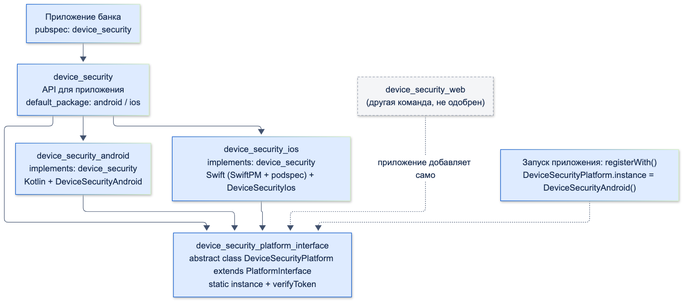
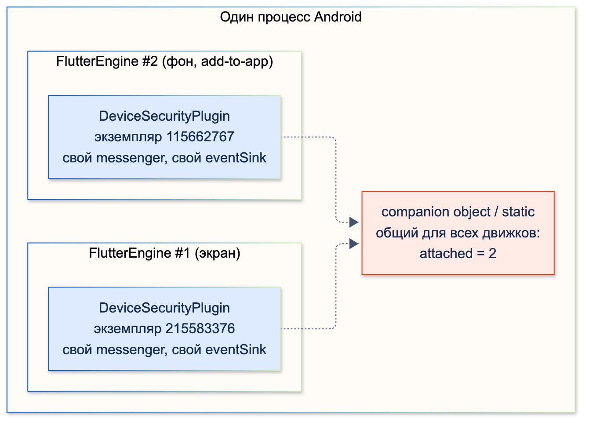
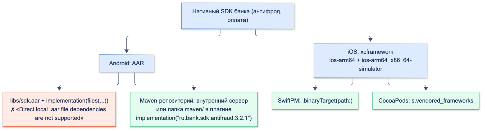

# Разработка плагинов (Android + iOS)

| Грейд | Время на изучение | Статус |
|-------|-------------------|--------|
| ⭐⭐ → ⭐⭐⭐ | ~60 мин лекция + практика | ✅ Готово |

---

> ℹ️ **Основы — в других темах этого раздела:**
> - **«Platform Channels»** — как устроены каналы, мини-плагин `device_security` с одним методом и потоком событий,
>   блок `flutter: plugin:` в `pubspec.yaml`, `GeneratedPluginRegistrant`, `ActivityAware`, тесты на подменённых каналах,
>   Pigeon.
> - **«Нативные API Android»** и **«Нативные API iOS»** — что вызывать внутри плагина и как дотянуться до этого без пакетов.
> - **«FFI»** — плагин на C/C++ без каналов.
>
> Здесь — то, что нужно, когда плагин живёт долго и им пользуются несколько команд: федеративная структура,
> развитие API без поломок, несколько движков, нативные SDK внутри плагина, Swift Package Manager, тесты
> по уровням и распространение внутри банка.

## 📚 Ресурсы

| Ресурс | Формат | Язык | Уровень | Зачем читать |
|--------|--------|------|---------|--------------|
| [Developing packages & plugins: Federated plugins](https://docs.flutter.dev/packages-and-plugins/developing-packages#federated-plugins) | Документация | 🇬🇧 | ⭐⭐⭐ | Три вида пакетов, `implements`, `default_package`, `dartPluginClass` |
| [plugin_platform_interface](https://pub.dev/packages/plugin_platform_interface) | Пакет | 🇬🇧 | ⭐⭐⭐ | Зачем `extends`, проверка токена, `MockPlatformInterfaceMixin` |
| [Swift Package Manager for plugin authors](https://docs.flutter.dev/packages-and-plugins/swift-package-manager/for-plugin-authors) | Документация | 🇬🇧 | ⭐⭐⭐ | Переход плагина на SwiftPM при сохранении CocoaPods |
| [Flutter и натив. Пример с Яндекс OAuth](https://habr.com/ru/articles/815313/) | Статья (Habr) | 🇷🇺 | ⭐⭐ | Плагин-обёртка над нативным SDK на обеих платформах |
| [Подключаем SberPay во Flutter-приложение](https://habr.com/ru/companies/friflex/articles/771354/) | Статья (Habr) | 🇷🇺 | ⭐⭐ | Банковский SDK внутри Flutter-приложения |
| [Hosted pub repositories](https://dart.dev/tools/pub/custom-package-repositories) | Документация | 🇬🇧 | ⭐⭐⭐ | Закрытый pub-репозиторий: `hosted:`, `dart pub token add` |

---

## 🎓 Лекция

> ℹ️ Всё ниже проверено на федеративной версии `device_security` (4 пакета + пример): Dart-тесты всех пакетов,
> JUnit и XCTest нативных частей, запуск на эмуляторе Android 16 и симуляторе iOS 26.5, сборка iOS через CocoaPods
> и через Swift Package Manager, release-сборка Android с R8. Flutter 3.38.5.

### 1. Федеративный плагин

В «Platform Channels» плагин — один пакет: Dart, Kotlin и Swift вместе. Пока его ведёт одна команда для двух
платформ, это нормально. **Федеративный** плагин делится на пакеты по ответственности:



| Пакет | Что внутри | Кто ведёт |
|-------|------------|-----------|
| `device_security` | API для приложения. Каналов не знает, всё делегирует | Владелец плагина |
| `device_security_platform_interface` | Абстрактный класс, который реализует каждая платформа | Владелец плагина |
| `device_security_android` | Kotlin + Dart-класс Android-реализации | Android-разработчики |
| `device_security_ios` | Swift + Dart-класс iOS-реализации | iOS-разработчики |

**Когда нужна федерация:**

- реализации ведут разные люди или команды (Android, iOS, web);
- платформу должен уметь добавить кто-то другой, не трогая основной пакет;
- у платформ разные нативные зависимости и релизы.

**Когда не нужна:** одна команда, две платформы, 1–5 методов. Четыре пакета — это четыре `pubspec.yaml`,
четыре CHANGELOG и согласование версий. Шаблон `flutter create --template=plugin` создаёт слой
`platform_interface` внутри одного пакета — это промежуточный вариант: интерфейс уже есть, пакет один.

**Интерфейс платформы.**

```dart
import 'package:plugin_platform_interface/plugin_platform_interface.dart';

/// Контракт, который реализует каждая платформа. Приложение с ним напрямую не работает —
/// только через пакет device_security
abstract class DeviceSecurityPlatform extends PlatformInterface {
  DeviceSecurityPlatform() : super(token: _token);

  static final Object _token = Object();

  static DeviceSecurityPlatform _instance = _UnsupportedPlatform();

  /// Реализация текущей платформы. Устанавливает её пакет платформы в registerWith()
  static DeviceSecurityPlatform get instance => _instance;

  static set instance(DeviceSecurityPlatform instance) {
    // Пропускает только наследников (extends): implements не получит токен
    PlatformInterface.verifyToken(instance, _token);
    _instance = instance;
  }

  /// Установлен ли код блокировки
  Future<bool> isDeviceSecure() => throw UnimplementedError('isDeviceSecure() не реализован');

  /// События «пользователь сделал скриншот»
  Stream<void> get screenshots => throw UnimplementedError('screenshots не реализован');

  /// Добавлен в 1.1.0. Реализация по умолчанию — чтобы старые пакеты платформ не сломались:
  /// они наследуют этот метод и продолжают собираться
  Future<bool?> isDeveloperModeEnabled() async => null; // null — платформа не умеет проверять
}

class _UnsupportedPlatform extends DeviceSecurityPlatform {}
```

**Почему `extends`, а не `implements`.** Если реализация пишет `implements DeviceSecurityPlatform`, то каждый новый
метод в интерфейсе ломает её сборку: она обязана его реализовать. При `extends` реализация наследует метод
по умолчанию — добавление метода **не ломающее** изменение. `verifyToken` следит за этим: токен есть только
у наследников. Проверено тестом и в исходниках пакета: проверка — это явный `throw AssertionError`, а не `assert`,
поэтому работает и в release-сборке.

```dart
/// Правильная реализация: наследует интерфейс
class ExtendsPlatform extends DeviceSecurityPlatform {
  @override
  Future<bool> isDeviceSecure() async => true;
}

/// Неправильная: реализует интерфейс. Не получит новые методы и не пройдёт проверку токена
class ImplementsPlatform implements DeviceSecurityPlatform {
  @override
  dynamic noSuchMethod(Invocation invocation) => super.noSuchMethod(invocation);
}

test('implements: проверка токена не пускает', () {
  expect(() => DeviceSecurityPlatform.instance = ImplementsPlatform(), throwsA(isA<AssertionError>()));
});
```

Для тестов приложения есть `MockPlatformInterfaceMixin` — он отключает проверку. В release-сборке пакет
сам бросает ошибку, если увидит этот миксин.

**Пакет платформы.**

```yaml
name: device_security_android
version: 1.1.0
publish_to: none

dependencies:
  flutter:
    sdk: flutter
  device_security_platform_interface:
    path: ../device_security_platform_interface

flutter:
  plugin:
    implements: device_security # какой интерфейс реализует пакет
    platforms:
      android:
        package: ru.bank.device_security_android
        pluginClass: DeviceSecurityPlugin # нативная часть: регистрирует каналы
        dartPluginClass: DeviceSecurityAndroid # Dart-часть: registerWith() ставит себя в instance
```

```dart
/// Реализация для Android. Flutter вызывает registerWith() при старте приложения
class DeviceSecurityAndroid extends DeviceSecurityPlatform {
  static const _methods = MethodChannel('ru.bank/device_security_android');
  static const _screenshots = EventChannel('ru.bank/device_security_android/screenshots');
  static final Stream<void> _screenshotStream = _screenshots.receiveBroadcastStream().map((_) {});

  static void registerWith() => DeviceSecurityPlatform.instance = DeviceSecurityAndroid();

  @override
  Future<bool> isDeviceSecure() async => await _methods.invokeMethod<bool>('isDeviceSecure') ?? false;

  @override
  Stream<void> get screenshots => _screenshotStream;

  // Только на Android: «Параметры разработчика» включены — повод для антифрода
  @override
  Future<bool?> isDeveloperModeEnabled() => _methods.invokeMethod<bool>('isDeveloperModeEnabled');
}
```

У каждой платформы своё имя канала (`…_android`, `…_ios`): реализации не зависят друг от друга, их можно
выпускать отдельно.

**Пакет для приложения** подключает реализации по умолчанию — **одобренные** (endorsed):

```yaml
name: device_security
version: 1.1.0
publish_to: none # во внутренний pub-репозиторий банка, не на pub.dev

dependencies:
  flutter:
    sdk: flutter
  device_security_platform_interface:
    path: ../device_security_platform_interface
  # Одобренные (endorsed) реализации: приходят в приложение автоматически
  device_security_android:
    path: ../device_security_android
  device_security_ios:
    path: ../device_security_ios

flutter:
  plugin:
    platforms:
      android:
        default_package: device_security_android
      ios:
        default_package: device_security_ios
```

```dart
/// API для приложения. Не знает про каналы и платформы — всё делегирует реализации
abstract final class DeviceSecurity {
  static DeviceSecurityPlatform get _platform => DeviceSecurityPlatform.instance;

  static Future<bool> isDeviceSecure() => _platform.isDeviceSecure();

  static Stream<void> get screenshots => _platform.screenshots;

  /// null — на этой платформе проверить нельзя (iOS). Решение «что делать» — за приложением
  static Future<bool?> isDeveloperModeEnabled() => _platform.isDeveloperModeEnabled();
}
```

Приложение зависит только от `device_security`. Проверено по `.flutter-plugins-dependencies` примера: на Android
подключён `device_security_android`, на iOS — `device_security_ios`. Реализацию, которую владелец не одобрил
(например, web от другой команды), приложение добавляет в свой `pubspec.yaml` само.

**Результат на устройствах:**

```console
Android: fedcheck: isDeviceSecure = true, isDeveloperModeEnabled = true
iOS:     fedcheck: isDeviceSecure = true, isDeveloperModeEnabled = null
```

На iOS метода `isDeveloperModeEnabled` нет — сработала реализация по умолчанию из интерфейса, и iOS-пакет
не пришлось менять при выпуске 1.1.0.

### 2. Развитие API без поломок

Плагином пользуются несколько приложений, и обновляются они в разное время. Правила:

| Изменение | Ломающее? | Как делать |
|-----------|-----------|------------|
| Новый метод в интерфейсе | Нет, если есть реализация по умолчанию | `UnimplementedError` или безопасное значение (`null`) |
| Новый необязательный параметр | Нет | Именованный со значением по умолчанию |
| Новое значение `enum` в ответе | **Да** для `switch` без `default` у потребителей | Документировать, добавлять в minor с запасом в коде потребителей |
| Переименовать, удалить, сменить тип | Да | Сначала `@Deprecated('Используйте … Удалим в 2.0')`, удаление — в major |
| Новое разрешение в манифесте или `Info.plist` | Да по смыслу: приложению проходить ревью магазина | Отдельный пункт CHANGELOG, отдельный minor |
| Поднять `minSdk` или минимальную iOS | Да | Только в major |

**Версии по semver:** `MAJOR.MINOR.PATCH`. Пакеты федеративного плагина версионируются отдельно, но интерфейс —
самый чувствительный: сломать его — сломать все реализации. Реализации зависят от интерфейса с диапазоном
(`^1.1.0`), а не от точной версии.

**Нативная и Dart-часть одного пакета** всегда выходят вместе: в одном пакете не может быть «Dart 1.1, Kotlin 1.0».
Но приложение может получить новый Dart-код интерфейса со старой реализацией — для этого и нужны значения по
умолчанию.

### 3. Несколько движков

Плагин регистрируется **в каждом** `FlutterEngine`, а движков в одном процессе бывает несколько:

- фоновые задачи на Dart (`workmanager`, геозоны, обработка push в фоне) запускают отдельный движок;
- встраивание Flutter в нативное приложение (add-to-app) часто держит несколько движков;
- `FlutterEngineGroup` — несколько экранов Flutter с общими ресурсами.

Проверка: пример запускает второй движок в `MainActivity`.

```kotlin
override fun configureFlutterEngine(flutterEngine: FlutterEngine) {
    super.configureFlutterEngine(flutterEngine)
    // Второй движок: так работают фоновые задачи Dart и встраивание Flutter в нативное приложение.
    // Плагины из pubspec регистрируются в нём заново — onAttachedToEngine вызовется ещё раз
    val engine = FlutterEngine(applicationContext)
    val bundle = FlutterInjector.instance().flutterLoader().findAppBundlePath()
    engine.dartExecutor.executeDartEntrypoint(DartExecutor.DartEntrypoint(bundle, "secondaryMain"))
    secondEngine = engine
}
```

```console
DeviceSecurity: onAttachedToEngine #1, экземпляр 215583376, messenger 205000585
DeviceSecurity: onAttachedToEngine #2, экземпляр 115662767, messenger 200589244
flutter : fedcheck: второй движок, isDeviceSecure = true
flutter : fedcheck: isDeviceSecure = true, isDeveloperModeEnabled = true
```



Два экземпляра плагина, у каждого свой messenger. А `companion object` (статика Kotlin) — **один на процесс**:
счётчик дошёл до 2. Отсюда правила:

- **Состояние — в полях экземпляра**, а не в `companion object` / `static`. Статический `eventSink` или канал
  перезапишет второй движок, и события первого экрана уйдут в фон.
- **Системные подписки — на экземпляр**, с отпиской в `onDetachedFromEngine` / `onCancel`.
- **Activity есть не у каждого движка**: у фонового `ActivityAware` не вызовется — методы, которым нужна
  Activity, должны отвечать ошибкой `NO_ACTIVITY`, а не падать.
- **Синглтоны нативного SDK** (антифрод, платёжный SDK) — инициализировать один раз на процесс, защищённо от
  повторного вызова: второй `init()` у многих SDK бросает исключение.

На iOS то же: `register(with:)` вызывается для каждого движка, состояние — в экземпляре, а не в `static var`.

### 4. Плагин-обёртка над нативным SDK банка

Типичная задача: SDK антифрода или оплаты поставляется как AAR для Android и xcframework для iOS.



**Android: локальный `.aar` в плагине не работает.** Проверено: `implementation(files("libs/antifraud-sdk.aar"))`
в плагине —

```console
Execution failed for task ':device_security_android:bundleDebugAar'.
> Direct local .aar file dependencies are not supported when building an AAR.
```

Плагин — это Android-библиотека, а AAR внутри AAR не упаковывается. Решение — Maven-репозиторий: внутренний
сервер банка (Nexus, Artifactory) или папка внутри плагина в формате Maven
(`maven/ru/bank/sdk/antifraud/3.2.1/antifraud-3.2.1.aar` + `.pom`):

```groovy
// SDK банка лежит в Maven-репозитории внутри плагина. Добавляем его всем проектам сборки:
// приложению он тоже нужен, чтобы найти зависимость плагина
def localMaven = "${projectDir}/maven"
rootProject.allprojects {
    repositories {
        google()
        mavenCentral()
        maven { url = localMaven }
    }
}

android {
    // ...
    dependencies {
        implementation("ru.bank.sdk:antifraud:3.2.1") // как обычная зависимость, с версией
    }
}
```

Проверено: сборка прошла, плагин вызывает класс SDK (`onAttachedToEngine #1, SDK 3.2.1`).

**iOS: xcframework подключается обоими способами.** SwiftPM — `binaryTarget`, CocoaPods — `vendored_frameworks`:

```swift
targets: [
  // SDK банка готовым бинарником — путь внутри пакета плагина
  .binaryTarget(name: "AntiFraudSDK", path: "Frameworks/AntiFraudSDK.xcframework"),
  .target(
    name: "device_security_ios",
    dependencies: ["AntiFraudSDK"],
    resources: [.process("PrivacyInfo.xcprivacy")] // манифест приватности плагина
  )
]
```

```ruby
s.dependency 'Flutter'
# Тот же бинарник SDK — для приложений на CocoaPods
s.vendored_frameworks = 'device_security_ios/Frameworks/AntiFraudSDK.xcframework'
```

**Ловушка с архитектурами.** Первая сборка упала: `Undefined symbol: _antifraud_version`,
`found architecture 'arm64', required architecture 'x86_64'`. `flutter build ios --simulator` собирает
приложение под **две** архитектуры симулятора, а в SDK был только arm64. Нужен срез
`ios-arm64_x86_64-simulator` — требуйте его от поставщика SDK или договоритесь, что сборки для симулятора
только arm64 (`EXCLUDED_ARCHS`). После добавления среза тест `sdkVersion → "3.2.1"` прошёл и со SwiftPM,
и с CocoaPods.

**Конфликты зависимостей.** Плагин и приложение могут тянуть разные версии одной библиотеки (OkHttp, Kotlin
coroutines, Firebase). Правила для плагина:

- не фиксировать версию жёстко, если можно указать минимальную;
- не тянуть тяжёлые зависимости ради одной функции;
- указывать в README, какие нативные зависимости и версии плагин приносит;
- при конфликте в приложении — смотреть `./gradlew :app:dependencies` и `Podfile.lock` / `Package.resolved`.

### 5. Сборка со стороны плагина

**Android: правила R8 плагина.** Если SDK или плагин используют рефлексию, R8 в release-сборке приложения
переименует или удалит классы. Правила кладут в сам плагин — они применятся у любого приложения:

```groovy
android {
    defaultConfig {
        minSdk = 24
        // Правила R8 для приложений, которые подключат плагин
        consumerProguardFiles("consumer-rules.pro")
    }
}
```

```text
# Правила R8 плагина: попадут в сборку любого приложения, которое подключит пакет.
# Нативный SDK банка находит класс по имени через рефлексию — не даём R8 его переименовать
-keep class ru.bank.device_security_android.DeviceSecurityPlugin { *; }
```

Проверено release-сборкой примера: правило есть в `build/app/outputs/mapping/release/configuration.txt`, а в
`mapping.txt` класс сохранил имя (`DeviceSecurityPlugin -> DeviceSecurityPlugin`). Правила должны быть
**узкими**: `-keep class ru.bank.** { *; }` в плагине отключает сжатие кода у всех, кто его подключил.

**`minSdk` и минимальная iOS плагина** — минимум для приложения. Поднять их — ломающее изменение (раздел 2).

**iOS: манифест приватности** (`PrivacyInfo.xcprivacy`) — у каждого плагина свой, если плагин использует
«required reason API» или собирает данные. Проверено чистой сборкой через SwiftPM: манифест плагина попал
в приложение отдельным бандлом `device_security_ios_device_security_ios.bundle`.

**Swift Package Manager.** По документации Flutter SwiftPM включён по умолчанию с Flutter 3.44, реестр
CocoaPods становится только для чтения 2 декабря 2026 года. Плагин должен поддерживать **оба** способа:

```text
device_security_ios/ios/
├── device_security_ios.podspec            ← CocoaPods: пути ведут в ту же папку Sources
└── device_security_ios/
    ├── Package.swift                      ← SwiftPM
    ├── Frameworks/AntiFraudSDK.xcframework
    └── Sources/device_security_ios/
        ├── DeviceSecurityPlugin.swift
        └── PrivacyInfo.xcprivacy
```

```swift
// swift-tools-version: 5.9
import PackageDescription

// Описание пакета для Swift Package Manager. Podspec рядом — для приложений на CocoaPods
let package = Package(
  name: "device_security_ios",
  platforms: [.iOS("13.0")],
  products: [
    // В имени библиотеки «_» заменяется на «-» — требование Flutter
    .library(name: "device-security-ios", targets: ["device_security_ios"])
  ],
  dependencies: [],
  targets: [
    // SDK банка готовым бинарником — путь внутри пакета плагина
    .binaryTarget(name: "AntiFraudSDK", path: "Frameworks/AntiFraudSDK.xcframework"),
    .target(
      name: "device_security_ios",
      dependencies: ["AntiFraudSDK"],
      resources: [.process("PrivacyInfo.xcprivacy")] // манифест приватности плагина
    )
  ]
)
```

```ruby
# Те же исходники, что у Swift Package Manager: одна копия кода на оба способа сборки
s.source_files     = 'device_security_ios/Sources/device_security_ios/**/*.swift'
s.resource_bundles = { 'device_security_ios_privacy' => ['device_security_ios/Sources/device_security_ios/PrivacyInfo.xcprivacy'] }
```

**Находка: шаблон из актуальной документации не собрался на Flutter 3.38.** В документации (Flutter 3.44)
`Package.swift` зависит от пакета `FlutterFramework` (`.package(name: "FlutterFramework", path: "../FlutterFramework")`).
Flutter 3.38.5 такого пакета не создаёт:

```console
xcodebuild: error: Could not resolve package dependencies:
  the package at '…/Packages/.packages/FlutterFramework' cannot be accessed (… doesn't exist in file system)
```

Без этой зависимости сборка через SwiftPM на 3.38 прошла. Вывод: `Package.swift` плагина пишут под **минимальную
версию Flutter, которую поддерживают приложения банка**, и проверяют на ней. При переходе всех приложений
на 3.44+ — добавить `FlutterFramework` по документации.

Включить SwiftPM для одного приложения, не меняя глобальную настройку Flutter, — в его `pubspec.yaml`:

```yaml
flutter:
  config:
    enable-swift-package-manager: true
```

Проверено: со SwiftPM плагин пропал из `Podfile.lock` (остался только `Flutter`), в проекте появился
`FlutterGeneratedPluginSwiftPackage`; с `false` — снова pod `device_security_ios`. Оба варианта прошли XCTest.

### 6. Тестирование по уровням

| Уровень | Что проверяет | Где | Устройство |
|---------|---------------|-----|------------|
| Dart: интерфейс | Значения по умолчанию, проверка токена | `*_platform_interface/test` | Нет |
| Dart: реализация | Имя канала, методы, разбор ответа (`setMockMethodCallHandler`) | `*_android/test`, `*_ios/test` | Нет |
| Dart: пакет приложения | Делегирование, подмена платформы | `device_security/test` | Нет |
| Нативный Android | Логика Kotlin без Flutter | JUnit: `android/src/test` | Нет (JVM) |
| Нативный iOS | Логика Swift без Flutter | XCTest: `example/ios/RunnerTests` | Симулятор |
| Интеграционный | Dart → натив → ответ на настоящей ОС | `integration_test` в `example/` | Да |

**Подмена платформы в тестах приложения:**

```dart
/// Подмена платформы в тестах приложения — без каналов и без устройства
class FakePlatform extends DeviceSecurityPlatform with MockPlatformInterfaceMixin {
  @override
  Future<bool> isDeviceSecure() async => false;
}

test('приложение работает с подменённой платформой', () async {
  DeviceSecurityPlatform.instance = FakePlatform();
  expect(await DeviceSecurity.isDeviceSecure(), isFalse);
  expect(await DeviceSecurity.isDeveloperModeEnabled(), isNull); // метод по умолчанию из интерфейса
});
```

**JUnit для Kotlin-части:**

```kotlin
// Нативный unit-тест: без эмулятора, на JVM. Android-классы подменяются Mockito
class DeviceSecurityPluginTest {
    private fun attachedPlugin(deviceSecure: Boolean): DeviceSecurityPlugin {
        val keyguard = mock(KeyguardManager::class.java)
        `when`(keyguard.isDeviceSecure).thenReturn(deviceSecure)
        val context = mock(Context::class.java)
        `when`(context.getSystemService(KeyguardManager::class.java)).thenReturn(keyguard)
        val binding = mock(FlutterPlugin.FlutterPluginBinding::class.java)
        `when`(binding.applicationContext).thenReturn(context)
        `when`(binding.binaryMessenger).thenReturn(mock(BinaryMessenger::class.java))
        return DeviceSecurityPlugin().apply { onAttachedToEngine(binding) }
    }

    @Test
    fun isDeviceSecure_returnsKeyguardValue() {
        val result = mock(MethodChannel.Result::class.java)
        attachedPlugin(deviceSecure = false).onMethodCall(MethodCall("isDeviceSecure", null), result)
        verify(result).success(false)
    }

    @Test
    fun unknownMethod_notImplemented() {
        val result = mock(MethodChannel.Result::class.java)
        attachedPlugin(deviceSecure = true).onMethodCall(MethodCall("unknown", null), result)
        verify(result).notImplemented()
    }
}
```

Запуск: `cd example/android && ./gradlew :device_security_android:testDebugUnitTest`. Две находки:

1. С `mockito-core:5.0.0` из шаблона плагина Flutter `mock(...)` упал с `MockitoException` на JDK 21, на котором
   работает Gradle. После обновления до `5.24.0` эта ошибка ушла — версии тестовых библиотек шаблона нужно обновлять.
2. Затем: `Method i in android.util.Log not mocked`. В JVM-тестах методы `android.jar` — заглушки. Решение:

```groovy
testOptions {
    // Методы android.jar (Log, TextUtils) в JVM-тестах — заглушки. Без этого они бросают RuntimeException
    unitTests.returnDefaultValues = true
}
```

**XCTest для Swift-части:**

```swift
import Flutter
import XCTest

@testable import device_security_ios

// Нативный unit-тест iOS-части плагина: вызываем handle напрямую, без Dart и без канала
class RunnerTests: XCTestCase {
  func testUnknownMethodIsNotImplemented() {
    let answered = expectation(description: "result")
    DeviceSecurityPlugin().handle(FlutterMethodCall(methodName: "unknown", arguments: nil)) { result in
      XCTAssertTrue((result as AnyObject) === FlutterMethodNotImplemented)
      answered.fulfill()
    }
    waitForExpectations(timeout: 1)
  }

  func testBinarySdkIsLinked() {
    let answered = expectation(description: "result")
    DeviceSecurityPlugin().handle(FlutterMethodCall(methodName: "sdkVersion", arguments: nil)) { result in
      XCTAssertEqual(result as? String, "3.2.1")
      answered.fulfill()
    }
    waitForExpectations(timeout: 1)
  }
}
```

Запуск: `xcodebuild test -workspace example/ios/Runner.xcworkspace -scheme Runner -destination 'platform=iOS Simulator,name=…'`.

**CI плагина** — матрица:

- Dart: `flutter analyze` и `flutter test` во всех пакетах;
- Android: `testDebugUnitTest`, сборка `example` debug и release (R8);
- iOS: XCTest и сборка `example` **дважды** — со SwiftPM и с CocoaPods;
- минимальная поддерживаемая версия Flutter и текущая стабильная;
- `integration_test` на эмуляторе и симуляторе — хотя бы на ночной сборке.

### 7. Распространение внутри банка

| Способ | Как подключить | Плюсы | Минусы |
|--------|----------------|-------|--------|
| Закрытый pub-репозиторий | `hosted:` + `dart pub token add` | Версии, `pub outdated`, диапазоны `^1.1.0` | Нужен сервер (свой, или облачный Artifactory/Cloudsmith) |
| git-зависимость | `git: url, path, ref` | Ничего не нужно, кроме git | Нет диапазонов версий, только тег или коммит |
| `path:` | Монорепозиторий / pub workspace | Мгновенные изменения | Только внутри одного репозитория |

```yaml
dependencies:
  # Закрытый pub-репозиторий банка
  device_security:
    hosted: https://pub.bank.example.ru
    version: ^1.1.0
```

```yaml
dependencies:
  # Или git: пакет в подпапке репозитория, версия — тегом. Ключ — имя пакета из его pubspec.yaml
  device_security:
    git:
      url: git@git.bank.example.ru:mobile/device_security.git
      path: device_security
      ref: device_security-v1.1.0
```

`publish_to: none` в каждом пакете защищает от случайной публикации на pub.dev. Для закрытого репозитория —
`publish_to: https://pub.bank.example.ru`.

**Процесс:**

- у плагина есть **владелец** — команда, которая отвечает за интерфейс и ревью;
- нативный код ревьюят Android- и iOS-разработчики, а не только Flutter;
- CHANGELOG с пометками: новые разрешения, новые нативные зависимости, поднятые минимальные версии;
- `example/` — живая документация и стенд для ручной проверки;
- уязвимость в нативной зависимости → patch-версия всех пакетов и рассылка командам.

### ⚠️ Частые ошибки

- **Федерация «на вырост»** для плагина с двумя методами одной команды — четыре пакета без пользы.
- **`implements` вместо `extends`** в реализации — каждый новый метод интерфейса ломает её; `verifyToken` не пустит.
- **Новый метод в интерфейсе без реализации по умолчанию** — ломающее изменение для всех реализаций.
- **Новое значение `enum`, разрешение или `minSdk` в minor/patch** — ломает потребителей.
- **Состояние в `companion object` / `static`** — второй движок перезаписывает его.
- **Ожидать Activity в каждом движке** — у фонового её нет.
- **Повторная инициализация нативного SDK** в каждом движке — исключение внутри SDK.
- **Локальный `.aar` в плагине** — сборка падает; нужен Maven-репозиторий.
- **xcframework без среза `x86_64` для симулятора** — `Undefined symbol` при сборке под симулятор.
- **Широкие правила R8 в `consumer-rules.pro`** — отключают сжатие у всех приложений.
- **Нет `consumer-rules.pro` при рефлексии** — release-сборка приложения падает, debug работает.
- **Плагин только для CocoaPods** — проблемы у приложений на SwiftPM, а реестр CocoaPods закрывается.
- **`Package.swift` по шаблону новой версии Flutter** при старой минимальной — зависимость `FlutterFramework` не находится.
- **Устаревшие тестовые зависимости из шаблона** (Mockito 5.0.0) — тесты падают на новом JDK.
- **Нет `publish_to: none`** — внутренний плагин можно случайно опубликовать на pub.dev.

### 🎤 На собеседовании: «Как спроектировать плагин, которым будут пользоваться 5 команд?»

| Уровень | Как выглядит ответ |
|---------|--------------------|
| ⭐ Junior | `flutter create --template=plugin`, MethodChannel, код для Android и iOS, пример в `example/` |
| ⭐⭐ Middle | Каналы скрыты за Dart API, Pigeon для типобезопасности, тесты на подменённых каналах, CHANGELOG и semver, закрытый репозиторий или git с тегами |
| ⭐⭐⭐ Senior | Всё из Middle, плюс: федеративная структура, если платформы ведут разные люди; интерфейс через `extends PlatformInterface` и значения по умолчанию для новых методов; что считать ломающим (enum, разрешения, `minSdk`); несколько движков — без статики, Activity может не быть; нативные SDK через Maven и xcframework со всеми срезами; `consumer-rules.pro`, манифест приватности, SwiftPM + CocoaPods под минимальную версию Flutter; тесты по уровням и CI-матрица; владелец, ревью нативного кода, политика обновлений |

---

## ✅ Самопроверка

**⭐⭐ Middle**
1. Из каких пакетов состоит федеративный плагин и что в каждом?
2. Чем одобренная (endorsed) реализация отличается от неодобренной?
3. Как приложение тестирует код, который использует плагин, без устройства?
4. Чем закрытый pub-репозиторий удобнее git-зависимости?

**⭐⭐⭐ Senior**
1. Почему реализация должна наследовать интерфейс, а не реализовывать его? Как это проверяется?
2. Какие изменения плагина ломающие, хотя код компилируется?
3. Что происходит с плагином, когда в процессе два `FlutterEngine`? Какие ошибки это вызывает?
4. Как подключить в плагин AAR и xcframework нативного SDK? Какие ловушки?
5. Зачем `consumer-rules.pro` и почему правила должны быть узкими?
6. Что нужно сделать плагину для Swift Package Manager и почему нельзя бросить CocoaPods?
7. Как устроить тесты и CI плагина?

<details>
<summary>Ответы</summary>

**Middle**
1. Пакет для приложения (API, `default_package`), `*_platform_interface` (абстрактный класс + `instance`),
   пакеты платформ (`implements:`, нативный код, `dartPluginClass` с `registerWith()`).
2. Одобренную владелец указал в `default_package` и зависимостях — она приходит в приложение автоматически.
   Неодобренную приложение добавляет в свой `pubspec.yaml` само.
3. Подменяет платформу: `DeviceSecurityPlatform.instance = FakePlatform()` с `MockPlatformInterfaceMixin`.
4. Диапазоны версий (`^1.1.0`), `pub outdated`, обычный процесс обновления; git даёт только тег или коммит.

**Senior**
1. Новые методы интерфейса с реализацией по умолчанию тогда не ломают реализации. `verifyToken` пропускает
   только наследников; проверка работает и в release, а `MockPlatformInterfaceMixin` в release запрещён.
2. Новое значение `enum` в ответе, новое разрешение в манифесте или `Info.plist`, поднятые `minSdk` или минимальная
   iOS, новая тяжёлая нативная зависимость, изменение формата данных в канале.
3. Плагин регистрируется в каждом движке — свой экземпляр и messenger, но статика общая на процесс. Статический
   канал или `eventSink` перезаписывается, события уходят не в тот движок; у фонового движка нет Activity;
   SDK пытаются инициализировать дважды.
4. Android: только через Maven-репозиторий (внутренний сервер или папка `maven/` в плагине) — локальный `.aar`
   Gradle не упакует. iOS: `binaryTarget` для SwiftPM и `vendored_frameworks` для CocoaPods; xcframework должен
   содержать срез симулятора `arm64_x86_64`, иначе `Undefined symbol`.
5. Правила R8 плагина попадают в release-сборку любого приложения — нужны, если плагин или SDK используют
   рефлексию. Широкие `-keep` отключают сжатие и обфускацию у всех.
6. `Package.swift` в `ios/<плагин>/`, исходники в `Sources/<плагин>/`, ресурсы и манифест приватности через
   `resources`, podspec указывает на те же файлы. CocoaPods ещё используют приложения на старых версиях Flutter.
   `Package.swift` писать под минимальную поддерживаемую версию Flutter и проверять обе сборки.
7. Dart-тесты интерфейса, реализаций и пакета приложения; JUnit и XCTest для нативных частей; `integration_test`
   в `example/`. CI: анализ и тесты всех пакетов, сборка Android debug и release, iOS со SwiftPM и CocoaPods,
   минимальная и текущая версии Flutter.

</details>
