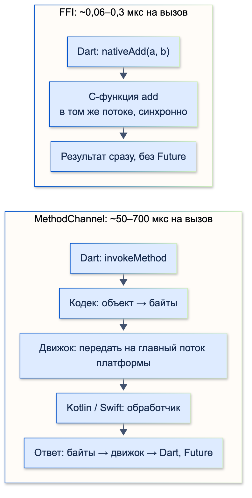
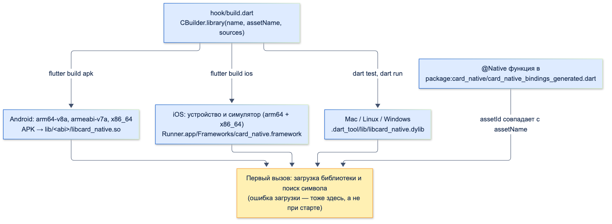
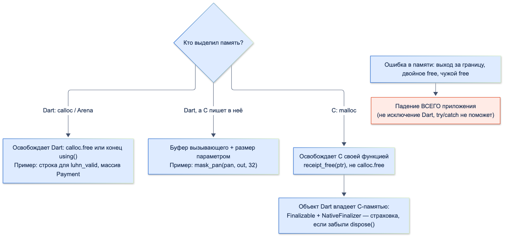
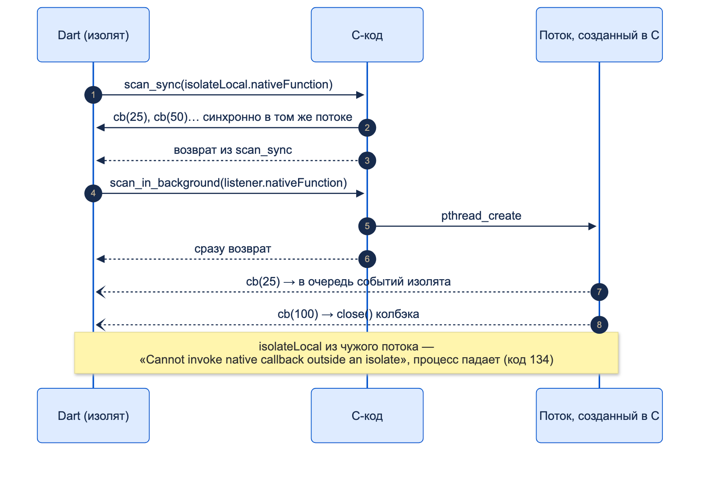

# Работа с FFI

| Грейд | Время на изучение | Статус |
|-------|-------------------|--------|
| ⭐⭐⭐ | ~70 мин лекция + практика | ✅ Готово |

---

> ℹ️ **Уже разобрано в «Анимациях»** (раздел 5, «Способ 5. Нативная отрисовка на C++ через FFI»): три пути нарисовать
> кнопку-кляксу на C++ (геометрия, пиксели в буфер, нативная текстура), почему для кнопки это избыточно и сравнение
> с `CustomPainter`, шейдером и Rive. Здесь — сам механизм FFI. Клякса используется как готовый пример
> C++-кода, без вопросов отрисовки.

## 📚 Ресурсы

| Ресурс | Формат | Язык | Уровень | Зачем читать |
|--------|--------|------|---------|--------------|
| [Нативная мощь: Flutter SDK на C++ ядре](https://habr.com/ru/articles/898804/) | Статья (Habr) | 🇷🇺 | ⭐⭐⭐ | 2ГИС: кодогенерация C++ → Dart, `NativeFinalizer`, `NativeCallable`, асинхронность в большом SDK |
| [Dart Native Assets: полное руководство](https://habr.com/ru/articles/918528/) | Статья (Habr) | 🇷🇺 | ⭐⭐ | Скрипты сборки и `@Native` по шагам. ⚠️ Использует старое имя пакета `native_assets_cli` — сейчас `hooks` и `code_assets` |
| [Ускоряем Dart. Нативно, недорого](https://habr.com/ru/post/547946/) | Статья (Habr) | 🇷🇺 | ⭐⭐ | Когда перенос вычислений в C даёт выигрыш, а когда нет |
| [Bind to native code using FFI](https://docs.flutter.dev/platform-integration/bind-native-code) | Документация | 🇬🇧 | ⭐⭐ → ⭐⭐⭐ | Официальный способ с Flutter 3.38: шаблон `package_ffi`, скрипты сборки, правила имён библиотек |
| [Hooks](https://dart.dev/tools/hooks) | Документация | 🇬🇧 | ⭐⭐⭐ | Как работают `hook/build.dart` и `@Native`, готовые бинарники |
| [C interop using dart:ffi](https://dart.dev/interop/c-interop) | Документация | 🇬🇧 | ⭐⭐ | Типы, указатели, структуры, память, колбэки |
| [ffigen](https://pub.dev/packages/ffigen) | Пакет | 🇬🇧 | ⭐⭐ | Генерация привязок из C-заголовков |

---

## 🎓 Лекция

> ℹ️ Весь код — пакет по шаблону `package_ffi` (Flutter 3.38.5, Dart 3.10.4): 8 тестов на Mac, пример-приложение
> в release-сборке на эмуляторе Android 16 и в debug на симуляторе iOS 26.5. Результаты — рядом с кодом.

### 1. Что такое FFI и когда его выбирать

**FFI** (Foreign Function Interface) — вызов функции на C прямо из Dart: в том же потоке, синхронно, без кодека
и без перехода на главный поток платформы. `dart:ffi` работает **только с C** (и с C++ через `extern "C"`).
Kotlin, Java и Swift через FFI не вызвать — для них по-прежнему каналы.



**Замер на устройствах** — одна и та же операция `a + b`: в C через FFI и в Kotlin/Swift через `MethodChannel`:

```console
Android (release, эмулятор): add — FFI 0.064 мкс/вызов, MethodChannel 522.1 мкс/вызов, в 8138 раз дольше
iOS (debug, симулятор):      add — FFI 0.261 мкс/вызов, MethodChannel 51.1 мкс/вызов,  в 196 раз дольше
```

Цифры эмулятора от запуска к запуску гуляют (в другом запуске — в 4254 раза), но порядок один: вызов через FFI —
десятые доли микросекунды, через канал — десятки и сотни.

**Но FFI не делает код быстрее сам по себе.** Проверка номера карты по алгоритму Луна — на C через FFI и тот же
алгоритм на Dart:

```console
Android: Луна — FFI 0.838 мкс (со строкой в нативную память), Dart 0.074 мкс
iOS:     Луна — FFI 0.362 мкс (со строкой в нативную память), Dart 0.029 мкс
```

Dart в 10 раз быстрее: AOT-компилятор Dart выдаёт машинный код, а вызов через FFI тратит время на копирование строки
в нативную память. Выигрыш от C — только когда работы много, а данных через границу передаётся мало.

| Задача | Чем делать | Почему |
|--------|------------|--------|
| Системный API Android / iOS, нативный SDK на Kotlin / Swift | Platform Channels, Pigeon | FFI их не вызывает |
| Готовая C/C++-библиотека: ГОСТ-криптография (СКЗИ), SQLite, распознавание документов, OpenCV | **FFI** | Код уже есть, переписывать на Dart дорого и рискованно |
| Общее C++-ядро бизнес-логики для нескольких платформ | **FFI** | Один код вместо двух-трёх |
| Частые мелкие вызовы (на каждый кадр, тысячи в секунду) | **FFI** | Канал стоит сотни микросекунд на вызов |
| Своя логика «чтобы было быстрее» | Сначала Dart и замер | Часто Dart не медленнее, а FFI добавляет сборку и ручную память |
| Kotlin / Swift без C | jnigen / swiftgen (экспериментально) | Вне темы |

### 2. Как Dart находит C-функцию

**Новый способ (Flutter 3.38+): `@Native` и скрипт сборки.**

```bash
flutter create --template=package_ffi card_native
```

Шаблон создаёт:

```text
card_native/
├── hook/build.dart                          ← скрипт сборки: компилирует C под каждую платформу
├── src/card_native.c, card_native.h         ← C-код
├── ffigen.yaml                              ← настройки генерации привязок
├── lib/card_native_bindings_generated.dart  ← привязки @Native (генерирует ffigen)
├── lib/card_native.dart                     ← удобный Dart-API для приложения
└── example/                                 ← Flutter-приложение
```

```dart
import 'package:code_assets/code_assets.dart';
import 'package:hooks/hooks.dart';
import 'package:logging/logging.dart';
import 'package:native_toolchain_c/native_toolchain_c.dart';

// Скрипт сборки: Flutter и `dart test` запускают его сами и компилируют C/C++ под нужную платформу и архитектуру
void main(List<String> args) async {
  await build(args, (input, output) async {
    final logger = Logger('')
      ..level = Level.WARNING
      ..onRecord.listen((record) => print(record.message));

    // Библиотека на C. assetName связывает её с Dart-файлом, где объявлены @Native-функции
    await CBuilder.library(
      name: 'card_native',
      assetName: 'card_native_bindings_generated.dart',
      sources: ['src/card_native.c'],
    ).run(input: input, output: output, logger: logger);

    final android = input.config.code.targetOS == OS.android;

    // Вторая библиотека — на C++ (кнопка-клякса из темы «Анимации»)
    await CBuilder.library(
      name: 'blob',
      assetName: 'blob_bindings.dart',
      sources: ['src/blob.cpp'],
      language: Language.cpp,
      // На Android по умолчанию c++_shared, но libc++_shared.so в APK никто не положит —
      // dlopen упадёт при первом вызове. Встраиваем стандартную библиотеку C++ в саму libblob.so;
      // c++abi — её часть с типами исключений (иначе «cannot locate symbol _ZTISt12length_error»)
      flags: ['-std=c++17', if (android) '-lc++abi'],
      cppLinkStdLib: android ? 'c++_static' : null,
    ).run(input: input, output: output, logger: logger);
  });
}
```

Функция объявляется в Dart как `external` с аннотацией `@Native`:

```dart
// Привязки, написанные вручную. Библиотека находится по assetId = 'package:card_native/blob_bindings.dart',
// функция — по имени символа: Dart-имя может отличаться от C-имени
import 'dart:ffi';

@Native<Void Function(Double, Int32, Int32, Pointer<Uint8>)>(symbol: 'blob_render')
external void blobRender(double t, int width, int height, Pointer<Uint8> rgba);

@Native<Int32 Function(Double, Int32, Int32, Double, Double)>(symbol: 'blob_contains')
external int blobContains(double t, int width, int height, double x, double y);
```



Связь «функция → библиотека» — через **assetId**: по умолчанию это URI Dart-файла с `@Native`
(`package:card_native/blob_bindings.dart`), и он должен совпасть с `assetName` в скрипте сборки.

**Что получилось в сборках:**

```console
APK: lib/arm64-v8a/libblob.so, lib/arm64-v8a/libcard_native.so
     lib/armeabi-v7a/…, lib/x86_64/…                       (скрипт собрал все три архитектуры)
iOS: Runner.app/Frameworks/blob.framework, card_native.framework   (x86_64 + arm64 для симулятора)
Mac: .dart_tool/lib/libblob.dylib, libcard_native.dylib             (для dart test)
```

**Библиотека загружается при первом вызове функции**, не при старте приложения. Первый вызов `blobRender`
занял 1,3 мс на Android и 7 мс на iOS. Отсюда же ловушка: если библиотека не загружается, приложение запустится
нормально, а упадёт при первом обращении (раздел 8).

**Старый способ** — `DynamicLibrary` и поиск функции вручную (так сделан прототип кляксы):

```dart
// Сигнатуры C-функций и их Dart-аналоги
typedef _RenderC = Void Function(Double t, Int32 w, Int32 h, Pointer<Uint8> rgba);
typedef _RenderDart = void Function(double t, int w, int h, Pointer<Uint8> rgba);

final lib = Platform.isIOS ? DynamicLibrary.process() : DynamicLibrary.open('libblob.so');
final render = lib.lookupFunction<_RenderC, _RenderDart>('blob_render');
```

Его встречают в старых плагинах (`plugin_ffi` с `CMakeLists.txt` и podspec). Для нового кода — `package_ffi`:
одна сборка на все платформы, без файлов сборки под каждую ОС.

### 3. Типы

| C | `dart:ffi` (в сигнатуре) | Dart (в коде) |
|---|---|---|
| `int32_t`, `int64_t` | `Int32`, `Int64` | `int` |
| `intptr_t` | `IntPtr` | `int` |
| `double`, `float` | `Double`, `Float` | `double` |
| `bool` | `Bool` | `bool` |
| `void` | `Void` | `void` |
| `char *` (строка) | `Pointer<Char>` или `Pointer<Utf8>` | `String` через `toNativeUtf8()` / `toDartString()` |
| `uint8_t *` (байты) | `Pointer<Uint8>` | `Uint8List` через `asTypedList` |
| `struct Payment` | Класс `extends Struct` с полями `@Int64()` | `ptr.ref.amount_kopecks` |
| `struct Payment *` (массив) | `Pointer<Payment>` | `(ptr + i).ref` |
| Указатель на функцию | `Pointer<NativeFunction<…>>` | `NativeCallable` (раздел 6) |

**Строки.** Dart-строку C не видит: её кодируют в UTF-8 и кладут в нативную память.

```dart
/// Проверка номера карты на C. Строку нужно положить в нативную память: Dart-строка для C невидима
bool isValidCard(String number) => using((arena) {
      // Arena освободит всё, что выделено через неё, при выходе из using — даже при исключении
      final digits = number.toNativeUtf8(allocator: arena);
      return c.luhn_valid(digits.cast()) == 1;
    });
```

**Структуры** генерирует ffigen (раздел 5) из заголовка:

```c
/// Платёж: структура, которую Dart передаёт массивом
typedef struct {
  int64_t amount_kopecks;
  int32_t currency; // 643 — рубль, 840 — доллар
} Payment;

/// Комиссия по всем рублёвым платежам, в копейках
FFI_EXPORT int64_t total_fee(const Payment *payments, int32_t count, double percent);
```

```dart
/// Массив структур: выделяем память под count элементов Payment и заполняем поля
int totalFee(List<({int amountKopecks, int currency})> payments, {double percent = 0.5}) {
  final array = calloc<c.Payment>(payments.length);
  try {
    for (var i = 0; i < payments.length; i++) {
      (array + i).ref
        ..amount_kopecks = payments[i].amountKopecks
        ..currency = payments[i].currency;
    }
    return c.total_fee(array, payments.length, percent);
  } finally {
    calloc.free(array); // выделил Dart — освобождает Dart
  }
}
```

**Конфликт `Size`.** В `dart:ffi` есть свой тип `Size` (как `size_t` в C), во Flutter — `Size` из `dart:ui`. Файл
с обоими импортами не компилируется:

```console
error • The name 'Size' is defined in the libraries 'dart:ffi' and 'dart:ui (via package:flutter/widgets.dart)'
```

Решение — `import 'dart:ffi' hide Size;`. Вариант `show Pointer, Uint8` хуже: он скрывает и **расширения**, и
`buffer.asTypedList(…)` перестаёт компилироваться (`The method 'asTypedList' isn't defined for the type 'Pointer'`)
— проверено.

### 4. Память

В остальном Dart память освобождает сборщик мусора. Память, выделенная для C, ему **не видна**: освобождать её
нужно вручную. Главное правило — **кто выделил, тот и освобождает**.



| Ситуация | Как | Пример |
|----------|-----|--------|
| Dart выделил на время вызова | `calloc` + `calloc.free` в `finally`, или `using((arena) { … })` | `isValidCard`, `totalFee` |
| C пишет в буфер Dart | Буфер выделяет Dart и передаёт **размер** — C не знает, сколько памяти за указателем | `maskPan` |
| C вернул память | Освобождает функция самого C (`receipt_free`), не `calloc.free`: у них могут быть разные аллокаторы | `receiptText` |
| Объект Dart держит C-память долго | `Finalizable` + `NativeFinalizer` — страховка, если забыли `dispose()` | `Receipt` |
| Байты из C в Dart без копирования | `pointer.asTypedList(length)` — вид на ту же память, живёт, пока жив указатель | Пиксели кляксы |

```dart
/// Буфер выделяет вызывающий и передаёт его размер: C не знает, сколько памяти за указателем
String? maskPan(String pan) => using((arena) {
      const size = 32;
      final out = arena<Char>(size);
      final length = c.mask_pan(pan.toNativeUtf8(allocator: arena).cast(), out, size);
      return length < 0 ? null : out.cast<Utf8>().toDartString(length: length);
    });

/// Память выделил C (malloc) — освобождать функцией самого C, а не calloc.free
String receiptText(int kopecks) {
  final receipt = c.receipt_create(kopecks);
  try {
    return receipt.cast<Utf8>().toDartString();
  } finally {
    c.receipt_free(receipt);
  }
}

/// Объект Dart, который владеет нативной памятью. Если про dispose() забыли — освободит сборщик мусора
final class Receipt implements Finalizable {
  Receipt(int kopecks) : _pointer = c.receipt_create(kopecks) {
    _finalizer.attach(this, _pointer.cast(), detach: this);
  }

  static final _finalizer = NativeFinalizer(Native.addressOf<NativeFunction<Void Function(Pointer<Char>)>>(c.receipt_free).cast());

  final Pointer<Char> _pointer;
  bool _disposed = false;

  String get text => _pointer.cast<Utf8>().toDartString();

  void dispose() {
    if (_disposed) return;
    _disposed = true;
    _finalizer.detach(this); // освобождаем сами — финализатор больше не нужен
    c.receipt_free(_pointer);
  }
}
```

`NativeFinalizer` — страховка, а не замена `dispose()`: когда сработает сборщик мусора, неизвестно.

**Ошибка в нативной памяти — не исключение Dart.** Выход за границу буфера, двойное освобождение, освобождение
чужим аллокатором — это падение **всего процесса**, `try/catch` его не поймает. Для банковского приложения это
крэш без понятного стека в Dart. Проверяйте C-код отдельно: unit-тесты на C, санитайзеры (`-fsanitize=address`).

`package:ffi` (`calloc`, `Arena`, `toNativeUtf8`) шаблон `package_ffi` кладёт в `dev_dependencies`. Если API пакета
им пользуется — перенести в `dependencies`, иначе анализатор предупредит: `The imported package 'ffi' isn't a
dependency of the importing package`.

### 5. ffigen: привязки из заголовка

Писать `@Native`-объявления руками для десятков функций и структур — источник ошибок: перепутанный тип —
мусор в данных или падение. **ffigen** генерирует их из C-заголовка:

```yaml
# Run with `dart run ffigen --config ffigen.yaml`.
name: CardNativeBindings
output: 'lib/card_native_bindings_generated.dart'
headers:
  entry-points:
    - 'src/card_native.h'
  include-directives:
    - 'src/card_native.h'
ffi-native:   # генерировать @Native, а не класс с DynamicLibrary
```

```bash
dart run ffigen --config ffigen.yaml
```

Результат для заголовка из раздела 3:

```dart
@ffi.Native<ffi.Int32 Function(ffi.Pointer<ffi.Char>)>()
external int luhn_valid(ffi.Pointer<ffi.Char> digits);

@ffi.Native<ffi.Int64 Function(ffi.Pointer<Payment>, ffi.Int32, ffi.Double)>()
external int total_fee(ffi.Pointer<Payment> payments, int count, double percent);

final class Payment extends ffi.Struct {
  @ffi.Int64()
  external int amount_kopecks;

  @ffi.Int32()
  external int currency;
}
```

Сгенерированный файл не правят руками: поменялся заголовок — перегенерировать. Приложению отдают **свой**
Dart-API (`lib/card_native.dart`), а не сырые привязки: в нём Dart-типы, освобождение памяти, проверки.

### 6. Потоки и колбэки

**Синхронный вызов блокирует изолят.** C-функция выполняется в потоке, который её вызвал. Если это UI-изолят,
Flutter не рисует кадры, пока функция не вернётся.

```dart
/// Долгий вызов: синхронная C-функция блокирует поток изолята. На UI-изоляте — заморозка интерфейса
int slowChecksum(int rounds) => c.slow_checksum(rounds);

/// Тот же вызов в отдельном изоляте: UI продолжает рисовать кадры
Future<int> slowChecksumAsync(int rounds) => Isolate.run(() => c.slow_checksum(rounds));
```

Проверка тестом: таймер с периодом 10 мс считает «тики», пока работает C-функция (~1,25 с):

```console
главный изолят: 1263 мс, тиков таймера: 1; Isolate.run: 1235 мс, тиков: 123
```

В главном изоляте за 1,2 секунды таймер не сработал ни разу (тик — уже после), в `Isolate.run` — 123 раза. Правило:
всё, что может занять больше пары миллисекунд, — в `Isolate.run` или долгоживущий фоновый изолят (шаблон
`package_ffi` показывает такой вариант с `SendPort`).

**Колбэки из C в Dart** — через `NativeCallable`:



| | `NativeCallable.isolateLocal` | `NativeCallable.listener` |
|---|---|---|
| Откуда C может вызвать | Только из потока изолята, синхронно | Из любого потока |
| Как выполняется | Сразу, C ждёт возврата | Асинхронно: сообщение в очередь событий изолята |
| Может вернуть значение в C | Да | Нет, только `void` |
| Пример | Прогресс внутри синхронного вызова | Событие от фонового потока SDK |

```dart
/// Колбэк, который C вызывает синхронно в том же потоке: NativeCallable.isolateLocal
List<int> scanSync() {
  final progress = <int>[];
  final callback = NativeCallable<c.progress_callbackFunction>.isolateLocal((int p) => progress.add(p));
  try {
    c.scan_sync(callback.nativeFunction);
  } finally {
    callback.close(); // закрыть, иначе утечка
  }
  return progress;
}

/// Колбэк из другого потока C: только NativeCallable.listener — вызов придёт в изолят асинхронно через очередь событий
Stream<int> scanInBackground() {
  final controller = StreamController<int>();
  late final NativeCallable<c.progress_callbackFunction> callback;
  callback = NativeCallable<c.progress_callbackFunction>.listener((int p) {
    controller.add(p);
    if (p == 100) {
      callback.close();
      controller.close();
    }
  });
  c.scan_in_background(callback.nativeFunction);
  return controller.stream;
}
```

Оба теста дали `[25, 50, 75, 100]`. А `isolateLocal`, вызванный из потока, созданного в C, — падение процесса:

```console
../../runtime/vm/runtime_entry.cc: 5025: error: Cannot invoke native callback outside an isolate.
exit=134
```

### 7. Кнопка-клякса: что здесь про FFI

Как выглядит кнопка и почему так её делать не стоит — в «Анимациях». Здесь — что она показывает про FFI.
C++-код прототипа (13 точек Безье, растеризация с подвыборкой, проверка попадания) перенесён в `src/blob.cpp` без
изменений; наружу — две функции в `extern "C"`:

```cpp
extern "C" {

// Нарисовать кнопку в буфер RGBA размером w × h (4 подвыборки на пиксель — сглаживание краёв)
void blob_render(double t, int32_t w, int32_t h, uint8_t* rgba) { … }

// Попала ли точка нажатия в фигуру
int32_t blob_contains(double t, int32_t w, int32_t h, double x, double y) { … }
}
```

`extern "C"` обязателен: без него компилятор C++ «искажает» имена (`_Z11blob_renderdiiPh`), и Dart функцию не найдёт.

Передача пикселей: буфер выделяет Dart, C++ заполняет, Dart смотрит на него без копирования и отдаёт движку:

```dart
Future<ui.Image> _toImage(Pointer<Uint8> buffer, int size) async {
  final pixels = buffer.asTypedList(size * size * 4); // вид на нативную память, без копирования
  final immutable = await ui.ImmutableBuffer.fromUint8List(pixels); // а вот здесь — копия в память движка
  final descriptor = ui.ImageDescriptor.raw(immutable, width: size, height: size, pixelFormat: ui.PixelFormat.rgba8888);
  final codec = await descriptor.instantiateCodec();
  return (await codec.getNextFrame()).image;
}
```

Освобождать нужно два ресурса: `calloc.free(buffer)` — нативный буфер, `image.dispose()` — память движка.

**Замеры** (после первого вызова, среднее по 20 кадрам):

| | 120×120 | 360×360 (кнопка 120 pt на экране 3x) |
|---|---|---|
| Mac (`dart test`) | 5,5 мс | 34–37 мс |
| Симулятор iOS (процессор Mac) | 3,8 мс | 33 мс |
| Эмулятор Android | 15–23 мс | 170–205 мс |

Бюджет кадра — 16 мс. Размер 360×360 не укладывается нигде, эмулятор Android медленнее реального телефона.
Проверка попадания работает везде: центр — 1, угол — 0.

### 8. Сборка под Android и iOS

**Архитектуры** скрипт собирает сам: Android — `arm64-v8a`, `armeabi-v7a`, `x86_64`; iOS — устройство и симулятор
(`arm64` + `x86_64`). Требования документации Flutter к именам:

- не добавлять архитектуру в имя файла (`libsqlite3_arm64.so`) — Flutter склеивает архитектуры через `lipo`;
- одинаковые имена фреймворков для устройства и симулятора iOS — иначе не соберётся XCFramework;
- если есть сборка для симулятора — должна быть и для устройства.

**Ловушка C++ на Android — найдена при проверке.** Первая release-сборка с кляксой запустилась, но при первом
вызове `blobRender`:

```console
Unhandled Exception: Invalid argument(s): Couldn't resolve native function 'blob_render' in 'package:card_native/blob_bindings.dart' :
Failed to load dynamic library 'libblob.so': dlopen failed: library "libc++_shared.so" not found
```

По умолчанию `CBuilder` на Android связывает C++ со **стандартной библиотекой в отдельном файле**
`libc++_shared.so`, но в APK её не кладёт (проверено `llvm-readelf -d`: `NEEDED libc++_shared.so`, файла в APK нет).
Перешли на `c++_static` — новая ошибка:

```console
dlopen failed: cannot locate symbol "_ZTISt12length_error" referenced by "…/lib/arm64-v8a/libblob.so"
```

Статической `libc++` нужна её ABI-часть с типами исключений — `-lc++abi`. После этого `libblob.so` зависит только
от `libc.so` и `libdl.so` и работает. На iOS проблемы нет: стандартная библиотека C++ системная
(`/usr/lib/libc++.1.dylib`). Вывод: C++-код в FFI-пакете **обязательно** запускать на Android, а не только собирать.

**Готовая закрытая библиотека от вендора** (СКЗИ, SDK распознавания): по документации Flutter скрипт сборки
скачивает бинарник по адресу, **проверяет хэш** и подключает его как `CodeAsset` с `DynamicLoadingBundled()`.
Хэш — защита от подмены бинарника на пути от вендора к сборке.

### 9. Тестирование

Скрипт сборки работает и для `dart test`: C-код компилируется под Mac (Linux, Windows) и тесты вызывают его
напрямую. Так проверены все функции пакета:

```dart
test('массив структур: комиссия только по рублёвым платежам', () {
  final fee = totalFee([
    (amountKopecks: 100_000, currency: 643),
    (amountKopecks: 500_000, currency: 840),
    (amountKopecks: 300_000, currency: 643),
  ]);
  expect(fee, 2000); // 0,5% от 4 000 ₽ = 20 ₽ = 2000 копеек
});

test('колбэк из другого потока — listener', () async {
  expect(await scanInBackground().toList(), [25, 50, 75, 100]);
});
```

```console
00:05 +8: All tests passed!
```

Чего тесты на Mac **не** покажут: проблемы сборки и загрузки на Android и iOS (как `libc++_shared.so` выше), другую
разрядность (`armeabi-v7a` — 32 бита) и скорость на телефоне. Поэтому в CI нужен ещё запуск примера на эмуляторе
и симуляторе.

### ⚠️ Частые ошибки

- **FFI «для скорости» без замера** — на мелкой работе Dart быстрее: копирование данных через границу дороже.
- **Долгий C-вызов на UI-изоляте** — интерфейс замирает; нужен `Isolate.run`.
- **Не освобождённая нативная память** — утечка, сборщик мусора её не видит. `try/finally`, `Arena`.
- **`calloc.free` для памяти из `malloc` C** — разные аллокаторы; освобождать функцией C.
- **Буфер без размера** — C пишет за границу, падение процесса.
- **`asTypedList` после `free`** — чтение освобождённой памяти.
- **`isolateLocal` из потока C** — «Cannot invoke native callback outside an isolate», падение.
- **Не закрыт `NativeCallable`** — утечка.
- **C++ без `extern "C"`** — искажённые имена, функция не находится.
- **C++ на Android с `c++_shared` по умолчанию** — `libc++_shared.so not found` при первом вызове.
- **`import 'dart:ffi'` во Flutter-файле** — конфликт `Size`; `hide Size`, не `show`.
- **`package:ffi` в `dev_dependencies`** при использовании в `lib/`.
- **Правка сгенерированных привязок вручную** — перезапишутся; менять заголовок и перегенерировать.
- **Проверять FFI-пакет только тестами на Mac** — проблемы загрузки на Android и iOS видны только на устройстве.
- **Ожидать исключение Dart от ошибки в C** — это падение всего приложения.

### 🎤 На собеседовании: «Когда FFI, а когда Platform Channel?»

| Уровень | Как выглядит ответ |
|---------|--------------------|
| ⭐ Junior | Каналы — для Kotlin/Swift, FFI — для C/C++ |
| ⭐⭐ Middle | FFI — синхронный вызов C без кодека и смены потока: для готовых C-библиотек (СКЗИ, SQLite, OpenCV) и частых вызовов. Каналы — для API Android/iOS и SDK на Kotlin/Swift. FFI требует ручной памяти и сборки под каждую архитектуру |
| ⭐⭐⭐ Senior | Всё из Middle, плюс: цифры (FFI — доли микросекунды, канал — сотни), но и обратная сторона — копирование данных через границу, мелкую работу Dart делает быстрее; долгие вызовы — в `Isolate.run`; колбэки — `isolateLocal` против `listener`; владение памятью и `NativeFinalizer`; ошибка в C роняет процесс; `package_ffi` и скрипты сборки вместо CMake/podspec; ловушки C++ на Android (`libc++_shared`), хэш для готовых бинарников вендора |

---

## ✅ Самопроверка

**⭐⭐ Middle**
1. Чем вызов через FFI отличается от вызова через `MethodChannel`? Можно ли через FFI вызвать Kotlin или Swift?
2. Как передать Dart-строку в C-функцию и не допустить утечки?
3. Что делает `hook/build.dart` и как Dart находит нужную библиотеку для `@Native`-функции?
4. Зачем ffigen?
5. Почему файл с `import 'dart:ffi'` и `package:flutter/widgets.dart` может не скомпилироваться?

**⭐⭐⭐ Senior**
1. Почему перенос функции в C может сделать её медленнее? Когда FFI действительно ускоряет?
2. Кто и как освобождает память в трёх случаях: выделил Dart, C пишет в буфер, выделил C?
3. Зачем `NativeFinalizer`, если есть `dispose()`?
4. Чем `NativeCallable.isolateLocal` отличается от `.listener`? Что будет при ошибке выбора?
5. Почему C++-библиотека может работать на iOS и на Mac, но падать на Android? Как это исправить?
6. Как подключить закрытую библиотеку вендора и защититься от подмены?

<details>
<summary>Ответы</summary>

**Middle**
1. FFI вызывает C-функцию синхронно в том же потоке, без кодека; канал — асинхронное сообщение через движок на
   главный поток платформы и обратно. Kotlin/Swift через FFI не вызвать — только C (C++ через `extern "C"`).
2. `using((arena) { final s = text.toNativeUtf8(allocator: arena); … })` — `Arena` освободит память при выходе,
   даже при исключении. Или `calloc` + `calloc.free` в `finally`.
3. Компилирует C/C++ под целевую платформу и архитектуру через `CBuilder` и регистрирует библиотеку под
   `assetName`. `@Native`-функция ищет библиотеку по assetId — URI своего Dart-файла — при первом вызове.
4. Генерирует `@Native`-объявления, структуры и типы из C-заголовка — без ручных ошибок в сигнатурах.
5. В `dart:ffi` и `dart:ui` есть `Size` — неоднозначный импорт. `import 'dart:ffi' hide Size;`.

**Senior**
1. Вызов требует передачи данных через границу (копирование строки, структур), а AOT-Dart — уже машинный код.
   Выигрыш — когда работы много на единицу переданных данных (криптография, обработка изображений) или когда
   код на C уже есть.
2. Выделил Dart — освобождает Dart (`calloc.free`, `Arena`); буфер для C — выделяет Dart и передаёт размер;
   выделил C — освобождает функция C (`receipt_free`), не `calloc.free`.
3. Страховка, если `dispose()` не вызвали: сборщик мусора освободит C-память. Момент срабатывания не определён,
   поэтому `dispose()` всё равно нужен.
4. `isolateLocal` — синхронный вызов только из потока изолята, может вернуть значение. `listener` — из любого
   потока, асинхронно через очередь событий, только `void`. `isolateLocal` из чужого потока роняет процесс.
5. На Android `CBuilder` по умолчанию связывает с `libc++_shared.so`, но не кладёт её в APK — `dlopen` падает при
   первом вызове. Исправление: `cppLinkStdLib: 'c++_static'` и `-lc++abi`. На iOS и Mac `libc++` системная.
6. Скрипт сборки скачивает бинарник, проверяет хэш и регистрирует его как `CodeAsset` с `DynamicLoadingBundled()`;
   имена одинаковые для всех архитектур и для устройства и симулятора.

</details>
