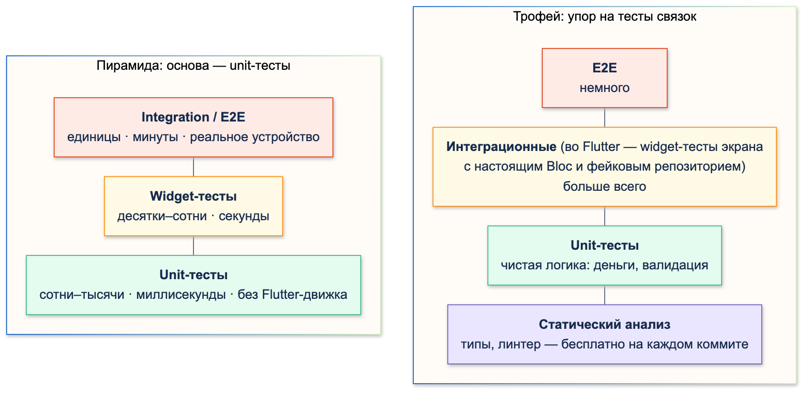
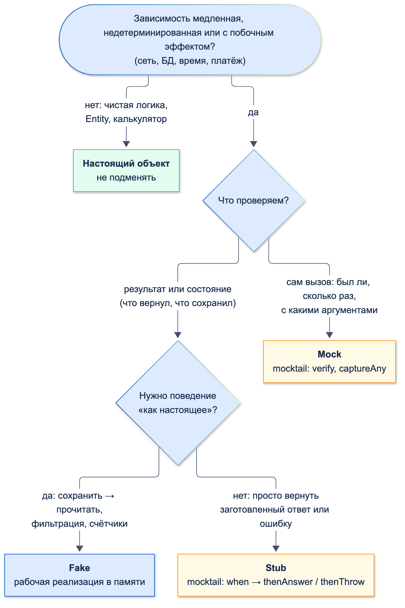
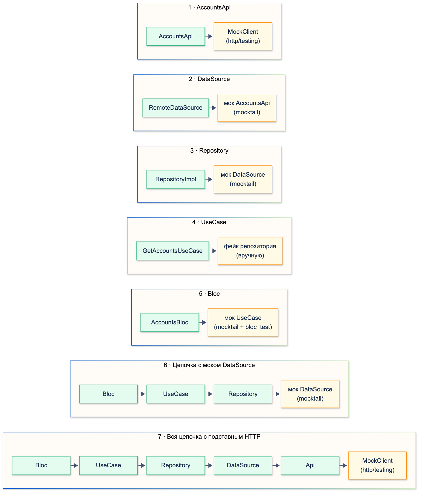

# Стратегия тестирования и unit-тесты

| Грейд | Время на изучение | Статус |
|-------|-------------------|--------|
| ⭐ | ~80 мин | ✅ Готово |

> ℹ️ **Важно:** часть темы уже разобрана в разделе «Архитектура»: тесты репозитория на фейковых DataSource —
> в теме «Паттерн Repository», `bloc_test` — в теме «Паттерны презентационного слоя», подмена зависимостей в тестах —
> в теме «Dependency Injection», страховочные тесты перед рефакторингом — в теме «Техдолг и рефакторинг», что
> проверять на каждом слое — в теме «Архитектура с нуля». Здесь — общая стратегия и инструменты unit-тестов.

---

## 📚 Ресурсы

| Ресурс | Формат | Язык | Уровень | Зачем читать |
|--------|--------|------|---------|--------------|
| Владимир Хориков, «Принципы юнит-тестирования» (Питер, 2021) | Книга | 🇷🇺 | ⭐⭐ | Лучшая книга по теме: что делает тест ценным, классическая и лондонская школы, когда моки вредят |
| [Практическая пирамида тестов](https://habr.com/ru/articles/358950/) | Статья (перевод Хэма Фокке) | 🇷🇺 | ⭐ | Уровни тестов, почему unit-тестов больше всего и как не дублировать проверки между уровнями |
| [Гайд по тестированию на Flutter. Часть 3: Mocking и Stubbing](https://habr.com/ru/articles/831094/) | Статья | 🇷🇺 | ⭐ | `thenReturn` / `thenAnswer` / `thenThrow`, матчеры `isA` и `having` на примерах |
| [Часть 6: Тестовые двойники — Faking vs Mocking](https://habr.com/ru/articles/833894/) | Статья | 🇷🇺 | ⭐⭐ | Почему фейк часто лучше мока, на примере двух ViewModel |
| [Часть 9: Best practices написания unit-тестов](https://habr.com/ru/articles/836226/) | Статья | 🇷🇺 | ⭐ | Структура, именование, выбор инструментов |
| [Flutter: Testing overview](https://docs.flutter.dev/testing/overview) | Документация | 🇬🇧 | ⭐ | Три вида тестов Flutter и их компромиссы: уверенность, цена поддержки, скорость |
| [Martin Fowler: Mocks Aren't Stubs](https://martinfowler.com/articles/mocksArentStubs.html) | Статья | 🇬🇧 | ⭐⭐ | Первоисточник терминов dummy / fake / stub / spy / mock, проверка состояния против проверки поведения |
| [mocktail на pub.dev](https://pub.dev/packages/mocktail) | Документация | 🇬🇧 | ⭐ | API и FAQ: `any(named:)`, `registerFallbackValue`, обобщённые методы |

---

## 🎓 Лекция

### 1. Зачем тесты в банке

Тест — это **исполняемое описание поведения**: «перевод сверх суточного лимита отклоняется и сервер не вызывается».
Он даёт три вещи:

- **Защиту от регрессии.** Ошибка в округлении комиссии на одну копейку на миллионе переводов — это реальные деньги
  и жалобы в Банк России.
- **Смелость менять код.** Без тестов рефакторинг расчёта комиссии — лотерея.
- **Документацию, которая не устаревает.** Новичок читает тесты калькулятора и видит все граничные случаи.

Тест, который проходит при любом поведении кода, хуже отсутствия теста: он создаёт ложную уверенность.
Цель — не «зелёная галочка», а тесты, которые **падают, когда поведение сломано**, и **не падают при рефакторинге**.

### 2. Пирамида и трофей

Во Flutter три вида автотестов:

| Вид | Что проверяет | Скорость | Цена поддержки | Уверенность |
|-----|---------------|----------|----------------|-------------|
| **Unit** | Функцию, класс, Bloc без UI | Миллисекунды, без движка Flutter | Низкая | Низкая — только свою часть |
| **Widget** | Один виджет или экран в тестовом окружении | Быстро, без устройства | Выше | Выше |
| **Integration / E2E** (end-to-end, «от начала до конца») | Приложение целиком на эмуляторе или устройстве | Медленно | Самая высокая | Самая высокая |

Две популярные модели соотношения:

- **Пирамида** (Майк Кон): больше всего unit-тестов внизу, меньше widget-тестов, совсем мало E2E наверху.
  Это и рекомендация документации Flutter: «много unit- и widget-тестов, интеграционных — достаточно для важных
  сценариев».
- **Трофей** (Кент Доддс): основание — статический анализ, больше всего — тестов связок компонентов («Write tests.
  Not too many. Mostly integration.»). Во Flutter роль «интеграционного» уровня трофея играют widget-тесты экрана
  с настоящим Bloc и фейковым репозиторием.



Модели не противоречат друг другу. Практический вывод для мобильного банка:

- **Domain и чистая логика** (деньги, лимиты, валидация, маппинг ошибок) — плотно покрыты unit-тестами: дёшево,
  быстро, точно показывают, где сломалось.
- **Экраны** — widget-тестами ключевых состояний: загрузка, ошибка, пусто, данные.
- **Критичные сценарии** (вход, перевод, оплата) — несколько E2E-тестов.
- **Статический анализ** — на каждом коммите, он ловит целый класс ошибок бесплатно.

### 3. Что тестировать обязательно, а что — нет

**Обязательно:**

- **Деньги:** комиссии, округление, суммы в копейках, конвертация валют, граничные суммы (минимум, максимум,
  ровно на границе, на копейку выше).
- **Лимиты и правила:** суточный и месячный лимит, «хватает ли средств», запрет перевода с заблокированного счёта.
- **Валидация:** номер карты (алгоритм Луна), счёт и БИК (контрольный ключ), ИНН, телефон.
- **Даты:** конец месяца, 29 февраля, полночь, часовые пояса (лимит «в сутки» — по чьему времени?).
- **Маппинг ошибок:** что видит пользователь при 401, 403, 409, 500 и отсутствии сети.
- **Состояния Bloc:** последовательность состояний, повторное нажатие, ошибка посреди загрузки.
- **Повторы и идемпотентность:** повтор платежа не должен списать деньги дважды.

**Не нужно:**

- Геттеры, конструкторы, `copyWith`, сгенерированный код (`*.g.dart`, `*.freezed.dart`) — их проверяет компилятор
  и генератор.
- Сам фреймворк: «`setState` перерисовывает виджет», «`jsonDecode` разбирает JSON».
- Приватные методы напрямую: их проверяют через публичное поведение. Если приватный метод хочется тестировать
  отдельно — возможно, это отдельный класс.

### 4. Анатомия unit-теста

Тесты лежат в `test/`, имя файла заканчивается на `_test.dart`, обычно повторяет путь в `lib/`:
`lib/transfer_fee_calculator.dart` → `test/transfer_fee_calculator_test.dart`. Во Flutter-приложении импортируют
`package:flutter_test/flutter_test.dart`, в чистом Dart-пакете (например, domain-модуль) — `package:test/test.dart`.
API у них общий.

Базовые конструкции — короткой шпаргалкой:

| Конструкция | Назначение |
|-------------|------------|
| `test('описание', () { … })` | Один тест. Может быть `async` |
| `group('название', () { … })` | Группа тестов; имя группы входит в имя теста |
| `setUp` / `tearDown` | Перед и после **каждого** теста группы |
| `setUpAll` / `tearDownAll` | Один раз на группу — для дорогих ресурсов, которые тесты не меняют |
| `expect(actual, matcher)` | Проверка |
| `skip: 'причина'` | Временно выключить тест (причина обязательна по смыслу) |

**Arrange — Act — Assert.** Каждый тест — три части: подготовка, одно действие, проверки. Если в тесте два
действия с проверками между ними — это, скорее всего, два теста.

**Имя теста** читается как предложение: *что* → *при каком условии* → *какой результат*. Плохо: `test1`,
`'fee works'`. Хорошо: `'сверх лимита — ошибка с доступным остатком, сервер не вызывается'`. Упавший тест в отчёте
CI должен сам объяснять, что сломалось.

Запуск:

```bash
flutter test                                     # все тесты
flutter test test/transfer_fee_calculator_test.dart
flutter test --plain-name "дневной лимит"        # только тесты, в имени которых есть подстрока
```

### 5. Матчеры

| Матчер | Пример |
|--------|--------|
| Значение | `expect(fee, 3000)` — то же, что `equals(3000)` |
| Тип и свойства | `isA<DailyLimitExceeded>().having((e) => e.availableKopecks, 'availableKopecks', 1000000)` |
| Коллекции | `hasLength(2)`, `isEmpty`, `contains(x)`, `containsAll([…])`, `orderedEquals([…])` |
| Синхронная ошибка | `expect(() => f(), throwsA(isA<ArgumentError>()))` — **функция**, а не результат вызова |
| `Future` | `completion(5)`, `throwsA(…)` — с `await expectLater(future, …)` |
| `Stream` | `emitsInOrder([…])`, `emits(x)`, `emitsError(…)`, `emitsDone` |
| Числа с плавающей точкой | `closeTo(0.3, 1e-9)` |

`having` даёт понятное сообщение при падении — видно, какое поле не совпало:

```text
Expected: <Instance of 'DailyLimitExceeded'> with `availableKopecks`: <1000000>
  Actual: DailyLimitExceeded:<DailyLimitExceeded(availableKopecks: 5)>
   Which: has `availableKopecks` with value <5>
```

> ⚠️ **Внимание:** `expect(0.1 + 0.2, 0.3)` падает: `Actual: <0.30000000000000004>`. Для `double` нужен `closeTo`.
> Но если тест суммы денег требует `closeTo` — проблема не в тесте, а в коде: деньги считают в целых копейках.

### 6. Тестовые двойники

Двойник (test double) — объект, который подставляют вместо настоящей зависимости. Термины Джерарда Мезароса:

| Вид | Что это | Пример в банке |
|-----|---------|----------------|
| **Dummy** | Заполняет параметр, не используется | `Logger`, который в этом тесте не важен |
| **Stub** | Возвращает заготовленные ответы | «Сервер вернул ошибку 500» |
| **Spy** | Stub, который запоминает вызовы | Счётчик `calls` в фейковом DataSource |
| **Mock** | Проверяет, **как** его вызвали | «`send` вызван трижды с одним ключом идемпотентности» |
| **Fake** | Рабочая упрощённая реализация | История переводов в списке вместо базы данных |

Две стратегии проверки:

- **Проверка состояния** (state verification): вызвали метод — проверили результат или состояние фейка.
  Тест не знает, *как* код дошёл до результата, поэтому переживает рефакторинг.
- **Проверка поведения** (behavior verification): проверяем сами вызовы зависимостей. Тест привязан к реализации:
  поменяли порядок вызовов без изменения результата — тест упал.

**Правило по умолчанию — проверка состояния и фейки.** Мок нужен там, где **вызов и есть результат**: отправка
платежа, отправка аналитики, запись в аудит, «сервер не вызывался при превышении лимита».



**Не подменяйте то, что можно взять настоящим.** Калькулятор комиссии — чистая функция без ввода-вывода: в тестах
сервиса используется настоящий, а не мок. Мок калькулятора проверял бы только то, что сервис передал ему
аргументы, и пропустил бы ошибку в самой комиссии.

### 7. mocktail на практике

`mocktail` — библиотека моков без кодогенерации (в отличие от `mockito`, где моки генерирует `build_runner`).

```dart
// Мок: класс, который наследует Mock и реализует интерфейс
class MockPaymentGateway extends Mock implements PaymentGateway {}

// Stub: что вернуть
when(() => gateway.status('tx-1')).thenAnswer((_) async => TransferStatus.done); // Future — только thenAnswer
when(() => gateway.status(any())).thenThrow(const NetworkException());            // ошибка

// Проверка вызовов
verify(() => gateway.status('tx-1')).called(1);
verifyNever(() => gateway.status(any()));

// Именованные параметры — any(named: 'имя'), иначе ошибка сопоставления
when(() => gateway.send(
      idempotencyKey: any(named: 'idempotencyKey'),
      toAccount: any(named: 'toAccount'),
      amountKopecks: any(named: 'amountKopecks'),
      feeKopecks: any(named: 'feeKopecks'),
    )).thenAnswer((_) async => 'tx-1');

// Захват аргументов: что именно передали при каждом вызове
final keys = verify(() => gateway.send(
      idempotencyKey: captureAny(named: 'idempotencyKey'),
      toAccount: '40817',
      amountKopecks: 500000,
      feeKopecks: 5000,
    )).captured; // ['key-1', 'key-1', 'key-1']
```

Типичные ошибки и что пишет тест:

| Ошибка | Сообщение |
|--------|-----------|
| Метод, возвращающий `Future`, не застаблен | `type 'Null' is not a subtype of type 'Future<TransferStatus>'` — незастабленный метод мока возвращает `null` |
| `thenReturn(Future.value(…))` | ``Invalid argument(s): `thenReturn` should not be used to return a Future. Instead, use `thenAnswer((_) => future)`.`` |
| `any()` для своего типа (`TransferRecord`) | ``Bad state: A test tried to use `any` or `captureAny` on a parameter of type `TransferRecord`, but registerFallbackValue was not previously called…`` — нужен `registerFallbackValue(…)` в `setUpAll` |
| Мок `final class` | Ошибка компиляции: `The class 'TransferFeeCalculator' can't be implemented outside of its library because it's a final class` |

Последнее — не повод убирать `final`: зависимость, которую нужно подменять, описывают **интерфейсом**
(`abstract interface class PaymentGateway`), а `final` остаётся у реализаций и у чистой логики, которую подменять
не нужно.

> 💡 **Совет:** если тест упал на `when` с сообщением `Cannot call when within a stub response`, ищите ошибку
> **выше**: предыдущий `when` в этом же тесте или файле прервался исключением и оставил mocktail в
> незавершённом состоянии.

### 8. Асинхронность и время

**`Future`.** Тест объявляют `async` и ждут результат. Ошибку из `Future` проверяют через `expectLater`:

```dart
await expectLater(
  service.transfer(toAccount: '40817', amountKopecks: 2000000),
  throwsA(isA<DailyLimitExceeded>()),
);
```

Забытый `await` перед вызовом сервиса — частая причина «странных» падений: проверка выполняется раньше, чем
сервис успел что-то сделать.

```dart
test('забытый await', () async {
  service.transfer(toAccount: '1', amountKopecks: 100); // не дождались
  expect(history.records, hasLength(1)); // Expected: an object with length of <1>  Actual: []
});
```

**`Stream`.** Матчеры потоков проверяют события по порядку, `emitsDone` — что поток закрылся:

```dart
expectLater(
  service.watchStatus('tx-1'),
  emitsInOrder([TransferStatus.processing, TransferStatus.processing, TransferStatus.done, emitsDone]),
);
```

**Таймеры.** Если в коде есть `Future.delayed` (повтор через секунду, опрос раз в 2 секунды), тест с настоящим
временем **ждёт по-настоящему**: тест статуса выше идёт 4 секунды. Сотня таких тестов — и CI ждёт минуты.
`fake_async` запускает код в зоне с виртуальным временем, которое двигает сам тест:

```dart
test('опрос статуса — без реального ожидания', () {
  fakeAsync((async) {
    final statuses = <TransferStatus>[];
    service.watchStatus('tx-1').listen(statuses.add);

    async.elapse(const Duration(seconds: 4)); // мгновенно «прошло» 4 секунды

    expect(statuses, [TransferStatus.processing, TransferStatus.processing, TransferStatus.done]);
  });
});
```

- `async.elapse(d)` — сдвинуть время и выполнить все таймеры, которые за это время сработали бы;
- `async.flushMicrotasks()` — выполнить микрозадачи (продолжения после `await`), не двигая время;
- внутри `fakeAsync` тело **синхронное**: не пишите `await`, результат забирайте через `.then` в переменную.

**«Сейчас».** `DateTime.now()` в коде делает тест зависимым от реального времени: тест лимита «в сутки» пройдёт
днём и упадёт в полночь. `fake_async` **не управляет** `DateTime.now()`:

```dart
fakeAsync((async) {
  final realBefore = DateTime.now();
  final fakeBefore = clock.now();
  async.elapse(const Duration(hours: 1));
  print(DateTime.now().difference(realBefore).inMinutes); // 0
  print(clock.now().difference(fakeBefore).inMinutes); // 60
});
```

Решение — пакет `clock`: в коде пишут `clock.now()`, в тестах время подменяют через `withClock(Clock.fixed(…), …)`,
а внутри `fakeAsync` `clock.now()` сам идёт вместе с виртуальным временем. Альтернатива — передавать в конструктор
функцию `DateTime Function() now`.

### 9. Тестовые данные

- **Фабрики и билдеры.** Если в каждом тесте полностью собирается `TransferRecord` со всеми полями, тест тонет
  в деталях. Функция с параметрами по умолчанию оставляет в тесте только то, что важно для проверки:

  ```dart
  TransferRecord aTransfer({int amountKopecks = 100000, DateTime? at}) => TransferRecord(
        id: 'tx-$amountKopecks',
        amountKopecks: amountKopecks,
        feeKopecks: 0,
        at: at ?? DateTime(2026, 10, 7, 12),
      );

  // В тесте видно главное: сумма и время
  history.records.add(aTransfer(amountKopecks: 59000000, at: lateEvening));
  ```

- **Фиксированные данные вместо случайных.** `Random()` и `DateTime.now()` в тестовых данных делают падение
  невоспроизводимым.
- **Свежие объекты на каждый тест.** Всё изменяемое создаётся в `setUp`, а не на уровне файла (см. раздел 12).

### 10. Табличные тесты

Граничные случаи удобно описать таблицей и прогнать циклом. Каждая строка — отдельный тест со своим именем
в отчёте: видно, какая именно граница сломалась.

```dart
const cases = [
  (1, 3000, 'минимальная сумма → минимальная комиссия'),
  (300000, 3000, '3 000 ₽: 1 % ровно равен минимуму'),
  (300001, 3001, 'дробная копейка округляется вверх'),
  (15000000, 150000, '150 000 ₽: 1 % ровно равен максимуму'),
  (15000001, 150000, 'выше максимума — максимум'),
];

for (final (amount, fee, description) in cases) {
  test('$description ($amount коп. → $fee коп.)', () {
    expect(calculator.feeKopecks(amountKopecks: amount, ownAccounts: false), fee);
  });
}
```

Как выбирать строки: **значение на границе, на единицу ниже и на единицу выше** (анализ граничных значений),
плюс по одному представителю из каждого диапазона (классы эквивалентности).

### 11. Покрытие кода

```bash
flutter test --coverage    # → coverage/lcov.info
```

Формат LCOV читают IDE и `genhtml`. Для подсветки покрытых строк в MR GitLab принимает только Cobertura
или JaCoCo, поэтому LCOV в CI конвертируют (это тема «CI/CD»). HTML-отчёт и исключение сгенерированных
файлов — через `lcov` (на macOS: `brew install lcov`, версия 2.x):

```bash
lcov --remove coverage/lcov.info '*.g.dart' '*.freezed.dart' -o coverage/lcov.info --ignore-errors empty
genhtml coverage/lcov.info -o coverage/html   # открыть coverage/html/index.html
```

`--ignore-errors empty` нужен, потому что Flutter не пишет в LCOV покрытие функций, а lcov 2.x считает это ошибкой.

Исключить код прямо в исходнике:

```dart
// coverage:ignore-start
@override
String toString() => 'DailyLimitExceeded(availableKopecks: $availableKopecks)';
// coverage:ignore-end
```

Есть также `// coverage:ignore-line` (в конце строки) и `// coverage:ignore-file`. Для метода надёжнее
`ignore-start` / `ignore-end`: строку объявления с `@override` покрытие считает отдельно, и `ignore-line` на теле
метода её не убирает. `freezed` сам добавляет `// coverage:ignore-file` в сгенерированные файлы, `json_serializable` — нет.

**Как читать цифру:**

- **Файлы, которые не импортирует ни один тест, в отчёт не попадают.** Модуль без единого теста не тянет
  процент вниз — его просто нет в `lcov.info`. Процент завышен ровно на непокрытые файлы.
- **Покрытие строк ≠ покрытие сценариев.** Строка `if (spent + amount > limit)` «покрыта» одним тестом, но граница
  `>` против `>=` проверяется только тестом ровно на лимите.
- **100 % — не цель.** Покрытие можно накрутить тестами без `expect`. Разумно: высокий порог (80–90 %) для
  domain-слоя и расчётов, отдельный общий порог для проекта, и правило «покрытие в MR не падает».

### 12. Нестабильные тесты

Нестабильный (flaky) тест иногда проходит, иногда падает без изменений кода. Частые причины:

| Причина | Лечение |
|---------|---------|
| Реальное время: `DateTime.now()`, `Future.delayed` | `clock`, `fake_async` |
| Общее изменяемое состояние между тестами | Создавать всё в `setUp`, сбрасывать синглтоны и DI в `tearDown` |
| Зависимость от порядка тестов | Найти через случайный порядок (ниже) |
| Реальная сеть, файлы, БД | Фейки; настоящие — только в отдельных интеграционных тестах с тегом |
| Забытый `await` | Линтеры `unawaited_futures`, `discarded_futures` |

**Случайный порядок** выявляет зависимость тестов друг от друга. Два теста, которые используют общий список
на уровне файла, проходят в порядке объявления и падают в другом порядке:

```bash
flutter test --test-randomize-ordering-seed random
# Shuffling test order with --test-randomize-ordering-seed=4273462298
```

Seed печатается в начале: при падении тот же порядок воспроизводится запуском с этим числом.

**Теги** отделяют медленные тесты от быстрых. Теги объявляют в `dart_test.yaml` в корне пакета, иначе тест
выводит `Warning: A tag was used that wasn't specified in dart_test.yaml.`

```dart
test('реальный ответ сервера тестового контура', () async { … }, tags: 'network');
```

```yaml
# dart_test.yaml
tags:
  network:
    timeout: 2x
```

```bash
flutter test --exclude-tags network   # быстрый прогон на каждый MR
flutter test --tags network           # отдельно, например ночью
```

> ⚠️ **Внимание:** у `test` есть параметр `retry: 2` — перезапустить упавший тест. Это **маскирует** проблему:
> тест, который падает раз из трёх, — сигнал о гонке, и в коде приложения она тоже может быть. `retry` допустим
> временно, вместе с задачей в Jira на исправление.

### 13. Где запускать

- **Локально** — перед пушем: `flutter test` для изменённого модуля.
- **В MR (GitLab)** — все unit- и widget-тесты, отчёт о покрытии; MR не вливается, если тесты красные.
- **Ночью** — медленные: интеграционные, с тегами `network`, на устройствах.

Как это собрать в Jenkins, публиковать отчёты и хранить артефакты в Nexus — в теме «CI/CD».

### 14. Пример: перевод с лимитом и повторами

Сквозной пример, на котором видны все приёмы: калькулятор комиссии (чистая логика, настоящий объект), сервис
перевода с суточным лимитом (`clock`), повторами при ошибке сети (`fake_async`) и ключом идемпотентности (мок).

**Код приложения:**

```dart
/// Комиссия за перевод: между своими счетами — бесплатно,
/// другому клиенту — 1 %, но не меньше 30 ₽ и не больше 1 500 ₽.
final class TransferFeeCalculator {
  const TransferFeeCalculator();

  static const minFeeKopecks = 3000; // 30 ₽
  static const maxFeeKopecks = 150000; // 1 500 ₽

  int feeKopecks({required int amountKopecks, required bool ownAccounts}) {
    if (amountKopecks <= 0) {
      throw ArgumentError.value(amountKopecks, 'amountKopecks', 'сумма должна быть больше нуля');
    }
    if (ownAccounts) return 0;
    // 1 % в копейках, дробную копейку округляем вверх: (x + 99) ~/ 100
    final percent = (amountKopecks + 99) ~/ 100;
    return percent.clamp(minFeeKopecks, maxFeeKopecks);
  }
}
```

```dart
import 'package:clock/clock.dart';

import 'transfer_fee_calculator.dart';

enum TransferStatus { processing, done, failed }

final class TransferRecord {
  const TransferRecord({required this.id, required this.amountKopecks, required this.feeKopecks, required this.at});

  final String id;
  final int amountKopecks;
  final int feeKopecks;
  final DateTime at;
}

/// Сеть недоступна — запрос можно повторить
final class NetworkException implements Exception {
  const NetworkException();
}

/// Сервер отказал (недостаточно средств, счёт закрыт) — повторять бессмысленно
final class PaymentRejected implements Exception {
  const PaymentRejected(this.reason);
  final String reason;
}

final class DailyLimitExceeded implements Exception {
  const DailyLimitExceeded({required this.availableKopecks});
  final int availableKopecks;

  @override
  String toString() => 'DailyLimitExceeded(availableKopecks: $availableKopecks)';
}

/// Отправка перевода на сервер
abstract interface class PaymentGateway {
  Future<String> send({
    required String idempotencyKey,
    required String toAccount,
    required int amountKopecks,
    required int feeKopecks,
  });

  Future<TransferStatus> status(String transferId);
}

/// Локальная история переводов
abstract interface class TransferHistory {
  Future<int> spentOn(DateTime day);
  Future<void> save(TransferRecord record);
}

final class TransferService {
  TransferService({
    required PaymentGateway gateway,
    required TransferHistory history,
    required String Function() newIdempotencyKey,
    TransferFeeCalculator fees = const TransferFeeCalculator(),
    Duration pollInterval = const Duration(seconds: 2),
  })  : _gateway = gateway,
        _history = history,
        _newKey = newIdempotencyKey,
        _fees = fees,
        _pollInterval = pollInterval;

  static const dailyLimitKopecks = 60000000; // 600 000 ₽ в сутки
  static const retryDelays = [Duration(seconds: 1), Duration(seconds: 2)];

  final PaymentGateway _gateway;
  final TransferHistory _history;
  final String Function() _newKey;
  final TransferFeeCalculator _fees;
  final Duration _pollInterval;

  Future<TransferRecord> transfer({
    required String toAccount,
    required int amountKopecks,
    bool ownAccounts = false,
  }) async {
    final fee = _fees.feeKopecks(amountKopecks: amountKopecks, ownAccounts: ownAccounts);

    // clock.now(), а не DateTime.now(): в тестах время подменяется
    final spent = await _history.spentOn(clock.now());
    if (spent + amountKopecks > dailyLimitKopecks) {
      throw DailyLimitExceeded(availableKopecks: dailyLimitKopecks - spent);
    }

    // Один ключ на все повторы: сервер по нему поймёт, что это тот же перевод, и не спишет деньги дважды
    final key = _newKey();
    final id = await _sendWithRetry(
      () => _gateway.send(idempotencyKey: key, toAccount: toAccount, amountKopecks: amountKopecks, feeKopecks: fee),
    );

    final record = TransferRecord(id: id, amountKopecks: amountKopecks, feeKopecks: fee, at: clock.now());
    await _history.save(record);
    return record;
  }

  /// Статус перевода, пока он не завершится
  Stream<TransferStatus> watchStatus(String transferId) async* {
    while (true) {
      final status = await _gateway.status(transferId);
      yield status;
      if (status != TransferStatus.processing) return;
      await Future<void>.delayed(_pollInterval);
    }
  }

  Future<String> _sendWithRetry(Future<String> Function() send) async {
    for (var attempt = 0;; attempt++) {
      try {
        return await send();
      } on NetworkException {
        if (attempt == retryDelays.length) rethrow; // попытки кончились
        await Future<void>.delayed(retryDelays[attempt]);
      }
    }
  }
}
```

Что сделано ради тестируемости — и это же просто хороший дизайн:

- зависимости приходят через конструктор и описаны интерфейсами;
- генератор ключа идемпотентности — параметр: в тесте ключи предсказуемы (`key-1`, `key-2`);
- время — через `clock`, задержки — через `Future.delayed` (их перехватывает `fake_async`).

**Фейк истории** — `test/fakes/fake_transfer_history.dart`:

```dart
import 'package:transfers/transfer_service.dart';

/// Фейк: настоящая логика, но в памяти
final class FakeTransferHistory implements TransferHistory {
  final records = <TransferRecord>[];

  @override
  Future<int> spentOn(DateTime day) async => records
      .where((r) => r.at.year == day.year && r.at.month == day.month && r.at.day == day.day)
      .fold<int>(0, (sum, r) => sum + r.amountKopecks);

  @override
  Future<void> save(TransferRecord record) async => records.add(record);
}
```

**Тесты калькулятора** — табличные (раздел 10) плюс два отдельных случая:

```dart
import 'package:flutter_test/flutter_test.dart';
import 'package:transfers/transfer_fee_calculator.dart';

void main() {
  const calculator = TransferFeeCalculator();

  group('TransferFeeCalculator', () {
    // Табличный тест: (сумма, ожидаемая комиссия, что проверяем)
    const cases = [
      (1, 3000, 'минимальная сумма → минимальная комиссия'),
      (300000, 3000, '3 000 ₽: 1 % ровно равен минимуму'),
      (300001, 3001, 'дробная копейка округляется вверх'),
      (15000000, 150000, '150 000 ₽: 1 % ровно равен максимуму'),
      (15000001, 150000, 'выше максимума — максимум'),
    ];

    for (final (amount, fee, description) in cases) {
      test('$description ($amount коп. → $fee коп.)', () {
        expect(calculator.feeKopecks(amountKopecks: amount, ownAccounts: false), fee);
      });
    }

    test('между своими счетами — бесплатно', () {
      expect(calculator.feeKopecks(amountKopecks: 100000, ownAccounts: true), 0);
    });

    test('нулевая сумма → ArgumentError', () {
      expect(
        () => calculator.feeKopecks(amountKopecks: 0, ownAccounts: false),
        throwsA(isA<ArgumentError>().having((e) => e.name, 'name', 'amountKopecks')),
      );
    });
  });
}
```

**Тесты сервиса:**

```dart
import 'package:clock/clock.dart';
import 'package:fake_async/fake_async.dart';
import 'package:flutter_test/flutter_test.dart';
import 'package:mocktail/mocktail.dart';
import 'package:transfers/transfer_service.dart';

import 'fakes/fake_transfer_history.dart';

// Мок: нужен, чтобы проверить, КАК сервис вызывает сервер
class MockPaymentGateway extends Mock implements PaymentGateway {}

void main() {
  late MockPaymentGateway gateway;
  late FakeTransferHistory history;
  late TransferService service;

  // Короткая запись вызова send с любыми аргументами
  Future<String> anySend() => gateway.send(
        idempotencyKey: any(named: 'idempotencyKey'),
        toAccount: any(named: 'toAccount'),
        amountKopecks: any(named: 'amountKopecks'),
        feeKopecks: any(named: 'feeKopecks'),
      );

  setUp(() {
    gateway = MockPaymentGateway();
    history = FakeTransferHistory();
    var counter = 0;
    service = TransferService(
      gateway: gateway,
      history: history,
      newIdempotencyKey: () => 'key-${++counter}',
    );
  });

  group('дневной лимит', () {
    final lateEvening = DateTime(2026, 10, 7, 23, 59);

    setUp(() {
      // Сегодня уже потрачено 590 000 ₽
      history.records.add(TransferRecord(id: 'old', amountKopecks: 59000000, feeKopecks: 0, at: lateEvening));
      when(anySend).thenAnswer((_) async => 'tx-1');
    });

    test('сверх лимита — ошибка с доступным остатком, сервер не вызывается', () async {
      await withClock(Clock.fixed(lateEvening), () async {
        await expectLater(
          service.transfer(toAccount: '40817', amountKopecks: 2000000),
          throwsA(isA<DailyLimitExceeded>().having((e) => e.availableKopecks, 'availableKopecks', 1000000)),
        );
      });
      verifyNever(anySend);
    });

    test('после полуночи лимит снова полный', () async {
      final nextDay = lateEvening.add(const Duration(minutes: 2));
      final record = await withClock(
        Clock.fixed(nextDay),
        () => service.transfer(toAccount: '40817', amountKopecks: 2000000),
      );
      expect(record.at, nextDay);
      expect(history.records, hasLength(2));
    });
  });

  group('повторы при ошибке сети', () {
    test('две ошибки сети, третья попытка успешна — тот же ключ идемпотентности', () {
      fakeAsync((async) {
        var calls = 0;
        when(anySend).thenAnswer((_) async {
          calls++;
          if (calls < 3) throw const NetworkException();
          return 'tx-1';
        });

        TransferRecord? result;
        service.transfer(toAccount: '40817', amountKopecks: 500000).then((r) => result = r);

        async.flushMicrotasks();
        expect(calls, 1); // первая попытка сразу

        async.elapse(const Duration(seconds: 1));
        expect(calls, 2); // повтор через 1 с

        async.elapse(const Duration(seconds: 2));
        expect(calls, 3); // повтор ещё через 2 с
        expect(result?.id, 'tx-1');

        final keys = verify(() => gateway.send(
              idempotencyKey: captureAny(named: 'idempotencyKey'),
              toAccount: '40817',
              amountKopecks: 500000,
              feeKopecks: 5000,
            )).captured;
        expect(keys, ['key-1', 'key-1', 'key-1']);
      });
    });

    test('отказ сервера не повторяется и не попадает в историю', () async {
      when(anySend).thenThrow(const PaymentRejected('Недостаточно средств'));

      await expectLater(
        service.transfer(toAccount: '40817', amountKopecks: 500000),
        throwsA(isA<PaymentRejected>()),
      );

      verify(anySend).called(1);
      expect(history.records, isEmpty);
    });
  });

  group('статус перевода', () {
    test('опрашивает, пока перевод в обработке', () {
      fakeAsync((async) {
        final answers = [TransferStatus.processing, TransferStatus.processing, TransferStatus.done];
        when(() => gateway.status('tx-1')).thenAnswer((_) async => answers.removeAt(0));

        final statuses = <TransferStatus>[];
        service.watchStatus('tx-1').listen(statuses.add);
        async.elapse(const Duration(seconds: 4));

        expect(statuses, [TransferStatus.processing, TransferStatus.processing, TransferStatus.done]);
      });
    });
  });
}
```

Разбор решений:

- **Фейк** у истории: тесту лимита нужно поведение «сохранил → посчитал за день», заготовленным ответом его не описать.
- **Мок** у шлюза: результат, который нас волнует, — сам вызов (сколько раз, с каким ключом, не было ли его вовсе).
- **Настоящий** калькулятор: тест повторов заодно проверяет, что на сервер ушла правильная комиссия —
  1 % от 5 000 ₽ = 50 ₽ (5 000 коп.).
- Граница суток проверена двумя тестами: `23:59` и `00:01` следующего дня.
- В тестах нет ни одного реального ожидания: повторы и опрос статуса идут в виртуальном времени `fake_async`.

### 15. Пример: тестируем цепочку Clean Architecture

Экран «Мои счета». Пользователь открывает экран, запрос идёт по слоям вниз до сервера, ответ поднимается обратно:

```text
AccountsBloc → GetAccountsUseCase → AccountsRepository → AccountsRemoteDataSource → AccountsApi → http.Client → сервер
     ↑                                                                                                         │
состояние ← Result<List<Account>> ← List<Account> ← List<AccountDto> ← List<Map> (JSON) ←──────────────────────┘
```

Тестов два вида:

- **по звеньям** — каждое звено отдельно, следующее за ним подменено. Падение точно показывает, где ошибка;
- **сквозные** — все классы настоящие, подменён только край: DataSource или сам HTTP. Ловят ошибки **стыков**:
  звенья по отдельности верны, а вместе — нет.



Подменяем тремя способами, и все три — в одном примере:

| Способ | Где | Что это |
|--------|-----|---------|
| `MockClient` из `package:http/testing.dart` | Под `AccountsApi` | Подставной HTTP-сервер: функция «запрос → ответ». Идёт в составе пакета `http`, библиотека моков не нужна |
| Мок mocktail | Под DataSource, Repository, Bloc | Заготовленные ответы и проверка вызовов |
| Фейк, написанный вручную | Под UseCase | Рабочая реализация в памяти |

#### Код модуля

Структура — та же, что в разделе «Архитектура»:

```text
lib/
├── core/result.dart
├── data/
│   ├── network/{accounts_api.dart, api_exception.dart}
│   ├── data_sources/accounts_remote_data_source.dart
│   ├── models/response/account_dto.dart
│   └── repositories/accounts_repository_impl.dart
├── domain/
│   ├── entities/account.dart
│   ├── exceptions/accounts_exceptions.dart
│   ├── repositories/accounts_repository.dart
│   └── use_cases/get_accounts_use_case.dart
└── presentation/pages/accounts/bloc/{accounts_bloc.dart, accounts_event.dart, accounts_state.dart}
```

**data:**

```dart
// lib/data/network/api_exception.dart
/// Ошибка HTTP-уровня. statusCode == null — ответа не было (нет сети)
final class ApiException implements Exception {
  const ApiException({this.statusCode});
  final int? statusCode;

  @override
  String toString() => 'ApiException(statusCode: $statusCode)';
}
```

```dart
// lib/data/network/accounts_api.dart
import 'dart:convert';

import 'package:http/http.dart' as http;

import 'api_exception.dart';

/// Обёртка над HTTP: знает эндпоинты и заголовки, возвращает разобранный JSON
class AccountsApi {
  AccountsApi(this._client, {required this.baseUrl, required this.token});

  final http.Client _client;
  final Uri baseUrl;
  final String Function() token;

  Future<List<Map<String, Object?>>> getAccounts() async {
    final http.Response response;
    try {
      response = await _client.get(
        baseUrl.resolve('/v1/accounts'),
        headers: {'Authorization': 'Bearer ${token()}', 'Accept': 'application/json'},
      );
    } on http.ClientException {
      throw const ApiException(); // нет сети, таймаут соединения
    }
    if (response.statusCode != 200) throw ApiException(statusCode: response.statusCode);

    // bodyBytes + utf8: response.body без charset в Content-Type декодируется как latin1
    final json = jsonDecode(utf8.decode(response.bodyBytes)) as Map<String, Object?>;
    return (json['accounts']! as List).cast<Map<String, Object?>>();
  }
}
```

```dart
// lib/data/models/response/account_dto.dart
import '../../../domain/entities/account.dart';

/// Счёт в формате API
final class AccountDto {
  const AccountDto({
    required this.id,
    required this.name,
    required this.balance,
    required this.currency,
    required this.status,
  });

  factory AccountDto.fromJson(Map<String, Object?> json) => AccountDto(
        id: json['id']! as String,
        name: json['name']! as String,
        balance: json['balance']! as int,
        currency: json['currency']! as String,
        status: json['status']! as String,
      );

  final String id;
  final String name;
  final int balance; // в копейках
  final String currency;
  final String status; // ACTIVE | BLOCKED | CLOSED

  Account toEntity() => Account(
        id: id,
        title: name,
        balanceKopecks: balance,
        currency: currency,
        isClosed: status == 'CLOSED',
      );
}
```

```dart
// lib/data/data_sources/accounts_remote_data_source.dart
import '../models/response/account_dto.dart';
import '../network/accounts_api.dart';

abstract interface class AccountsRemoteDataSource {
  Future<List<AccountDto>> fetchAccounts();
}

final class AccountsRemoteDataSourceImpl implements AccountsRemoteDataSource {
  AccountsRemoteDataSourceImpl(this._api);

  final AccountsApi _api;

  @override
  Future<List<AccountDto>> fetchAccounts() async =>
      [for (final json in await _api.getAccounts()) AccountDto.fromJson(json)];
}
```

```dart
// lib/data/repositories/accounts_repository_impl.dart
import '../../domain/entities/account.dart';
import '../../domain/exceptions/accounts_exceptions.dart';
import '../../domain/repositories/accounts_repository.dart';
import '../data_sources/accounts_remote_data_source.dart';
import '../network/api_exception.dart';

final class AccountsRepositoryImpl implements AccountsRepository {
  AccountsRepositoryImpl(this._remote);

  final AccountsRemoteDataSource _remote;

  @override
  Future<List<Account>> getAccounts() async {
    try {
      final dtos = await _remote.fetchAccounts();
      return [for (final dto in dtos) dto.toEntity()];
    } on ApiException catch (e) {
      // Ошибки HTTP не выходят за пределы data: переводим в ошибки domain
      throw switch (e.statusCode) {
        null => const NoConnectionException(),
        401 => const SessionExpiredException(),
        _ => const AccountsUnavailableException(),
      };
    }
  }
}
```

**domain:**

```dart
// lib/core/result.dart
sealed class Result<T> {
  const Result();
}

final class Success<T> extends Result<T> {
  const Success(this.value);
  final T value;
}

final class Failure<T> extends Result<T> {
  const Failure(this.error);
  final Exception error;
}
```

```dart
// lib/domain/entities/account.dart
import 'package:equatable/equatable.dart';

final class Account extends Equatable {
  const Account({
    required this.id,
    required this.title,
    required this.balanceKopecks,
    required this.currency,
    required this.isClosed,
  });

  final String id;
  final String title;
  final int balanceKopecks;
  final String currency;
  final bool isClosed;

  @override
  List<Object?> get props => [id, title, balanceKopecks, currency, isClosed];
}
```

```dart
// lib/domain/exceptions/accounts_exceptions.dart
sealed class AccountsException implements Exception {
  const AccountsException();
}

final class NoConnectionException extends AccountsException {
  const NoConnectionException();
}

final class SessionExpiredException extends AccountsException {
  const SessionExpiredException();
}

final class AccountsUnavailableException extends AccountsException {
  const AccountsUnavailableException();
}
```

```dart
// lib/domain/repositories/accounts_repository.dart
import '../entities/account.dart';

abstract interface class AccountsRepository {
  /// Бросает [AccountsException]
  Future<List<Account>> getAccounts();
}
```

```dart
// lib/domain/use_cases/get_accounts_use_case.dart
import '../../core/result.dart';
import '../entities/account.dart';
import '../exceptions/accounts_exceptions.dart';
import '../repositories/accounts_repository.dart';

/// Счета для главного экрана: без закрытых, сначала с большим балансом.
/// Класс не final: в тестах Bloc его подменяют моком mocktail
class GetAccountsUseCase {
  GetAccountsUseCase(this._repository);

  final AccountsRepository _repository;

  Future<Result<List<Account>>> call() async {
    try {
      final accounts = await _repository.getAccounts();
      final open = accounts.where((a) => !a.isClosed).toList()
        ..sort((a, b) => b.balanceKopecks.compareTo(a.balanceKopecks));
      return Success(open);
    } on AccountsException catch (e) {
      return Failure(e);
    }
  }
}
```

**presentation:**

```dart
// lib/presentation/pages/accounts/bloc/accounts_bloc.dart
import 'package:equatable/equatable.dart';
import 'package:flutter_bloc/flutter_bloc.dart';

import '../../../../core/result.dart';
import '../../../../domain/entities/account.dart';
import '../../../../domain/exceptions/accounts_exceptions.dart';
import '../../../../domain/use_cases/get_accounts_use_case.dart';

part 'accounts_event.dart';
part 'accounts_state.dart';

/// Не final: в widget-тестах экран получает MockBloc, который реализует этот класс
class AccountsBloc extends Bloc<AccountsEvent, AccountsState> {
  AccountsBloc(this._getAccounts) : super(const AccountsInitial()) {
    on<AccountsRequested>(_onRequested);
  }

  final GetAccountsUseCase _getAccounts;

  Future<void> _onRequested(AccountsRequested event, Emitter<AccountsState> emit) async {
    emit(const AccountsLoading());
    final result = await _getAccounts();
    emit(switch (result) {
      Success(:final value) => AccountsLoaded(value),
      Failure(error: NoConnectionException()) => const AccountsError('Нет соединения с интернетом'),
      Failure(error: SessionExpiredException()) => const AccountsError('Сессия истекла, войдите снова'),
      Failure() => const AccountsError('Не удалось загрузить счета, попробуйте позже'),
    });
  }
}
```

```dart
// lib/presentation/pages/accounts/bloc/accounts_event.dart
part of 'accounts_bloc.dart';

sealed class AccountsEvent {
  const AccountsEvent();
}

final class AccountsRequested extends AccountsEvent {
  const AccountsRequested();
}
```

```dart
// lib/presentation/pages/accounts/bloc/accounts_state.dart
part of 'accounts_bloc.dart';

sealed class AccountsState extends Equatable {
  const AccountsState();

  @override
  List<Object?> get props => [];
}

final class AccountsInitial extends AccountsState {
  const AccountsInitial();
}

final class AccountsLoading extends AccountsState {
  const AccountsLoading();
}

final class AccountsLoaded extends AccountsState {
  const AccountsLoaded(this.accounts);
  final List<Account> accounts;

  @override
  List<Object?> get props => [accounts];
}

final class AccountsError extends AccountsState {
  const AccountsError(this.message);
  final String message;

  @override
  List<Object?> get props => [message];
}
```

> ℹ️ **Важно:** тексты ошибок прямо в Bloc — упрощение примера. В приложении это ключи локализации, тест сверяет
> ключ или тип ошибки.

#### Тестовые данные

Общие данные лежат в `test/fixtures/`, фейки — в `test/fakes/`. Не импортируйте один `*_test.dart` из другого
ради его фейка: общие помощники выносят в отдельные файлы.

```dart
// test/fixtures/accounts_fixtures.dart
import 'package:accounts/data/models/response/account_dto.dart';
import 'package:accounts/domain/entities/account.dart';

/// Ответ сервера, как он приходит по сети
const accountsJson = '''
{
  "accounts": [
    {"id": "1", "name": "Зарплатный", "balance": 15000000, "currency": "RUB", "status": "ACTIVE"},
    {"id": "2", "name": "Накопительный", "balance": 50000000, "currency": "RUB", "status": "ACTIVE"},
    {"id": "3", "name": "Старый", "balance": 0, "currency": "RUB", "status": "CLOSED"}
  ]
}
''';

const salaryDto = AccountDto(id: '1', name: 'Зарплатный', balance: 15000000, currency: 'RUB', status: 'ACTIVE');
const savingsDto = AccountDto(id: '2', name: 'Накопительный', balance: 50000000, currency: 'RUB', status: 'ACTIVE');
const closedDto = AccountDto(id: '3', name: 'Старый', balance: 0, currency: 'RUB', status: 'CLOSED');

const salary = Account(id: '1', title: 'Зарплатный', balanceKopecks: 15000000, currency: 'RUB', isClosed: false);
const savings = Account(id: '2', title: 'Накопительный', balanceKopecks: 50000000, currency: 'RUB', isClosed: false);
const closed = Account(id: '3', title: 'Старый', balanceKopecks: 0, currency: 'RUB', isClosed: true);
```

```dart
// test/fakes/fake_accounts_repository.dart
import 'package:accounts/domain/entities/account.dart';
import 'package:accounts/domain/exceptions/accounts_exceptions.dart';
import 'package:accounts/domain/repositories/accounts_repository.dart';

/// Фейк репозитория: отдаёт заданные счета или бросает заданную ошибку
final class FakeAccountsRepository implements AccountsRepository {
  List<Account> accounts = [];
  AccountsException? error;
  var calls = 0;

  @override
  Future<List<Account>> getAccounts() async {
    calls++;
    if (error case final e?) throw e;
    return accounts;
  }
}
```

#### Звено 1. API: подставной HTTP-сервер `MockClient`

`MockClient` получает настоящий `http.Request` и возвращает `http.Response`. Можно проверить, **что ушло** на сервер
(метод, адрес, заголовки), и подставить **любой ответ**: JSON, код ошибки, обрыв соединения.

```dart
// test/data/network/accounts_api_test.dart
import 'dart:convert';

import 'package:accounts/data/network/accounts_api.dart';
import 'package:accounts/data/network/api_exception.dart';
import 'package:flutter_test/flutter_test.dart';
import 'package:http/http.dart' as http;
import 'package:http/testing.dart';

import '../../fixtures/accounts_fixtures.dart';

void main() {
  final baseUrl = Uri.parse('https://api.bank.test');

  AccountsApi apiWith(MockClientHandler handler) =>
      AccountsApi(MockClient(handler), baseUrl: baseUrl, token: () => 'token-123');

  test('отправляет GET на /v1/accounts с токеном и разбирает JSON', () async {
    http.Request? sent;
    final api = apiWith((request) async {
      sent = request; // запоминаем запрос, чтобы проверить его после вызова
      return http.Response.bytes(utf8.encode(accountsJson), 200);
    });

    final accounts = await api.getAccounts();

    expect(sent!.method, 'GET');
    expect(sent!.url.toString(), 'https://api.bank.test/v1/accounts');
    expect(sent!.headers['Authorization'], 'Bearer token-123');
    expect(accounts, hasLength(3));
    expect(accounts.first['name'], 'Зарплатный');
  });

  test('код не 200 → ApiException с этим кодом', () {
    final api = apiWith((_) async => http.Response('', 500));
    expect(api.getAccounts(), throwsA(isA<ApiException>().having((e) => e.statusCode, 'statusCode', 500)));
  });

  test('нет сети → ApiException без кода', () {
    final api = apiWith((request) async => throw http.ClientException('Connection refused', request.url));
    expect(api.getAccounts(), throwsA(isA<ApiException>().having((e) => e.statusCode, 'statusCode', isNull)));
  });
}
```

Две ловушки с кириллицей в ответе:

- `http.Response('{"name": "Зарплатный"}', 200)` **падает** при создании ответа:
  `Invalid argument (string): Contains invalid characters.` Конструктор кодирует строку в latin1, если в заголовках
  нет `charset`. Поэтому в тестах — `http.Response.bytes(utf8.encode(json), 200)` или заголовок
  `content-type: application/json; charset=utf-8`.
- `response.body` без `charset` **декодирует как latin1**. Если в `AccountsApi` написать `jsonDecode(response.body)`,
  тест выше падает с `Expected: 'Зарплатный'  Actual: 'ÐаÑплаÑнÑй'`. Сервер, который не указывает
  кодировку, в продакшене даст ту же «кракозябру» — тест ловит реальную ошибку.

#### Звено 2. DataSource: мок API

```dart
// test/data/data_sources/accounts_remote_data_source_test.dart
import 'dart:convert';

import 'package:accounts/data/data_sources/accounts_remote_data_source.dart';
import 'package:accounts/data/network/accounts_api.dart';
import 'package:flutter_test/flutter_test.dart';
import 'package:mocktail/mocktail.dart';

import '../../fixtures/accounts_fixtures.dart';

class MockAccountsApi extends Mock implements AccountsApi {}

void main() {
  late MockAccountsApi api;
  late AccountsRemoteDataSourceImpl dataSource;

  setUp(() {
    api = MockAccountsApi();
    dataSource = AccountsRemoteDataSourceImpl(api);
  });

  test('превращает JSON из API в DTO', () async {
    final json = (jsonDecode(accountsJson) as Map<String, Object?>)['accounts']! as List;
    when(() => api.getAccounts()).thenAnswer((_) async => json.cast<Map<String, Object?>>());

    final dtos = await dataSource.fetchAccounts();

    expect(dtos.map((d) => d.name), ['Зарплатный', 'Накопительный', 'Старый']);
    expect(dtos.last.status, 'CLOSED');
    verify(() => api.getAccounts()).called(1);
  });
}
```

`AccountsApi` — обычный класс (не `final`), поэтому mocktail может его реализовать. Если бы API был `final class`,
понадобился бы интерфейс или тест на уровне `MockClient`, как в звене 1.

#### Звено 3. Repository: мок DataSource и таблица ошибок

```dart
// test/data/repositories/accounts_repository_impl_test.dart
import 'package:accounts/data/data_sources/accounts_remote_data_source.dart';
import 'package:accounts/data/network/api_exception.dart';
import 'package:accounts/data/repositories/accounts_repository_impl.dart';
import 'package:accounts/domain/exceptions/accounts_exceptions.dart';
import 'package:flutter_test/flutter_test.dart';
import 'package:mocktail/mocktail.dart';

import '../../fixtures/accounts_fixtures.dart';

class MockAccountsRemoteDataSource extends Mock implements AccountsRemoteDataSource {}

void main() {
  late MockAccountsRemoteDataSource remote;
  late AccountsRepositoryImpl repository;

  setUp(() {
    remote = MockAccountsRemoteDataSource();
    repository = AccountsRepositoryImpl(remote);
  });

  test('DTO → Entity: статус CLOSED становится isClosed', () async {
    when(() => remote.fetchAccounts()).thenAnswer((_) async => [salaryDto, closedDto]);

    expect(await repository.getAccounts(), [salary, closed]);
  });

  // Табличный тест перевода ошибок: ApiException → ошибка domain
  final cases = <(int?, TypeMatcher<AccountsException>)>[
    (null, isA<NoConnectionException>()),
    (401, isA<SessionExpiredException>()),
    (500, isA<AccountsUnavailableException>()),
    (503, isA<AccountsUnavailableException>()),
  ];

  for (final (statusCode, matcher) in cases) {
    test('ApiException($statusCode) → ${matcher.runtimeType}', () {
      when(() => remote.fetchAccounts()).thenThrow(ApiException(statusCode: statusCode));
      expect(repository.getAccounts(), throwsA(matcher));
    });
  }
}
```

В отчёте каждая строка таблицы — отдельный тест: `ApiException(401) → TypeMatcher<SessionExpiredException>`.

#### Звено 4. UseCase: фейк репозитория

Здесь мок не нужен: UseCase проверяют по результату, а фейк проще читать, чем `when(...)`.

```dart
// test/domain/use_cases/get_accounts_use_case_test.dart
import 'package:accounts/core/result.dart';
import 'package:accounts/domain/entities/account.dart';
import 'package:accounts/domain/exceptions/accounts_exceptions.dart';
import 'package:accounts/domain/use_cases/get_accounts_use_case.dart';
import 'package:flutter_test/flutter_test.dart';

import '../../fakes/fake_accounts_repository.dart';
import '../../fixtures/accounts_fixtures.dart';

void main() {
  late FakeAccountsRepository repository;
  late GetAccountsUseCase getAccounts;

  setUp(() {
    repository = FakeAccountsRepository();
    getAccounts = GetAccountsUseCase(repository);
  });

  test('скрывает закрытые и сортирует по убыванию баланса', () async {
    repository.accounts = [salary, closed, savings];

    final result = await getAccounts();

    expect(result, isA<Success<List<Account>>>().having((r) => r.value, 'value', [savings, salary]));
  });

  test('ошибка репозитория → Failure с той же ошибкой', () async {
    repository.error = const SessionExpiredException();

    final result = await getAccounts();

    expect(result, isA<Failure<List<Account>>>().having((r) => r.error, 'error', isA<SessionExpiredException>()));
  });
}
```

#### Звено 5. Bloc: `bloc_test` и мок UseCase

```dart
// test/presentation/accounts/accounts_bloc_test.dart
import 'package:accounts/core/result.dart';
import 'package:accounts/domain/entities/account.dart';
import 'package:accounts/domain/exceptions/accounts_exceptions.dart';
import 'package:accounts/domain/use_cases/get_accounts_use_case.dart';
import 'package:accounts/presentation/pages/accounts/bloc/accounts_bloc.dart';
import 'package:bloc_test/bloc_test.dart';
import 'package:flutter_test/flutter_test.dart';
import 'package:mocktail/mocktail.dart';

import '../../fixtures/accounts_fixtures.dart';

class MockGetAccountsUseCase extends Mock implements GetAccountsUseCase {}

void main() {
  late MockGetAccountsUseCase getAccounts;

  setUp(() => getAccounts = MockGetAccountsUseCase());

  blocTest<AccountsBloc, AccountsState>(
    'успех: загрузка → список счетов',
    setUp: () => when(() => getAccounts()).thenAnswer((_) async => const Success([savings, salary])),
    build: () => AccountsBloc(getAccounts),
    act: (bloc) => bloc.add(const AccountsRequested()),
    expect: () => const [AccountsLoading(), AccountsLoaded([savings, salary])],
    verify: (_) => verify(() => getAccounts()).called(1),
  );

  blocTest<AccountsBloc, AccountsState>(
    'сессия истекла: загрузка → текст ошибки',
    setUp: () => when(() => getAccounts())
        .thenAnswer((_) async => const Failure<List<Account>>(SessionExpiredException())),
    build: () => AccountsBloc(getAccounts),
    act: (bloc) => bloc.add(const AccountsRequested()),
    expect: () => const [AccountsLoading(), AccountsError('Сессия истекла, войдите снова')],
  );
}
```

`GetAccountsUseCase` вызывается как функция (`getAccounts()`) — это метод `call`, и mocktail стабит его так же:
`when(() => getAccounts())`.

#### Под капотом: тот же тест на чистом `flutter_test`

`bloc_test` — тонкая обёртка. По его исходникам `blocTest` делает по шагам: `setUp` → `build()` → подписка на
`bloc.stream` → `act` → пауза `wait` (если задана) и ещё один «нулевой» `Future.delayed` → `await bloc.close()` →
сравнение собранных состояний с `expect` → `verify` → `tearDown`. Всё запускается в зоне, которая собирает
необработанные ошибки Bloc для `errors`.

Тот же сценарий без `bloc_test` и без mocktail — только `flutter_test` и spy, написанный вручную:

```dart
// test/presentation/accounts/accounts_bloc_plain_test.dart
import 'package:accounts/core/result.dart';
import 'package:accounts/domain/entities/account.dart';
import 'package:accounts/domain/use_cases/get_accounts_use_case.dart';
import 'package:accounts/presentation/pages/accounts/bloc/accounts_bloc.dart';
import 'package:flutter_test/flutter_test.dart';

import '../../fakes/fake_accounts_repository.dart';
import '../../fixtures/accounts_fixtures.dart';

/// Spy вручную: настоящий UseCase, который запоминает вызовы
final class SpyGetAccountsUseCase extends GetAccountsUseCase {
  SpyGetAccountsUseCase(super.repository);

  var calls = 0;

  @override
  Future<Result<List<Account>>> call() {
    calls++;
    return super.call();
  }
}

void main() {
  test('успех: загрузка → список счетов (без bloc_test и mocktail)', () async {
    // build
    final repository = FakeAccountsRepository()..accounts = [salary, savings, closed];
    final getAccounts = SpyGetAccountsUseCase(repository);
    final bloc = AccountsBloc(getAccounts);

    // подписываемся ДО события, иначе можно пропустить состояния
    final states = <AccountsState>[];
    final subscription = bloc.stream.listen(states.add);

    // act
    bloc.add(const AccountsRequested());

    // дать обработчику события отработать до конца
    await bloc.close();
    await subscription.cancel();

    // expect
    expect(states, const [AccountsLoading(), AccountsLoaded([savings, salary])]);
    // verify
    expect(getAccounts.calls, 1);
  });
}
```

| `blocTest` | Чистый `flutter_test` |
|------------|------------------------|
| `build: () => AccountsBloc(…)` | `final bloc = AccountsBloc(…)` |
| — (подписка внутри) | `bloc.stream.listen(states.add)` до первого события |
| `act: (bloc) => bloc.add(…)` | `bloc.add(…)` |
| — (закрытие внутри) | `await bloc.close()` — ждёт, пока обработчик события допишет состояния |
| `expect: () => […]` | `expect(states, […])` |
| `verify: (_) => verify(…).called(1)` | `expect(spy.calls, 1)` |

> ⚠️ **Внимание:** `bloc.stream` — broadcast-поток: состояния, выпущенные **до подписки**, в него не попадут.
> Если между `bloc.add(…)` и `listen` есть ожидание (например, `await Future<void>.delayed(Duration.zero)`), список
> состояний окажется **пустым** (`[]`): обработчик успевает отработать раньше подписки. Подписывайтесь до события
> или сразу после `add`, без `await` между ними.

Когда что брать: `bloc_test` — для большинства тестов Bloc (короче, понятный дифф при падении, ловит ошибки в
`errors`). Чистый `expectLater(bloc.stream, emitsInOrder([...]))` — когда Bloc проверяется внутри сквозного теста
вместе с HTTP и удобнее иметь доступ к нему напрямую.

#### Сквозные тесты: вся цепочка туда и обратно

Два уровня подмены в одном файле: мок DataSource (проверяем Bloc → UseCase → Repository и обратно) и подставной
HTTP (вся цепочка, включая разбор JSON и заголовки). Состояния проверяются матчером `emitsInOrder` — без `bloc_test`.

```dart
// test/chain/accounts_chain_test.dart
import 'dart:convert';

import 'package:accounts/data/data_sources/accounts_remote_data_source.dart';
import 'package:accounts/data/network/accounts_api.dart';
import 'package:accounts/data/network/api_exception.dart';
import 'package:accounts/data/repositories/accounts_repository_impl.dart';
import 'package:accounts/domain/use_cases/get_accounts_use_case.dart';
import 'package:accounts/presentation/pages/accounts/bloc/accounts_bloc.dart';
import 'package:flutter_test/flutter_test.dart';
import 'package:http/http.dart' as http;
import 'package:http/testing.dart';
import 'package:mocktail/mocktail.dart';

import '../fixtures/accounts_fixtures.dart';

class MockAccountsRemoteDataSource extends Mock implements AccountsRemoteDataSource {}

void main() {
  group('цепочка с моком DataSource', () {
    late MockAccountsRemoteDataSource remote;
    late AccountsBloc bloc;

    setUp(() {
      remote = MockAccountsRemoteDataSource();
      // Всё настоящее, кроме DataSource
      bloc = AccountsBloc(GetAccountsUseCase(AccountsRepositoryImpl(remote)));
    });

    tearDown(() => bloc.close());

    test('DTO с сервера доходят до экрана: без закрытых, по убыванию баланса', () async {
      when(() => remote.fetchAccounts()).thenAnswer((_) async => [salaryDto, savingsDto, closedDto]);

      bloc.add(const AccountsRequested());

      await expectLater(
        bloc.stream,
        emitsInOrder([const AccountsLoading(), const AccountsLoaded([savings, salary])]),
      );
      verify(() => remote.fetchAccounts()).called(1);
    });

    test('401 из DataSource превращается в текст на экране', () async {
      when(() => remote.fetchAccounts()).thenThrow(const ApiException(statusCode: 401));

      bloc.add(const AccountsRequested());

      await expectLater(
        bloc.stream,
        emitsInOrder([const AccountsLoading(), const AccountsError('Сессия истекла, войдите снова')]),
      );
    });
  });

  group('цепочка с подставным HTTP-сервером', () {
    late List<http.Request> requests;

    /// Собирает настоящую цепочку; подменён только http.Client
    AccountsBloc buildBloc(MockClientHandler server) {
      final client = MockClient((request) {
        requests.add(request);
        return server(request);
      });
      final api = AccountsApi(client, baseUrl: Uri.parse('https://api.bank.test'), token: () => 'token-123');
      return AccountsBloc(GetAccountsUseCase(AccountsRepositoryImpl(AccountsRemoteDataSourceImpl(api))));
    }

    setUp(() => requests = []);

    test('JSON сервера → состояние экрана', () async {
      final bloc = buildBloc((_) async => http.Response.bytes(utf8.encode(accountsJson), 200));
      addTearDown(bloc.close);

      bloc.add(const AccountsRequested());

      await expectLater(
        bloc.stream,
        emitsInOrder([const AccountsLoading(), const AccountsLoaded([savings, salary])]),
      );
      expect(requests.single.url.path, '/v1/accounts');
      expect(requests.single.headers['Authorization'], 'Bearer token-123');
    });

    test('сервер ответил 500 → «попробуйте позже»', () async {
      final bloc = buildBloc((_) async => http.Response('Internal Server Error', 500));
      addTearDown(bloc.close);

      bloc.add(const AccountsRequested());

      await expectLater(
        bloc.stream,
        emitsInOrder([const AccountsLoading(), const AccountsError('Не удалось загрузить счета, попробуйте позже')]),
      );
    });

    test('нет сети → «Нет соединения с интернетом»', () async {
      final bloc = buildBloc((request) async => throw http.ClientException('Connection refused', request.url));
      addTearDown(bloc.close);

      bloc.add(const AccountsRequested());

      await expectLater(
        bloc.stream,
        emitsInOrder([const AccountsLoading(), const AccountsError('Нет соединения с интернетом')]),
      );
    });
  });
}
```

`addTearDown(bloc.close)` регистрирует закрытие Bloc прямо в тесте: удобно, когда объект создаётся не в `setUp`.

#### Что ловит каждый тест

Чтобы убедиться, что тесты чего-то стоят, код ломали по одному месту и смотрели, какие тесты покраснели
(всего в примере 19 тестов, без поломок все зелёные):

| Поломка | Упавшие тесты |
|---------|---------------|
| В репозитории `401 =>` заменили на `403 =>` | Звено 3: `ApiException(401) → …`; сквозной: «401 из DataSource превращается в текст на экране» |
| В UseCase убрали сортировку | Звено 4; Bloc на чистом `flutter_test`; сквозные «DTO с сервера доходят до экрана…» и «JSON сервера → состояние экрана». **`bloc_test` с моком UseCase — зелёный** |
| В API `jsonDecode(response.body)` вместо `utf8.decode(response.bodyBytes)` | Звено 1: разбор JSON; сквозной «JSON сервера → состояние экрана» |
| В DTO статус сравнивается с `'closed'` вместо `'CLOSED'` | Звено 3: «DTO → Entity…»; оба сквозных успешных сценария |

Выводы:

- **Тест звена указывает место**, сквозной — что сломан сценарий пользователя. Нужны оба вида.
- **Тест Bloc с моком UseCase не заметил пропажу сортировки — и не должен.** Сортировка — ответственность UseCase,
  её проверяет тест UseCase. Тест Bloc проверяет только то, что Bloc делает сам: состояния и тексты ошибок.
- **Ошибку кодировки поймали только тесты с настоящим разбором ответа** (`MockClient`). Тесты с моком API или
  DataSource получают уже готовые строки и её не видят.
- Сквозных тестов немного: успех и по одному на каждый вид ошибки. Все граничные случаи — в тестах звеньев.

### 🚫 Чрезмерное применение

- **Мок на всё.** Каждая зависимость — мок, в тесте 15 строк `when` и 10 `verify`. Такой тест повторяет реализацию
  строка за строкой и падает при любом рефакторинге, не находя ошибок.
- **Тесты ради процента покрытия.** Тесты на геттеры и `toString`, тесты без `expect`, вызывающие код «чтобы строки
  стали зелёными».
- **Абстракции только ради тестов.** Интерфейс на каждый класс, даже на чистую логику без ввода-вывода.
  Интерфейс нужен на границе с внешним миром: сеть, БД, время, платформа.
- **`@visibleForTesting` на приватной логике.** Если её хочется тестировать отдельно, это отдельный класс со
  своим публичным API.

### ⚠️ Частые ошибки

- `DateTime.now()` в коде и тест, который падает в полночь или первого числа месяца.
- `double` для денег и `closeTo` в тестах сумм.
- Изменяемые объекты на уровне файла вместо `setUp` — тесты зависят от порядка.
- `expect(f(), throwsA(…))` вместо `expect(() => f(), throwsA(…))` для синхронной ошибки: исключение вылетает
  ещё до `expect`, и тест падает с этим исключением, а не проходит проверку.
- `thenReturn` для `Future` и незастабленные асинхронные методы мока.
- Тест, который никогда не падал: после написания теста стоит временно сломать код (`>` на `>=`) и убедиться,
  что тест покраснел.
- Один тест на всё: «создать, изменить, удалить» с проверками между шагами — при падении непонятно, что сломано.
- `http.Response('кириллица', 200)` в тесте — падает с `Contains invalid characters`; нужен `Response.bytes(utf8.encode(…))`.
- Подписка на `bloc.stream` после `await` — состояния уже прошли, тест видит пустой список.
- Только сквозные тесты: красный сквозной тест не говорит, какое звено сломано; граничные случаи — в тестах звеньев.

### 🎤 Задачи с собеседования

**1. «Как бы ты протестировал сервис перевода с суточным лимитом и повторами при ошибке сети?»**

- ⭐ Junior: «unit-тестами; замокаю API, проверю, что при ошибке бросается исключение».
- ⭐⭐ Middle: разделяет калькулятор (табличные тесты границ) и сервис; фейк истории, мок шлюза; `clock` для
  лимита, `fake_async` для повторов; проверяет, что отказ сервера не повторяется.
- ⭐⭐⭐ Senior: всё из Middle плюс **ключ идемпотентности** — один на все повторы (проверка через `captureAny`),
  граница суток и часовой пояс (по чьему времени лимит — клиента или банка?), лимит на сервере как источник
  истины, а клиентская проверка — только для UX.

**2. «Покрытие проекта 85 %. Это хорошо?»**

Само число мало говорит. Вопросы в ответ: какие файлы вообще не попали в отчёт; каково покрытие domain-слоя
и расчётов; есть ли тесты на граничные значения; падают ли тесты, если сломать условие. Хороший ответ —
про **качество** тестов и процент по критичным модулям, а не про общую цифру.

**3. «Тест иногда падает в CI, локально — никогда. Твои действия?»**

Запустить с `--test-randomize-ordering-seed random` и много раз подряд; искать общее состояние между тестами,
реальное время, реальную сеть, забытые `await`. Не ставить `retry` как решение. Если тест падает из-за гонки,
проверить, нет ли той же гонки в коде приложения.

---

## ✅ Самопроверка

**⭐ Junior**
1. Чем unit-тест отличается от widget- и интеграционного теста?
2. Что такое Arrange — Act — Assert?
3. Как проверить, что синхронная функция бросает `ArgumentError`?
4. Почему суммы денег в тестах (и в коде) — в копейках, а не в `double`?

**⭐⭐ Middle**
1. Чем фейк отличается от мока? Когда что выбрать?
2. Почему метод мока, возвращающий `Future`, нельзя стабить через `thenReturn`?
3. Как протестировать повтор запроса через 1 и 2 секунды без реального ожидания?
4. Почему тест с `DateTime.now()` может падать в полночь и как это исправить?
5. Зачем `registerFallbackValue`?
6. Чем `MockClient` из `package:http/testing.dart` отличается от мока `AccountsApi`? Какую ошибку ловит только он?
7. Сортировку в UseCase сломали, а тест Bloc с моком UseCase зелёный. Это плохой тест?

**⭐⭐⭐ Senior**
1. Почему покрытие 90 % может вводить в заблуждение? Назови минимум три причины.
2. Как найти тест, который зависит от порядка выполнения?
3. Что проверить в тесте повторов платежа, кроме количества попыток?
4. Где нужен мок, а где он делает тесты хрупкими? Приведи пример из банковского приложения.
5. Что делает `blocTest` под капотом? Как написать тот же тест без `bloc_test`?
6. Зачем нужны и тесты звеньев, и сквозные тесты цепочки, если сквозной проверяет всё сразу?

<details>
<summary>Ответы</summary>

**Junior**
1. Unit проверяет функцию или класс без UI, работает за миллисекунды. Widget-тест проверяет виджет или экран
   в тестовом окружении Flutter без устройства. Интеграционный запускает приложение целиком на эмуляторе
   или устройстве: самый медленный и дорогой, но даёт больше всего уверенности.
2. Структура теста: подготовка данных и зависимостей → одно действие → проверки результата.
3. `expect(() => f(), throwsA(isA<ArgumentError>()))` — передаём функцию, а не результат вызова.
4. `double` не представляет точно десятичные дроби (`0.1 + 0.2 = 0.30000000000000004`), ошибки копятся при
   сложении и округлении. Целые копейки считаются точно.

**Middle**
1. Фейк — рабочая упрощённая реализация (история в списке), с ним проверяют состояние и результат. Мок проверяет
   сами вызовы. Фейк — по умолчанию; мок — когда вызов и есть результат (платёж, аналитика, «сервер не вызван»).
2. mocktail запрещает это с ошибкой ``Invalid argument(s): `thenReturn` should not be used to return a Future``:
   заранее созданный `Future` был бы один на все вызовы, а его ошибка могла бы всплыть как необработанная ещё
   до вызова. Нужен `thenAnswer((_) async => …)` — новый `Future` на каждый вызов.
3. `fakeAsync((async) { … async.elapse(const Duration(seconds: 1)); … })`: таймеры срабатывают при сдвиге
   виртуального времени.
4. Результат зависит от реального времени запуска: перед полуночью и после — разные «сегодня». В коде —
   `clock.now()`, в тесте — `withClock(Clock.fixed(…), …)`; в `fakeAsync` `clock.now()` идёт с виртуальным временем.
5. `any()` и `captureAny()` должны вернуть значение своего типа, пока `when` / `verify` записывает вызов. Для
   встроенных типов mocktail его знает, для своих — нужно зарегистрировать образец в `setUpAll`.
6. `MockClient` подменяет HTTP-клиент: настоящий `AccountsApi` строит запрос и разбирает ответ, поэтому проверяются
   адрес, заголовки, коды ответа и разбор JSON. Мок `AccountsApi` отдаёт уже разобранные данные. Только `MockClient`
   ловит ошибки разбора — например, `response.body` без `charset`, превращающий кириллицу в «кракозябры».
7. Нет. Сортировка — ответственность UseCase, её проверяет тест UseCase (он упал). Тест Bloc проверяет только то,
   что делает Bloc: последовательность состояний и тексты ошибок. Иначе одна ошибка роняет тесты всех слоёв выше.

**Senior**
1. Файлы без тестов не попадают в отчёт; покрытие строк не равно покрытию веток и границ (`>` против `>=`);
   строки «покрываются» тестами без проверок; общий процент прячет непокрытый критичный модуль за покрытым
   простым кодом.
2. `flutter test --test-randomize-ordering-seed random`, при падении повторить с напечатанным seed. Затем
   искать общее изменяемое состояние: переменные на уровне файла, синглтоны, DI-контейнер без сброса.
3. Что ключ идемпотентности одинаков во всех попытках (`captureAny`), что отказ сервера (не сетевая ошибка)
   не повторяется, что после исчерпания попыток ошибка дошла до вызывающего и ничего не сохранилось в истории,
   что задержки между попытками правильные.
4. Мок нужен для шлюза платежей, аналитики, аудита — там сам вызов и есть поведение. Хрупкий тест: мок репозитория
   счетов с `verify` порядка вызовов `getAccounts` → `getCards` в UseCase — смена порядка или добавление кеша
   ломает тест без изменения результата; фейк репозитория и проверка результата UseCase надёжнее.
5. `setUp` → `build()` → подписка на `bloc.stream` → `act` → пауза → `await bloc.close()` → сравнение собранных
   состояний с `expect` → `verify` → `tearDown`; ошибки Bloc собираются для `errors`. Без него: создать Bloc,
   `bloc.stream.listen(states.add)` до события, `bloc.add(…)`, `await bloc.close()`, `expect(states, […])`; или
   `expectLater(bloc.stream, emitsInOrder([…]))`.
6. Тест звена при падении указывает место ошибки и дёшево проверяет все граничные случаи. Сквозной ловит ошибки
   стыков, которые не видны по отдельности (формат JSON, кодировка, перевод ошибок через несколько слоёв), но
   при падении не говорит, где сломано. Поэтому сквозных немного (успех и по одному на вид ошибки), а граничные
   случаи — в тестах звеньев.

</details>
