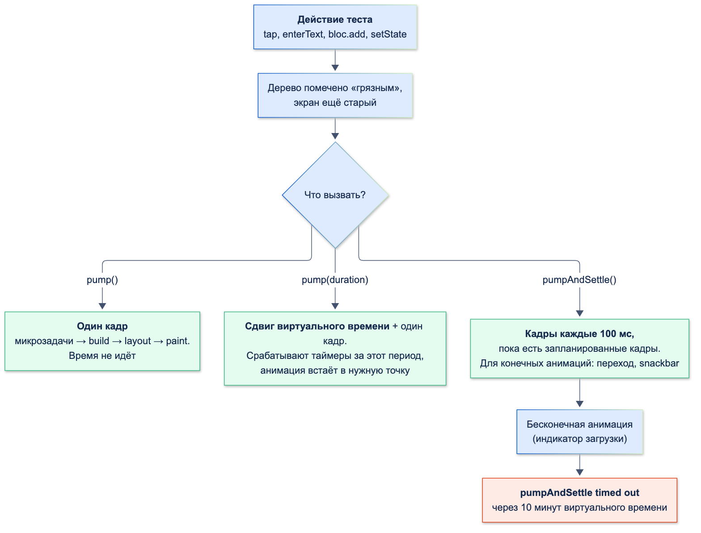
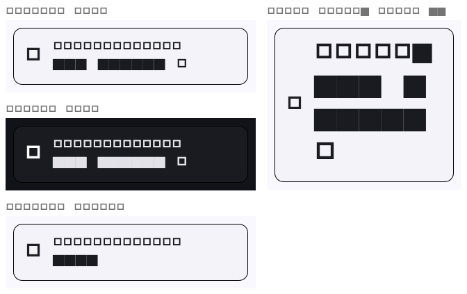
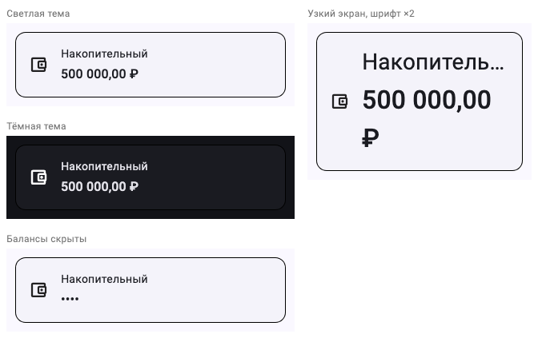
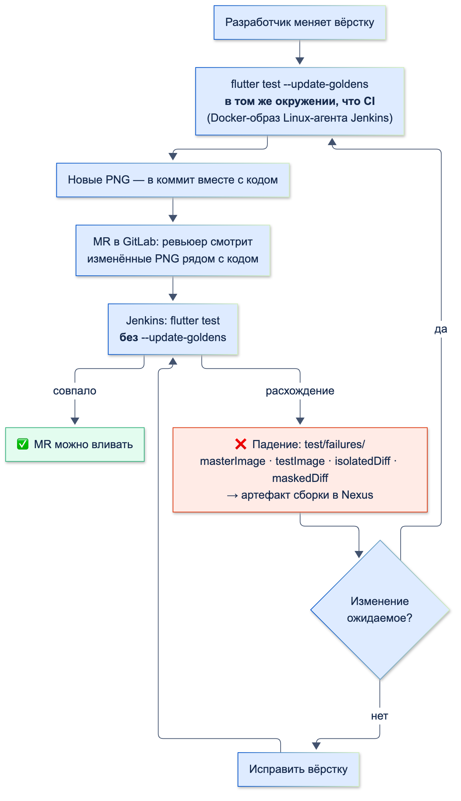

# Widget- и golden-тесты

| Грейд | Время на изучение | Статус |
|-------|-------------------|--------|
| ⭐⭐ | ~70 мин | ✅ Готово |

> ℹ️ **Важно:** пример продолжает модуль «Мои счета» из темы «Стратегия тестирования и unit-тесты»: Bloc, UseCase,
> фейк репозитория и тестовые данные — оттуда. Здесь к ним добавляется экран, и тесты поднимаются на уровень UI.

---

## 📚 Ресурсы

| Ресурс | Формат | Язык | Уровень | Зачем читать |
|--------|--------|------|---------|--------------|
| [Даниил Липаткин: Полный гайд по golden-тестам во Flutter](https://habr.com/ru/articles/952090/) | Статья (2025) | 🇷🇺 | ⭐⭐ | Зачем golden, базовый тест на `flutter_test`, платформозависимость (разные ОС, Intel и Apple Silicon), alchemist, настройка CI |
| [Углублённый анализ тестирования виджетов. Часть I](https://habr.com/ru/company/otus/blog/555136/) | Статья (перевод, 2021) | 🇷🇺 | ⭐ | `testWidgets`, `skip`, `timeout`, `TestVariant` — один тест для набора значений |
| [Часть II: Finder и WidgetTester](https://habr.com/ru/post/556760/) | Статья (перевод, 2021) | 🇷🇺 | ⭐ | Поиск виджетов, `pump` / `pumpAndSettle`, жесты |
| [Flutter: An introduction to widget testing](https://docs.flutter.dev/cookbook/testing/widget/introduction) | Документация | 🇬🇧 | ⭐ | Первый widget-тест: `pumpWidget`, `find`, матчеры |
| [Flutter: Tap, drag, and enter text](https://docs.flutter.dev/cookbook/testing/widget/tap-drag) | Документация | 🇬🇧 | ⭐ | Действия пользователя и зачем после них `pump` |
| [matchesGoldenFile (API)](https://api.flutter.dev/flutter/flutter_test/matchesGoldenFile.html) | Документация | 🇬🇧 | ⭐⭐ | `--update-goldens`, загрузка шрифтов, отличия между платформами и версиями Flutter |
| [bloc_test на pub.dev](https://pub.dev/packages/bloc_test) | Документация | 🇬🇧 | ⭐ | `MockBloc`, `whenListen` |
| [alchemist на pub.dev](https://pub.dev/packages/alchemist) | Документация | 🇬🇧 | ⭐⭐ | CI-golden, одинаковые на любой ОС; сетка сценариев в одной картинке |

---

## 🎓 Лекция

### 1. Что такое widget-тест

Widget-тест строит виджет в **тестовом окружении Flutter** — без устройства и эмулятора, в обычном процессе
`flutter test`. Проходят настоящие build, layout и paint, работают жесты, анимации, навигация. Нет только
экрана и платформы.

| Вид теста | Что проверяет | Где идёт | Скорость |
|-----------|---------------|----------|----------|
| Unit | Класс или функция без UI | Dart VM | Миллисекунды |
| **Widget** | Виджет или экран: что показано, как реагирует на действия | Тестовое окружение Flutter | Десятки миллисекунд на тест |
| **Golden** | Как виджет **выглядит**: попиксельное сравнение с эталонной картинкой | То же окружение | Как widget-тест |
| Интеграционный | Приложение целиком | Эмулятор или устройство | Секунды и минуты |

Особенности тестового окружения, которые важно знать заранее:

| Что | Как в тесте | Следствие |
|-----|-------------|-----------|
| Размер экрана | 800×600 логических точек, `devicePixelRatio` 3.0 (физически 2400×1800) | Узкие телефоны нужно задавать явно |
| Платформа | `TargetPlatform.android`, шрифт темы — Roboto | iOS-вёрстку проверяют через `TargetPlatformVariant` |
| Шрифт | Тестовый: буквы рисуются прямоугольниками | Для golden шрифты загружают явно |
| Время | Виртуальное: таймеры и анимации двигает тест | Ничего не происходит без `pump` |
| Сеть | Любой HTTP-запрос получает ответ 400 | `Image.network` → `HTTP request failed, statusCode: 400` |
| Платформенные каналы | Ответа нет, пока не задан мок | `await Clipboard.setData(…)` **зависает** навсегда |

### 2. Анатомия теста

```dart
testWidgets('описание', (tester) async {
  await tester.pumpWidget(const MaterialApp(home: AccountsPage())); // построить и отрисовать кадр
  await tester.tap(find.text('Повторить'));                          // действие
  await tester.pump();                                               // кадр после действия
  expect(find.text('Счетов пока нет'), findsOneWidget);              // проверка
});
```

- `testWidgets` вместо `test`: даёт `WidgetTester` и запускает тело в виртуальном времени.
- Виджету нужно то же окружение, что в приложении: `MaterialApp` (тема, `Navigator`, `Directionality`,
  локализация), провайдеры. Без `Material` выше по дереву `ListTile` падает с `No Material widget found.`
- Окружение собирают в одном помощнике — расширении `WidgetTester`, чтобы не повторять его в каждом тесте:

```dart
// test/helpers/pump_app.dart
import 'package:accounts/presentation/pages/accounts/bloc/accounts_bloc.dart';
import 'package:flutter/material.dart';
import 'package:flutter_bloc/flutter_bloc.dart';
import 'package:flutter_test/flutter_test.dart';

extension PumpApp on WidgetTester {
  /// Оборачивает виджет в то же окружение, что и в приложении: тема, Navigator, Bloc
  Future<void> pumpApp(Widget child, {required AccountsBloc bloc, ThemeData? theme}) => pumpWidget(
        MaterialApp(
          theme: theme ?? ThemeData(colorSchemeSeed: const Color(0xFF0052CC)),
          home: BlocProvider<AccountsBloc>.value(value: bloc, child: child),
        ),
      );
}
```

### 3. Кадры и время

В тесте ничего не перерисовывается само. После `tap` или `setState` дерево помечено «грязным», но экран старый:

```dart
await tester.tap(find.byType(TextButton)); // setState(() => n++)
find.text('n=1').evaluate().length;        // 0 — кадра ещё не было
await tester.pump();
find.text('n=1').evaluate().length;        // 1
```



| Вызов | Что делает | Когда |
|-------|------------|-------|
| `pump()` | Выполняет микрозадачи и рисует **один кадр**, время не двигает | После `tap`, `setState`, нового состояния Bloc |
| `pump(const Duration(seconds: 1))` | Сдвигает виртуальное время и рисует кадр | Таймеры, середина анимации, debounce |
| `pumpAndSettle()` | Кадры с шагом 100 мс, пока есть запланированные кадры | Конечные анимации: переход между экранами, snackbar, `RefreshIndicator` |

`pumpAndSettle` **нельзя** вызывать, пока на экране бесконечная анимация — индикатор загрузки. Кадры будут
запланированы всегда, и через 10 минут виртуального времени тест падает: `pumpAndSettle timed out`. Пока
крутится индикатор — только `pump()`.

**Таймеры, пережившие тест.** Если виджет запустил `Timer` и тест закончился раньше, тест падает:
`A Timer is still pending even after the widget tree was disposed.` Таймер либо отменяют в `dispose`, либо
доводят до срабатывания через `pump(duration)`.

> ⚠️ **Внимание:** объекты с асинхронной работой (Bloc, StreamController, сервисы) создавайте **внутри
> `testWidgets`**, а не в `setUp`. Bloc, созданный в `setUp`, живёт вне виртуального времени теста: `pump()` не
> продвигает его обработчики, экран навсегда остаётся в состоянии загрузки, а `pumpAndSettle` падает по таймауту.
> Моки без асинхронной работы (`MockBloc`) создавать в `setUp` можно.

Для настоящего ввода-вывода (чтение файла, работа изолята) есть `tester.runAsync(() => …)`: код внутри идёт
в реальном времени.

### 4. Поиск виджетов

| Finder | Что ищет |
|--------|----------|
| `find.text('Повторить')` | `Text` (и `EditableText`) с точно таким текстом |
| `find.byType(Card)` | Виджеты класса |
| `find.byKey(const ValueKey('account_2'))` | Виджет с ключом |
| `find.byIcon(Icons.visibility)`, `find.byTooltip('Скрыть балансы')` | Иконка, подсказка |
| `find.widgetWithText(FilledButton, 'Повторить')` | Виджет типа, внутри которого есть текст |
| `find.descendant(of: …, matching: …)`, `find.ancestor(…)` | Поиск внутри или над найденным |
| `find.bySemanticsLabel('…')` | По подписи для экранного диктора |

Матчеры количества: `findsOneWidget`, `findsNothing`, `findsNWidgets(2)`, `findsWidgets`, `findsAtLeastNWidgets(1)`.
Сам виджет достают через `tester.widget<Text>(finder)`, его положение — через `tester.getTopLeft(finder)`,
`getCenter`, `getSize`.

Ловушки поиска:

- **Неразрывные пробелы.** Сумма «500 000,00 ₽» в приложении пишется через U+00A0, чтобы не разрываться
  переносом. `find.text('500 000,00 ₽')` с обычными пробелами её **не найдёт**: нужно `'500 000,00 ₽'`.
- **Ленивые списки.** `ListView` строит только видимые элементы. Элемента 40 в дереве ещё нет:
  `The finder "Found 0 widgets with key [<40>]: []" (used in a call to "tap()") could not find any matching widgets.`
  Сначала прокрутить: `await tester.scrollUntilVisible(find.byKey(const ValueKey(40)), 200)`.
- **Ключи** — для того, что нельзя надёжно найти текстом: элементы списка, повторяющиеся кнопки.
  Ключ с id сущности (`ValueKey('account_${account.id}')`) не зависит от текста и перевода.

### 5. Действия пользователя

| Действие | Метод |
|----------|-------|
| Нажатие, долгое нажатие | `tap`, `longPress` |
| Ввод текста | `enterText(find.byType(TextField), '1000')` |
| Перетаскивание, свайп, «потянуть вниз» | `drag(finder, const Offset(0, 300))`, `fling(finder, offset, скорость)` |
| Прокрутка до элемента | `scrollUntilVisible`, `ensureVisible` |
| Кнопка «Назад» | `pageBack()` |

`tap` нажимает в центр виджета. Если виджет построен, но за краем экрана или перекрыт, нажатие уходит мимо,
а тест **не падает** — только печатает предупреждение:

```text
Warning: A call to tap() with finder "Found 1 widget with key [<40>] …" derived an Offset (Offset(400.0, 2268.0))
that would not hit test on the specified widget.
Maybe the widget is actually off-screen, or another widget is obscuring it, or the widget cannot receive pointer events.
```

Проверка после такого нажатия (например, «открылся экран счёта») упадёт, и причина будет непонятна.
`WidgetController.hitTestWarningShouldBeFatal = true` превращает предупреждение в ошибку.

### 6. Экран с Bloc: MockBloc или настоящий Bloc

| Подход | Как | Когда |
|--------|-----|-------|
| **`MockBloc`** из `bloc_test` | `when(() => bloc.state).thenReturn(…)`; поток состояний — `whenListen` | Проверить, как экран показывает **каждое** состояние и какие события отправляет. Bloc протестирован отдельно |
| **Настоящий Bloc** + фейковый репозиторий | `AccountsBloc(GetAccountsUseCase(FakeAccountsRepository()))` | Проверить связку «действие → Bloc → UseCase → экран» без сети |

```dart
class MockAccountsBloc extends MockBloc<AccountsEvent, AccountsState> implements AccountsBloc {}
```

`implements AccountsBloc` требует, чтобы класс Bloc **не был `final`**: иначе ошибка компиляции «can't be
implemented outside of its library». Поэтому у `AccountsBloc` модификатора нет.

`whenListen` задаёт поток состояний и держит `bloc.state` в согласии с ним:

```dart
whenListen(bloc, Stream.fromIterable(const [AccountsLoaded([savings])]), initialState: const AccountsLoading());
await tester.pumpApp(const AccountsPage(), bloc: bloc); // индикатор загрузки
await tester.pump();                                    // BlocBuilder получил AccountsLoaded → карточки
```

### 7. Разные устройства и настройки

**Размер экрана и крупный шрифт.** Узкий телефон и шрифт ×2 (настройка «Крупный текст» у пожилых клиентов) —
самые частые причины поломанной вёрстки:

```dart
tester.view
  ..physicalSize = const Size(320 * 3, 640 * 3) // 320×640 логических точек
  ..devicePixelRatio = 3;
tester.platformDispatcher.textScaleFactorTestValue = 2;
addTearDown(tester.view.reset); // вернуть размер для следующих тестов
addTearDown(tester.platformDispatcher.clearTextScaleFactorTestValue);
```

Переполнение — исключение во время раскладки, тест его ловит. Первая версия карточки счёта ставила название
и сумму в одну строку, и на таком экране тест упал:

```text
A RenderFlex overflowed by 178 pixels on the right.
```

Сумму перенесли под название (код карточки — в разделе 13), тест стал зелёным. `expect(tester.takeException(),
isNull)` в конце теста делает такую проверку явной.

**Платформа.** `TargetPlatformVariant` запускает один тест для нескольких платформ:

```dart
testWidgets('…', (tester) async { … }, variant: const TargetPlatformVariant({TargetPlatform.android, TargetPlatform.iOS}));
```

В отчёте — два теста: `(variant: TargetPlatform.android)` и `(variant: TargetPlatform.iOS)`. Ловушка:
`CircularProgressIndicator.adaptive()` на iOS — всё равно виджет класса `CircularProgressIndicator`, который
внутри рисует `CupertinoActivityIndicator`. `find.byType(CircularProgressIndicator)` находит его на обеих
платформах; отличие видно только по `CupertinoActivityIndicator`.

**Тёмная тема** — через `ThemeData(brightness: Brightness.dark)` в `MaterialApp` или `Theme`; удобнее всего
проверять в golden (раздел 10).

### 8. Платформенные каналы в тестах

Буфер обмена, вибрация, системные настройки, плагины — это платформенные каналы. В тестовом окружении на
другом конце никого нет, и `await Clipboard.setData(…)` **не возвращается никогда**: тест зависает до общего
таймаута. Ответ на канал задают моком:

```dart
final platformCalls = <MethodCall>[];
tester.binding.defaultBinaryMessenger.setMockMethodCallHandler(SystemChannels.platform, (call) async {
  platformCalls.add(call); // запоминаем вызовы, чтобы проверить их
  return null;
});
addTearDown(() => tester.binding.defaultBinaryMessenger.setMockMethodCallHandler(SystemChannels.platform, null));
```

Так же подменяют `MethodChannel` своих плагинов: по имени канала, с ответом на нужный метод. Мок заодно
проверяет вызов: `Clipboard.setData` с аргументами `{text: 2}`.

### 9. Доступность в тестах

`meetsGuideline` проверяет экран по правилам доступности:

| Правило | Что проверяет |
|---------|---------------|
| `androidTapTargetGuideline` | Зона нажатия не меньше 48×48 |
| `iOSTapTargetGuideline` | Не меньше 44×44 |
| `labeledTapTargetGuideline` | У всего нажимаемого есть подпись для экранного диктора |
| `textContrastGuideline` | Контраст текста по WCAG |

```dart
final handle = tester.ensureSemantics(); // включить дерево семантики
await tester.pumpApp(const AccountsPage(), bloc: bloc);
await expectLater(tester, meetsGuideline(labeledTapTargetGuideline));
handle.dispose();
```

`IconButton` без `tooltip` не проходит проверку подписи:

```text
Expected: Tappable widgets should have a semantic label
   Which: SemanticsNode#5(Rect.fromLTRB(752.0, 4.0, 800.0, 52.0), actions: [focus, tap], flags: [isButton, …]):
          expected tappable node to have semantic label, but none was found.
```

Поэтому у кнопки-«глаза» на экране счетов есть `tooltip` — он же становится подписью для диктора.

### 10. Golden-тесты

Golden-тест снимает картинку виджета и сравнивает её с эталонным PNG в репозитории:

```dart
await expectLater(find.byKey(const ValueKey('golden')), matchesGoldenFile('goldens/account_card.png'));
```

```bash
flutter test --update-goldens test/goldens   # создать или обновить эталоны
flutter test test/goldens                    # сравнить с эталонами
```

Путь эталона — относительно файла теста: `test/goldens/goldens/account_card.png`. Снимок ограничивают
`RepaintBoundary` вокруг нужного виджета.

**Шрифты.** Без настройки golden бесполезен: тестовый шрифт рисует латиницу и цифры закрашенными
прямоугольниками, а для кириллицы и иконок у него нет символов — получаются пустые рамки:



Шрифты загружают один раз для всей папки в `flutter_test_config.dart`: `flutter test` вызывает его
`testExecutable` перед каждым тестовым файлом этой папки и вложенных:

```dart
// test/goldens/flutter_test_config.dart
import 'dart:async';

import 'package:flutter/services.dart';
import 'package:flutter_test/flutter_test.dart';

import 'tolerant_golden_file_comparator.dart';

/// Выполняется перед каждым тестовым файлом в этой папке и её подпапках
Future<void> testExecutable(FutureOr<void> Function() testMain) async {
  TestWidgetsFlutterBinding.ensureInitialized();
  await _loadFont('Roboto', ['assets/fonts/Roboto-Regular.ttf', 'assets/fonts/Roboto-Medium.ttf']);
  // Иконки Material подключаются флагом uses-material-design и лежат в ассетах под этим путём
  await _loadFont('MaterialIcons', ['fonts/MaterialIcons-Regular.otf']);

  // flutter test уже поставил LocalFileComparator для текущего файла; берём его папку
  final local = goldenFileComparator as LocalFileComparator;
  goldenFileComparator = TolerantGoldenFileComparator(local.basedir.resolve('golden_test.dart'), tolerance: 0.005);

  await testMain();
}

Future<void> _loadFont(String family, List<String> assets) async {
  final loader = FontLoader(family);
  for (final asset in assets) {
    loader.addFont(rootBundle.load(asset));
  }
  await loader.load();
}
```

Шрифт приложения (здесь Roboto) должен быть объявлен в `pubspec.yaml` в разделе `fonts:`, иконки Material
доступны благодаря `uses-material-design: true`. Тот же эталон с настоящими шрифтами:



**Что golden ловит, а widget-тест — нет.** На варианте «узкий экран, шрифт ×2» знак «₽» ушёл на новую строку:
сумма не помещается даже в отдельной строке, и текст переносится принудительно. Переполнения нет, и тест
раскладки из раздела 7 зелёный. Видно только на картинке — это вопрос к дизайнеру, а не баг вёрстки, но узнать
о нём без golden можно было бы только от клиента.

**Когда эталон не совпал.** Тест падает с сообщением и кладёт картинки в `test/goldens/failures/`:

| Что изменилось | Сообщение | Файлы |
|----------------|-----------|-------|
| Размер снимка (поменяли отступ 16 → 12) | `Pixel test failed, image sizes do not match.` `Master Image: 672 X 423` `Test Image: 672 X 399` | `masterImage`, `testImage` |
| Пиксели того же размера (толщина шрифта суммы 500 → 400) | `Pixel test failed, 1.23%, 3490px diff detected.` | плюс `isolatedDiff` (только отличия) и `maskedDiff` (отличия поверх эталона) |


В Jenkins папку `failures/` сохраняют как артефакт сборки: без неё по красному тесту непонятно, что изменилось.

**Mac против Linux.** Одинаковый тест на разных ОС даёт разные пиксели: сглаживание шрифтов, тени, отрисовка
кривых. Документация `matchesGoldenFile` предупреждает, что шрифты отрисовываются по-разному на разных
платформах и даже в разных версиях Flutter; в статье Липаткина различия видны даже между Intel Mac и Apple
Silicon. Отсюда правила:

- эталоны генерирует **та же среда, где их проверяет CI**: Linux-агент Jenkins или его Docker-образ локально;
- версия Flutter у всех одна (fvm), обновление Flutter — отдельный MR с обновлёнными эталонами;
- альтернатива — CI-режим `alchemist`: текст рисуется блоками, тени отключены, картинка одинакова на любой ОС.
  Текст при этом в golden не проверяется.

**Допуск.** По умолчанию сравнение побайтное: любой пиксель — падение. Небольшой допуск снимает шум
сглаживания, но и пропускает мелкие настоящие изменения. Компаратор с допуском — подкласс `LocalFileComparator`
(подключён в `flutter_test_config.dart` выше):

```dart
// test/goldens/tolerant_golden_file_comparator.dart
import 'package:flutter/foundation.dart';
import 'package:flutter_test/flutter_test.dart';

/// Пропускает расхождение не больше [tolerance] (доля пикселей: 0.005 = 0,5 %).
/// Без допуска сравнение побайтное: любой пиксель — падение
class TolerantGoldenFileComparator extends LocalFileComparator {
  TolerantGoldenFileComparator(super.testFile, {required this.tolerance});

  final double tolerance;

  @override
  Future<bool> compare(Uint8List imageBytes, Uri golden) async {
    final result = await GoldenFileComparator.compareLists(imageBytes, await getGoldenBytes(golden));
    if (result.passed || result.diffPercent <= tolerance) {
      result.dispose();
      return true;
    }
    final error = await generateFailureOutput(result, golden, basedir);
    result.dispose();
    throw FlutterError(error);
  }
}
```

С допуском 0,5 % изменение толщины шрифта (1,23 %) по-прежнему ловится, с допуском 2 % — уже нет. Допуск
выбирают маленьким и только после того, как эталоны генерируются в одной среде.

**Несколько вариантов в одной картинке.** Вместо отдельного PNG на каждую тему и размер — одна сетка вариантов
(код — в разделе 13). Один файл проще ревьюить, а сравнение вариантов рядом сразу показывает разницу.
Для этого есть и пакеты: `golden_toolkit` помечен на pub.dev как **discontinued**, живая замена — `alchemist`
(`GoldenTestGroup` и `GoldenTestScenario`).

**Процесс.**



- `--update-goldens` в CI **никогда**: так тест проходит всегда.
- Эталоны обновляют в том же MR, что и вёрстку; ревьюер смотрит изменённые PNG — GitLab показывает картинки
  в диффе.
- Golden-тесты отделяют тегом или папкой: их можно запускать отдельной стадией.
- PNG занимают место в репозитории: снимают компоненты, а не экраны целиком, и не дублируют варианты.

### 11. Нестабильные widget-тесты

| Причина | Лечение |
|---------|---------|
| Бесконечная анимация и `pumpAndSettle` | `pump()` пока крутится индикатор |
| Объекты с асинхронной работой созданы в `setUp` | Создавать внутри `testWidgets` |
| Таймер пережил тест | Отменять в `dispose` или доводить `pump(duration)` |
| Картинки из сети | `Image.network` в тесте всегда получает 400; подменять источник картинок или показывать заглушку |
| Платформенный канал без мока | `setMockMethodCallHandler` |
| Размер экрана или шрифт не сброшены | `addTearDown(tester.view.reset)` |
| Golden на другой ОС или версии Flutter | Одна среда для генерации и проверки |

### 12. Что покрывать widget-тестами, а что golden

| Widget-тесты | Golden-тесты |
|--------------|--------------|
| Каждое состояние экрана: загрузка, ошибка, пусто, данные | Компоненты дизайн-системы: кнопки, поля, карточки |
| Реакция на действия: нажатия, ввод, «потянуть вниз», навигация | Темы (светлая и тёмная), крупный шрифт, узкий экран |
| Snackbar, диалоги, тексты ошибок | Сложная отрисовка: графики, `CustomPaint` |
| Доступность: подписи, размер зон нажатия | — |

Целые экраны в golden обычно не снимают: эталон ломается от любой мелочи (новый пункт меню, другой текст), и
ревьюеры перестают смотреть картинки.

### 13. Пример: экран «Мои счета»

**Код экрана.** Состояния Bloc → загрузка, ошибка с кнопкой «Повторить», пустой список, карточки
с «потянуть вниз». Нажатие на карточку открывает экран счёта, долгое нажатие копирует номер, кнопка-«глаз»
прячет балансы.

```dart
// lib/presentation/formatters/money_format.dart
/// 50000000 → «500 000,00 ₽». Разделители — неразрывные пробелы (U+00A0),
/// чтобы сумма не переносилась по строкам
String formatRubles(int kopecks) {
  final rubles = (kopecks.abs() ~/ 100).toString();
  final rest = (kopecks.abs() % 100).toString().padLeft(2, '0');
  final grouped = StringBuffer();
  for (var i = 0; i < rubles.length; i++) {
    if (i > 0 && (rubles.length - i) % 3 == 0) grouped.write(' ');
    grouped.write(rubles[i]);
  }
  return '${kopecks < 0 ? '−' : ''}$grouped,$rest ₽';
}
```

```dart
// lib/presentation/pages/accounts/widgets/account_card.dart
import 'package:flutter/material.dart';

import '../../../../domain/entities/account.dart';
import '../../../formatters/money_format.dart';

class AccountCard extends StatelessWidget {
  const AccountCard({
    required this.account,
    this.hideBalance = false,
    this.onTap,
    this.onLongPress,
    super.key,
  });

  final Account account;
  final bool hideBalance;
  final VoidCallback? onTap;
  final VoidCallback? onLongPress;

  @override
  Widget build(BuildContext context) {
    final textTheme = Theme.of(context).textTheme;
    return Card(
      clipBehavior: Clip.antiAlias,
      child: InkWell(
        onTap: onTap,
        onLongPress: onLongPress,
        child: Padding(
          padding: const EdgeInsets.all(16),
          child: Row(
            children: [
              const Icon(Icons.account_balance_wallet_outlined),
              const SizedBox(width: 16),
              // Сумма под названием, а не справа: с крупным шрифтом на узком экране
              // строка «название + сумма» не помещается
              Expanded(
                child: Column(
                  crossAxisAlignment: CrossAxisAlignment.start,
                  children: [
                    Text(account.title, maxLines: 1, overflow: TextOverflow.ellipsis, style: textTheme.bodyMedium),
                    const SizedBox(height: 4),
                    Text(
                      hideBalance ? '••••' : formatRubles(account.balanceKopecks),
                      key: ValueKey('balance_${account.id}'),
                      style: textTheme.titleMedium?.copyWith(fontWeight: FontWeight.w500),
                    ),
                  ],
                ),
              ),
            ],
          ),
        ),
      ),
    );
  }
}
```

```dart
// lib/presentation/pages/account_details/account_details_page.dart
import 'package:flutter/material.dart';
import 'package:permission_handler/permission_handler.dart';

import '../../../domain/entities/account.dart';
import '../../formatters/money_format.dart';

class AccountDetailsPage extends StatefulWidget {
  const AccountDetailsPage({required this.account, super.key});

  final Account account;

  @override
  State<AccountDetailsPage> createState() => _AccountDetailsPageState();
}

class _AccountDetailsPageState extends State<AccountDetailsPage> {
  String? _notificationsStatus;

  /// Системный диалог разрешения: его рисует ОС, а не Flutter
  Future<void> _enableNotifications() async {
    final status = await Permission.notification.request();
    if (!mounted) return;
    setState(() => _notificationsStatus = status.isGranted ? 'Уведомления включены' : 'Уведомления запрещены');
  }

  @override
  Widget build(BuildContext context) => Scaffold(
        appBar: AppBar(title: Text(widget.account.title)),
        body: Center(
          child: Column(
            mainAxisSize: MainAxisSize.min,
            children: [
              Text(formatRubles(widget.account.balanceKopecks)),
              const SizedBox(height: 24),
              OutlinedButton(onPressed: _enableNotifications, child: const Text('Уведомлять об операциях')),
              if (_notificationsStatus case final status?) Text(status),
            ],
          ),
        ),
      );
}
```

```dart
// lib/presentation/pages/accounts/accounts_page.dart
import 'package:flutter/material.dart';
import 'package:flutter/services.dart';
import 'package:flutter_bloc/flutter_bloc.dart';

import '../../../domain/entities/account.dart';
import '../account_details/account_details_page.dart';
import 'bloc/accounts_bloc.dart';
import 'widgets/account_card.dart';

class AccountsPage extends StatefulWidget {
  const AccountsPage({super.key});

  @override
  State<AccountsPage> createState() => _AccountsPageState();
}

class _AccountsPageState extends State<AccountsPage> {
  var _hideBalances = false;

  @override
  Widget build(BuildContext context) => Scaffold(
        appBar: AppBar(
          title: const Text('Мои счета'),
          actions: [
            IconButton(
              tooltip: _hideBalances ? 'Показать балансы' : 'Скрыть балансы',
              icon: Icon(_hideBalances ? Icons.visibility_off : Icons.visibility),
              onPressed: () => setState(() => _hideBalances = !_hideBalances),
            ),
          ],
        ),
        body: BlocBuilder<AccountsBloc, AccountsState>(
          builder: (context, state) => switch (state) {
            AccountsInitial() || AccountsLoading() => const Center(child: CircularProgressIndicator.adaptive()),
            AccountsError(:final message) => _ErrorView(
                message: message,
                onRetry: () => context.read<AccountsBloc>().add(const AccountsRequested()),
              ),
            AccountsLoaded(:final accounts) when accounts.isEmpty => const Center(child: Text('Счетов пока нет')),
            AccountsLoaded(:final accounts) => RefreshIndicator(
                onRefresh: () => _refresh(context),
                child: ListView(
                  padding: const EdgeInsets.all(8),
                  children: [
                    for (final account in accounts)
                      AccountCard(
                        key: ValueKey('account_${account.id}'),
                        account: account,
                        hideBalance: _hideBalances,
                        onTap: () => _openDetails(context, account),
                        onLongPress: () => _copyNumber(context, account),
                      ),
                  ],
                ),
              ),
          },
        ),
      );

  Future<void> _refresh(BuildContext context) async {
    final bloc = context.read<AccountsBloc>()..add(const AccountsRequested());
    // Индикатор крутится, пока Bloc не выйдет из загрузки
    await bloc.stream.firstWhere((state) => state is! AccountsLoading);
  }

  void _openDetails(BuildContext context, Account account) {
    Navigator.of(context).push(MaterialPageRoute<void>(builder: (_) => AccountDetailsPage(account: account)));
  }

  Future<void> _copyNumber(BuildContext context, Account account) async {
    await Clipboard.setData(ClipboardData(text: account.id));
    if (!context.mounted) return;
    ScaffoldMessenger.of(context).showSnackBar(const SnackBar(content: Text('Номер счёта скопирован')));
  }
}

class _ErrorView extends StatelessWidget {
  const _ErrorView({required this.message, required this.onRetry});

  final String message;
  final VoidCallback onRetry;

  @override
  Widget build(BuildContext context) => Center(
        child: Column(
          mainAxisSize: MainAxisSize.min,
          children: [
            Text(message, textAlign: TextAlign.center),
            const SizedBox(height: 16),
            FilledButton(onPressed: onRetry, child: const Text('Повторить')),
          ],
        ),
      );
}
```

**Widget-тесты экрана** — 14 тестов: состояния с `MockBloc`, связка с настоящим Bloc, платформы, маленький экран,
доступность:

```dart
// test/presentation/accounts/accounts_page_test.dart
import 'package:accounts/domain/exceptions/accounts_exceptions.dart';
import 'package:accounts/domain/use_cases/get_accounts_use_case.dart';
import 'package:accounts/presentation/pages/account_details/account_details_page.dart';
import 'package:accounts/presentation/pages/accounts/accounts_page.dart';
import 'package:accounts/presentation/pages/accounts/bloc/accounts_bloc.dart';
import 'package:bloc_test/bloc_test.dart';
import 'package:flutter/cupertino.dart';
import 'package:flutter/foundation.dart';
import 'package:flutter/material.dart';
import 'package:flutter/services.dart';
import 'package:flutter_test/flutter_test.dart';
import 'package:mocktail/mocktail.dart';

import '../../fakes/fake_accounts_repository.dart';
import '../../fixtures/accounts_fixtures.dart';
import '../../helpers/pump_app.dart';

class MockAccountsBloc extends MockBloc<AccountsEvent, AccountsState> implements AccountsBloc {}

void main() {
  group('экран с MockBloc: каждое состояние отдельно', () {
    late MockAccountsBloc bloc;

    setUp(() => bloc = MockAccountsBloc());

    testWidgets('загрузка — индикатор', (tester) async {
      when(() => bloc.state).thenReturn(const AccountsLoading());

      await tester.pumpApp(const AccountsPage(), bloc: bloc);

      expect(find.byType(CircularProgressIndicator), findsOneWidget);
    });

    testWidgets('ошибка — текст и кнопка «Повторить» отправляет событие', (tester) async {
      when(() => bloc.state).thenReturn(const AccountsError('Нет соединения с интернетом'));

      await tester.pumpApp(const AccountsPage(), bloc: bloc);
      await tester.tap(find.widgetWithText(FilledButton, 'Повторить'));

      expect(find.text('Нет соединения с интернетом'), findsOneWidget);
      verify(() => bloc.add(const AccountsRequested())).called(1);
    });

    testWidgets('пустой список — подсказка', (tester) async {
      when(() => bloc.state).thenReturn(const AccountsLoaded([]));

      await tester.pumpApp(const AccountsPage(), bloc: bloc);

      expect(find.text('Счетов пока нет'), findsOneWidget);
    });

    testWidgets('данные — карточки в порядке из состояния, суммы с неразрывными пробелами', (tester) async {
      when(() => bloc.state).thenReturn(const AccountsLoaded([savings, salary]));

      await tester.pumpApp(const AccountsPage(), bloc: bloc);

      final titles = tester.widgetList<Text>(find.descendant(of: find.byType(Card), matching: find.byType(Text)));
      expect(titles.map((t) => t.data), ['Накопительный', '500 000,00 ₽', 'Зарплатный', '150 000,00 ₽']);
      // С обычными пробелами текст не найдётся
      expect(find.text('500 000,00 ₽'), findsNothing);
    });

    testWidgets('смена состояний: загрузка → данные (whenListen)', (tester) async {
      // whenListen задаёт поток состояний и держит bloc.state в согласии с ним
      whenListen(
        bloc,
        Stream.fromIterable(const [AccountsLoaded([savings])]),
        initialState: const AccountsLoading(),
      );

      await tester.pumpApp(const AccountsPage(), bloc: bloc);
      expect(find.byType(CircularProgressIndicator), findsOneWidget);

      await tester.pump(); // BlocBuilder получил новое состояние → перестроение
      expect(find.byType(CircularProgressIndicator), findsNothing);
      expect(find.text('Накопительный'), findsOneWidget);
    });

    testWidgets('кнопка-глаз скрывает балансы', (tester) async {
      when(() => bloc.state).thenReturn(const AccountsLoaded([savings]));
      await tester.pumpApp(const AccountsPage(), bloc: bloc);

      await tester.tap(find.byTooltip('Скрыть балансы'));
      await tester.pump(); // setState → новый кадр

      expect(find.text('••••'), findsOneWidget);
      expect(find.byTooltip('Показать балансы'), findsOneWidget);
    });

    testWidgets('нажатие на карточку открывает экран счёта', (tester) async {
      when(() => bloc.state).thenReturn(const AccountsLoaded([savings]));
      await tester.pumpApp(const AccountsPage(), bloc: bloc);

      await tester.tap(find.byKey(const ValueKey('account_2')));
      await tester.pumpAndSettle(); // дождаться конца анимации перехода

      expect(find.byType(AccountDetailsPage), findsOneWidget);
      expect(find.widgetWithText(AppBar, 'Накопительный'), findsOneWidget);
    });

    testWidgets('долгое нажатие копирует номер счёта и показывает snackbar', (tester) async {
      // Буфер обмена — платформенный канал; без ответа на него тест зависнет
      final platformCalls = <MethodCall>[];
      tester.binding.defaultBinaryMessenger.setMockMethodCallHandler(SystemChannels.platform, (call) async {
        platformCalls.add(call);
        return null;
      });
      addTearDown(() => tester.binding.defaultBinaryMessenger.setMockMethodCallHandler(SystemChannels.platform, null));
      when(() => bloc.state).thenReturn(const AccountsLoaded([savings]));
      await tester.pumpApp(const AccountsPage(), bloc: bloc);

      await tester.longPress(find.byKey(const ValueKey('account_2')));
      await tester.pump(); // показать snackbar

      expect(find.text('Номер счёта скопирован'), findsOneWidget);
      expect(
        platformCalls.where((c) => c.method == 'Clipboard.setData').single.arguments,
        {'text': '2'},
      );
    });
  });

  group('экран с настоящим Bloc и фейковым репозиторием', () {
    // Bloc создаётся внутри testWidgets, а не в setUp: только так его асинхронная работа
    // идёт в виртуальном времени теста и продвигается вызовами pump
    testWidgets('ошибка → «Повторить» → счета', (tester) async {
      final repository = FakeAccountsRepository()..error = const NoConnectionException();
      final bloc = AccountsBloc(GetAccountsUseCase(repository))..add(const AccountsRequested());
      addTearDown(bloc.close);

      await tester.pumpApp(const AccountsPage(), bloc: bloc);
      expect(find.text('Нет соединения с интернетом'), findsOneWidget);

      repository
        ..error = null
        ..accounts = [salary, closed, savings];
      await tester.tap(find.text('Повторить'));
      await tester.pump();

      // Закрытый счёт скрыт, порядок — по убыванию баланса: работает настоящий UseCase
      expect(find.byType(Card), findsNWidgets(2));
      expect(tester.getTopLeft(find.text('Накопительный')).dy, lessThan(tester.getTopLeft(find.text('Зарплатный')).dy));
    });

    testWidgets('потянуть вниз — повторный запрос к репозиторию', (tester) async {
      final repository = FakeAccountsRepository()..accounts = [savings, salary];
      final bloc = AccountsBloc(GetAccountsUseCase(repository))..add(const AccountsRequested());
      addTearDown(bloc.close);
      await tester.pumpApp(const AccountsPage(), bloc: bloc);
      expect(repository.calls, 1);

      await tester.fling(find.byType(ListView), const Offset(0, 300), 1000);
      await tester.pumpAndSettle(); // анимация индикатора обновления до конца

      expect(repository.calls, 2);
      expect(find.byType(Card), findsNWidgets(2));
    });
  });

  testWidgets(
    'индикатор загрузки — по стилю платформы',
    (tester) async {
      final bloc = MockAccountsBloc();
      when(() => bloc.state).thenReturn(const AccountsLoading());

      await tester.pumpApp(const AccountsPage(), bloc: bloc);

      // .adaptive() — это всё равно CircularProgressIndicator, который на iOS внутри рисует Cupertino-индикатор
      expect(find.byType(CircularProgressIndicator), findsOneWidget);
      final isApple = defaultTargetPlatform == TargetPlatform.iOS;
      expect(find.byType(CupertinoActivityIndicator), isApple ? findsOneWidget : findsNothing);
    },
    variant: const TargetPlatformVariant({TargetPlatform.android, TargetPlatform.iOS}),
  );

  testWidgets('маленький экран и крупный шрифт — без переполнения', (tester) async {
    tester.view
      ..physicalSize = const Size(320 * 3, 640 * 3) // 320×640 логических точек
      ..devicePixelRatio = 3;
    tester.platformDispatcher.textScaleFactorTestValue = 2;
    addTearDown(tester.view.reset);
    addTearDown(tester.platformDispatcher.clearTextScaleFactorTestValue);

    final bloc = MockAccountsBloc();
    when(() => bloc.state).thenReturn(const AccountsLoaded([savings, salary]));
    await tester.pumpApp(const AccountsPage(), bloc: bloc);

    // Переполнение RenderFlex — это исключение во время раскладки; тест упал бы на нём сам
    expect(tester.takeException(), isNull);
  });

  testWidgets('доступность: размер зон нажатия, подписи, контраст', (tester) async {
    final handle = tester.ensureSemantics();
    final bloc = MockAccountsBloc();
    when(() => bloc.state).thenReturn(const AccountsLoaded([savings, salary]));
    await tester.pumpApp(const AccountsPage(), bloc: bloc);

    await expectLater(tester, meetsGuideline(androidTapTargetGuideline));
    await expectLater(tester, meetsGuideline(iOSTapTargetGuideline));
    await expectLater(tester, meetsGuideline(labeledTapTargetGuideline));
    await expectLater(tester, meetsGuideline(textContrastGuideline));
    handle.dispose();
  });
}
```

**Golden-тест карточки** — четыре варианта в одном снимке:

```dart
// test/goldens/account_card_golden_test.dart
import 'package:accounts/presentation/pages/accounts/widgets/account_card.dart';
import 'package:flutter/material.dart';
import 'package:flutter_test/flutter_test.dart';

import '../fixtures/accounts_fixtures.dart';

final _light = ThemeData(colorSchemeSeed: const Color(0xFF0052CC));
final _dark = ThemeData(colorSchemeSeed: const Color(0xFF0052CC), brightness: Brightness.dark);

/// Один вариант карточки: подпись, тема, ширина, масштаб шрифта
Widget _variant(String label, {required ThemeData theme, double width = 360, double textScale = 1, bool hide = false}) =>
    Padding(
      padding: const EdgeInsets.all(8),
      child: Column(
        mainAxisSize: MainAxisSize.min,
        crossAxisAlignment: CrossAxisAlignment.start,
        children: [
          Text(label, style: const TextStyle(fontSize: 12, color: Colors.black54)),
          const SizedBox(height: 4),
          SizedBox(
            width: width,
            child: Theme(
              data: theme,
              child: MediaQuery.withClampedTextScaling(
                minScaleFactor: textScale,
                maxScaleFactor: textScale,
                child: ColoredBox(
                  color: theme.colorScheme.surface,
                  child: Padding(
                    padding: const EdgeInsets.all(8),
                    child: AccountCard(account: savings, hideBalance: hide),
                  ),
                ),
              ),
            ),
          ),
        ],
      ),
    );

void main() {
  testWidgets('AccountCard: варианты', (tester) async {
    await tester.pumpWidget(
      MaterialApp(
        debugShowCheckedModeBanner: false,
        theme: _light,
        home: Scaffold(
          backgroundColor: Colors.white,
          body: Align(
            alignment: Alignment.topLeft,
            // RepaintBoundary задаёт границы снимка
            child: RepaintBoundary(
              key: const ValueKey('golden'),
              // Два столбца: тестовый экран 800×600, в один столбец варианты не помещаются
              child: Row(
                mainAxisSize: MainAxisSize.min,
                crossAxisAlignment: CrossAxisAlignment.start,
                children: [
                  Column(
                    mainAxisSize: MainAxisSize.min,
                    crossAxisAlignment: CrossAxisAlignment.start,
                    children: [
                      _variant('Светлая тема', theme: _light),
                      _variant('Тёмная тема', theme: _dark),
                      _variant('Балансы скрыты', theme: _light, hide: true),
                    ],
                  ),
                  _variant('Узкий экран, шрифт ×2', theme: _light, width: 280, textScale: 2),
                ],
              ),
            ),
          ),
        ),
      ),
    );

    await expectLater(find.byKey(const ValueKey('golden')), matchesGoldenFile('goldens/account_card.png'));
  });
}
```

**Что проверено поломками:**

| Поломка | Что упало |
|---------|-----------|
| Название и сумма в одной строке карточки | «маленький экран и крупный шрифт»: `A RenderFlex overflowed by 178 pixels on the right` |
| Bloc создан в `setUp` | Экран застрял в загрузке, `pumpAndSettle timed out` |
| Нет мока платформенного канала | Тест с копированием номера зависает |
| `IconButton` без `tooltip` | `labeledTapTargetGuideline` |
| Отступ карточки 16 → 12 | Golden: `image sizes do not match` |
| Толщина шрифта суммы 500 → 400 | Golden: `1.23%, 3490px diff detected`; с допуском 2 % — не ловится |

### 🚫 Чрезмерное применение

- **Golden на каждый экран.** Сотни PNG, которые обновляют пачкой `--update-goldens` не глядя, — то же, что
  отсутствие тестов.
- **Widget-тест на каждый виджет.** `Text` с заголовком не нужно проверять отдельно: он проверяется в тесте экрана.
- **Проверка деталей вёрстки в widget-тестах.** `expect(padding, 16)` и цвета — работа golden; widget-тест
  проверяет поведение.
- **Ключи на всём подряд.** Ключ нужен там, где текст неоднозначен; иначе тест читается хуже, чем `find.text`.

### ⚠️ Частые ошибки

- `pumpAndSettle()`, пока крутится индикатор загрузки → `pumpAndSettle timed out`.
- Нет `pump()` после действия — экран ещё старый, `findsOneWidget` не находит новое.
- Bloc или контроллер с асинхронной работой создан в `setUp`, а не в теле `testWidgets`.
- Виджет без `MaterialApp` / `Scaffold` выше по дереву → `No Material widget found.`
- `find.text` с обычными пробелами для суммы с неразрывными.
- `tap` по виджету за краем экрана — только предупреждение, тест идёт дальше с неверным состоянием.
- Платформенный канал без мока — тест зависает.
- Не сброшены `tester.view` и масштаб шрифта — следующие тесты идут на чужом размере.
- `final class` у Bloc, который нужно подменять `MockBloc`.
- Эталоны golden сгенерированы на Mac разработчика, а проверяются на Linux в CI.
- `--update-goldens` как способ «починить» красный тест без просмотра картинок.

### 🎤 Задачи с собеседования

**1. «Как протестировать экран со списком счетов?»**

- ⭐ Junior: `pumpWidget`, `find.text`, `expect(..., findsOneWidget)`; про состояния и Bloc — не говорит.
- ⭐⭐ Middle: все состояния через `MockBloc` (загрузка, ошибка, пусто, данные); действия (повтор, переход,
  «потянуть вниз») с проверкой отправленных событий; `pump` против `pumpAndSettle`; обёртка `pumpApp`.
- ⭐⭐⭐ Senior: плюс связка с настоящим Bloc и фейковым репозиторием; маленький экран и крупный шрифт;
  доступность через `meetsGuideline`; golden карточки в темах; сам называет ловушки (индикатор и
  `pumpAndSettle`, платформенные каналы, создание Bloc в `setUp`) и где golden генерировать для CI.

**2. «Golden-тесты проходят у всех локально и падают в CI. Почему и что делать?»**

Разные ОС или версии Flutter: сглаживание шрифтов и тени отличаются. Генерировать эталоны в той же среде, что
CI (Docker-образ агента), закрепить версию Flutter, при необходимости — CI-режим `alchemist` или маленький
допуск. Не обновлять эталоны в CI.

**3. «Тест висит и падает по таймауту через 10 минут. С чего начнёте?»**

`pumpAndSettle` при бесконечной анимации; `await` платформенного канала без мока; объект с асинхронной работой
вне виртуального времени (создан в `setUp`); ожидание настоящей сети или файла без `runAsync`.

---

## ✅ Самопроверка

**⭐ Junior**
1. Чем widget-тест отличается от unit- и интеграционного теста?
2. Зачем вызывать `pump()` после `tap`?
3. Как найти кнопку по тексту и проверить, что она одна на экране?

**⭐⭐ Middle**
1. Чем отличаются `pump()`, `pump(duration)` и `pumpAndSettle()`? Когда `pumpAndSettle` нельзя использовать?
2. Когда в тесте экрана брать `MockBloc`, а когда настоящий Bloc с фейковым репозиторием?
3. Как проверить экран на узком телефоне с крупным шрифтом?
4. Почему тест с `Clipboard.setData` может зависнуть и как это исправить?
5. Что такое golden-тест и как обновить эталон?

**⭐⭐⭐ Senior**
1. Почему Bloc, созданный в `setUp`, не продвигается вызовами `pump`?
2. Почему golden-эталоны, сгенерированные на Mac, падают на Linux-агенте? Три способа с этим жить.
3. Какие файлы появляются при падении golden и как их использовать в CI?
4. Что golden-тест поймает, а widget-тест — нет? Приведи пример.
5. Как встроить проверку доступности в тесты экрана?

<details>
<summary>Ответы</summary>

**Junior**
1. Unit проверяет логику без UI в Dart VM. Widget-тест строит виджет в тестовом окружении Flutter без устройства:
   build, layout, paint, жесты, навигация — по-настоящему. Интеграционный запускает всё приложение на эмуляторе
   или устройстве.
2. Время и кадры в тесте двигает сам тест. После `tap` дерево только помечено «грязным», `pump()` рисует кадр.
3. `expect(find.text('Повторить'), findsOneWidget)` или точнее
   `find.widgetWithText(FilledButton, 'Повторить')`.

**Middle**
1. `pump()` — один кадр без движения времени; `pump(duration)` — сдвиг времени и кадр; `pumpAndSettle()` — кадры
   с шагом 100 мс, пока анимации не закончатся. Нельзя при бесконечной анимации (индикатор загрузки):
   `pumpAndSettle timed out`.
2. `MockBloc` — проверить отображение каждого состояния и отправку событий; Bloc протестирован отдельно.
   Настоящий Bloc с фейком — проверить связку экрана с Bloc и UseCase (например, «ошибка → Повторить → данные»).
3. `tester.view.physicalSize` и `devicePixelRatio`, `tester.platformDispatcher.textScaleFactorTestValue = 2`,
   сброс через `addTearDown`; переполнение ловится как исключение (`takeException`).
4. Буфер обмена — платформенный канал, в тестах на нём никто не отвечает, и `await` не возвращается.
   `tester.binding.defaultBinaryMessenger.setMockMethodCallHandler(SystemChannels.platform, …)`.
5. Сравнение снимка виджета с эталонным PNG (`matchesGoldenFile`). Обновить — `flutter test --update-goldens`
   и посмотреть изменённые PNG в MR.

**Senior**
1. Тело `testWidgets` идёт в зоне с виртуальным временем; `pump` выполняет микрозадачи и таймеры только этой
   зоны. Bloc из `setUp` создан вне её: его асинхронные продолжения запланированы в обычной зоне, и `pump` их
   не выполняет — экран остаётся в состоянии загрузки.
2. Разное сглаживание шрифтов, тени, отрисовка на разных ОС и версиях Flutter. Генерировать в той же среде,
   что CI (Docker-образ агента); CI-режим `alchemist` (текст блоками, без теней); маленький допуск через
   свой `GoldenFileComparator`.
3. `masterImage`, `testImage`, а при одинаковом размере — `isolatedDiff` и `maskedDiff` в `failures/` рядом
   с тестом. В Jenkins сохранять как артефакт сборки, чтобы смотреть отличия без локального запуска.
4. Визуальные изменения без поломки раскладки: цвет, толщина шрифта, отступы, перенос знака «₽» на новую строку
   при крупном шрифте — переполнения нет, widget-тест зелёный.
5. `tester.ensureSemantics()` и `meetsGuideline(androidTapTargetGuideline / iOSTapTargetGuideline /
   labeledTapTargetGuideline / textContrastGuideline)` в тестах экранов; `tooltip` у кнопок-иконок.

</details>
