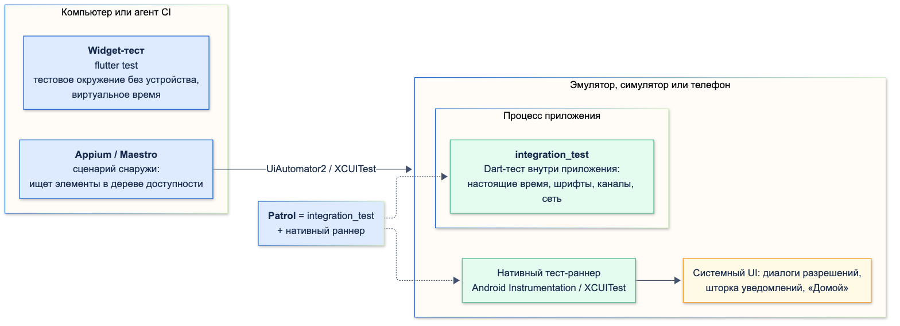
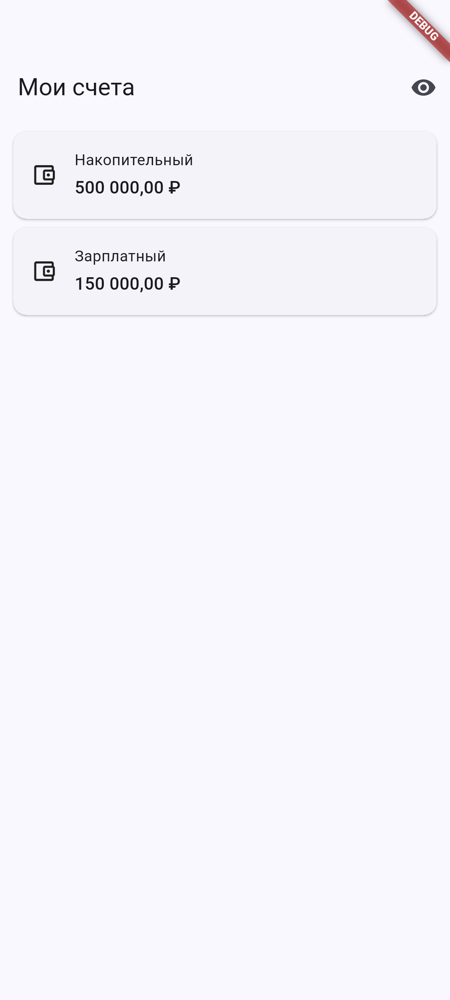
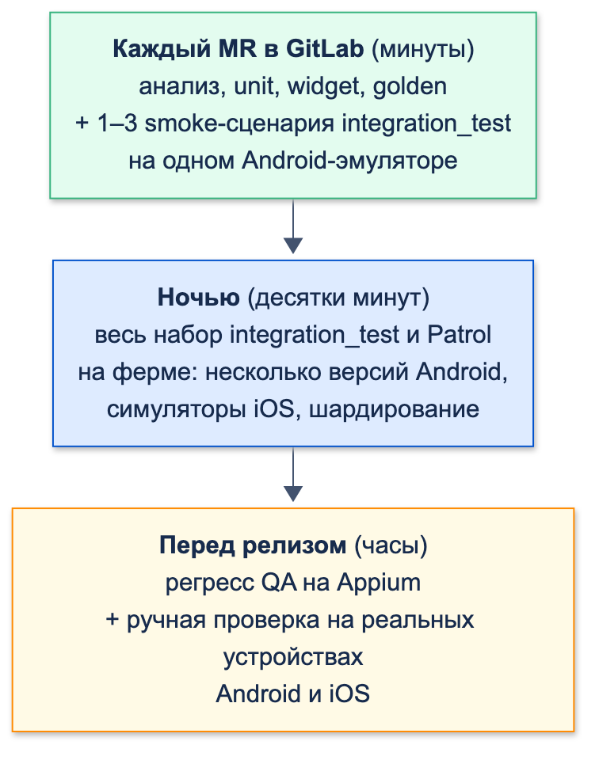

# Интеграционные и E2E-тесты

| Грейд | Время на изучение | Статус |
|-------|-------------------|--------|
| ⭐⭐ | ~70 мин | ✅ Готово |

> ℹ️ **Важно:** пример продолжает модуль «Мои счета» из тем «Стратегия тестирования и unit-тесты» и «Widget- и
> golden-тесты». Здесь к нему добавляются вход по PIN и запрос разрешения на уведомления, а тесты переезжают на
> эмулятор Android и симулятор iOS.

---

## 📚 Ресурсы

| Ресурс | Формат | Язык | Уровень | Зачем читать |
|--------|--------|------|---------|--------------|
| [AGIMA: Шпаргалка для QA — как тестировать Flutter-приложения](https://habr.com/ru/companies/agima/articles/790048/) | Статья (2024) | 🇷🇺 | ⭐ | Опыт QA с Appium на Flutter: регресс сократили с 90 до 33 часов; главная проблема — элементы без идентификаторов, решение — просить разработчиков их добавлять |
| [Flutter: Integration testing](https://docs.flutter.dev/testing/integration-tests) | Документация | 🇬🇧 | ⭐ | `integration_test`: подключение, запуск на устройстве, `flutter drive`, Firebase Test Lab |
| [Patrol: документация](https://patrol.leancode.co/documentation) | Документация | 🇬🇧 | ⭐⭐ | Установка для Android и iOS, нативные действия: разрешения, уведомления, «Домой» |
| [SemanticsProperties.identifier](https://api.flutter.dev/flutter/semantics/SemanticsProperties/identifier.html) | Документация | 🇬🇧 | ⭐⭐ | Идентификатор для UIAutomator, XCUITest и Appium |
| [appium-flutter-integration-driver](https://github.com/AppiumTestDistribution/appium-flutter-integration-driver) | Репозиторий | 🇬🇧 | ⭐⭐ | Драйвер Appium для Flutter на основе `integration_test`: что добавить в приложение и как собрать |
| [Marathon: документация](https://docs.marathonlabs.io/) | Документация | 🇬🇧 | ⭐⭐⭐ | Запуск тестов на своей ферме: шардирование, пулы устройств, повторы |

---

## 🎓 Лекция

### 1. Интеграционный тест и E2E: в чём разница

| Вид | Где идёт | Кто пишет | Что видит |
|-----|----------|-----------|-----------|
| **Widget-тест** | Компьютер, тестовое окружение без устройства | Разработчик | Только Flutter, время виртуальное |
| **`integration_test`** | **Внутри процесса приложения** на эмуляторе, симуляторе или телефоне | Разработчик, на Dart | Flutter целиком, настоящие время, шрифты, плагины и сеть. Системные окна — нет |
| **Patrol** | То же + нативный тест-раннер (Android Instrumentation, XCUITest) | Разработчик, на Dart | Плюс системный UI: диалоги разрешений, шторка уведомлений, кнопка «Домой» |
| **E2E «чёрным ящиком»** (Appium, Maestro) | Снаружи приложения, через UiAutomator2 или XCUITest | QA | Только то, что есть в дереве доступности, как у пользователя |



Что ловят интеграционные тесты и не ловят widget-тесты:

- нативную часть и плагины: разрешения, хранилища, камеру, платформенные каналы;
- настоящую сеть и разбор ответов, сертификаты, кодировки;
- настоящие шрифты, размеры экранов и системные настройки устройства;
- сборку приложения целиком: Gradle, CocoaPods, манифест, Info.plist.

Цена — время и стабильность. В примере ниже 14 widget-тестов экрана идут около 3 секунд, а один интеграционный
сценарий на Android-эмуляторе с учётом сборки и установки — 19–33 секунды, на симуляторе iOS — 42–76 секунд
(больше — когда нужна пересборка в Xcode). Поэтому интеграционных тестов мало: только ключевые сценарии.

### 2. `integration_test` на практике

Подключение: зависимость в `pubspec.yaml` и папка `integration_test/` в корне проекта.

```yaml
dev_dependencies:
  flutter_test:
    sdk: flutter
  integration_test:
    sdk: flutter
```

Тест пишется на том же API, что и widget-тест, но с другой привязкой:

```dart
void main() {
  // Связывает тест с приложением на устройстве: время, кадры и платформа — настоящие
  IntegrationTestWidgetsFlutterBinding.ensureInitialized();
  testWidgets('…', (tester) async { … });
}
```

Запуск:

```bash
flutter test integration_test/all_test.dart -d emulator-5554   # Android-эмулятор
flutter test integration_test/all_test.dart -d <UDID симулятора>  # iOS-симулятор
```

Что меняется по сравнению с widget-тестом:

| | Widget-тест | `integration_test` |
|---|---|---|
| Время | Виртуальное, двигает тест | **Настоящее**: `pump(duration)` ждёт по-настоящему |
| `pumpAndSettle` | Ждёт окончания анимаций | То же, но **не ждёт сеть**: если во время запроса ничего не анимируется, возвращается до ответа (раздел 4) |
| Шрифты | Тестовые прямоугольники | Настоящие шрифты устройства |
| Платформенные каналы и плагины | Нужны моки | Работают по-настоящему |
| Сеть | Любой HTTP — ответ 400 | Настоящая |
| Системные окна | — | Не видны и не нажимаются: для них Patrol |

**Каждый файл — отдельная сборка.** `flutter test integration_test` собирает и ставит приложение заново для каждого
файла: два файла в примере — 32 секунды и две установки. Одна точка входа, которая вызывает `main()` остальных, —
19 секунд и одна установка:

```dart
// integration_test/all_test.dart
import 'package:integration_test/integration_test.dart';

import 'app_test.dart' as app;
import 'http_server_test.dart' as http_server;

/// Одна точка входа: приложение собирается и ставится на устройство один раз, а не на каждый файл
void main() {
  IntegrationTestWidgetsFlutterBinding.ensureInitialized();
  app.main();
  http_server.main();
}
```

> ⚠️ **Внимание:** эмулятор в CI должен быть **без блокировки экрана**. Пока пользователь эмулятора с PIN-кодом не
> разблокирован после загрузки, Android не запускает приложения, и `flutter test` падает с обманчивой ошибкой
> `Error: Activity class {ru.bank.accounts/ru.bank.accounts.MainActivity} does not exist.` — хотя приложение
> установлено и класс на месте.

### 3. Откуда приложение берёт данные в тесте

Чтобы тест мог подставить свои зависимости, корень приложения получает их снаружи, а `main.dart` только собирает
настоящие:

```dart
// lib/app/bank_app.dart
import 'package:flutter/material.dart';
import 'package:flutter_bloc/flutter_bloc.dart';

import '../domain/repositories/accounts_repository.dart';
import '../domain/use_cases/get_accounts_use_case.dart';
import '../presentation/pages/accounts/accounts_page.dart';
import '../presentation/pages/accounts/bloc/accounts_bloc.dart';
import '../presentation/pages/pin/pin_page.dart';

/// Корень приложения. Зависимости приходят снаружи: main.dart передаёт настоящие,
/// интеграционный тест — фейки или клиент к локальному серверу
class BankApp extends StatelessWidget {
  const BankApp({required this.accountsRepository, required this.verifyPin, super.key});

  final AccountsRepository accountsRepository;
  final Future<bool> Function(String pin) verifyPin;

  @override
  Widget build(BuildContext context) => MaterialApp(
        title: 'Мои счета',
        theme: ThemeData(colorSchemeSeed: const Color(0xFF0052CC)),
        home: Builder(
          builder: (context) => PinPage(
            verifyPin: verifyPin,
            onSuccess: () => Navigator.of(context).pushReplacement(
              MaterialPageRoute<void>(
                builder: (_) => BlocProvider(
                  create: (_) => AccountsBloc(GetAccountsUseCase(accountsRepository))..add(const AccountsRequested()),
                  child: const AccountsPage(),
                ),
              ),
            ),
          ),
        ),
      );
}
```

```dart
// lib/main.dart
import 'package:flutter/material.dart';
import 'package:http/http.dart' as http;

import 'app/bank_app.dart';
import 'data/data_sources/accounts_remote_data_source.dart';
import 'data/network/accounts_api.dart';
import 'data/repositories/accounts_repository_impl.dart';

void main() {
  final api = AccountsApi(http.Client(), baseUrl: Uri.parse('https://api.bank.example'), token: () => '');
  runApp(
    BankApp(
      accountsRepository: AccountsRepositoryImpl(AccountsRemoteDataSourceImpl(api)),
      // Учебная заглушка: в приложении PIN проверяет сервер или защищённое хранилище
      verifyPin: (pin) async => false,
    ),
  );
}
```

Варианты источника данных:

| Вариант | Как | Что проверяет | Минусы |
|---------|-----|---------------|--------|
| **Фейки в корне приложения** | `BankApp(accountsRepository: FakeAccountsRepository())` | UI, навигацию, Bloc, UseCase на устройстве | Сеть и разбор ответа не проверяются |
| **Подмена `http.Client`** | `MockClient` в `AccountsApi` | Плюс разбор ответа | Сетевой стек не настоящий |
| **Локальный HTTP-сервер в тесте** | `HttpServer` из `dart:io` прямо на устройстве | Плюс настоящий HTTP-клиент, заголовки, коды ответа | Сервер нужно описать в тесте |
| **Тестовый контур банка** | Сборка, настроенная на тестовый бэкенд, тестовые клиенты | Всю систему, включая бэкенд | Медленно, нестабильно (контур падает, данные меняются), нужен доступ |

Правила для тестовых данных:

- **Никаких боевых данных и контуров.** Только тестовые клиенты, тестовые карты, тестовые суммы.
- **Каждый тест сам готовит свои данные** и не зависит от предыдущего. Patrol на Android в настройке из документации очищает
  данные приложения перед каждым тестом (`clearPackageData`).
- На общем тестовом контуре данные меняются под тестом: проверять «счёт появился», а не «счетов ровно три».

**Сценарий с фейками** — вход по PIN, список счетов, экран счёта, назад, «потянуть вниз»:

```dart
// integration_test/app_test.dart
import 'package:accounts/app/bank_app.dart';
import 'package:flutter/material.dart';
import 'package:flutter_test/flutter_test.dart';
import 'package:integration_test/integration_test.dart';

import '../test/fakes/fake_accounts_repository.dart';
import '../test/fixtures/accounts_fixtures.dart';
import 'helpers.dart';

void main() {
  // Связывает тест с приложением на устройстве: время, кадры и платформа — настоящие
  IntegrationTestWidgetsFlutterBinding.ensureInitialized();

  testWidgets('вход по PIN → счета → экран счёта → назад → обновление', (tester) async {
    final repository = FakeAccountsRepository()..accounts = [salary, closed, savings];
    await tester.pumpWidget(BankApp(accountsRepository: repository, verifyPin: (pin) async => pin == '1111'));

    await tester.login('0000');
    expect(find.text('Неверный PIN'), findsOneWidget);

    await tester.login('1111');
    expect(find.text('Мои счета'), findsOneWidget);
    expect(find.byType(Card), findsNWidgets(2)); // закрытый счёт скрыт

    await tester.tap(find.byKey(const ValueKey('account_2')));
    await tester.pumpAndSettle();
    expect(find.widgetWithText(AppBar, 'Накопительный'), findsOneWidget);

    await tester.pageBack();
    await tester.pumpAndSettle();
    await tester.fling(find.byType(ListView), const Offset(0, 300), 1000);
    await tester.pumpAndSettle();
    expect(repository.calls, 2);
  });
}
```

**Сценарий с настоящим HTTP.** Сервер поднимается прямо в тесте, на устройстве: `127.0.0.1` — это само устройство.
Первый ответ — 500, после «Повторить» — счета:

```dart
// integration_test/http_server_test.dart
import 'dart:io';

import 'package:accounts/app/bank_app.dart';
import 'package:accounts/data/data_sources/accounts_remote_data_source.dart';
import 'package:accounts/data/network/accounts_api.dart';
import 'package:accounts/data/repositories/accounts_repository_impl.dart';
import 'package:flutter_test/flutter_test.dart';
import 'package:http/http.dart' as http;
import 'package:integration_test/integration_test.dart';

import '../test/fixtures/accounts_fixtures.dart';
import 'helpers.dart';

void main() {
  IntegrationTestWidgetsFlutterBinding.ensureInitialized();

  testWidgets('настоящий HTTP: 500 → «Повторить» → счета', (tester) async {
    // Сервер поднимается прямо на устройстве, в процессе теста: 127.0.0.1 — это само устройство
    final server = await HttpServer.bind(InternetAddress.loopbackIPv4, 0);
    addTearDown(() => server.close(force: true));
    final requests = <HttpRequest>[];
    server.listen((request) {
      requests.add(request);
      if (requests.length == 1) {
        request.response
          ..statusCode = 500
          ..close();
      } else {
        request.response
          ..headers.contentType = ContentType.json
          ..write(accountsJson)
          ..close();
      }
    });

    final api = AccountsApi(http.Client(), baseUrl: Uri.parse('http://127.0.0.1:${server.port}'), token: () => 'test-token');
    await tester.pumpWidget(
      BankApp(
        accountsRepository: AccountsRepositoryImpl(AccountsRemoteDataSourceImpl(api)),
        verifyPin: (pin) async => pin == '1111',
      ),
    );

    await tester.login('1111');
    await tester.pumpUntilFound(find.text('Не удалось загрузить счета, попробуйте позже'));

    await tester.tap(find.text('Повторить'));
    await tester.pumpUntilFound(find.text('Накопительный'));

    expect(requests, hasLength(2));
    expect(requests.last.uri.path, '/v1/accounts');
    expect(requests.last.headers.value('authorization'), 'Bearer test-token');
  });
}
```

Запрос по обычному `http://` к `127.0.0.1` прошёл и на Android 16, и на iOS: `HttpClient` из `dart:io` не
применяет к нему ограничения платформы на незашифрованный трафик. Для тестового сервера это удобно, но то же
верно и для боевого кода: запрет `http://` во Flutter-приложении нужно обеспечивать самим.

### 4. Ожидания вместо пауз

`await Future.delayed(const Duration(seconds: 3))` — худший способ ждать: на быстром эмуляторе тест зря стоит,
на медленном агенте CI — падает. Нужен цикл «кадр → проверка» с таймаутом.

`pumpAndSettle` для этого не подходит. Проверка: кнопка запускает HTTP-запрос с ответом через 2 секунды и только
потом вызывает `setState`. `pumpAndSettle` вернулся через **807 мс** — когда закончилась анимация нажатия, а ответа
ещё не было. Тест пошёл дальше со старым экраном. Пока на экране крутится индикатор загрузки, `pumpAndSettle` ждёт
(кадры идут), но полагаться на это нельзя.

Помощник с ожиданием:

```dart
// integration_test/helpers.dart
import 'package:flutter/foundation.dart';
import 'package:flutter_test/flutter_test.dart';

extension PumpUntilFound on WidgetTester {
  /// Ждёт, пока виджет появится, с таймаутом. На устройстве время настоящее:
  /// pumpAndSettle не ждёт ответа сервера — пока запрос идёт, кадров нет, и он возвращается сразу
  Future<void> pumpUntilFound(Finder finder, {Duration timeout = const Duration(seconds: 10)}) async {
    final deadline = DateTime.now().add(timeout);
    while (finder.evaluate().isEmpty) {
      if (DateTime.now().isAfter(deadline)) {
        throw TestFailure('Не дождались за $timeout: $finder');
      }
      await pump(const Duration(milliseconds: 100));
    }
  }

  /// Ввести PIN и нажать «Войти»
  Future<void> login(String pin) async {
    await enterText(find.byKey(const ValueKey('pin_field')), pin);
    await tap(find.text('Войти'));
    await pumpAndSettle();
  }
}
```

### 5. Скриншоты, видео и отчёты

**Скриншоты** снимает тест, а сохраняет драйвер на компьютере. Для этого запуск идёт через `flutter drive`:

```dart
// test_driver/integration_test.dart
import 'dart:io';

import 'package:integration_test/integration_test_driver_extended.dart';

/// Драйвер на компьютере: принимает снимки экрана с устройства и сохраняет их в screenshots/
Future<void> main() => integrationDriver(
      onScreenshot: (name, bytes, [args]) async {
        final file = File('screenshots/$name.png');
        await file.create(recursive: true);
        await file.writeAsBytes(bytes);
        return true;
      },
    );
```

```dart
// integration_test/screenshot_test.dart
import 'dart:io';

import 'package:accounts/app/bank_app.dart';
import 'package:flutter_test/flutter_test.dart';
import 'package:integration_test/integration_test.dart';

import '../test/fakes/fake_accounts_repository.dart';
import '../test/fixtures/accounts_fixtures.dart';
import 'helpers.dart';

void main() {
  final binding = IntegrationTestWidgetsFlutterBinding.ensureInitialized();

  testWidgets('снимок экрана счетов для отчёта', (tester) async {
    await tester.pumpWidget(
      BankApp(accountsRepository: FakeAccountsRepository()..accounts = [savings, salary], verifyPin: (pin) async => true),
    );
    await tester.login('1111');

    // На Android снимок возможен только после перевода поверхности Flutter в изображение
    if (Platform.isAndroid) await binding.convertFlutterSurfaceToImage();
    await tester.pumpAndSettle();
    await binding.takeScreenshot('accounts_screen');
  });
}
```

```bash
flutter drive --driver=test_driver/integration_test.dart --target=integration_test/screenshot_test.dart -d emulator-5554
```



**Видео** прогона снимают средствами платформы и прикладывают к сборке в Jenkins:

```bash
adb -s emulator-5554 shell screenrecord --time-limit 180 /sdcard/run.mp4   # Android, затем adb pull
xcrun simctl io <UDID> recordVideo run.mp4                                  # iOS, остановка — Ctrl+C
```

**JUnit-отчёт для Jenkins.** `flutter test --machine` пишет события в JSON, пакет `junitreport` превращает их
в JUnit XML:

```bash
dart pub global activate junitreport
flutter test --machine integration_test/all_test.dart -d emulator-5554 > report.jsonl
tojunit --input report.jsonl --output integration-report.xml --base "$PWD/" --package accounts
```

Без `--base` имя набора в отчёте — полный путь до файла на агенте. Patrol на Android отчёт пишет сам:
`build/app/outputs/androidTest-results/connected/debug/TEST-*.xml`; на iOS — `.xcresult` в `build/`.

### 6. Системные окна и Patrol

`integration_test` живёт внутри Flutter: окно «Разрешить уведомления?», шторку уведомлений, экран «Домой» рисует
ОС, и тест их не видит. Сценарий «включить уведомления» на нём не дописать: тест повиснет на системном окне.

**Patrol** (`patrol` + `patrol_cli`, версия 4.x) добавляет к `integration_test` нативный тест-раннер. Тот же тест
на Dart получает `$.platform.mobile`: разрешения, уведомления, «Домой», Wi-Fi, авиарежим, тёмная тема.

**Установка:**

```bash
flutter pub global activate patrol_cli
flutter pub add --dev patrol
export PATROL_FLUTTER_COMMAND="$HOME/fvm/versions/3.38.5/bin/flutter"   # если Flutter через fvm
patrol doctor
```

```yaml
# pubspec.yaml
patrol:
  app_name: Мои счета
  android:
    package_name: ru.bank.accounts
  ios:
    bundle_id: ru.bank.accounts
```

**Android:** файл-раннер и три правки Gradle.

```java
// android/app/src/androidTest/java/ru/bank/accounts/MainActivityTest.java
package ru.bank.accounts;

import androidx.test.platform.app.InstrumentationRegistry;
import org.junit.Test;
import org.junit.runner.RunWith;
import org.junit.runners.Parameterized;
import org.junit.runners.Parameterized.Parameters;
import pl.leancode.patrol.PatrolJUnitRunner;

@RunWith(Parameterized.class)
public class MainActivityTest {
    @Parameters(name = "{0}")
    public static Object[] testCases() {
        PatrolJUnitRunner instrumentation = (PatrolJUnitRunner) InstrumentationRegistry.getInstrumentation();
        instrumentation.setUp(MainActivity.class);
        instrumentation.waitForPatrolAppService();
        return instrumentation.listDartTests();
    }

    public MainActivityTest(String dartTestName) {
        this.dartTestName = dartTestName;
    }

    private final String dartTestName;

    @Test
    public void runDartTest() {
        PatrolJUnitRunner instrumentation = (PatrolJUnitRunner) InstrumentationRegistry.getInstrumentation();
        instrumentation.runDartTest(dartTestName);
    }
}
```

```kotlin
// android/app/build.gradle.kts
android {
    defaultConfig {
        testInstrumentationRunner = "pl.leancode.patrol.PatrolJUnitRunner"
        testInstrumentationRunnerArguments["clearPackageData"] = "true"
    }
    testOptions {
        execution = "ANDROIDX_TEST_ORCHESTRATOR"
    }
}

dependencies {
    androidTestUtil("androidx.test:orchestrator:1.5.1")
}
```

**iOS:** отдельный таргет UI-тестов в Xcode. По шагам документации Patrol:

1. File → New → Target → **UI Testing Bundle**, имя `RunnerUITests`, язык Objective-C, Target to be Tested — `Runner`.
2. Удалить `RunnerUITestsLaunchTests.m`, содержимое `RunnerUITests.m` заменить на код ниже.
3. Deployment Target и наборы конфигураций (Debug, Release, Profile) — как у `Runner`.
4. Добавить `RunnerUITests` в Podfile внутрь `target 'Runner'` с `inherit! :complete`.
5. В Build Phases таргета — два Run Script: `xcode_backend build` (до Sources) и `xcode_backend embed_and_thin`
   (в конце).
6. **User Script Sandboxing = No**, в схеме **выключить параллельный запуск** тестов.

```objc
// ios/RunnerUITests/RunnerUITests.m
@import XCTest;
@import patrol;
@import ObjectiveC.runtime;
#if !defined(PATROL_INTEGRATION_TEST_IOS_RUNNER)
#import "PatrolIntegrationTestIosRunner.h"
#endif
PATROL_INTEGRATION_TEST_IOS_RUNNER(RunnerUITests)
```

```ruby
# ios/Podfile
target 'Runner' do
  # …
  target 'RunnerUITests' do
    inherit! :complete
  end
end
```

**Тест:** вход, экран счёта, системный диалог разрешения, сворачивание и возврат.

```dart
// patrol_test/notifications_test.dart
import 'dart:io';

import 'package:accounts/app/bank_app.dart';
import 'package:flutter/foundation.dart';
import 'package:flutter_test/flutter_test.dart';
import 'package:patrol/patrol.dart';

import '../test/fakes/fake_accounts_repository.dart';
import '../test/fixtures/accounts_fixtures.dart';

void main() {
  patrolTest('уведомления об операциях: системный диалог, сворачивание приложения', ($) async {
    await $.pumpWidgetAndSettle(
      BankApp(
        accountsRepository: FakeAccountsRepository()..accounts = [savings],
        verifyPin: (pin) async => pin == '1111',
      ),
    );

    await $(const ValueKey('pin_field')).enterText('1111');
    if (Platform.isAndroid) {
      // Нажатие «снаружи», через UIAutomator по resource-id — так кнопку находит и Appium
      await $.platform.android.tap(AndroidSelector(resourceName: 'login_button'));
    } else {
      await $('Войти').tap();
    }
    await $(const ValueKey('account_2')).tap();
    await $('Уведомлять об операциях').tap();

    // Окно «Разрешить уведомления?» рисует ОС: integration_test его не видит и нажать не может
    if (await $.platform.mobile.isPermissionDialogVisible(timeout: const Duration(seconds: 5))) {
      await $.platform.mobile.grantPermissionWhenInUse();
    }
    await $('Уведомления включены').waitUntilVisible();

    // Свернуть и вернуться: экран и состояние на месте
    await $.platform.mobile.pressHome();
    await $.platform.mobile.openApp();
    expect($('Уведомления включены'), findsOneWidget);
  });
}
```

```bash
patrol test -t patrol_test/notifications_test.dart -d emulator-5554
```

Результат: на Android сам тест — 6–8 секунд, весь запуск с установкой — около минуты (первая сборка — 4 минуты из-за
загрузки зависимостей Gradle); на iOS — 4 секунды и 49 секунд.

Ловушки, найденные при проверке:

- **iOS и язык устройства.** Нажимать «Разрешить» в системном диалоге iOS Patrol умеет, только если язык устройства
  английский: в iOS нет независимого от языка идентификатора для этой кнопки (предупреждение из документации Patrol).
  Симуляторы CI — на `en-US`; для русского языка документация предлагает нажимать кнопку по тексту в процессе `com.apple.springboard`:
  `$.platform.ios.tap(IOSSelector(text: 'Разрешить'), appId: 'com.apple.springboard')`.
- **Разрешение на iOS не включено в сборке** — диалога просто нет. `permission_handler` на iOS включает каждое
  разрешение макросом в Podfile (`PERMISSION_NOTIFICATIONS=1` в `GCC_PREPROCESSOR_DEFINITIONS`); без него запрос
  сразу возвращает «запрещено», и тест ждёт текст «Уведомления включены» впустую. На Android всё работало — разница
  видна только на втором устройстве.
- `isPermissionDialogVisible` перед `grant…`: если разрешение уже выдано, диалога нет, и без проверки тест упадёт.

### 7. Автотесты QA на Appium: что нужно от разработчика

Appium управляет приложением **снаружи**, через UiAutomator2 (Android) и XCUITest (iOS), и ищет элементы в дереве
доступности. Для QA Flutter-приложение — один большой холст: если у элемента нет текста или подписи, найти его можно
только по координатам. Именно с этим столкнулись QA в статье AGIMA из ресурсов: решение — идентификаторы от
разработчиков.

**Стабильный идентификатор** — `Semantics(identifier: …)`. По документации Flutter он становится `resource-id`
на Android и `accessibilityIdentifier` на iOS. Поиск по тексту хрупкий: меняется при правке текста, переводе,
A/B-тесте.

```dart
// lib/presentation/pages/pin/pin_page.dart
import 'package:flutter/material.dart';

/// Вход по PIN. Проверку делает внешний код (сервер, хранилище) — экран её только вызывает
class PinPage extends StatefulWidget {
  const PinPage({required this.verifyPin, required this.onSuccess, super.key});

  final Future<bool> Function(String pin) verifyPin;
  final VoidCallback onSuccess;

  @override
  State<PinPage> createState() => _PinPageState();
}

class _PinPageState extends State<PinPage> {
  final _controller = TextEditingController();
  String? _error;

  @override
  void dispose() {
    _controller.dispose();
    super.dispose();
  }

  Future<void> _submit() async {
    final ok = await widget.verifyPin(_controller.text);
    if (!mounted) return;
    if (ok) {
      widget.onSuccess();
    } else {
      setState(() => _error = 'Неверный PIN');
      _controller.clear();
    }
  }

  @override
  Widget build(BuildContext context) => Scaffold(
        appBar: AppBar(title: const Text('Вход')),
        body: Padding(
          padding: const EdgeInsets.all(24),
          child: Column(
            children: [
              // identifier — стабильный идентификатор для автотестов QA (Appium):
              // на Android становится resource-id, на iOS — accessibilityIdentifier
              Semantics(
                identifier: 'pin_field',
                child: TextField(
                  key: const ValueKey('pin_field'),
                  controller: _controller,
                  obscureText: true,
                  keyboardType: TextInputType.number,
                  maxLength: 4,
                  decoration: InputDecoration(labelText: 'PIN-код', errorText: _error),
                ),
              ),
              const SizedBox(height: 16),
              // MergeSemantics: без него identifier попадает на отдельный узел-обёртку,
              // а нажимаемая кнопка остаётся без resource-id
              MergeSemantics(
                child: Semantics(
                  identifier: 'login_button',
                  child: FilledButton(onPressed: _submit, child: const Text('Войти')),
                ),
              ),
            ],
          ),
        ),
      );
}
```

**Проверка на Android** — дерево доступности экрана входа, как его видит UiAutomator (`adb shell uiautomator dump`):

```text
<node resource-id="pin_field" class="android.widget.EditText" password="true" clickable="true" … />
<node resource-id="login_button" class="android.widget.Button" content-desc="Войти" clickable="true" … />
```

Ловушка: без `MergeSemantics` идентификатор кнопки попал на отдельный узел-обёртку `android.view.View`
(`clickable="false"`), а нажимаемый `android.widget.Button` с текстом «Войти» остался без `resource-id`. Для
текстового поля обёртка не понадобилась. Patrol нажал кнопку снаружи по `resource-id` — так же это сделает Appium.

**iOS — не проверено до конца.** В нашем запуске Patrol на симуляторе дерево XCUITest содержало только корневой
элемент приложения, элементов Flutter в нём не было — даже с принудительно включённой семантикой. Почему — выяснить
не удалось. Если QA не видят идентификаторы на iOS, проверьте дерево в Appium Inspector на своей конфигурации
и обсудите драйвер.

**Драйверы Appium для Flutter:**

| Драйвер | Как работает | Что нужно от приложения |
|---------|--------------|-------------------------|
| UiAutomator2 / XCUITest (обычные) | Дерево доступности ОС | `Semantics(identifier:)` на ключевых элементах |
| `appium-flutter-integration-driver` | Через `integration_test`: видит виджеты Flutter, а не только доступность | Пакет `appium_flutter_server` и отдельная сборка с точкой входа `integration_test/appium_test.dart` |
| `appium-flutter-driver` | Через `flutter_driver` | Считается устаревшим: исправлений больше не будет |

**Договорённость с QA:**

- имена идентификаторов — по схеме `экран_элемент` (`pin_field`, `login_button`, `account_card_<id>`), латиницей;
- идентификаторы — часть контракта: их не переименовывают без QA, а тест защищает от случайного удаления:

```dart
// test/presentation/pin/qa_identifiers_test.dart
import 'package:accounts/presentation/pages/pin/pin_page.dart';
import 'package:flutter/material.dart';
import 'package:flutter_test/flutter_test.dart';

void main() {
  // Контракт с QA: на эти идентификаторы опираются автотесты Appium.
  // Тест падает в MR, если идентификатор случайно удалили или переименовали
  testWidgets('идентификаторы для автотестов QA на месте', (tester) async {
    final handle = tester.ensureSemantics();
    await tester.pumpWidget(MaterialApp(home: PinPage(verifyPin: (_) async => true, onSuccess: () {})));

    for (final id in ['pin_field', 'login_button']) {
      expect(find.bySemanticsIdentifier(id), findsOneWidget, reason: 'нет идентификатора $id');
    }
    handle.dispose();
  });
}
```

Если идентификатор переименовать, тест падает в MR: `нет идентификатора login_button`.

**Maestro** — ещё один инструмент «снаружи»: сценарии в YAML, удобен QA без программирования, работает через то же
дерево доступности. Требования к приложению те же — идентификаторы.

### 8. Стабильность

| Причина падений | Что делать |
|-----------------|------------|
| Паузы `Future.delayed` | Ожидание условия с таймаутом (`pumpUntilFound`) |
| `pumpAndSettle` после сетевого запроса | Ждать конкретный виджет |
| Тесты зависят друг от друга | Каждый тест готовит свои данные; Patrol — `clearPackageData` |
| Нестабильный тестовый контур | Для большинства сценариев — фейки или локальный сервер, контур — только в отдельном наборе |
| Эмулятор с экраном блокировки | Образ эмулятора для CI без PIN |
| Системные анимации и всплывающие окна | Отключить анимации эмулятора, закрыть системные подсказки в образе |
| Холодный старт эмулятора | Снапшот загруженного эмулятора, переиспользование между прогонами |
| Язык симулятора iOS | `en-US` для системных диалогов Patrol |

Повторы упавших тестов (Marathon это умеет) допустимы для ночного набора, но каждый повтор — сигнал: тест
нестабилен, и это нужно чинить.

### 9. Фермы устройств

| Вариант | Как | Для банка |
|---------|-----|-----------|
| **Свои эмуляторы Android** | Эмуляторы в Docker на Linux-агентах Jenkins, несколько версий Android | Данные не уходят наружу; нужна аппаратная виртуализация на агентах |
| **Mac-агенты для iOS** | Симуляторы на Mac mini в контуре банка | Других способов запускать симуляторы iOS нет |
| **Раннер с шардированием** | Marathon: делит тесты между устройствами, сортирует по времени, повторяет упавшие; поддерживает Android и iOS | Работает со своими устройствами |
| **Облачные фермы** (Firebase Test Lab, BrowserStack и другие) | Загрузить сборку, запустить на реальных устройствах | Сборка и тестовые данные уходят во внешний сервис за рубежом; для банка это вопрос к безопасности, плюс доступность и оплата для российских компаний |
| **Свои реальные устройства** | Полка с телефонами, подключёнными к агенту | Нужны для регресса перед релизом: биометрия, NFC, производители со своими особенностями |

### 10. Что запускать и когда



- **MR в GitLab** — быстрое: анализ, unit, widget, golden и 1–3 smoke-сценария на одном эмуляторе. Если MR ждёт
  интеграционные тесты дольше 10–15 минут, их перестанут запускать.
- **Ночью** — весь набор `integration_test` и Patrol на ферме, на нескольких версиях Android и iOS.
- **Перед релизом** — регресс QA на Appium и ручная проверка на реальных устройствах.

Как собрать эти стадии в Jenkins, публиковать JUnit-отчёты, скриншоты и видео как артефакты в Nexus — в теме «CI/CD».

### 11. Что проверено поломками и запусками

| Что | Результат |
|-----|-----------|
| Эмулятор с PIN после загрузки | `Activity class … does not exist` до разблокировки |
| Два файла против общей точки входа | 32 с и две установки против 19 с и одной |
| `pumpAndSettle` при запросе без анимации | Вернулся через 807 мс, до ответа сервера |
| `http://127.0.0.1` из `dart:io` | Работает на Android 16 и iOS |
| `Semantics(identifier:)` без `MergeSemantics` у кнопки | `resource-id` на обёртке, кнопка без идентификатора |
| Patrol на iOS без макроса `PERMISSION_NOTIFICATIONS` | Диалога нет, тест падает по таймауту ожидания |
| Переименован идентификатор | Тест-контракт: `нет идентификатора login_button` |

### 🚫 Чрезмерное применение

- **E2E на каждую ветку логики.** Граничные суммы, ошибки сервера, валидация — в unit- и widget-тестах. E2E — только
  сквозные сценарии пользователя.
- **Весь набор интеграционных тестов на каждый MR.** Разработчики начинают ждать по полчаса и искать обходные пути.
- **Тесты против общего тестового контура для всего подряд.** Контур падает и меняется — тесты краснеют не из-за кода.
- **Идентификаторы на всём.** Нужны на элементах, с которыми работают автотесты: поля, кнопки, элементы списков.

### ⚠️ Частые ошибки

- Паузы `Future.delayed` вместо ожидания условия.
- `pumpAndSettle` как «дождаться ответа сервера».
- Отдельный файл на каждый сценарий — сборка и установка на каждый файл.
- Эмулятор CI с PIN-кодом — обманчивое `Activity class does not exist`.
- Проверка только на Android: iOS-настройки (`Info.plist`, макросы Podfile) ломаются отдельно.
- Симулятор iOS на русском языке для тестов с системными диалогами Patrol.
- `Semantics(identifier:)` без `MergeSemantics` на кнопке — Appium находит не тот узел.
- Переименование идентификаторов без QA.
- Боевые данные или боевой контур в тестах.

### 🎤 Задачи с собеседования

**1. «Как протестировать сценарий "включить уведомления об операциях"?»**

- ⭐ Junior: widget-тест на нажатие кнопки.
- ⭐⭐ Middle: widget-тест с моком `permission_handler` для обоих ответов; на устройстве — `integration_test`
  не может нажать системный диалог, нужен Patrol (`grantPermissionWhenInUse`), проверка на Android и iOS.
- ⭐⭐⭐ Senior: плюс язык симулятора для системных диалогов, макросы разрешений на iOS, сброс разрешений между
  тестами, что запускать на MR, а что ночью; согласование с QA: если сценарий покрыт Appium, не дублировать.

**2. «Интеграционные тесты в CI то проходят, то падают. С чего начнёте?»**

Паузы и `pumpAndSettle` вместо ожидания условий; зависимость тестов друг от друга и от данных контура; холодный
старт и состояние эмулятора (блокировка, системные окна); сеть до тестового контура. Смотреть скриншоты, видео
и логи упавших прогонов, а не перезапускать до зелёного.

**3. «QA жалуются, что автотесты Appium ломаются после каждого релиза. Что можете сделать как разработчик?»**

Добавить `Semantics(identifier:)` на ключевые элементы по общей схеме имён, не завязывать автотесты на тексты,
защитить идентификаторы тестом-контрактом в MR, предупреждать QA о переделках экранов, проверить идентификаторы
в дереве доступности на обеих платформах.

---

## ✅ Самопроверка

**⭐ Junior**
1. Чем `integration_test` отличается от widget-теста?
2. Как запустить интеграционный тест на эмуляторе?
3. Почему интеграционных тестов меньше, чем widget-тестов?

**⭐⭐ Middle**
1. Почему `pumpAndSettle` не подходит для ожидания ответа сервера и что использовать вместо него?
2. Какие есть варианты источника данных в интеграционном тесте? Плюсы и минусы.
3. Почему `integration_test` не может нажать «Разрешить» в системном диалоге и как это решает Patrol?
4. Зачем одна точка входа для всех интеграционных тестов?
5. Как получить скриншот и JUnit-отчёт из интеграционного теста?

**⭐⭐⭐ Senior**
1. Что нужно от Flutter-разработчика, чтобы автотесты QA на Appium были стабильными?
2. Почему `Semantics(identifier:)` на кнопке иногда не находится Appium и как это исправить?
3. Какие особенности iOS нужно учесть при запуске Patrol в CI?
4. Как организовать запуск интеграционных тестов: что на MR, что ночью, что перед релизом? Где взять устройства?
5. Почему облачная ферма устройств — вопрос к безопасности банка?

<details>
<summary>Ответы</summary>

**Junior**
1. Он идёт на настоящем устройстве внутри процесса приложения: время, шрифты, плагины и сеть настоящие.
   Widget-тест идёт на компьютере в тестовом окружении с виртуальным временем.
2. Добавить `integration_test` в `dev_dependencies`, в тесте вызвать
   `IntegrationTestWidgetsFlutterBinding.ensureInitialized()`, запустить
   `flutter test integration_test/all_test.dart -d emulator-5554`.
3. Каждый идёт секунды или минуты (сборка, установка, настоящее время) и чаще бывает нестабилен. Ими проверяют
   только ключевые сценарии, остальное — unit- и widget-тестами.

**Middle**
1. Он ждёт, пока есть запланированные кадры. Если во время запроса ничего не анимируется, он вернётся до ответа
   (в примере — через 807 мс при ответе через 2 с). Вместо него — ожидание конкретного виджета с таймаутом.
2. Фейки в корне приложения (быстро, без сети); подмена `http.Client` (плюс разбор ответа); локальный
   `HttpServer` на устройстве (плюс настоящий HTTP-клиент); тестовый контур (вся система, но медленно и
   нестабильно).
3. Диалог рисует ОС, а тест живёт внутри Flutter и видит только свои виджеты. Patrol добавляет нативный
   тест-раннер (Android Instrumentation, XCUITest), который управляет системным UI:
   `$.platform.mobile.grantPermissionWhenInUse()`.
4. Каждый файл собирается и ставится отдельно: два файла — 32 с, одна точка входа — 19 с.
5. Скриншот — `binding.takeScreenshot` (на Android перед этим `convertFlutterSurfaceToImage`) и запуск через
   `flutter drive` с драйвером, у которого есть `onScreenshot`. JUnit — `flutter test --machine` и `tojunit`
   из `junitreport`; Patrol на Android пишет JUnit XML сам.

**Senior**
1. Стабильные идентификаторы `Semantics(identifier:)` по общей схеме на полях, кнопках, элементах списков; не
   завязывать автотесты на тексты; тест-контракт на идентификаторы в MR; предупреждать QA о переделках;
   проверять дерево доступности на Android и iOS.
2. Без `MergeSemantics` идентификатор попадает на отдельный узел-обёртку, а нажимаемая кнопка остаётся без
   идентификатора. Обернуть в `MergeSemantics` — идентификатор окажется на самой кнопке.
3. Отдельный таргет `RunnerUITests` с фазами `xcode_backend`, без песочницы скриптов и параллельного запуска;
   язык симулятора `en-US` для системных диалогов; макросы разрешений `permission_handler` в Podfile; Mac-агенты.
4. MR — быстрые тесты и 1–3 smoke-сценария на эмуляторе; ночью — весь набор на ферме (эмуляторы в Docker,
   Mac-агенты, шардирование Marathon); перед релизом — регресс QA и реальные устройства.
5. Сборка приложения и тестовые данные уходят во внешний сервис за пределами контура банка; плюс доступность
   и оплата таких сервисов для российских компаний.

</details>
